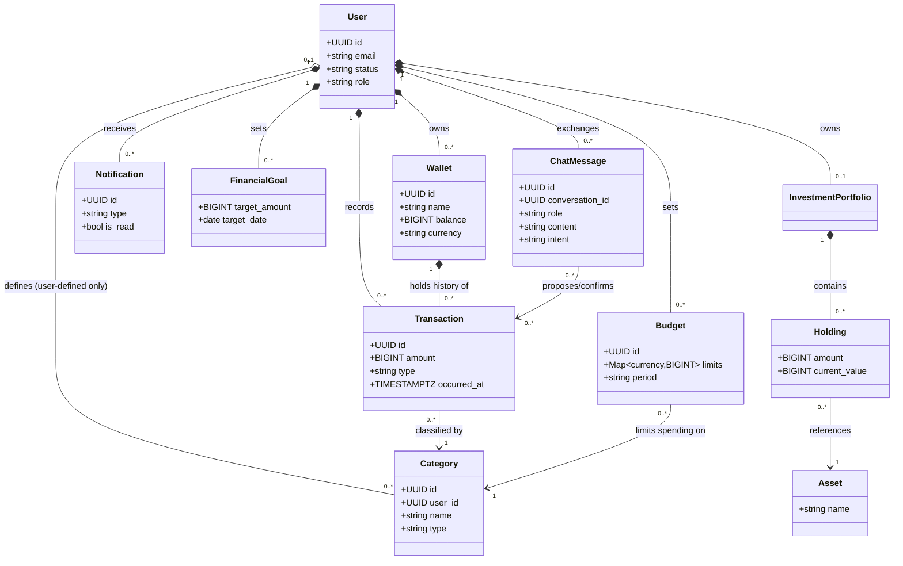

Personal Finance Management

Software Design Specification (SDS)

**Table of Contents**

- [1. Introduction – Personal Finance Management](#1-introduction-personal-finance-management)
  - [1. Purpose](#1-purpose)
  - [2. Scope](#2-scope)
  - [3. Assumptions and Constraints](#3-assumptions-and-constraints)
    - [1. Assumptions](#1-assumptions)
    - [2. Constraints](#2-constraints)
    - [3. Definitions and Acronyms](#3-definitions-and-acronyms)
- [2. Domain Model](#2-domain-model)
  - [1. Domain Objects](#1-domain-objects)
    - [1. User](#1-user)
    - [2. Wallet](#2-wallet)
    - [3. Category](#3-category)
    - [4. Budget](#4-budget)
    - [5. Transaction](#5-transaction)
    - [6. FinancialGoal](#6-financialgoal)
    - [7. InvestmentPortfolio](#7-investmentportfolio)
    - [8. Asset](#8-asset)
    - [9. Holding](#9-holding)
    - [10. Notification](#10-notification)
    - [11. ChatMessage](#11-chatmessage)
  - [2. Domain Object Relationships](#2-domain-object-relationships)
- [3. UI Design](#3-ui-design)
  - [1. Wireframe](#1-wireframe)
  - [2. UI/UX Principles](#2-uiux-principles)
- [4. Architecture Design](#4-architecture-design)
  - [1. System Context](#1-system-context)
  - [2. Logical View](#2-logical-view)
  - [3. Development View](#3-development-view)
    - [1. System Architecture](#1-system-architecture)
    - [2. Data Design](#2-data-design)
  - [4. Process View](#4-process-view)
  - [5. Physical View](#5-physical-view)
  - [6. Key Scenarios (Scenario View +1)](#6-key-scenarios-scenario-view-1)
  - [7. Architecture Principles](#7-architecture-principles)
- [5. Product Features & User Story Specification](#5-product-features-user-story-specification)
  - [1. Feature-01: User Management](#1-feature-01-user-management)
    - [1. US-01-01: Register a User](#1-us-01-01-register-a-user)
  - [2. Feature-02: System Security](#2-feature-02-system-security)
    - [1. US-02-01: Login](#1-us-02-01-login)
    - [2. US-02-02: Logout](#2-us-02-02-logout)
  - [3. Feature-03: Wallet Management](#3-feature-03-wallet-management)
    - [1. US-03-01: Create a Wallet](#1-us-03-01-create-a-wallet)
  - [4. Feature-04: Category Management](#4-feature-04-category-management)
    - [1. US-04-01: Create a Category](#1-us-04-01-create-a-category)
  - [5. Feature-05: Budget Management](#5-feature-05-budget-management)
    - [1. US-05-01: Create a Budget for a Category](#1-us-05-01-create-a-budget-for-a-category)
  - [6. Feature-06: Transaction Management](#6-feature-06-transaction-management)
    - [1. US-06-01: Create a Transaction for a Wallet](#1-us-06-01-create-a-transaction-for-a-wallet)
  - [7. Feature-07: Financial Reporting](#7-feature-07-financial-reporting)
  - [8. Feature-08: Financial Goal](#8-feature-08-financial-goal)
  - [9. Feature-09: Investment Portfolio](#9-feature-09-investment-portfolio)
  - [10. Feature-10: Notification Handling](#10-feature-10-notification-handling)
  - [11. Feature-11: Data Overview Dashboard](#11-feature-11-data-overview-dashboard)
  - [12. Feature-12: AI Chat Assistant](#12-feature-12-ai-chat-assistant)
    - [1. US-12-01: Create a Transaction via Chat](#1-us-12-01-create-a-transaction-via-chat)
- [6. API Design](#6-api-design)
  - [1. API Design Standards](#1-api-design-standards)
  - [2. API Index](#2-api-index)
  - [3. API Specification](#3-api-specification)
    - [1. `POST /wallets`](#1-post-wallets)
    - [2. `GET /wallets`](#2-get-wallets)
    - [3. `GET /wallets/{id}`](#3-get-walletsid)
    - [4. `POST /categories`](#4-post-categories)
    - [5. `POST /budgets`](#5-post-budgets)
    - [6. `POST /transactions`](#6-post-transactions)
    - [7. `PUT /transactions/{id}`](#7-put-transactionsid)
    - [8. `POST /ai/chat`](#8-post-aichat)
  - [4. API  → User Story Traceability](#4-api-user-story-traceability)
- [7. Security Design](#7-security-design)
  - [1. Authentication](#1-authentication)
  - [2. Authorization](#2-authorization)
  - [3. Threat Modeling](#3-threat-modeling)
- [8. Non-Functional Requirements](#8-non-functional-requirements)
- [9. Design Decisions and Trade-offs](#9-design-decisions-and-trade-offs)
- [10. Product Metrics](#10-product-metrics)
  - [1. Purpose](#1-purpose-1)
  - [2. Metric Categories](#2-metric-categories)
  - [3. Core Metrics for PFM](#3-core-metrics-for-pfm)
    - [1. Adoption and Engagement Metrics](#1-adoption-and-engagement-metrics)
    - [2. Financial Behavior Improvement Metrics](#2-financial-behavior-improvement-metrics)
    - [3. Operational Quality Metrics](#3-operational-quality-metrics)
    - [4. Notification and Awareness Metrics](#4-notification-and-awareness-metrics)
  - [4. MVP Metric Measurement Scope](#4-mvp-metric-measurement-scope)
  - [5. Privacy and Ethics Considerations](#5-privacy-and-ethics-considerations)
- [11. Future Enhancements](#11-future-enhancements)
- [12. Appendix](#12-appendix)
  - [1. Known Issues Log](#1-known-issues-log)

# 1. Introduction – Personal Finance Management {#1-introduction-personal-finance-management}

## 1. Purpose {#1-purpose}

This document defines the **Software Design Specification (SDS)** for the **Personal Finance Management (PFM)** system.

The purpose of this document is to describe how the PFM product is designed to satisfy the requirements defined in the [**SRS**](https://docs.google.com/document/d/17SbJrDvMbExf3JNQmrE2PKiCSbllqY6OwsuPQWeloNo/edit?tab=t.0), following structures and practices commonly used in real-world software projects.

## 2. Scope {#2-scope}

This SDS describes the design of the PFM product as a whole, independent of a specific release. The design is intended to evolve across multiple releases.  
**Within the KPITAI course**, learners will implement an MVP subset of this design for learning purposes, while the SDS remains the reference design for future extensions.

## 3. Assumptions and Constraints {#3-assumptions-and-constraints}

### 1. Assumptions {#1-assumptions}

* Users manually input personal financial data.  
* The system is initially implemented as a Monolith.  
* The design supports incremental growth across releases.

### 2. Constraints {#2-constraints}

* External banking integrations are not required in early releases.  
* Implementation code is not included in this document.

### 3. Definitions and Acronyms {#3-definitions-and-acronyms}

* SDS – Software Design Specification  
* SRS – Software Requirements Specification  
* PFM – Personal Finance Management  
* US – User Story  
* API – Application Programming Interface

# 2. Domain Model {#2-domain-model}

This section describes the core business concepts of the PFM domain and their relationships, independent of technical implementation.

Domain objects are grouped by delivery phase, per the [Feature-level Release table in the SRS](SRS.md#feature-level-release-overview) and the [MVP Features table in CLAUDE.md](CLAUDE.md#mvp-features):

| Phase | Domain Objects |
| --- | --- |
| **Phase 0** (current scope — see [docs/features.md](docs/features.md)) | User |
| **MVP** | Wallet, Category, Budget, Transaction, Notification |
| **Release 1** | FinancialGoal, ChatMessage |
| **Release 2** | InvestmentPortfolio, Asset, Holding |

## 1. Domain Objects {#1-domain-objects}

### 1. User {#1-user}

Represents an account holder. Created via admin invite — no self-registration (see [docs/features.md](docs/features.md) Feature-01). Owns essentially every other domain object: each Wallet, user-defined Category, Budget, Transaction, Notification, FinancialGoal, and InvestmentPortfolio belongs to exactly one User.

Key attributes: `id`, `email`, `full_name`, `password_hash`, `status` (pending/active/disabled), `role` (admin/member), `invited_by`, `invite_token`, `invite_expires_at`, `activated_at`.

### 2. Wallet {#2-wallet}

A source or destination of money (cash, bank account, e-wallet). All Transactions are recorded against a Wallet, and its `balance` is updated atomically with every Transaction insert (same DB transaction — CLAUDE.md).

Key attributes: `id`, `user_id`, `name`, `type`, `balance` (BIGINT, integer cents), `currency`, `is_default`, `icon` *(planned)*, `icon_url` *(planned)*. The last two mirror Category's icon/photo pattern (§2.1.3) for visual recognition in the Wallet list — not yet implemented; see §12.1 Known Issues Log, Item 3.

### 3. Category {#3-category}

Classifies Transactions for budgeting and reporting (e.g. Food, Salary). May be **system-defined** (`user_id IS NULL`, shared across all Users) or **user-defined** (`user_id` set, private to that User).

Key attributes: `id`, `user_id` (nullable), `name`, `icon`, `icon_url`, `type` (income/expense). `icon` is a free-text emoji/short label; `icon_url` is an uploaded photo (`POST /categories/icon`) and takes display precedence over `icon` when both are set — see §12.1 Known Issues Log for the current rollout status of this capability.

### 4. Budget {#4-budget}

A spending limit a User sets for a Category within a period (e.g. monthly), tracked across **all** of the User's Wallets for that Category (not scoped to a single Wallet — see resolution below). The System tracks actual spend — computed from Transactions in that Category — against the Budget's per-currency limits.

Key attributes: `id`, `user_id`, `category_id`, `limits` (a non-empty set of `(currency, amount_limit)` pairs, at most one entry per currency, each `amount_limit` a BIGINT), `period`, `start_date`, `icon` *(planned)*, `icon_url` *(planned)*. The last two let a Budget's own visual identity diverge from its Category's, for the Budget list (mobile `insights.tsx`) — not yet implemented; see §12.1 Known Issues Log, Item 3.

> **Resolved** (was previously an open question): SRS (Feature-05, BF-01 step 5) originally framed a Budget as scoped to *both* a Wallet and a Category. BA clarification (see `specs/budget-management/spec.md`) settled this as **Category-only, aggregated across all Wallets** — the better product model for a personal-finance budgeting feature, not just the path of least schema change. `SRS.md` BF-01/BF-04 wording has been updated to match. A direct consequence of dropping the Wallet scope is that a Category's Transactions can span Wallets of different currencies, so a Budget can no longer hold one blended `amount_limit` — it instead holds independent per-currency limits, each tracked (spent/remaining/status) separately; a currency with real spend but no corresponding limit entry is simply not tracked by that Budget. See `specs/budget-management/spec.md` for full detail.

### 5. Transaction {#5-transaction}

A single income or expense event. Always belongs to exactly one Wallet and one Category, and to the User who owns that Wallet.

Key attributes: `id`, `user_id`, `wallet_id`, `category_id`, `amount` (BIGINT), `type` (income/expense), `note`, `occurred_at`.

### 6. FinancialGoal {#6-financialgoal} *(Release 1)*

A savings target a User defines (e.g. emergency fund, travel). Tracks progress toward a target amount by a target time frame, based on recorded Transactions/allocations (SRS FR-05, BF-06).

### 7. InvestmentPortfolio {#7-investmentportfolio} *(Release 2)*

A single portfolio per User ("Investment Index" — SRS Feature-09) that aggregates all of that User's Holdings for a high-level performance view.

### 8. Asset {#8-asset} *(Release 2)*

A reference definition of something investable (e.g. a stock ticker, a fund). Exists independently of any User or Portfolio — shared reference data, analogous to a system Category.

### 9. Holding {#9-holding} *(Release 2)*

A position of a specific Asset held inside a User's InvestmentPortfolio, with an amount and current value (SRS FR-06).

### 10. Notification {#10-notification}

A system-generated message to a User (e.g. budget limit reached). Read-only from the User's perspective except for `is_read` toggling (Feature-10).

Key attributes: `id`, `user_id`, `type`, `title`, `body`, `is_read`, `created_at`.

### 11. ChatMessage {#11-chatmessage} *(Release 1)*

A single message exchanged between a User and the AI Chat Assistant (SRS Feature-12), either from the User or the assistant. When a message results in a created/updated Transaction, it links back to the affected Transaction(s) for audit/traceability — the AI never writes to the database directly; it only proposes actions that a User must confirm through the standard Transaction Management flow (FR-02).

Key attributes: `id`, `user_id`, `conversation_id`, `role` (user/assistant), `content`, `intent`, `transaction_ids` (nullable array, set once confirmed), `created_at`.

> **Schema note:** realizing this feature also requires two small additions to existing MVP tables, not new domain concepts: (1) `categories.description` (nullable) so the AI can disambiguate between similarly-named Categories, and (2) an idempotency mechanism for `POST /transactions` (e.g. a unique `idempotency_key` column or a dedicated keys table) so a duplicate confirm-tap from the chat UI cannot create a duplicate Transaction. Exact shape to be finalized at `/cook-plan` time.

## 2. Domain Object Relationships {#2-domain-object-relationships}

**Conceptual Data Model (CDM)** — composition (`*--`, filled diamond) marks a part with no meaning or lifecycle outside its whole; aggregation (`o--`, hollow diamond) marks a part that can exist independently of the whole; a plain association (`-->`) marks a reference/classification link with no ownership semantics.

**Relationship summary**

| # | From | Relationship | To | Cardinality | Type | Rationale |
| --- | --- | --- | --- | --- | --- | --- |
| 1 | User | owns | Wallet | 1 : 0..* | Composition | A Wallet has no meaning without its owning User; `wallets.user_id` is mandatory |
| 2 | User | records | Transaction | 1 : 0..* | Composition | Every Transaction belongs to exactly one User |
| 3 | User | receives | Notification | 1 : 0..* | Composition | Notifications are generated for and owned by one User |
| 4 | User | sets | Budget | 1 : 0..* | Composition | Budgets are per-User spending limits |
| 5 | User | defines | Category | 0..1 : 0..* | Aggregation | System Categories exist with `user_id = NULL` — independent of any User |
| 6 | User | sets | FinancialGoal | 1 : 0..* | Composition | Goal has no meaning outside its owning User (Release 1) |
| 7 | User | owns | InvestmentPortfolio | 1 : 0..1 | Composition | Exactly one Portfolio per User, per SDS Feature-09 (Release 2) |
| 8 | Wallet | holds history of | Transaction | 1 : 0..* | Composition | Transaction requires a Wallet (`wallet_id` mandatory); balance update and insert are atomic |
| 9 | Category | classifies | Transaction | 1 : 0..* | Association | Category is reusable reference data, not owned by any single Transaction |
| 10 | Category | limits | Budget | 1 : 0..* | Association | Budget references a Category to track against |
| 11 | InvestmentPortfolio | contains | Holding | 1 : 0..* | Composition | A Holding has no meaning outside its Portfolio (Release 2) |
| 12 | Asset | referenced by | Holding | 1 : 0..* | Association | Asset is shared reference data across all Portfolios (Release 2) |
| 13 | User | exchanges | ChatMessage | 1 : 0..* | Composition | A ChatMessage has no meaning outside its owning User's conversation (Release 1) |
| 14 | ChatMessage | proposes/confirms | Transaction | 0..* : 0..* | Association | A ChatMessage may reference the Transaction(s) it created or edited, once User-confirmed; the AI never persists a Transaction on its own |

Note: derived figures such as Wallet `balance` or Budget "spent so far" are **computed from Transactions**, not separate stored relationships — they are covered by rows 8–9 above, not modeled as their own line.

# 3. UI Design {#3-ui-design}

## 1. Wireframe {#1-wireframe}

## 2. UI/UX Principles {#2-uiux-principles}

* **Keyboard-safe forms** — whichever field a User is actively typing into must stay visible above the on-screen keyboard, on both iOS and Android, in every bottom-sheet form (Wallet/Category/Budget/Transaction — all built on the shared `Drawer` component). Do not reach for `KeyboardAvoidingView` or a wrapping third-party scroll library by default: the project already hit and worked around a confirmed Android bug where `KeyboardAvoidingView`'s `height` behavior fails to restore layout after the keyboard closes (facebook/react-native#22884), and replaced it with a custom `useKeyboardHeight()` hook (`mobile/src/lib/use-keyboard-height.ts`) already used by the AI Chat screen. New keyboard-safety work should extend that hook's usage (e.g. into `Drawer.tsx`) rather than introduce a second, inconsistent approach — see §12.1 Known Issues Log, Item 2.
* **Consistent icon/photo picking** — any entity that supports a visual icon (Category today; Wallet and Budget planned) should reuse the same interaction pattern established by `CategoryFormModal.tsx`: an `Avatar` preview, an immediate upload-on-pick via `expo-image-picker` (not deferred to form submit), and a free-text emoji fallback used only when no uploaded photo is set.

# 4. Architecture Design {#4-architecture-design}

This chapter describes **the system architecture** using **multiple architectural views**, a common industry practice to ensure different stakeholders can understand the system from different perspectives.

This SDS explicitly uses:

* **C4 Model** to visualize system structure at different levels  
* **“4+1 Views” Model** to organize architectural views

The following tools are recommended to create and maintain architectural diagrams:

* **draw.io** (diagrams.net) – supports all “4+1 Views” and C4 diagrams using free-form notation  
* **PlantUML** – for text-based diagrams and version control

## 1. System Context {#1-system-context}

(**C4 Model – System Context Diagram**)

The PFM provides personal finance management capabilities to individual users.

* Primary actors: End Users  
* External systems: None (initially)

This view defines the system boundary and its interaction with external actors.

## 2. Logical View {#2-logical-view}

(**“4+1 Views” Model – Logical View**)

At a logical level, the PFM system consists of the following major functional areas:

* User Management  
* System Security  
* Wallet Management  
* Category Management  
* Budget Management  
* Transaction Management  
* Financial Reporting  
* Notification Handling

This view focuses on responsibilities and separation of concerns, not implementation details.

## 3. Development View {#3-development-view}

(**“4+1 Views” Model – Development View**)

### 1. System Architecture {#1-system-architecture}

The system is organized using a **3-Layer Architecture**: 

**Controller → Service → Repository (DAO)**

Technology Stack

* **POC**: Flet/PyQt6 - Python - CSV  
* **MVP**: React - DRF - Django ORM - SQLite  
* **Releases**: TBD

Suggested code organization:

* controller  
* service  
* repository  
* model  
* dto  
* security  
* common

This view supports maintainability and team collaboration.

### 2. Data Design {#2-data-design}

**Data Integrity Rules**

This section defines business rules and constraints derived from the domain model.

* AI Chat Assistant (Feature-12): the AI Service never writes to the database directly. Every AI-proposed `create_transaction` / `edit_transaction` action is a **suggestion only**; it becomes a real write exclusively through the standard `POST /transactions` / `PUT /transactions/{id}` endpoints, after explicit User confirmation.  
* Any Wallet/Category ID returned by the AI Service must be **re-validated for ownership** by the Backend before use — the AI Service is untrusted input with respect to authorization, even though it runs on the internal Docker network (see §7 Security Design).

**Database Design**

This section maps the Domain Model to the physical Database Structure.

## 4. Process View {#4-process-view}

(**“4+1 Views” Model – Process View**)

Typical runtime behavior:

* Controller receives request  
* Service applies business rules  
* Repository accesses data  
* Response is returned to the UI

Concurrency and performance optimizations may be introduced in later releases.

## 5. Physical View {#5-physical-view}

(**“4+1 Views” Model – Physical View**)

Initial deployment:

* Single application instance  
* Single database  
* Separate development and production environments

This view may evolve as scalability requirements grow.

## 6. Key Scenarios (Scenario View +1) {#6-key-scenarios-scenario-view-1}

Key scenarios are used to validate that the system architecture can support real business needs.

Each scenario corresponds to a User Story defined in Chapter 5.

These scenarios represent the Scenarios (+1 View) of the “4+1 Views” Model.

**Scenario Index** 

| Scenario ID | Feature | User Story | MVP | Notes |
| ----- | ----- | ----- | :---: | ----- |
| S-URM-01 | Feature-01: User Management | **US-01-01 Register a User** | ✔ | Entry point for new users |
| S-SEC-01 | Feature-02: System Security | **US-02-01 Login** | ✔ | Required before protected actions |
| S-WAL-01 | Feature-03: Wallet Management | **US-03-01 Create a Wallet** | ✔ | Core financial container |
| S-CAT-01 | Feature-04: Category Management | **US-04-01 Create a Category** | ✔ | Used by transactions |
| S-BUD-01 | Feature-05: Budget Management | **US-05-01 Create a Budget for a Category** | ✔ | Spending control |
| S-TRX-01 | Feature-06: Transaction Management | **US-06-01 Create a Transaction for a Wallet** | ✔ | Primary core scenario |
| S-RPT-01 | Feature-07: Financial Reporting | **US-07-01 View the Summary Report** | ✔ | Insight & feedback loop |
| S-NOT-01 | Feature-10: Notification Handling | **US-10-01 View the list of Notifications** | ✔ | User awareness |
| S-CHAT-01 | Feature-12: AI Chat Assistant | **US-12-01 Create a Transaction via Chat** |  | Reuses Transaction Management write path; Release 1 |

## 7. Architecture Principles {#7-architecture-principles}

* Keep domain pure  
* Secure by default  
* API-first  
* Data consistency first  
* Fail-safe  
* Idempotency for finance ops  
* Observability ready  
* Logs are first-class signals

  # 

# 5. Product Features & User Story Specification {#5-product-features-user-story-specification}

This chapter provides build-ready design details per Feature and User Story, aligned with the [SRS](https://docs.google.com/document/d/17SbJrDvMbExf3JNQmrE2PKiCSbllqY6OwsuPQWeloNo/edit?tab=t.0).

## 1. Feature-01: User Management {#1-feature-01-user-management}

### 1. US-01-01: Register a User {#1-us-01-01-register-a-user}

      ## 

## 2. Feature-02: System Security {#2-feature-02-system-security}

### 1. US-02-01: Login {#1-us-02-01-login}

### 2. US-02-02: Logout {#2-us-02-02-logout}

      ## 

## 3. Feature-03: Wallet Management {#3-feature-03-wallet-management}

### 1. US-03-01: Create a Wallet {#1-us-03-01-create-a-wallet}

## 4. Feature-04: Category Management {#4-feature-04-category-management}

### 1. US-04-01: Create a Category {#1-us-04-01-create-a-category}

## 5. Feature-05: Budget Management {#5-feature-05-budget-management}

### 1. US-05-01: Create a Budget for a Category {#1-us-05-01-create-a-budget-for-a-category}

## 6. Feature-06: Transaction Management {#6-feature-06-transaction-management}

### 1. US-06-01: Create a Transaction for a Wallet {#1-us-06-01-create-a-transaction-for-a-wallet}

**Goal:** Allow an authenticated User to create an income or expense Transaction for a Wallet they own.

**Preconditions**: 

* User is authenticated.  
* Wallet exists and belongs to the user.

**Layers Involved**:

* TransactionController  
* TransactionService  
* TransactionRepository  
* WalletRepository  
* CategoryRepository (optional)  
* Budget / Notification logic (optional)

**APIs Involved:** 

Endpoint: `POST /transactions`

Success Response

* transaction_id  
* status  
* message

Error Responses

* 400 INVALID_INPUT  
* 403 WALLET_ACCESS_DENIED  
* 404 WALLET_NOT_FOUND

Main Flow

* Controller receives request and validates input.  
* Service validates wallet ownership.  
* Service creates a Transaction.  
* Repository persists data transactionally.  
* Optional: budget update and notification trigger.  
* Controller returns a response.

## 7. Feature-07: Financial Reporting {#7-feature-07-financial-reporting}

## 8. Feature-08: Financial Goal {#8-feature-08-financial-goal}

## 9. Feature-09: Investment Portfolio {#9-feature-09-investment-portfolio}

## 10. Feature-10: Notification Handling {#10-feature-10-notification-handling}

## 11. Feature-11: Data Overview Dashboard {#11-feature-11-data-overview-dashboard}

## 12. Feature-12: AI Chat Assistant {#12-feature-12-ai-chat-assistant}

### 1. US-12-01: Create a Transaction via Chat {#1-us-12-01-create-a-transaction-via-chat}

**Goal:** Allow an authenticated User to create one or more Transactions by sending a natural-language chat message, with explicit confirmation before any write.

**Preconditions**:

* User is authenticated.  
* User has at least one Wallet (a default Wallet is used when the message does not name one).

**Client:** implemented on both `frontend/` (web) and `mobile/` (React Native, `app/(app)/ai-chat.tsx` + `src/features/ai-chat/`) — mobile reached feature parity with web for this flow as of the `455bfb1`→`fe4f6cc` commit range (see `docs/architecture.md` §3).

**Layers Involved**:

* ChatHandler → ChatService (Go Backend)  
* WalletRepository, CategoryRepository (context injection: the User's own Wallets/Categories, never another User's)  
* AI Service client (internal REST call to Python AI Service, per CLAUDE.md architecture — reuses the existing Groq-primary/Anthropic-fallback client, no new provider)  
* TransactionRepository (only invoked after User confirmation, via the existing `POST /transactions` flow)

**APIs Involved:**

Endpoint: `POST /ai/chat`

Success Response

* message (assistant reply, Vietnamese)  
* intent (`create_transaction` | `edit_transaction` | `query_spending` | `general_advice` | `ambiguous`)  
* actions[] — proposed Transaction payload(s), each with a pre-generated idempotency key and a confidence score; empty for query/advice/ambiguous intents

Error Responses

* 400 INVALID_INPUT  
* 502 AI_SERVICE_UNAVAILABLE (Groq/Anthropic both failing — return a retryable error, do not crash)

Main Flow

* Controller receives the message and validates input.  
* Service loads the User's own Wallets and Categories as context.  
* Service calls the AI Service, which returns a structured intent + proposed action(s).  
* Service **re-validates that every Wallet/Category ID in the response belongs to the requesting User** before returning it to the client — the AI Service is treated as untrusted input for authorization purposes (see §7 Security Design).  
* For `create_transaction` / `edit_transaction`, the client renders a confirmation card; nothing is persisted until the User confirms.  
* On confirmation, the client calls the existing `POST /transactions` (or `PUT /transactions/{id}`) endpoint, using the pre-generated idempotency key to guard against duplicate confirms.

   # 

# 6. API Design {#6-api-design}

## 1. API Design Standards {#1-api-design-standards}

* REST-style APIs  
* Naming convention  
* Authentication style  
* Versioning /api/v1  
* Pagination  
* JSON request/response  
* Standard error structure:  
  * error_code  
  * message  
  * details (optional)
* **Framework-level routing errors must keep their real status** — a 404 for an unmatched route or a 405 for a mismatched HTTP verb (both raised by Fiber itself, before any handler runs) must be surfaced to the client with that real status and a matching `error_code` (e.g. `NOT_FOUND`, `METHOD_NOT_ALLOWED`), never coerced into a generic `500 INTERNAL_ERROR`. See §12.1 Known Issues Log, Items 1 & 4 for the confirmed bug this corrects (`backend/internal/response/response.go`'s `Error()` only special-cases `*common.AppError`; everything else — including Fiber's own `*fiber.Error`s — falls through to a blanket `INTERNAL_ERROR`, hiding the real cause from both the client and the logs).

## 2. API Index {#2-api-index}

| API ID | Endpoint | Feature |
| ----- | ----- | ----- |
| API-WAL-01 | `POST /wallets` | Wallet Management |
| API-WAL-02 | `GET /wallets` | Wallet Management |
| API-WAL-03 | `GET /wallets/{id}` | Wallet Management |
| API-TRX-01 | `POST /transactions` | Transaction Management |
| API-TRX-02 | `GET /transactions` | Transaction Management |
| API-TRX-03 | `GET /transactions/{id}` | Transaction Management |
| API-TRX-04 | `PUT /transactions/{id}` | Transaction Management |
| API-CHAT-01 | `POST /ai/chat` | AI Chat Assistant |

## 3. API Specification {#3-api-specification}

### 1. `POST /wallets` {#1-post-wallets}

### 2. `GET /wallets` {#2-get-wallets}

### 3. `GET /wallets/{id}` {#3-get-walletsid}

### 4. `POST /categories` {#4-post-categories}

### 5. `POST /budgets` {#5-post-budgets}

### 6. `POST /transactions` {#6-post-transactions}

| Main Flow | Success Response | Error Responses |
| ----- | ----- | ----- |
| Controller receives request and validates input. Service validates wallet ownership. Service creates a Transaction. Repository persists data transactionally. Optional: budget update and notification trigger. Controller returns a response.  | transaction_id status message | 400:  INVALID_INPUT 403:  WALLET_ACCESS_DENIED 404:  WALLET_NOT_FOUND  |

### 7. `PUT /transactions/{id}` {#7-put-transactionsid}

| Main Flow | Success Response | Error Responses |
| ----- | ----- | ----- |
| Controller receives request and validates input. Service validates the Transaction belongs to the requesting User. Service applies the update and re-adjusts the Wallet balance in the same DB transaction. Controller returns a response. | transaction_id status message | 400: INVALID_INPUT 403: WALLET_ACCESS_DENIED 404: TRANSACTION_NOT_FOUND |

### 8. `POST /ai/chat` {#8-post-aichat}

| Main Flow | Success Response | Error Responses |
| ----- | ----- | ----- |
| Controller receives message and validates input. Service loads the User's own Wallets/Categories as context, calls the AI Service, then re-validates ownership of every ID the AI Service returns before responding. No Transaction is written by this endpoint. | message intent actions[] | 400: INVALID_INPUT 502: AI_SERVICE_UNAVAILABLE |

## 4. API  → User Story Traceability {#4-api-user-story-traceability}

| API | Feature | US |
| ----- | ----- | ----- |
| `POST /wallets` | Wallet Management | US-03-01 |
| `PUT /transactions/{id}` | Transaction Management | US-12-02 (AI Chat edit flow) |
| `POST /ai/chat` | AI Chat Assistant | US-12-01, US-12-02, US-12-03 |
| `POST /transactions` | Transaction Management | US-06-01 |

# 7. Security Design {#7-security-design}

## 1. Authentication {#1-authentication}

All protected APIs require authenticated user context.

## 2. Authorization {#2-authorization}

Users can only access data they own, for example: Wallet, Transaction, Category...

For AI Chat Assistant (Feature-12): the AI Service is treated as **untrusted input** with respect to authorization, even though it runs on the internal Docker network — the Go Backend must re-validate that every Wallet/Category ID the AI Service returns actually belongs to the requesting User before it is shown to the client or used in any write.

## 3. Threat Modeling {#3-threat-modeling}

* **AI hallucinated ownership** — the AI Service could return a Wallet/Category ID belonging to a different User (model error, not necessarily malicious). Mitigated by mandatory ownership re-validation in `ChatService` before the response leaves the Backend (see §6.3 `POST /ai/chat`).  
* **Duplicate transaction from double-confirm** — a repeated tap on the chat confirmation card must not create two Transactions. Mitigated by an idempotency key pre-generated per proposed action (see Domain Model §11 ChatMessage, schema note).  
* **AI Service unavailability** — Groq/Anthropic outage must degrade to a clear retryable error on `POST /ai/chat`, never a crash or a silently-dropped write.

   # 

# 8. Non-Functional Requirements {#8-non-functional-requirements}

| No. | NFR | Design Approach |
| :---: | ----- | ----- |
| 1 | **Performance** | Indexed queries |
| 2 | **Availability** | Single-instance initially |
| 3 | **Scalability** | Clean layering |
| 4 | **Security** | Auth + ownership checks |
| 5 | **Privacy** | User data isolation |
| 6 | **Reliability** | Transactional writes |

   # 

# 9. Design Decisions and Trade-offs {#9-design-decisions-and-trade-offs}

* Monolith chosen for early simplicity and clarity.  
* Design allows future evolution without rewriting fundamentals.  
* AI Chat Assistant (Feature-12) reuses the existing AI Service (Python/FastAPI, Groq SDK primary + Anthropic SDK fallback per CLAUDE.md tech stack) — no new LLM provider or client is introduced. Complexity-based model routing within the AI Service (e.g. a fast/cheap model for simple single-item extraction vs. a stronger model for multi-item or edit/query intents) is an AI Service implementation detail to be finalized at `/cook-plan` time, not a fixed choice baked into this SDS.  
* Client surface for Feature-12 was `frontend/` (web) first, matching the project's original implementation priority; `mobile/` (React Native, not Flutter — rebuilt 2026-08-16) has since shipped its own AI Chat screen and reached feature parity for this flow.

  # 

# 10. Product Metrics {#10-product-metrics}

## 1. Purpose {#1-purpose-1}

**Product Metrics** define how the success and effectiveness of the PFM product are measured during real-world usage. 

These metrics help stakeholders evaluate whether the product is delivering user value, supporting financial behavior change, and operating reliably over time. 

Metrics are collected and monitored across releases to support data-driven product decisions and continuous improvement.

Metrics are **non-functional outcomes** and are independent of any specific feature implementation.

## 2. Metric Categories {#2-metric-categories}

The PFM product adopts four main categories of product metrics:

1. **Adoption & Engagement Metrics**  
    Measure how users adopt and actively use the system.  
2. **Financial Behavior Metrics**  
    Measure whether users achieve better financial management outcomes through the product.  
3. **Operational Quality Metrics**  
    Measure reliability and stability of the system.  
4. **Notification & Awareness Metrics**  
    Measure whether system signals effectively reach the user.

Each metric includes a definition and a measurement scope.

## 3. Core Metrics for PFM {#3-core-metrics-for-pfm}

### 1. Adoption and Engagement Metrics {#1-adoption-and-engagement-metrics}

| Metric | Description |
| ----- | ----- |
| **MAU – Monthly Active Users** | Number of distinct users performing at least one meaningful financial action per month (e.g., add transaction, create wallet, edit budget). |
| **DAU/MAU Ratio** | Measures product stickiness and recurring behavior. |
| **Retention Rate (D30)** | Percentage of users still active 30 days after registration. |
| **Average Transactions per Active User per Month** | Indicates depth of usage. |
| **Report Views per User** | Measures engagement with insight-driven features. |

### 2. Financial Behavior Improvement Metrics {#2-financial-behavior-improvement-metrics}

| Metric | Description |
| ----- | ----- |
| **Budget Compliance Rate** | % of months where spending stays within configured budgets. |
| **Savings Goal Success Rate** | % of users achieving at least one Financial Goal. |
| **Recurring Expense Capture Rate** | % of recurring expenses logged in the system. |
| **Expense Categorization Coverage** | % of transactions categorized. |
| **Net Savings Change Trend** | Average increase/decrease in net savings over time (self-reported). |

These metrics reflect **behavioral outcome**, not financial advice.

### 3. Operational Quality Metrics {#3-operational-quality-metrics}

| Metric | Description |
| ----- | ----- |
| **System Availability** | % uptime measured monthly. |
| **Failed Transaction Write Rate** | % API requests to `/transactions` resulting in error. |
| **Average API Response Time** | End-to-end latency for core operations. |
| **Data Consistency Incidents** | Number of cases where balance or totals are incorrect. |
| **Backup Success Rate** | % successful backup cycles. |

### 4. Notification and Awareness Metrics {#4-notification-and-awareness-metrics}

| Metric | Description |
| ----- | ----- |
| **Notification Delivery Success Rate** | % notifications successfully delivered. |
| **Notification Open/Interaction Rate** | % users opening or viewing notifications. |
| **Critical Alert Acknowledgement Rate** | % of high-priority alerts acknowledged. |

## 4. MVP Metric Measurement Scope {#4-mvp-metric-measurement-scope}

During MVP, only lightweight metrics may be collected, such as:

* Active user counts  
* Transaction activity volume  
* Report view counts  
* System availability

Advanced financial-behavior metrics may be introduced in later releases.

## 5. Privacy and Ethics Considerations {#5-privacy-and-ethics-considerations}

* Metrics are stored and processed **anonymously or pseudonymously**.  
* No financial advice inference is performed.  
* Users maintain full ownership of financial data.  
* Metrics collection follows applicable privacy policies.

# 11. Future Enhancements {#11-future-enhancements}

* Recurring transactions  
* Advanced analytics  
* Migration to microservices when required

# 12. Appendix {#12-appendix}

* Architecture diagrams (draw.io)  
* Optional PlantUML definitions

## 1. Known Issues Log {#1-known-issues-log}

Dated entries for defects/gaps reported from real usage, with confirmed root cause (via code inspection, not assumption) and the resulting design implication captured elsewhere in this document. Kept here rather than deleted so the reasoning survives past the fix.

### 2026-08-21 — Category icon upload, Drawer keyboard behavior, Wallet/Budget icons, account-activation link

**1. Category icon upload returned 405 on production**
Mobile's `CategoryFormModal.tsx` showed a generic "unexpected error occurred"; the VPS backend log showed `405 Method Not Allowed` for `POST /api/v1/categories/icon`.
*Root cause (confirmed):* the route `categories.Post("/icon", categoryHandler.UploadIcon)` (`backend/cmd/server/routes.go:55`) and the full mobile upload flow (`useUploadCategoryIconMutation`, `expo-image-picker`, `Avatar` preview, replace via "Change photo") already exist in code as of commit `fe4f6cc`. A 405 on this exact path is Fiber's signature for "path matches an existing route shape (`/:id`) for other verbs (GET/PATCH/DELETE) but not for POST" — meaning **the deployed VPS backend predates `fe4f6cc` and has not been redeployed.** This is a deployment gap, not a missing feature.
*Compounding bug (confirmed, real fix needed):* see the API Design Standards note in §6.1 — the global error handler coerces this 405 (and any other Fiber-level routing error) into a generic `500 INTERNAL_ERROR`, which is the message the User actually saw. **Action:** (a) CI/CD (`.github/workflows/deploy-backend.yml`) already auto-builds and deploys the backend to the VPS on every push to `develop` that touches `backend/**` — check that workflow's run history for `fe4f6cc` (or the current `HEAD`) before assuming a manual redeploy is needed; if the run failed or never fired, fix that first, otherwise trigger it via `workflow_dispatch`; (b) fix `response.Error` to preserve real routing-error statuses (§6.1).

**2. On-screen keyboard covers the focused input in bottom-sheet forms**
In the shared `Drawer` component (`mobile/src/components/shared/Drawer.tsx`, used by every Wallet/Category/Budget/Transaction form), a focused `TextInput` can end up hidden behind the keyboard with nothing visibly scrolled into view.
*Root cause (confirmed):* `Drawer.tsx` wraps its children in a plain `ScrollView` with no keyboard-avoidance logic at all — not `KeyboardAvoidingView`, not the project's own keyboard-height hook, nothing. The project already solved an equivalent problem for the AI Chat screen with a **custom `useKeyboardHeight()` hook** (`mobile/src/lib/use-keyboard-height.ts`), deliberately *not* `KeyboardAvoidingView`, because that API's Android `height` behavior has a known bug where it fails to restore the original layout after the keyboard closes (see that file's own comment, referencing facebook/react-native#22884).
*Action:* wire `useKeyboardHeight()` into `Drawer.tsx` (pad the sheet's bottom by the live keyboard height) instead of adding the third-party `react-native-keyboard-aware-scroll-view` library proposed in the original report — that library wraps the same native primitives the project already moved off of for a confirmed Android bug, so adopting it would reintroduce the exact failure mode `useKeyboardHeight` exists to avoid. See §3.2 UI/UX Principles.

**3. Wallet and Budget screens lack icon/photo support**
`mobile/app/(app)/wallets.tsx` and `mobile/app/(app)/insights.tsx` (Budget screen) have no icon/emoji/photo UI at all, unlike Categories.
*Status (confirmed):* net-new, not started at any layer — no `icon`/`icon_url` columns on `wallets` or `budgets` (only `categories`, added by migration `012_categories_icon_url.sql`), no DTO fields, no upload endpoint, no mobile UI. Target design captured in the Domain Model (§2.1.2 Wallet, §2.1.4 Budget) and the shared picker pattern in §3.2 UI/UX Principles.
*Action:* **not yet spec'd for implementation** — run `/cook-ba` to produce a `specs/{feature}/spec.md` (DB migration, DTO/service/repository changes, endpoint shape — either generalizing `POST /categories/icon` or adding `/wallets/icon` + `/budgets/icon` siblings, and mobile form changes mirroring `CategoryFormModal.tsx`) before implementation.

**4. Account-activation email link failed on production**
Clicking the invite email's `{APP_BASE_URL}/activate?token=...` link (generated by `backend/internal/service/smtp_email_sender.go:40`) returned the same generic `{"success":false,"message":"an unexpected error occurred","error_code":"INTERNAL_ERROR"}` body.
*Root cause (confirmed):* identical to Item 1 — `app.Get("/activate", handler.ActivatePageHandler)` (`backend/internal/handler/activate_page_handler.go`) was added in the same `fe4f6cc` commit and is not yet live on the VPS. Fiber's default "Cannot GET /activate" 404 gets coerced into `500 INTERNAL_ERROR` by the same error-handler gap as Item 1.
*Action:* no code change needed beyond the shared fixes above (§6.1 error-handler correction, plus confirming the `deploy-backend.yml` run for the current `HEAD` actually succeeded) — the handler itself (a self-contained HTML activation form posting to the existing `POST /api/v1/auth/activate`) is already correct.