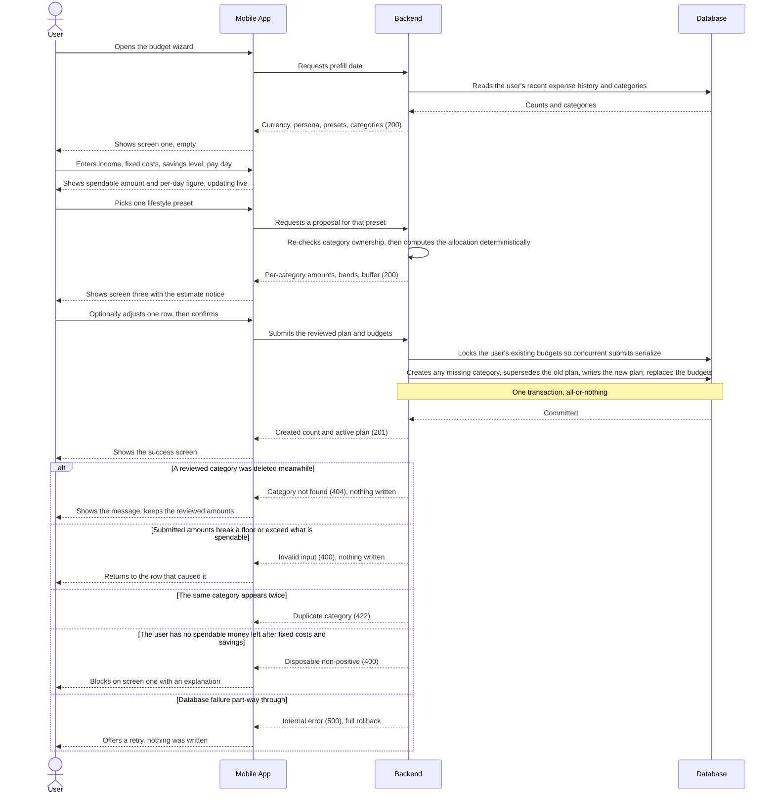
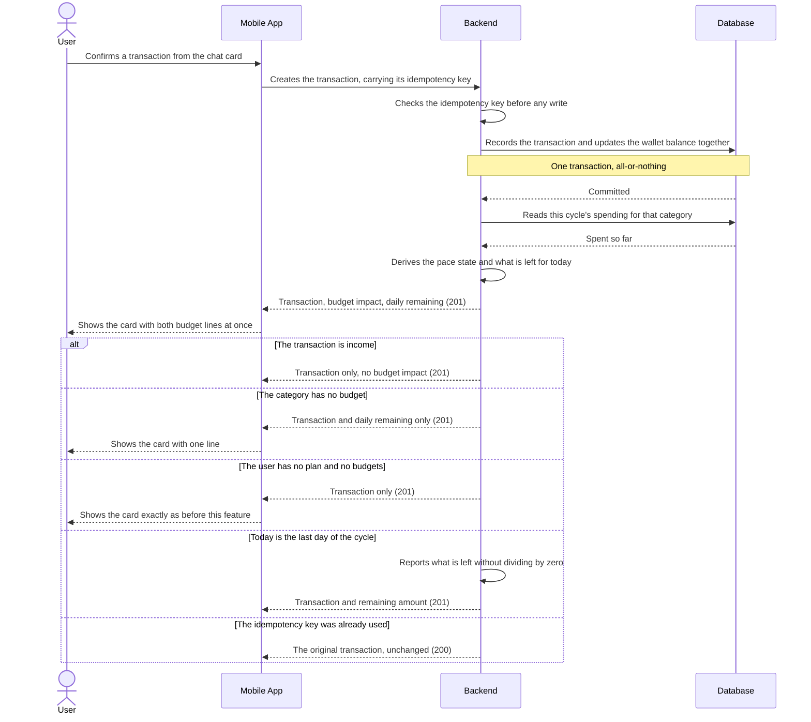

# Implementation Plan: F-13.1 AI Budget Setup Wizard v2 — Phase 1

> Spec: [`spec.md`](./spec.md) · SRS: **FR-10 / Feature-13** · Design source: `docs/new-tasks.md` §0–§21
> Replaces in place: `specs/ai-budget-wizard/` US-03 and US-04 (decision D-13). Its US-01/US-02 triggers and US-05 bulk submit survive, extended here.
> Task ID prefix: `BWZ2-T{NN}` · Scenario refs: `S-BWZ2-{NN}`

---

## Pre-flight: Spec Review Findings

| # | Finding | Type | Resolution |
|---|---------|------|------------|
| **F1** | `spec.md` calls its migrations **021** and **022**, inherited from `docs/new-tasks.md` §21, which numbered the *push* migrations 019/020. But Phase 1 ships **before** Phase 2, and the last applied migration is `018`. | Gap — sequencing | **Phase 1 takes `019` and `020`.** Phase 2's push migrations shift to `021`–`023`. `spec.md` renumbered to match; `docs/new-tasks.md` §21.3/§21.6/§21.7 must be renumbered when Phase 2 is planned. |
| **F2** | Rewriting the engine makes `budgetproposal` exceed the 300-line rule. `compute.go` is already 265 lines and now gains persona resolution, presets, banding, quantization, and the floor↔ceiling fixed point. | Gap — convention | Split the package by responsibility: `compute.go` (orchestration), `intent.go`, `preset.go`, `quantize.go`, `band.go`, `classify.go`. Each stays well under 300. |
| **F3** | `spec.md` requires a `persona` on prefill but never says what computes it. | Ambiguity | Two new read queries (`CountExpenseTxLast90Days`, `CountDistinctExpenseMonths`) called by `BudgetWizardService.Prefill`. `ResolvePersona` is pure and lives in `budgetproposal/classify.go` so it is unit-testable without a DB. |
| **F4** | `SumExpenseByUserCycle` replaces `SumExpenseByUserCurrentPeriod`, whose current callers include `BudgetRepository` (F-05 list), `ReportService` (F-07) **and** `NotificationService` (F-10). Swapping it changes numbers on three shipped features. | ⚠️ Gap — blast radius | One shared resolver `service.ResolveCycleWindow(plan)` returning `[start, end)`. With **no plan**, or `cycle_start_day = 1`, it returns exactly the calendar month — so every existing User's numbers are bit-identical (S-BWZ2-20). A regression test asserts this for all three callers before the swap. |
| **F5** | `budget_impact` on `POST /transactions` is unspecified for `type = income`. | Ambiguity | Income transactions return `budget_impact: null`. Budgets track expenses only (F-05). Stated as `BR-16`. |
| **F6** | The floor↔ceiling loop is bounded at `maxIter = n + 2` but nothing proves it converges, and step 5's proportional shrink has no defined tie-break when two items round identically. | Gap — correctness | Tie-break is **ascending `category_id` string order** — arbitrary but stable, which is the only property that matters. A fuzz test asserts the loop reaches a fixed point within the bound on 10.000 inputs. |
| **F7** | `spec.md` says a deleted Category's plan item is retained, but does not state the FK behaviour. | Ambiguity | `budget_plan_items.category_id` is a plain FK with **no** `ON DELETE` clause. Categories are soft-deleted (`deleted_at`), never hard-deleted, so the row survives naturally; enforcement and Phase 2 filter on `deleted_at IS NULL` at read time. |
| **F8** | Manual budget CRUD must now emit a plan version (D-12). That is three more call sites inside `budget_service.go`, which sits beside an already-323-line `budget_repository.go`. | Gap — convention | New `budget_service_plan.go` holding `writePlanVersion(ctx, tx, userID, origin, …)`, called from `CreateBudget`, `UpdateBudget`, `DeleteBudget`, and `BulkReplaceBudgets`. No existing file grows past its limit. |
| **F9** | Screen 3 states both "other rows never re-scale" (S-BWZ2-39) and "total can never exceed disposable" (S-BWZ2-41). Those conflict once the buffer is exhausted. | Ambiguity | A manual edit is **clamped client-side** to `own_amount + buffer`. The slider cannot travel past it. So the total is bounded without ever touching another row. Stated as `BR-12`. |
| **F10** | Removing `weekly`/`quarterly` from `dto.BulkBudgetItem.Period` and `BudgetProposalsRequest.Period` is a wire-breaking change. | Risk | `mobile/` is the only client that sends these fields (web has no wizard). Both ship in the same release. Safe. |
| **F11** | `spec.md` gives an income cap in xu but the existing tag is `lte=9999999999`, which reads as a đồng figure. | Gap | Change to `lte=999999999900`. Well inside `int64`. Also correct the stale comment in `specs/ai-budget-wizard/spec.md` S-BWZ-08. |
| **F12** | No `testID` exists anywhere in the current wizard; only `btn-new-budget` exists in `BudgetsTab.tsx`. | Gap — QA | Full `testID` table below; every new control carries one. |
| **F13** | `spec.md` Open Question #1 (does Phase 1 ship alone?) is unresolved and changes nothing structural. | Open | Not a blocker for implementation. Carried forward. |

---

## Architecture

### Package / file layout

```text
backend/
├── db/
│   ├── migrations/
│   │   ├── 019_categories_system_key.sql       # F1 — key + VN rename + 2 new system categories
│   │   └── 020_budget_plans.sql                # budget_plans + budget_plan_items + backfill
│   └── queries/
│       ├── categories.sql                      # + ListSystemCategoriesByKey
│       ├── transactions.sql                    # + SumExpenseByUserCycle, CountExpenseTxLast90Days,
│       │                                       #   CountDistinctExpenseMonths  (⚠️ column is occurred_at)
│       └── budget_plans.sql                    # NEW — plan + item CRUD, supersede, active lookup
└── internal/
    ├── common/
    │   ├── constants.go                        # xu constants, preset table, system-key class map
    │   └── errors.go                           # + 3 error codes
    ├── model/
    │   ├── budget_plan.go                      # BudgetPlan, BudgetPlanItem, PlanOrigin, IntentSource
    │   └── category.go                         # + SystemKey
    ├── repository/
    │   ├── budget_plan_repository.go           # NEW
    │   └── transaction_repository.go           # + cycle/persona queries
    ├── service/
    │   ├── budgetproposal/                     # F2 — split, pure arithmetic, no pgx/fiber import
    │   │   ├── compute.go                      # orchestration: steps 1→9
    │   │   ├── intent.go                       # CategoryIntent + source precedence
    │   │   ├── preset.go                       # 4 profiles keyed by system_key
    │   │   ├── quantize.go                     # roundStep + largest-remainder
    │   │   ├── band.go                         # min/max per source
    │   │   └── classify.go                     # ResolvePersona, CategoryClass
    │   ├── budget_cycle.go                     # NEW — ResolveCycleWindow, shared by F-05/F-07/F-10
    │   ├── budget_pace.go                      # NEW — Go port of mobile budget-pace.ts
    │   ├── budget_service_plan.go              # NEW — writePlanVersion (F8)
    │   ├── budget_service_bulk.go              # extended: plan + items in the same tx
    │   ├── budget_wizard_service.go            # rewritten: persona, prefill, proposals
    │   └── transaction_service_create.go       # + budget_impact on the create response
    ├── dto/
    │   ├── budget_wizard_request.go            # BudgetProposalsRequest reshaped (intents[])
    │   ├── budget_wizard_response.go           # + persona, presets, bands, evidence
    │   ├── budget_bulk_request.go              # + plan object; period forced monthly
    │   └── transaction_response.go             # + BudgetImpact (nullable)
    └── handler/
        └── budget_wizard_handler.go            # unchanged shape; new DTOs

mobile/src/features/budget-wizard/
├── api/
│   ├── use-budget-wizard-prefill-query.ts      # + persona, presets
│   ├── use-budget-proposals-mutation.ts        # new payload
│   └── use-submit-budget-wizard.ts             # + plan object
├── components/
│   ├── BudgetWizardModal.tsx                   # 3 steps instead of 4
│   ├── WizardProgressHeader.tsx                # 3 dots
│   ├── WizardStepIncome.tsx                    # NEW  (replaces WizardStepIncomePeriod.tsx)
│   ├── WizardStepProfile.tsx                   # NEW  (replaces StepCategories + StepPreferences)
│   ├── WizardStepResult.tsx                    # NEW  (replaces WizardStepProposal.tsx)
│   ├── ProposalRow.tsx                         # NEW — band, badge, inline editor
│   └── WizardStepSuccess.tsx                   # kept
├── hooks/use-budget-wizard-state.ts            # rewritten for the new state shape
├── budget-math.ts                              # NEW — xu-safe disposable / per-day, shared by screens
└── types.ts                                    # reshaped

mobile/src/features/ai-chat/components/
└── TransactionActionCard.tsx                   # + BudgetImpactLines

mobile/src/features/budgets/
└── budget-pace.ts                              # unchanged — it is the Go port's reference
```

**Deleted:** `WizardStepIncomePeriod.tsx`, `WizardStepCategories.tsx`, `WizardStepPreferences.tsx`, `WizardStepProposal.tsx` (D-13 — replaced in place, no parallel version).

### Domain objects

| Entity | Table | Key fields | Notes |
|---|---|---|---|
| `BudgetPlan` | `budget_plans` *(new)* | `id` UUID v4 · `user_id` · `version` int · `parent_plan_id` · `origin` (`wizard`\|`manual`\|`calibration`) · `currency` · `period` · `cycle_start_day` smallint 1–28 · `income` **BIGINT xu, nullable** · `income_source` · `fixed_total` · `savings_target` · `disposable` **nullable** · `profile_preset` · `confidence` · `created_at` · `superseded_at` | ⚠️ All money BIGINT **xu**. Nullable income/disposable only when `origin='manual'`. Partial unique index on `user_id WHERE superseded_at IS NULL`. **No `deleted_at`** — a plan is superseded, never deleted; the version chain is the audit trail. |
| `BudgetPlanItem` | `budget_plan_items` *(new)* | `id` · `plan_id` (`ON DELETE CASCADE`) · `category_id` (plain FK, F7) · `amount_min` · `amount_max` BIGINT xu · `source` · `locked` · `confidence` real · `evidence` text | `UNIQUE (plan_id, category_id)`. `CHECK (amount_min <= amount_max AND amount_min > 0)`. |
| `Category` | `categories` | `+ system_key` text nullable | Unique among system rows only: `WHERE user_id IS NULL AND deleted_at IS NULL`. |
| `Budget` / `BudgetLimit` | `budgets`, `budget_limits` | unchanged | Enforcement layer. `amount_limit = plan_item.amount_max`. Soft delete unchanged. |
| `Transaction` | `transactions` | unchanged | Read only. Cycle window uses **`occurred_at`** — `transaction_date` does not exist (BS-03). |

### Business rules

| ID | Rule | Source | Enforcement |
|---|---|---|---|
| BR-01 | Same input → byte-identical output, always | S-BWZ2-01/02 | `budgetproposal` — ordered slice, never a Go map, for every keyword and preset lookup |
| BR-02 | ⚠️ `Σ amount_max + unallocated == disposable`, exactly | S-BWZ2-03 | `budgetproposal.Compute()` final assertion; `int64` throughout, `a*num/den` |
| BR-03 | Locked items are never scaled, never rounded | S-BWZ2-06 | `quantize.go` skips `locked`; `compute.go` excludes them from the scale set |
| BR-04 | `Σ(locked) > cap` → report, never silently reduce | S-BWZ2-07 | `Compute()` returns `OverCommitted` + shortfall |
| BR-05 | `ScaledDown` true only if ≥ 1 xu was actually reduced | S-BWZ2-05 | `Compute()` counts reduced xu (fixes B3) |
| BR-06 | `disposable <= 0` rejected | S-BWZ2-08 | `BudgetWizardService.Proposals` → `400 E_DISPOSABLE_NONPOSITIVE` |
| BR-07 | Ceiling overflow becomes buffer, never redistributed | spec US-01 EC-3 | `compute.go` step 7 |
| BR-08 | Preset → Category resolves by `system_key`, never by name | S-BWZ2-11/36 | `preset.go`; keyword match survives only for `system_key IS NULL` |
| BR-09 | `system_key IS NULL` Category classifies as `essential` | S-BWZ2-14 | `classify.go` default |
| BR-10 | Cycle is `[most recent day N, next day N)`; `daysInCycle` from real dates | S-BWZ2-16/17/18 | `service.ResolveCycleWindow` |
| BR-11 | `cycle_start_day` outside 1–28 rejected | S-BWZ2-19 | DTO validator + DB `CHECK` |
| BR-12 | A manual edit is clamped to `own_amount + buffer` | S-BWZ2-39/41, F9 | Client slider bound **and** server re-validation at submit |
| BR-13 | ⚠️ Plan + items + budgets + limits write in **one** DB transaction | S-BWZ2-48 | `BulkReplaceBudgets` — existing `tx` + `defer tx.Rollback` convention |
| BR-14 | Every enforcement-layer change creates a plan version | S-BWZ2-21/22/23 | `writePlanVersion()` called from all four mutation paths |
| BR-15 | `disposable IS NULL` → per-day figures hidden, never guessed | S-BWZ2-24/54 | Server omits the field; client renders nothing |
| BR-16 | `type = income` → `budget_impact: null` | F5 | `TransactionService.Create` |
| BR-17 | `daysLeft = 0` → show remaining, do not divide | S-BWZ2-55 | `budget_pace.go` guard |
| BR-18 | `period` forced to `monthly` server-side | A-03 | `BulkReplaceBudgets` overrides whatever arrives |
| BR-19 | Every Category ID re-validated for ownership before any write | spec US-08 | `validateBulkItems` (existing) — unchanged, still the authorization boundary |
| BR-20 | Income ≤ `999_999_999_900` xu | S-BWZ2-30 | DTO `lte` tag (F11) + client input guard |

**Authorization is enforced in exactly two places** and nowhere else: `middleware.JWTAuth` establishes identity for every `/ai/*`, `/budgets/*` and `/transactions/*` route; the **service** layer scopes every read and write by `user_id` and re-validates every client-supplied Category ID. Handlers never authorize; the client never authorizes.

### API surface

Every endpoint below already exists except where marked NEW. Each maps 1-to-1 to a service method — no endpoint is planned without one.

| Method + path | Story | Request | Response | Transactional | Failure checks |
|---|---|---|---|---|---|
| `GET /api/v1/ai/budget-wizard/prefill` | US-05 | none | currency, persona, presets, visible categories, active plan | **No** — read-only | gating: authenticated |
| `POST /api/v1/ai/budget-proposals` | US-07 | income, fixed total, savings target, currency, cycle start day, profile preset, intent list | per-category amounts with band, source, confidence, evidence; buffer; over-committed and scaled-down flags | **No** — pure computation, writes nothing | **independent** (returned together): every amount/range violation across all fields. **gating**: authenticated, then category ownership, then arithmetic |
| `POST /api/v1/budgets/bulk` | US-08 | plan object, budget list | created count, active plan | **Yes** — one transaction covering category creation, plan, items, budgets, limits | **gating, per item** (existing convention): authenticated, then category exists, then ownership, then category type is expense. **independent**: duplicate-category and too-many-budgets are detected across the whole payload before any per-item work |
| `POST /api/v1/transactions` | US-09 | unchanged | unchanged, plus optional budget impact and daily remaining total | **Yes** — unchanged; the budget impact is computed after commit and never affects it | gating: authenticated, then wallet ownership, then sufficient balance |

No new endpoint is introduced by Phase 1. `budget_plans` is reached only through the existing budget endpoints, which is deliberate: a standalone plan-writing endpoint would allow a plan to drift from the budgets it describes.

### Sequence — budget setup (US-05 through US-08)



### Sequence — budget context at the moment of spending (US-09)



> **Deviation from the one-diagram-per-story rule, stated deliberately:** US-01 through US-04 are the engine, the cycle window, the category keys and the plan layer. None of them has a user-triggered request path of its own — they are reached only through the two flows above, and drawing four more lifeline diagrams for them would show the same three arrows with different labels. Their behaviour is specified in the Business Rules table instead.

---

## Error Flows

| Scenario | HTTP | Error code | Type |
|---|---|---|---|
| Missing / invalid / expired JWT | 401 | `UNAUTHENTICATED` | client |
| Category not owned by caller | 403 | `CATEGORY_ACCESS_DENIED` | client |
| Category deleted between proposal and submit | 404 | `CATEGORY_NOT_FOUND` | client |
| Same Category twice in payload | 422 | `DUPLICATE_CATEGORY_IN_REQUEST` | client |
| More than 20 budgets in one submit | 422 | `TOO_MANY_BUDGETS` | client |
| `income <= 0`, `income >` cap, `cycle_start_day` out of 1–28, amount below floor, total above disposable | 400 | `INVALID_INPUT` | client |
| `income − fixed − savings <= 0` | 400 | **`DISPOSABLE_NONPOSITIVE`** *(new)* | client |
| Submitted item amounts disagree with a server recompute | 400 | **`PROPOSAL_STALE`** *(new)* | client |
| Concurrent submit lost the active-plan race | 409 | **`PLAN_VERSION_CONFLICT`** *(new)* | client |
| Rate limit on `/ai/*` | 429 | `RATE_LIMITED` | client |
| DB failure mid-transaction | 500 | — | **system** |
| AI Service down | — | — | **not applicable** — no Phase 1 path calls it; only the pre-existing `POST /ai/suggest-category-name` does |

---

## Regression Scope

Phase 1 changes code paths that three already-shipped features read. Each needs a deliberate regression pass, not just new tests.

| Affected feature | What changes | Regression check |
|---|---|---|
| **F-05 Budget Management** | The spending window behind every budget's "spent" figure moves from the calendar month to the plan's cycle. Manual budget create/edit/delete now also writes a plan version. | A user with no plan, and a user whose pay day is the 1st, must see numbers identical to today. Manual CRUD must keep working for a user who has never opened the wizard (plan income stays unset). |
| **F-07 Financial Reporting** | Same shared window resolver. | Summary and by-category totals unchanged for every existing user. |
| **F-10 Notification Handling** | The budget-exceeded job reads the same window. | The job must not start firing or stop firing for existing users as a side effect of the swap. |
| **F-04 Category Management** | System categories are renamed and gain a key. | A user's own categories are untouched; existing transactions still resolve; a user-created category sharing a new system name does not break the migration. |
| **F-06 Transaction Management** | The create response grows two optional fields. | The web client, which ignores them, is unaffected. Existing transaction tests still pass unchanged. |
| **F-13 v1 wizard** | Replaced in place. | Nothing to preserve — but confirm no other screen imports the four deleted step components. |

## Audit & Logging

| Concern | Decision |
|---|---|
| Is a budget change audited? | **Yes, by design of the data model** — the plan version chain (`version`, `parent_plan_id`, `superseded_at`, `origin`) is the audit trail. No separate audit table is added, and `transaction_audit_logs` is not extended; it stays scoped to transactions. |
| What is recorded per change | Who (`user_id`), when (`created_at`), what changed (the full item set of that version), and where it came from (`origin`). A reader can reconstruct any past budget without a separate log. |
| Actor resolution | Taken from the authenticated request context, the same source every other service uses — never re-derived inside the repository. |
| Log statements | Amounts, income and savings targets are financial data: log identifiers and counts, never the figures. No email, token, or push identifier appears in any log this feature adds. |
| Failed submits | A rejected submit writes no plan version at all, so the chain never contains a version that was not actually enforced. |

## Constitution / Convention Notes

| Rule | Status | How this plan satisfies it |
|---|---|---|
| Service layer owns business rules | Required | BR-01…BR-20 all land in `service/` or the pure `budgetproposal` package; handlers only parse and respond |
| Handler never imports repository | Required | `BudgetWizardHandler` → `BudgetWizardService` → `BudgetPlanRepository` |
| Transactional atomicity | Required ⚠️ | BR-13 — plan, items, budgets, limits and any created Category share one `tx` |
| Money is BIGINT xu, never float | Required ⚠️ | Every new column BIGINT; `budgetproposal` has no `float64` on the money path; `confidence real` is the only float and touches no amount |
| Timestamps UTC | Required | `created_at`/`superseded_at` TIMESTAMPTZ UTC; `cycle_start_day` is a day number, not a date. **A-05: cycle boundaries remain UTC — timezone is a separate feature** |
| Soft delete | Required | `budgets`/`categories` keep `deleted_at`; `budget_plans` deliberately uses `superseded_at` instead and this is stated, not implied |
| SQL in `.sql` files | Required | `budget_plans.sql` + additions to `transactions.sql`/`categories.sql`. ⚠️ The local sqlc CLI rewrites every generated file — hand-write to match existing style, as with recent queries |
| Error wrapping | Required | `fmt.Errorf("service.BulkReplaceBudgets: %w", err)` |
| No file > 300 lines | Required | F2 and F8 splits. `budget_wizard_service.go` must be re-measured after the rewrite and split again if it crosses |
| Mobile: server state via TanStack Query | Required | Wizard state is *draft input* (legitimately local); prefill/proposal/budget responses are never copied into Zustand |
| Mobile: no `any` | Required | `types.ts` reshaped with explicit unions for `source`, `persona`, `state` |
| UI copy Vietnamese | Required | Every new string; also translate `buildBudgetExceededNotification()` if touched |
| Migrations mounted in **both** compose files | Required ⚠️ | 019 and 020 added to `docker-compose.yml` **and** `backend/docker-compose.yml` — the 015–018 drift must not repeat |

---

## Element / Key IDs (QA automation)

**Mobile (`testID`)** — none of these exist today (F12):

| Element | testID | Status | File |
|---|---|---|---|
| Income input | `input-wizard-income` | **Missing** | `WizardStepIncome.tsx` |
| Fixed-costs input | `input-wizard-fixed` | **Missing** | `WizardStepIncome.tsx` |
| Savings level chip | `chip-wizard-savings-{0\|5\|10\|20\|custom}` | **Missing** | `WizardStepIncome.tsx` |
| Cycle-day picker | `picker-wizard-cycle-day` | **Missing** | `WizardStepIncome.tsx` |
| Disposable readout | `text-wizard-disposable` | **Missing** | `WizardStepIncome.tsx` |
| Per-day readout | `text-wizard-per-day` | **Missing** | `WizardStepIncome.tsx` |
| Step 1 next | `btn-wizard-next-income` | **Missing** | `WizardStepIncome.tsx` |
| Preset option | `btn-wizard-preset-{key}` | **Missing** | `WizardStepProfile.tsx` |
| Proposal row | `row-wizard-proposal-{categoryId}` | **Missing** | `ProposalRow.tsx` |
| Row inline editor | `input-wizard-amount-{categoryId}` | **Missing** | `ProposalRow.tsx` |
| Confidence badge | `badge-wizard-confidence-{categoryId}` | **Missing** | `ProposalRow.tsx` |
| Buffer row | `text-wizard-buffer` | **Missing** | `WizardStepResult.tsx` |
| Estimate notice | `text-wizard-estimate-notice` | **Missing** | `WizardStepResult.tsx` |
| Submit | `btn-wizard-submit` | **Missing** | `WizardStepResult.tsx` |
| Dismiss | `btn-wizard-dismiss` | **Missing** | `BudgetWizardModal.tsx` |
| Budget impact line | `text-chat-budget-impact` | **Missing** | `TransactionActionCard.tsx` |
| Daily remaining line | `text-chat-daily-remaining` | **Missing** | `TransactionActionCard.tsx` |

**Web:** no work — the wizard is mobile-only (spec Out of Scope).

---

### Plan-checklist items that do not apply to this stack

Recorded rather than silently skipped: the shared planning checklist is written for a Java/Spring, Jira-tracked codebase. `@PreAuthorize` placement has no equivalent here — authorization is JWT middleware plus explicit `user_id` scoping in the service, stated above. CSRF strategy does not apply: every mutating endpoint authenticates with a Bearer token from secure storage, not a cookie, so there is no ambient-credential surface. `GenerationType` is a JPA concept; primary keys are UUID v4 generated by Postgres. `User`/`Employee` separation and `BusinessUnit` naming belong to a different domain model. There is no Jira project for PFM — traceability runs through `spec.md` scenario IDs instead.

---

## Open Tasks

### Blocking backend (must land before any wizard UI work)

| ID | Task | File |
|---|---|---|
| BWZ2-T01 | Migration: `categories.system_key`, partial unique index, key assignment, Vietnamese rename, insert `children_education` + `other`. Idempotent (`ON CONFLICT DO NOTHING`) | `backend/db/migrations/019_categories_system_key.sql` |
| BWZ2-T02 | Mount 019 + 020 in **both** compose files | `docker-compose.yml`, `backend/docker-compose.yml` |
| BWZ2-T03 | Migration: `budget_plans` + `budget_plan_items`, partial unique active index, conditional `chk_disposable_positive`, backfill v1 `manual` plans from existing `budget_limits` | `backend/db/migrations/020_budget_plans.sql` |
| BWZ2-T04 | Queries: `SumExpenseByUserCycle`, `CountExpenseTxLast90Days`, `CountDistinctExpenseMonths` (⚠️ `occurred_at`, `t.type='expense'`, `deleted_at IS NULL`) | `backend/db/queries/transactions.sql` |
| BWZ2-T05 | Queries: plan CRUD, active-plan lookup, supersede, item CRUD | `backend/db/queries/budget_plans.sql` |
| BWZ2-T06 | `ResolveCycleWindow` + migrate **all three** existing callers off `SumExpenseByUserCurrentPeriod`; regression test that `cycle_start_day = 1` reproduces today's numbers exactly | `backend/internal/service/budget_cycle.go` |
| BWZ2-T07 | Go port of `budget-pace.ts` (`ratio > elapsed + 0.05`, `PACE_TOLERANCE`), shared test vectors with the TS original | `backend/internal/service/budget_pace.go` |
| BWZ2-T08 | Rewrite `budgetproposal` to `int64` xu; split per F2; fix **B1–B7**; delete the false "order is insignificant" comment | `backend/internal/service/budgetproposal/*.go`, `common/constants.go:227` |
| BWZ2-T09 | Property test: I1–I6, 10.000 fuzzed cases; determinism test ×1.000; 4 presets × 5 income levels | `backend/internal/service/budgetproposal/compute_test.go` |
| BWZ2-T10 | Constants in xu: floor `5_000_000`, income cap `999_999_999_900`, buffer `12%`, ceiling `50%`, `roundStep` ladder, preset table keyed by `system_key`, `system_key → CategoryClass` map | `backend/internal/common/constants.go` |
| BWZ2-T11 | Error codes: `DISPOSABLE_NONPOSITIVE`, `PROPOSAL_STALE`, `PLAN_VERSION_CONFLICT` | `backend/internal/common/errors.go` |
| BWZ2-T12 | `model.BudgetPlan`, `model.BudgetPlanItem`, `PlanOrigin`, `IntentSource`; `model.Category.SystemKey` | `backend/internal/model/budget_plan.go`, `category.go` |
| BWZ2-T13 | `BudgetPlanRepository` | `backend/internal/repository/budget_plan_repository.go` |
| BWZ2-T14 | `writePlanVersion()`; wire into `CreateBudget`/`UpdateBudget`/`DeleteBudget`/`BulkReplaceBudgets` | `backend/internal/service/budget_service_plan.go` |
| BWZ2-T15 | Extend `BulkReplaceBudgets`: accept `plan`, write plan + items in the same tx, force `period=monthly` | `backend/internal/service/budget_service_bulk.go` |
| BWZ2-T16 | Rewrite `BudgetWizardService`: persona resolution, extended prefill, new proposals payload | `backend/internal/service/budget_wizard_service.go` |
| BWZ2-T17 | DTOs: reshape `BudgetProposalsRequest` (`intents[]`), extend responses (persona, presets, bands, evidence), add `plan` to bulk, fix the income `lte` tag, drop `weekly`/`quarterly` | `backend/internal/dto/budget_wizard_*.go`, `budget_bulk_request.go` |
| BWZ2-T18 | `budget_impact` + `daily_remaining_total` on the create response; null for income (BR-16); `daysLeft = 0` guard | `backend/internal/service/transaction_service_create.go`, `dto/transaction_response.go` |
| BWZ2-T19 | Integration tests against a **real** Postgres (not fakes): one-transaction guarantee, induced mid-write failure, concurrent submit, backfill correctness | `backend/internal/service/*_integration_test.go` |

### Mobile

| ID | Task | File |
|---|---|---|
| BWZ2-T20 | `budget-math.ts` — xu-safe disposable and per-day helpers | `mobile/src/features/budget-wizard/budget-math.ts` |
| BWZ2-T21 | Rewrite wizard state for `{income, fixed, savings, preset, intents}` in xu | `hooks/use-budget-wizard-state.ts` |
| BWZ2-T22 | `WizardStepIncome.tsx` — live disposable + đ/ngày, 5 validations, cycle-day picker | `components/WizardStepIncome.tsx` |
| BWZ2-T23 | `WizardStepProfile.tsx` — 4 presets, one question; Phase 4 free-text entry point **not rendered** | `components/WizardStepProfile.tsx` |
| BWZ2-T24 | `ProposalRow.tsx` — band, badge, inline editor clamped to `own + buffer` (BR-12) | `components/ProposalRow.tsx` |
| BWZ2-T25 | `WizardStepResult.tsx` — donut of disposable only, buffer row, savings/fixed reference lines, non-dismissible estimate notice | `components/WizardStepResult.tsx` |
| BWZ2-T26 | `BudgetWizardModal.tsx` → 3 steps; `WizardProgressHeader.tsx` → 3 dots; **delete** the 4 old step files | `components/*` |
| BWZ2-T27 | All four UI states per surface (spec §UI States); no red for over-budget; "—" for unknown vs `0đ` for computed zero | `components/*` |
| BWZ2-T28 | Budget-impact lines under the confirmation card, rendered with it, never as a later pop-in | `ai-chat/components/TransactionActionCard.tsx` |
| BWZ2-T29 | Reshape `types.ts` — explicit unions, no `any`; mirror the Go DTOs by hand (no codegen exists) | `budget-wizard/types.ts` |
| BWZ2-T30 | Add every `testID` from the table above | `components/*` |

### Docs / follow-up

| ID | Task | File |
|---|---|---|
| BWZ2-T31 | Renumber `docs/new-tasks.md` §21 Phase-2 migrations to 021–023 (F1) | `docs/new-tasks.md` |
| BWZ2-T32 | Mark `specs/ai-budget-wizard/spec.md` §5/§6.2 superseded; correct its S-BWZ-08 income-cap comment (F11) | `specs/ai-budget-wizard/spec.md` |
| BWZ2-T33 | Apply 019 + 020 by hand on the VPS — initdb scripts only run on a fresh volume | deploy runbook |
| BWZ2-T34 | Re-measure every touched file against the 300-line rule after implementation | — |
