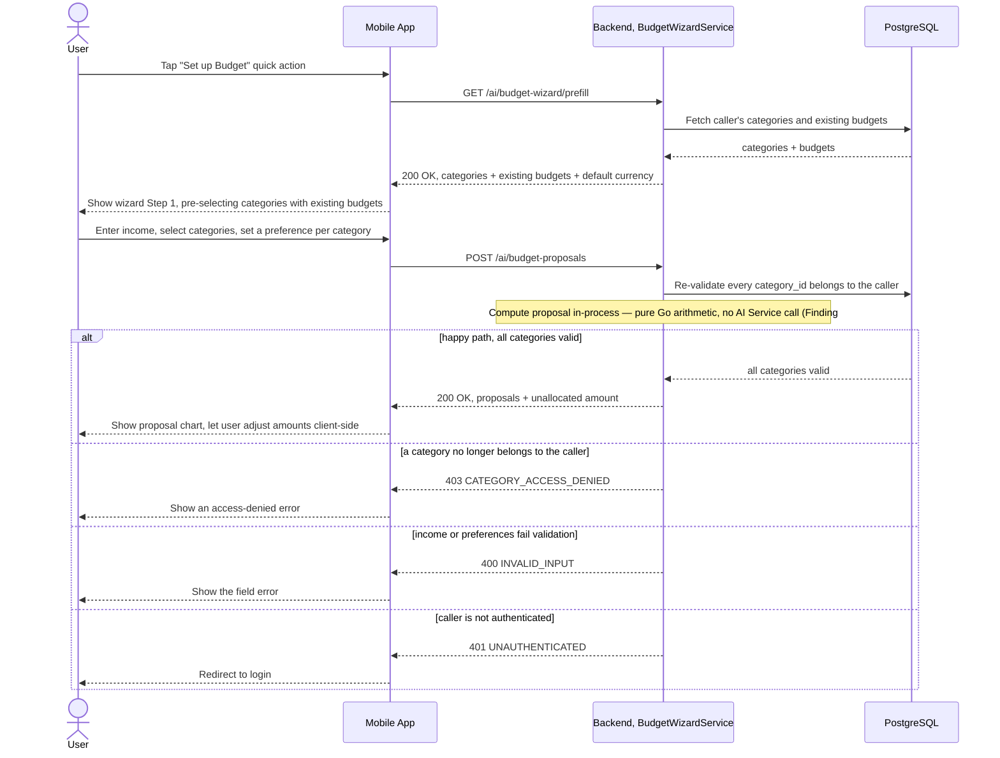
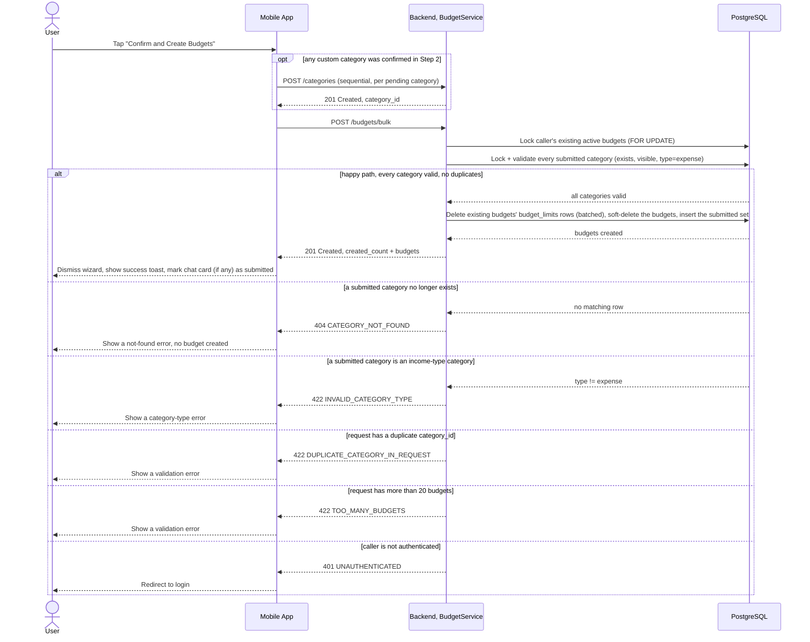

# Implementation Plan: F-13 AI Budget Setup Wizard (Release 1)

- **Feature:** AI Budget Setup Wizard
- **SRS Feature Code:** F-13 / FR-10 (SRS.md Feature-13 §6; SDS.md §5.13 is a single-US summary — `spec.md` in this folder is the authoritative source, same convention as every prior plan)
- **Jira Epic:** N/A — this repository has no Jira integration wired up (same as every prior plan)
- **Spec:** [spec.md](./spec.md)
- **Related plans:** [F-05 Budget Management](../budget-management/plan.md) (this plan's `POST /budgets/bulk` extends `BudgetService`/`BudgetRepository` — reuses `LockCategoryForBudgetCheck`, `CreateBudget` unchanged), [F-04 Category Management](../category-management/plan.md) (custom-Category creation reuses `POST /categories` unchanged), [ai-chat-assistant](../ai-chat-assistant/plan.md) (natural-language trigger extends `ChatService`'s `/extract` contract; reuses `AIServiceClient`/`chat_messages` plumbing)
- **Frontend scope:** **mobile only** (`mobile/`, React Native/Expo), per `spec.md`'s Out of Scope — `frontend/` (Next.js web) parity is a follow-up, not in this plan.

---

## 1. Pre-flight: Spec Review Findings

| # | Type | Finding | Resolution / Open Task |
|---|------|---------|-------------------------|
| 1 | **No new migration required** | `spec.md` introduces no new stored domain object — every write goes through the existing `budgets`/`budget_limits` (migration `007_budgets.sql`, extended by `014_budgets_icon.sql`) and `categories` tables, and `chat_messages.intent` (migration `011_chat_messages.sql`) is a plain unconstrained `TEXT` column, so storing a new `"budget_wizard"` value needs no `CHECK`-constraint migration either. | Confirmed by reading all three migrations directly. This plan adds **zero** new migration files — the next available number (`015`) is not used here. |
| 2 | **Correction — server-side Category-type enforcement is stricter than `spec.md` assumed** | `spec.md` US-03 Edge Cases #1 says budgeting an `income`-type Category is "allowed with a non-blocking warning." But `BudgetService.createBudgetTx` (existing, `budget_service.go:93-95`) already hard-rejects any `category.Type != model.CategoryTypeExpense` with `422 INVALID_CATEGORY_TYPE` — this is an established F-05 business invariant (`specs/budget-management/spec.md` Business invariants), not something this feature can silently loosen for one code path without creating an inconsistency between `POST /budgets` and `POST /budgets/bulk`. | This plan's `POST /budgets/bulk` reuses the **same** `LockCategoryForBudgetCheck` check unconditionally — an `income`-type Category in the request is a hard `422 INVALID_CATEGORY_TYPE`, all-or-nothing, same as Create. `spec.md`'s "non-blocking warning" becomes a **client-side-only** UI hint shown before submit (mobile warns proactively so the User doesn't hit the 422 in the first place) — not a server behavior change. Flagged here since it's a deviation from `spec.md`'s stated assumption, not a silent one. |
| 3 | **Architecture correction — SDS §5.13 oversimplifies where the wizard's endpoints live** | `SDS.md` §5.13 describes `GET /ai/budget-wizard/prefill` and `POST /ai/budget-proposals` as "`ChatHandler` (existing, extended)." Neither endpoint reads or writes `chat_messages`, and neither shares any state with `ChatService`'s Transaction-proposal logic — folding them into `chat_service.go` (already the largest AI-touching service file) would blur a clean single-responsibility boundary for no benefit. | This plan introduces a **new** `BudgetWizardHandler`/`BudgetWizardService` pair instead, owning all three wizard-adjacent endpoints (`Prefill`, `Proposals`, `SuggestCategoryName` — Finding #11), depending on the existing `CategoryRepo`/`BudgetRepo` plus a new `AIBudgetClient` interface for the one that's actually AI-Service-backed (`SuggestCategoryName` — `ProposeBudget` was removed from that interface by Finding #6). `ChatService`/`ChatHandler` are touched only for the natural-language *trigger* (US-02): `/extract`'s response gains a `"budget_wizard"` intent value, and `ChatService.Chat` recognizes it and returns `action_type: "budget_wizard"` — a small, additive change, not a restructure. |
| 4 | **Gap** | No `/budgets/bulk` or `/ai/budget-wizard/*` route group exists in `cmd/server/routes.go` yet — this includes `/ai/suggest-category-name`, which US-03's Step 2B depends on (Finding #11). | Added in §2 — `/budgets/bulk` joins the existing `budgets` group (`JWTAuth` only); `/ai/budget-wizard/prefill`, `/ai/budget-proposals`, and `/ai/suggest-category-name` all join the existing `ai` group (`JWTAuth` + `AIChatRateLimiter`). Only `/ai/suggest-category-name` actually reaches the AI Service (Finding #6) — the other two share the group purely for URL-namespace and rate-limit consistency. |
| 5 | **Design decision — bulk-replace race (spec.md S-BWZ-27)** | `spec.md` Edge Cases #3 (US-05) requires locking the caller's existing Budget rows before replacing them, mirroring F-05's own `SELECT ... FOR UPDATE` pattern for its create-vs-Category-delete race. | This plan adds `BudgetRepo.LockBudgetsByUser(ctx, tx, userID) ([]*model.Budget, error)` (`SELECT ... FOR UPDATE` on all the caller's active Budgets) and `BudgetRepo.SoftDeleteBudgetsByUser(ctx, tx, userID) error`, both called inside `BudgetService.BulkReplaceBudgets`'s single transaction, before any new Budget is inserted. |
| 6 | **Design decision — the allocation math moves to the Go Backend, not the AI Service at all** | `spec.md`'s Context section commits to a rule-based (non-LLM) allocation formula for `POST /ai/budget-proposals`. An earlier draft of this plan put that formula in a new Python `budget_proposal_service.py`, reached via an internal HTTP call from the Go Backend to the AI Service — **superseded**. The math is pure deterministic arithmetic (weight lookups, proportional scaling, clamping) with zero use for a Python/FastAPI process: it needs no LLM, no prompt, no Groq/Anthropic client, and putting it behind an HTTP call only adds a network hop, a new failure mode (`AI_SERVICE_UNAVAILABLE`) that has no business applying to arithmetic, and a second language's test suite to keep in sync. | `POST /ai/budget-proposals`'s handler (`BudgetWizardHandler.Proposals`) calls a **pure Go function**, `budgetproposal.Compute(...)` (no `pgx`/`fiber`/network import — see §2), directly in-process. The AI Service's involvement in this feature shrinks to exactly one endpoint, `POST /suggest-category-name` (LLM-backed, unchanged). This also means: `502 AI_SERVICE_UNAVAILABLE` is **no longer a possible response** for `POST /ai/budget-proposals` (Error Flows, §3) — budget-proposal availability no longer depends on AI Service uptime at all. If a future iteration wants LLM-generated reasoning text, that is a *new, additive* call from this same handler to the AI Service — not a rewrite of this Go function. |
| 7 | **Ambiguity, resolved** | `spec.md` US-04 Main Flow step 1 excludes a not-yet-created custom Category from the `POST /ai/budget-proposals` call (Open Questions #2), leaving its share to be resolved client-side. | This plan does not change the backend contract to accommodate this — it is a pure mobile-client concern (the client computes a placeholder amount for the pending Category out of the `unallocated_amount` already returned, and only sends it to `POST /budgets/bulk` once `POST /categories` has returned it a real ID). No backend work needed for this finding; noted so the mobile plan below reflects it explicitly (§2, Mobile section). |
| 8 | **Ambiguity, resolved** | `spec.md` does not specify whether `POST /ai/budget-proposals`' category-ownership re-validation should short-circuit on the first invalid ID or collect all invalid IDs into one response. | This plan collects independent field-shape violations (`income`/`period`/`preferences` format) into one `400` response via the existing `newValidationError` convention, but treats category-ownership re-validation as **sequential/gating per item** — the first `category_id` that fails ownership returns `403 CATEGORY_ACCESS_DENIED` immediately, without attempting the rest. Rationale: ownership failure on a wizard call almost always means a client-side bug (a stale/tampered ID), not a recoverable multi-field user mistake worth batching — same reasoning F-05's own `plan.md` used to classify Category-existence checks as gating, not independent. |
| 9 | **Gap (carried over), placement locked down** | `mobile/src/features/budgets/` exists (F-05's mobile screens — `BudgetsTab.tsx`, `BudgetFormModal.tsx`) but has no wizard-specific screen yet; `mobile/src/features/ai-chat/` exists (Feature-12) with the chat thread, action cards, and edit modals, but no `budget_wizard` card variant. An earlier draft of this plan left the quick-action entry point (US-01) as an open "mobile-design decision" between `BudgetsTab.tsx` and `ai-chat.tsx` — **`spec.md` already settles this**: the quick action is a chip shown directly above the message input box on the AI Chat screen (spec.md US-01 Main Flow step 1), not a Budgets-tab affordance. | Both feature folders are scaffolded fresh in §2 — `mobile/src/features/budget-wizard/` (new feature folder, since this is a distinct multi-step flow, not a form modal like the rest of `features/budgets/`) plus one new component inside `features/ai-chat/components/` for the chat card variant. The quick-action chip is built and wired **only** in `mobile/app/(app)/ai-chat.tsx`'s input area (BWZ-T20) — `BudgetsTab.tsx` is not touched by this plan at all. |
| 10 | **Correction — bulk replace must also clean up `budget_limits`, not just `budgets`** | `budget_limits` has no `deleted_at` of its own (confirmed in `007_budgets.sql`/`014_budgets_icon.sql`) — F-05's existing single-Budget delete (`BudgetRepository.SoftDeleteBudget`) deliberately leaves a deleted Budget's `budget_limits` rows in place as accepted orphans (never surfaced, never cleaned up — `specs/budget-management/plan.md` Domain Objects note). Left unaddressed, this bulk endpoint would compound that same gap far faster, since a single wizard run can replace many Budgets at once and the wizard is meant to be re-run whenever the User wants to redo their plan. | This plan does **not** reuse the existing per-Budget `DeleteBudgetLimits` query (`DELETE FROM budget_limits WHERE budget_id = $1`) in a per-item loop — batched instead: a new sqlc query `DeleteBudgetLimitsByBudgetIDs` (`DELETE FROM budget_limits WHERE budget_id = ANY($1::uuid[])`), called once with every locked Budget's ID, before the parent Budgets are soft-deleted. One statement instead of up to 20 round-trips inside the same transaction. See §2 Business Rules and BWZ-T1/T3/T4. |
| 11 | **Gap — `POST /ai/suggest-category-name` had no route in the original draft of this plan** | US-03's Step 2B (custom-Category name suggestion) calls `POST /ai/suggest-category-name` through the backend — `spec.md` documents this endpoint fully (US-05's internal-helper subsection), but an earlier draft of this plan's route registration (Finding #4) only wired up `/budget-wizard/prefill` and `/budget-proposals`. Left as-is, Step 2B would 404 at runtime — a real gap, not a documentation nicety. | `ai.Post("/suggest-category-name", budgetWizardHandler.SuggestCategoryName)` is added alongside the other two routes (§2, Finding #4 note updated; BWZ-T9). `BudgetWizardHandler`/`BudgetWizardService` gain a third method, `SuggestCategoryName`, delegating to `AIBudgetClient.SuggestCategoryName` (the interface's one remaining AI-Service-backed method — see Finding #6). |
| 12 | **Confirmed — no method-name mismatch** | Reviewer flagged a risk that `BudgetService.BulkReplaceBudgets` might call a Go method name (`LockCategoryForBudgetCheck`) that doesn't actually exist, if the real repository only exposes the sqlc-generated name (`LockCategoryByID`). | Verified directly against `backend/internal/repository/budget_repository.go:41-45`: `BudgetRepository.LockCategoryForBudgetCheck` is a real, already-shipped Go method (used today by `BudgetService.createBudgetTx`) that itself calls the sqlc-generated `r.q.WithTx(tx).LockCategoryByID(...)` internally. `LockCategoryByID` is `CategoryRepository`'s own (different) wrapper around the same underlying query, used by `CategoryService.DeleteCategory`. This plan's `BulkReplaceBudgets` correctly calls `BudgetRepo.LockCategoryForBudgetCheck` — no rename needed, no compile risk. |

### Regression Scope

**New files only:**
- `backend/internal/handler/budget_wizard_handler.go`, `backend/internal/service/budget_wizard_service.go`, `backend/internal/service/ai_budget_client.go` (new `AIBudgetClient` interface — `SuggestCategoryName` only, see Finding #6 — + HTTP implementation, sibling to `ai_service_client.go`)
- `backend/internal/service/budgetproposal/compute.go` (new package — pure Go allocation-guardrail math, Finding #6; no `pgx`/`fiber`/network import)
- `backend/internal/dto/budget_wizard_request.go`, `backend/internal/dto/budget_wizard_response.go`, `backend/internal/dto/budget_bulk_request.go`, `backend/internal/dto/budget_bulk_response.go`
- `ai-service/app/routers/budget_router.py` (one endpoint only — `POST /suggest-category-name`, Finding #6), `ai-service/app/services/category_suggestion_service.py`, `ai-service/app/schemas/budget_schema.py` (category-suggestion schemas only — no `BudgetPreference`/`BudgetProposalRequest`/`Response` on the Python side, Finding #6)
- `mobile/src/features/budget-wizard/**` (new feature folder — api/components/types.ts)
- `mobile/src/features/ai-chat/components/BudgetWizardCard.tsx`

**Modified files (additive):**
- `backend/cmd/server/routes.go` — `budgets.Post("/bulk", ...)` added to the existing `budgets` group; `ai.Get("/budget-wizard/prefill", ...)`, `ai.Post("/budget-proposals", ...)`, and `ai.Post("/suggest-category-name", ...)` (Finding #11) all added to the existing `ai` group. No existing route line touched.
- `backend/internal/service/interfaces.go` — `BudgetRepo` gains three new methods (`LockBudgetsByUser`, `SoftDeleteBudgetsByUser`, `DeleteBudgetLimitsByBudgetIDs` — Finding #10); a new `AIBudgetClient` interface is appended (`SuggestCategoryName` only); `AIServiceClient` itself is untouched (`Extract`'s signature doesn't change — only its response's `intent` enum gains a new accepted string value, which is a Python-side/DTO-level change, not a Go interface signature change).
- `backend/internal/repository/budget_repository.go` — three new methods appended (`LockBudgetsByUser`, `SoftDeleteBudgetsByUser`, `DeleteBudgetLimitsByBudgetIDs`); `CreateBudget` is called by the new bulk flow exactly as it already is by `CreateBudget`'s own single-item path — no change to that method.
- `backend/internal/service/budget_service.go` — one new method appended, `BulkReplaceBudgets`; no existing method's body changes.
- `backend/internal/service/chat_service.go` — `Chat` gains one new `if extractResp.Intent == "budget_wizard"` branch (returns `action_type` early, before the existing Transaction-resolution code path runs) — additive, no existing branch's logic changes.
- `backend/internal/dto/chat_response.go` (or wherever `ChatResponse` lives) — one new optional field, `ActionType *string \`json:"action_type,omitempty"\``.
- `backend/internal/model/chat_message.go` — one new constant, `ChatIntentBudgetWizard = "budget_wizard"`.
- `backend/internal/common/errors.go` — two new error codes appended (`ErrCodeDuplicateCategoryInRequest`, `ErrCodeTooManyBudgets`); nothing renamed.
- `ai-service/app/schemas/extract_schema.py` — `ExtractResponse.intent`'s `Literal` gains `"budget_wizard"`; `ProposedTransaction`/`ExtractRequest` are untouched.
- `ai-service/app/main.py` — registers the new `budget_router` (now one endpoint, Finding #6), additive.
- `mobile/app/(app)/ai-chat.tsx` — renders `BudgetWizardCard` when a message's `action_type === "budget_wizard"`, alongside its existing Transaction-card rendering (no existing branch removed); also adds the "Set up Budget" quick-action chip above its message input box (US-01, Finding #9) — **locked to this file**, not `BudgetsTab.tsx`.

**Regression risk:** low. No existing endpoint's request/response shape changes (only additive optional fields); no existing service method's body is rewritten (unlike F-05's own plan, which had to rewrite `CategoryService.DeleteCategory` — this plan needs no equivalent surgery on any existing method). The one behavior a reviewer should double-check post-implementation: `BulkReplaceBudgets` soft-deletes **every** active Budget the caller has, including ones never touched by any wizard run (Finding #5 in `spec.md`'s own Edge Cases) — confirm this is still the desired product behavior before shipping, since it is the single most destructive write path in this entire feature.

---

## 2. Architecture

### Package/File Layout

**Backend (Go Fiber + sqlc)**

```text
backend/internal/
├── handler/
│   └── budget_wizard_handler.go     # BudgetWizardPrefill (GET), BudgetProposals (POST), SuggestCategoryName (POST) — Finding #11
│                                      # BulkCreateBudgets lives on budget_handler.go (existing file, new method — it's a Budget write, not a wizard-specific concern)
├── service/
│   ├── budget_wizard_service.go     # Prefill (list categories+budgets), Proposals (re-validate ownership, call budgetproposal.Compute — no AIBudgetClient involved, Finding #6),
│   │                                  # SuggestCategoryName (re-validate input, call AIBudgetClient.SuggestCategoryName)
│   ├── budgetproposal/
│   │   └── compute.go               # Pure Go — weight mapping, baseline table, allocation algorithm, all 4 guardrails
│   │                                  # (spec.md US-04 Main Flow step 3). No LLM call, no network call, no DB call — Finding #6.
│   ├── ai_budget_client.go          # AIBudgetClient interface + HTTP impl — SuggestCategoryName only (Finding #6)
│   └── budget_service.go (append)   # + BulkReplaceBudgets(ctx, userID, items) ([]*model.Budget, error)
│   └── chat_service.go (append)     # + budget_wizard intent branch in Chat()
├── repository/
│   └── budget_repository.go (append) # + LockBudgetsByUser, SoftDeleteBudgetsByUser, DeleteBudgetLimitsByBudgetIDs (Finding #10)
├── model/
│   └── chat_message.go (append)      # + ChatIntentBudgetWizard constant
└── dto/
    ├── budget_wizard_request.go      # BudgetProposalsRequest, BudgetPreference, SuggestCategoryNameRequest
    ├── budget_wizard_response.go      # BudgetWizardPrefillResponse, BudgetProposalsResponse, ProposalEntry, SuggestCategoryNameResponse
    ├── budget_bulk_request.go        # BulkCreateBudgetsRequest, BulkBudgetItem (no start_date field — Finding, see spec.md US-05 Edge Cases #6)
    └── budget_bulk_response.go        # BulkCreateBudgetsResponse

# Modified:
├── service/interfaces.go             # BudgetRepo +3 methods; new AIBudgetClient interface (SuggestCategoryName only)
└── common/errors.go                  # +2 error codes
```

No new migration; no `db/queries/` file needed beyond three new queries appended to the existing `budgets.sql` (`LockBudgetsByUser`, `SoftDeleteBudgetsByUser`, `DeleteBudgetLimitsByBudgetIDs` — Finding #10).

**Python AI Service (FastAPI)**

```text
ai-service/app/
├── routers/
│   └── budget_router.py             # POST /suggest-category-name — the ONLY wizard-adjacent endpoint left in
│                                      # the AI Service; /budget-proposals moved entirely into the Go Backend (Finding #6)
├── services/
│   └── category_suggestion_service.py # Groq-primary/Anthropic-fallback LLM call, temperature=0, schema-forced
└── schemas/
    └── budget_schema.py             # CategorySuggestionRequest/Response only — no BudgetPreference/BudgetProposalRequest/Response
                                      # on the Python side at all (Finding #6)

# Modified:
└── schemas/extract_schema.py        # ExtractResponse.intent Literal gains "budget_wizard"
└── main.py                          # app.include_router(budget_router)
```

**Mobile (`mobile/`, Expo — React Native)**

```text
mobile/
├── app/(app)/
│   └── ai-chat.tsx (modify)          # renders BudgetWizardCard when action_type === "budget_wizard";
│                                       # also adds the "Set up Budget" quick-action chip directly above the
│                                       # message input box (US-01) — locked here per spec.md, not BudgetsTab.tsx (Finding #9)
└── src/features/
    ├── budget-wizard/                # NEW feature folder — a multi-step flow, not a single form modal
    │   ├── api/
    │   │   ├── use-budget-wizard-prefill-query.ts   # GET /ai/budget-wizard/prefill
    │   │   ├── use-budget-proposals-mutation.ts     # POST /ai/budget-proposals
    │   │   ├── use-suggest-category-name-mutation.ts # POST /ai/suggest-category-name
    │   │   └── use-bulk-create-budgets-mutation.ts   # POST /budgets/bulk
    │   ├── components/
    │   │   ├── BudgetWizardModal.tsx        # full-screen Drawer-style flow, progress bar, dismiss = discard
    │   │   ├── WizardStepIncomePeriod.tsx   # Step 1
    │   │   ├── WizardStepCategories.tsx     # Step 2 (+ inline custom-category confirm sub-step, Step 2B)
    │   │   ├── WizardStepPreferences.tsx    # Step 3
    │   │   └── WizardStepProposal.tsx       # Step 4 (chart + adjustable per-category rows)
    │   └── types.ts                          # BudgetPreference, ProposalEntry, WizardState
    └── ai-chat/components/
        └── BudgetWizardCard.tsx      # tappable card variant, mirrors TransactionActionCard.tsx's collapsed-once-actioned pattern
```

### Domain Objects

No new table. This feature's writes land in the existing `budgets`/`budget_limits` (migration `007_budgets.sql`/`014_budgets_icon.sql`) and `categories` (`005_categories.sql`) tables, unchanged in shape. `chat_messages.intent` (`011_chat_messages.sql`) gains a new accepted **value** (`"budget_wizard"`), not a new column — that column is already a plain nullable `TEXT` with no `CHECK` constraint (confirmed by reading the migration, Finding #1).

`BulkReplaceBudgets` deletes a replaced Budget's `budget_limits` rows explicitly (via the new batched `DeleteBudgetLimitsByBudgetIDs` query) before soft-deleting the Budget itself — unlike F-05's own single-Budget delete, which leaves `budget_limits` rows as accepted orphans (Finding #10). `start_date` is never accepted from the client on `POST /budgets/bulk` — every created Budget gets the Backend's own `time.Now().UTC()`, reusing `CreateBudget`'s existing nil-`StartDate`-defaults-to-now behavior (`budget_service.go:43-53`) unchanged; `BulkBudgetItem` simply has no `StartDate` field to populate it with.

### Business Rules

| Rule | Source | Enforcement |
|------|--------|-------------|
| Prefill never calls the AI Service or writes `chat_messages` | US-01 Edge Cases #1 | `BudgetWizardService.Prefill` — a pure read via existing `CategoryRepo.ListCategoriesForUser`/`BudgetRepo.ListBudgetsByUser`, no `ChatRepo` dependency at all |
| `budget_wizard` intent is mutually exclusive with `create_transaction` | US-02 Edge Cases #3 | `ExtractResponse.intent` is a single `Literal` field — the Python side can never return both in one response |
| Every `category_id` in `POST /ai/budget-proposals` must be visible to the caller | S-BWZ-15 | `BudgetWizardService.Proposals` calls `CategoryRepo.GetCategoryByID` per item (gating, per-item — Finding #8) → `403 CATEGORY_ACCESS_DENIED` on the first failure |
| Proposal amounts are a pure function of input (no LLM, no network call, deterministic) | S-BWZ-13, S-BWZ-14, S-BWZ-19, US-04 Edge Cases #2 | `budgetproposal.Compute(...)` — a pure Go function inside `backend/internal/service/budgetproposal/compute.go`, unit-tested directly with no HTTP mock needed (Finding #6) |
| `income` overflow guard, and `period` must be one of `monthly`/`weekly`/`quarterly` | S-BWZ-08, S-BWZ-17 | `dto.BudgetProposalsRequest` validator: `income` ≤ 9,999,999,999 (`validate:"required,gt=0,lte=9999999999"`), `period` via `validate:"required,oneof=monthly weekly quarterly"` |
| `preferences` non-empty | S-BWZ-16 | `validate:"required,min=1,dive"` on `dto.BudgetProposalsRequest.Preferences` |
| Single-Category ceiling lift (50% cap only applies with ≥2 Categories) | S-BWZ-14 | `budgetproposal.Compute`'s clamp step checks `len(preferences) > 1` before applying the 50%-of-income ceiling |
| `ai_decides` baseline overflow scaling | S-BWZ-19 | `budgetproposal.Compute` — if summed baselines > 90% of income, scale every `ai_decides` entry down proportionally before the weighted pool is computed |
| `POST /budgets/bulk` re-validates every `category_id`'s ownership + existence + `type = expense`, sequentially per item, all-or-nothing | S-BWZ-22, S-BWZ-24, Finding #2 | `BudgetService.BulkReplaceBudgets` calls the existing `LockCategoryForBudgetCheck` once per item, **inside the transaction, before any delete/insert** — first failure aborts the whole request via `tx.Rollback` (confirmed real method, Finding #12) |
| No duplicate `category_id` within one bulk request | S-BWZ-23 | Handler-level: a `map[uuid.UUID]bool` seen-set over `req.Budgets`, checked before calling the service at all → `422 DUPLICATE_CATEGORY_IN_REQUEST` |
| At most 20 Budgets per bulk request | S-BWZ-25, S-BWZ-10 | `validate:"max=20"` on `dto.BulkCreateBudgetsRequest.Budgets` → `422 TOO_MANY_BUDGETS` (a custom validator message, not the generic `400`, per `spec.md`'s explicit error-code choice) |
| Bulk replace is atomic, scoped to the caller's **entire** active Budget set, and cleans up `budget_limits` (not just `budgets`) | S-BWZ-20, S-BWZ-21, Regression Scope note, Finding #10 | `BudgetService.BulkReplaceBudgets` — one `pgx.Tx`: `LockBudgetsByUser` (lock, returns existing Budget IDs) → per-item `LockCategoryForBudgetCheck` (validate) → `DeleteBudgetLimitsByBudgetIDs` (batched, on the locked IDs) → `SoftDeleteBudgetsByUser` (replace) → per-item `CreateBudget` (insert budget + its own new limits) → commit. Any step's error rolls back everything via the existing `defer tx.Rollback(ctx)` convention. Returns `201 Created` (not `200`), matching `POST /budgets`'s own status code. |
| Bulk-replace race between two concurrent wizard submissions is serialized | S-BWZ-27, Finding #5 | `LockBudgetsByUser`'s `SELECT ... FOR UPDATE` inside both transactions — the second transaction blocks until the first commits, then proceeds against the now-updated (empty) active-Budget set |
| Every Budget created by `POST /budgets/bulk` gets a server-assigned `start_date`, never a client-supplied one | spec.md US-05 Edge Cases #6 | `dto.BulkBudgetItem` has no `StartDate` field at all; `BudgetService.BulkReplaceBudgets` passes `time.Now().UTC()` to each `CreateBudget` call, reusing `createBudgetTx`'s existing nil-defaults-to-now behavior unchanged |
| Unauthenticated caller rejected on every new endpoint | S-BWZ-03 and equivalents | `middleware.JWTAuth` at the existing `budgets`/`ai` route-group level — no new middleware needed |
| `POST /ai/suggest-category-name` never writes anything | Edge Cases #2 (US-03) | `category_suggestion_service.py` — a single Groq/Anthropic call, no DB access at all (the AI Service has no DB connection in this codebase to begin with). This is now the **only** endpoint in this feature that reaches the AI Service (Finding #6). |

### Sequence Diagrams

> Four-tier lifeline (User → Mobile App → Backend → DB), happy path first with `alt/else` branches beneath. AI-generated, requires human review before implementation begins. Note: this flow has no AI Service participant at all — the allocation math runs entirely inside the Backend (Finding #6). The AI Service only appears in US-03's Step 2B (custom-category-name suggestion), a separate, optional sub-flow not diagrammed here since it's a single stateless request/response with no branching of its own beyond the error table already in §3.

**US-01/US-03/US-04: Open wizard, enter preferences, get a proposal**



**US-05: Confirm and bulk-create Budgets**



### Security & Actor Resolution

- **Middleware:** the two new `ai/*` endpoints join the existing `ai` group (`JWTAuth` + `AIChatRateLimiter`); `POST /budgets/bulk` joins the existing `budgets` group (`JWTAuth` only) — no new middleware introduced, no `RequireRole` gate on any of the three (matches every other Budget/AI endpoint).
- **Actor resolution:** identical to every existing handler — `callerUUID(c)` reads JWT-populated Fiber locals once per handler, passed explicitly into every service method as `userID uuid.UUID`.
- **AI Service as untrusted input:** this principle applies narrowly in this feature, since `POST /ai/budget-proposals` no longer calls the AI Service at all (Finding #6) — `BudgetWizardService.Proposals` re-validates every `category_id` for ownership because it's *client*-submitted input, not because it came back from an AI call. The only AI-Service-backed endpoint left, `POST /ai/suggest-category-name`, returns free text (a name/icon suggestion) with no ID of any kind to re-validate. The untrusted-input principle fully applies, unchanged from Feature-12, to `POST /budgets/bulk`, which re-validates every `category_id` the client submits before writing.
- **Validation-check independence:** `income`/`period`/`preferences` shape (US-04) are independent field-level checks, collected into one `400` response. Category-ownership re-validation (US-04, US-05) is sequential/gating per item (Finding #8) — the first failure aborts the request.

---

## 3. Error Flows

### `GET /ai/budget-wizard/prefill`

| Scenario | HTTP | Error Code |
|----------|------|------------|
| Unauthenticated | 401 | — |
| Unexpected error | 500 | — |

### `POST /ai/budget-proposals`

> No `502 AI_SERVICE_UNAVAILABLE` row — this endpoint makes no AI Service call at all (Finding #6); its only failure modes are validation, ownership, and genuine internal errors.

| Scenario | HTTP | Error Code |
|----------|------|------------|
| Unauthenticated | 401 | — |
| `income` missing, ≤ 0, or > 9,999,999,999 | 400 | `INVALID_INPUT` |
| `preferences` empty or malformed | 400 | `INVALID_INPUT` |
| `period` not one of `monthly`/`weekly`/`quarterly` | 400 | `INVALID_INPUT` |
| A `category_id` does not belong to the caller | 403 | `CATEGORY_ACCESS_DENIED` |
| Unexpected error | 500 | — |

### `POST /ai/suggest-category-name`

| Scenario | HTTP | Error Code |
|----------|------|------------|
| Unauthenticated | 401 | — |
| `description` missing/empty | 400 | `INVALID_INPUT` |
| AI Service (LLM) unreachable/times out | 502 | `AI_SERVICE_UNAVAILABLE` |
| Unexpected error | 500 | — |

### `POST /budgets/bulk`

> Success is `201 Created` (not `200`), matching `POST /budgets`'s own status code (F-05) — this is still a resource-creation endpoint, just a batched one.

| Scenario | HTTP | Error Code |
|----------|------|------------|
| Unauthenticated | 401 | — |
| `budgets` empty | 400 | `INVALID_INPUT` |
| `budgets` has more than 20 items | 422 | `TOO_MANY_BUDGETS` |
| Duplicate `category_id` within the request | 422 | `DUPLICATE_CATEGORY_IN_REQUEST` |
| A `category_id` does not exist or is soft-deleted | 404 | `CATEGORY_NOT_FOUND` |
| A `category_id` belongs to a different user | 403 | `CATEGORY_ACCESS_DENIED` |
| A `category_id` is not an `expense`-type Category | 422 | `INVALID_CATEGORY_TYPE` |
| Unexpected error (transaction rolled back, nothing created) | 500 | — |

---

## 4. Constitution / Convention Notes

| Rule | Status | Note |
|------|--------|------|
| Service layer owns business rules | Required | Ownership re-validation, allocation guardrails (Go, `budgetproposal.Compute`), and bulk-replace sequencing all live in `BudgetWizardService`/`BudgetService` — never in a handler |
| Handler validates shape only | Required | `income`/`preferences`/`budgets`-length via `validator/v10` tags; the 20-item cap and duplicate-category check run at handler level (cheap, in-memory) before any service call |
| Transactional atomicity — Bulk create | Required ⚠️ | `BulkReplaceBudgets` (lock existing → validate every category → delete existing `budget_limits` (batched) → soft-delete existing budgets → insert new) runs inside one `pgx.Tx` — a client never observes a partially-replaced Budget set |
| Read flows non-transactional | Required | `Prefill`/`Proposals` are plain reads (`Proposals` also runs its allocation math in-process, no outbound call at all — Finding #6) — no `pgx.Tx` |
| Locking strategy — bulk replace race | Pessimistic, required | `LockBudgetsByUser` (`SELECT ... FOR UPDATE`) inside `BulkReplaceBudgets` — mirrors F-05's own Category-row-lock precedent, applied to the caller's whole active-Budget set instead of one Category |
| `budget_limits` cleanup on replace | Required, new (Finding #10) | `DeleteBudgetLimitsByBudgetIDs` (batched) runs inside the same transaction, before the parent Budgets are soft-deleted — a deliberate strengthening of F-05's own accepted "orphaned rows" gap for this specific endpoint |
| Money stored as BIGINT cents | Required ⚠️ | `income`, every proposed amount, and every `amount_limit` are `int64` throughout Go DTOs/model — no float anywhere in the path (the Python side no longer handles any money value at all, Finding #6) |
| AI Service reuses existing provider client | Required | `category_suggestion_service.py` calls the same Groq-primary/Anthropic-fallback client as `extract_service.py` — no new provider/SDK added. This is now the only AI-Service call anywhere in this feature. |
| Rule-based proposal computation has no external dependency | Required, new (Finding #6) | `budgetproposal.Compute` (Go) makes no network call, no DB call, no LLM call — testable with plain Go unit tests, no HTTP/LLM mock needed |
| Idempotency on write — Bulk create | Per spec, accepted gap | Explicitly **not** idempotent (`spec.md` US-05 Idempotency note) — same precedent as F-05's own Create; mobile disables the confirm button after first tap as the practical safeguard |
| Idempotency on write — Prefill/Proposals | N/A / satisfied | `GET` is naturally idempotent; `Proposals` is a pure function of its input (deterministic formula), safe to retry |
| JWT auth enforced at middleware | Required | All three new endpoints registered under the existing `budgets`/`ai` groups, both already behind `JWTAuth` |
| User isolation on every query | Required | `LockBudgetsByUser`/`SoftDeleteBudgetsByUser` both scope by `user_id`; `Prefill` scopes both its queries by the caller |
| Soft delete respected | Required | `SoftDeleteBudgetsByUser` sets `deleted_at`, never a hard `DELETE FROM budgets` |
| No file > 300 lines | Required | Watch `budget_service.go` — it already carries F-05's full CRUD plus icon logic; `BulkReplaceBudgets` should stay a thin orchestration method delegating to existing repo calls, not inline SQL-adjacent logic |
| Mobile: server state via TanStack Query only | Required | All 4 new mobile API calls (`use-budget-wizard-prefill-query.ts`, etc.) are TanStack Query hooks; wizard step state (income, selected categories, preferences, adjusted amounts) is local component/Zustand state until the final `POST /budgets/bulk` call, never persisted as if it were server state |
| Mobile: keyboard-safe forms | Required | `BudgetWizardModal.tsx` reuses the existing `Drawer`/`useKeyboardHeight()` pattern (`SDS.md` §3.2) for its income-entry step, same as every other form sheet |
| Mobile: multi-step guided flow | Required, new pattern (`SDS.md` §3.2) | `BudgetWizardModal.tsx` shows a visible progress indicator across its 4 steps; dismissing at any step discards all in-progress state — no partial save |

---

## 5. Element/Key IDs

> `testID` attributes for QA automation — mobile has no existing `testID` convention established yet (same carried-over gap noted in every prior mobile-touching plan).

| Element | testID | Status | File |
|---------|--------|--------|------|
| "Set up Budget" quick-action chip | `testID="btn-open-budget-wizard"` | **Missing** | `mobile/app/(app)/ai-chat.tsx`, in the row directly above the message input box (spec.md US-01, Finding #9 — not `BudgetsTab.tsx`) |
| Budget wizard card in chat | `testID="card-budget-wizard"` | **Missing** | `mobile/src/features/ai-chat/components/BudgetWizardCard.tsx` |
| Wizard income input | `testID="input-wizard-income"` | **Missing** | `mobile/src/features/budget-wizard/components/WizardStepIncomePeriod.tsx` |
| Wizard period chip row | `testID="chip-wizard-period"` | **Missing** | same |
| Wizard category selection chip | `testID="chip-wizard-category"` | **Missing** | `mobile/src/features/budget-wizard/components/WizardStepCategories.tsx` |
| Wizard custom-category confirm button | `testID="btn-wizard-confirm-category"` | **Missing** | same |
| Wizard preference chip | `testID="chip-wizard-preference"` | **Missing** | `mobile/src/features/budget-wizard/components/WizardStepPreferences.tsx` |
| Wizard proposal amount input (per category) | `testID="input-wizard-proposal-amount"` | **Missing** | `mobile/src/features/budget-wizard/components/WizardStepProposal.tsx` |
| Wizard "Confirm and Create Budgets" button | `testID="btn-wizard-confirm-submit"` | **Missing** | same |
| Wizard dismiss/close button | `testID="btn-wizard-dismiss"` | **Missing** | `mobile/src/features/budget-wizard/components/BudgetWizardModal.tsx` |

---

## 6. Status Summary (Step Handoff)

| Area | Status |
|------|--------|
| Spec (`spec.md`) | Done |
| Plan (this document) | Done, pending human review of diagrams (§2), Finding #2's stricter-than-drafted Category-type enforcement, and Finding #6's move of the allocation math from the AI Service into the Go Backend |
| Backend: `budgets/bulk`, `ai/budget-wizard/*` endpoints, `budgetproposal.Compute` | Not started |
| AI Service: `budget_router.py` (`suggest-category-name` only) | Not started |
| Mobile: wizard screens, chat card variant | Not started |

## 7. Open Tasks

| ID | Task | File |
|----|------|------|
| BWZ-T1 | Add sqlc queries `LockBudgetsByUser`, `SoftDeleteBudgetsByUser`, `DeleteBudgetLimitsByBudgetIDs` (batched — Finding #10) | `backend/db/queries/budgets.sql` |
| BWZ-T2 | Add error codes `ErrCodeDuplicateCategoryInRequest`, `ErrCodeTooManyBudgets` | `backend/internal/common/errors.go` |
| BWZ-T3 | Implement `BudgetRepository.LockBudgetsByUser`/`SoftDeleteBudgetsByUser`/`DeleteBudgetLimitsByBudgetIDs` | `backend/internal/repository/budget_repository.go` |
| BWZ-T4 | Implement `BudgetService.BulkReplaceBudgets` (lock existing budgets → validate each category via existing `LockCategoryForBudgetCheck` (confirmed real method, Finding #12) → `DeleteBudgetLimitsByBudgetIDs` on the locked IDs → `SoftDeleteBudgetsByUser` → per-item `CreateBudget` with `start_date = time.Now().UTC()` → commit, one transaction) | `backend/internal/service/budget_service.go` |
| BWZ-T5 | Implement `BudgetHandler.BulkCreateBudgets` (dedup check, 20-item cap, calls service, responds `201 Created`); register `budgets.Post("/bulk", ...)` | `backend/internal/handler/budget_handler.go`, `backend/cmd/server/routes.go` |
| BWZ-T6 | DTOs: `BulkCreateBudgetsRequest`, `BulkBudgetItem` (no `StartDate` field, Finding — see spec.md US-05 Edge Cases #6), `BulkCreateBudgetsResponse` | `backend/internal/dto/budget_bulk_request.go`, `budget_bulk_response.go` |
| BWZ-T7 | Define `AIBudgetClient` interface (`SuggestCategoryName` only — `ProposeBudget` removed, Finding #6) + HTTP implementation | `backend/internal/service/ai_budget_client.go`, `backend/internal/service/interfaces.go` |
| BWZ-T8 | Implement `BudgetWizardService.Prefill` (read-only), `.Proposals` (ownership re-validation, then calls `budgetproposal.Compute` in-process — no `AIBudgetClient` call), `.SuggestCategoryName` (ownership n/a, delegates to `AIBudgetClient.SuggestCategoryName` — Finding #11) | `backend/internal/service/budget_wizard_service.go` |
| BWZ-T9 | Implement `budgetproposal.Compute` — weight mapping, baseline table, allocation algorithm, all 4 guardrails; pure Go, no `pgx`/`fiber`/network import (Finding #6) | `backend/internal/service/budgetproposal/compute.go` |
| BWZ-T10 | Implement `BudgetWizardHandler`; register `ai.Get("/budget-wizard/prefill", ...)`, `ai.Post("/budget-proposals", ...)`, `ai.Post("/suggest-category-name", ...)` (Finding #11) | `backend/internal/handler/budget_wizard_handler.go`, `backend/cmd/server/routes.go` |
| BWZ-T11 | DTOs: `BudgetProposalsRequest`, `BudgetPreference`, `BudgetWizardPrefillResponse`, `BudgetProposalsResponse`, `SuggestCategoryNameRequest`/`Response` | `backend/internal/dto/budget_wizard_request.go`, `budget_wizard_response.go` |
| BWZ-T12 | Extend `ChatService.Chat` with the `budget_wizard` intent branch; add `ChatIntentBudgetWizard` constant; add `ActionType` field to `ChatResponse` | `backend/internal/service/chat_service.go`, `backend/internal/model/chat_message.go`, `backend/internal/dto/chat_response.go` |
| BWZ-T13 | Extend `/extract`'s intent detection to recognize a `budget_wizard` request (prompt update); add `"budget_wizard"` to `ExtractResponse.intent` `Literal` | `ai-service/app/services/extract_service.py`, `ai-service/app/schemas/extract_schema.py` |
| BWZ-T14 | Implement `category_suggestion_service.py` (LLM call, `temperature=0`, schema-forced) — the only AI-Service work this feature needs (Finding #6) | `ai-service/app/services/category_suggestion_service.py` |
| BWZ-T15 | Implement `budget_router.py` (`POST /suggest-category-name` only); register in `main.py` | `ai-service/app/routers/budget_router.py`, `ai-service/app/main.py` |
| BWZ-T16 | Schemas: `CategorySuggestionRequest`/`Response` only (no `BudgetPreference`/`BudgetProposalRequest`/`Response` — Finding #6) | `ai-service/app/schemas/budget_schema.py` |
| BWZ-T17 | Scaffold `mobile/src/features/budget-wizard/{api,components,types.ts}` | `mobile/src/features/budget-wizard/` |
| BWZ-T18 | Build `BudgetWizardModal.tsx` + 4 step components, reusing `Drawer`/`useKeyboardHeight()` | `mobile/src/features/budget-wizard/components/*.tsx` |
| BWZ-T19 | Build `BudgetWizardCard.tsx` (chat card variant); wire into `ai-chat.tsx`'s message rendering | `mobile/src/features/ai-chat/components/BudgetWizardCard.tsx`, `mobile/app/(app)/ai-chat.tsx` |
| BWZ-T20 | Add the "Set up Budget" quick-action chip directly above the message input box (US-01) — **locked to this file**, not `BudgetsTab.tsx` (Finding #9) | `mobile/app/(app)/ai-chat.tsx` |
| BWZ-T21 | Unit tests: allocation guardrails (income overflow, single-category ceiling lift, `ai_decides` overflow scaling, small-income-many-categories scale-down) — plain Go tests, no HTTP mock | `backend/internal/service/budgetproposal/compute_test.go` |
| BWZ-T22 | Unit/integration tests: bulk-replace atomicity (including `budget_limits` cleanup), duplicate-category rejection, 20-item cap, the concurrency race (S-BWZ-27), server-assigned `start_date` | `backend/internal/service/budget_service_test.go` (or a new `budget_bulk_test.go`) |
