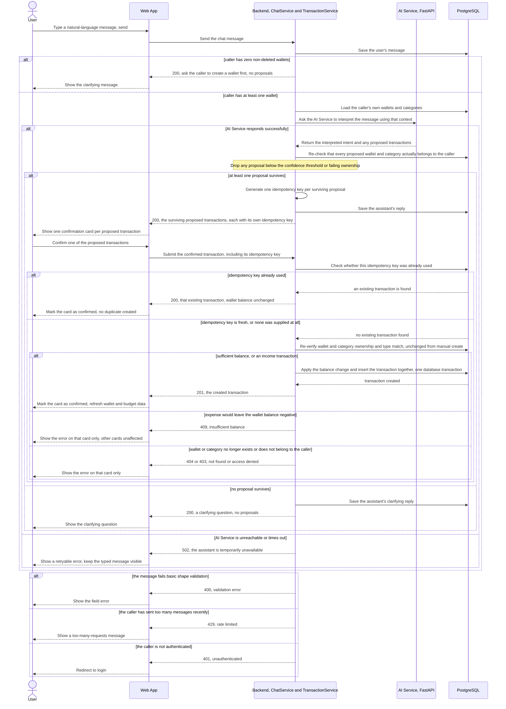

# Implementation Plan: Feature-12 AI Chat Assistant — Create Transaction via Chat (Release 1)

- **Feature:** AI Chat Assistant (US-01 only — Create a Transaction via Chat)
- **SRS Feature Code:** FR-09 / Feature-12 (SRS.md Feature-12 §6 US-01; SDS.md §5.12 US-12-01, §6 API Design, §7 Security Design; `spec.md` in this folder is the authoritative source)
- **Jira Epic:** N/A — this repository has no Jira integration wired up (same as every prior plan)
- **Spec:** [spec.md](./spec.md)
- **Related plans:** [F-06 Transaction Management](../transaction-management/plan.md) (**this plan modifies F-06's existing files** — adds an optional `idempotency_key` to `POST /transactions`, closing that plan's own Open Task `TRX-T20`), [F-04 Category Management](../category-management/plan.md) / [F-03 Wallet Management](../wallet-management/plan.md) (`WalletRepo.ListWalletsByUser`/`CategoryRepo.ListCategoriesForUser` reused as-is for AI context injection — no changes to either)
- **Frontend scope:** **web only** (`frontend/`, Next.js). `mobile/` (Flutter) is paused per `CLAUDE.md` and not touched by this plan.
- **New stack introduced:** Python FastAPI (`ai-service/`) — greenfield, did not exist before this plan.

---

## 1. Pre-flight: Spec Review Findings

| # | Type | Finding | Resolution / Open Task |
|---|------|---------|-------------------------|
| 1 | Gap | `spec.md` describes the AI Service's internal contract only as "`{ message, wallets, categories, now }` → `{ intent, transactions[] }`" without pinning an exact path. | This plan fixes it as `POST http://ai-service:8000/extract` (internal Docker network only, no host port exposed — mirrors how `postgres` is reachable only as `postgres:5432` from `backend`). |
| 2 | Ambiguity, resolved | `spec.md` doesn't say who renders the user-facing confirmation reply text (SRS's own example scenarios show a rendered Vietnamese summary naming the affected category and amounts). | **`ChatService` renders it in Go, templated from the structured `actions[]`/ambiguous state — not a second LLM call.** The AI Service's job is *only* structured extraction (`intent` + `transactions[]`); a second free-text LLM round-trip purely for phrasing would risk the reply text drifting from the actual proposed fields (a classic LLM-hallucination surface) and doubles Groq/Anthropic cost per message. Money in the templated text uses the existing `common.FormatCents` helper (already used by Notification's title/body rendering) — cosmetic gap: it renders a plain "amount CURRENCY" string, not the localized currency suffix SRS's examples show; flagged as a minor, non-blocking wording difference, not a new formatter. |
| 3 | **Cross-feature modification, spec-mandated (Resolved design decision #5 in spec.md)** | `spec.md` requires `POST /transactions` to accept an optional `idempotency_key` and return the original Transaction (`200`, not `201`) on a repeat key — this endpoint is F-06's, already shipped and tested. | This plan modifies `TransactionService.CreateTransaction`'s signature to return an additional `wasReplay bool`, and `TransactionHandler.CreateTransaction` picks `200`/`201` accordingly. **Backward compatible by construction**: every existing caller (the manual "Add transaction" dialog) never sends `idempotency_key`, so `wasReplay` is always `false` for them and the response stays `201` exactly as before — see Regression Scope. |
| 4 | Gap | `ai-service/` does not exist in the repository at all (confirmed via `docs/features.md`/`docs/tech_stacks.md`, both updated this session). | This plan scaffolds its Phase 0 (FastAPI + health check) and Phase 1 (the one `/extract` endpoint) — per `docs/features.md` §6 AI Service Roadmap. Exact prompt wording and Groq model ID selection are left as an Open Task (#8 below) — this plan does not hardcode a specific Groq model string, since none was confirmed against Groq's live catalog. |
| 5 | Gap | No `docker-compose.yml` entry, no internal network path from `backend` to an AI service exists yet. | This plan adds a new `ai-service` compose entry (internal-only, no host port) and a new `AI_SERVICE_URL` env var read by `backend/internal/config/config.go`, defaulting to `http://ai-service:8000` (compose's internal DNS name), matching the `DATABASE_URL`-via-service-name precedent already used for `postgres`. |
| 6 | Ambiguity, resolved as an explicit assumption (spec.md Open Question #1) | Exact rate-limit threshold for `POST /ai/chat` is unset — spec assumes 30/hour/user as a placeholder. | This plan implements the assumed number as `common.AIChatRateLimit = 30`, `common.AIChatRateLimitWindow = 1 * time.Hour`, keyed by the authenticated caller's user ID — same `KeyGenerator` pattern as `InviteRateLimiter`, not by IP (unlike `LoginRateLimiter`, which runs pre-auth). Flagged for product sign-off (Open Task #9), not silently treated as final. |
| 7 | Ambiguity, resolved (spec.md Open Question #5) | `categories.description` for disambiguation is explicitly deferred in `spec.md`. | This plan makes **no schema change to `categories`** — the AI Service is given only `{id, name, type}` per category, matching context injection already planned for Wallets (`{id, name, is_default, currency}`). |
| 8 | Ambiguity, resolved as deferred (spec.md Open Question #8) | Linking a confirmed Transaction back to its originating `chat_messages` row is explicitly "best-effort, not required for correctness" in `spec.md`. | **Not implemented in this plan** — `chat_messages.transaction_ids` is written by the migration but never populated by any code path here. Tracked as **AI-T28** (Open Tasks), mirroring `transaction-management/plan.md`'s own precedent of explicitly deferring `TRX-T20` rather than silently skipping it. |
| 9 | Gap, resolved as a cost-saving short-circuit | `spec.md` Edge Case #7 says a caller with zero Wallets gets `intent: "ambiguous"` — it doesn't say whether the AI Service is still called in that case. | **`ChatService.Chat` short-circuits before calling the AI Service at all when the caller has zero non-deleted Wallets** — a message can never succeed without a Wallet to write against, so calling a metered LLM API for it would be pure waste. Directly serves `docs/features.md` §6's explicit "avoid designs that call the LLM on every request when a cheaper heuristic would do" instruction. |
| 10 | Gap, resolved | Confidence-below-threshold and hallucinated-ownership items (spec.md Edge Cases #1, #4) are **not** error responses — both fold into a `200` with `intent: "ambiguous"` or a partial `actions[]`. | No new `AppError`/error code is needed for either case — confirmed by re-reading `spec.md`'s own Scenarios table (S-AI-06 through S-AI-09 are all `200`s). Only two failure paths in this plan actually need a new error code: AI Service unreachable (`502`) and rate-limit (`429`, but that code — `RATE_LIMITED` — already exists from F-01/F-02, reused as-is). |
| 11 | Out of scope, explicitly not started (per spec's own resolution) | `spec.md` Open Questions #2/#4 leave the exact Groq/Anthropic fallback trigger condition and the general-vs-chat-only framing of `idempotency_key` open. | Not resolved by this plan — `AIServiceClient`'s fallback logic (Open Task #10) and the idempotency-key framing question (Open Task #26) are both implementation/product decisions flagged, not silently picked. |
| 12 | Gap (carried over) | The frontend project still has zero test tooling configured — unchanged since F-03/F-04/F-05/F-06's own plans each flagged this. | Not committed to in this plan either; carried forward as **AI-T29**. |
| 13 | **Concurrency gap, caught during self-review** | A lookup-then-insert ordering alone (check `GetTransactionByIdempotencyKey`, then insert if not found) has a race window: two near-simultaneous confirms carrying the *same fresh* key could both pass the lookup before either commits. | The partial unique index (`idx_transactions_user_idempotency_key`) is the actual concurrency guard, not the lookup — `TransactionService.CreateTransaction` must catch a unique-constraint violation on the insert itself and, on that specific conflict, re-run `GetTransactionByIdempotencyKey` and return the now-existing row as a `200` replay, rather than surfacing a raw `500`. Same "let the DB constraint be the source of truth, not a check-then-write race" pattern already used by F-03's default-wallet index and F-05's active-Budget index — see Locking Strategy in §4. |

### Regression Scope

**New files (Go Backend):**
- `backend/db/migrations/010_transactions_idempotency_key.sql`, `011_chat_messages.sql`
- `backend/db/queries/chat_messages.sql` (new); `backend/db/queries/transactions.sql` (append: `GetTransactionByIdempotencyKey`, modified `CreateTransaction`)
- `backend/internal/model/chat_message.go`
- `backend/internal/repository/chat_repository.go`
- `backend/internal/service/chat_service.go`, `backend/internal/service/ai_service_client.go`
- `backend/internal/handler/chat_handler.go`
- `backend/internal/dto/chat_request.go`, `backend/internal/dto/chat_response.go`

**New files (Python AI Service, greenfield):**
- `ai-service/app/main.py`, `ai-service/app/core/config.py`, `ai-service/app/core/groq_client.py`
- `ai-service/app/schemas/extract_schema.py`, `ai-service/app/services/extract_service.py`, `ai-service/app/routers/extract_router.py`
- `ai-service/requirements.txt`, `ai-service/Dockerfile`

**New files (Next.js web):**
- `frontend/src/features/ai-chat/**` (api, components, types.ts)
- `frontend/src/app/app/ai-chat/page.tsx`

**Modified files (additive only):**
- `backend/cmd/server/routes.go` — new `/ai` group; no existing route touched.
- `backend/cmd/server/main.go` — new repo/service/handler/client wiring, appended.
- `backend/internal/common/errors.go` / `constants.go` — new error code/constants appended; nothing renamed.
- `backend/internal/service/interfaces.go` — new `ChatRepo`/`AIServiceClient` interfaces + compile-time checks appended; `TransactionRepo` interface **gains one new method** (see below).
- `backend/internal/config/config.go` — new `AIServiceURL` field.
- `backend/internal/middleware/rate_limit.go` — new `AIChatRateLimiter` function appended.
- `backend/internal/dto/transaction_request.go` — `CreateTransactionRequest` gains one new optional field.
- `docker-compose.yml` / `.env.example` — new `ai-service` entry, new env vars.
- `frontend/src/features/transactions/types.ts` — `CreateTransactionRequest` gains one new optional field (mirrors the Go DTO change).
- `frontend/src/lib/constants.ts` — new `ROUTES.aiChat` entry, new `AI_CHAT_MESSAGE_MAX_LENGTH`.
- `frontend/src/features/auth/components/app-header.tsx` — adds an "AI Chat" nav link.

**Modified files (behavioral change — flagged per Finding #3, not additive):**
- `backend/internal/repository/transaction_repository.go` — `CreateTransactionParams` gains `IdempotencyKey *uuid.UUID`; new `GetTransactionByIdempotencyKey` method.
- `backend/internal/service/transaction_service_create.go` — `CreateTransaction` now checks for an existing idempotency-key match before doing any Wallet/Category work, and returns an additional `wasReplay bool`.
- `backend/internal/handler/transaction_handler.go` — `CreateTransaction` picks `fiber.StatusOK` instead of `fiber.StatusCreated` when `wasReplay` is `true`.

**Regression risk: none for every existing caller.** `idempotency_key` is optional and the manual "Add transaction" dialog (`create-transaction-dialog.tsx`) never sends it — `wasReplay` is therefore always `false` for every pre-existing call site, and the response status stays `201` exactly as before (S-TRX-01, S-TRX-02 unaffected). The new `200`-on-replay branch activates only when a caller explicitly supplies `idempotency_key` — i.e., only the new AI Chat confirm flow this plan introduces. Re-verify S-TRX-01/S-TRX-02 after this change lands anyway (Open Task #29), same discipline as `transaction-management/plan.md`'s own regression note.

---

## 2. Architecture

### Package/File Layout

**Backend (Go Fiber + sqlc)**

```text
backend/internal/
├── handler/
│   └── chat_handler.go             # Chat (POST /ai/chat)
├── service/
│   ├── chat_service.go             # context load, AI Service call, ownership re-validation,
│   │                                  confidence gate, default-wallet resolution, message rendering
│   └── ai_service_client.go        # AIServiceClient interface + HTTP impl — POST {AI_SERVICE_URL}/extract
├── repository/
│   └── chat_repository.go          # CreateChatMessage only (this cut never reads chat_messages back)
├── model/
│   └── chat_message.go             # ChatMessage struct — zero framework imports
└── dto/
    ├── chat_request.go             # ChatRequest
    └── chat_response.go            # ChatResponse, ChatActionResponse, TransactionActionPayload

# Modified (Finding #3 — closes transaction-management/plan.md's TRX-T20):
├── repository/transaction_repository.go   # + GetTransactionByIdempotencyKey; CreateTransactionParams + IdempotencyKey
├── service/transaction_service_create.go  # CreateTransaction returns (tx, balance, wasReplay, err)
├── handler/transaction_handler.go         # 200 vs 201 based on wasReplay
└── dto/transaction_request.go             # CreateTransactionRequest + IdempotencyKey *uuid.UUID
└── service/interfaces.go                  # TransactionRepo interface + GetTransactionByIdempotencyKey

# Modified (additive):
├── middleware/rate_limit.go        # + AIChatRateLimiter (mirrors InviteRateLimiter's per-user keying)
└── config/config.go                # + AIServiceURL

db/
├── migrations/
│   ├── 010_transactions_idempotency_key.sql
│   └── 011_chat_messages.sql
└── queries/
    ├── transactions.sql (append)   # GetTransactionByIdempotencyKey; CreateTransaction gains idempotency_key param
    └── chat_messages.sql (new)     # CreateChatMessage
```

**AI Service (Python FastAPI — greenfield)**

```text
ai-service/
├── app/
│   ├── main.py                     # FastAPI app, GET /health, mounts extract_router
│   ├── core/
│   │   ├── config.py               # env: GROQ_API_KEY, ANTHROPIC_API_KEY (both from os.environ, no defaults for secrets)
│   │   └── groq_client.py          # Groq SDK client singleton; Anthropic client singleton (fallback)
│   ├── routers/
│   │   └── extract_router.py       # POST /extract
│   ├── services/
│   │   └── extract_service.py      # builds the system prompt from injected wallets/categories,
│   │                                 # calls Groq first; on exception/timeout, retries once via Anthropic;
│   │                                 # both failing -> raises, router maps to 503 (Go backend turns
│   │                                 # any non-2xx/timeout from this service into 502 AI_SERVICE_UNAVAILABLE)
│   └── schemas/
│       └── extract_schema.py       # Pydantic v2: ExtractRequest, ExtractResponse, ProposedTransaction
├── requirements.txt                # fastapi, uvicorn, pydantic>=2, groq, anthropic
└── Dockerfile
```

**Next.js — Web Frontend (`frontend/src/`)**

```text
frontend/src/
├── app/app/
│   └── ai-chat/
│       └── page.tsx                                # AIChatPage — composes chat thread + input
└── features/ai-chat/
    ├── api/
    │   └── use-send-chat-message-mutation.ts       # POST /ai/chat
    ├── components/
    │   ├── chat-thread.tsx                          # renders the client-only message list (see Finding below)
    │   ├── chat-message-bubble.tsx                  # user vs assistant bubble
    │   ├── chat-input.tsx                            # textarea + send button, enforces 1000-char cap
    │   └── confirmation-card.tsx                     # per-action card: amount/category/wallet/date +
    │                                                    Confirm/Cancel; reuses useCreateTransactionMutation
    └── types.ts                                      # ChatAction, ChatResponse, ChatRequest

# Modified (additive):
├── features/transactions/types.ts        # CreateTransactionRequest + idempotency_key?: string
├── lib/constants.ts                       # + ROUTES.aiChat, + AI_CHAT_MESSAGE_MAX_LENGTH
└── features/auth/components/app-header.tsx  # + "AI Chat" nav link
```

> **Resolved ambiguity — chat thread is client-only state, not TanStack Query cache.** The Constitution rule "server state via TanStack Query, never `useState`" (existing convention) applies to *fetchable* server data. There is no `GET /ai/chat/history` in this spec's scope (spec.md explicitly rules out multi-turn context) — the visible message thread is built up entirely from each `POST /ai/chat` mutation's own response, which has no corresponding refetchable GET resource. `chat-thread.tsx` therefore holds the thread in local component state (`useState`/`useReducer`), same as any one-shot action-result UI, not a violation of the server-state rule.

### Domain Objects

| Entity | Table | Key Fields | Notes |
|--------|-------|------------|-------|
| `ChatMessage` | `chat_messages` | `id` (UUID v4), `user_id` (FK → `users.id`), `conversation_id` (UUID, server-generated if omitted), `role` (`user`\|`assistant`), `content`, `intent` (nullable, `create_transaction`\|`ambiguous`), `transaction_ids` (nullable `UUID[]`, never populated by this plan — Finding #8), `created_at` | No `deleted_at` — an append-only historical log with no delete/update operation defined anywhere in `spec.md`, same reasoning as F-10's `Notification` (no soft-delete column either). |
| `Transaction` (modified) | `transactions` | **+** `idempotency_key` (nullable `UUID`) | ⚠️ Money-adjacent — this column gates duplicate-write protection for a money-mutating endpoint; unique per `(user_id, idempotency_key)` via a partial index, `NULL` values excluded so every pre-existing row (all currently `NULL`) is unaffected. |

### Schema — `010_transactions_idempotency_key.sql`

```sql
ALTER TABLE transactions ADD COLUMN idempotency_key UUID;

-- Partial unique index — NULL keys (every pre-existing row, and every future
-- caller that doesn't send one) never collide with each other or with a real
-- key. A second POST /transactions reusing the same (user_id, idempotency_key)
-- is rejected at the DB level before TransactionService.CreateTransaction's
-- lookup even races a concurrent duplicate (spec.md Edge Case #2).
CREATE UNIQUE INDEX idx_transactions_user_idempotency_key
    ON transactions (user_id, idempotency_key)
    WHERE idempotency_key IS NOT NULL;
```

### Schema — `011_chat_messages.sql`

```sql
CREATE TABLE chat_messages (
    id              UUID PRIMARY KEY DEFAULT uuid_generate_v4(),
    user_id         UUID NOT NULL REFERENCES users(id),
    conversation_id UUID NOT NULL,
    role            TEXT NOT NULL CHECK (role IN ('user', 'assistant')),
    content         TEXT NOT NULL,
    intent          TEXT,
    transaction_ids UUID[],
    created_at      TIMESTAMPTZ NOT NULL DEFAULT NOW()
);

CREATE INDEX idx_chat_messages_user_conversation
    ON chat_messages (user_id, conversation_id, created_at);
```

### Business Rules

| Rule | Source | Enforcement |
|------|--------|-------------|
| `message` required, non-empty, ≤ 1000 chars | S-AI-11 | handler-level `validate.Struct` (`required,max=1000`) → `400 INVALID_INPUT` |
| `conversation_id` (if present) must be a valid UUID | S-AI-18 | `*uuid.UUID` field — malformed value fails at `c.BodyParser` itself, same precedent as `CreateTransactionRequest.WalletID` |
| Caller must be authenticated | S-AI-15 | `middleware.JWTAuth` at the `/ai` route-group level |
| Caller is rate-limited on `POST /ai/chat` only | S-AI-16 | `middleware.AIChatRateLimiter` (new), keyed by caller's user ID (`common.AIChatRateLimit`/`AIChatRateLimitWindow`) — confirm step (`POST /transactions`) carries no additional limit |
| Zero Wallets → short-circuit to `ambiguous`, no AI Service call | S-AI-17, Finding #9 | `ChatService.Chat` checks `len(wallets) == 0` before calling `AIServiceClient` |
| AI Service unreachable/timeout | S-AI-10 | `AIServiceClient.Extract` wraps any transport error/non-2xx as `common.ErrAIServiceUnavailable` (new) → `502 AI_SERVICE_UNAVAILABLE` |
| Every returned `category_id`/`wallet_id` re-validated for caller ownership | S-AI-09, Resolved design decision #4 | `ChatService.Chat` calls the same `getVisibleCategory`/`getOwnedWallet`-equivalent checks `TransactionService` already has (duplicated here, not shared — same precedent as `TransactionService`'s own duplication of `WalletService`'s helper) |
| Confidence < 0.6 → item dropped from `actions[]`, folded into ambiguous text | S-AI-08 | `common.AIChatConfidenceThreshold = 0.6` (new constant); `ChatService.Chat` filters before building `actions[]` |
| Wallet unmentioned → resolve to caller's default Wallet; none default → item dropped | S-AI-05, S-AI-06 | `ChatService.Chat` scans the already-loaded `[]model.Wallet` for `IsDefault == true` — no new repository method |
| `idempotency_key` generated once per surviving action, server-side | Edge Case #2 | `uuid.New()` per item in `ChatService.Chat`, never client- or AI-Service-supplied |
| Assistant reply text rendered in Go, not a second LLM call | Finding #2 | `ChatService.Chat` builds `message` from the structured `actions`/ambiguous state via `common.FormatCents` + fixed Vietnamese templates |
| `chat_messages` persisted for both roles, no delete/update path | Domain Objects | `ChatRepository.CreateChatMessage`, called twice per `Chat` call (`role=user` then `role=assistant`) |
| **`POST /transactions` — idempotency replay** | Resolved design decision #5, S-AI-13 | `TransactionRepository.GetTransactionByIdempotencyKey(userID, key)` checked first in `TransactionService.CreateTransaction`; a hit short-circuits straight to returning that Transaction + its Wallet's current balance, `wasReplay = true`, **skipping Wallet/Category checks and any balance mutation entirely**. If two confirms race past this initial lookup with the same fresh key, the partial unique index rejects the second insert — that specific conflict is caught and turned into a second `GetTransactionByIdempotencyKey` lookup + `200` reply, never a raw `500` (Finding #13) |
| **`POST /transactions` — fresh idempotency key** | S-AI-12 | No existing row found → proceeds through the unchanged US-01 flow (`transaction-management/spec.md`), then the new insert also stores `idempotency_key` |
| **`POST /transactions` — confirm-time validation unchanged** | S-AI-14 | Every existing check (`404 WALLET_NOT_FOUND`, `409 INSUFFICIENT_BALANCE`, etc.) applies identically when `idempotency_key` is fresh — no special-casing for AI-originated requests |

### API Index — Endpoint → Service Traceability

| API | Request | Response | Service Method |
|-----|---------|----------|-----------------|
| `POST /ai/chat` | `ChatRequest` | `ChatResponse` (`200`) | `ChatService.Chat` |
| `POST /transactions` *(modified)* | `CreateTransactionRequest` (+ optional `idempotency_key`) | `TransactionResponse` (`201` fresh / `200` replay) | `TransactionService.CreateTransaction` |

### Security & Actor Resolution

- **Middleware:** `/ai` sits under `JWTAuth(tokens, logger)` **and** the new `AIChatRateLimiter(logger)`, in that order (auth must resolve the caller before the limiter can key on their user ID — same ordering rule `routes.go`'s own comment states for `InviteRateLimiter`).
- **Actor resolution path:** identical to every other feature — `callerUUID(c)` reads JWT-populated Fiber locals once in `chat_handler.go`, passed into `ChatService.Chat` as an explicit `userID uuid.UUID` parameter.
- **AI Service is untrusted for authorization** (spec.md Resolved design decision #4, SDS §7): `ChatService` re-validates every `wallet_id`/`category_id` the AI Service returns against `WalletRepo.GetWalletByID`/`CategoryRepo.GetCategoryByID` (existing methods, no changes) before either ID reaches `actions[]`. A failed check is treated identically to a low-confidence item — dropped, never surfaced, never a distinct error response.
- **Idempotency-key lookup is scoped by `(user_id, idempotency_key)`, never by `idempotency_key` alone** — one caller can never observe or collide with another caller's key, even if two different users' clients happened to generate the same UUID (astronomically unlikely, but the composite index makes it structurally impossible regardless).
- **CSRF:** not applicable — Bearer-JWT API, no cookie/session auth surface for either mutating endpoint in this plan (`POST /ai/chat`, `POST /transactions`) — same reasoning as every prior plan.
- **Framework note:** no Spring-style `@PreAuthorize`. All authorization logic (ownership re-validation, confidence gating, rate limiting via middleware) lives in `ChatService`/`middleware`, never in `chat_handler.go`.
- **Bookmark / direct-URL access:** not a meaningful scenario for this feature — `POST /ai/chat` and the confirm step are both action endpoints with no `{id}`-addressable resource a caller could navigate to directly (unlike `GET /transactions/{id}`); there is nothing to bookmark into someone else's data.
- **Validation-check independence:** `message`/`conversation_id` shape checks (`POST /ai/chat`) are a single independent field-level check, collected into one `400` via the existing `newValidationError` convention. Everything after that is **sequential/gating**: authenticate → rate-limit → zero-Wallet short-circuit → call the AI Service → re-validate ownership of each returned ID → confidence gate — each step requires the prior to have resolved before the next runs, modeled as early-return steps inside `ChatService.Chat`, never collected together. On the confirm side, the idempotency-key lookup is now the **first** gating check, ahead of the unchanged Wallet-existence → Wallet-ownership → Category-existence → Category-visibility → Category-type-match → balance-floor chain from `transaction-management/plan.md`.

### Sequence Diagrams

> This diagram is AI-generated and requires human review before implementation begins. It covers the whole of US-01 end to end — both the propose call and the confirm call — in one diagram, since both belong to the same user story; every alternate/failure path is a real `alt`/`else` branch, not a separate diagram.

**US-01: Create a Transaction via Chat (propose, then confirm)**



---

## 3. Error Flows

### `POST /ai/chat`

| Scenario | HTTP | Error Code |
|----------|------|------------|
| Unauthenticated | 401 | — |
| `message` empty, missing, or > 1000 chars | 400 | `INVALID_INPUT` |
| `conversation_id` present but not a valid UUID | 400 | `INVALID_INPUT` |
| Rate limit exceeded | 429 | `RATE_LIMITED` *(existing code, reused)* |
| AI Service unreachable / timeout (Groq + Anthropic both failed) | 502 | `AI_SERVICE_UNAVAILABLE` *(new)* |
| Unexpected error | 500 | — |

*(Zero-Wallet short-circuit, sub-threshold confidence, and hallucinated-ownership items are all `200` responses with `intent: "ambiguous"` or a partial `actions[]` — not error paths; see `spec.md` S-AI-06 through S-AI-09, Finding #10.)*

### `POST /transactions` (idempotency addition only — every other row is unchanged from `transaction-management/plan.md` §3 US-01)

| Scenario | HTTP | Error Code |
|----------|------|------------|
| `idempotency_key` reused by the same `user_id`, matches an existing Transaction | 200 *(not an error — returns the existing Transaction)* | — |
| *(all other US-01 error flows unchanged — see `transaction-management/plan.md`)* | — | — |

---

## 4. Constitution / Convention Notes

| Rule | Status | Note |
|------|--------|------|
| Service layer owns business rules | Required | Ownership re-validation, confidence gating, default-Wallet resolution, and message rendering all live in `ChatService` — never in `chat_handler.go` |
| Handler validates shape only | Required | `message`/`conversation_id` via `validator/v10` tags, same convention as `CreateTransactionRequest` |
| Transactional atomicity — `POST /transactions` idempotency check | Required ⚠️ | The idempotency lookup and the balance mutation + insert happen inside the **same flow**, before any Wallet/Category work on a fresh key — a replay never touches the Wallet balance a second time |
| Transactional atomicity — `POST /ai/chat` | Not applicable | No money mutation happens on this endpoint at all — the two `chat_messages` inserts are independent, unordered-safe writes, not wrapped in a `pgx.Tx` |
| Read flows non-transactional | Required | `ChatService.Chat`'s context load (`ListWalletsByUser`, `ListCategoriesForUser`) and the idempotency-key lookup are plain reads, no transaction wrapper |
| Locking strategy — idempotency-key replay | Optimistic via the partial unique index, not a row lock | The lookup-then-insert order is a fast path only; the `(user_id, idempotency_key)` partial unique index is the actual concurrency guard — a losing concurrent insert is caught and converted to a `200` replay lookup (Finding #13), never a raw `500`. Same "push the invariant into the DB, not a check-then-write race" reasoning as F-03's default-Wallet index, F-05's active-Budget index, and F-06's own insufficient-balance floor |
| Audit logging | Not required (MVP) | No `audit_log` table exists anywhere in the schema — same reasoning as every prior feature's plan |
| No PII / sensitive content in application logs | Required ⚠️ | `chat_messages.content` (raw user text) is stored in the DB by design — that is the feature's whole purpose — but `ChatService`/`ChatHandler` must never additionally log that raw content at INFO level; only structured Zap `WARN` logs on `401`/`403`/`502`/`429`, matching every existing handler's convention, with no message body included |
| Money stored as BIGINT cents | Required ⚠️ | The AI Service parses "30k"/"1tr" shorthand into a plain integer *before* it reaches the Go Backend; the Go Backend re-validates that integer exactly as `POST /transactions` already does (spec.md Resolved design decision #3) — no float anywhere in either stack's path |
| Idempotency on write — `POST /ai/chat` | Not idempotent (by design) | Each call may consult a live LLM and always persists a fresh `chat_messages` pair — resending the same message is a new proposal, not a replay |
| Idempotency on write — `POST /transactions` confirm step | **Now satisfied** ⚠️ | First MVP/Release-1 write endpoint in the project with an explicit idempotency key — closes `transaction-management/plan.md`'s `TRX-T20` |
| JWT auth enforced at middleware | Required | `/ai/*` registered under `JWTAuth` + the new `AIChatRateLimiter`, same group-level pattern as every other feature |
| Rate limiting scope | Required, new | `AIChatRateLimiter` applies only to `POST /ai/chat` — the confirm step reuses the unmodified, unlimited `POST /transactions` |
| Soft delete respected | Not applicable to `chat_messages` | No `deleted_at` column — append-only historical log, same precedent as `Notification` (Domain Objects note) |
| Timestamps UTC stored / local displayed | Required | `chat_messages.created_at` is `TIMESTAMPTZ`; the AI Service receives `now` as a server-computed UTC timestamp, never client-supplied |
| No file > 300 lines | Required | Watch `chat_service.go` — ownership re-validation × 2 (Wallet, Category) + confidence gating + message templating is the largest new file in this plan; split further if it grows past the cap |
| Frontend server state via TanStack Query | Required, with one documented exception | `use-send-chat-message-mutation.ts` is a TanStack `useMutation`; the *visible thread* is client-only `useState` (see Architecture note above) — not a violation, since there is no corresponding `GET` resource to cache |
| Frontend skeleton loading | Not applicable in the traditional sense | No table/list skeleton — the "Loading" state (Client UI States, spec.md) is an inline typing indicator while `POST /ai/chat` is in flight |
| Frontend delete confirmation dialog | Not applicable | No delete operation exists anywhere in this feature |
| Frontend reuses existing mutation for the money-moving step | Required, deliberate | `confirmation-card.tsx` calls the **existing** `useCreateTransactionMutation` (unchanged file), passing the new optional `idempotency_key` — no new mutation hook duplicates F-06's create logic |

---

## 5. Element/Key IDs

> `data-testid` attributes for QA automation — `frontend/src` still has zero `data-testid` usage anywhere (carried-over gap, F-03 Finding #8 / ... / F-06 §5).

**Web (`data-testid`):**

| Element | data-testid | Status | File |
|---------|------------|--------|------|
| Chat message textarea | `input-chat-message` | **Missing** | `frontend/src/features/ai-chat/components/chat-input.tsx` |
| Send message button | `btn-chat-send` | **Missing** | same |
| User message bubble | `bubble-chat-user` | **Missing** | `chat-message-bubble.tsx` |
| Assistant message bubble | `bubble-chat-assistant` | **Missing** | same |
| Chat error banner (AI Service down / rate limited) | `banner-chat-error` | **Missing** | `chat-thread.tsx` |
| Confirmation card container | `card-chat-confirm-action` | **Missing** | `confirmation-card.tsx` |
| Confirm button (per action) | `btn-chat-confirm-action` | **Missing** | same |
| Cancel button (per action) | `btn-chat-cancel-action` | **Missing** | same |
| Confirmed-state indicator on a card | `indicator-chat-action-confirmed` | **Missing** | same |

---

## 6. Status Summary (Step Handoff)

| Area | Status |
|------|--------|
| Spec (`spec.md`) | Done — cross-checked against `/ba-checklist` this session (mixed-confidence handling, invalid-`conversation_id` scenario, and a Client UI States table were added during self-check) |
| Plan (this document) | Done, pending human review of diagrams (§2) and the `POST /transactions` behavioral modification (Finding #3) |
| Backend migration/queries/handler/service/repository (new) | Not started |
| Backend `POST /transactions` idempotency modification (Finding #3) | Not started |
| AI Service scaffold (Python, greenfield) | Not started |
| `docker-compose.yml` / `.env.example` wiring | Not started |
| Frontend feature scaffold | Not started |
| Frontend test infra | Not started (carried-over gap) |

## 7. Open Tasks

| ID | Task | File |
|----|------|------|
| AI-T01 | Write migration: additive `idempotency_key` column + partial unique index on `transactions` (Finding #3) | `backend/db/migrations/010_transactions_idempotency_key.sql` |
| AI-T02 | Write migration: `chat_messages` table + index | `backend/db/migrations/011_chat_messages.sql` |
| AI-T03 | sqlc: add `GetTransactionByIdempotencyKey`; modify `CreateTransaction` query to accept/store `idempotency_key` | `backend/db/queries/transactions.sql` |
| AI-T04 | sqlc: add `CreateChatMessage` | `backend/db/queries/chat_messages.sql` (new) |
| AI-T05 | Add error code `ErrCodeAIServiceUnavailable` / sentinel `ErrAIServiceUnavailable` (502) | `backend/internal/common/errors.go` |
| AI-T06 | Add constants: `AIChatRateLimit`, `AIChatRateLimitWindow`, `AIChatMessageMaxLength`, `AIChatConfidenceThreshold` | `backend/internal/common/constants.go` |
| AI-T07 | Implement `model.ChatMessage` (zero framework imports) | `backend/internal/model/chat_message.go` |
| AI-T08 | Implement `ChatRepository.CreateChatMessage` | `backend/internal/repository/chat_repository.go` |
| AI-T09 | `TransactionRepository`: add `GetTransactionByIdempotencyKey`; extend `CreateTransactionParams` with `IdempotencyKey *uuid.UUID` | `backend/internal/repository/transaction_repository.go` |
| AI-T10 | Implement `AIServiceClient` interface + HTTP impl (`POST {AI_SERVICE_URL}/extract`, timeout, wraps failures as `ErrAIServiceUnavailable`) | `backend/internal/service/ai_service_client.go` |
| AI-T11 | Implement `ChatService.Chat` — context load, zero-Wallet short-circuit, AI Service call, ownership re-validation, confidence gate, default-Wallet resolution, idempotency-key pre-generation, message templating, `chat_messages` persistence | `backend/internal/service/chat_service.go` |
| AI-T12 | Modify `TransactionService.CreateTransaction` — idempotency-key lookup first, returns `(tx, walletBalance, wasReplay, err)` | `backend/internal/service/transaction_service_create.go` |
| AI-T13 | Modify `TransactionHandler.CreateTransaction` — `200` vs `201` based on `wasReplay` | `backend/internal/handler/transaction_handler.go` |
| AI-T14 | Implement `ChatHandler.Chat`; register `/ai` group under `JWTAuth` + `AIChatRateLimiter` | `backend/internal/handler/chat_handler.go`, `backend/cmd/server/routes.go` |
| AI-T15 | Implement `dto.ChatRequest`, `dto.ChatResponse`, `dto.ChatActionResponse`, `dto.TransactionActionPayload` | `backend/internal/dto/chat_request.go`, `chat_response.go` |
| AI-T16 | Add `CreateTransactionRequest.IdempotencyKey *uuid.UUID` (optional) | `backend/internal/dto/transaction_request.go` |
| AI-T17 | Add `ChatRepo`/`AIServiceClient` interfaces + compile-time checks; extend `TransactionRepo` interface | `backend/internal/service/interfaces.go` |
| AI-T18 | Implement `AIChatRateLimiter` (mirrors `InviteRateLimiter`'s per-user keying) | `backend/internal/middleware/rate_limit.go` |
| AI-T19 | Add `Config.AIServiceURL` (env `AI_SERVICE_URL`, default `http://ai-service:8000`) | `backend/internal/config/config.go` |
| AI-T20 | Wire `chatRepo`/`aiServiceClient`/`chatService`/`chatHandler` into DI; pass `chatHandler` into `registerRoutes` | `backend/cmd/server/main.go` |
| AI-T21 | Add `ai-service` entry to `docker-compose.yml` (internal-only, no host port; env `GROQ_API_KEY`/`ANTHROPIC_API_KEY`); add `AI_SERVICE_URL` to the `backend` service's environment; add placeholder `GROQ_API_KEY=`/`ANTHROPIC_API_KEY=`/`AI_SERVICE_URL=` lines to `.env.example` (values left blank — user already holds a Groq key locally, do not commit it) | `docker-compose.yml`, `.env.example` |
| AI-T22 | Scaffold `ai-service/app/main.py` (FastAPI + `GET /health`), `core/config.py`, `core/groq_client.py` (Groq + Anthropic client singletons) | `ai-service/app/` |
| AI-T23 | Implement `POST /extract` — Pydantic v2 schemas, prompt assembly from injected wallets/categories, Groq call, Anthropic fallback on exception/timeout, both-failing → 503 | `ai-service/app/routers/extract_router.py`, `services/extract_service.py`, `schemas/extract_schema.py` |
| AI-T24 | `ai-service/requirements.txt`, `Dockerfile` | `ai-service/` |
| AI-T25 | Add `idempotency_key?: string` to the frontend `CreateTransactionRequest` type | `frontend/src/features/transactions/types.ts` |
| AI-T26 | Scaffold `frontend/src/features/ai-chat/{api,components,types.ts}` | `frontend/src/features/ai-chat/` |
| AI-T27 | Build `AIChatPage` (chat thread + input) | `frontend/src/app/app/ai-chat/page.tsx` |
| AI-T28 | Add `ROUTES.aiChat`, `AI_CHAT_MESSAGE_MAX_LENGTH`; add an "AI Chat" nav link (additive only) | `frontend/src/lib/constants.ts`, `frontend/src/features/auth/components/app-header.tsx` |
| AI-T29 | **Blocked on product sign-off** — exact `POST /ai/chat` rate-limit threshold (Finding #6 / spec.md Open Question #1); current implementation uses the assumed 30/hour | N/A |
| AI-T30 | **Blocked on product sign-off** — should `idempotency_key` be documented as general-purpose (any `POST /transactions` caller) or AI-Chat-only (spec.md Open Question #4)? This plan implements it as general-purpose | N/A |
| AI-T31 | **Explicitly deferred, not started** — `chat_messages.transaction_ids` linkage after a confirmed create (spec.md Open Question #8, Finding #8) | N/A |
| AI-T32 | Stand up frontend test tooling (still zero test infra, carried-over gap) | `frontend/package.json` |
| AI-T33 | Re-run F-06's S-TRX-01/S-TRX-02 (create happy paths) after the idempotency-key change lands, confirming `201` is unaffected when the field is omitted (Regression Scope note) | `backend/internal/service/transaction_service_test.go` |
