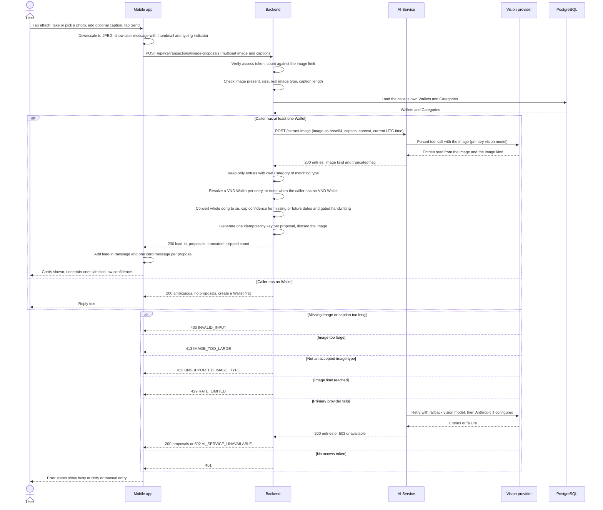
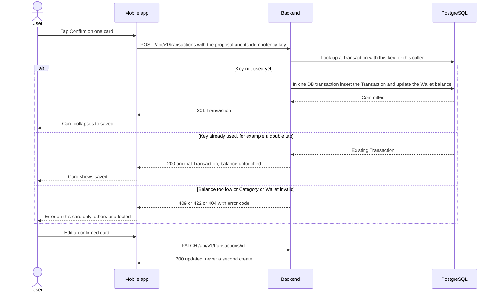
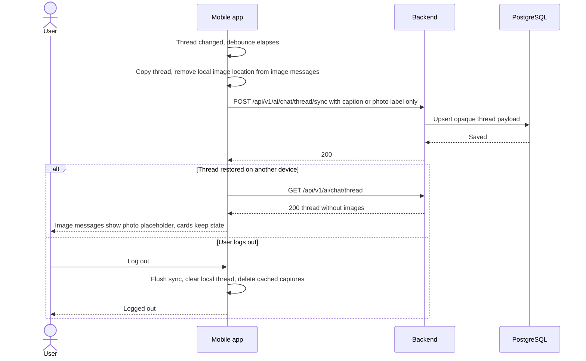
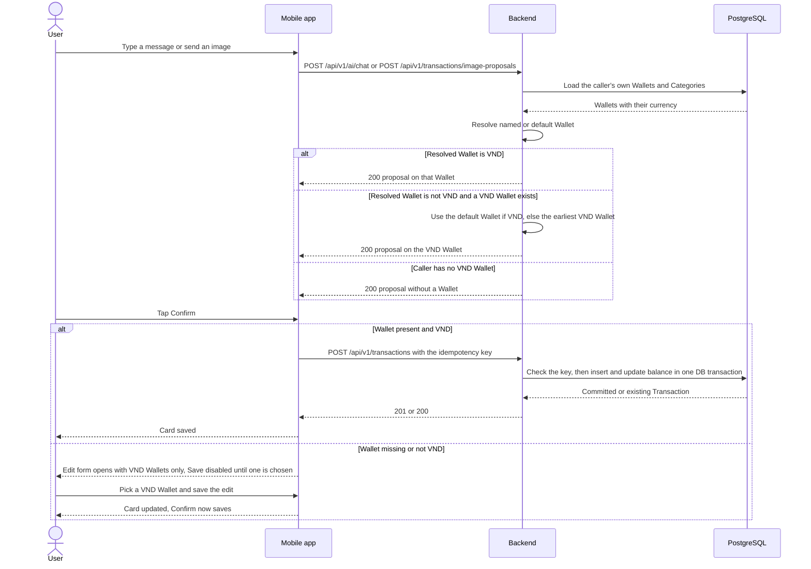
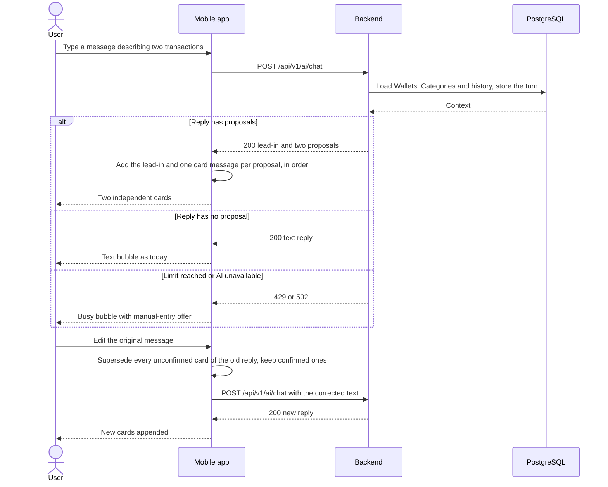

# Plan: Feature-12 — Record Transactions from an Image (`ai-chat-image-capture`)

> Spec: [spec.md](./spec.md) · SRS: Feature-12 AI Chat Assistant / FR-09 / BF-10 (image-capture story being added to SRS in parallel — spec Open Questions #1, in progress) · Touches: F-06 Transaction (confirm step), Feature-12 US-01 typed chat (US-04, US-05 pre-requisite fixes)
> Research: [../mobile-ux-batch-2026-10/research.md](../mobile-ux-batch-2026-10/research.md) (Option C, corrected 2026-10-04)
> Ticket: none — PFM has no Jira; this folder is the tracking unit.
> Stacks touched: **Python AI Service · Go backend · React Native mobile.** `frontend/` web is frozen — no web section.
> Task prefix: `AIIMG-T{NN}`. Scenario IDs: `S-AIIMG-NN` (spec). Product-owner decisions of 2026-10-04 folded in (spec Resolved design decisions 6–10).
> Amended 2026-10-11 for spec BR-03/BR-15, AC-41–AC-43, S-AIIMG-52–S-AIIMG-55: a receipt proposal carries Items and Adjustments ([../transaction-line-items/plan.md](../transaction-line-items/plan.md)). Findings F24–F28, Phase 0 receipt-line criteria (§2.3), tool schema (§4.3), tasks AIIMG-T49–T55.

---

## 1. Pre-flight: Spec Review Findings

Cross-checked against the code on 2026-10-04. Several findings **contradict research.md** — marked 🔺.

| # | Finding | Evidence | Resolution |
|---|---|---|---|
| F1 🔺 | **Mobile renders only the first proposal of a reply.** `ChatMessage` holds a single `action`; `requestAssistantReply` takes `response.actions[0]`. research.md §1 ("nothing on the output side has to change") is wrong for mobile — every multi-item reply (typed ones too) silently drops items 2..N today. | `mobile/src/features/ai-chat/hooks/use-chat-actions.ts:51`, `types.ts` `action?: ChatAction` | **Spec US-05 — pre-requisite fix, ships alone.** Fan out: one lead-in assistant message + **one assistant message per action** (each keeps the existing per-message confirm / edit / swipe-delete / tombstone / pending logic unchanged). Pure helper `reply-fanout.ts`, built for typed replies first (AIIMG-T45) and reused for image replies (AIIMG-T30). |
| F2 🔺 | **The existing AI wire carries whole dong (`amount_vnd`), not xu.** The prompt explicitly tells the model "VND, not xu"; Go multiplies by `common.VNDToCentsFactor` (100). research.md §4 proposes an `amount_xu` tool field. Asking the model to emit ×100 values re-introduces the exact 100× error class found in live testing (`chat_service.go` resolveActions comment). | `ai-service/app/services/prompt_builder.py` rule 2, `backend/internal/service/chat_service.go` resolveActions | Tool field is `amount_vnd`, JSON-schema `integer` (never `number`), `> 0`. Conversion to xu happens once, in Go, with `common.MaxTransactionAmountCents` bound. Every layer is still integer; "xu everywhere" holds from the Go boundary onward, as it does for text chat today. Spike (Phase 0) measures 100×/10× errors to confirm. **Deviation from the task brief's "xu in the LLM tool schema" — flagged for the user.** |
| F3 🔺 | **`/ai/chat/image` would consume the text limiter.** Fiber group middleware applies to every path under the prefix: `v1.Group("/ai", JWTAuth, AIChatRateLimiter)` — any `/ai/*` route spends `AIChatRateLimiter`'s budget (the exact reason `/analytics/*` lives outside `/ai`). | `backend/cmd/server/routes.go` analytics comment | Route is **`POST /api/v1/transactions/image-proposals`** in the existing `transactions` group (JWTAuth only) with its own per-route `AIImageRateLimiter`. Same "propose from a file, user commits" family as `/transactions/import/preview`. No `POST /:id` exists in that group → no ordering conflict. |
| F4 🔺 | **base64 overhead tightens the 4 MB Groq limit.** base64 inflates by 4/3; the request also carries the prompt (Wallet/Category lists). A raw image above ~2.9 MB cannot fit. | research.md §3 | `AIImageMaxUploadBytes = 2.5 MiB` server cap (→ ≈3.4 MB base64 + prompt < 4 MB). Mobile targets < 1 MB (1600 px long edge, JPEG q≈0.7). |
| F5 | `expo-image-picker` plugin config has `"cameraPermission": false` and a photos text about category icons. Expo Go ignores plugin config, but any EAS/dev build would have **no camera permission**. | `mobile/app.json` plugins | AIIMG-T35: set camera + photos permission strings (generic wording). |
| F6 | The mobile debug console logs every request body via `redact(config.data)`. A FormData body is logged as its parts (file URI); a base64 JSON body would be logged whole. | `mobile/src/lib/axios.ts:79,93`, `lib/redact.ts` | Send multipart with a file URI (never base64 from mobile); AIIMG-T36 replaces any FormData body with a fixed `[multipart omitted]` marker in the debug log (spec AC-28). |
| F7 | A User message is always editable (`isEditLocked` returns false for `role === "user"`), and editing re-runs **text** extraction on its text. An image message's text is only the caption. | `mobile/src/features/ai-chat/edit-lock.ts` | AIIMG-T33: lock messages carrying `imageCapture` (spec AC-27). |
| F8 | `useConfirmProposal.save` records `message.sourceText` as a recent phrase. `recent-phrases-store.record` de-duplicates by text (`moveToFront`), so several fanned-out typed cards sharing one `sourceText` produce one entry (spec EC-25). | `hooks/use-confirm-proposal.ts:38`, `stores/recent-phrases-store.ts` | Typed fanned-out cards keep `sourceText`; image proposal messages never set it (spec AC-20) — enforced in `reply-fanout.ts` by the caller passing no source text. |
| F9 | `TransactionActionCard` has no confidence indicator; text chat only changes the lead-in sentence. | `components/TransactionActionCard.tsx` | New optional `lowConfidence` prop rendering the low-confidence label (spec BR-09, AC-21), set only when `message.imageOrigin` and `confidence < AI_CONFIDENCE_THRESHOLD`. Missing/future dates and (when gated) handwritten sources reach the client already capped below the threshold (§3.4), so one client rule covers every BR-09 case. Typed proposals unaffected (spec Out of Scope; Open Questions #3). |
| F10 | `chat_service.go` is already 340 lines (> 300 rule). Its `resolveActions`/`resolveWallet`/index/context helpers use no `ChatService` state. | `CURRENT_STATE.md` known issues; gitnexus impact on `resolveActions`: LOW, 0 indexed callers (call is via receiver; `Chat` is the only caller) | AIIMG-T43: move those helpers into `chat_resolve.go` as package functions, shared by text and image; same task makes wallet resolution currency-aware (F19). `chat_service.go` drops below 300. |
| F11 | No connectivity detection exists in mobile (no NetInfo / expo-network). | `research-offline.md` §2 | Dependency on the offline-support feature's `isOnline` signal. Until it lands, AIIMG-T32 treats an axios network error (no response) as the "no connection" state; the button disables only once the signal exists. |
| F12 | `ai-service` logs `error: str(exc)` on failures. A Pydantic `ValidationError` string echoes input values (amounts, notes); a FastAPI 422 response echoes the request (base64!). | `extract_service.py`; FastAPI default 422 handler | Image path logs `error_type` only, never `str(exc)`. Go client never reads/logs a non-200 body (already true for `/extract`). |
| F13 | `prod` compose limits ai-service to 192 MB. One ≤3.4 MB base64 string per request is fine; concurrent requests are bounded by the per-user limiter. | `backend/docker-compose.yml:164` | No change; noted for ops. |
| F14 | SRS has no story for this yet (checklist requires one before `/cook-ba`). | `SRS.md` Feature-12 has US-01..US-04 only | **In progress** by another contributor (spec Open Questions #1). This plan does not edit SRS. |
| F15 | Spec says "current date" for a missing date. Text flow uses server `time.Now().UTC()` and stores date-only proposals at 00:00 UTC. | `parseFlexibleTimestamp`, `chat_service.go` | Same rule reused; the known UTC day-boundary issue applies equally (spec Timestamps). |
| F16 | Spec's `413 IMAGE_TOO_LARGE`: a body over Fiber's default 4 MB `BodyLimit` is rejected by Fiber **before** the handler, as a `*fiber.Error` 413 mapped by `errCodeForFiberStatus`. | `main.go` (no `BodyLimit`), `internal/response` | Handler enforces `AIImageMaxUploadBytes` itself → `IMAGE_TOO_LARGE`. Mobile treats any 413 as too large regardless of code. `BodyLimit` stays default. |
| F17 | Anthropic key is not configured in this environment → Groq is the only live path. | research.md §3 | Chain: Groq primary vision model → Groq secondary vision model → Anthropic (skipped when key empty). Spec Open Questions #5. |
| F18 | No chat_messages rows needed. The text flow persists `chat_messages` for multi-turn history; an image turn is not text-replayable and persisting even a caption adds nothing. | `chat_service.go` buildHistory | Image endpoint is **stateless**: no `chat_messages` write, no `conversation_id`. Keeps the text flow's user/assistant alternation untouched. |
| F19 🔺⚠️ | **Verified bug: wallet currency ignored.** `resolveActions` books `AmountVND * VNDToCentsFactor` against whatever Wallet `resolveWallet` returns; `resolveWallet` accepts any owned Wallet regardless of `Currency`. "45k" proposed to a USD Wallet becomes 45,000.00 USD on confirm. | `backend/internal/service/chat_service.go:242`, `resolveWallet` | **Spec US-04 — pre-requisite fix, ships alone.** `resolveWallet` gains the VND rule (§3.4): resolved Wallet not `VND` → default Wallet if `VND` → first `VND` Wallet in list order (`ListWalletsByUser` orders `is_default DESC, created_at ASC`, so the first non-default match is the earliest-created) → none → proposal kept **without a Wallet**. Comparison uses `common.WalletDefaultCurrency` ("VND"). Applies to text and image. |
| F20 | **Wallet-less proposal ripple.** `dto.TransactionActionPayload.WalletID` is a non-pointer `uuid.UUID`; mobile `wallet_id: string`; web `frontend/.../ai-chat/types.ts` the same. | `backend/internal/dto/chat_response.go:14` | `WalletID *uuid.UUID` (`json:"wallet_id"` → `null`); mobile `wallet_id: string \| null`. **Option chosen for "no VND Wallet" (spec AC-31): return the proposal without a Wallet; Confirm opens the existing `EditTransactionModal`** — its `canSave` already requires a `walletId`, so "pick before save" needs no new form logic, and the proposal survives until the User creates a VND Wallet (the alternative "not confirmable" card loses it and forces a re-send that spends another image-limit use, for the same DTO cost). Web (frozen) would receive `null` only for Users with no VND Wallet — accepted, flagged in §9. |
| F21 | **`editUserMessage` supersedes only the next message.** With fan-out, the 2nd..Nth unconfirmed cards would stay confirmable against stale input. | `hooks/use-chat-actions.ts:97-99` | AIIMG-T45: supersede every following assistant message with an unconfirmed `action`, up to the next `role === "user"` message (spec AC-39). No new field. |
| F22 | **Client-side Wallet currency gate.** `EditTransactionModal` lists every Wallet; switching an unconfirmed AI proposal to a USD Wallet keeps the VND-cents amount. Threads saved before F19 can hold unconfirmed proposals on USD Wallets. | `components/EditTransactionModal.tsx:168`, `pending.ts` | AIIMG-T46: pure `proposal-wallet.ts` `isSavableProposal(payload, walletById)` (Wallet present **and** `VND`). Card Confirm → opens edit when false; `useConfirmProposal.save` returns false without a request when false (covers confirm-all, spec AC-34); edit modal gets a `vndOnly` prop for unconfirmed AI proposals (filters `WalletChipRow`, shows a "create a VND Wallet first" hint when the list is empty). |
| F23 | **Handwriting signal.** Decision 8 needs to know the image was handwritten; the AI wire has no such field. | spec BR-09, AC-06 | Tool schema gains top-level `source_kind` (`receipt` / `handwritten` / `spreadsheet` / `other`). Go caps every item's confidence at `AIImageReviewConfidence` when `source_kind = handwritten` **and** `AIImageFlagHandwritten` is true (set from the Phase 0 verdict). No new client field. |
| F24 | **Receipt lines on the AI wire.** Spec BR-15: one receipt proposal carries its Items and Adjustments. The tool schema has no place for them. | spec BR-03, BR-15 | §4.3: each `transactions[]` entry gains `items[]` (`name`, `quantity` integer ≥ 1, `unit_price_vnd` integer or null, `amount_vnd` integer > 0) and `adjustments[]` (`kind` tax/fee/discount/other, `direction` add/subtract, `label` or null, `amount_vnd` integer > 0). The prompt fills them only when `source_kind = receipt`. Go converts ×`VNDToCentsFactor`, then runs the TXI `normalizeLines` (shape) and `reconcile` (balance rule) from `service/transaction_lines.go`. Typed chat never produces lines. |
| F25 ⚠️ | **Unreconciled or oversized receipt lines.** A misread line makes the lines miss the total; a very long receipt exceeds `TransactionItemsMax`. | spec BR-15, S-AIIMG-52, S-AIIMG-53 | Lines that fail `normalizeLines` drop **all** lines of that proposal (never a partial list). Lines that fail `reconcile` are kept and the proposal's confidence is capped at `AIImageReviewConfidence`. More lines than `TransactionItemsMax` → no lines, and `items_dropped_count` feeds the lead-in (`chat_image_reply.go`). The total payable is never altered to fit the lines. |
| F26 | **Output size.** 100 lines ≈ 2.5–3k completion tokens; `vision_max_tokens = 1500` would cut the tool call mid-JSON. | §3.6 | `vision_max_tokens` → 4000. Phase 0 measures p95 latency on long receipts; `vision_timeout_seconds` and `AIImageRequestTimeout` rise only if the measured p95 requires it. |
| F27 | **Proposal DTO and confirm.** `TransactionActionPayload` mirrors `CreateTransactionRequest`; the confirm is a plain `POST /transactions`. | `dto/chat_response.go` | Payload gains `items` / `adjustments` (`omitempty`, xu). The client forwards them unchanged on confirm → the TXI create saves Transaction + lines in one tx under the proposal's idempotency key (AC-43, S-AIIMG-55). No new endpoint. |
| F28 | **Mobile gate for unreconciled lines.** `isSavableProposal` checks only the Wallet. | `proposal-wallet.ts` | Extend it: not savable when lines are present and TXI `line-math.ts` finds a gap. Confirm → `EditTransactionModal`, which gains the TXI Items entry (reusing `ItemsEditorSheet`); confirm-all already skips non-savable cards (AC-42). The card shows the Item count and an expandable list (`ProposalItemsList.tsx`, AC-41). |

---

## 2. Phase 0 — Accuracy Spike (GATE for the image build; the pre-requisite fixes in §10 do not wait for it)

Duration ~1 day. Owner: dev + product owner (samples, verdict). Output: a results table appended to `specs/mobile-ux-batch-2026-10/research.md` §6 (by the user/dev, not part of this plan's file set).

### 2.1 Samples
- **12–15 real Vietnamese images**, min. 4 per type: printed receipts (café, supermarket, fuel, a long one with cash/change lines, one priced in a foreign currency — spec EC-05 — plus **3 supermarket receipts with 30+ lines, VAT and a discount line**, F24), handwritten notes (mixed `k` / `tr` / `m` shorthand, one with a crossed-out line, one undated), spreadsheet screenshots (header + total row, one with an income/expense column, one with > `AIImageMaxProposals` rows).
- ⚠️ Real receipts carry PII: samples stay on the dev machine, **never committed**. A hand-labelled ground-truth sheet (expected rows, amounts in dong, dates, type, source kind) accompanies them.

### 2.2 Method
- Throwaway script (not shipped, not committed) calling Groq directly with the planned tool schema (§4.3) and prompt draft, images downscaled exactly as mobile will (1600 px long edge, JPEG q 0.7).
- Run each image ×3 at temperature 0 on **both** `qwen/qwen3.8-27b` (instruct / low reasoning effort) and `meta-llama/llama-4-scout-17b-16e-instruct`.
- Record per image: rows expected / proposed / matched, amount exact match per row, phantom rows, date correct, type correct, `source_kind` correct, tool-call validity, latency, prompt + completion tokens, base64 size.

### 2.3 Pass criteria (per model, best of the two becomes `groq_vision_model`)

| Input type | Metric | Pass threshold |
|---|---|---|
| Printed receipt | Total payable exact (dong) | ≥ 90 % of runs |
| Printed receipt | Cash-tendered / change / subtotal proposed as an item | 0 occurrences |
| Printed receipt | Date correct when printed | ≥ 80 % |
| Printed receipt | Foreign-currency amount proposed | 0 occurrences |
| Printed receipt | Line amount exact (long receipts) | ≥ 90 % of lines |
| Printed receipt | Line count exact | ≥ 80 % of receipts |
| Printed receipt | Lines reconcile with the total (spec BR-15) | ≥ 80 % of receipts |
| Printed receipt | VAT / discount captured as an Adjustment, not an Item | ≥ 90 % of receipts |
| Handwritten note | Row amount exact | ≥ 80 % of rows |
| Handwritten note | Phantom rows | ≤ 1 across the whole set |
| Handwritten note | Wrong amount with confidence ≥ 0.6 ("confident miss") | ≤ 10 % of rows |
| Handwritten note | `source_kind = handwritten` | ≥ 90 % of runs |
| Spreadsheet screenshot | Row amount exact | ≥ 95 % of rows |
| Spreadsheet screenshot | Header / subtotal / total row proposed | 0 occurrences |
| Spreadsheet screenshot | Row count exact | ≥ 90 % of images |
| All | 10× / 100× magnitude errors (`amount_vnd` unit check, F2) | 0 occurrences |
| All | Tool call schema-valid | ≥ 95 % of calls |
| All | p95 latency (single provider call) | ≤ `vision_timeout_seconds` (12 s) |
| All | Downscaled image size | < 1 MB for every sample |

### 2.4 Gate outcomes

| Result | Decision |
|---|---|
| All types pass on ≥ 1 model | Proceed. That model → `groq_vision_model`; the other → `groq_vision_fallback_model`. `AIImageFlagHandwritten = false`. |
| Receipts + sheets pass, handwritten fails | **Proceed (product decision 2026-10-04).** `AIImageFlagHandwritten = true`: every proposal from a handwritten note carries the low-confidence label. No extra gate. |
| Receipt totals pass, receipt-line criteria fail | **Proceed without lines**: `AIImageReadReceiptLines = false` (the prompt never asks for lines; F24 code stays dormant). Re-run the line criteria when a better model is available. |
| Receipts or sheets fail on both models | **Stop.** Re-open research (Option B cloud OCR, or prompt redesign) before any image build task. Pre-requisite fixes still ship. |
| Magnitude errors > 0 | Fix prompt (shorthand rules) and re-run; do not switch the unit to xu without re-running the whole gate. |

---

## 3. Architecture

### 3.1 Package / file layout

```text
ai-service/app/
├── core/
│   ├── config.py                       # + groq_vision_model, groq_vision_fallback_model, groq_vision_reasoning_effort,
│   │                                   #   anthropic_vision_model, vision_max_tokens, vision_timeout_seconds, vision_max_items
│   └── groq_client.py                  # + get_groq_vision_client() (max_retries=0, timeout)
├── routers/extract_image_router.py     # NEW  POST /extract-image
├── schemas/extract_image_schema.py     # NEW  request / tool / response models (incl. source_kind)
├── services/
│   ├── image_prompt_builder.py         # NEW  pure prompt text
│   └── extract_image_service.py        # NEW  provider chain, tool call, validation
└── main.py                             # + include extract_image_router
ai-service/tests/
├── test_image_prompt_builder.py        # NEW
└── test_extract_image_service.py       # NEW  (mocked SDK clients, synthetic fixture only)

backend/
├── cmd/server/{main.go, routes.go}     # wire client/service/handler; register route
└── internal/
    ├── common/
    │   ├── constants_ai_image.go       # NEW  named limits (§3.6)
    │   └── errors.go                   # + IMAGE_TOO_LARGE (413), UNSUPPORTED_IMAGE_TYPE (415)
    ├── middleware/rate_limit.go        # + AIImageRateLimiter
    ├── handler/chat_image_handler.go   # NEW  multipart parse + shape validation
    ├── service/
    │   ├── chat_resolve.go             # NEW  helpers moved out of chat_service.go (F10) + VND wallet rule (F19)
    │   ├── chat_resolve_test.go        # NEW  VND wallet rule tests (US-04)
    │   ├── chat_service.go             # call moved helpers
    │   ├── chat_image_service.go       # NEW  business rules for the image flow
    │   ├── chat_image_reply.go         # NEW  lead-in message rendering
    │   ├── ai_image_client.go          # NEW  HTTP client to /extract-image
    │   └── interfaces.go               # + AIImageClient
    └── dto/
        ├── chat_response.go            # WalletID → *uuid.UUID (F20)
        └── chat_image_response.go      # NEW

mobile/
├── app.json                            # picker permission strings (F5)
├── app/(app)/pending.tsx               # wallet-less cards: name fallback, not savable (F22)
├── package.json                        # + expo-image-manipulator (SDK 54 line, via npx expo install)
└── src/
    ├── lib/{constants.ts, redact.ts or axios.ts}   # AI_CONFIDENCE_THRESHOLD; FormData log marker (F6)
    ├── stores/session-scoped-reset.ts  # delete capture dir on logout
    └── features/ai-chat/
        ├── types.ts                    # wallet_id nullable; + ImageProposalsResponse, ChatMessage.imageCapture / imageOrigin
        ├── reply-fanout.ts             # NEW  pure fan-out: reply → ChatMessage[] (F1), typed + image
        ├── proposal-wallet.ts          # NEW  pure isSavableProposal (F22)
        ├── image-capture.ts            # NEW  pick (camera/library), permissions, downscale, cache dir, cleanup
        ├── edit-lock.ts                # lock image user messages (F7)
        ├── api/
        │   ├── use-image-proposals-mutation.ts   # NEW  multipart POST
        │   └── use-chat-thread-sync.ts           # strip imageCapture.localUri before sync
        ├── hooks/
        │   ├── use-chat-actions.ts               # fan-out typed replies; supersede all stale cards (F21)
        │   ├── use-confirm-proposal.ts           # refuse non-savable proposals (F22)
        │   └── use-image-capture-actions.ts      # NEW  send / retry flow
        └── components/
            ├── ImageSourceSheet.tsx    # NEW  camera / library choice
            ├── ImagePreviewModal.tsx   # NEW  preview + caption + Send
            ├── ImageThumbnail.tsx      # NEW  thumbnail / placeholder in the user bubble
            ├── ImageViewerModal.tsx    # NEW  full-screen local view
            ├── ChatInputBar.tsx        # + attach button
            ├── RecordingPane.tsx       # wire attach flow
            ├── ChatMessageRow.tsx      # thumbnail child; lowConfidence; retry; Confirm → edit when not savable
            ├── EditTransactionModal.tsx   # + vndOnly prop (F22)
            └── TransactionActionCard.tsx  # + lowConfidence label; wallet-required message
```

No migration (next number would be 025 — unused). No sqlc query. No new table.

### 3.2 Domain objects

| Entity | Table | Key fields | Notes |
|---|---|---|---|
| Image capture (transient) | — none | bytes, MIME, caption | ⚠️ Never persisted, never logged. Lives only in request memory (Go handler → base64 → ai-service → provider) and in the device cache. |
| Proposed transaction (AI wire) | — | `amount_vnd` int > 0, `tx_type`, `category_id`, `wallet_id?`, `note?`, `occurred_at?` (YYYY-MM-DD or null), `confidence` 0–1; per image: `source_kind` | Untrusted. Whole dong, integer only, VND only. |
| `dto.ChatActionResponse` | — | existing: payload (amount **xu** int64, `wallet_id` now nullable), `idempotency_key` UUID v4, `confidence` | Shared by text and image. `wallet_id = null` only when the User has no VND Wallet (F20). |
| `Transaction` | `transactions` | existing, incl. `idempotency_key` partial unique index (mig 010), `deleted_at` | Written only by existing `POST /transactions`. Soft delete unchanged. |
| `Wallet`, `Category` | `wallets`, `categories` | existing; `wallets.currency` drives the VND rule | Read-only; lists already filter `deleted_at IS NULL` and `user_id`. |
| Chat thread message (client) | `chat_thread_messages` (opaque payload, mig 015) | `imageCapture: { caption?, localUri? }`, `imageOrigin?: true` | `localUri` stripped before sync (AC-23). Old single-card messages remain valid (spec S-AIIMG-51). |

### 3.3 API

#### `POST /api/v1/transactions/image-proposals` (US-01)

- **Auth:** `JWTAuth` (transactions group) → `AIImageRateLimiter` (per route, keyed by `LocalsUserID`, `SkipFailedRequests: true`). No role gate.
- **Request:** `multipart/form-data` — `image` (file, required), `caption` (text, optional, ≤ `AIImageCaptionMaxLength`).
- **Response 200:**
  `{ success, message, data: { message, intent: "create_transaction" | "ambiguous", actions: ChatActionResponse[], truncated: bool, skipped_count: int } }`
  `actions` is always an array (empty when `intent = ambiguous`). `actions[].payload.wallet_id` may be `null` (F20).
- **Status codes:** 200 · 400 `INVALID_INPUT` · 401 · 413 `IMAGE_TOO_LARGE` · 415 `UNSUPPORTED_IMAGE_TYPE` · 429 `RATE_LIMITED` · 502 `AI_SERVICE_UNAVAILABLE` · 500.
- **Check ordering:**
  - *Gating (sequential):* JWT (401) → rate limit (429) → multipart parse / `image` present (400) → size (413) → content sniff (415) → caller id.
  - *Independent:* caption length and image checks are both shape checks; caption-too-long and missing-image are collected into one `INVALID_INPUT` with `details` per field. Size/type short-circuit because the body is unusable.
  - *Business:* zero Wallets → 200 ambiguous without AI call. Per-item resolution failures never fail the request — they are counted (`skipped_count`). A missing VND Wallet is not a failure — the item is returned with `wallet_id = null`.
- **Service method (1:1):** `ChatImageService.ProposeFromImage(ctx, userID, ImageProposalInput)`.

#### `POST /api/v1/ai/chat` (US-04, US-05 — existing, contract change only)

- Unchanged request, auth, limiter, status codes. Response change: `actions[].payload.wallet_id` may be `null`; the resolved Wallet is always `VND` when present. Service method unchanged: `ChatService.Chat`.

#### Internal: **`POST http://ai-service:8000/extract-image`** (internal Docker network only)
- Request JSON: `image_base64`, `mime_type`, `caption?`, `wallets[]`, `categories[]` (same shapes as `/extract`, incl. `currency`), `now` (RFC3339 UTC), `max_items`.
- Response JSON: `intent: "create_transaction" | "no_transactions"`, `source_kind`, `transactions: ProposedImageTransaction[]`, `truncated: bool`.
- 200 · 422 (malformed request — Go treats as unavailable) · 503 (all providers failed).

### 3.4 Business rules (Go backend unless noted)

| Rule | Source | Enforcement |
|---|---|---|
| Image ≤ `AIImageMaxUploadBytes` | BR-12, S-AIIMG-16 | `ChatImageHandler` → 413 `IMAGE_TOO_LARGE` |
| MIME ∈ jpeg/png/webp by **content sniff** (`http.DetectContentType`), header ignored | BR-12, S-AIIMG-17 | `ChatImageHandler` → 415 `UNSUPPORTED_IMAGE_TYPE` |
| Caption ≤ `AIImageCaptionMaxLength` | S-AIIMG-18 | `ChatImageHandler` → 400 `INVALID_INPUT` |
| Separate per-user limit, does not touch `AIChatRateLimiter` | BR-10, AC-13 | `AIImageRateLimiter` on the route only; route outside `/ai` group (F3) → 429 |
| Zero Wallets → ambiguous, no AI call | S-AIIMG-13 | `ChatImageService.ProposeFromImage` |
| Only caller's Wallets/Categories are sent as context and accepted back | BR-07, S-AIIMG-10 | `ChatImageService` via `chat_resolve.go` — in-memory membership = ownership check |
| Category type must equal proposal type | BR-07 | `chat_resolve.go` (existing rule) |
| ⚠️ Wallet must be `VND`: resolved non-VND → default if VND → first VND in list order → else `wallet_id = null` (item kept). Text and image. | BR-13, AC-29, AC-30, AC-31, S-AIIMG-36–38, 41 | `chat_resolve.go` `resolveWallet` (F19) |
| No default and none named → existing ambiguous "which Wallet" reply (unchanged) | S-AIIMG-14 | `chat_resolve.go` (existing `dropReasonNoWallet`) |
| ⚠️ `amount_vnd` > 0, integer; xu = `amount_vnd × VNDToCentsFactor`; result ≤ `MaxTransactionAmountCents` else skipped; never converted to another currency | BR-02, AC-08, AC-35 | ai-service schema (`int`, `gt=0`, strict — a float fails validation → item dropped) + `chat_resolve.go` bound check |
| ⚠️ Foreign-currency amounts not proposed | EC-05 | `image_prompt_builder.py` — verified by Phase 0 (§2.3) |
| ⚠️ Max `AIImageMaxProposals` items; extra → `truncated=true` | BR-06, S-AIIMG-07 | ai-service prompt + `extract_image_service.py` slices; Go re-slices defensively |
| Missing date → today (UTC) and confidence capped at `AIImageReviewConfidence` | BR-05, BR-09, S-AIIMG-08 | `ChatImageService` |
| Future date (> today UTC + 1 day) → confidence capped | BR-05, BR-09, S-AIIMG-09 | `ChatImageService` |
| `source_kind = handwritten` and `AIImageFlagHandwritten` → every item's confidence capped | BR-09, AC-06, S-AIIMG-04 | `ChatImageService` (F23) |
| Note truncated to `TransactionNoteMaxLength` runes | — (keeps confirm from failing) | `ChatImageService` |
| ⚠️ Receipt total vs tendered/change; no header/total rows; no invented rows/dates; VN shorthand; DD/MM | BR-03, BR-04, BR-05 | `image_prompt_builder.py` (ai-service) — verified by Phase 0, not enforceable in code |
| Idempotency key: one fresh UUID v4 per surviving action, server-generated | BR-08 | `chat_resolve.go` (existing) |
| ⚠️ Confirm creates exactly one Transaction per key | AC-16, S-AIIMG-26 | Existing `TransactionService.Create` + partial unique index (mig 010) — unchanged |
| ⚠️ Confirm with `wallet_id` null is rejected | AC-31 (defence in depth) | Existing `POST /transactions` validator → 400 `INVALID_INPUT` (client never sends it, F22) |
| Lead-in text (counts, low-confidence count, truncated, skipped) | AC-10, AC-11 | `chat_image_reply.go` |
| ⚠️ Image never stored / never logged | AC-22 | Handler reads bytes into memory only; no `zap` field with bytes/caption/values; ai-service logs sizes/counts/model/latency only (F12) |

**Mobile-side rules (separate, not assumed from backend):**

| Rule | Source | Enforcement |
|---|---|---|
| One message per action (fan-out), order preserved, single lead-in — typed and image | BR-14, AC-36, AC-15 | `reply-fanout.ts`, used by `use-chat-actions.ts` and `use-image-capture-actions.ts` |
| Editing a user message supersedes every unconfirmed card of its reply | AC-39 | `use-chat-actions.ts` `editUserMessage` (F21) |
| ⚠️ Proposal savable only when its Wallet exists and is `VND`; else Confirm opens edit, save/confirm-all send nothing | AC-31, AC-32, AC-34 | `proposal-wallet.ts` → `ChatMessageRow`, `use-confirm-proposal.ts` (F22) |
| ⚠️ Edit form for an unconfirmed AI proposal offers VND Wallets only; empty-list hint | AC-33 | `EditTransactionModal` `vndOnly` (F22) |
| Wallet-less card shows the wallet-required message; pending list shows a fallback Wallet name | AC-31 | `TransactionActionCard`, `pending.tsx` |
| Attach only in recording mode, disabled while sending / offline | AC-01 | `ChatInputBar` + `RecordingPane` |
| Preview before send; downscale to `CAPTURE_MAX_EDGE_PX` JPEG `CAPTURE_JPEG_QUALITY`; refuse locally if still > `CAPTURE_MAX_BYTES` | AC-03, EC-08 | `image-capture.ts` |
| Low-confidence label when `imageOrigin && confidence < AI_CONFIDENCE_THRESHOLD`, cleared after edit (`edited`) or confirm | BR-09, AC-21 | `ChatMessageRow` → `TransactionActionCard` |
| No `sourceText` on image proposals | AC-20 | `use-image-capture-actions.ts` passes none to `reply-fanout.ts` |
| Image user message not text-editable | AC-27 | `edit-lock.ts` |
| `localUri` never synced | AC-23 | `use-chat-thread-sync.ts` |
| Placeholder when local file is missing | AC-24, AC-25 | `ImageThumbnail` (`FileSystem.getInfoAsync`) |
| Capture dir deleted on logout | AC-26 | `session-scoped-reset.ts` |
| Debug log never holds image data | AC-28 | FormData marker (F6) |

### 3.5 Provider chain (ai-service)

1. Groq `groq_vision_model` (default `qwen/qwen3.8-27b`, `reasoning_effort = groq_vision_reasoning_effort` — passed **only** to this model; llama-4-scout rejects the param).
2. Groq `groq_vision_fallback_model` (default `meta-llama/llama-4-scout-17b-16e-instruct`).
3. Anthropic `anthropic_vision_model` (default `claude-haiku-4-5-20251001`) — **skipped when `anthropic_api_key` is empty**.

Each call: forced tool call `record_transactions`, flat schema (existing `_dereference_schema` reused), `temperature = settings.temperature (0)`, `max_tokens = vision_max_tokens`, client timeout `vision_timeout_seconds`, `max_retries = 0`. Image as a data URL (Groq: `image_url` content part; Anthropic: `image` block, `source.type = base64`). Any failure → next provider; all failed → `ExtractImageUnavailableError` → 503. Model ids from env only (research §3).

Worst case 3 × 12 s = 36 s → Go client timeout `AIImageRequestTimeout = 40 s`; mobile per-request timeout `IMAGE_REQUEST_TIMEOUT_MS = 45_000` (global axios default stays 15 s).

### 3.6 Named constants

| Name | Value | Where |
|---|---|---|
| `AIImageMaxUploadBytes` | 2.5 MiB | `common/constants_ai_image.go` (F4) |
| `AIImageAllowedContentTypes` | image/jpeg, image/png, image/webp | same |
| `AIImageCaptionMaxLength` | 300 (confirmed 2026-10-04) | same |
| `AIImageMaxProposals` | 20 (confirmed 2026-10-04) | same |
| `AIImageRateLimit` / `AIImageRateLimitWindow` | 10 / 1 h (confirmed 2026-10-04) | same |
| `AIImageRequestTimeout` | 40 s | same |
| `AIImageReviewConfidence` | 0.5 (must stay < `AIChatConfidenceThreshold`) | same |
| `AIImageFlagHandwritten` | set by Phase 0 verdict (§2.4) | same |
| `WalletDefaultCurrency` | "VND" (existing) — the only currency a proposal may target | `common/constants.go` |
| `vision_timeout_seconds` / `vision_max_tokens` / `vision_max_items` | 12 / **4000** (F26) / 20 | `ai-service/app/core/config.py` |
| `vision_max_lines` | `TransactionItemsMax` + `TransactionAdjustmentsMax` (TXI) | `ai-service/app/core/config.py` (prompt cap; Go re-checks) |
| `AIImageReadReceiptLines` | true unless the Phase 0 line criteria fail (§2.4) | `common/constants_ai_image.go` |
| `CAPTURE_MAX_EDGE_PX` / `CAPTURE_JPEG_QUALITY` / `CAPTURE_MAX_BYTES` | 1600 / 0.7 / 2.5 MiB | `mobile/src/features/ai-chat/image-capture.ts` |
| `AI_CONFIDENCE_THRESHOLD` | 0.6 (mirrors Go) | `mobile/src/lib/constants.ts` |
| `PROPOSAL_CURRENCY` | "VND" (mirrors Go) | `mobile/src/lib/constants.ts` |
| `IMAGE_REQUEST_TIMEOUT_MS` | 45 000 | `use-image-proposals-mutation.ts` |

### 3.7 Sequence diagrams

#### US-01 — Capture and receive proposals



#### US-02 — Confirm a proposal (existing confirm path, idempotency explicit)



#### US-03 — Privacy: sync and logout



#### US-04 — VND-only Wallet resolution and confirm gate



#### US-05 — Every proposal of a typed reply



---

## 4. Component detail

### 4.1 Backend
- **`chat_resolve.go`** — `resolveActions(wallets, categories, proposed)` returns `(actions, skipped int, sawWalletDrop bool)`; text `Chat` ignores `skipped`. Amount: `AmountVND * VNDToCentsFactor` with an overflow/upper-bound check against `MaxTransactionAmountCents` (skip if exceeded). `resolveWallet` returns `(walletID *uuid.UUID, reason)` where the existing named/default resolution is followed by the VND step (F19): resolved Wallet's `Currency != common.WalletDefaultCurrency` → default if VND → first VND in slice order → `nil` with new reason `dropReasonNoVNDWallet`, which **keeps** the item (`WalletID = nil`) instead of dropping it. `dropReasonNoWallet` (no default, none named) keeps today's ambiguous reply.
- **`ChatImageHandler.ProposeFromImage`** — `c.FormFile("image")`; `fileHeader.Size` check; open + `io.ReadAll` (bounded by size check); sniff first 512 bytes; `c.FormValue("caption")` trimmed; `callerUUID`; call service; `response.Success(200, ...)`. Never logs the caption or bytes. Handler does **not** import repository.
- **`ChatImageService`** — deps: `WalletRepo`, `CategoryRepo`, `AIImageClient`, `*zap.Logger`. Steps mirror `ChatService.Chat` minus history/chat_messages (F18), plus the date and handwriting confidence caps (§3.4). Non-transactional (read-only DB access; nothing written). Errors wrapped `fmt.Errorf("service.ProposeFromImage: %w", err)`; AI failure → `common.ErrAIServiceUnavailable` with `zap.String("error_type", ...)` only.
- **`AIImageClient`** — `ExtractImage(ctx, AIExtractImageRequest) (*AIExtractImageResponse, error)`; wire types private; `http.Client{Timeout: AIImageRequestTimeout}`; non-200 → error without reading the body.
- **Routes:** inside the `transactions` block, next to the import routes, with a comment citing F3:
  `transactions.Post("/image-proposals", middleware.AIImageRateLimiter(logger), chatImageHandler.ProposeFromImage)`.

### 4.2 Mobile
- **`reply-fanout.ts`** — pure: `toReplyMessages(reply, { sourceText?, imageOrigin?, edited? })` → lead-in `{ role: "assistant", text: reply.message, intent, actionType, edited }` (carries the single action itself when there is exactly one, so one-proposal replies render exactly as today — spec AC-40) + for 2..N actions one `{ role: "assistant", text: "", action, sourceText?, imageOrigin?, editHistory: [created] }` each. Unit-tested without React.
- **`proposal-wallet.ts`** — pure: `isSavableProposal(payload, walletById)` → `payload.wallet_id !== null && walletById.get(id)?.currency === PROPOSAL_CURRENCY`.
- **`use-chat-actions.ts`** — `requestAssistantReply` returns `ChatMessage[]` via `reply-fanout.ts`; `send` / `editUserMessage` add each; `editUserMessage` supersedes all following unconfirmed action messages up to the next user message (F21). Stays < 300 lines (151 today).
- **`use-confirm-proposal.ts`** — `save` reads Wallets from the TanStack Query cache (`queryClient.getQueryData` on the wallets key) and returns `false` with no request when `!isSavableProposal` — confirm-all then reports it as not saved.
- **`ChatMessageRow` / `TransactionActionCard`** — card shows the wallet-required message when not savable; Confirm calls the existing edit-open path instead of `onConfirm`; `lowConfidence` label per F9.
- **`EditTransactionModal`** — `vndOnly?: boolean`; filters wallets passed to `WalletChipRow`; when filtered list is empty, shows the "create a VND Wallet first" hint; existing `canSave` already blocks a null Wallet. Passed by the chat/pending edit paths for unconfirmed proposals only (confirmed ones keep `lockWalletAndType`).
- **`image-capture.ts`** — `pickImage(source: "camera" | "library")`: request permission (`requestCameraPermissionsAsync` / `requestMediaLibraryPermissionsAsync`); `launchCameraAsync` / `launchImageLibraryAsync` (`mediaTypes: ["images"]`, no base64); `ImageManipulator` resize to long edge `CAPTURE_MAX_EDGE_PX`, `SaveFormat.JPEG` (converts HEIC), compress; move into `cacheDirectory/chat-captures/`; return `{ uri, sizeBytes }` or a typed refusal (`denied`, `cancelled`, `too_large`). `deleteAllCaptures()` for logout. Use the SDK 54 `expo-image-manipulator` API documented for v54 (mobile/AGENTS.md: read versioned docs first).
- **`use-image-proposals-mutation.ts`** — FormData `image: { uri, name: "capture.jpg", type: "image/jpeg" }`, optional `caption`; `timeout: IMAGE_REQUEST_TIMEOUT_MS`; `unwrap`. TanStack mutation; response is not copied into Zustand except through the chat thread messages (the thread is client-owned state, same as text replies).
- **`use-image-capture-actions.ts`** — `sendImage(uri, caption)`: add user message `{ role: "user", text: caption ?? "", imageCapture: { localUri: uri, caption } }`; await mutation (min typing delay reused); add every message from `toReplyMessages(response, { imageOrigin: true })`; on error build a failed reply with `retryImageMessageId` → "retry" re-sends the same local file if it still exists; `offerManualEntry` for 429/502 as today.
- **Offline** — consume the offline feature's online signal when it exists (AIIMG-T32); no NetInfo dependency introduced here.

### 4.3 AI Service tool schema (flat, no `$ref` after dereference)

`record_transactions` arguments:
- `intent`: `"create_transaction" | "no_transactions"`
- `source_kind`: `"receipt" | "handwritten" | "spreadsheet" | "other"`
- `transactions[]` (max `vision_max_items`): `amount_vnd` **integer** > 0 (whole dong), `tx_type` `"income" | "expense"`, `category_id` string, `wallet_id` string|null, `note` string|null (≤ 200 chars), `occurred_at` `YYYY-MM-DD`|null, `confidence` number 0–1
- `transactions[].items[]` (receipt only, max `vision_max_lines`): `name` string (as printed, weight/unit kept in the name), `quantity` **integer** ≥ 1, `unit_price_vnd` **integer** > 0 or null, `amount_vnd` **integer** > 0 (printed line amount)
- `transactions[].adjustments[]` (receipt only): `kind` `"tax" | "fee" | "discount" | "other"`, `direction` `"add" | "subtract"`, `label` string or null, `amount_vnd` **integer** > 0
- `truncated`: boolean

Prompt rules (prompt text itself is written in Vietnamese, like the existing extractor, in `image_prompt_builder.py`): receipt → one transaction = total payable, never the cash-tendered, change or subtotal; its product lines go into `items` (name as printed, a weight such as 0.45 kg stays in the name with quantity 1, printed line amount, unit price when printed) and its VAT / service fee / discount / rounding lines into `adjustments` — never as separate transactions (spec BR-03, BR-15); handwritten → one item per entry, skip crossed-out; sheet → one item per data row, skip header/subtotal/total, use an income/expense column if present; amounts are VND only — skip any amount shown in another currency; shorthand k / nghìn / tr / triệu / m and "1tr2"; "." is the thousands separator; DD/MM dates, year defaults to the current year; never invent a date (null) or a row; stop at `max_items` and set `truncated`; confidence < 0.6 when unsure; caption can name a Wallet; prefer VND Wallets (the backend enforces it regardless); report `source_kind` for the whole image.

---

## 5. Error flows

| Scenario | HTTP | Error code | Class |
|---|---|---|---|
| Missing / invalid / expired JWT | 401 | `UNAUTHENTICATED` | Client (auth) |
| Image limit exceeded | 429 | `RATE_LIMITED` | Client (quota) |
| Malformed multipart, no `image` field, caption too long | 400 | `INVALID_INPUT` (field `details`) | Validation |
| Image > `AIImageMaxUploadBytes` | 413 | `IMAGE_TOO_LARGE` | Validation |
| Body > Fiber 4 MB default | 413 | Fiber-mapped code (F16) | Validation |
| Not jpeg/png/webp by content | 415 | `UNSUPPORTED_IMAGE_TYPE` | Validation |
| Zero Wallets / nothing readable / all items skipped | 200 | — (`intent = ambiguous`) | Business outcome |
| Caller has no VND Wallet | 200 | — (proposal with `wallet_id = null`) | Business outcome (US-04) |
| AI Service down, timeout, 503, 422, malformed body | 502 | `AI_SERVICE_UNAVAILABLE` | System (retryable) |
| Wallet/Category repo failure | 500 | `INTERNAL_ERROR` | System |
| Confirm: key replay | 200 | — | Idempotent (existing) |
| Confirm: insufficient balance | 409 | `INSUFFICIENT_BALANCE` | Business (existing) |
| Confirm: category type mismatch / not found | 422 / 404 | existing codes | Validation (existing) |
| Confirm: `wallet_id` missing (client bypass only) | 400 | `INVALID_INPUT` (existing) | Validation |
| Confirm attempted on wallet-less / non-VND card in the app | — (no request; edit form opens) | — | Client-side gate (F22) |
| Cross-user ids returned by AI | — (item skipped, never surfaced) | — | Security (S-AIIMG-10) |

Ownership: there is no resource id in the request, so there is no 403 path; isolation is enforced by loading context with `user_id` and accepting only ids from that context.

---

## 6. Security, transactions, logging

| Topic | Decision |
|---|---|
| Authentication | `middleware.JWTAuth` on the `transactions` group (filter level) — direct URL calls are rejected the same as app calls. `/ai/chat` unchanged. |
| Authorization | No role gate. Actor resolved in the handler via `callerUUID(c)` from `LocalsUserID` and passed to the service; the service scopes every read by that id. AI output re-validated in the service (`chat_resolve.go`). |
| CSRF | Not applicable — Bearer JWT, no cookie session (same as every API route). |
| Transactions | Proposal endpoints (image and text proposal resolution): **non-transactional** for the image path (reads only, writes nothing); the text path keeps its existing `chat_messages` write. Confirm: existing `POST /transactions` — **transactional** (insert + balance update in one DB tx). Edit: existing `PATCH` — transactional. |
| Audit | No new audit events — the proposal writes nothing. Confirmed Transactions get the existing audit-log entry (mig 018) via the existing create path. |
| Logging allowed | Go: `error_type`, status, `image_bytes` (size), `mime`, `source_kind`, `actions_count`, `skipped_count`, `walletless_count`, latency. ai-service: model id, `image_bytes`, `prompt_tokens`, `completion_tokens`, `items_count`, `truncated`, `error_type`. |
| Logging forbidden | ⚠️ Image bytes / base64, caption, notes, amounts, Wallet/Category names, `str(exc)` of validation errors, any provider response body. Request IP is per request (Fiber), never stored. |
| Storage | ⚠️ Nothing server-side. Mobile: cache dir only, deleted at logout. |

---

## 7. Constitution / convention notes

| Rule | Status | Note |
|---|---|---|
| Handler → service → repository; handler never imports repository | Required | `ChatImageHandler` → `ChatImageService` → existing `WalletRepo`/`CategoryRepo` |
| Shape validation in handler, business rules in service | Required | §3.4 split; VND rule lives in the service layer (`chat_resolve.go`) |
| ⚠️ Money BIGINT xu, never float | Required | Tool field integer whole dong (F2), Go converts ×100 with bound; DTO `int64`; mobile `number` integer, displayed via existing `formatCurrency*` |
| ⚠️ Currency | Required | VND only; proposal Wallet always VND or absent (F19, F20); no conversion |
| Idempotency on financial writes | Required | Existing `idempotency_key`; one per proposal, server-generated |
| Soft delete respected | Required | Context lists exclude `deleted_at` rows (existing queries) |
| User isolation | Required | Every read `AND user_id = $n` (existing queries) |
| SQL via sqlc only | Required | No new SQL. **Never run `sqlc generate`** (local CLI mismatch). |
| No file > 300 lines | Required | `chat_service.go` shrinks via F10; new files kept small; watch `ChatMessageRow.tsx` (141), `TransactionActionCard.tsx` (228), `EditTransactionModal.tsx` (209), `pending.tsx` (214), `ChatInputBar.tsx` (177), `ai-chat.tsx` (235) — put new UI in new components |
| Errors wrapped with context | Required | `fmt.Errorf("service.ProposeFromImage: %w", err)` |
| No sensitive data in logs | Required | §6 |
| LLM: tool calling, flat schema, explicit `max_tokens`, temperature 0, model ids from env | Required | §3.5, §4.3 |
| Mobile: server state via TanStack Query | Required | Mutation hook; Wallets read from the query cache in `save`; thread messages are client state (same as text chat) |
| Mobile: Expo Go SDK 54, no native module | Required | Only `expo-image-picker` (installed) + `expo-image-manipulator` (Expo Go-compatible, installed with `npx expo install` to get the SDK 54 version) |
| Mobile: Vietnamese copy, `createStyles` + `useColors` | Required | All new components; the low-confidence label copy is fixed by the product owner (spec BR-09) |
| TypeScript: `const`, no `any` | Required | FormData file part cast follows the existing `as unknown as Blob` precedent |
| Web frozen | Required | No `frontend/` task (see §9 for the null `wallet_id` exposure) |
| Impact analysis before edits | Required | Run `gitnexus_impact` on `resolveActions`, `resolveWallet`, `requestAssistantReply`, `editUserMessage`, `save`, `EditTransactionModal` before T43–T47 |

---

## 8. Element / key IDs (mobile `testID`)

| Element | testID | Status | File |
|---|---|---|---|
| Attach-image button | `btn-attach-image` | **Missing** | `components/ChatInputBar.tsx` |
| Choice: camera | `btn-image-source-camera` | **Missing** | `components/ImageSourceSheet.tsx` |
| Choice: library | `btn-image-source-library` | **Missing** | `components/ImageSourceSheet.tsx` |
| Preview image | `img-capture-preview` | **Missing** | `components/ImagePreviewModal.tsx` |
| Caption input | `input-capture-caption` | **Missing** | `components/ImagePreviewModal.tsx` |
| Send image | `btn-send-image` | **Missing** | `components/ImagePreviewModal.tsx` |
| Cancel preview | `btn-cancel-image` | **Missing** | `components/ImagePreviewModal.tsx` |
| Thumbnail in user bubble | `img-chat-thumbnail-{messageId}` | **Missing** | `components/ImageThumbnail.tsx` |
| Thumbnail placeholder | `img-chat-thumbnail-placeholder-{messageId}` | **Missing** | `components/ImageThumbnail.tsx` |
| Full-screen viewer close | `btn-close-image-viewer` | **Missing** | `components/ImageViewerModal.tsx` |
| Low-confidence label | `badge-low-confidence-{messageId}` | **Missing** | `components/TransactionActionCard.tsx` |
| Wallet-required message | `txt-wallet-required-{messageId}` | **Missing** | `components/TransactionActionCard.tsx` |
| No-VND-Wallet hint in edit form | `txt-edit-no-vnd-wallet` | **Missing** | `components/EditTransactionModal.tsx` |
| Retry failed image | `btn-retry-image-{messageId}` | **Missing** | `components/ChatMessageRow.tsx` |
| Message bubble | `msg-chat-{id}` | Exists | `components/ChatBubble.tsx` via `ChatMessageRow` |

---

## 9. Regression scope

| Area | Why affected | Check |
|---|---|---|
| Text AI chat (`POST /ai/chat`) | Helpers moved to `chat_resolve.go` (F10); VND Wallet rule (F19) | Existing `chat_service_test.go` passes unchanged; new `chat_resolve_test.go` |
| `dto.TransactionActionPayload` JSON | `wallet_id` nullable (F20) | Non-null in every all-VND case (spec S-AIIMG-45) |
| ⚠️ Web chat (`frontend/`, frozen) | Receives `wallet_id: null` only when the User has no VND Wallet; its confirm would then fail with `400` | Accepted while web is frozen; noted for whoever unfreezes web |
| Typed replies on mobile | Fan-out (F1), supersede-all (F21) | One-proposal and zero-proposal replies unchanged (S-AIIMG-49, 50); old threads load (S-AIIMG-51) |
| Confirm / edit / swipe-delete / tombstone / pending review / confirm-all | Reused by fanned-out and image cards; savable gate (F22) | Manual device pass on typed and image cards |
| Edit form | `vndOnly` filter | Manual Transaction create/edit forms unaffected (prop off by default) |
| `AIChatRateLimiter` | Must not count image requests | S-AIIMG-21 test |
| Thread sync + restore | New fields on `ChatMessage`; `localUri` stripped | Old persisted threads (no new fields) still load |
| Logout | New capture cleanup | Logout still completes when the capture dir is missing |
| Debug console | FormData marker | Other request bodies still logged/redacted as before |
| Category/Wallet icon upload | Same picker library, `app.json` permission text changed | Icon pick still works |

---

## 10. Open tasks

Sequencing: **Pre-requisite fixes (T43–T48) ship first, independently of Phase 0** (two separate small releases are fine: US-04 backend+client, US-05 client). Phase 0 can run in parallel. Image build tasks (T05–T40) start only after Phase 0 passes **and** T43–T47 are merged. IDs T43+ are appended to keep the existing numbering stable.

### Pre-requisite fixes — ship alone
| ID | Task | File |
|---|---|---|
| AIIMG-T43 | ⚠️ (US-04) Move `resolveActions`, `resolveWallet`, `index*`, `toAI*Contexts` to package functions; add `skipped` count + `MaxTransactionAmountCents` bound; VND Wallet rule with `dropReasonNoVNDWallet` keeping the item wallet-less; `WalletID *uuid.UUID`; update `Chat` call | `backend/internal/service/chat_resolve.go`, `chat_service.go`, `backend/internal/dto/chat_response.go` |
| AIIMG-T44 | ⚠️ (US-04) Backend tests: named USD → default VND (S-AIIMG-36); default USD → earliest VND (S-AIIMG-37); only USD → `wallet_id` null, amount unchanged (S-AIIMG-38); all VND unchanged (S-AIIMG-45); amount always `AmountVND × 100`; existing `chat_service_test.go` green | `backend/internal/service/chat_resolve_test.go`, `chat_service_test.go` |
| AIIMG-T45 | (US-05) `reply-fanout.ts` + unit tests; `requestAssistantReply` returns all messages; `editUserMessage` supersedes all stale cards (F21) | `mobile/src/features/ai-chat/reply-fanout.ts`, `hooks/use-chat-actions.ts` |
| AIIMG-T46 | ⚠️ (US-04) `wallet_id: string \| null`; `PROPOSAL_CURRENCY`; `isSavableProposal`; `save` refuses non-savable; card wallet-required message + Confirm → edit; `vndOnly` in edit form; pending list name fallback | `mobile/src/features/ai-chat/types.ts`, `proposal-wallet.ts`, `hooks/use-confirm-proposal.ts`, `components/{ChatMessageRow,TransactionActionCard,EditTransactionModal}.tsx`, `mobile/app/(app)/pending.tsx`, `mobile/src/lib/constants.ts` |
| AIIMG-T47 | On-device check: S-AIIMG-36–51 in Expo Go (Android) | — |
| AIIMG-T48 | `/cook-state` after the pre-requisite release (US-04/US-05 behavior change in typed chat) | `CURRENT_STATE.md` |

### Phase 0 — Gate (image build only)
| ID | Task | File |
|---|---|---|
| AIIMG-T01 | Collect 12–15 labelled VN samples (≥ 4 per type, incl. one foreign-currency receipt), kept off-repo | — (local only) |
| AIIMG-T02 | Throwaway spike script: both Groq vision models, planned schema (incl. `source_kind`) + prompt draft, mobile-equivalent downscale, 3 runs each | — (not committed) |
| AIIMG-T03 | Score against §2.3; record results, chosen default models and the `AIImageFlagHandwritten` value in research.md §6 | `specs/mobile-ux-batch-2026-10/research.md` (user-owned) |
| AIIMG-T04 | **Gate review** — proceed only on a §2.4 "proceed" outcome | — |

### AI Service
| ID | Task | File |
|---|---|---|
| AIIMG-T05 | Settings: `groq_vision_model`, `groq_vision_fallback_model`, `groq_vision_reasoning_effort`, `anthropic_vision_model`, `vision_max_tokens`, `vision_timeout_seconds`, `vision_max_items` (defaults from Phase 0) | `ai-service/app/core/config.py` |
| AIIMG-T06 | `get_groq_vision_client()` (no retries, timeout) + Anthropic vision client reuse | `ai-service/app/core/groq_client.py` |
| AIIMG-T07 | Schemas: request, `ProposedImageTransaction` (`amount_vnd: int`, strict, `gt=0`; `occurred_at: str | None`; note ≤ 200), response with `source_kind` and `truncated` | `ai-service/app/schemas/extract_image_schema.py` |
| AIIMG-T08 | Prompt builder (§4.3 rules, incl. VND-only and `source_kind`) | `ai-service/app/services/image_prompt_builder.py` |
| AIIMG-T09 | Service: 3-step provider chain, forced tool call, slice to `max_items`, sizes-only logging, `ExtractImageUnavailableError`; router `POST /extract-image` (503); register in `main.py` | `ai-service/app/services/extract_image_service.py`, `routers/extract_image_router.py`, `main.py` |
| AIIMG-T09b | Tests: prompt content (incl. VND-only rule), chain order, Anthropic skipped without key, `reasoning_effort` only on primary, float amount rejected, invalid `source_kind` rejected, truncation, no image/caption in captured log records | `ai-service/tests/test_image_prompt_builder.py`, `test_extract_image_service.py` |

### Backend
| ID | Task | File |
|---|---|---|
| AIIMG-T10 | *(Merged into AIIMG-T43.)* | — |
| AIIMG-T11 | Constants (§3.6), incl. `AIImageFlagHandwritten` from Phase 0 | `backend/internal/common/constants_ai_image.go` |
| AIIMG-T12 | Error codes `IMAGE_TOO_LARGE` (413), `UNSUPPORTED_IMAGE_TYPE` (415), Vietnamese messages | `backend/internal/common/errors.go` |
| AIIMG-T13 | `AIImageClient` interface + HTTP impl (`/extract-image`, 40 s, body never read on non-200) | `backend/internal/service/interfaces.go`, `ai_image_client.go` |
| AIIMG-T14 | `ChatImageService.ProposeFromImage` (zero-Wallet short-circuit, shared resolve incl. VND rule, date/handwriting confidence caps, note truncation, defensive slice) | `backend/internal/service/chat_image_service.go` |
| AIIMG-T15 | Lead-in rendering (counts, low-confidence count, truncated, skipped; Vietnamese) | `backend/internal/service/chat_image_reply.go` |
| AIIMG-T16 | DTO `ChatImageResponse` | `backend/internal/dto/chat_image_response.go` |
| AIIMG-T17 | Handler: multipart, size, sniff, caption, collected `INVALID_INPUT` details | `backend/internal/handler/chat_image_handler.go` |
| AIIMG-T18 | `AIImageRateLimiter` (`SkipFailedRequests: true`) | `backend/internal/middleware/rate_limit.go` |
| AIIMG-T19 | Register route in `transactions` group with F3 comment; wire client/service/handler | `backend/cmd/server/routes.go`, `main.go` |
| AIIMG-T20 | Unit tests with fakes: S-AIIMG-01, 04 (handwriting cap on/off), 08–11, 13–15, 41 (USD default → VND Wallet); `fake_ai_image_client_test.go` | `backend/internal/service/chat_image_service_test.go` |
| AIIMG-T21 | Handler/limiter tests: S-AIIMG-16–21 (incl. image request does not decrement `AIChatRateLimiter` and vice versa) | `backend/internal/handler/chat_image_handler_test.go`, `middleware/rate_limit_test.go` |
| AIIMG-T22 | Verify existing `chat_service_test.go` and `chat_resolve_test.go` pass | — |

### Mobile
| ID | Task | File |
|---|---|---|
| AIIMG-T30 | Types (`ImageProposalsResponse`, `imageCapture`, `imageOrigin`); reuse `reply-fanout.ts` with `imageOrigin` and no `sourceText` | `mobile/src/features/ai-chat/types.ts` |
| AIIMG-T31 | `npx expo install expo-image-manipulator`; capture helper (permissions, pick, downscale, cache dir, delete-all) | `mobile/package.json`, `mobile/src/features/ai-chat/image-capture.ts` |
| AIIMG-T32 | Mutation hook (multipart, 45 s); send/retry hook; network-error → "no connection"; offline signal hook-up when the offline feature lands | `api/use-image-proposals-mutation.ts`, `hooks/use-image-capture-actions.ts` |
| AIIMG-T33 | Lock image user messages from text edit | `mobile/src/features/ai-chat/edit-lock.ts` |
| AIIMG-T34 | UI: `ImageSourceSheet`, `ImagePreviewModal`, `ImageThumbnail`, `ImageViewerModal`; attach button in `ChatInputBar`; wiring in `RecordingPane`; thumbnail + retry in `ChatMessageRow`; `lowConfidence` label in `TransactionActionCard`; `AI_CONFIDENCE_THRESHOLD` | `components/*.tsx`, `mobile/src/lib/constants.ts` |
| AIIMG-T35 | Picker permission strings (camera + photos, generic wording) | `mobile/app.json` |
| AIIMG-T36 | Debug log: FormData body → `[multipart omitted]` | `mobile/src/lib/axios.ts` or `lib/redact.ts` |
| AIIMG-T37 | Strip `imageCapture.localUri` in sync payload | `api/use-chat-thread-sync.ts` |
| AIIMG-T38 | Delete capture dir on logout | `mobile/src/stores/session-scoped-reset.ts` |
| AIIMG-T39 | *(Superseded by AIIMG-T45 — typed fan-out is now a required pre-requisite.)* | — |
| AIIMG-T40 | On-device manual checklist: S-AIIMG-01–09, 12, 20, 22–35 in Expo Go (Android) | — |

### Receipt lines (spec BR-15 — after TXI backend T01–T11 merge)
| ID | Task | File |
|---|---|---|
| AIIMG-T49 | Phase 0 additions: 3 long supermarket receipts; score the receipt-line criteria (§2.3); set `AIImageReadReceiptLines` | spike script, `research.md` §6 |
| AIIMG-T50 | Schema `items[]` / `adjustments[]` (strict ints), prompt rule (§4.3), `vision_max_tokens`, `vision_max_lines`; tests: float line amount rejected, no lines for handwritten/sheet | `ai-service/app/schemas/extract_image_schema.py`, `services/image_prompt_builder.py`, `core/config.py`, `tests/*` |
| AIIMG-T51 | Go: convert lines ×100, TXI `normalizeLines` + `reconcile`, drop-all on shape failure, confidence cap on gap, drop on oversize + lead-in count (F25) | `service/chat_image_service.go`, `chat_image_reply.go`, `ai_image_client.go` |
| AIIMG-T52 | DTO payload `items` / `adjustments` (F27) | `dto/chat_response.go` |
| AIIMG-T53 | Backend tests S-AIIMG-02, 52–55 | `service/chat_image_service_test.go` |
| AIIMG-T54 | Mobile: types; `isSavableProposal` gap rule (F28); `ProposalItemsList` on the card; Items entry in `EditTransactionModal`; confirm forwards lines | `features/ai-chat/{types.ts,proposal-wallet.ts}`, `components/{TransactionActionCard,ProposalItemsList,EditTransactionModal}.tsx`, `hooks/use-confirm-proposal.ts` |
| AIIMG-T55 | On-device: S-AIIMG-02, 52–55 | — |

### Docs (after merge, by the user's normal flow)
| ID | Task | File |
|---|---|---|
| AIIMG-T41 | SRS story for image capture — **in progress by another contributor** (spec OQ #1); not owned by this plan | `SRS.md` (other contributor) |
| AIIMG-T42 | `/cook-state`, `/renew-docs` (new route, new env vars `GROQ_VISION_*`, `ANTHROPIC_VISION_MODEL`, nullable `wallet_id`) | `CURRENT_STATE.md`, `docs/*` |

---

## 11. Handoff

| Step | Status | Owner next |
|---|---|---|
| Research (Option C) | Done, approved | — |
| spec.md | Done (5 US, 51 scenarios); PO decisions 2026-10-04 folded in | Product: spec Open Questions #2–#5 (none blocks the pre-requisite fixes or Phase 0) |
| plan.md | Done | Dev: AIIMG-T43–T47 and Phase 0 (T01–T04) in parallel |
| Pre-requisite fixes (US-04, US-05) | **Ready to build — no gate** | Dev (`/cook-implementation`) |
| Phase 0 gate | **Pending — blocks the image build** | Dev + product |
| AI Service / Backend / Mobile image build | Pending gate and T43–T47 | Dev (`/cook-implementation`) |
| test_cases.md | Pending | QC (`/cook-qc`) |
| SRS story | In progress (other contributor) | — |
| Offline dependency | Being specced in parallel | Offline feature owner provides `isOnline` |
