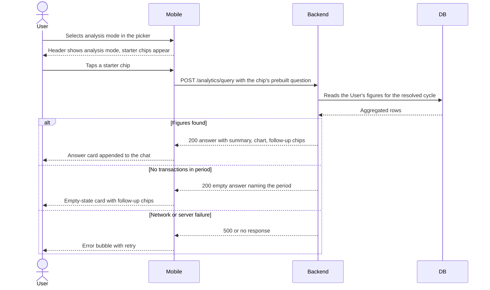
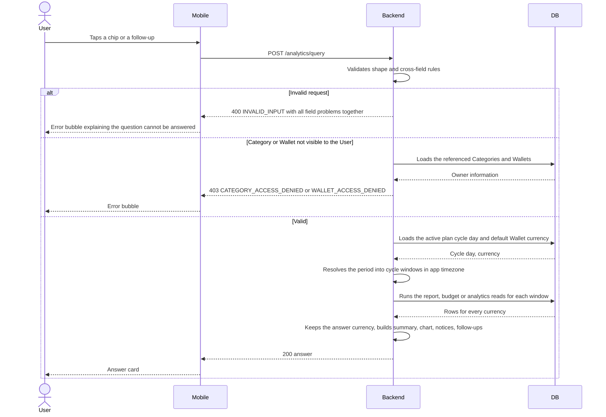
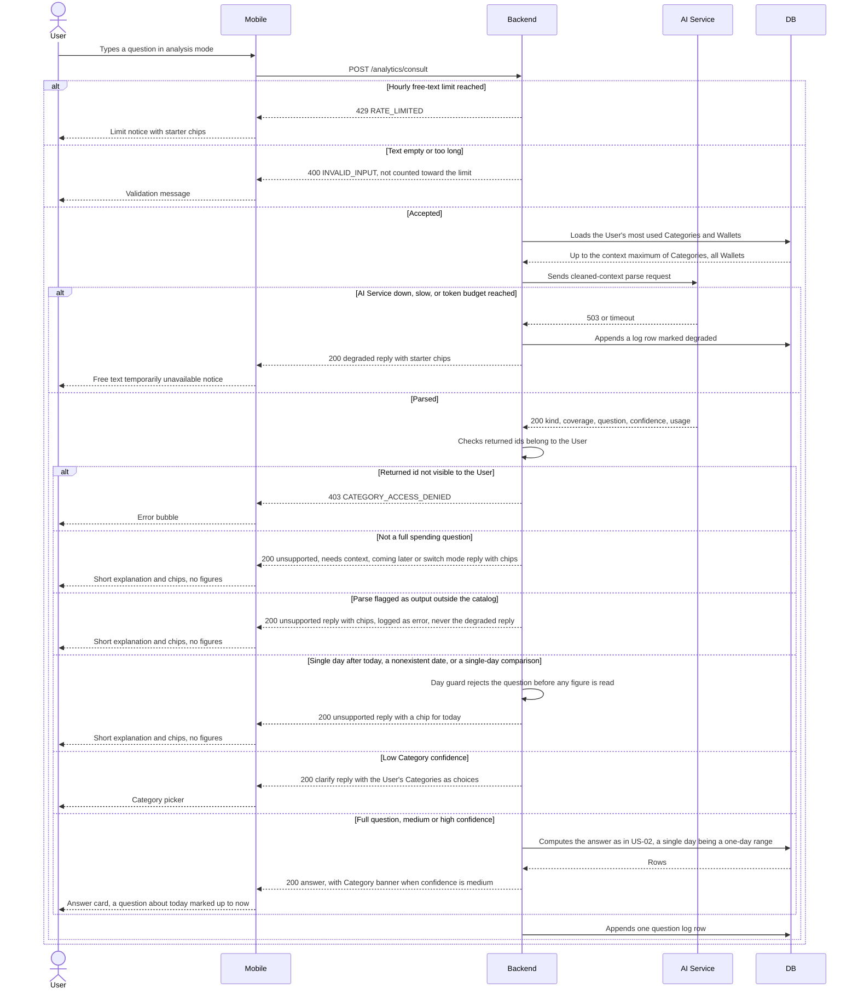
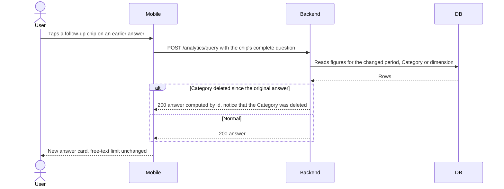
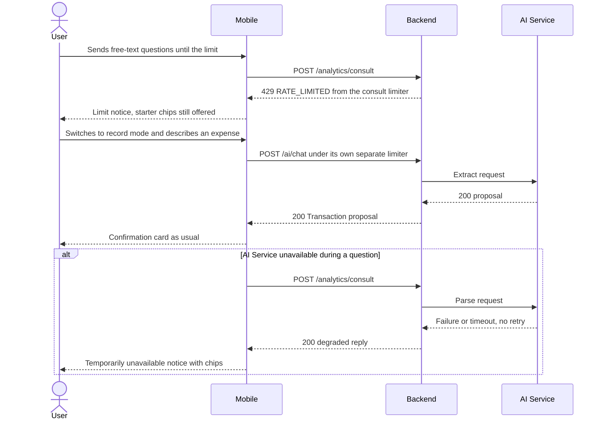
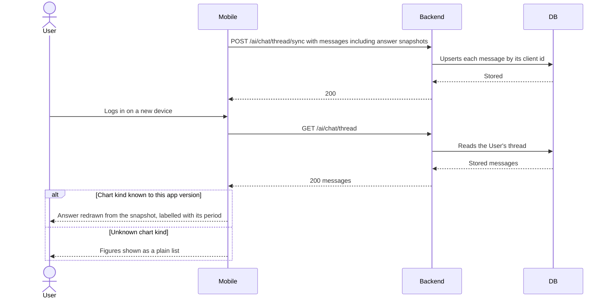
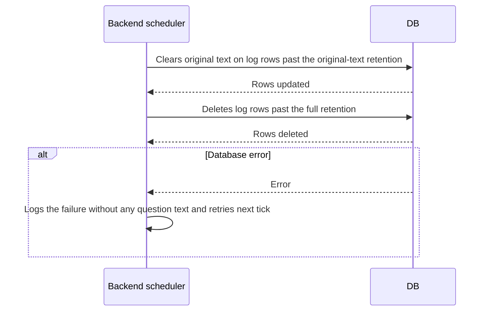

# Implementation Plan: Feature-12 US-03 — Query Spending via Chat

> Spec: [`spec.md`](./spec.md) · SRS: **FR-09 / BF-10 / Feature-12 US-03** · Design brief: `docs/new-tasks.md` Part II (group Q)
> Ticket: none — PFM has no ticket system; traceability is spec scenario IDs (`S-AIQ-NN`, `EC-NN`) → task IDs (`AIQ-T{NN}`).
> Stacks touched: Go backend · Python AI service · React Native mobile. **Web (`frontend/`) not touched** (spec Out of Scope #1).
> ⚠️ **Implementation gate:** tasks `AIQ-T10` onward depend on `specs/ai-budget-wizard-v2/` task `BWZ2-T06` (cycle resolver) **including the app-timezone part** — see F1.

---

## Pre-flight: Spec Review Findings

| # | Finding | Type | Resolution |
|---|---------|------|------------|
| **F1** | `specs/ai-budget-wizard-v2/spec.md` A-05 says cycle boundaries **stay UTC** (timezone deferred). This spec (and `docs/new-tasks.md` §I.3 item I-1) needs boundaries in the app timezone — S-AIQ-11 fails otherwise. | ⚠️ Conflict between specs | Close I-1 as the brief defines it: `BWZ2-T06` ships `ResolveCycleWindow` **with** `common.AppTimezone` loaded via `time.LoadLocation`. Required signature in §Architecture "Cycle resolver contract". Update v2 spec A-05 when I-1 is implemented. |
| **F2** | The cycle start day lives only in `budget_plans` (mig 020), which **nothing writes yet** (I-2). Until I-2 ships every User resolves to the calendar month. | Gap — dependency | Acceptable and matches spec A-02 ("never chose a cycle start day → calendar month"). The resolver reads the active plan if one exists, else day 1. No extra work here. |
| **F3** | The brief puts free text at `POST /ai/consult`. Fiber group middleware on `v1.Group("/ai", JWTAuth, AIChatRateLimiter)` matches **every path under `/ai`**, so any new `/ai/*` route still consumes the 30/h create-Transaction budget — exactly what S-AIQ-37 forbids. | ⚠️ Gap — routing | New group `v1.Group("/analytics", JWTAuth)`: `POST /analytics/query` (no limiter) and `POST /analytics/consult` (`AIConsultRateLimiter` per route). `/ai` group untouched → zero regression risk to US-01. Spec API lines updated; `chat-mode.ts` comment updated. |
| **F4** | Side finding: thread sync (`/ai/chat/thread/sync`, 3 s debounce, whole thread) sits behind the same `/ai` limiter, so sync calls already eat the create-Transaction budget. | Existing bug, out of scope | Logged as Open Task `AIQ-T44` (optional, separate commit). Not fixed here. |
| **F5** | Brief says Q5/Q6/Q14 reuse `ListTransactions` sorted by amount. **False:** `ListTransactionsByUser` has fixed `ORDER BY occurred_at DESC` and no amount filter; mobile sorts client-side (`transactions/sort.ts`). | Brief error | New query `ListExpensesByAmount` + `CountExpensesByAmount` in new `analytics.sql`. |
| **F6** | Reports window is **inclusive** on both ends (`occurred_at <= to`), budgets window is **half-open**. S-AIQ-06 requires Q1 == Reports. | ⚠️ Consistency | Analytics works in half-open `[start, end)`. When it calls the Report queries it passes `To = end − 1µs` (PostgreSQL `timestamptz` resolution is 1µs, so `<= end−1µs` ≡ `< end`). The equality test (`AIQ-T24`) calls `ReportService.GetSummary` with the same explicit RFC3339 bounds. |
| **F7** | Reports and Budgets return **every currency**; spec A-01 wants one. | Ambiguity | Analytics filters the returned rows to the answer currency in Go; other currencies with non-zero amounts produce notice `other_currencies_present` listing their codes. New queries filter `w.currency = $n` in SQL. |
| **F8** | Q9 must equal the Budgets screen. Mobile shows backend `limit.spent` when no date filter is active; that comes from `BudgetService.ListBudgets`. | Design | Q9 calls `BudgetService.ListBudgets` directly — same code, same numbers, and both move together when I-1 lands. The stale "Spent/Remaining are currently always 0" comment in `dto/budget_response.go:12-14` is removed (`AIQ-T45`). |
| **F9** | Spec requires a Transaction count on every answer; Report queries don't return counts. | Gap | New query `CountTransactionsInWindow` (type, currency, optional category ids, optional wallet). |
| **F10** | Brief proposes amounts as JSON **strings**. The whole app sends xu as JSON numbers and mobile holds them as `number` (exact below 2^53 ≈ 9e13 VND). | Convention conflict | Keep JSON integers, like every other endpoint. Spec money line reworded accordingly. |
| **F11** | Brief proposes a new index `(user_id, category_id, occurred_at DESC)`. Q3/Q12 are computed as ≤ 6 calls of the existing report queries (see BR-07); at invite-only scale the existing `idx_transactions_user_occurred_at` serves them. | Scope | **Deferred.** Add only if `EXPLAIN` on production-size data shows a seq scan. No migration for it now. |
| **F12** | AI service: sync Groq/Anthropic SDK calls inside `async def` block the event loop; SDK default `max_retries=2` contradicts brief §13.3 "no retry on 429"; `prompt_tokens` / cached tokens are **never read**; no `tests/`, no pytest. | Gap | Consult uses a dedicated Groq client with `max_retries=0`, explicit timeout, and runs the call in a thread (`run_in_threadpool`). Usage (prompt, completion, cached tokens) returned to Go. `pytest` added via `requirements-dev.txt`. **No Anthropic fallback for consult** (latency budget 8 s; degradation path covers outages — S-AIQ-40). |
| **F13** | Brief §13.1 wants an org-level token bucket (create-Transaction reserves 15%). Without it, consult traffic could exhaust the provider's per-org TPM and break recording — violating S-AIQ-37 at a layer Fiber's per-user limiter cannot see. | ⚠️ Gap | In-process `ConsultTokenBudget` (sliding 60 s window, sum of reported tokens). Consult refuses new free-text calls once the window reaches `ConsultTokenBudgetPerMinute` → degraded answer (same as S-AIQ-40). Value is a placeholder until `AIQ-T01` measures real usage. Single backend instance → in-memory is enough. |
| **F14** | Mobile `ChatMessage` is one flat interface; chat thread (incl. action payloads) lives in a persisted Zustand store and is re-sent **whole** every 3 s. Chart data inflates every sync. | Constraint | Add one optional `analytics` field. Answer payload is bounded (BR-12): breakdown ≤ 6 slices + Other, lists ≤ 10 rows, series ≤ 6 points, daily line ≤ 31 points. |
| **F15** | CLAUDE.md: "server state via TanStack Query only, never copied into Zustand". Answers go into the chat store. | Convention note | Same accepted exception as US-01 action cards: an answer is an immutable **snapshot** (spec US-06 EC "never recomputed"), not live server state. Requests themselves go through TanStack `useMutation`. |
| **F16** | `ai-chat.tsx` is 282 lines; `chat_service.go` is 339 (already over). | Convention | Consult never touches `chat_service.go` (separate `ConsultService`), so the brief's P1.5 split is **not** a prerequisite. Mobile: all consult logic in a new `use-consult-actions.ts` + new `features/analytics/`; `ai-chat.tsx` gains only mode-based dispatch and the starter-chip row (target net +15 lines). |
| **F17** | Spec Open Question #5 (keep consult disabled until I-1 ships). | Open | Plan assumes **yes**: `CONSULT_MODE_ENABLED` flips to `true` in the last task, after I-1. |
| **F18** | Spec asks for a regex fast path nowhere; brief §6.2 says the pattern set starts **empty**. | Scope | No regex matcher built. `method` column reserves values `chip`, `drilldown`, `llm` (and `regex` for later). |

---

## Architecture

### Package / file layout

```text
backend/
├── db/
│   ├── migrations/
│   │   └── 021_intent_parse_log.sql              # NEW — question log table (+ both compose mounts)
│   └── queries/
│       ├── analytics.sql                         # NEW — ListExpensesByAmount, CountExpensesByAmount,
│       │                                         #   CountTransactionsInWindow, SumExpenseByWalletForUser,
│       │                                         #   SumExpenseByLocalDay, ListTopExpenseCategoriesRecent
│       └── intent_parse_log.sql                  # NEW — InsertIntentParseLog, ClearExpiredRawText, DeleteExpiredLogs
└── internal/
    ├── common/
    │   ├── constants.go                          # + analytics/consult constants (see Named limits)
    │   └── errors.go                             # + ErrAIConsultUnavailable (reuses AI_SERVICE_UNAVAILABLE code)
    ├── middleware/rate_limit.go                  # + AIConsultRateLimiter
    ├── dto/
    │   ├── analytics_request.go                  # NEW — AnalyticsQueryRequest
    │   ├── analytics_response.go                 # NEW — AnalyticsAnswerResponse + chart unions
    │   └── consult_dto.go                        # NEW — ConsultRequest / ConsultResponse
    ├── model/analytics.go                        # NEW — AnalyticsQuery, Window, answer building blocks
    ├── repository/
    │   ├── analytics_repository.go               # NEW
    │   └── intent_parse_log_repository.go        # NEW
    ├── repository/sqlc/analytics.sql.go          # NEW — hand-written to sqlc output shape (sqlc version mismatch)
    ├── repository/sqlc/intent_parse_log.sql.go   # NEW — same
    ├── service/
    │   ├── interfaces.go                         # + AnalyticsRepo, IntentParseLogRepo, AIConsultClient
    │   ├── analytics_service.go                  # NEW — Answer(): validate → ownership → window → dispatch
    │   ├── analytics_window.go                   # NEW — period key → []Window via ResolveCycleWindow
    │   ├── analytics_metrics.go                  # NEW — sum, breakdown, compare, series
    │   ├── analytics_metrics_tx.go               # NEW — top_n, filter, max_tx, avg_daily, weekday, budget_status
    │   ├── analytics_followups.go                # NEW — follow-up chip generation (pure)
    │   ├── analytics_template.go                 # NEW — summary sentence templates (pure)
    │   ├── consult_service.go                    # NEW — free-text orchestration
    │   ├── consult_token_budget.go               # NEW — in-memory sliding-window guard (F13)
    │   ├── ai_consult_client.go                  # NEW — HTTP client to ai-service /consult, 8 s timeout
    │   └── intent_log_retention.go               # NEW — PurgeIntentLogs() used by the scheduler
    ├── handler/analytics_handler.go              # NEW — Query, Consult
    └── ../cmd/server/{main.go,routes.go}         # wire service/handler, /analytics group, retention ticker

ai-service/
├── app/
│   ├── nlu/normalize.py                          # NEW — cleaning pipeline (query path only)
│   ├── routers/consult_router.py                 # NEW — POST /consult
│   ├── services/consult_service.py               # NEW — normalize → tool call → ConsultParse
│   ├── services/consult_prompt.py                # NEW — system prompt + flat tool schema
│   ├── schemas/consult_schema.py                 # NEW — Pydantic v2
│   ├── core/groq_client.py                       # + get_groq_consult_client() (max_retries=0, timeout)
│   └── main.py                                   # + include consult_router
├── requirements-dev.txt                          # NEW — pytest
└── tests/
    ├── test_normalize.py                         # NEW — offline unit tests
    ├── golden/analytics_intents.jsonl            # NEW — ≥100 labelled questions
    └── test_consult_golden.py                    # NEW — live-provider eval, opt-in marker

mobile/
├── app/(app)/ai-chat.tsx                         # mode dispatch + starter chips row
└── src/features/
    ├── ai-chat/
    │   ├── chat-mode.ts                          # CONSULT_MODE_ENABLED → true (last task); comment fix
    │   ├── types.ts                              # + analytics?: ConsultMessageData on ChatMessage
    │   ├── components/ChatMessageRow.tsx         # + branch → AnalyticsAnswerCard
    │   └── hooks/use-consult-actions.ts          # NEW — sendConsult(text), askQuery(query,label)
    └── analytics/
        ├── types.ts                              # NEW — mirrors dto/analytics_*.go + consult_dto.go
        ├── starter-chips.ts                      # NEW — hardcoded starter queries
        ├── api/use-analytics-query-mutation.ts   # NEW
        ├── api/use-consult-mutation.ts           # NEW
        └── components/
            ├── AnalyticsAnswerCard.tsx           # NEW — summary, period label, notices, chart, chips
            ├── ChartRenderer.tsx                 # NEW — switch on chart.type, unknown → RankedList fallback
            ├── NumberStat.tsx                    # NEW
            ├── CompareBars.tsx                   # NEW
            ├── RankedList.tsx                    # NEW
            ├── LineChart.tsx                     # NEW — react-native-svg polyline
            ├── WeekdayBars.tsx                   # NEW
            ├── BudgetStatusList.tsx              # NEW — uses BudgetProgressBar
            ├── SuggestionChips.tsx               # NEW — starter + follow-up chips
            ├── CategoryBanner.tsx                # NEW — "calculated for …" + Change
            └── CategoryChoiceList.tsx            # NEW — low-confidence picker
```

Donut and bar visuals reuse `components/shared/DonutChart.tsx` and `SegmentedBar.tsx`. `BudgetProgressBar.tsx` is imported cross-feature from `features/budgets/` (accepted; move to `shared/` only if a third feature needs it).

### Cycle resolver contract (provided by `BWZ2-T06`, consumed here)

```go
// service/budget_cycle.go (owned by ai-budget-wizard-v2)
func ResolveCycleWindow(now time.Time, cycleStartDay int, offset int, loc *time.Location) (start, end time.Time)
// [start, end) in UTC; boundaries are local midnights in loc; offset 0 = current, -1 = previous.
// cycleStartDay 0 or 1 → calendar month.
```

`AnalyticsService` reads the caller's active plan's `cycle_start_day` (0 when no plan) once per request.

### Domain objects

| Entity | Table | Key Fields | Notes |
|--------|-------|------------|-------|
| `Transaction` | `transactions` | read only: `user_id`, `wallet_id`, `category_id`, `amount` BIGINT xu, `type`, `occurred_at` TIMESTAMPTZ, `deleted_at` | Every query filters `t.deleted_at IS NULL` and `t.user_id = $1`. Currency from `JOIN wallets`. |
| `Wallet` / `Category` / `Budget` | existing | read only | Category visibility = system (`user_id IS NULL`) or own. Deleted Categories stay visible by name in historical answers (report query does not filter `c.deleted_at`, intentionally). |
| `IntentParseLog` | `intent_parse_log` **(new, mig 021)** | `id` UUID v4 (`uuid_generate_v4()`) · `user_id` FK · `raw_text` TEXT NULL · `normalized_text` TEXT · `parsed_intent` JSONB · `method` TEXT CHECK (`chip`,`drilldown`,`regex`,`llm`) · `kind` TEXT · `confidence` REAL NULL · `latency_ms` INT · `token_in`/`token_out`/`cached_tokens` INT NULL · `outcome` TEXT (`answered`,`clarify`,`unsupported`,`degraded`,`error`) · `created_at` TIMESTAMPTZ UTC | Append-only, **no `deleted_at`** — retention is a hard delete by design (privacy, US-07), not a financial record. Index `(created_at)` for the purge. No endpoint reads it. |
| `AnalyticsQuery` | — (wire/model) | `metric`, `group_by`, `tx_type`, `period`, `from`/`to` (local dates), `category_ids[]`, `wallet_id`, `amount_min` xu, `limit`, `currency` | Named `Analytics*` to avoid collision with `model.ChatIntent*`. |
| `AnalyticsAnswer` | — (wire) | `schema_version`, `metric`, `period{key,from,to,partial}`, `currency`, `summary`, `chart{type,…}`, `notices[]`, `tx_count`, `follow_ups[]`, `query` (echo, for re-ask/Change) | Stored by the client inside the chat thread payload. |

⚠️ **Money:** all amounts `int64` xu end to end; no `float64` on any amount path. Average (Q11) = `(sum*2 + days) / (days*2)` (integer half-up). Percent change = integer half-up of `(cur−prev)*100/prev`; `prev == 0` → `change_pct: null` + notice `no_previous_data`. JSON numbers, like all endpoints (F10).

⚠️ **Time:** stored UTC; windows computed in `common.AppTimezone`; `period.from/to` returned as RFC3339 UTC plus local-date strings for display; client renders local.

### Named limits (`common/constants.go`)

| Constant | Value | Source |
|---|---|---|
| `AIConsultRateLimit` / `AIConsultRateLimitWindow` | 20 / 1 h | brief §10.2 — placeholder (spec OQ #1) |
| `AIConsultTimeout` | 8 s | brief §13.3 |
| `ConsultTokenBudgetPerMinute` | set after `AIQ-T01` | F13 |
| `AnalyticsCategoryConfidenceHigh` / `…Medium` | 0.8 / 0.5 | brief §8.2 |
| `AnalyticsCategoryContextMax` | 20 | brief §8.1 |
| `AnalyticsCategoryContextCycles` | 6 | brief §8.1 |
| `AnalyticsBreakdownMaxSlices` | 6 (+ Other) | F14 |
| `AnalyticsListMaxRows` | 10 | F14 |
| `AnalyticsSeriesMaxCycles` | 6 | spec periods |
| `AnalyticsCustomRangeMaxDays` | 366 | bound query cost |
| `AIConsultMessageMaxLength` | 300 | spec S-AIQ-32 |
| `IntentLogRawRetention` / `IntentLogRetention` | 30 d / 365 d | spec OQ #2 |
| `IntentLogPurgeInterval` | 24 h | US-07 |

### Business rules

| ID | Rule | Source | Enforcement |
|----|------|--------|-------------|
| BR-01 | Every referenced Category must be visible (system or own), every Wallet owned — else 403, never filtered silently | S-AIQ-15, EC-17 (US-03 #2) | `AnalyticsService.checkOwnership()` → `CATEGORY_ACCESS_DENIED` / `WALLET_ACCESS_DENIED` |
| BR-02 | Request shape: known `metric`, `period`, `group_by`; `limit` ≤ max; custom range ≤ max days and `from ≤ to`; `amount_min > 0` | S-AIQ-16 | DTO `validate` tags (handler) + cross-field checks in `AnalyticsService.validate()` → `INVALID_INPUT` |
| BR-03 | Named periods resolve through the cycle resolver in app timezone; no `date_trunc` anywhere in analytics SQL | S-AIQ-10, S-AIQ-11, A-02 | `analytics_window.go` |
| BR-04 | One currency per answer: named Wallet's, else default Wallet's; other currencies → notice | S-AIQ-12, A-01 | `AnalyticsService.resolveCurrency()` |
| BR-05 | Q1/Q2/Q4/Q10 use the **same report queries** as F-07 with half-open → inclusive conversion | S-AIQ-06, S-AIQ-07 | `analytics_metrics.go` via `ReportRepo` (F6) |
| BR-06 | Q9 uses `BudgetService.ListBudgets` unchanged | S-AIQ-09 | `analytics_metrics_tx.go` |
| BR-07 | Q3/Q12 = one report call per cycle (≤ 6) — no separate bucketing SQL | S-AIQ-06 consistency, EC-10 | `analytics_metrics.go` |
| BR-08 | Q11 divides by days with ≥ 1 expense; answer carries that count | S-AIQ-13, A-03 | `analytics_metrics_tx.go` |
| BR-09 | `prev == 0` → no percentage | S-AIQ-08 | `analytics_metrics.go` |
| BR-10 | Soft-deleted Transactions never counted | S-AIQ-18 | every query `t.deleted_at IS NULL` |
| BR-11 | Summary sentence only from templates; no model output ever reaches `summary` or any amount | Context #1 | `analytics_template.go`; `ConsultService` never forwards model text |
| BR-12 | Answer payload bounded (slices, rows, points); list answers carry `total_matched` | EC-05, EC-11, F14 | `analytics_metrics*.go` |
| BR-13 | Partial periods flagged `partial: true`, never projected | EC-04 | `analytics_window.go` |
| BR-14 | Free text answered only when the parse covers the whole question (`coverage = full`); otherwise clarify/unsupported | S-AIQ-27, EC-16 | AI prompt contract + `ConsultService.route()` rejects `coverage != full` |
| BR-15 | Category confidence bands: ≥ high → answer; ≥ medium → answer + banner; else → choice list, no figures | S-AIQ-24…26 | `ConsultService.route()` |
| BR-16 | Non-query kinds (`evaluate`, `scenario`, `unsupported`, `needs_context`, `transaction_like`) never produce figures; each maps to a fixed message + chips | S-AIQ-28…31 | `ConsultService.route()` + `analytics_followups.go` |
| BR-17 | Free-text limit is per User, separate from `/ai`; chips/follow-ups/Change never count | S-AIQ-35, S-AIQ-37…39 | `AIConsultRateLimiter` only on `POST /analytics/consult`; `/analytics/query` has none |
| BR-18 | AI down / timeout / token budget reached → degraded answer (message + starter chips), no retry. **Only** these three — an output the model produced but the catalog cannot hold is BR-26, not degraded | S-AIQ-40, S-AIQ-41, F13, S-AIQ-60 | `ConsultService` (returns 200 `kind=degraded`, see Error Flows note) |
| BR-19 | Validation-rejected messages do not reach the limiter count | EC (US-05 #3) | Fiber's limiter runs before the handler, so it is configured with `SkipFailedRequests: true`; the handler returns 400 for invalid text, and responses with status ≥ 400 are not counted |
| BR-20 | One log row per free-text question; log failure never fails the answer; text never in app logs | S-AIQ-45, S-AIQ-48, EC (US-07 #1) | `ConsultService.logParse()` (error logged without text) |
| BR-21 | Raw text cleared after raw retention; rows deleted after full retention | S-AIQ-46 | `intent_log_retention.go` on scheduler tick |
| BR-22 | Answers never contain Transaction notes | EC (US-06 #2) | list DTO has no `note` field; AI prompt receives no notes |
| BR-23 | Analysis mode never creates a Transaction | S-AIQ-31 | consult path has no write to `transactions`; client routes by mode |

### API

| Endpoint | US | Request | Response (`data`) | Idempotent | Checks |
|---|---|---|---|---|---|
| `POST /api/v1/analytics/query` | US-01, US-02, US-04, US-03 "Change" | `AnalyticsQueryRequest` = metric, group_by?, tx_type?, period, from?, to?, category_ids?, wallet_id?, amount_min?, limit?, currency? | `AnalyticsAnswerResponse` (200) | Yes — read-only, non-transactional | **gating:** JWT → shape → ownership (BR-01). **independent** (returned together as `details`): unknown metric, unknown period, missing custom dates, range too long, bad limit, bad amount_min |
| `POST /api/v1/analytics/consult` | US-03, US-05, US-07 | `ConsultRequest` = message (1…300) | `ConsultResponse` (200) = kind (`answer`,`clarify_category`,`unsupported`,`needs_context`,`coming_later`,`switch_mode`,`degraded`), message key, answer?, category_choices?, banner_categories?, chips[] | No financial write; appends one log row (single statement, non-transactional) | **gating:** JWT → limiter → shape → AI parse → ownership of returned ids (BR-01) → routing |
| `POST /consult` (ai-service, internal) | US-03 | message, categories (≤ 20 {id,name,type}), wallets ({id,name,currency,is_default}), today (local date), tz | kind, coverage, query fields (flat), category_confidence, normalized_text, usage {prompt, completion, cached}, latency_ms, **invalid_output** (bool, R-F19) | Pure | 422 on schema; 503 provider **unavailable** only — an out-of-catalog model output is 200 `kind=unsupported`, `invalid_output=true` (BR-26) |

Service 1-to-1: `AnalyticsHandler.Query → AnalyticsService.Answer`; `AnalyticsHandler.Consult → ConsultService.Consult`.

Authorization: `JWTAuth` at group middleware extracts `common.LocalsUserID`; handler passes `userID` to service; **ownership enforced in service** (BR-01). No role gate (personal data). CSRF: not applicable — bearer token in `Authorization` header, no cookies. Direct URL access: every request passes `JWTAuth`, no client-side-only guard.

---

## Sequence diagrams

### US-01 — Analysis mode + starter chip



### US-02 — Answer a structured question



### US-03 — Free-text question



### US-04 — Follow-up chip



### US-05 — Limit isolation and degradation



### US-06 — Answers in history



### US-07 — Question log retention



---

## Error Flows

| Scenario | HTTP | Error Code | Class |
|----------|------|------------|-------|
| Missing / invalid / expired JWT | 401 | `UNAUTHENTICATED` | client |
| Unknown metric/period/group, bad limit, bad dates, range too long, amount_min ≤ 0 (all returned together) | 400 | `INVALID_INPUT` | client |
| Free-text empty or > max length | 400 | `INVALID_INPUT` | client |
| Category not visible to caller (request or AI-returned) | 403 | `CATEGORY_ACCESS_DENIED` | client |
| Wallet not owned by caller | 403 | `WALLET_ACCESS_DENIED` | client |
| Free-text hourly limit reached | 429 | `RATE_LIMITED` | client |
| AI Service down / timeout / token budget reached | **200** `kind=degraded` | — | upstream, degraded by design (BR-18): the reply is a valid answer the client renders as a message; an error status would make the app show a generic failure instead of the chips |
| AI Service returns malformed parse, or the model's output falls outside the catalog | 200 `kind=unsupported` *(was `degraded` — changed by R-F19 / BR-26)* | — (logged `outcome=error`) | system, surfaced as out of scope (S-AIQ-60) |
| Single-day question for a day after today, a nonexistent date, or a single-day comparison | 200 `kind=unsupported` + today chip | — (logged `outcome=unsupported`) | client-side meaning, no figures (BR-27) |
| DB failure during answer | 500 | `INTERNAL_ERROR` | system |
| ai-service `/consult` schema violation (internal) | 422 → Go treats as degraded | — | system |

Mobile maps 429 → limit notice + starter chips; 500/network → error bubble with retry; 403/400 → error bubble with the server message.

---

## Affected existing features (regression scope)

| Feature | Impact | Test |
|---|---|---|
| Feature-12 US-01 (record via chat) | No backend change; `/ai` group untouched. Mobile send path now dispatches by mode. | Existing chat tests; manual: record flow in record mode after exhausting consult limit (S-AIQ-37) |
| F-07 Reports | Read-only reuse of `ReportRepo` | `AIQ-T24` equality test |
| F-05 Budgets | Read-only reuse of `ListBudgets` | `AIQ-T24` Q9 equality |
| Chat thread sync | Larger payloads (bounded, F14) | Manual: restore on new device |
| F-13.1 cycle resolver | Consumer only | Depends on `BWZ2-T06` tests |

---

## Constitution / Convention Notes

| Rule | Status | Note |
|------|--------|------|
| Handler → service → repository; no repo import in handler | Required | `AnalyticsHandler` holds only services |
| Shape validation in handler, business rules in service | Required | DTO tags vs `AnalyticsService.validate()` / ownership |
| Service owns ownership checks | Required | BR-01 in service, not handler, not client |
| Reads non-transactional | Required | All analytics reads; no `BEGIN` |
| Writes transactional where multi-statement | N/A | Only single-statement log insert / purge |
| Money BIGINT xu, never float | Required | ⚠️ Average and percent use integer half-up formulas above |
| Timestamps UTC stored, local display | Required | Windows computed in `AppTimezone`, returned UTC + local dates |
| Soft delete respected | Required | `t.deleted_at IS NULL` in every analytics query; log table has hard-delete retention by design |
| User isolation (`AND user_id = $n`) | Required | Every new query's first predicate |
| SQL in `.sql`, sqlc-shaped Go | Required | Generated files hand-written (local sqlc version mismatch) |
| Wrap errors with context | Required | `fmt.Errorf("analyticsService.Answer: %w", err)` |
| No sensitive data in logs | Required | Question text never logged (BR-20); ids and outcome only |
| File ≤ 300 lines | Required | Service split into 7 files; mobile charts one per file; `ai-chat.tsx` must stay ≤ 300 |
| Mobile: TanStack for requests | Required | `useMutation` hooks; answers stored as thread snapshots (F15) |
| TypeScript `const`, no `any` | Required | `ChartRenderer` uses discriminated union on `chart.type` |
| Hand-synced API types | Required | `mobile/src/features/analytics/types.ts` ↔ `dto/analytics_*.go`, `consult_dto.go` |
| Migration mounts | Required | `021_intent_parse_log.sql` added to root and `backend/` compose files; re-runnable (`IF NOT EXISTS`) |
| English-only copy in plan; Vietnamese in UI | Required | Message keys → Vietnamese strings in `analytics_template.go` and mobile |

### Audit & logging

| Event | Where | Fields | Excluded |
|---|---|---|---|
| Free-text parse | `intent_parse_log` row | user_id, method, kind, outcome, confidence, latency, token counts, parsed intent, texts (retention-bound) | — |
| Consult degraded / error | Zap `warn` | user_id, outcome, latency, provider status | message text |
| Retention run | Zap `info` | rows cleared, rows deleted | any text |

Actor source: `common.LocalsUserID` set by `JWTAuth` (middleware), passed explicitly to service. No IP logged (not needed for this feature).

### Locking

None required: analytics is read-only; log is append-only; the purge is idempotent single statements.

---

## Element / Key IDs (mobile `testID`)

| Element | testID | Status | File |
|---------|--------|--------|------|
| Analysis mode row in picker | `row-chat-mode-consult` | **Missing** | `ai-chat/components/ChatModePicker.tsx` |
| Starter chip | `chip-starter-{key}` | **Missing** | `analytics/components/SuggestionChips.tsx` |
| Follow-up chip | `chip-followup-{index}` | **Missing** | same |
| Answer card | `card-analytics-answer` | **Missing** | `analytics/components/AnalyticsAnswerCard.tsx` |
| Answer summary text | `text-analytics-summary` | **Missing** | same |
| Period label | `text-analytics-period` | **Missing** | same |
| Notice line | `text-analytics-notice-{code}` | **Missing** | same |
| Category banner Change button | `btn-analytics-change-category` | **Missing** | `analytics/components/CategoryBanner.tsx` |
| Category choice row | `row-analytics-category-{id}` | **Missing** | `analytics/components/CategoryChoiceList.tsx` |
| Chart container | `chart-analytics-{type}` | **Missing** | `analytics/components/ChartRenderer.tsx` |

---

## Open Tasks

| ID | Task | File | Blocks / Blocked by |
|----|------|------|---|
| AIQ-T01 | **P0-A:** measure provider token accounting — 5 identical requests, record `prompt_tokens`, `cached_tokens`, rate-limit headers; write result | `docs/groq-token-baseline.md` | Blocks T30–T36 and sets `ConsultTokenBudgetPerMinute` |
| AIQ-T02 | Golden set ≥ 100 labelled questions (groups per spec US-03 DoD); assert structured output only | `ai-service/tests/golden/analytics_intents.jsonl` | Blocks T36 |
| AIQ-T03 | Add `pytest` dev dependency + opt-in marker for live-provider tests | `ai-service/requirements-dev.txt`, `ai-service/pytest.ini` | — |
| AIQ-T10 | ⚠️ Wait for / verify `BWZ2-T06` resolver with app timezone (F1); add tests S-AIQ-10, S-AIQ-11 at resolver level | `backend/internal/service/budget_cycle.go` (owned by v2) | **Blocks T11–T29** |
| AIQ-T11 | Migration `intent_parse_log` + index on `created_at` + both compose mounts | `backend/db/migrations/021_intent_parse_log.sql`, `docker-compose.yml`, `backend/docker-compose.yml` | — |
| AIQ-T12 | Queries: `ListExpensesByAmount`, `CountExpensesByAmount`, `CountTransactionsInWindow`, `SumExpenseByWalletForUser`, `SumExpenseByLocalDay` (group by local date via `AT TIME ZONE`), `ListTopExpenseCategoriesRecent` — all half-open windows, currency filter, `deleted_at IS NULL`, `user_id` first | `backend/db/queries/analytics.sql` + hand-written `repository/sqlc/analytics.sql.go` | — |
| AIQ-T13 | Queries: `InsertIntentParseLog`, `ClearExpiredRawText`, `DeleteExpiredLogs` | `backend/db/queries/intent_parse_log.sql` + `repository/sqlc/intent_parse_log.sql.go` | T11 |
| AIQ-T14 | Repositories + interfaces + compile-time checks | `repository/analytics_repository.go`, `repository/intent_parse_log_repository.go`, `service/interfaces.go` | T12, T13 |
| AIQ-T15 | Constants + `AIConsultRateLimiter` (`SkipFailedRequests: true`, BR-19) | `common/constants.go`, `middleware/rate_limit.go` | — |
| AIQ-T16 | DTOs: `AnalyticsQueryRequest` (validate tags), `AnalyticsAnswerResponse` + chart variants, `ConsultRequest/Response` | `dto/analytics_request.go`, `dto/analytics_response.go`, `dto/consult_dto.go` | — |
| AIQ-T17 | Model types | `model/analytics.go` | — |
| AIQ-T18 | `analytics_window.go`: period key → windows (this/last cycle, last 3/6 cycles, last 30 days, this week, custom), `partial` flag | `service/analytics_window.go` | T10 |
| AIQ-T19 | `AnalyticsService.Answer` skeleton: validate (independent checks collected), ownership, currency, dispatch | `service/analytics_service.go` | T14, T16–T18 |
| AIQ-T20 | Metrics via `ReportRepo`: sum, breakdown by category, compare, series (≤ 6 cycles); inclusive-bound conversion (F6); currency filter + notice | `service/analytics_metrics.go` | T19 |
| AIQ-T21 | Metrics via new queries + budgets: top_n, filter, max_tx, avg_daily, weekday, wallet breakdown, budget_status | `service/analytics_metrics_tx.go` | T19 |
| AIQ-T22 | Summary templates + notice codes (Vietnamese copy) | `service/analytics_template.go` | T19 |
| AIQ-T23 | Follow-up generator (≥ 1 per metric, never repeats current, deleted-Category notice) | `service/analytics_followups.go` | T19 |
| AIQ-T24 | Unit tests with fakes: every metric; **equality tests** Q1/Q4 vs `ReportService.GetSummary`, Q9 vs `ListBudgets`; zero-previous; soft-delete; cross-user 403; multi-currency notice; avg-daily denominator | `service/analytics_service_test.go`, `fake_analytics_repo_test.go` | T20–T23 |
| AIQ-T25 | `AnalyticsHandler.Query` + `/analytics` group in `routes.go` + wiring in `main.go` | `handler/analytics_handler.go`, `cmd/server/routes.go`, `cmd/server/main.go` | T19 |
| AIQ-T30 | `nlu/normalize.py` (whitespace, case, accents with original kept, pronoun strip, shorthand, amount shorthand incl. digit-k rule, informal periods) + offline tests | `ai-service/app/nlu/normalize.py`, `tests/test_normalize.py` | T01, T03 |
| AIQ-T31 | Consult schema: flat tool schema (no `$ref`), fields `kind`, `coverage` (`full`/`partial`), query fields, `category_ids`, `category_confidence` | `ai-service/app/schemas/consult_schema.py` | T01 |
| AIQ-T32 | Consult prompt: pick only from provided Categories/Wallets; never output numbers other than parsed thresholds; mark `coverage=partial` when any condition is unmapped; kind boundaries per brief §II.4 | `ai-service/app/services/consult_prompt.py` | T31 |
| AIQ-T33 | Consult service + router: dedicated Groq client `max_retries=0`, timeout < Go timeout, `run_in_threadpool`, return usage incl. cached tokens, 503 on provider error, no Anthropic fallback | `services/consult_service.py`, `routers/consult_router.py`, `core/groq_client.py`, `main.py` | T30–T32 |
| AIQ-T34 | Go `AIConsultClient` (8 s timeout, no retry) + `ConsultTokenBudget` sliding window | `service/ai_consult_client.go`, `service/consult_token_budget.go` | T33 |
| AIQ-T35 | `ConsultService.Consult`: context (top Categories by recent frequency ≤ max + all Wallets), parse, id ownership (403), routing BR-14…BR-18, answer via `AnalyticsService`, log row (failure-tolerant) | `service/consult_service.go` | T19, T34, T14 |
| AIQ-T36 | Golden-set eval run; record precision/recall per kind and fall-through rate; zero partial-understanding answers (S-AIQ-27) | `ai-service/tests/test_consult_golden.py` | T02, T33 |
| AIQ-T37 | `AnalyticsHandler.Consult` route with `AIConsultRateLimiter`; handler tests for 400/429/403/degraded | `handler/analytics_handler.go`, `routes.go` | T35, T15 |
| AIQ-T38 | Retention: `PurgeIntentLogs` + second ticker goroutine sharing `schedulerCtx` | `service/intent_log_retention.go`, `cmd/server/main.go` | T13 |
| AIQ-T40 | Mobile types mirroring DTOs + `ChatMessage.analytics` optional field | `features/analytics/types.ts`, `features/ai-chat/types.ts` | T16 |
| AIQ-T41 | Mutations `useAnalyticsQueryMutation`, `useConsultMutation` | `features/analytics/api/*.ts` | T40 |
| AIQ-T42 | Components: `AnalyticsAnswerCard`, `ChartRenderer` (unknown → `RankedList`), `NumberStat`, `CompareBars`, `RankedList`, `LineChart`, `WeekdayBars`, `BudgetStatusList`, `SuggestionChips`, `CategoryBanner`, `CategoryChoiceList`; loading/empty/error states; all `testID`s | `features/analytics/components/*.tsx` | T40 |
| AIQ-T43 | `use-consult-actions.ts` (typing indicator, 429 → limit notice + starters, degraded, Change → query mutation); `ChatMessageRow` branch; `ai-chat.tsx` mode dispatch + starter row (disabled while pending); `starter-chips.ts`; `ChatModePicker` testID | `features/ai-chat/hooks/use-consult-actions.ts`, `components/ChatMessageRow.tsx`, `app/(app)/ai-chat.tsx`, `features/analytics/starter-chips.ts` | T41, T42 |
| AIQ-T44 | *(optional, separate commit, F4)* stop thread sync consuming the create-Transaction limit | `cmd/server/routes.go` | — |
| AIQ-T45 | Remove stale "Spent/Remaining always 0" comment (F8); fix outdated comments in `chat-mode.ts:29` and `prompt_builder.py` docstring | `dto/budget_response.go`, `chat-mode.ts`, `ai-service/app/services/prompt_builder.py` | — |
| AIQ-T46 | Flip `CONSULT_MODE_ENABLED = true` (F17) after T10 is live in production | `features/ai-chat/chat-mode.ts` | All above |
| AIQ-T47 | Docs: `SDS.md` §5/§6/§7.3 (endpoints, facts-only threat model: self-injection + PII + token bound, log retention), `docs/features.md` via `/renew-features` | `SDS.md`, `docs/features.md` | After implementation |

### Handoff summary

| Step | State | Owner next |
|---|---|---|
| Spec | Done — `spec.md` (7 US, 60 scenarios after the 2026-09-28 revision) | — |
| Plan | Done — this file | — |
| Prerequisite I-1 (`BWZ2-T06` + app timezone) | **Not started** | `/cook-implementation specs/ai-budget-wizard-v2/` |
| P0-A token measurement (`AIQ-T01`) | Not started | Developer, before any AI-service task |
| Implementation `AIQ-T02…T46` | Not started — backend T11–T25 can proceed once T10 is done; AI T30–T36 after T01 | `/cook-implementation specs/ai-chat-query-spending/` |
| Test cases | Not started | `/cook-qc` |
| Revision 2026-09-28 (reasoning-token truncation, single-day periods, listing phrasing, failure classes) — `AIQ-T49…T60` | T50 done (root cause confirmed). **T49 first.** T60 needs a Groq key from a separate org. Owner decision pending: provider tier / separate org for consult (R-F27) | `/cook-implementation specs/ai-chat-query-spending/` |

---

## Implementation notes (2026-09-26)

Recorded where the code deliberately differs from the plan above.

| # | Plan said | Code does | Why |
|---|---|---|---|
| IN-1 | US-04 diagram: a deleted Category's follow-up returns 200 with a notice | 404 `CATEGORY_NOT_FOUND`, shown as the error bubble's message | `GetCategoryByID` excludes deleted rows; spec S-AIQ-36 allows "explains that the Category no longer exists". No new query needed |
| IN-2 | `AIQ-T44` (thread sync consuming the `/ai` limit) | Not done | Optional, separate commit — unchanged behaviour |
| IN-3 | `testID` `row-chat-mode-consult` missing | Already exists as `btn-chat-mode-consult` in `ChatModePicker.tsx` | Kept the existing id |
| IN-4 | Answer amounts as JSON numbers | Same, plus the list/weekday/bar visuals are shared by one `ColumnBars` component | Fewer components than the plan's list (`WeekdayBars` folded in) |
| IN-5 | `AIQ-T01` token measurement before AI-service work | AI-service code written; measurement **not** run | Needs the real Groq key and network. `ConsultTokenBudgetPerMinute = 4000` is a placeholder until `docs/groq-token-baseline.md` exists |
| IN-6 | `AIQ-T36` golden-set eval | Test written (`tests/test_consult_golden.py`, 115 questions), **not run** | Opt-in: `PFM_LIVE_LLM=1 GROQ_API_KEY=… python -m pytest -m live -s` |
| IN-7 | `AIQ-T46` flip `CONSULT_MODE_ENABLED` | Still `false` | Gate: backend deployed + IN-5/IN-6 done |
| IN-8 | Category context = top-20 by usage | All visible Categories when ≤ 20; otherwise top by usage over 6 cycles, topped up alphabetically | Spec EC: a rarely used Category must still be nameable |
| IN-9 | — | The interpreter's invented ids (not in the list it was shown) mark the question `partial` in the AI service | Never silently drop a filter (spec US-03 EC) |
| IN-10 | — | Migrations and SQL were not executed against a real Postgres | No Docker on the dev machine this session. `cmd/migrate` applies `021` on deploy; an existing local volume needs a manual `psql <` |

---

## Revision 2026-09-28 — single-day periods and listing phrasing

> Spec revision: A-05, A-06, S-AIQ-49→S-AIQ-60, EC-29→EC-35. Trigger: in live use, the questions of S-AIQ-53, S-AIQ-54 and S-AIQ-55 all got the **degraded** reply (`msgDegraded`), while a Transaction description sent right after was classified correctly (S-AIQ-31). So the provider was up and the failure was specific to these questions.
> Scope: ai-service (prompt, normalize, failure classification, golden set) · Go backend (consult routing guard, wire flag, one-day label) · mobile (one suffix). **No migration, no new endpoint, no new period or metric value.** The backend already accepts `period=custom` with `from = to`.

### Pre-flight: findings for this revision

| # | Finding | Type | Resolution |
|---|---------|------|------------|
| **R-F19** | **Root cause — confirmed live 2026-09-28 (`AIQ-T50`).** `openai/gpt-oss-120b` is a reasoning model, and its hidden reasoning tokens count against `consult_max_tokens = 400`. On a question that needs more thought, reasoning alone took 291–376 tokens, so the tool call was cut off. Groq then answers 400 `tool_use_failed`, either "Failed to parse tool call arguments as JSON" (truncated arguments) or "Tool choice is required, but model did not call a tool". The same question succeeded at `max_tokens=2000` (reasoning 291–376, output 377–462) and at `max_tokens=400` with `reasoning_effort=low` (reasoning 122–186, output 208–272). Production question log: about half the free-text questions over two days were `degraded`, including supported Q4/Q11/Q13 phrasings, not only single days. The earlier hypothesis (a period outside the enum) was **wrong**: for "today" the model already returned `period=custom`, `from_date = today`. `/extract` does not hit this because it runs at `max_tokens=1024`. Every such failure lands in the bare `except Exception` in `consult_service.consult()`, which gives 503, which Go turns into `kind=degraded`. So a budget miss is reported to the User as an outage. | ⚠️ Bug — config + wrong failure class | (1) **`AIQ-T49`, first:** `reasoning_effort="low"` on the consult call, with headroom on `consult_max_tokens` (BR-31). (2) Split the failure classes (BR-26): a provider transport/auth/429/timeout error stays 503. `tool_use_failed` or an output-validation failure becomes 200 `kind=unsupported`, `coverage=partial`, `invalid_output=true`. Go logs it as `outcome=error`, never `degraded`. |
| **R-F27** | **Provider capacity, measured live.** The Groq org is on the free `on_demand` tier: **8,000 tokens per minute for the whole org**, shared by consult and `/extract` (recording). One consult call is charged about 1.9–2.1k tokens (prompt plus the output reservation). That is about 4 questions per minute across all Users, and the diagnostic run itself hit 429 after 5 calls. `ConsultTokenBudgetPerMinute = 4000` (IN-5 placeholder) would allow only about 2 consult calls a minute. It does protect recording (S-AIQ-37), but it also degrades almost every question at any real usage. Raising `max_tokens` makes this worse, because Groq counts the reservation against the TPM limit. | ⚠️ Capacity constraint | Keep the output reservation small: `reasoning_effort=low` makes a low cap viable (BR-31). Record the measured numbers as the `AIQ-T01` baseline and set `ConsultTokenBudgetPerMinute` from them (`AIQ-T49`). The real fix, a paid tier or a separate org for consult, is a product/cost decision → **Open question for the owner**, not decided here. API keys in the same org share the limit, so a new key does not help. |
| **R-F20** | Asking the model to compute "yesterday" / "the day before yesterday" is date arithmetic, which LLMs get wrong near month and year edges. | Risk | `build_consult_prompt` computes the anchors in Python from `req.today` (`date.fromisoformat` − 1 and − 2 days) and prints them in the prompt. The model only copies a date (BR-24). The prompt already carries `today`, so no prompt-cache prefix is lost. |
| **R-F21** | A one-day custom range is labelled as a "from 28/09 to 28/09" range (`periodLabel` default branch). `soFar()` explicitly skips `custom`, so a question about today carries no "so far" wording. Mobile `ConsultReplyCard` appends its "until today" suffix whenever `partial`, which would read as "today (28/09) until today". S-AIQ-49 fails on wording. | Gap | One-day label: "today (DD/MM)" when the day is today, else "day DD/MM". `soFar()` gets a one-day-today case with an "up to now" prefix. Multi-day custom is unchanged. Mobile suffix becomes "up to now" when `from_date == to_date`, else unchanged (BR-29). Vietnamese copy lives in `analytics_template.go` and the mobile component, as for every other message. |
| **R-F22** | The consult path calls `AnalyticsService.Answer` with a DTO built by `queryFromParse`, **never passing the DTO `validate` tags**. `validateAnalyticsDates` discards parse errors (`from, _ := time.ParseInLocation`). A model date such as `2026-02-31` therefore becomes a zero `time.Time`, not a validation error. Nothing rejects a day after today either. | ⚠️ Gap | (a) `validateAnalyticsDates` checks both parse errors and reports rule `invalid_date` (defense for both paths). (b) New consult-only guard `consultDayGuard` runs before `Answer`. It maps a day after today (EC-29), an unparseable date (EC-30) and `compare` on a one-day range (EC-32) to `kind=unsupported` with a today chip (BR-27). The chip path (`/analytics/query`) keeps accepting any valid custom range: a chip never asks for a future day, and rejecting one there is not a spec requirement. |
| **R-F23** | `normalize.py` maps `may bua nay` ("these past days") to the last 30 days, but has no rule for the Southern `bua nay` (= today) or for the shorthands `hnay` / `hqua`. Adding `bua nay` naively would also rewrite the inside of `may bua nay`. | Gap | `hnay` → `hom nay` and `hqua` → `hom qua` go in the word map. `bua nay` → `hom nay` goes in `_TIME_ALIASES` **after** the `may bua nay` rule, so the longer phrase is consumed first. Tests cover both (S-AIQ-57). |
| **R-F24** | Golden `_matches()` does not compare `from`/`to`, so a single-day row cannot catch a wrong day. The golden `today` is fixed at `2026-10-14`. | Gap | `_matches` compares `from`/`to` when the expected row has them. New rows use dates relative to `2026-10-14`. |
| **R-F25** | Listing phrasing (A-06: "what did I spend on", "which expenses", "list") has no prompt rule. The backend already answers `top_n` with no `limit` at `AnalyticsListDefaultRows`, and follow-ups for `top_n` on a custom range keep the dates (`topOf`, `whereDidItGo`). | Gap — prompt only | Prompt rule only (BR-25). No backend change. |
| **R-F26** | The spec revision appended new IDs (S-AIQ-49→51 inside US-02; EC-29→35 inside US-03) out of document order. | Convention trade-off | Kept deliberately: renumbering would break every `S-AIQ-NN` / `EC-NN` reference already in this plan, the code comments and `test_cases.md`. |

### Business rules (added)

| ID | Rule | Source | Enforcement |
|----|------|--------|-------------|
| BR-24 | A single named day → `period=custom`, `from = to` = that local day. "Today" / "yesterday" / "day before yesterday" are copied from anchors computed in code. A year-less date → its most recent occurrence not after today. | A-05, S-AIQ-52, S-AIQ-56→59 | `consult_prompt.build_consult_prompt()` (anchors + rule) |
| BR-25 | Listing phrasing (A-06) → `metric=top_n`, no `limit`. "Where did my money go" stays `breakdown` by category whatever the period. | A-06, S-AIQ-53→56 | `consult_prompt.py` rule 2 |
| BR-26 | A model output that fails the tool schema or Pydantic validation → 200 `kind=unsupported`, `coverage=partial`, `invalid_output=true`. Go replies with `msgUnsupported`, logs `outcome=error`, never shows figures. Degraded is reserved for BR-18. | S-AIQ-60, R-F19 | `consult_service.consult()` (Python) · `ConsultService.consult()` (Go) |
| BR-27 | A one-day range after today (EC-29), an unparseable custom date (EC-30), and `compare` on a one-day range (EC-32) → `kind=unsupported`, chips `[today total, this-cycle total]`, no figures. | EC-29, EC-30, EC-32 | `consultDayGuard()` in Go, called from `route()` after the coverage check |
| BR-28 | A part of a day ("this morning", "last night") → `coverage=partial` → `msgPartial`. Never the whole day's total. | ⚠️ EC-31 | Prompt rule 6 examples + existing BR-14 |
| BR-29 | A one-day answer is labelled "today (DD/MM)" or "day DD/MM". When the day is today, the summary opens with "up to now" wording and the period line carries the "up to now" suffix. | S-AIQ-49, EC-04 | `analytics_template.go` `periodLabel` + `soFar` · mobile `ConsultReplyCard.tsx` |
| BR-30 | A single day with a multi-period metric (`series`) → the existing `INVALID_INPUT` → `msgPartial` mapping in `route()`. Never answered without the day. | EC-33 | Existing `toAnalyticsQuery` (`series` needs last_3/6) + `route()` — test only |
| BR-31 | The consult call runs with low reasoning effort and a named output cap sized from measured usage, so the tool call is never truncated at normal load. Both are settings, not literals. The call logs `finish_reason` and reasoning-token count (no text) so truncation is visible. | S-AIQ-40 (degraded only for real outages), S-AIQ-60, R-F19, R-F27 | `core/config.py` (`consult_reasoning_effort`, `consult_max_tokens`) · `consult_service._call_groq()` |

⚠️ **Money / time for this revision:** no new amount path. A one-day window is `[local midnight, next local midnight)` in `common.AppTimezone`, returned as UTC plus local dates, exactly like every custom range (`analytics_window.go` custom branch, BR-03). Q11 on one day divides by 1 day with spending (A-03, EC-34); integer arithmetic unchanged.

### Sequence diagram

No separate diagram: the single-day, day-guard and out-of-catalog branches are merged into the **US-03 diagram** above (one diagram per story). The ai-service computes the date anchors before the model call (R-F20); the provider-down branch is unchanged (BR-18).

### Security and transactions (revision)

No new endpoint, route or middleware. `POST /analytics/consult` keeps `JWTAuth` at the `/analytics` group and `AIConsultRateLimiter` on the route. The actor is still `common.LocalsUserID` passed to the service, and ownership of returned ids is still checked in `ConsultService` (BR-01). CSRF is not applicable (bearer token, no cookies). Every figure read stays non-transactional. The only write is the existing single-statement log insert, which is non-transactional by design. `consultDayGuard` is a **gating** check that runs after the parse and before `Answer`. `invalid_date` (T56) is an **independent** check, collected with the other date rules in `validateAnalyticsDates`.

### Error flows (delta)

The two changed rows are in §Error Flows above. Classification stays the same: nothing in this revision adds a 4xx or 5xx. The day guard and invalid output are 200 replies the client already renders (`kind=unsupported`).

### Element / Key IDs

No new elements. The one-day label reuses `text-analytics-period`. The today chip reuses `chip-followup-{index}` / `chip-starter-{key}`.

### Open tasks (revision)

| ID | Task | File | Blocks / Blocked by |
|----|------|------|---|
| AIQ-T49 | 🔶 **Code done 2026-09-28** (`consult_reasoning_effort="low"`, `consult_max_tokens=600`, typed `reasoning_effort` in `groq==1.6.0`, `finish_reason` / `reasoning_tokens` / Groq `error_code` logged). **Open:** baseline doc, `ConsultTokenBudgetPerMinute`, post-deploy question-log check. **Do first — fixes most degraded replies by itself.** Add settings `consult_reasoning_effort = "low"` and a `consult_max_tokens` with headroom over the measured low-effort output (208–272 observed; proposal 600, a named setting). Pass the effort through the SDK (`extra_body={"reasoning_effort": …}` if `groq==1.6.0` has no typed parameter). In `_call_groq`, log `finish_reason`, `completion_tokens` and reasoning tokens (no text). Record the R-F27 numbers in `docs/groq-token-baseline.md` (closes `AIQ-T01`) and set `ConsultTokenBudgetPerMinute` from them. Re-query the question log after deploy: `degraded` should drop to real outages only. | `ai-service/app/core/config.py`, `ai-service/app/services/consult_service.py`, `docs/groq-token-baseline.md`, `backend/internal/common/constants_analytics.go` | — |
| AIQ-T50 | ✅ **Done 2026-09-28.** ai-service logs: three `consult interpretation failed`, `error_type=BadRequestError`. A direct call in the production container returned 400 `tool_use_failed` "Failed to parse tool call arguments as JSON" (truncated `failed_generation`). A diagnostic matrix (`max_tokens` 400 / 2000 / 400 + low effort) confirmed reasoning-token truncation (R-F19) and measured TPM usage (R-F27). The backend log had no match because the container was redeployed within the window; the DB question log kept the history. | — (ops) | — |
| AIQ-T51 | `normalize.py`: `hnay` → `hom nay`, `hqua` → `hom qua` (word map); `bua nay` → `hom nay` in `_TIME_ALIASES` **after** the `may bua nay` rule. Offline tests: `bua nay` alone → today, `may bua nay` → still the last 30 days, and the S-AIQ-57 inputs. | `ai-service/app/nlu/normalize.py`, `tests/test_normalize.py` | — |
| AIQ-T52 | Prompt: (1) date anchors computed from `today` (today, yesterday, day before yesterday); (2) rule 3 adds single day → `custom`, `from_date = to_date`, and year-less date → most recent not after today; (3) rule 2 adds listing phrasing → `top_n`, no `limit` (BR-25); (4) rule 6 adds part-of-day examples → `partial` (BR-28); (5) comparing two single days → `unsupported`. Pure string building. | `ai-service/app/services/consult_prompt.py` | T51 |
| AIQ-T53 | *(after T49; T49 removes the common cause, this makes any remaining miss honest)* Split failure classes (BR-26): catch `pydantic.ValidationError`, `json.JSONDecodeError`, `ValueError` (no tool call) and Groq `BadRequestError` whose body code is `tool_use_failed` (both observed messages: truncated JSON, and "model did not call a tool") → return `ConsultResponse(kind="unsupported", coverage="partial", invalid_output=True, …)`. Every other exception stays `ConsultUnavailableError` → 503. Add `invalid_output: bool = False` to `ConsultResponse`. Offline tests with a stubbed client for both branches. Log only `error_type`, never text. | `ai-service/app/services/consult_service.py`, `schemas/consult_schema.py`, `tests/test_consult_service.py` | T50 (exception list) |
| AIQ-T54 | Go wire: `consultWireResponse.InvalidOutput` → `AIConsultParse.InvalidOutput`. `ConsultService.consult()`: when set, reply `kind=unsupported` (`msgUnsupported`, starter chips) and log `outcome=error`. Tokens still recorded. | `service/ai_consult_client.go`, `service/consult_service.go` | T53 |
| AIQ-T55 | `consultDayGuard(p, today, currency)` + `todayChip(today, currency)` (sum, custom, `from = to = today`). Called in `route()` after the coverage check and before the confidence check. Unit tests: EC-29 (tomorrow), EC-30 (`2026-02-31`), EC-32 (`compare` + one-day custom), multi-day custom still passes through, a valid today passes. New file to keep `consult_routing.go` focused. | `service/consult_day_guard.go`, `service/consult_routing.go`, `service/consult_service_test.go` | — |
| AIQ-T56 | `validateAnalyticsDates`: report `invalid_date` on a `ParseInLocation` error instead of discarding it (R-F22 a). Test on both `/analytics/query` and consult paths. | `service/analytics_validate.go`, `service/analytics_service_test.go` | — |
| AIQ-T57 | One-day label and so-far (BR-29): `periodLabel` custom branch → "today (DD/MM)" / "day DD/MM" copy when start and end are the same local day; `soFar` → "up to now" prefix for a one-day range that is today. Tests: S-AIQ-49 (00:30 and 23:50 on the day counted, 23:50 the day before not counted), multi-day custom label unchanged. `analytics_template.go` is at 270 lines — if it would exceed 300, move period labelling to `analytics_period_label.go`. | `service/analytics_template.go` (or new `analytics_period_label.go`), `service/analytics_service_test.go` | — |
| AIQ-T58 | Mobile: "up to now" period suffix when `period.from_date === period.to_date && period.partial`, else the existing "until today" suffix. | `mobile/src/features/analytics/components/ConsultReplyCard.tsx` | T57 |
| AIQ-T59 | Golden set: ≥ 12 new rows in a new group `single_day` (golden `today` = 2026-10-14). Cover every input of S-AIQ-52→S-AIQ-59, with and without accents; a year-less date before the golden today (1/10 → 2026-10-01) and after it (20/10 → 2025-10-20, A-05); and the boundaries EC-29 (tomorrow → unsupported), EC-31 (this morning → partial) and EC-32 (today vs yesterday → unsupported). `_matches` compares `from`/`to` when present (R-F24). | `ai-service/tests/golden/analytics_intents.jsonl`, `tests/test_consult_golden.py` | T51, T52 |
| AIQ-T60 | Live golden run (`PFM_LIVE_LLM=1`): whole set ≥ the previous pass rate, `single_day` group recorded separately, zero partial-understanding answers (S-AIQ-27). Record in §Implementation notes. ⚠️ **R-F27:** at about 2k tokens per call against an 8k TPM org limit, about 130 rows need about 35 minutes. The test must pace its calls (a named inter-call delay) and back off on 429 instead of failing the row. Run it from a **different Groq org** (a separate account), never the production key: keys in one org share the limit, so the run would degrade production questions and recording for its whole duration. | `ai-service/tests/test_consult_golden.py` (pacing) | T49, T52, T53, T59 |

### Regression scope (revision)

| Area | Risk | Check |
|---|---|---|
| Existing golden rows | Prompt additions shift other classifications | T60 whole-set run, compared with the previous pass rate |
| Degraded rate in the question log | Drops, because misses are now `outcome=error` | Expected — note it when reading the log after deploy |
| Multi-day custom ranges | Label or so-far wording change leaking | T57 test: multi-day label unchanged |
| Recording via chat (`/extract`) | None: separate prompt and service (`prompt_builder.py`), normalize not applied there (spec Out of Scope #8) | Existing extract tests |

