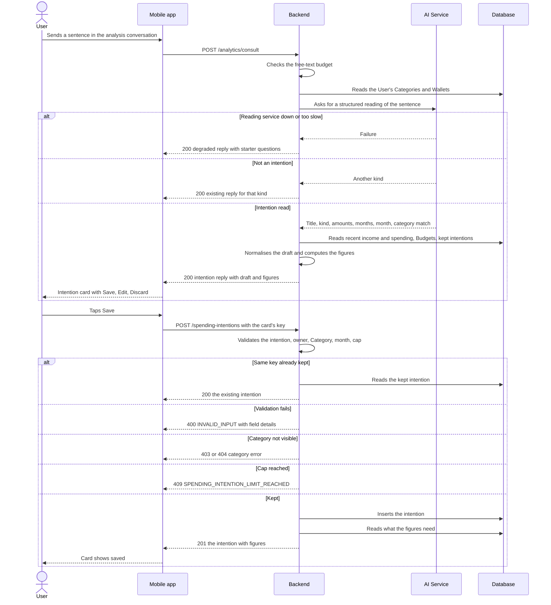
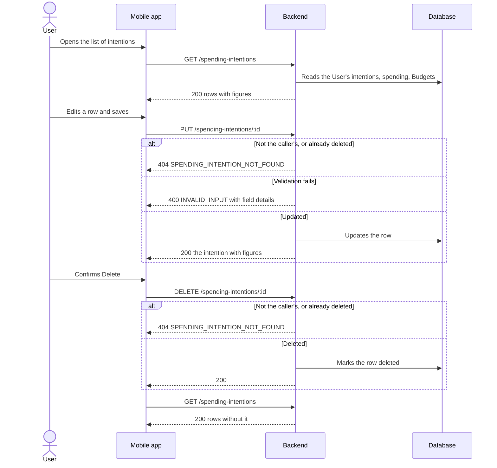
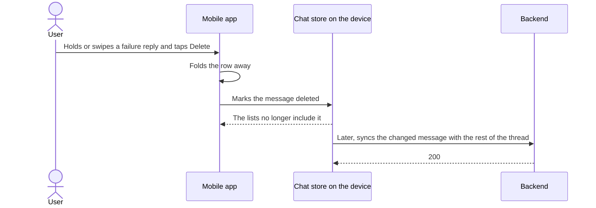

# Plan: Feature-12 US-06 Spending Intentions, US-07 Delete a Failed Reply

**Spec:** [spec.md](./spec.md) · **SRS:** FR-09, Feature-12 US-06 / US-07 · **Clients:** mobile (`mobile/`), Go backend, Python AI service. Web is out of scope.

## Pre-flight: Spec Review Findings

| # | Gap / ambiguity found in spec.md vs. the codebase | Resolution |
|---|---|---|
| F1 | The savings-goal plan (`consult_scenario.go`) already reads a baseline of the last three completed cycles and rounds with `roundUp / roundNearest / roundDown` over `common.SuggestedStep`. The spec's "same rounding steps" must reuse them, not copy them. | The baseline load moves into one shared function (`cycle_baseline.go`) used by both; the rounding helpers are reused as they are. |
| F2 | A sentence names several things (braces, perfume, shower gel). The tool schema used flat fields, and the interpreter's forced tool call mishandles `$ref`. | The tool output carries a list of items (at most 5) and the schema is inlined with `dereference_schema`, as the extract tool already does. Backend reads each item, skips the unreadable ones and reports how many. |
| F9 | Weighing each plan alone ignores what the others take: two plans in one Category share one Budget, plans in one month share one surplus. | The assessor is built over every plan that counts together (kept intentions and the sentence's drafts); it excludes a plan from its own figures by id or identity, and a portfolio sums them month by month (`spending_intention_portfolio.go`). |
| F10 | A later month has no real spending to weigh a Budget against. | The baseline also averages each expense Category over the recent cycles (`SumByCategory`); a later month's Budget uses that usual spending, and shows the limit only when there is no history. |
| F3 | `ConsultService` is constructed in many tests. A new dependency in the constructor would break them all. | Intentions are attached with a `WithIntentions` method; without it the new reply kind degrades to "unsupported". |
| F4 | Budget `Spent`/`Remaining` come from `BudgetService.ListBudgets` for the current period. A later month has no such figure. | Spec A-06/BR-06: the Budget lines are shown only when the assessed month is the current cycle's month. |
| F5 | Chat thread sync is upsert-only; `removeMessage` in the store is not synced. A deleted failure reply would return on restore. | Deletion is a `dismissed` flag on the message (synced as part of its payload) that every list filters out (BR-25). No server change. |
| F6 | `ConsultKind` on mobile is a closed union and `ConsultReplyCard` renders by kind; an unknown kind must still draw something (S-AIQ-43 precedent). | A new kind `intention` is added end to end; an older app shows the reply's `message` and the starter chips. |
| F7 | Money fields cross Go (xu) and the model (đồng). | The interpreter returns đồng; the service multiplies by `VNDToCentsFactor` once, as the scenario path does. |
| F8 | spec.md OQ-2 leaves the cap open. | Assumption recorded: 50 active intentions per User (`IntentionMaxPerUser`). |

## Architecture

### Package / file layout (only the stacks touched)

```text
backend/
├── db/migrations/038_spending_intentions.sql         # embedded, applied by cmd/migrate
├── db/queries/spending_intentions.sql                # source of the hand-written sqlc code
└── internal/
    ├── common/constants_intention.go                 # caps, horizon, limits, error codes
    ├── model/spending_intention.go
    ├── dto/spending_intention_request.go · spending_intention_response.go
    ├── repository/spending_intention_repository.go
    ├── repository/sqlc/spending_intentions.sql.go · models.go (SpendingIntention)
    ├── service/
    │   ├── interfaces_intention.go                   # SpendingIntentionRepo
    │   ├── spending_intention_service.go             # create / list / update / delete
    │   ├── spending_intention_normalize.go           # one rule set for a draft and a save
    │   ├── spending_intention_assess.go              # one plan against all the others
    │   ├── spending_intention_portfolio.go           # all plans together, month by month
    │   ├── cycle_baseline.go                         # shared with the savings-goal plan
    │   └── consult_intention.go                      # the new reply kind
    └── handler/spending_intention_handler.go
ai-service/app/
├── schemas/consult_schema.py                         # kind "intention" + flat intention fields
├── services/consult_prompt.py                        # when to choose it, with examples
└── services/consult_service.py                       # tool output → ConsultIntention
mobile/
├── src/features/spending-intentions/
│   ├── types.ts · intention-draft.ts · intention-lines.ts · intention-message-state.ts
│   ├── api/use-spending-intentions-query.ts · use-spending-intention-mutations.ts
│   └── components/IntentionCard.tsx · IntentionSummary.tsx · IntentionFigures.tsx · IntentionRow.tsx
│                  · IntentionPortfolioView.tsx · IntentionFormModal.tsx · IntentionsDrawer.tsx · IntentionSheetsHost.tsx · IntentionsChip.tsx
├── src/stores/intention-sheets-store.ts              # which sheet is open, so a card never owns one
└── src/features/ai-chat/                             # failure-reply.ts, hooks/use-dismiss-collapse.ts, row changes
```

### Domain objects

| Entity | Table | Key fields | Notes |
|---|---|---|---|
| `SpendingIntention` | `spending_intentions` | id (UUID v4), user_id, title, kind (`one_time` / `installment`), category_id (nullable), currency, total_amount (BIGINT xu, nullable), monthly_amount (BIGINT xu, nullable), installment_months (nullable), target_month (DATE, first day of a local month), note, idempotency_key (nullable), created_at, updated_at, `deleted_at` | ⚠️ money is BIGINT xu, never float; **soft delete** via `deleted_at`; unique (user_id, idempotency_key) among rows with a key |

Not stored: every figure of the assessment (computed at read time, like Budget `Spent`).

### Business rules

| Rule | Source | Enforcement |
|---|---|---|
| Only the sentence is read by the model; amounts on the card are the User's own | BR-01 | AI Service tool schema carries only the stated fields; `ConsultService.routeIntention` builds figures |
| Non-intentions never become a card | BR-02 | Interpreter kind `intention` only; `transaction_like`, `scenario`, `query` keep their own routes |
| Category below medium confidence dropped | BR-03 | `routeIntention` reuses `common.AnalyticsCategoryConfidenceMedium` |
| Monthly burden (price, payment, or total ÷ months rounded up) | BR-04, A-04 | `normalizeIntention` |
| Surplus and "left after other intentions" round down; shortfall up; averages nearest | BR-05, A-07 | `intentionAssessor.assess` over `roundDown / roundUp / roundNearest` |
| Current cycle's Budget read as the Budgets screen; a later month against the Category's usual spending; limit only without history | BR-06, BR-29, A-09 | `intentionAssessor.budgetFor` with `BudgetStatusReader.ListBudgets` and `cycleBaseline.byCategory` |
| Every plan weighed against all the others of its month and Category | BR-27, BR-28, A-08 | `intentionAssessor.plannedIn` over kept intentions plus the sentence's drafts |
| All plans together, month by month, against the surplus and each Budget | BR-30 | `intentionAssessor.portfolios` |
| Fit flags and shortfalls, never advice | BR-07 | response carries numbers and booleans only; mobile composes the lines |
| Counts toward the free-text limit | BR-08 | existing `AIConsultRateLimiter` on `/analytics/consult` |
| Title required, length capped | BR-09 | handler validator tags |
| One-time has no months or payment | BR-10 | `normalizeIntention` → 400 `INVALID_INPUT` with field details |
| Instalment needs months and a total or a payment | BR-11 | `normalizeIntention` |
| Amounts above zero and below the cap, no overflow | BR-12 | validator + `common.MulDiv`-style checked multiply in `normalizeIntention` |
| Category visible and expense | BR-13 | service via `CategoryRepo.GetCategoriesByIDs` → 404 / 403 / 400 |
| Month not in the past, within the horizon | BR-14 | service, month index against `CycleResolver` |
| Per-User cap | BR-15 | service count before insert → 409 `SPENDING_INTENTION_LIMIT_REACHED` |
| ⚠️ Saving twice keeps one | BR-16 | idempotency key lookup before insert, plus a unique index as the race guard |
| Independent problems reported together | BR-17 | `normalizeIntention` collects field problems into one `INVALID_INPUT` with details |
| Live figures in list and card | BR-18 | `GET` computes per request; the card reads the list query |
| Edit replaces the editable set under the save rules | BR-19 | `PUT` shares `normalizeIntention` with create |
| Delete confirmation, soft delete | BR-20 | mobile `ConfirmDialog`; repository sets `deleted_at` |
| Deleted stops counting everywhere | BR-21 | every read filters `deleted_at IS NULL` |
| Own rows only | BR-22 | every query carries `AND user_id = $n`; a foreign or missing id is 404 |
| Failure replies deletable, nothing else | BR-23 | `isFailureReply` (structural, no flag) |
| Delete without a second confirm | BR-24 | popover / revealed button acts directly |
| Stays deleted after restore | BR-25 | `dismissed` flag on the synced message; lists filter it |
| Neighbours untouched | BR-26 | update touches only the one message |

### Sequence — US-01 (read an intention) and US-02 (keep it), one diagram



### Sequence — US-03 (list, edit, delete)



### Sequence — US-04 (delete a failed reply)



## API contract

| Method + path | Auth | Body → response | Status codes |
|---|---|---|---|
| `POST /analytics/consult` | JWT + consult limiter | existing request → reply with `kind: "intention"`, `intentions: { items: [{ draft, month_moved }], portfolios, truncated, skipped }` | 200; 400 `INVALID_INPUT`; 429 `RATE_LIMITED` |
| `GET /spending-intentions` | JWT | → `{ items: [intention + assessment], portfolios }` soonest month first | 200; 401 |
| `POST /spending-intentions` | JWT | draft + `idempotency_key` → intention + assessment | 201 (200 when the key was already kept); 400; 401; 403 `CATEGORY_ACCESS_DENIED`; 404 `CATEGORY_NOT_FOUND`; 409 `SPENDING_INTENTION_LIMIT_REACHED` |
| `PUT /spending-intentions/:id` | JWT | editable set → intention + assessment | 200; 400; 401; 403; 404 `SPENDING_INTENTION_NOT_FOUND` |
| `DELETE /spending-intentions/:id` | JWT | → empty | 200; 401; 404 |

Money in every body: integer xu. `target_month` is `YYYY-MM`. Independent field checks (shape, amounts, months, title) are **collected into one 400**; ownership, Category, month and cap checks are **gating** and short-circuit in that order after the shape passes.

Authorization: JWT middleware resolves the caller; every service method takes the caller's `userID`; there is no role gate (every active User manages only their own).

Transactions: create, update and delete are single-statement writes (each `INSERT` / `UPDATE` is atomic). The cap check runs before the insert; the race at the cap is accepted to be off by a small number and bounded by the per-route limiter (not a financial write). Reads open no transaction.

## Error flows

| Scenario | HTTP | Error code |
|---|---|---|
| Unauthenticated | 401 | — |
| Another User's intention id, or a deleted one | 404 | `SPENDING_INTENTION_NOT_FOUND` |
| Category of another User | 403 | `CATEGORY_ACCESS_DENIED` |
| Category not found | 404 | `CATEGORY_NOT_FOUND` |
| Income Category linked | 400 | `INVALID_INPUT` (field `category_id`) |
| Shape or rule violation (title, amount, months, month, kind mix) | 400 | `INVALID_INPUT` with `details.fields` |
| Cap reached | 409 | `SPENDING_INTENTION_LIMIT_REACHED` |
| Free-text limit | 429 | `RATE_LIMITED` |
| Interpreter down or too slow | 200 | reply kind `degraded` |
| Interpreter output outside the catalogue | 200 | reply kind `unsupported` |
| Unexpected | 500 | — |

## Constitution / Convention Notes

| Rule | Status | Note |
|---|---|---|
| Service owns business rules | Required | validation in `spending_intention_normalize.go`; handler only shapes |
| Handler never imports a repository | Required | handler → service only |
| Money BIGINT xu, no float | Required | `int64` throughout; the AI Service sends đồng integers |
| Soft delete | Required | `deleted_at`, all reads filter it |
| User isolation | Required | `AND user_id = $n` on every query |
| Idempotency on create | Required | key lookup + unique index |
| Migration applied by the runner | Required | `038_*` is embedded (`db/migrations.go`) and applied by `cmd/migrate`; additive and re-runnable (`IF NOT EXISTS`) |
| Hand-written sqlc | Required | never run `sqlc generate` (see `repository/sqlc/db.go`) |
| No file over 300 lines | Required | service split into four files |
| Mobile: server state through TanStack Query only | Required | list and mutations; the saved card reads the query, never a copy |
| Mobile: user-visible text through locale keys | Required | `chat.json` and a new `intentions.json` in VI and EN; copy per `pfm-ux-copy` |
| Mobile: skeleton while loading | Required | list shows row skeletons |
| Facts not advice in copy | Required | numbers vs the User's own limits only |

## Element / Key IDs (mobile `testID`)

| Element | testID | Status | File |
|---|---|---|---|
| Intention card | `card-intention-{messageId}` | New | `IntentionCard.tsx` |
| Save / Edit / Discard / Delete on the card | `btn-intention-save`, `btn-intention-edit`, `btn-intention-discard`, `btn-intention-delete` | New | `IntentionCard.tsx` |
| Intentions chip above the input | `chip-intentions` | New | `IntentionsChip.tsx` |
| List sheet and its add button | `sheet-intentions`, `btn-intention-add` | New | `IntentionsDrawer.tsx` |
| A row, and its delete | `row-intention-{id}`, `btn-intention-row-delete` | New | `IntentionRow.tsx` |
| Form fields | `input-intention-title`, `input-intention-amount`, `input-intention-monthly`, `input-intention-months`, `btn-intention-submit` | New | `IntentionFormModal.tsx` |
| Delete a failed reply (hold menu / swipe) | `btn-msg-menu-delete`, `btn-chat-delete-transaction` | Exists | `use-message-actions.ts`, `SwipeableMessageRow.tsx` |

## Open Tasks

| ID | Task | File |
|---|---|---|
| INT-T01 | Migration `038_spending_intentions` (embedded in the binary and applied by the `migrate` service; no compose mount) | `backend/db/migrations/038_spending_intentions.sql` |
| INT-T02 | Queries source + hand-written sqlc + model | `backend/db/queries/spending_intentions.sql`, `repository/sqlc/spending_intentions.sql.go`, `models.go` |
| INT-T03 | Constants and error codes | `backend/internal/common/constants_intention.go`, `errors.go` |
| INT-T04 | Domain model, DTOs | `backend/internal/model/spending_intention.go`, `dto/spending_intention_*.go` |
| INT-T05 | Repository + repo interface | `backend/internal/repository/spending_intention_repository.go`, `service/interfaces_intention.go` |
| INT-T06 | Shared baseline extraction | `backend/internal/service/cycle_baseline.go`, `consult_scenario.go` |
| INT-T07 | Normalise + assess + portfolio + service (+ unit tests, fake repo) | `backend/internal/service/spending_intention_*.go` |
| INT-T08 | Handler, routes, wiring | `backend/internal/handler/spending_intention_handler.go`, `cmd/server/routes.go`, `wiring.go` |
| INT-T09 | Consult: wire fields and `intention` kind (+ tests) | `service/ai_consult_client.go`, `consult_intention.go`, `consult_routing.go`, `model/analytics.go`, `dto/analytics_response.go` |
| INT-T10 | AI Service: schema (list of items), prompt, mapping (+ pytest) | `ai-service/app/...` |
| INT-T11 | Mobile: types, query and mutation hooks, sheets store | `mobile/src/features/spending-intentions/{types.ts,api}`, `mobile/src/stores/intention-sheets-store.ts` |
| INT-T12 | Mobile: card with several proposals and Save all, portfolio view, form, list sheet, chip | `mobile/src/features/spending-intentions/components/...` |
| INT-T13 | Mobile: consult wiring (kind, message fields, actions) | `features/analytics/types.ts`, `ConsultReplyCard.tsx`, `use-consult-actions.ts`, `ai-chat/types.ts` |
| INT-T14 | Mobile: locale keys VI and EN, glossary | `mobile/src/locales/{vi,en}/...`, `.claude/skills/pfm-ux-copy/references/glossary.md` |
| INT-T15 | Mobile: delete a failed reply (done) | `failure-reply.ts`, `use-dismiss-collapse.ts`, `ChatMessageRow.tsx`, `ConsultMessageRow.tsx`, `ai-chat.tsx`, `ConsultPane.tsx` |
| INT-T16 | QC: `test_cases.md` | `specs/ai-chat-spending-intentions/test_cases.md` |
