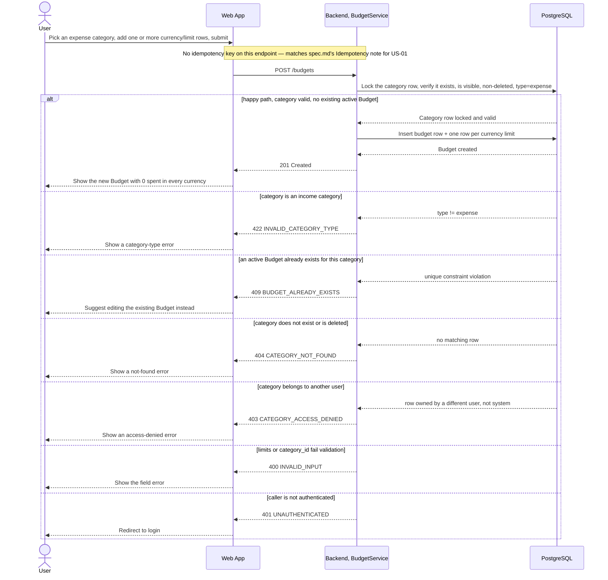
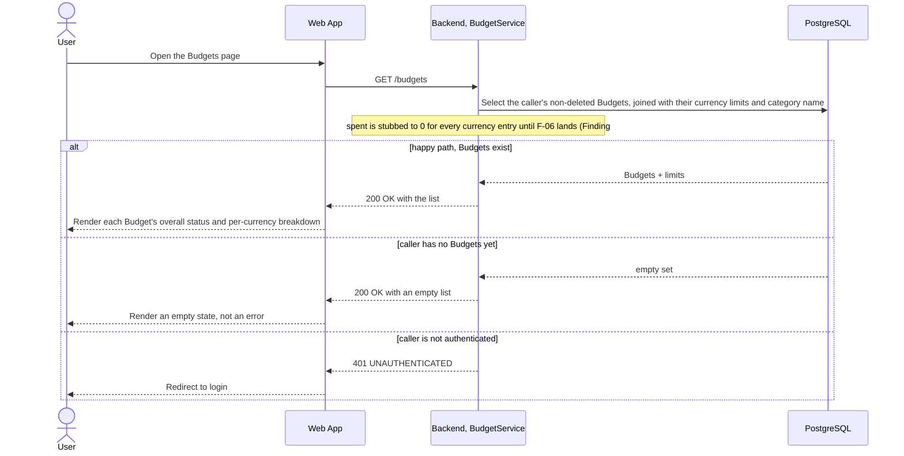
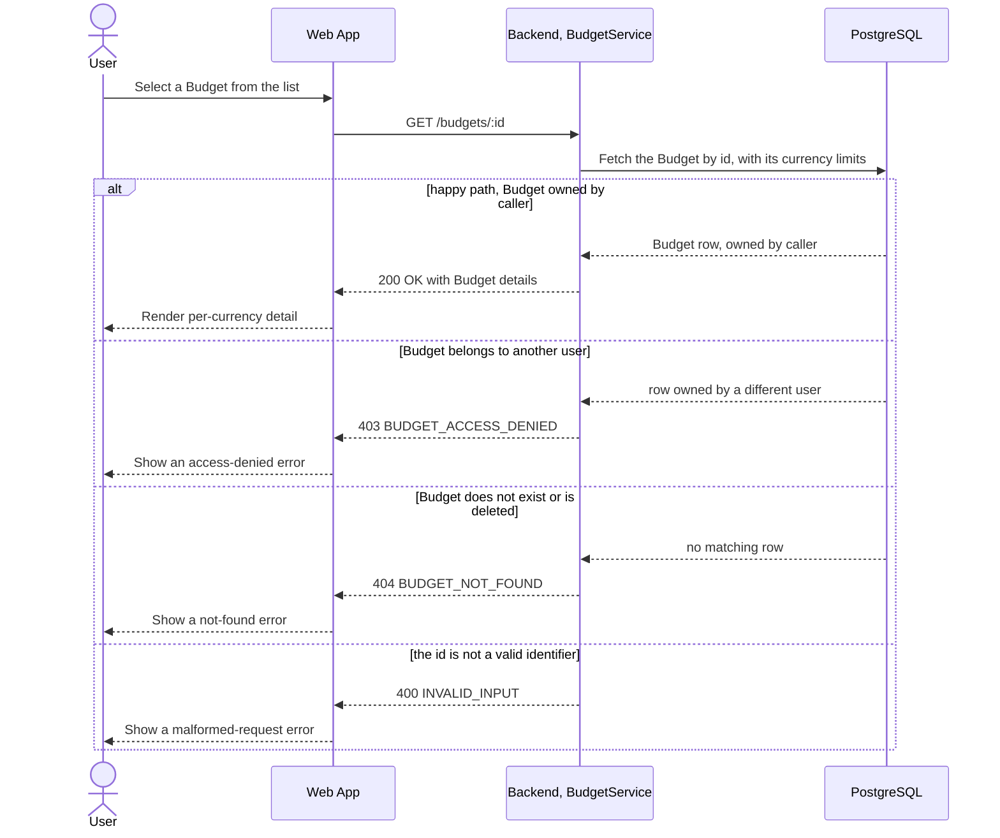
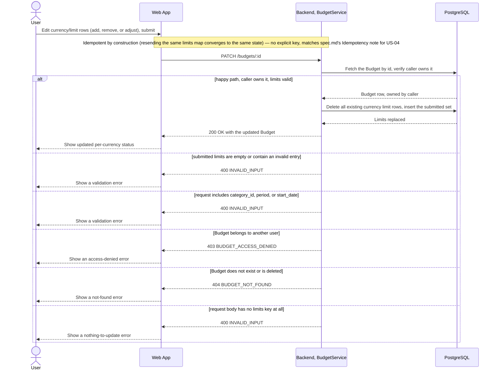
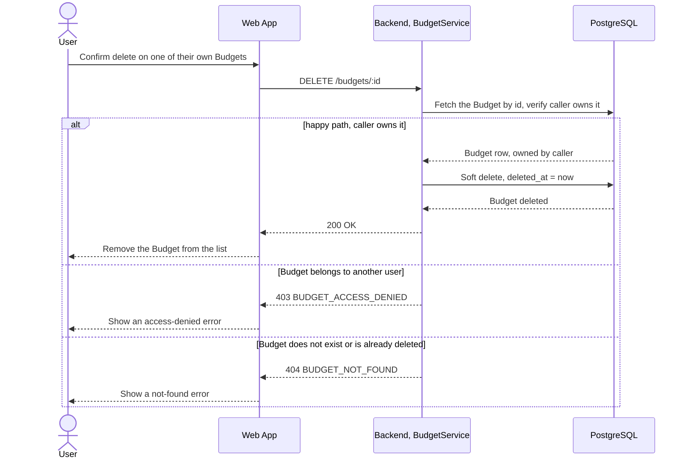
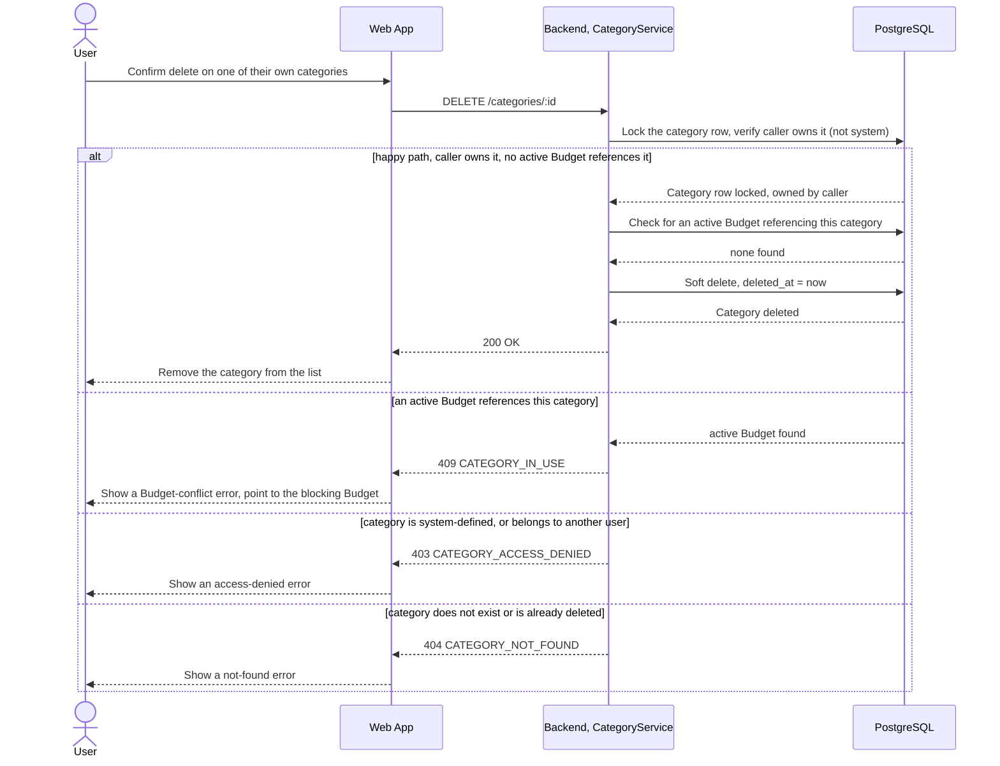

# Implementation Plan: F-05 Budget Management (MVP)

- **Feature:** Budget Management
- **SRS Feature Code:** F-05 (SRS.md Feature-05 §6; SDS.md §5.5 is currently an empty skeleton header — no ACs defined there; `spec.md` in this folder is the authoritative source)
- **Jira Epic:** N/A — this repository has no Jira integration wired up (same as the F-01–F-04 plans)
- **Spec:** [spec.md](./spec.md)
- **Related plans:** [F-03 Wallet Management](../wallet-management/plan.md) (Wallet currency allow-list `{VND, USD}` reused here for `limits` validation), [F-04 Category Management](../category-management/plan.md) (`budgets.category_id` FK; **this plan modifies F-04's existing files** — see Finding #2)
- **Frontend scope:** **web only** (`frontend/`, Next.js). `mobile/` (Flutter) remains deferred per current project direction.

---

## 1. Pre-flight: Spec Review Findings

| # | Type | Finding | Resolution / Open Task |
|---|------|---------|-------------------------|
| 1 | **Blocking dependency, biggest scope cut in this plan** | `spec.md`'s entire "actual spend" computation (US-02 step 4, US-03 step 4) requires `SUM(transactions.amount) ... JOIN wallets ON wallets.currency = ...`. **The `transactions` table does not exist yet** — F-06 Transaction Management has no spec, plan, or migration (confirmed: no `transaction_handler.go`/`transaction_service.go`/`transactions.sql` anywhere in the repo). Querying a nonexistent table would break the build, exactly the same class of blocker as F-04's `CAT-T14`. | `GET /budgets` and `GET /budgets/{id}` are implemented in this plan **returning `spent = 0`, `remaining = amount_limit`, `status = "within"` for every currency entry, unconditionally** — the real aggregate query is not wired. This is a genuine, temporary reduction in the feature's core value (spend tracking) versus `spec.md`, not an oversight — tracked as **BUD-T17**, blocked on F-06's migration landing. The seam is isolated to one method (`BudgetService.computeStatus`, §2 Business Rules) so swapping in the real query later is a single-method change, not a rewrite. |
| 2 | **Cross-feature modification, spec-mandated** | `spec.md` Open Questions #3 (mirroring F-04 `spec.md` US-05 Edge Cases #4 / `plan.md` Finding #4, `CAT-T14`) requires this plan to close the create-vs-delete race between `POST /budgets` and `DELETE /categories/{id}` (S-BUD-14 / S-CAT-32), **and** to wire up F-04's long-deferred `409 CATEGORY_IN_USE` check now that `budgets` will exist. Both require modifying already-shipped F-04 files. | This plan modifies `category_repository.go` (adds `BeginTx`, a tx-scoped `LockCategoryByID`, a tx-scoped `SoftDeleteCategory`, and `HasActiveBudgetForCategory`), `category_service.go` (`DeleteCategory` rewritten to run inside one transaction: lock → ownership check → active-Budget check → soft-delete → commit), and `interfaces.go` (`CategoryRepo` interface gains the new methods). This is a deliberate exception to the "small additive edits only" pattern every prior plan followed — flagged here, in Regression Scope, and again in Constitution Notes, not silently done. |
| 3 | Gap | The `budgets` table (plus its per-currency limits) does not exist in any migration yet — `backend/db/migrations/` currently ends at `006_seed_categories.sql`. | This plan adds `007_budgets.sql` (§2, Schema). |
| 4 | **Design decision** | `spec.md`'s Domain Fields section explicitly defers the physical shape of `limits` to this plan (a child table of `(budget_id, currency, amount_limit)` rows vs. a JSONB column were both left open). | This plan commits to a **child table**, `budget_limits`, keyed `(budget_id, currency)` — consistent with this codebase's sqlc-generated-Go convention (a JSONB column would require hand-rolled (un)marshaling code sqlc doesn't generate, and no other table in this schema uses JSONB). See §2, Schema. |
| 5 | Ambiguity | `spec.md`'s `limits` validation (non-empty map, each key a currency in `{VND, USD}`, each value a positive integer) doesn't map cleanly onto `go-playground/validator/v10` struct tags — `dive/keys/endkeys` map-validation syntax exists but is unused anywhere else in this codebase and is easy to get subtly wrong. | This plan implements a small hand-written `dto.ValidateLimits(map[string]int64) error` helper (handler-level, called alongside `validate.Struct`, same layer CLAUDE.md mandates for shape validation) instead of fighting `dive` tag syntax. Requires a new `common.SupportedCurrencies` lookup (§2) — a narrow, deliberate exception to `constants.go`'s existing comment that the currency enum is "dead weight" as a Go-side list; that reasoning held when currency only needed a struct-tag `oneof`, but map-*key* validation genuinely cannot be expressed as a struct tag. |
| 6 | Gap | No `/budgets` route group exists in `cmd/server/routes.go` yet. | Added in §2 — a new group under the existing `JWTAuth` middleware only, no `RequireRole` gate (same convention as `/wallets`, `/categories`). |
| 7 | Gap | `frontend/src/features/budgets/` does not exist yet. | Scaffolded in §2, mirroring `features/categories/` file-for-file (closest precedent — has a delete flow, unlike `features/wallets/`), with new multi-currency-row form components budgets need that neither prior feature does. |
| 8 | Gap (carried over) | The frontend project still has zero test tooling configured — unchanged since F-03's Finding #8 / F-04's Finding #9. | Not committed to in this plan either; tracked as **BUD-T18**. |
| 9 | Ambiguity | `spec.md` US-04 Edge Cases #1 commits to full-replace semantics for `PATCH .../{id}`'s `limits` (not a per-currency merge), but leaves open whether the replace is "delete all rows then insert the new set" or a diff (upsert changed, delete removed, insert added) at the SQL level. | This plan implements it as **delete-all-then-insert**, inside one transaction — simpler, and the end state is identical either way since there's no partial-failure-visible intermediate state a client could observe. No optimistic-locking/version column is introduced. |
| 10 | Out of scope, explicitly not started | `spec.md`'s decision #4 (async Budget-crossing Notifications) and Open Questions #5 (F-10's trigger cadence) belong entirely to F-10 Notification Handling, which doesn't exist yet either. | Nothing in this plan creates, schedules, or stubs a Notification. No placeholder cron/job is added — that would be inventing F-10 design this plan has no mandate to make. |

### Regression Scope

**New files only** (mirrors F-03/F-04's pattern):
- `backend/db/migrations/007_budgets.sql`, `backend/db/queries/budgets.sql`
- `backend/internal/model/budget.go`, `backend/internal/repository/budget_repository.go`, `backend/internal/service/budget_service.go`, `backend/internal/handler/budget_handler.go`, `backend/internal/dto/budget_request.go`, `backend/internal/dto/budget_response.go`
- `frontend/src/features/budgets/**`, `frontend/src/app/app/budgets/**`

**Modified files (additive):**
- `backend/cmd/server/routes.go` — new `/budgets` group; no existing route touched.
- `backend/internal/common/errors.go` / `constants.go` — new error codes/constants appended; nothing renamed.
- `backend/internal/service/interfaces.go` — new `BudgetRepo` interface + compile-time check appended; `CategoryRepo` interface **gains new methods** (see below).
- `backend/db/queries/categories.sql` — one new query appended (`LockCategoryForBudgetCheck`), invoked by `BudgetRepository` via the shared `sqlc.Queries` struct (both repos already take the same generated struct — no new cross-repository dependency is introduced, see §2 Security note).
- `frontend/src/features/auth/components/app-header.tsx` — adds a "Budgets" nav link.

**Modified files (behavioral change — flagged per Finding #2, not additive):**
- `backend/internal/repository/category_repository.go` — adds `BeginTx`, `LockCategoryByID` (tx-scoped, row lock), a tx-scoped `SoftDeleteCategory` variant, `HasActiveBudgetForCategory`.
- `backend/internal/service/category_service.go` — `DeleteCategory` rewritten to run inside one transaction (lock → ownership → active-Budget check → soft-delete → commit) instead of today's unconditional soft-delete.
- `backend/internal/service/interfaces.go` — `CategoryRepo` interface signature changes (additive methods only — no existing method signature changes, so `*repository.CategoryRepository`'s compile-time check keeps passing without touching other call sites).

**Regression risk:** low but non-zero, confined to `CategoryService.DeleteCategory` — every other F-04 behavior (create/list/get/update, all their scenarios S-CAT-01 through S-CAT-26/28–31) is untouched. Re-run F-04's existing delete tests (S-CAT-29, S-CAT-30, S-CAT-31) after this change to confirm the 403/404 semantics still hold under the new transactional path.

---

## 2. Architecture

### Package/File Layout

**Backend (Go Fiber + sqlc)**

```text
backend/internal/
├── handler/
│   └── budget_handler.go          # CreateBudget, ListBudgets, GetBudget, UpdateBudget, DeleteBudget
├── service/
│   └── budget_service.go          # category lock+validate, duplicate-active-Budget, full-replace limits,
│                                   # computeStatus() (stubbed per Finding #1 / BUD-T17)
├── repository/
│   └── budget_repository.go       # sqlc wrapper: CreateBudget, ReplaceLimits, ListBudgetsByUser,
│                                   # GetBudgetByID, SoftDeleteBudget, LockCategoryForBudgetCheck (via shared sqlc.Queries)
├── model/
│   └── budget.go                  # Budget + BudgetLimit structs — zero framework imports
└── dto/
    ├── budget_request.go          # CreateBudgetRequest, UpdateBudgetRequest, ValidateLimits() (Finding #5)
    └── budget_response.go         # BudgetResponse, LimitEntryResponse, ListBudgetsResponse

# Modified (Finding #2):
├── repository/category_repository.go   # + BeginTx, LockCategoryByID, SoftDeleteCategory(tx), HasActiveBudgetForCategory
├── service/category_service.go         # DeleteCategory rewritten to run inside one transaction
└── service/interfaces.go               # CategoryRepo interface gains the above; new BudgetRepo interface

db/
├── migrations/
│   └── 007_budgets.sql             # budgets + budget_limits tables, indexes
└── queries/
    ├── budgets.sql                 # CreateBudget, InsertBudgetLimits, DeleteBudgetLimits, ListBudgetsByUser,
    │                                # GetBudgetByID, ExistsActiveBudgetForCategory, SoftDeleteBudget
    └── categories.sql (append)     # LockCategoryForBudgetCheck (SELECT ... FOR UPDATE on categories)
```

`common/errors.go` and `common/constants.go` are extended in place (new entries appended).

**Frontend (Next.js web — mirrors `features/categories/` file-for-file, closest precedent)**

```text
frontend/src/
├── app/app/
│   └── budgets/
│       ├── page.tsx                              # BudgetsPage — list + create entry point
│       └── [id]/
│           └── page.tsx                          # BudgetDetailPage
├── features/budgets/
│   ├── api/
│   │   ├── use-budgets-query.ts                  # GET /budgets
│   │   ├── use-budget-query.ts                   # GET /budgets/{id}
│   │   ├── use-create-budget-mutation.ts         # POST /budgets
│   │   ├── use-update-budget-mutation.ts         # PATCH /budgets/{id}
│   │   └── use-delete-budget-mutation.ts         # DELETE /budgets/{id}
│   ├── components/
│   │   ├── create-budget-dialog.tsx              # category select (expense-only) + dynamic currency/limit rows
│   │   ├── currency-limit-row-input.tsx          # NEW pattern — repeatable (currency, amount) row, add/remove
│   │   ├── budget-table.tsx                      # overall status badge per row; per-currency breakdown on expand
│   │   ├── budget-table-skeleton.tsx
│   │   ├── budget-detail-card.tsx                # per-currency progress bar (spent/limit), overall status
│   │   ├── budget-detail-card-skeleton.tsx
│   │   ├── edit-budget-dialog.tsx                # pre-populates ALL existing currency rows (full-replace semantics — Finding #9)
│   │   └── delete-budget-dialog.tsx              # confirm dialog, mirrors category's
│   └── types.ts                                   # Budget, LimitEntry, CreateBudgetRequest, UpdateBudgetRequest
└── lib/constants.ts (extend)                        # reuses existing WALLET_CURRENCIES for the currency picker; adds BUDGET_PERIODS = ["monthly"]
```

### Domain Objects

| Entity | Table | Key Fields | Notes |
|--------|-------|------------|-------|
| `Budget` | `budgets` | `id` (UUID v4), `user_id` (FK → `users.id`), `category_id` (FK → `categories.id`), `period` (`"monthly"` only, MVP), `start_date` (`DATE`), `created_at`, `updated_at`, `deleted_at` | Soft delete via `deleted_at`; every query filters `deleted_at IS NULL`. Not a money field itself at this level — money lives one level down in `budget_limits`. |
| `BudgetLimit` | `budget_limits` | `budget_id` (FK → `budgets.id`), `currency` (`VND`\|`USD`), `amount_limit` (BIGINT, integer cents, `> 0`) | ⚠️ Money field — BIGINT cents, never float. Composite PK `(budget_id, currency)` enforces "at most one entry per currency" at the data layer, not just app code. No `deleted_at` of its own — rows are replaced wholesale by `PATCH` (Finding #9) or vanish implicitly once the parent `Budget` is soft-deleted (queries always join through a non-deleted `budgets` row, so orphaned-looking `budget_limits` rows for a soft-deleted Budget are simply never surfaced). |

### Schema — `007_budgets.sql`

```sql
CREATE TABLE budgets (
    id          UUID PRIMARY KEY DEFAULT uuid_generate_v4(),
    user_id     UUID NOT NULL REFERENCES users(id),
    category_id UUID NOT NULL REFERENCES categories(id),
    period      TEXT NOT NULL DEFAULT 'monthly' CHECK (period IN ('monthly')),
    start_date  DATE NOT NULL DEFAULT CURRENT_DATE,
    created_at  TIMESTAMPTZ NOT NULL DEFAULT NOW(),
    updated_at  TIMESTAMPTZ NOT NULL DEFAULT NOW(),
    deleted_at  TIMESTAMPTZ
);

-- Source of truth for "at most one active Budget per (user, category)"
-- (spec.md Business invariants / S-BUD-11, S-BUD-13) — enforced at the DB
-- level, same precedent as F-03's one-default-wallet index and F-04's
-- name/type duplicate index, so two concurrent creates can never both land.
CREATE UNIQUE INDEX idx_budgets_one_active_per_user_category ON budgets (user_id, category_id)
    WHERE deleted_at IS NULL;

CREATE INDEX idx_budgets_user_id ON budgets (user_id) WHERE deleted_at IS NULL;
CREATE INDEX idx_budgets_category_id ON budgets (category_id) WHERE deleted_at IS NULL;

-- Per-currency limits (spec.md Domain Fields / Finding #4). ON DELETE CASCADE
-- is a referential-integrity safety net only — application code never issues
-- a hard DELETE FROM budgets (soft delete only, CLAUDE.md), so this never
-- fires in normal operation; it exists purely so the schema itself can't
-- silently orphan rows if a future migration or manual cleanup ever does.
CREATE TABLE budget_limits (
    budget_id    UUID NOT NULL REFERENCES budgets(id) ON DELETE CASCADE,
    currency     TEXT NOT NULL CHECK (currency IN ('VND', 'USD')),
    amount_limit BIGINT NOT NULL CHECK (amount_limit > 0),
    PRIMARY KEY (budget_id, currency)
);
```

### Business Rules

| Rule | Source | Enforcement |
|------|--------|-------------|
| `category_id` required, must be a valid UUID | S-BUD-09, S-BUD-26 | handler-level `validate.Struct` (`required`) → `400 INVALID_INPUT` |
| `limits` non-empty; each key ∈ `{VND, USD}`; each value a positive non-zero integer | S-BUD-04–S-BUD-08 | `dto.ValidateLimits()` (Finding #5) at handler level → `400 INVALID_INPUT` |
| `period` (if present) must be exactly `"monthly"` | Edge Case US-01 #3 | validator `oneof=monthly` → `400 INVALID_INPUT` |
| `start_date` (if present) must be a valid ISO date | US-01 step 2 | validator `datetime=2006-01-02` → `400 INVALID_INPUT` |
| Category must exist, be visible (system or caller's own), non-deleted, `type = "expense"` | S-BUD-03, S-BUD-09, S-BUD-10 | `BudgetService.CreateBudget` — locks + fetches the category row inside the create transaction (`BudgetRepository.LockCategoryForBudgetCheck`) → `404 CATEGORY_NOT_FOUND` / `403 CATEGORY_ACCESS_DENIED` / `422 INVALID_CATEGORY_TYPE` |
| At most one active Budget per `(user_id, category_id)` | S-BUD-11, S-BUD-13 | DB partial unique index (`idx_budgets_one_active_per_user_category`) + `isUniqueViolation()` → `409 BUDGET_ALREADY_EXISTS` |
| Create-vs-Category-delete race closed | S-BUD-14 | `BudgetRepository.LockCategoryForBudgetCheck` takes a `SELECT ... FOR UPDATE` row lock on the category **inside the same transaction** as the Budget insert; `CategoryService.DeleteCategory` (Finding #2) takes the same lock before its own active-Budget check — the two transactions serialize on that row, so one always commits before the other's check runs |
| Unauthenticated caller rejected | S-BUD-12, S-BUD-17 | `middleware.JWTAuth` at route-group level → `401` |
| List/View scoped strictly to caller | S-BUD-15 | `BudgetRepository.ListBudgetsByUser` / `GetBudgetByID` — `WHERE user_id = $1` |
| Soft-deleted Budgets excluded everywhere | S-BUD-18 | every `budget_repository.go` query filters `deleted_at IS NULL` |
| Not-found vs. access-denied split | S-BUD-24 vs. S-BUD-25 | fetch first (existence + `deleted_at IS NULL`), then decide `404 BUDGET_NOT_FOUND` / `403 BUDGET_ACCESS_DENIED` — same pattern as Wallet/Category |
| Invalid UUID path param rejected before any DB call | S-BUD-26 | handler `budgetIDParam()` helper (mirrors `walletIDParam`/`categoryIDParam`) → `400 INVALID_INPUT` |
| **Spend/remaining/status computation** | US-02 step 4–5 | ⚠️ **Stubbed** (Finding #1 / BUD-T17) — `BudgetService.computeStatus()` currently returns `spent=0, remaining=amount_limit, status="within"` for every currency entry unconditionally, because `transactions` doesn't exist. The method signature already takes `(budgetID, categoryID uuid.UUID, limits []BudgetLimit) []LimitEntryResponse` so the real aggregate query slots in later without changing any caller. |
| `category_id`/`period`/`start_date` never accepted on `PATCH` | S-BUD-28 | `dto.UpdateBudgetRequest` has no such fields at the type level; decoded via existing `dto.DecodeStrict` → `400 INVALID_INPUT` on any unrecognized field |
| `PATCH .../limits` is a full replacement, not a merge | S-BUD-27–S-BUD-29 | `BudgetService.UpdateBudget` runs `DeleteBudgetLimits(tx, budgetID)` then `InsertBudgetLimits(tx, budgetID, newLimits)` inside one transaction (Finding #9) |
| Empty `limits` on create or update rejected | S-BUD-04, S-BUD-30 | same `dto.ValidateLimits()` helper, called from both `CreateBudgetRequest` and `UpdateBudgetRequest` handling |
| Empty `PATCH` body (no `limits` key) rejected | S-BUD-36 | `UpdateBudgetRequest.HasUpdates()` → `400 INVALID_INPUT` |
| Delete is unconditional once ownership passes (no FK references `budgets.id`) | S-BUD-37 | `BudgetService.DeleteBudget` — `getOwnedBudget()` then soft-delete, no dependency check (unlike Category's) |
| Delete is a soft delete only | Edge Case US-05 #2 | `UPDATE budgets SET deleted_at = NOW() ...`; `budget_limits` rows are left in place (orphaned but never surfaced — see Domain Objects note) |
| Delete is not idempotent — second call is `404` | S-BUD-39 | delete query scoped by `deleted_at IS NULL`; second call finds no row |
| **[F-04 amendment]** `DELETE /categories/{id}` blocked while an active Budget references it | S-CAT-27 (F-04), resolved by Finding #2 | `CategoryService.DeleteCategory` now calls `HasActiveBudgetForCategory(tx, categoryID)` inside its transaction → `409 CATEGORY_IN_USE` if true |

### API Index — Endpoint → Service Traceability

| API | Request | Response | Service Method |
|-----|---------|----------|-----------------|
| `POST /budgets` | `CreateBudgetRequest` | `BudgetResponse` (`201`) | `BudgetService.CreateBudget` |
| `GET /budgets` | — | `ListBudgetsResponse` (`200`) | `BudgetService.ListBudgets` |
| `GET /budgets/{id}` | — | `BudgetResponse` (`200`) | `BudgetService.GetBudget` |
| `PATCH /budgets/{id}` | `UpdateBudgetRequest` | `BudgetResponse` (`200`) | `BudgetService.UpdateBudget` |
| `DELETE /budgets/{id}` | — | `200` confirmation | `BudgetService.DeleteBudget` |

### Security & Actor Resolution

- **Middleware:** all five endpoints sit under one `JWTAuth(tokens, logger)` route group — no `RequireRole` gate, same convention as `/wallets`, `/categories`.
- **Actor resolution path:** identical to F-03/F-04 — `callerUUID(c)` reads JWT-populated Fiber locals once in `budget_handler.go`, passed into every `BudgetService` method as an explicit `userID uuid.UUID` parameter.
- **Cross-repository query note (Finding #2):** `BudgetRepository.LockCategoryForBudgetCheck` and `CategoryRepository.HasActiveBudgetForCategory` each query a table their own feature doesn't "own" (`categories` and `budgets` respectively). This works without a new repository-to-repository dependency because both repositories already hold a reference to the same generated `*sqlc.Queries` struct (confirmed: `NewWalletRepository`/`NewCategoryRepository` both take `*sqlc.Queries`, and sqlc generates one combined struct across every `.sql` file in `db/queries/` regardless of filename) — each repository simply calls a method generated from a query declared in the *other* feature's `.sql` file. This is a deliberate, narrow exception: acceptable because it's a single read (existence check / row lock), not a second feature's full CRUD surface being reimplemented.
- **CSRF:** not applicable for every mutating endpoint here (`POST`/`PATCH`/`DELETE /budgets*`) — Bearer-JWT API, no cookie/session auth surface for the Go backend to protect (same reasoning as every prior plan).
- **Framework note:** no Spring-style `@PreAuthorize` in this stack. Authorization logic (category-type check, ownership, duplicate-active-Budget) lives entirely in the Service layer (`BudgetService`), never in `budget_handler.go`.
- **Bookmark / direct-URL access:** a User navigating directly to `/app/budgets/{id}` for a Budget they don't own is safe by construction — the page's data fetch hits `GET /budgets/{id}`, which enforces ownership **server-side** (`403`/`404`) regardless of navigation path. `middleware.ts` only gates on session-cookie presence for the whole `/app` group, same as every other feature.
- **Validation-check independence (checklist requirement):** `category_id` format and `limits` format (US-01/US-04) are **independent** field-level checks — both run through `validator.Struct` + `dto.ValidateLimits` and are collected into a single `400` response's `details` array (existing `newValidationError` convention, `handler/validate.go`), never a fix-one-resubmit-one flow. Category existence → visibility → `type = expense` → duplicate-active-Budget (US-01) are **sequential/gating** checks — each requires the prior to have resolved a real, locked row before it can even run, so they are correctly modeled as early-return steps inside `BudgetService.CreateBudget`, not collected together.

### Sequence Diagrams

> Five-tier lifeline (User → Frontend → Backend → DB), happy path first with `alt/else` branches beneath. These diagrams are AI-generated and require human review before implementation begins.

**US-01: Create a Budget for a Category**



**US-02: View a List of Budgets**



**US-03: View a Budget**



**US-04: Update a Budget**



**US-05: Delete a Budget**



**[F-04 amendment] Updated `DELETE /categories/{id}` flow (Finding #2)**



---

## 3. Error Flows

### US-01: Create a Budget for a Category

| Scenario | HTTP | Error Code |
|----------|------|------------|
| Unauthenticated | 401 | — |
| `category_id` missing or not a valid UUID | 400 | `INVALID_INPUT` |
| `limits` empty, has an invalid currency, or a non-positive/non-integer value | 400 | `INVALID_INPUT` |
| `period` present but not `"monthly"` | 400 | `INVALID_INPUT` |
| `start_date` present but not a valid date | 400 | `INVALID_INPUT` |
| Category is an `income` category | 422 | `INVALID_CATEGORY_TYPE` |
| Category not found or soft-deleted | 404 | `CATEGORY_NOT_FOUND` |
| Category belongs to another user | 403 | `CATEGORY_ACCESS_DENIED` |
| Active Budget already exists for this category | 409 | `BUDGET_ALREADY_EXISTS` |
| Unexpected error | 500 | — |

### US-02: View a List of Budgets

| Scenario | HTTP | Error Code |
|----------|------|------------|
| Unauthenticated | 401 | — |
| Unexpected error | 500 | — |

*(Zero Budgets is `200` with an empty list — not an error path; see `spec.md` S-BUD-16.)*

### US-03: View a Budget

| Scenario | HTTP | Error Code |
|----------|------|------------|
| Unauthenticated | 401 | — |
| `{id}` not a valid UUID | 400 | `INVALID_INPUT` |
| Budget belongs to another user | 403 | `BUDGET_ACCESS_DENIED` |
| Budget not found or soft-deleted | 404 | `BUDGET_NOT_FOUND` |
| Unexpected error | 500 | — |

### US-04: Update a Budget

| Scenario | HTTP | Error Code |
|----------|------|------------|
| Unauthenticated | 401 | — |
| Request body has no `limits` key | 400 | `INVALID_INPUT` |
| `limits` empty, has an invalid currency, or a non-positive/non-integer value | 400 | `INVALID_INPUT` |
| Request includes `category_id`, `period`, or `start_date` | 400 | `INVALID_INPUT` |
| Budget belongs to another user | 403 | `BUDGET_ACCESS_DENIED` |
| Budget not found or soft-deleted | 404 | `BUDGET_NOT_FOUND` |
| Unexpected error | 500 | — |

### US-05: Delete a Budget

| Scenario | HTTP | Error Code |
|----------|------|------------|
| Unauthenticated | 401 | — |
| Budget belongs to another user | 403 | `BUDGET_ACCESS_DENIED` |
| Budget not found or already soft-deleted | 404 | `BUDGET_NOT_FOUND` |
| Unexpected error | 500 | — |

### [F-04 amendment] `DELETE /categories/{id}`

| Scenario | HTTP | Error Code |
|----------|------|------------|
| Active Budget references the category | 409 | `CATEGORY_IN_USE` *(newly wired up — was "not implemented" per F-04 `plan.md` Finding #4 / `CAT-T14`)* |
| *(all other `DELETE /categories/{id}` error flows unchanged from F-04's `plan.md`)* | — | — |

---

## 4. Constitution / Convention Notes

| Rule | Status | Note |
|------|--------|------|
| Service layer owns business rules | Required | Category-type/visibility check, duplicate-active-Budget, full-replace limits, and the (stubbed) status computation all live in `BudgetService` — never in `budget_handler.go` |
| Handler validates shape only | Required | `category_id`/`period`/`start_date` via `validator/v10` tags; `limits` via the hand-written `dto.ValidateLimits()` (Finding #5) — both called from `budget_handler.go` before the service is invoked |
| Transactional atomicity — Create | Required ⚠️ | `CreateBudget` (category lock + insert budget + insert limits) runs inside one `pgx.Tx`, mirroring F-03's default-swap pattern — money-adjacent multi-statement writes are never split across transactions |
| Transactional atomicity — Update | Required ⚠️ | `UpdateBudget` (delete-then-insert limits, Finding #9) runs inside one `pgx.Tx` — a client never observes a Budget with zero limits mid-request |
| Transactional atomicity — Delete | N/A | Single-statement `UPDATE budgets SET deleted_at = ...` — no multi-statement write, no `pgx.Tx` needed (same reasoning as F-03/F-04's single-row updates) |
| Read flows non-transactional | Required | `ListBudgets`/`GetBudget` are plain reads, no transaction wrapper |
| Locking strategy — Category row (create-vs-delete race) | Pessimistic, required | `SELECT ... FOR UPDATE` inside both `BudgetService.CreateBudget` and `CategoryService.DeleteCategory` (Finding #2) — the two transactions serialize on the same category row rather than relying on optimistic retry |
| Locking strategy — Budget updates | None (explicit, accepted) | No version/optimistic-lock column on `budgets`/`budget_limits` — two concurrent `PATCH` requests to the same Budget are last-write-wins, each individually atomic via its own transaction, but with no conflict detection between them. `spec.md` defines no concurrent-update scenario for US-04 (unlike Create's S-BUD-13/S-BUD-14), so this is an accepted gap, not an oversight |
| Money stored as BIGINT cents | Required ⚠️ | `budget_limits.amount_limit` is `BIGINT`, `CHECK (amount_limit > 0)`; no float anywhere in the Go path (`int64` throughout DTOs/model) |
| Audit logging | Not required (MVP) | No `audit_log` table exists in the schema (same reasoning as F-01–F-04) — only structured Zap `WARN` logs on `401`/`403`/`409`, no PII/token/password fields in any log statement this plan introduces |
| Idempotency on write — Create | Per spec | Explicitly **not** idempotent (`spec.md` US-01 Idempotency note) — no key; the duplicate-active-Budget check is a business rule, not a formal idempotency mechanism, same precedent as F-04 |
| Idempotency on write — Update | Satisfied | Idempotent by construction — resubmitting the same `limits` map converges to the same end state |
| Idempotency on write — Delete | Per spec | Explicitly **not** idempotent — a second `DELETE` on the same id returns `404` |
| JWT auth enforced at middleware | Required | `/budgets*` registered under the same `JWTAuth` group pattern as `/wallets*`/`/categories*` |
| Actor resolution | Required | `callerUUID(c)` reads `JWTAuth`-populated locals once in the handler; passed to every `BudgetService` method as an explicit `userID` param |
| User isolation on every query | Required | Every `budget_repository.go` method scopes by `user_id`; cross-user data never reaches a response |
| Soft delete respected | Required | Every query filters `deleted_at IS NULL`; `DeleteBudget` sets `deleted_at`, never a hard `DELETE FROM` |
| Timestamps UTC stored / local displayed | Required | `created_at`/`updated_at` are `TIMESTAMPTZ` stored UTC; `start_date` is a plain `DATE` (no time component, per spec.md); the web app formats for display only |
| Cross-repository query exception | Documented ⚠️ | `BudgetRepository`/`CategoryRepository` each run one query against the other's table (Security & Actor Resolution, above) — a deliberate, narrow exception to "repository = own table only," not a general pattern to repeat elsewhere without the same justification |
| Spend computation is a stub | ⚠️ Temporary, tracked | `BudgetService.computeStatus()` always returns `spent=0` until F-06 lands (Finding #1 / BUD-T17) — every List/View response is structurally correct but not yet functionally meaningful for its core purpose |
| CSRF | N/A | Bearer-JWT API; no cookie/session auth surface for the Go backend to protect |
| No file > 300 lines | Required | Watch `budget_service.go` in particular — it's the largest file in this plan (category lock, duplicate check, limits replace, stubbed status) |
| Frontend server state via TanStack Query only | Required | All 5 Budget API calls are TanStack Query hooks in `features/budgets/api/`; never copied into local component state |
| Frontend skeleton loading | Required | `BudgetTableSkeleton`/`BudgetDetailCardSkeleton` render while queries load |
| Frontend delete confirmation | Required | `DeleteBudgetDialog` mirrors `DeleteCategoryDialog` — fires only on explicit confirm |
| Frontend full-replace UX | Required, new pattern | `EditBudgetDialog` must pre-populate **every** existing currency row before allowing edits — since the API replaces the whole `limits` map, silently dropping a row the user didn't intend to touch would delete that currency's tracking (Finding #9) |

---

## 5. Element/Key IDs

> `data-testid` attributes for QA automation — `frontend/src` still has zero `data-testid` usage anywhere (carried-over gap, F-03 Finding #8 / F-04 Finding #9).

| Element | Key | Status | File |
|---------|-----|--------|------|
| Create budget trigger button | `data-testid="btn-create-budget"` | **Missing** | `frontend/src/features/budgets/components/create-budget-dialog.tsx` |
| Budget category select | `data-testid="select-budget-category"` | **Missing** | same |
| Currency/limit row — currency select | `data-testid="select-limit-currency"` | **Missing** | `frontend/src/features/budgets/components/currency-limit-row-input.tsx` |
| Currency/limit row — amount input | `data-testid="input-limit-amount"` | **Missing** | same |
| Currency/limit row — add row button | `data-testid="btn-add-limit-row"` | **Missing** | same |
| Currency/limit row — remove row button | `data-testid="btn-remove-limit-row"` | **Missing** | same |
| Create budget submit button | `data-testid="btn-budget-submit"` | **Missing** | `create-budget-dialog.tsx` |
| Create budget error banner | `data-testid="banner-budget-error"` | **Missing** | same |
| Budget list table | `data-testid="table-budgets"` | **Missing** | `frontend/src/features/budgets/components/budget-table.tsx` |
| Budget row overall-status badge | `data-testid="badge-budget-status"` | **Missing** | same |
| Budget list loading skeleton | `data-testid="skeleton-budgets"` | **Missing** | `budget-table-skeleton.tsx` |
| Budget detail card | `data-testid="card-budget-detail"` | **Missing** | `frontend/src/features/budgets/components/budget-detail-card.tsx` |
| Budget detail per-currency progress bar | `data-testid="progress-budget-currency"` | **Missing** | same |
| Edit budget trigger button | `data-testid="btn-edit-budget"` | **Missing** | same |
| Delete budget trigger button | `data-testid="btn-delete-budget"` | **Missing** | same |
| Edit budget submit button | `data-testid="btn-edit-budget-submit"` | **Missing** | `edit-budget-dialog.tsx` |
| Delete confirmation dialog | `data-testid="dialog-delete-budget-confirm"` | **Missing** | `delete-budget-dialog.tsx` |
| Delete confirm button | `data-testid="btn-delete-budget-confirm"` | **Missing** | same |
| Delete cancel button | `data-testid="btn-delete-budget-cancel"` | **Missing** | same |

---

## 6. Status Summary (Step Handoff)

| Area | Status |
|------|--------|
| Spec (`spec.md`) | Done — multi-currency `limits` redesign resolved through BA review, cross-checked against `/ba-checklist` |
| Plan (this document) | Done, pending human review of diagrams (§2) and the F-04 amendment (Finding #2) |
| Backend migration/queries/handler/service/repository | Not started |
| F-04 amendment (`CategoryService.DeleteCategory` transactional rewrite) | Not started — required before this feature can be considered fully closing S-BUD-14/S-CAT-32 |
| Spend computation (real aggregate query) | Blocked — cannot start until F-06 Transaction Management exists (BUD-T17) |
| Frontend feature scaffold | Not started |
| Frontend test infra | Not started (carried-over gap) |

## 7. Open Tasks

| ID | Task | File |
|----|------|------|
| BUD-T1 | Write migration: `budgets` + `budget_limits` tables, indexes (Finding #3/#4) | `backend/db/migrations/007_budgets.sql` |
| BUD-T2 | Write sqlc queries: `CreateBudget`, `InsertBudgetLimits`, `DeleteBudgetLimits`, `ListBudgetsByUser` (joined with `categories`/`budget_limits`), `GetBudgetByID`, `ExistsActiveBudgetForCategory`, `SoftDeleteBudget` | `backend/db/queries/budgets.sql` |
| BUD-T3 | Append sqlc query `LockCategoryForBudgetCheck` (`SELECT ... FOR UPDATE` on `categories`) | `backend/db/queries/categories.sql` |
| BUD-T4 | Add error codes `ErrCodeBudgetAccessDenied`, `ErrCodeBudgetNotFound`, `ErrCodeBudgetAlreadyExists`, `ErrCodeInvalidCategoryType` (append) | `backend/internal/common/errors.go` |
| BUD-T5 | Add `common.SupportedCurrencies` lookup for `dto.ValidateLimits` (Finding #5) | `backend/internal/common/constants.go` |
| BUD-T6 | Implement `model.Budget` + `model.BudgetLimit` (zero framework imports) | `backend/internal/model/budget.go` |
| BUD-T7 | Implement `BudgetRepository` — `BeginTx`, `LockCategoryForBudgetCheck`, `CreateBudget`, `InsertBudgetLimits`, `DeleteBudgetLimits`, `ListBudgetsByUser`, `GetBudgetByID`, `SoftDeleteBudget` | `backend/internal/repository/budget_repository.go` |
| BUD-T8 | Implement `BudgetService.CreateBudget` (category lock+validate, duplicate-active-Budget catch) | `backend/internal/service/budget_service.go` |
| BUD-T9 | Implement `BudgetService.ListBudgets` / `GetBudget` with stubbed `computeStatus()` (Finding #1) | `backend/internal/service/budget_service.go` |
| BUD-T10 | Implement `BudgetService.UpdateBudget` (full-replace limits, Finding #9) | `backend/internal/service/budget_service.go` |
| BUD-T11 | Implement `BudgetService.DeleteBudget` (unconditional soft-delete once owned) | `backend/internal/service/budget_service.go` |
| BUD-T12 | Implement `budget_handler.go` (5 endpoints); register `/budgets` group under `JWTAuth` only | `backend/internal/handler/budget_handler.go`, `backend/cmd/server/routes.go` |
| BUD-T13 | Implement `dto.CreateBudgetRequest`, `dto.UpdateBudgetRequest`, `dto.ValidateLimits()`, response DTOs | `backend/internal/dto/budget_request.go`, `budget_response.go` |
| BUD-T14 | Add `BudgetRepo` interface + compile-time check | `backend/internal/service/interfaces.go` |
| BUD-T15 | **[F-04 amendment]** Add `BeginTx`, `LockCategoryByID`, tx-scoped `SoftDeleteCategory`, `HasActiveBudgetForCategory` to `CategoryRepo` | `backend/internal/repository/category_repository.go`, `backend/internal/service/interfaces.go` |
| BUD-T16 | **[F-04 amendment]** Rewrite `CategoryService.DeleteCategory` to run inside one transaction (lock → ownership → active-Budget check → soft-delete → commit); re-run F-04's S-CAT-29/30/31 tests after | `backend/internal/service/category_service.go` |
| BUD-T17 | **Blocked on F-06** — wire the real `SUM(transactions.amount) ... GROUP BY category_id, currency` aggregate into `BudgetService.computeStatus()`, replacing the Finding #1 stub | `backend/internal/service/budget_service.go` |
| BUD-T18 | Stand up frontend test tooling (still zero test infra, carried-over gap) | `frontend/package.json` |
| BUD-T19 | Scaffold `frontend/src/features/budgets/{api,components,types.ts}` including the new `currency-limit-row-input.tsx` pattern | `frontend/src/features/budgets/` |
| BUD-T20 | Build `BudgetsPage` (list + create) and `BudgetDetailPage` | `frontend/src/app/app/budgets/page.tsx`, `frontend/src/app/app/budgets/[id]/page.tsx` |
| BUD-T21 | Add `BUDGET_PERIODS` constant; reuse existing `WALLET_CURRENCIES` for the currency picker | `frontend/src/lib/constants.ts` |
| BUD-T22 | Add a "Budgets" nav link (additive only) | `frontend/src/features/auth/components/app-header.tsx` |
