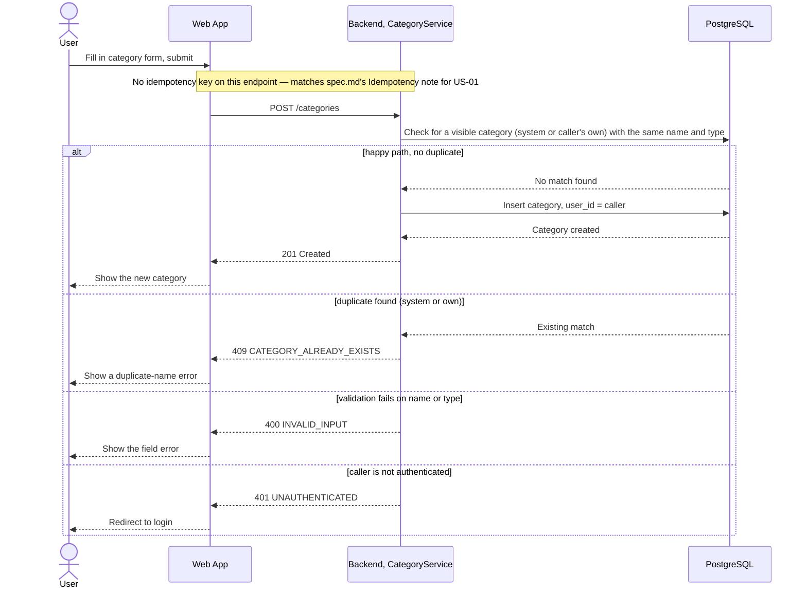
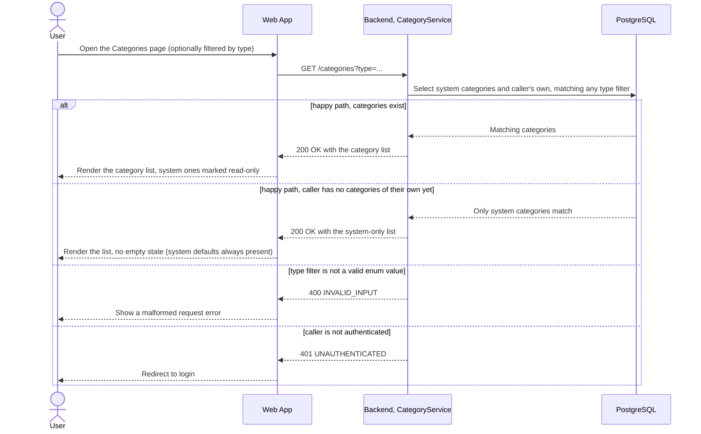
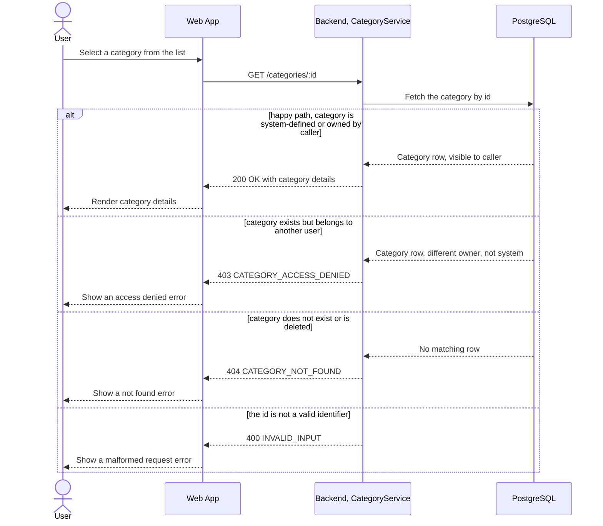
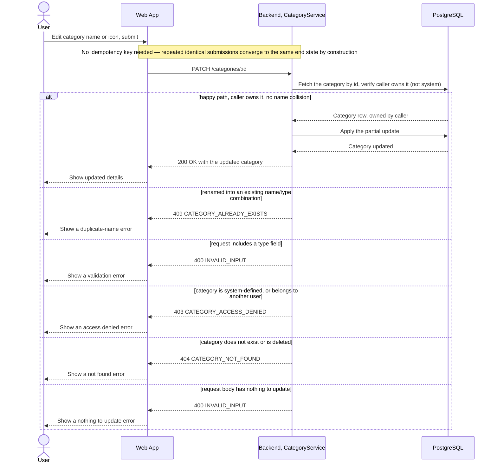
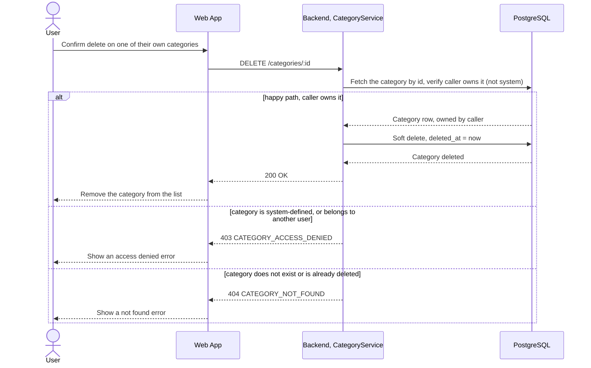

# Implementation Plan: F-04 Category Management (MVP)

- **Feature:** Category Management
- **SRS Feature Code:** F-04 (SRS.md Feature-04 §6; SDS.md §5.4 is currently an empty skeleton header — no ACs defined there; `spec.md` in this folder is the authoritative source)
- **Jira Epic:** N/A — this repository has no Jira integration wired up (same as the F-01/F-02/F-03 plans)
- **Spec:** [spec.md](./spec.md)
- **Related plans:** [F-01 User Management](../user-management/plan.md) (category owner, for user-defined categories), [F-03 Wallet Management](../wallet-management/plan.md) (sibling MVP domain feature — same auth/ownership pattern, same `dto.DecodeStrict` precedent this plan reuses)
- **Frontend scope:** **web only** (`frontend/`, Next.js). `mobile/` (Flutter) remains deferred per current project direction — no Flutter file layout appears below.

---

## 1. Pre-flight: Spec Review Findings

| # | Type | Finding | Resolution / Open Task |
|---|------|---------|-------------------------|
| 1 | Gap | The `categories` table does not exist in any migration yet — `backend/db/migrations/` currently has `001_init.sql` (users), `002_seed_admin.sql`, `003_revoked_tokens.sql`, `004_wallets.sql` only. | This plan adds `005_categories.sql` (§3). |
| 2 | Gap | `spec.md`'s "Key Entity" section explicitly defers schema/index design to `plan.md` — this is the first place F-04's actual DDL is defined. | Schema defined in §3, Domain Objects + migration. |
| 3 | **Design gap** | `spec.md`'s US-01 Definition of Done states the `(name, type)` duplicate check "is enforced at the data layer via a partial unique index (not application logic alone)," spanning **both** system categories (`user_id IS NULL`) and the caller's own. A single Postgres unique index keyed on `(user_id, lower(name), type)` (even with `NULLS NOT DISTINCT`, PG15+) protects two cases — a user's own categories against each other, and system categories against each other — but **cannot** also catch a *user-owned* row colliding with a *system* row, since `user_id` differs between the two scopes by definition. Full DB-level enforcement of `spec.md`'s claim is not achievable with one index. | This plan implements the DB index for the two same-scope cases (own-vs-own, system-vs-system) **plus** a service-level pre-insert existence check across both scopes for the cross-scope case (user creating a name/type that collides with a system category). The cross-scope case therefore has a residual concurrent-double-submit race window that the DB does not close — same class of accepted gap as `spec.md`'s own Open Question #1 (no category cap) and F-03's Open Question #5 (wallet double-submit). Documented here rather than silently claimed as airtight. |
| 4 | **Blocking dependency** | `spec.md` US-05 (S-CAT-27) requires a `409 CATEGORY_IN_USE` rule gated on an active-Budget existence check, but the `budgets` table does not exist yet — F-05 Budget Management has no spec, plan, or migration. Querying a nonexistent table would break the build. | `DELETE /categories/{id}` is implemented in this plan **without** the active-Budget check — deletion succeeds unconditionally once ownership is confirmed. Tracked as **CAT-T14**, blocked on F-05's migration landing. Real scope reduction versus `spec.md`, flagged here and again in Error Flows/Constitution Notes (same pattern as F-03's `WAL-T14` for the currency lock). |
| 5 | Gap | `spec.md` assumes ≥1 system category is already seeded (S-CAT-10, S-CAT-14) so `GET /categories` is never truly empty. No seed data exists yet — `002_seed_admin.sql` seeds only the admin user. | This plan adds `006_seed_categories.sql` with a starter system-category list (§3). The exact list is product content, not a spec requirement — flagged as an **explicit assumption** pending product sign-off (§7, CAT-T2). |
| 6 | Ambiguity | `spec.md` Open Question #3 assumes `PATCH /categories/{id}` rejects an unrecognized `type` field via strict decoding, matching F-03's precedent. | Confirmed reusable as-is: `dto.DecodeStrict` (already implemented in `backend/internal/dto/wallet_request.go` for `UpdateWalletRequest`) is a package-level helper, not wallet-specific — `UpdateCategoryRequest` decodes through it directly, no new helper needed. |
| 7 | Gap | No `/categories` route group exists in `cmd/server/routes.go` yet. | Added in §3 — a new group under the existing `JWTAuth` middleware only, no `RequireRole` gate (every active user manages their own categories and reads system ones identically, same as F-03's wallets group). |
| 8 | Gap | `frontend/src/features/categories/` does not exist yet. | Scaffolded in §3, mirroring `features/wallets/` file-for-file (the newest, most complete precedent — includes a `[id]` detail route, unlike `features/users/`). |
| 9 | Gap (carried over) | The frontend project still has **zero test tooling** configured (confirmed against current `frontend/package.json` — no Jest/Vitest/Playwright/RTL) — unchanged since F-03's plan flagged this as Finding #8. | Same resolution as F-03: not committed to in this plan; tracked as **CAT-T15**, not silently assumed covered. |
| 10 | Cross-story dependency | US-01's create-time duplicate check (S-CAT-04/05/06) and US-04's rename-time duplicate check (S-CAT-22) are the exact same rule, run at two different call sites. | Implemented once, in `CategoryService`, as a private helper (`checkNameTypeAvailable`) both `CreateCategory` and `UpdateCategory` call — not duplicated per story. |
| 11 | Cross-story dependency | US-03's "system category always visible, ownership check only applies to non-system rows" logic (S-CAT-14/16) is needed again, more strictly, by US-04/US-05 (system categories are visible but never writable). | Implemented once as `getVisibleCategory()` (read-visibility: system OR own) plus a second, stricter `getOwnedCategory()` (write-visibility: own only, system rows explicitly rejected with `403`) — `GetCategory` uses the former; `UpdateCategory`/`DeleteCategory` use the latter. |
| 12 | Ambiguity | `spec.md`'s US-01 Edge Case #4 leaves `icon` validation as "no validation beyond a reasonable max length" — no concrete number is committed. Left unspecified, this is an unnamed limit with no enforcement anywhere. | This plan commits to `CategoryIconMaxLength = 32` (generous for an emoji sequence or a short icon-font key) as an explicit assumption, flagged for product sign-off — same treatment as F-03's currency allow-list assumption. |

### Regression Scope

This plan only adds new files, plus small additive edits to shared files:
- `backend/cmd/server/routes.go` — adds a new `/categories` route group; no existing route is touched.
- `backend/internal/common/errors.go` / `constants.go` — appends new error codes/constants; nothing renamed or removed.
- `backend/internal/service/interfaces.go` — appends `CategoryRepo` interface + compile-time check; existing interfaces untouched.
- `frontend/src/features/auth/components/app-header.tsx` — adds a "Categories" nav link; no existing link changed.

No existing F-01/F-02/F-03 handler, service, or repository file is modified. No regression risk to User Management, System Security, or Wallet Management is expected from this feature.

---

## 2. Architecture

### Package/File Layout

**Backend (Go Fiber + sqlc)**

```text
backend/internal/
├── handler/
│   └── category_handler.go        # CreateCategory, ListCategories, GetCategory, UpdateCategory, DeleteCategory
├── service/
│   └── category_service.go        # duplicate-check helper, system-category write guard, visibility split, delete (Budget check deferred)
├── repository/
│   └── category_repository.go     # sqlc wrapper: CreateCategory, ListCategoriesForUser, GetCategoryByID,
│                                   # NameTypeExists, UpdateCategory, SoftDeleteCategory
├── model/
│   └── category.go                # Category struct — zero framework imports
└── dto/
    ├── category_request.go        # CreateCategoryRequest, UpdateCategoryRequest (reuses dto.DecodeStrict, Finding #6)
    └── category_response.go       # CategoryResponse, ListCategoriesResponse

db/
├── migrations/
│   ├── 005_categories.sql         # categories table + own-scope/system-scope unique indexes
│   └── 006_seed_categories.sql    # starter system category seed data (Finding #5)
└── queries/
    └── categories.sql             # CreateCategory, ListCategoriesForUser, GetCategoryByID, NameTypeExists,
                                    # UpdateCategory, SoftDeleteCategory
```

`common/errors.go` and `common/constants.go` are extended in place (new entries appended), not restructured.

**Frontend (Next.js web — mirrors `features/wallets/` file-for-file, the most complete precedent)**

```text
frontend/src/
├── app/app/
│   └── categories/
│       ├── page.tsx                              # CategoriesPage — list + create entry point
│       └── [id]/
│           └── page.tsx                          # CategoryDetailPage
├── features/categories/
│   ├── api/
│   │   ├── use-categories-query.ts               # GET /categories (optional ?type=)
│   │   ├── use-category-query.ts                 # GET /categories/{id}
│   │   ├── use-create-category-mutation.ts        # POST /categories
│   │   ├── use-update-category-mutation.ts        # PATCH /categories/{id}
│   │   └── use-delete-category-mutation.ts        # DELETE /categories/{id}
│   ├── components/
│   │   ├── create-category-dialog.tsx
│   │   ├── category-table.tsx
│   │   ├── category-table-skeleton.tsx
│   │   ├── category-detail-card.tsx
│   │   ├── category-detail-card-skeleton.tsx
│   │   ├── edit-category-dialog.tsx
│   │   └── delete-category-dialog.tsx             # confirm dialog — new vs. F-03 (wallets have no delete)
│   └── types.ts                                    # Category, CreateCategoryRequest, UpdateCategoryRequest, ListCategoriesResult
└── lib/constants.ts (extend)                        # CATEGORY_TYPES, CATEGORY_NAME_MAX_LENGTH
```

### Domain Objects

| Entity | Table | Key Fields | Notes |
|--------|-------|------------|-------|
| `Category` | `categories` | `id` (UUID v4, `uuid_generate_v4()`), `user_id` (UUID, nullable FK → `users.id`; `NULL` = system-defined), `name` (text), `icon` (text, nullable), `type` (`income`\|`expense`), `created_at`, `deleted_at` | Soft delete via `deleted_at` — every query filters `deleted_at IS NULL`. No `updated_at` column (matches CLAUDE.md's Core DB Schema table for `categories`; `spec.md` Open Question #6). Not a money field itself, but referenced by `budgets.category_id`/`transactions.category_id` once those exist — treated as financial-adjacent, soft-delete-only, never hard-deleted. |

### Schema — `005_categories.sql`

```sql
CREATE TABLE categories (
    id          UUID PRIMARY KEY DEFAULT uuid_generate_v4(),
    user_id     UUID REFERENCES users(id),
    name        TEXT NOT NULL,
    icon        TEXT,
    type        TEXT NOT NULL CHECK (type IN ('income', 'expense')),
    created_at  TIMESTAMPTZ NOT NULL DEFAULT NOW(),
    deleted_at  TIMESTAMPTZ
);

-- Same-scope duplicate protection only (Finding #3): prevents a single user's
-- own categories from colliding with each other, and separately prevents
-- system categories (user_id IS NULL) from colliding with each other.
-- NULLS NOT DISTINCT (PG15+, per CLAUDE.md's PostgreSQL 16) makes multiple
-- user_id = NULL rows collide the same way same-user rows do — without it,
-- plain UNIQUE lets unlimited duplicate system rows through since NULL <> NULL.
-- This index does NOT catch a user-owned row colliding with a system row
-- (different user_id values are different index keys by construction) —
-- that cross-scope case is a service-level check only (CategoryService,
-- see Finding #3), with an accepted concurrent-request race window.
CREATE UNIQUE INDEX idx_categories_owner_name_type_unique
    ON categories (user_id, lower(name), type)
    NULLS NOT DISTINCT
    WHERE deleted_at IS NULL;

CREATE INDEX idx_categories_user_id ON categories (user_id) WHERE deleted_at IS NULL;
CREATE INDEX idx_categories_type ON categories (type) WHERE deleted_at IS NULL;
```

### Seed — `006_seed_categories.sql`

```sql
-- Starter system category list — product content, not a spec requirement.
-- Explicit assumption (Finding #5), pending product sign-off; safe to extend
-- with a later migration without touching this one.
INSERT INTO categories (user_id, name, icon, type) VALUES
    (NULL, 'Salary',        '💰', 'income'),
    (NULL, 'Bonus',         '🎁', 'income'),
    (NULL, 'Investment',    '📈', 'income'),
    (NULL, 'Food',          '🍔', 'expense'),
    (NULL, 'Rent',          '🏠', 'expense'),
    (NULL, 'Transport',     '🚗', 'expense'),
    (NULL, 'Utilities',     '💡', 'expense'),
    (NULL, 'Entertainment', '🎬', 'expense'),
    (NULL, 'Shopping',      '🛍️', 'expense'),
    (NULL, 'Health',        '💊', 'expense');
```

### Business Rules

| Rule | Source | Enforcement |
|------|--------|-------------|
| `name` required, ≤ 50 chars | S-CAT-02 | `dto.CreateCategoryRequest` validator (`required,max=50`) → `400 INVALID_INPUT` |
| `type` must be `income` or `expense` | S-CAT-03 | validator `oneof=income expense` → `400 INVALID_INPUT` |
| `icon` ≤ 32 chars when present | Edge Case (US-01 #4) | validator `omitempty,max=32` using `common.CategoryIconMaxLength` (Finding #12) → `400 INVALID_INPUT` |
| Unauthenticated caller rejected | S-CAT-07, S-CAT-11 | `middleware.JWTAuth` at the route-group level → `401` (no `error_code`, matches F-02/F-03 convention) |
| Duplicate `(name, type)` within the caller's own categories | S-CAT-05 | DB partial unique index (own-scope) + `CategoryService.checkNameTypeAvailable()` pre-check → `409 CATEGORY_ALREADY_EXISTS` |
| Duplicate `(name, type)` against a system category | S-CAT-04 | `CategoryService.checkNameTypeAvailable()` service-level check only → `409 CATEGORY_ALREADY_EXISTS` ⚠️ not DB-enforced across scopes (Finding #3) — concurrent-create race not fully closed |
| Same name, different `type`, is not a duplicate | S-CAT-06 | Duplicate key is `(lower(name), type)` — differing `type` is an entirely different key |
| List returns system + caller's own only, isolates other users | S-CAT-08 | `CategoryRepository.ListCategoriesForUser()` — `WHERE user_id IS NULL OR user_id = $1` |
| `type` query filter validated before use | S-CAT-13 | handler-level `oneof=income expense` check on the query param before it reaches the repository |
| Soft-deleted rows excluded everywhere | S-CAT-12 | every `category_repository.go` method filters `deleted_at IS NULL` |
| System category always visible; non-owner's category is not | S-CAT-14, S-CAT-16 | `CategoryService.getVisibleCategory()` — `user_id IS NULL` short-circuits to visible; otherwise compares `user_id = caller` |
| Not-found vs. access-denied split | S-CAT-16 vs. S-CAT-17 | `getVisibleCategory()` — fetch first (existence + `deleted_at IS NULL`), then decide `404 CATEGORY_NOT_FOUND` / `403 CATEGORY_ACCESS_DENIED` |
| Invalid UUID path param rejected before any DB call | S-CAT-18 | handler `categoryIDParam()` helper (mirrors `walletIDParam`) → `400 INVALID_INPUT` |
| `type` never accepted on `PATCH` | S-CAT-21 | `dto.UpdateCategoryRequest` has no `type` field at the type level; decoded via `dto.DecodeStrict` → `400 INVALID_INPUT` on any unrecognized field (Finding #6) |
| System category is never writable by any caller | S-CAT-20, S-CAT-29 | `CategoryService.getOwnedCategory()` — explicitly rejects `user_id IS NULL` with `403 CATEGORY_ACCESS_DENIED` before any update/delete proceeds |
| Rename re-triggers the exact create-time duplicate rule | S-CAT-22 | `CategoryService.UpdateCategory()` calls the same `checkNameTypeAvailable()` helper when `Name` changes (Finding #10) |
| Empty `PATCH` body rejected | S-CAT-25 | `UpdateCategoryRequest.HasUpdates()` — explicit check → `400 INVALID_INPUT` |
| Delete blocked while an active Budget references the category | S-CAT-27 | **Not implemented in this plan** — `budgets` table doesn't exist yet (Finding #4); tracked as **CAT-T14** |
| Delete allowed despite historical Transactions | S-CAT-28 | N/A for now — no block of any kind exists until CAT-T14 lands; once it does, only the Budget check applies, never a Transaction check |
| Delete is a soft delete only | S-CAT-26 | `CategoryService.DeleteCategory()` → `UPDATE categories SET deleted_at = NOW() ...` |
| Delete is not idempotent — second call is `404` | S-CAT-31 | Repository's delete query is scoped by `deleted_at IS NULL`; a second call finds no matching row (`pgx.ErrNoRows`) |

### API Index — Endpoint → Service Traceability

| API | Request | Response | Service Method |
|-----|---------|----------|-----------------|
| `POST /categories` | `CreateCategoryRequest` | `CategoryResponse` (`201`) | `CategoryService.CreateCategory` |
| `GET /categories` | optional `?type=` | `ListCategoriesResponse` (`200`) | `CategoryService.ListCategories` |
| `GET /categories/{id}` | — | `CategoryResponse` (`200`) | `CategoryService.GetCategory` |
| `PATCH /categories/{id}` | `UpdateCategoryRequest` | `CategoryResponse` (`200`) | `CategoryService.UpdateCategory` |
| `DELETE /categories/{id}` | — | `200` confirmation | `CategoryService.DeleteCategory` |

Each endpoint has exactly one service method — no shared "generic update" endpoint, same convention as F-03.

### Security & Actor Resolution

- **Middleware:** all five endpoints sit under one `JWTAuth(tokens, logger)` route group in `routes.go` — no `RequireRole` gate, since categories are personal-or-shared-read-only and every active user (`admin` or `member`) manages only their own writes.
- **Actor resolution path:** identical to F-03 — `JWTAuth` resolves the caller's identity once into Fiber locals (`common.LocalsUserID`); `category_handler.go` reads it once via the existing `callerUUID(c)` helper and passes it into every `CategoryService` method as an explicit `userID uuid.UUID` parameter. Service and repository layers never re-parse the token.
- **CSRF:** not applicable — Bearer-JWT API, no cookie/session auth surface for the Go backend to protect (same reasoning as every prior plan).
- **Bookmark / direct-URL access:** a User navigating directly to `/app/categories/{id}` for a category they don't own is safe by construction — the page's data fetch hits `GET /categories/{id}`, which enforces visibility **server-side** (`403`/`404`) regardless of navigation path. `middleware.ts` only gates on session-cookie presence for the whole `/app` group, same as every other feature.
- **Framework note:** no Spring-style `@PreAuthorize` in this stack. Authorization logic lives in the Service layer, never the Handler — system-category and ownership checks happen inside `CategoryService`, never in `category_handler.go`.

### Sequence Diagrams

> Four-tier lifeline (User → Frontend → Backend → DB), one diagram per story, happy path first with real `alt/else` branches beneath it.

**US-01: Create a Category**



**US-02: View a List of Categories**



**US-03: View a Category**



**US-04: Update a Category**



**US-05: Delete a Category**



> `spec.md`'s `409 CATEGORY_IN_USE` branch (S-CAT-27, blocked delete due to an active Budget) is intentionally **not** shown above — Finding #4 blocks it on the `budgets` table not existing yet. Adding that branch here would document behavior this plan does not implement.
>
> These five diagrams are AI-generated and require human review/validation before implementation begins — they are not pre-approved by virtue of being produced here.

---

## 3. Error Flows

### US-01: Create a Category

| Scenario | HTTP | Error Code |
|----------|------|------------|
| Unauthenticated (missing/invalid/expired JWT) | 401 | — |
| `name` empty or > 50 chars | 400 | `INVALID_INPUT` |
| `type` not a valid enum value | 400 | `INVALID_INPUT` |
| `icon` > 32 chars | 400 | `INVALID_INPUT` |
| Duplicate `(name, type)` against a system or the caller's own category | 409 | `CATEGORY_ALREADY_EXISTS` |
| Unexpected error (DB down, etc.) | 500 | — |

### US-02: View a List of Categories

| Scenario | HTTP | Error Code |
|----------|------|------------|
| Unauthenticated | 401 | — |
| `type` query param not a valid enum value | 400 | `INVALID_INPUT` |
| Unexpected error | 500 | — |

*(Zero user-defined categories is `200` with only system categories present — not an error path; see `spec.md` S-CAT-10.)*

### US-03: View a Category

| Scenario | HTTP | Error Code |
|----------|------|------------|
| Unauthenticated | 401 | — |
| `{id}` not a valid UUID | 400 | `INVALID_INPUT` |
| Category belongs to another user (not system) | 403 | `CATEGORY_ACCESS_DENIED` |
| Category not found or soft-deleted | 404 | `CATEGORY_NOT_FOUND` |
| Unexpected error | 500 | — |

### US-04: Update a Category

| Scenario | HTTP | Error Code |
|----------|------|------------|
| Unauthenticated | 401 | — |
| Request body empty (nothing to update) | 400 | `INVALID_INPUT` |
| Request includes a `type` field | 400 | `INVALID_INPUT` |
| `name` empty/too long or `icon` > 32 chars | 400 | `INVALID_INPUT` |
| Renamed into an existing `(name, type)` | 409 | `CATEGORY_ALREADY_EXISTS` |
| Category is system-defined | 403 | `CATEGORY_ACCESS_DENIED` |
| Category belongs to another user | 403 | `CATEGORY_ACCESS_DENIED` |
| Category not found or soft-deleted | 404 | `CATEGORY_NOT_FOUND` |
| Unexpected error | 500 | — |

### US-05: Delete a Category

| Scenario | HTTP | Error Code |
|----------|------|------------|
| Unauthenticated | 401 | — |
| Category is system-defined | 403 | `CATEGORY_ACCESS_DENIED` |
| Category belongs to another user | 403 | `CATEGORY_ACCESS_DENIED` |
| Category not found or already soft-deleted | 404 | `CATEGORY_NOT_FOUND` |
| Active Budget references the category | — | **Not implemented — blocked on F-05, see Finding #4 / CAT-T14** |
| Unexpected error | 500 | — |

---

## 4. Constitution / Convention Notes

| Rule | Status | Note |
|------|--------|------|
| Service layer owns business rules | Required | Duplicate-check, system-category write guard, visibility split all live in `CategoryService` — never in `category_handler.go` |
| Handler validates shape only | Required | `name`/`type`/`icon` via `validator/v10` tags on `dto.CreateCategoryRequest`/`UpdateCategoryRequest` |
| Transactional atomicity | N/A | No multi-statement write exists in this feature (unlike F-03's default-swap) — every write is a single-row `INSERT ... RETURNING *` or `UPDATE ... RETURNING *`; no `pgx.Tx` needed |
| Read flows non-transactional | Required | `ListCategories`/`GetCategory` are plain reads, no transaction wrapper |
| Concurrency / duplicate-check strategy | Partially satisfied ⚠️ | Own-scope and system-scope duplicates are DB-constraint-guarded (`idx_categories_owner_name_type_unique`); the cross-scope case (user vs. system) is service-check-only with an accepted race window (Finding #3) — distinct from F-03's fully DB-guarded default-wallet invariant |
| JWT auth enforced at middleware | Required | `/categories*` registered under the same `JWTAuth` group pattern as `/wallets*`; no role restriction |
| Actor resolution | Required | `callerUUID(c)` reads `JWTAuth`-populated locals once in the handler; passed to every `CategoryService` method as an explicit `userID` param — never re-parsed downstream |
| User isolation on every query | Required | Every `category_repository.go` method takes `userID` where relevant; every list/write query includes the appropriate `user_id` scoping (CLAUDE.md rule) |
| Idempotency on write — Create | Per spec | Explicitly **not** idempotent (`spec.md` US-01 Idempotency note) — no key; the duplicate check is a business rule, not a formal idempotency mechanism |
| Idempotency on write — Update | Satisfied | Idempotent by construction (standard `PATCH` semantics) — no key needed |
| Idempotency on write — Delete | Per spec | Explicitly **not** idempotent (`spec.md` US-05 Idempotency note) — a second `DELETE` on the same id returns `404`, not a repeated `200` |
| Money stored as BIGINT cents | N/A | `Category` carries no money field itself; it is money-**adjacent** (referenced by `budgets.category_id`/`transactions.category_id`) — this plan introduces no float anywhere in its own path |
| Soft delete respected | Required | Every repository query filters `deleted_at IS NULL`; `DeleteCategory` sets `deleted_at`, never a hard `DELETE FROM` (CLAUDE.md rule, `spec.md` Edge Case US-05 #3) |
| Timestamps UTC stored / local displayed | Required | `created_at` is `TIMESTAMPTZ` stored UTC; no `updated_at` exists for this table (Finding #2/spec Open Question #6) — the web app formats `created_at` to browser-local time for display only |
| CSRF | N/A | Bearer-JWT API behind the BFF proxy; `middleware.ts` checks only session-cookie presence, never decodes the JWT |
| Bookmark / direct URL access | Covered | See §2 Security & Actor Resolution — visibility/ownership enforced server-side on every `GET`/`PATCH`/`DELETE` regardless of navigation path |
| Audit logging | Not required (MVP) | No `audit_log` table exists in the schema (same reasoning as F-01/F-02/F-03) — only structured Zap `WARN` logs on 401/403 |
| No file > 300 lines | Required | If `category_handler.go`/`category_service.go` grow past this, split by operation, same convention as F-03's guidance |
| Frontend server state via TanStack Query only | Required | All 5 category API calls are TanStack Query hooks in `features/categories/api/`; never copied into `useState`/Zustand |
| Frontend skeleton loading | Required | `CategoryTableSkeleton`/`CategoryDetailCardSkeleton` (mirror the wallet equivalents) render while queries are loading — no blank screen |
| Frontend no raw fetch/axios in components | Required | All calls go through `features/categories/api/*.ts` hooks, same as `features/wallets/` |
| Frontend delete confirmation | Required | `DeleteCategoryDialog` is a confirm-before-destructive-action modal (new pattern vs. F-03, which has no delete) — the delete mutation only fires after explicit confirm, not on the first click |

---

## 5. Element/Key IDs

> Web equivalent of Flutter's `Key(...)` — `data-testid` attributes for QA automation. `frontend/src` still has zero `data-testid` usage anywhere in the codebase (Finding #9, carried over from F-03).

| Element | Key | Status | File |
|---------|-----|--------|------|
| Create category trigger button | `data-testid="btn-create-category"` | **Missing** | `frontend/src/features/categories/components/create-category-dialog.tsx` |
| Category name input | `data-testid="input-category-name"` | **Missing** | same |
| Category icon input | `data-testid="input-category-icon"` | **Missing** | same |
| Category type select | `data-testid="select-category-type"` | **Missing** | same |
| Create category submit button | `data-testid="btn-category-submit"` | **Missing** | same |
| Create category error banner | `data-testid="banner-category-error"` | **Missing** | same |
| Category list table | `data-testid="table-categories"` | **Missing** | `frontend/src/features/categories/components/category-table.tsx` |
| Category row system-lock badge | `data-testid="badge-category-system"` | **Missing** | same |
| Category list loading skeleton | `data-testid="skeleton-categories"` | **Missing** | `frontend/src/features/categories/components/category-table-skeleton.tsx` |
| Category detail card | `data-testid="card-category-detail"` | **Missing** | `frontend/src/features/categories/components/category-detail-card.tsx` |
| Edit category trigger button | `data-testid="btn-edit-category"` | **Missing** | same |
| Delete category trigger button | `data-testid="btn-delete-category"` | **Missing** | same |
| Edit category name input | `data-testid="input-edit-category-name"` | **Missing** | `frontend/src/features/categories/components/edit-category-dialog.tsx` |
| Edit category icon input | `data-testid="input-edit-category-icon"` | **Missing** | same |
| Edit category submit button | `data-testid="btn-edit-category-submit"` | **Missing** | same |
| Delete confirmation dialog | `data-testid="dialog-delete-category-confirm"` | **Missing** | `frontend/src/features/categories/components/delete-category-dialog.tsx` |
| Delete confirm button | `data-testid="btn-delete-category-confirm"` | **Missing** | same |
| Delete cancel button | `data-testid="btn-delete-category-cancel"` | **Missing** | same |

---

## 6. Status Summary (Step Handoff)

> No Jira/sprint tooling in this repo (same as F-01/F-02/F-03 plans) — "owner" below is whoever picks the task up next, not a pre-assigned name.

| Area | Status |
|------|--------|
| Spec (`spec.md`) | Done — reviewed against `/ba-checklist` |
| Plan (this document) | Done, pending human review of diagrams (see §2) and the seed-category list (Finding #5) |
| Backend migration/queries/handler/service/repository | Not started |
| Frontend feature scaffold | Not started |
| Frontend test infra | Not started — blocking any automated frontend coverage (Finding #9) |
| F-05 dependency (active-Budget delete block) | Blocked — tracked as CAT-T14, cannot start until F-05 exists |

## 7. Open Tasks

| ID | Task | File |
|----|------|------|
| CAT-T1 | Write migration: `categories` table + `idx_categories_owner_name_type_unique` (own-scope/system-scope only, Finding #3) | `backend/db/migrations/005_categories.sql` |
| CAT-T2 | Write seed migration with starter system categories — **flag list for product sign-off** (Finding #5) | `backend/db/migrations/006_seed_categories.sql` |
| CAT-T3 | Write sqlc queries: `CreateCategory`, `ListCategoriesForUser`, `GetCategoryByID`, `NameTypeExists`, `UpdateCategory`, `SoftDeleteCategory` | `backend/db/queries/categories.sql` |
| CAT-T4 | Add error codes `ErrCodeCategoryAccessDenied`, `ErrCodeCategoryNotFound`, `ErrCodeCategoryAlreadyExists`, `ErrCodeCategoryInUse` (append, no renames; last one reserved for CAT-T14) | `backend/internal/common/errors.go` |
| CAT-T5 | Add constants `CategoryNameMaxLength = 50`, `CategoryIconMaxLength = 32` (append, Finding #12) | `backend/internal/common/constants.go` |
| CAT-T6 | Implement `model.Category` (zero framework imports) | `backend/internal/model/category.go` |
| CAT-T7 | Implement `CategoryRepository` wrapping sqlc, returning `model.Category` | `backend/internal/repository/category_repository.go` |
| CAT-T8 | Implement `CategoryService.CreateCategory` (`checkNameTypeAvailable()` helper, Finding #10) | `backend/internal/service/category_service.go` |
| CAT-T9 | Implement `CategoryService.ListCategories` / `GetCategory` (`getVisibleCategory()`, Finding #11) | `backend/internal/service/category_service.go` |
| CAT-T10 | Implement `CategoryService.UpdateCategory` (`getOwnedCategory()`, empty-body rejection, reuses `checkNameTypeAvailable()`) | `backend/internal/service/category_service.go` |
| CAT-T11 | Implement `CategoryService.DeleteCategory` (`getOwnedCategory()`, soft delete; Budget-check **excluded**, see Finding #4) | `backend/internal/service/category_service.go` |
| CAT-T12 | Implement `category_handler.go` (5 endpoints); register `/categories` group under `JWTAuth` only | `backend/internal/handler/category_handler.go`, `backend/cmd/server/routes.go` |
| CAT-T13 | Implement `dto.CreateCategoryRequest`, `dto.UpdateCategoryRequest` (decoded via the existing `dto.DecodeStrict`, Finding #6), response DTOs | `backend/internal/dto/category_request.go`, `category_response.go` |
| CAT-T14 | **Blocked on F-05** — wire the `409 CATEGORY_IN_USE` active-Budget check into `DeleteCategory` once the `budgets` table/migration exists | `backend/internal/service/category_service.go` |
| CAT-T15 | Add `CategoryRepo` interface + compile-time check (mirrors `WalletRepo`) | `backend/internal/service/interfaces.go` |
| CAT-T16 | Stand up frontend test tooling (still zero test infra in `frontend/`, Finding #9) | `frontend/package.json` |
| CAT-T17 | Scaffold `frontend/src/features/categories/{api,components,types.ts}` mirroring the `wallets` feature | `frontend/src/features/categories/` |
| CAT-T18 | Build `CategoriesPage` (list + create entry point) and `CategoryDetailPage` | `frontend/src/app/app/categories/page.tsx`, `frontend/src/app/app/categories/[id]/page.tsx` |
| CAT-T19 | Add `CATEGORY_TYPES`/`CATEGORY_NAME_MAX_LENGTH`/`CATEGORY_ICON_MAX_LENGTH` constants mirroring backend enums | `frontend/src/lib/constants.ts` |
| CAT-T20 | Add a "Categories" nav link (additive only, no existing link changed) | `frontend/src/features/auth/components/app-header.tsx` |
