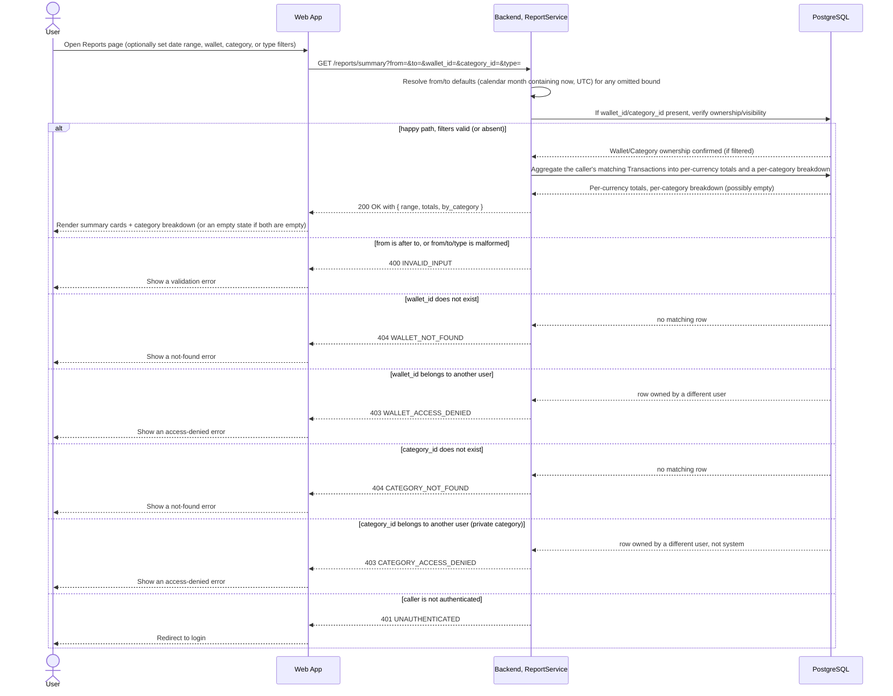

# Implementation Plan: F-07 Financial Reporting (MVP: Summary Report)

- **Feature:** Financial Reporting
- **SRS Feature Code:** F-07 (SRS.md Feature-07 §6 / FR-07; SDS.md §7 is currently an empty skeleton beyond the §4 traceability row `S-RPT-01`; `spec.md` in this folder is the authoritative source)
- **Jira Epic:** N/A — this repository has no Jira integration wired up (same as every prior plan)
- **Spec:** [spec.md](./spec.md)
- **Related plans:** [F-06 Transaction Management](../transaction-management/plan.md) (sole data source; this plan appends to `transactions.sql` rather than introducing a new query file — see Finding #1), [F-05 Budget Management](../budget-management/plan.md) (`SumExpenseByUserCurrentPeriod`'s `GROUP BY category_id, currency` aggregate is the direct precedent this plan's two new queries follow), [F-03 Wallet Management](../wallet-management/plan.md) (currency source), [F-04 Category Management](../category-management/plan.md) (category names)
- **Frontend scope:** **web only** (`frontend/`, Next.js). `mobile/` (Flutter) remains deferred per current project direction (CLAUDE.md, CURRENT_STATE.md).

---

## 1. Pre-flight: Spec Review Findings

| # | Type | Finding | Resolution / Open Task |
|---|------|---------|-------------------------|
| 1 | **Design decision, no gap** | `spec.md` Context decision #1 collapses SRS's five User Stories into one endpoint, `GET /reports/summary`, with query parameters. Confirmed against the current codebase: every prior feature (F-03–F-06) instead has one endpoint per User Story. | This plan follows `spec.md`'s resolution as-is — **one handler method, one service method, one route**. Flagging again here (on top of `spec.md`'s own Open Questions #3) because it's the one place a developer skimming only `plan.md` might expect five route registrations and should not add them. |
| 2 | **No new migration** | `spec.md` Preconditions state no new migration is required — this is a pure read/aggregate feature over `transactions`, `wallets`, `categories`, all of which already exist (`001_init.sql`–`008_transactions.sql`). Confirmed: no `reports` table is named anywhere in `spec.md`'s Domain Concept table. | No `backend/db/migrations/009_*.sql` is added by this plan. The next available migration number remains `009` for whichever feature needs one next (F-10 Notification Handling's `notifications` table is the most likely claimant). |
| 3 | **Gap — new aggregate queries needed** | No existing sqlc query groups `transactions` by `(type, currency)` or `(category_id, type, currency)` with the arbitrary-window/wallet/category/type filter combination `spec.md`'s US-01 needs. The closest precedent, `SumExpenseByUserCurrentPeriod` (`transactions.sql`, backing F-05's `BudgetRepo.SpentByUserCurrentPeriod`), is expense-only, hardcoded to the current calendar month, and has no wallet/category filter. | Two new `:many` queries are appended to `backend/db/queries/transactions.sql` (same file — see Finding #4): `SumReportTotalsByUser` (grouped `type, currency`) and `SumReportByCategoryForUser` (grouped `category_id, category_name, type, currency`, ordered `amount DESC`). Both take explicit `from_ts`/`to_ts` (never a SQL-computed "current month" — that's a Go-side default per Finding #6) plus optional `wallet_id`/`category_id`/`type` narg filters, mirroring `ListTransactionsByUser`'s optional-filter pattern. |
| 4 | **Design decision — file placement** | Query-file convention in this codebase is "one file per owning table" (`wallets.sql`, `categories.sql`, `budgets.sql`, `transactions.sql`), not "one file per feature" — `SumExpenseByUserCurrentPeriod` lives in `transactions.sql` even though it's called from `BudgetRepository` (documented cross-repository exception, F-05 `plan.md` §Security). Financial Reporting has no owning table of its own. | The two new queries (Finding #3) go into `transactions.sql`, called from a new `ReportRepository` — the same cross-repository exception, now used a second time. No new `.sql` file is created for a feature with no table. |
| 5 | **Gap — no model struct for a non-persisted entity** | Every prior feature's `model/*.go` maps 1:1 to a table row. This feature computes two transient shapes (`totals` entries, `by_category` entries) that are never a table row. | This plan defines `model.ReportTotal` and `model.ReportCategoryEntry` as plain computed value structs (zero framework imports, same rule as every other `model/*.go`) in a new `backend/internal/model/report.go` — populated directly from the two new aggregate queries' rows, not mapped from any table. |
| 6 | **Ambiguity — default-window resolution is new logic, not reusable from `TransactionService`** | `spec.md`'s Domain Concept table requires `from`/`to` to default **independently per missing bound** to the calendar month containing "now" (UTC). `TransactionService.ListTransactions`'s existing `from`/`to` handling has no default at all — an omitted bound there just means "unbounded." Copy-pasting that method's filter block would silently produce the wrong behavior (an unbounded report by default, not "this month"). | `ReportService.GetSummary` implements its own resolution: `from` defaults to `date_trunc('month', NOW())`-equivalent computed in Go (`time.Now().UTC()` truncated to the 1st, 00:00:00), `to` defaults to `time.Now().UTC()`, each independently. It reuses the existing `parseFlexibleTimestamp` helper (`transaction_service_query.go`) verbatim for parsing an explicit bound — only the default-filling behavior is new. |
| 7 | **Ambiguity — ownership-check duplication vs. sharing** | `wallet_id`/`category_id` filter validation (ownership/visibility) needs the same two checks `TransactionService.ListTransactions` already has (`getOwnedWallet`, `getVisibleCategory`) — but those are private methods on `TransactionService`, not exported or shared. | `ReportService` takes its own `WalletRepo`/`CategoryRepo` dependencies (both interfaces already exist in `interfaces.go`, no new methods needed on either) and implements its own small `getOwnedWallet`/`getVisibleCategory`-equivalent checks (≈10 lines each). This duplicates a small amount of logic rather than introducing a new shared package — consistent with this codebase's existing pattern where `TransactionService`, `BudgetService`, etc. each already own their own near-identical ownership checks rather than sharing one (see e.g. `getOwnedWallet` in both `wallet_service.go` and `transaction_service.go`). |
| 8 | **Clarification, not a gap** | `spec.md`'s Response Shape examples show a bare `{ range, totals, by_category }` object. Every prior feature's actual wire response wraps this in the project's standard `{ success, message, data }` envelope (`response.Success`) — `spec.md`'s examples are consistently written as the `data` payload only, matching every other feature's spec. | No change needed — `dto.ReportSummaryResponse` becomes the `data` field of the standard envelope, exactly like `dto.ListTransactionsResponse` etc. Noted here only so a developer doesn't mistake `spec.md`'s bare JSON for the literal wire format. |
| 9 | **Gap — `totals` ordering unspecified** | `spec.md` specifies `by_category` is ordered `amount DESC` but states no ordering for the `totals` array. | This plan orders `totals` by `currency ASC` (i.e. `SumReportTotalsByUser`'s `ORDER BY w.currency ASC`) for a deterministic response — arbitrary but stable, matching the general "deterministic list order" precedent set by every other list endpoint in this codebase. |

### Regression Scope

**New files only** — this plan modifies no existing feature's behavior (unlike F-05's Finding #2 amendment to F-04):

- `backend/db/queries/transactions.sql` (append two queries — additive only, no existing query's SQL is touched)
- `backend/internal/model/report.go`
- `backend/internal/repository/report_repository.go`
- `backend/internal/service/report_service.go`
- `backend/internal/handler/report_handler.go`
- `backend/internal/dto/report_request.go`, `backend/internal/dto/report_response.go`
- `frontend/src/features/reports/**`, `frontend/src/app/app/reports/**`

**Modified files (additive only):**
- `backend/cmd/server/routes.go` — new `/reports` group; no existing route touched.
- `backend/internal/service/interfaces.go` — new `ReportRepo` interface + compile-time check appended.
- `frontend/src/features/auth/components/app-header.tsx` — adds a "Reports" nav link.

**Regression risk:** effectively none — no existing table, migration, error code, service, or handler is modified. The only shared surface touched is `transactions.sql` (two new queries appended) and `routes.go`/`app-header.tsx` (additive lines).

---

## 2. Architecture

### Package/File Layout

**Backend (Go Fiber + sqlc)**

```text
backend/internal/
├── handler/
│   └── report_handler.go          # GetSummary — parses query params, calls service, responds
├── service/
│   └── report_service.go          # window default-resolution, wallet/category ownership checks,
│                                    # calls both aggregate queries, reshapes rows into the response DTO
├── repository/
│   └── report_repository.go       # sqlc wrapper: SumReportTotalsByUser, SumReportByCategoryForUser
├── model/
│   └── report.go                  # ReportTotal, ReportCategoryEntry — computed value structs, no table
└── dto/
    ├── report_request.go          # ReportSummaryQuery (query-string binding)
    └── report_response.go         # ReportSummaryResponse, ReportRangeResponse, ReportTotalResponse, ReportCategoryResponse

db/queries/
└── transactions.sql (append)      # SumReportTotalsByUser, SumReportByCategoryForUser (Finding #3/#4)
```

`interfaces.go` and `cmd/server/routes.go` are extended in place (new entries appended, nothing renamed).

**Frontend (Next.js web — new read-only dashboard-style feature, no CRUD dialogs)**

```text
frontend/src/
├── app/app/
│   └── reports/
│       └── page.tsx                                  # ReportsPage — filters + summary cards + category breakdown
├── features/reports/
│   ├── api/
│   │   └── use-report-summary-query.ts               # GET /reports/summary
│   ├── components/
│   │   ├── report-filters.tsx                        # wallet/category/type selects + from/to date inputs
│   │   │                                               # (mirrors transaction-filters.tsx minus pagination)
│   │   ├── report-totals-cards.tsx                    # one card per currency: total_income, total_expense, net
│   │   ├── report-totals-cards-skeleton.tsx
│   │   ├── report-category-breakdown-table.tsx        # by_category, grouped/sorted as returned
│   │   └── report-category-breakdown-table-skeleton.tsx
│   └── types.ts                                       # ReportSummary, ReportTotal, ReportCategoryEntry, ReportFilters
└── features/auth/components/app-header.tsx (append)    # "Reports" nav link
```

No `create-*-dialog.tsx`/`edit-*-dialog.tsx`/`delete-*-dialog.tsx` files exist for this feature — there is nothing to create, edit, or delete; every prior feature's CRUD-dialog trio doesn't apply here.

### Domain Objects

| Entity | Table | Key Fields | Notes |
|--------|-------|------------|-------|
| *(none — this feature persists nothing)* | — | — | Reads existing `transactions` (joined to `wallets` for `currency`, `categories` for `name`) — no new table, no new column on any existing table (Finding #2). |
| `ReportTotal` *(computed, not a table)* | — | `currency`, `total_income` (BIGINT), `total_expense` (BIGINT), `net` (BIGINT, derived) | ⚠️ Money — BIGINT cents throughout; `net` is computed in Go (`total_income - total_expense`), never stored. |
| `ReportCategoryEntry` *(computed, not a table)* | — | `category_id`, `category_name`, `type`, `currency`, `amount` (BIGINT) | Same money rule; `category_name` resolved via a join that does **not** filter on `categories.deleted_at` (spec.md S-RPT-10), identical to `GetTransactionByID`'s existing precedent. |

### Business Rules

| Rule | Source | Enforcement |
|------|--------|-------------|
| Unauthenticated caller rejected | S-RPT-11 | `middleware.JWTAuth` at route-group level → `401` |
| Report strictly scoped to caller | S-RPT-12 | Both new queries filter `t.user_id = $1` — no cross-user data ever reaches a response |
| Amounts are grouped per Wallet currency, never blended | S-RPT-04 | `SumReportTotalsByUser`/`SumReportByCategoryForUser` `GROUP BY ... w.currency`, joined `wallets ON wallets.id = transactions.wallet_id` — no cross-currency `SUM` anywhere |
| Currency/category/type combination with zero activity is omitted, never zero-filled | S-RPT-05, S-RPT-14, S-RPT-17 | A `GROUP BY` aggregate naturally has no row for a combination with zero matching Transactions — no post-processing zero-fill step is added |
| Default window = calendar month containing "now" (UTC), independently per missing bound | Domain Concept table, S-RPT-01, S-RPT-22 | `ReportService.GetSummary` resolves `from`/`to` in Go before querying (Finding #6) — never left to the SQL layer's `NOW()` |
| `from` must not be after `to` | S-RPT-19 | `ReportService.GetSummary`, same check as `TransactionService.ListTransactions` → `400 INVALID_INPUT` |
| `from`/`to` accept bare date or full ISO 8601 datetime | S-RPT-20, Edge Case US-04 #2 | Reused `parseFlexibleTimestamp` helper (no new parsing logic) |
| `type` (if present) must be exactly `income` or `expense` | S-RPT-15 | validator `oneof=income expense` on `dto.ReportSummaryQuery` → `400 INVALID_INPUT` |
| `wallet_id` (if present) must belong to (or be visible to) the caller | S-RPT-23–S-RPT-25 | `ReportService`'s own ownership check (Finding #7) → `404 WALLET_NOT_FOUND` / `403 WALLET_ACCESS_DENIED` |
| `category_id` (if present) must be visible to the caller | S-RPT-26, S-RPT-27 | `ReportService`'s own visibility check (Finding #7) → `404 CATEGORY_NOT_FOUND` / `403 CATEGORY_ACCESS_DENIED` |
| `wallet_id` and `category_id` combine with AND, alongside `from`/`to`/`type` | S-RPT-28 | Every filter is an independent `AND` clause in both new queries — no OR-mode exists |
| Soft-deleted Transactions excluded unconditionally | S-RPT-08 | Both new queries filter `t.deleted_at IS NULL` |
| A Category soft-deleted after a Transaction was recorded against it still shows its historical name | S-RPT-10 | `SumReportByCategoryForUser`'s join to `categories` is a plain `JOIN`, not filtered on `categories.deleted_at` — identical to `GetTransactionByID`'s existing precedent |
| No pagination on `by_category`; no cap on date-range width | Edge Cases US-01 #6, US-04 #1 | Both new queries return the full result set in one call — no `LIMIT`/cursor param on either |
| Two aggregate queries, never N+1 | Edge Case US-01 #7 | `ReportService.GetSummary` calls `SumReportTotalsByUser` and `SumReportByCategoryForUser` exactly once each per request |

### API Index — Endpoint → Service Traceability

| API | Request | Response | Service Method |
|-----|---------|----------|-----------------|
| `GET /reports/summary` | `ReportSummaryQuery` (`from`, `to`, `wallet_id`, `category_id`, `type` — all optional) | `ReportSummaryResponse` (`200`) | `ReportService.GetSummary` |

*(This single row covers SRS US-01 through US-05 — Context decision #1 / Finding #1.)*

### Security & Actor Resolution

- **Middleware:** the single endpoint sits under one `JWTAuth(tokens, logger)` route group — no `RequireRole` gate, same convention as `/wallets`, `/categories`, `/budgets`, `/transactions`.
- **Actor resolution path:** identical to every prior feature — `callerUUID(c)` reads JWT-populated Fiber locals once in `report_handler.go`, passed into `ReportService.GetSummary` as an explicit `userID uuid.UUID` parameter.
- **Cross-repository query note (Finding #3/#4):** `ReportRepository`'s two queries live in `transactions.sql`, a file "owned" by `TransactionRepository`. This works the same way F-05's `BudgetRepository.SpentByUserCurrentPeriod` already does — every repository holds a reference to the same generated `*sqlc.Queries` struct (sqlc combines every `.sql` file in `db/queries/` into one struct regardless of filename), so `ReportRepository` simply calls a method generated from a query declared in `transactions.sql`. Acceptable for the same reason F-05's plan already established: a single read, not a second feature's CRUD surface reimplemented.
- **CSRF:** not applicable — `GET /reports/summary` is a read-only Bearer-JWT endpoint, no cookie/session auth surface for the Go backend to protect (same reasoning as every prior plan).
- **Framework note:** no Spring-style `@PreAuthorize`. All filter-ownership checks live in `ReportService`, never in `report_handler.go`.
- **Bookmark / direct-URL access:** a User navigating directly to `/app/reports?wallet_id=<other's>` is safe by construction — the page's data fetch hits `GET /reports/summary`, which enforces ownership **server-side** (`403`/`404`) regardless of how the query param was set. `middleware.ts` only gates on session-cookie presence for the whole `/app` group, same as every other feature.
- **Validation-check independence:** `from`, `to`, `type`, `wallet_id` (format), `category_id` (format) are **independent** field-level checks, collected via `validator.Struct` into a single `400` response (existing `newValidationError` convention). `wallet_id`/`category_id` **existence + ownership** are gating checks — each requires the filter to be syntactically valid first, so they run as early-return steps inside `ReportService.GetSummary`, not collected together with the format checks.

### Sequence Diagram

> Single endpoint covers US-01 through US-05 (Context decision #1) — query params vary; the flow itself does not. This is a read-only `GET`; per this project's plan-authoring convention, an explicit idempotency-check step is only required for money **writes** (wallet/transaction/budget mutations) — there is no write here, so none is shown.



---

## 3. Error Flows

### `GET /reports/summary` (covers US-01 through US-05)

| Scenario | HTTP | Error Code |
|----------|------|------------|
| Unauthenticated | 401 | — |
| `from`/`to` malformed, or `from` after `to` | 400 | `INVALID_INPUT` |
| `type` present but not `income`/`expense` | 400 | `INVALID_INPUT` |
| `wallet_id`/`category_id` present but not a valid UUID | 400 | `INVALID_INPUT` |
| `wallet_id` not found or soft-deleted | 404 | `WALLET_NOT_FOUND` |
| `wallet_id` belongs to another user | 403 | `WALLET_ACCESS_DENIED` |
| `category_id` not found or soft-deleted | 404 | `CATEGORY_NOT_FOUND` |
| `category_id` belongs to another user (private category) | 403 | `CATEGORY_ACCESS_DENIED` |
| Unexpected error | 500 | — |

*(Zero matching Transactions is `200` with `totals: []`, `by_category: []` — not an error path; see `spec.md` S-RPT-02. No new error codes are introduced by this feature — every code above already exists in `common/errors.go`.)*

---

## 4. Constitution / Convention Notes

| Rule | Status | Note |
|------|--------|------|
| Service layer owns business rules | Required | Window-default resolution, ownership/visibility checks, and result reshaping all live in `ReportService` — never in `report_handler.go` |
| Handler validates shape only | Required | `type`/`wallet_id`/`category_id` format via `validator/v10` tags on `dto.ReportSummaryQuery`; `from`/`to` format and `from ≤ to` are service-level (mirrors `TransactionService.ListTransactions`'s existing split, since bare-date-vs-RFC3339 parsing isn't expressible as a struct tag) |
| Transactional atomicity | N/A | Read-only feature — no multi-statement write exists anywhere in this plan, so no `pgx.Tx` is used |
| Read flows non-transactional | Required | Both new repository methods are plain reads |
| Money stored as BIGINT cents | Required ⚠️ | `total_income`/`total_expense`/`net`/`amount` are all `int64` throughout DTOs/model; no float anywhere in the Go path; `net` is computed as a simple `int64` subtraction, never rounded or converted |
| No currency conversion or blending | Required ⚠️ | Every aggregate is `GROUP BY ... currency` — a request never sums across two different currencies into one number |
| Idempotency on write | N/A | No write exists in this feature — `GET /reports/summary` is naturally idempotent by virtue of being read-only |
| JWT auth enforced at middleware | Required | `/reports*` registered under the same `JWTAuth` group pattern as every other feature |
| Actor resolution | Required | `callerUUID(c)` reads `JWTAuth`-populated locals once in the handler; passed to `ReportService.GetSummary` as an explicit `userID` param |
| User isolation on every query | Required | Both new queries scope by `t.user_id = $1`; cross-user data never reaches a response |
| Soft delete respected | Required | Both new queries filter `t.deleted_at IS NULL`; the `categories` join deliberately does **not** filter on `categories.deleted_at` (Business Rules table, S-RPT-10) — an intentional, documented exception, not an oversight |
| Timestamps UTC stored / local displayed | Required | `range.from`/`range.to` in the response are UTC `TIMESTAMPTZ`-equivalent ISO 8601 strings; the web app formats for display only |
| Cross-repository query exception | Documented ⚠️ | `ReportRepository` runs two queries declared in `transactions.sql`, a file "owned" by `TransactionRepository` (Security & Actor Resolution, above) — the same narrow, previously-established exception F-05's `BudgetRepository` already uses, not a new pattern |
| Locking strategy | N/A | No entity in this plan has concurrent-write risk — this feature performs no writes at all, so there is nothing to lock (unlike F-05's create-vs-delete row-lock race) |
| No new migration | Confirmed | This plan adds zero `.sql` migration files (Finding #2) |
| No new error codes | Confirmed | Every error this feature can return already exists in `common/errors.go` |
| CSRF | N/A | Bearer-JWT API; no cookie/session auth surface for the Go backend to protect |
| No file > 300 lines | Required | `report_service.go` should stay small (window resolution + two ownership checks + one reshape step) — no reason it should approach the limit, but watch if wallet/category filter logic grows |
| Frontend server state via TanStack Query only | Required | The one Report API call is a TanStack Query hook in `features/reports/api/`; never copied into local component state |
| Frontend skeleton loading | Required | `ReportTotalsCardsSkeleton`/`ReportCategoryBreakdownTableSkeleton` render while the query loads |
| Frontend delete confirmation | N/A | Nothing is created, edited, or deleted in this feature — no confirmation dialog applies |
| Frontend empty state | Required, new for this feature | `report-totals-cards.tsx`/`report-category-breakdown-table.tsx` must render an explicit "no activity in this range" state when both `totals` and `by_category` are empty (S-RPT-02) — not a blank space, not an error |

---

## 5. Element/Key IDs

> `data-testid` attributes for QA automation — `frontend/src` still has zero `data-testid` usage anywhere (carried-over gap, F-03 Finding #8 / F-04 Finding #9 / F-05 Finding #8, unchanged by this plan).

| Element | Key | Status | File |
|---------|-----|--------|------|
| Report wallet filter select | `data-testid="filter-report-wallet"` | **Missing** | `frontend/src/features/reports/components/report-filters.tsx` |
| Report category filter select | `data-testid="filter-report-category"` | **Missing** | same |
| Report type filter select | `data-testid="filter-report-type"` | **Missing** | same |
| Report date-range inputs | `data-testid="filter-report-date-range"` | **Missing** | same |
| Per-currency totals card | `data-testid="card-report-totals"` | **Missing** | `frontend/src/features/reports/components/report-totals-cards.tsx` |
| Totals loading skeleton | `data-testid="skeleton-report-totals"` | **Missing** | `report-totals-cards-skeleton.tsx` |
| Category breakdown table | `data-testid="table-report-by-category"` | **Missing** | `frontend/src/features/reports/components/report-category-breakdown-table.tsx` |
| Category breakdown loading skeleton | `data-testid="skeleton-report-by-category"` | **Missing** | `report-category-breakdown-table-skeleton.tsx` |
| Empty-state message | `data-testid="empty-report"` | **Missing** | `report-totals-cards.tsx` |

---

## 6. Status Summary (Step Handoff)

| Area | Status |
|------|--------|
| Spec (`spec.md`) | Done — single-endpoint design resolved through BA review, cross-checked against `/ba-checklist` |
| Plan (this document) | Done, pending human review of the sequence diagram (§2) |
| Backend queries/repository/service/handler/dto | Not started |
| Frontend feature scaffold | Not started |
| Frontend test infra | Not started (carried-over gap, unchanged by this plan) |

## 7. Open Tasks

| ID | Task | File |
|----|------|------|
| RPT-T1 | Append sqlc queries: `SumReportTotalsByUser` (`GROUP BY type, currency`), `SumReportByCategoryForUser` (`GROUP BY category_id, category_name, type, currency`, `ORDER BY amount DESC`) — both with optional `wallet_id`/`category_id`/`type` narg filters and explicit `from_ts`/`to_ts` (Finding #3/#4) | `backend/db/queries/transactions.sql` |
| RPT-T2 | Implement `model.ReportTotal`, `model.ReportCategoryEntry` (computed value structs, zero framework imports) | `backend/internal/model/report.go` |
| RPT-T3 | Implement `ReportRepository` — `SumReportTotalsByUser`, `SumReportByCategoryForUser` | `backend/internal/repository/report_repository.go` |
| RPT-T4 | Implement `ReportService.GetSummary` — from/to default resolution (independently per missing bound, Finding #6), wallet/category ownership checks (Finding #7), calls both aggregate queries, reshapes into the response DTO | `backend/internal/service/report_service.go` |
| RPT-T5 | Implement `dto.ReportSummaryQuery`, `dto.ReportSummaryResponse` + nested response types | `backend/internal/dto/report_request.go`, `report_response.go` |
| RPT-T6 | Implement `report_handler.go` (`GetSummary`); register `/reports` group under `JWTAuth` only | `backend/internal/handler/report_handler.go`, `backend/cmd/server/routes.go` |
| RPT-T7 | Add `ReportRepo` interface + compile-time check | `backend/internal/service/interfaces.go` |
| RPT-T8 | Scaffold `frontend/src/features/reports/{api,components,types.ts}` | `frontend/src/features/reports/` |
| RPT-T9 | Build `report-filters.tsx` (wallet/category/type selects + date-range inputs, mirrors `transaction-filters.tsx` minus pagination) | `frontend/src/features/reports/components/report-filters.tsx` |
| RPT-T10 | Build `report-totals-cards.tsx` + skeleton (per-currency income/expense/net cards, empty-state message) | `frontend/src/features/reports/components/report-totals-cards.tsx`, `report-totals-cards-skeleton.tsx` |
| RPT-T11 | Build `report-category-breakdown-table.tsx` + skeleton | `frontend/src/features/reports/components/report-category-breakdown-table.tsx`, `report-category-breakdown-table-skeleton.tsx` |
| RPT-T12 | Build `ReportsPage` composing filters + totals cards + breakdown table | `frontend/src/app/app/reports/page.tsx` |
| RPT-T13 | Add a "Reports" nav link (additive only) | `frontend/src/features/auth/components/app-header.tsx` |
