# Implementation Plan: Account Switching on Mobile (F-02 extension)

- **Feature:** Account switching — saved-account registry, switch/add/remove/logout flows and Settings avatar group (mobile); remote "sign out everywhere" (self + admin), identity check before switching and a Security screen (owner decisions 2026-10-04, final). **Revision 2026-10-19:** every saved account keeps its own device-bound session (switching = renewing it), 60 d idle / 180 d absolute session lifetimes, device list + sign out one device, change password, opt-in app lock.
- **SRS Feature Code:** F-02 System Security (SRS Feature-02 US-03…US-08; source is the approved research note plus the 2026-10-19 design contract)
- **Jira:** N/A — this repository has no Jira integration
- **Spec:** [spec.md](./spec.md)
- **Related:** [research-account-switch](../mobile-ux-batch-2026-10/research-account-switch.md), [mobile-session-refresh plan](../mobile-session-refresh/plan.md) (session store/refresh this builds on), [transaction-export-import](../transaction-export-import/spec.md) (purpose-tagged token precedent), [ops-runbook §5](../../docs/ops-runbook.md) (sessions in production)
- **Client scope:** Backend (Go Fiber) + `mobile/` only. `frontend/` (web) is frozen — no task touches it.
- **Baseline (2026-10-04):** plans on top of the uncommitted 2026-10-04 `session-store.ts` change — `setTokens` clears the query cache only when the user id changes; `refreshSession` force-logs-out only on 400/401/403 and otherwise schedules a retry after `REFRESH_RETRY_DELAY_SECONDS`.
- **Baseline (2026-10-19):** sessions (migration 028: `sessions` row per sign-in, `sid` in every token, `JWTAuth` checks the session per request, rotation + reuse detection with a 5-minute grace, 5 live sessions per user) and passkeys (migration 032) are live. US-01…US-09 shipped on the switch-token design below.
- **Migrations:** `025_users_tokens_valid_after.sql` (2026-10-04) and `033_session_devices.sql` (2026-10-19). No `sqlc generate`: new queries are hand-written into the generated files in the existing style (local sqlc CLI version differs from the committed output). See Finding #21 and R-09 for how they get applied.

## Revision 2026-10-19 — device-bound sessions

> Source: [spec.md](./spec.md) 2026-10-19 revision (decisions 2, 3, 10, 11, 14–18; BR-03…BR-22; US-10…US-12) and the design contract of the same day (product owner's "Device-bound session + biometric vault" proposal, applied where it fits). This section is the summary; the sections after it are updated in place, and anything that only describes the retired switch-token path is marked **Superseded 2026-10-19** or **legacy** (still served for app builds older than the revision).

### What changes

| Before (2026-10-04) | After (2026-10-19) |
|---|---|
| Saved account = identity + its own 180-day single-use switch token (SecureStore `pfm_account_st_<userId>`), renewed daily by `use-switch-token-renewal` | Saved account = identity + the refresh token of its own device-bound session (SecureStore `pfm_account_rt_<userId>`) |
| Switch = `POST /auth/switch` with the switch token → a brand-new session; `SwitchRateLimiter` per IP | Switch = `POST /auth/refresh` with that account's refresh token → the account's existing session is renewed |
| Outgoing account's session ended on every switch (fire-and-forget logout, Finding #14) | Outgoing account's session kept in its slot (spec BR-07) |
| Remove / logout revoke the switch token (`POST /auth/switch-token/revoke`) | Remove / logout = `POST /auth/logout` with that account's refresh token |
| Sessions 7 d idle, 30 d absolute; any number of sessions per device | 60 d idle (sliding), 180 d absolute; one live session per (user, device) |
| "Sign out everywhere" only | + `GET /auth/sessions`, `DELETE /auth/sessions/:id`, `PUT /users/me/password` |
| Identity check before switching | + opt-in app lock |

### Revision findings

| # | Type | Finding | Resolution |
|---|------|---------|------------|
| R-01 | Decision (design) | The proposal's separate `devices` + `refresh_tokens` tables duplicate `sessions` (mig 028), which already is the token family: current + previous jti, rotation, reuse detection, per-session revoke. | Not added. Migration 033 puts `device_id`, `device_name`, `public_key` (phase 2, unused) on `sessions`; "a device" in the UI = one live session of the user. |
| R-02 | Decision (design) | Proposal stores `token_hash`. Refresh tokens are signed JWTs; the row keeps only the jti, useless without the signature. | Not adopted — nothing to hash. |
| R-03 | ⚠️ Platform limit | Proposal wraps the refresh token with a biometric-bound Keystore key (BIOMETRIC_STRONG + PIN fallback). `expo-secure-store`'s `requireAuthentication` is BIOMETRIC_STRONG only (no device-PIN fallback), prompts on **every** read and write on Android, and its key is invalidated when a fingerprint is added. The active session rotates every ~12 min → a prompt every 12 min. | Not adopted. Tokens stay in SecureStore (Keystore-encrypted, not auth-bound); the fingerprint is a UI gate (switch check + optional app lock). Phase 2 (device key pair, `sessions.public_key`) is the real fix for token theft. No "fingerprint enrollment changed" failure mode exists. |
| R-04 | ⚠️ Race (new) | With per-account sessions, a refresh of account A that answers after the device switched to B must not be dropped: A's slot would keep the now-previous jti, and the next switch back to A (more than 5 minutes later) would present it and **trigger reuse detection, revoking A's session**. | Per-account single flight in `src/lib/account-tokens.ts`: the result is written to the owning account's slot with compare-and-set on the presented token, whichever account is active (spec BR-18). Finding #4's "discard a stale result" becomes "store it under its owner". |
| R-05 | Decision (design) | Proposal keeps the access token in memory only. It lives 15 min and `JWTAuth` checks its session every request, so revocation is already instant; SecureStore lets an offline cold start open from cache (mobile-offline-support). | Not adopted. |
| R-06 | ⚠️ Header encoding | OkHttp (Android) rejects non-ASCII header values; device names are often Vietnamese or contain `’`. | Mobile sends `X-Device-Name: encodeURIComponent(name)`; backend URI-decodes, trims, strips control characters and cuts at `SessionDeviceNameMaxRunes` (64). An undecodable or empty name → NULL. A malformed `X-Device-Id` → treated as absent. |
| R-07 | ⚠️ Behaviour change (spec AC-16) | Logging in again as the active account used to end the unused new session (`logoutQuietly`). With one session per (user, device), that login has **already replaced** the active session on the server — ending the new one leaves the account with none. | `completeLogin` same-user branch keeps the new pair: swap it in silently (same user → no cache clear), store it in the account's slot, show the existing toast. |
| R-08 | Gap | Old builds hold switch tokens, not session refresh tokens; new builds must not ask users for passwords on update. | One-time legacy conversion on first start (spec US-01 upgrade): active account → copy the session's refresh token into its slot, revoke its switch token; each inactive account → one `POST /auth/switch` **with** `X-Device-Id` (backend returns a device-bound session and **no** new switch token), keep its refresh token. 401/400 → "Hết phiên"; no answer → retry on next start. |
| R-09 | ⚠️ Deploy order | Login and every refresh write `device_id`/`device_name` once the new backend runs; without migration 033 they fail with `42703` → nobody can sign in or stay signed in. The OTA bundle that sends the headers and stops requesting switch tokens needs the backend that understands them (`/auth/switch` must already return device-bound sessions with no switch token, or the conversion keeps minting switch tokens). | 033 is idempotent (`IF NOT EXISTS`), applied by `cmd/migrate` in `deploy.sh` before the new backend serves, by hand with `psql` locally (same as 028/032). Order: migration → backend → `npm run ota:publish`. The headers are harmless to the old backend (ignored), but conversion against an old backend would keep minting switch tokens. |
| R-10 | Lifetimes | `RefreshTokenTTL` was also the pre-session legacy refresh window (`cmd/server/database.go`: mig 028 applied-at + TTL). Raising it to 60 d would reopen that window for tokens minted with 7 d. | New `common.LegacyRefreshTokenTTL = 7 d` for that window and for `TokenService.GenerateTokenPair` (legacy/test path); `RefreshTokenTTL = 60 d` (idle, sliding: each refresh sets `expires_at = min(now + 60 d, absolute_expires_at)`); `SessionAbsoluteTTL = 180 d`. `AccessTokenTTL` stays 15 min. |
| R-11 | Security | A wrong current password on `PUT /users/me/password` must never be 401: the mobile client reads 401 as "session over" and would sign the user out. | 400 `WRONG_CURRENT_PASSWORD`; 400 `WEAK_PASSWORD` (`len < common.MinPasswordLength`); 400 `SAME_PASSWORD`. Per-user failed-try limiter (5 / 15 min). |
| R-12 | Transactional | Password change touches the user row and every session row, then starts a session. | New hash + `tokens_valid_after = now` (whole seconds, Finding #18 rule) in **one** UPDATE — atomic on its own. Then `EndAll(reason password_changed)`, then `Start(user, device)`. If a later step fails the request is 500, but the sign-out point already refuses every older token in `JWTAuth`/refresh, so no old session survives (spec EC-30). |
| R-13 | Gap | The device list must mark, and refuse to sign out, the calling device; the access token's `sid` is only read inside `JWTAuth`. | `JWTAuth` also stores the session id in `common.LocalsSessionID`; handlers pass it to the service. |
| R-14 | Gap | The registry's display identity came from the switch-token responses (Finding #6). With no switch-token call after login, a new saved account needs its identity from elsewhere. | `GET /users/me` (exists since the profile work) after the session is committed; failure tolerated, falling back to the email-derived name as before. |

### Backend files (2026-10-19)

| File | Change |
|---|---|
| `db/migrations/033_session_devices.sql` | NEW — `sessions.device_id UUID NULL`, `device_name TEXT NULL`, `public_key TEXT NULL`; partial index `idx_sessions_user_device_live (user_id, device_id) WHERE revoked_at IS NULL AND device_id IS NOT NULL` |
| `db/queries/sessions.sql` (+ hand-written `repository/sqlc/sessions.sql.go`) | `RevokeSessionsOnDevice :execrows` (reason `replaced`); `CreateSession` + device columns; `GetSession` returns them; `RotateSessionRefresh` fills them with `COALESCE` (never overwrites); `ListLiveSessionsForUser :many` |
| `db/queries/users.sql` (+ `users.sql.go`) | Password change UPDATE: new hash + `tokens_valid_after` in one statement (`:execrows`, `WHERE id = $1 AND deleted_at IS NULL`) |
| `internal/model/session.go` | `Session.DeviceID/DeviceName`; `SessionDevice`; `SessionSummary`; reasons `replaced`, `device_sign_out`, `password_changed` |
| `internal/common/constants.go`, `constants_session.go`, `account_switch.go`, `errors.go` | Lifetimes (R-10), `LocalsSessionID`, `SessionDeviceNameMaxRunes = 64`, switch-token constants marked deprecated, `WEAK_PASSWORD` (`NewWeakPasswordError`) |
| `internal/common/password.go` | NEW — `WRONG_CURRENT_PASSWORD`, `SAME_PASSWORD`, `PasswordChangeRateLimit = 5`, `PasswordChangeRateLimitWindow = 15 min` |
| `internal/service/session_service.go` | `Start(ctx, user, device)`: revoke the user's live session on that device first, inside the same transaction as the 5-session cap; `Refresh(…, device)` records a missing device |
| `internal/service/session_devices.go` | NEW — `SessionService.ListDevices`, `SessionService.SignOutDevice` |
| `internal/service/password_change.go` | NEW — `SessionRevocationService.ChangePassword` per R-11/R-12 |
| `internal/service/auth_session.go` | NEW — `AuthService.Refresh` / `Logout` split out of `auth_service.go` (300-line rule); refresh passes the device |
| `internal/service/account_switch_service.go`, `session_revocation_service.go` | With a device: `/auth/switch` and self revoke-all start a device-bound session and return no switch token |
| `internal/service/auth_service.go`, `passkey_login.go`, `token_service.go`, `cmd/server/database.go` | Login and passkey login pass the device; legacy window uses `LegacyRefreshTokenTTL` |
| `internal/repository/session_repository.go`, `user_repository_password.go` (NEW), `sqlc/users_password.sql.go` (NEW) | Device-aware session calls; the password + sign-out point UPDATE |
| `internal/handler/device_info.go` (+ `device_info_test.go`) | NEW — `X-Device-Id` / `X-Device-Name` → `*model.SessionDevice` (R-06) |
| `internal/handler/device_session_handler.go` | NEW — `GET /auth/sessions`, `DELETE /auth/sessions/:id` (+ audit line) |
| `internal/handler/session_revocation_handler.go` | + `ChangePassword` for `PUT /users/me/password` (+ audit line `password.change`) |
| `internal/middleware/jwt_auth.go`, `rate_limit_password.go` (NEW) | `Locals(LocalsSessionID)`; `PasswordChangeRateLimiter` — failed changes per user, 5 / 15 min |
| `internal/dto/device_session_dto.go` (NEW), `account_switch_dto.go` | Device-list response, change-password request; `SwitchResponse` / `RevokeAllSessionsResponse` with `switch_token*` omitted when empty |
| `cmd/server/routes.go`, `main.go` | Register + wire the three new routes (`/sessions` GET/DELETE after `/sessions/revoke-all`) |

### Mobile files (2026-10-19)

| File | Change |
|---|---|
| `src/lib/device-identity.ts` | NEW — device id (UUID v4, created once, SecureStore `pfm_device_id`) + device name; both clients (`apiClient`, the interceptor-free one) send `X-Device-Id` and `X-Device-Name: encodeURIComponent(name)` |
| `src/lib/account-tokens.ts` | NEW — per-account refresh-token slots (`pfm_account_rt_<userId>`); `refreshAccount(userId)`: one in-flight `/auth/refresh` per account, result written to the owner's slot by compare-and-set on the presented token (R-04); 401/400 → slot deleted + account marked "Hết phiên" (spec BR-19) |
| `src/lib/session-events.ts` | NEW — small event channel ("renewed for X", "refused for X") so the session store and the registry stay decoupled |
| `src/stores/session-store.ts` | The active session's refresh goes through `account-tokens.ts`; a refused active session → `clear()` + "Phiên đăng nhập đã hết hạn." and the account stays listed as "Hết phiên" |
| `src/features/accounts/account-registry-store.ts` | `SavedAccount` drops `switchIssuedAt`/`switchExpiresAt`; `expired` now means "Hết phiên", set only on a refusal; `switchInterrupted` kept |
| `src/features/accounts/switch-account.ts` | identity check → overlay → chat flush → `refreshAccount(target)` → `commitSession`; copy per spec (R-15 below) |
| `src/features/accounts/commit-session.ts` | No longer ends the outgoing session (Finding #14 reversed); stores the target's new refresh token first |
| `src/features/accounts/complete-login.ts` | Stores the login's refresh token in the account's slot; no switch-token request; same-user branch per R-07; identity per R-14 |
| `src/features/accounts/hooks/use-logout.ts`, registry `remove` | `POST /auth/logout` with that account's refresh token; no switch-token revoke |
| `src/features/accounts/hooks/use-switch-token-renewal.ts` | REMOVED — replaced by `hooks/use-saved-account-sync.ts` (`useSavedAccountSync`: keeps the active account's slot in step with the session store) and the one-time legacy conversion `convert-legacy-accounts.ts` (`convertLegacySwitchTokens`, R-08) |
| `src/features/accounts/api/account-switch-requests.ts` | Switch-token calls kept only for the conversion (`switchRequest` with device headers, quiet revoke) |
| `src/features/security/components/DeviceSessionsSection.tsx` + `api/use-device-sessions-query.ts` (`useDeviceSessionsQuery`, `useSignOutDeviceMutation`) | NEW — spec US-10 |
| `app/(app)/change-password.tsx` + `src/features/security/components/ChangePasswordRow.tsx`, `ChangePasswordForm.tsx`, `api/use-change-password-mutation.ts` | NEW — spec US-11; onSuccess swaps in the returned pair (same user, cache kept) and writes it to the account's slot |
| `src/features/security/app-lock.ts` (`useAppLockStore`, `installAppLock`), `components/AppLockToggleRow.tsx`, `components/AppLockOverlay.tsx`; `src/stores/security-prefs-store.ts` + app lock flag (default off) | NEW — spec US-12; background timer from `AppState`, `APP_LOCK_AFTER_BACKGROUND_MS` (5 min) |
| `app/(app)/security.tsx`, `app/(app)/_layout.tsx`, `app/_layout.tsx` | Sections in spec decision 14 order; sync hook + app lock mounted |
| `src/lib/constants.ts` | + `SECURE_STORE_DEVICE_ID_KEY`, `SECURE_STORE_ACCOUNT_REFRESH_KEY_PREFIX`, `APP_LOCK_AFTER_BACKGROUND_MS`; switch-token TTL/renewal constants retired |

**R-15 — copy changes (spec):** saved account refused "Cần đăng nhập lại tài khoản này."; interrupted "Lần chuyển trước bị gián đoạn. Cần đăng nhập lại tài khoản này."; generic "Chưa chuyển được tài khoản. Thử lại sau."; active session refused "Phiên đăng nhập đã hết hạn."; status label "Hết phiên". US-10/11/12 copy is in the spec.

### Deploy order (2026-10-19)

1. Migration 033 (`cmd/migrate` in `deploy.sh`; locally `psql … < backend/db/migrations/033_session_devices.sql`) — before the new backend starts.
2. Backend.
3. Mobile OTA bundle (`npm run ota:publish`). No new native module is needed (`expo-local-authentication` is already in the APK), so no APK — confirm with `ota:publish`'s own native-change check.
4. Leave the switch-token endpoints in place until no phone runs an older bundle (spec Open Question 6).

## Pre-flight: Spec Review Findings (2026-10-04)

> Kept for the history. Findings that only concern the retired switch-token path are marked **legacy** (still true for the deprecated endpoints) or **superseded**.

| # | Type | Finding | Resolution / Open Task |
|---|------|---------|-------------------------|
| 1 | ⚠️ Security gap (code) | `TokenService.ParseRefreshToken` accepts **any** signed token that has `jti`, `sub` and `exp`. A switch token carries all three, so without a change **`POST /auth/refresh` would accept a 180-day switch token** and silently turn it into a 7-day refresh chain — breaking BR-04 / S-ASW-22. | `refreshClaims` gains `Purpose string json:"purpose,omitempty"`; `ParseRefreshToken` rejects any non-empty purpose. Test: switch token → `Refresh` → 401. AS-T03. **Legacy:** still needed while the deprecated endpoints exist. |
| 2 | Security check (code) | `JWTAuth` rejects a token whose decoded `role` or `user_id` is empty. | Switch claims must carry **only** `sub`, `jti`, `iat`, `exp`, `purpose` — never `user_id`/`role` — so `JWTAuth` rejects them by construction. Test in `jwt_auth_test.go`. AS-T02, AS-T11. **Legacy.** |
| 3 | Gap (research) | Research slides the 180 days only "on each switch". An account used continuously as the active one (never switched away from and back) would keep its original credential and expire after 180 days **while in use** — violating AC-24. | Mobile renews the active account's credential at most once per `SWITCH_TOKEN_RENEW_AFTER_SECONDS` (1 day) on cold start and on app foreground (spec US-06). AS-T20. **Superseded 2026-10-19:** no switch credential; the session's idle clock slides on every refresh (spec US-06). |
| 4 | ⚠️ Race (research P1–P4 missed this) | `refreshSession()` of User A in flight when the switch lands resolves afterwards and calls `setTokens(A pair)` — **silently switching back to A**, with B's data cleared. Its rejected path would also `clear()` B's session. | `refreshSession` captures the refresh token it used; in both `.then` and the rejected `.catch` it does nothing to the session unless `get().refreshToken` is still that token. AS-T16 (spec EC-05). **Changed 2026-10-19:** the late result is no longer discarded but stored in A's slot (R-04); it still never touches the active session. |
| 5 | ⚠️ Single-use race | `IsRevoked` then `Revoke` (the refresh pattern) lets two concurrent `/auth/switch` calls with the same credential both succeed (`ON CONFLICT DO NOTHING` returns no signal). For a 180-day credential that matters (BR-05). | New hand-written query `ClaimTokenJTI :execrows` (same insert, returns rows affected). The service claims the JTI **first**; 0 rows → 401. Only one caller can ever win. AS-T04/T05. **Legacy.** (Session refresh has its own compare-and-swap, `RotateSessionRefresh`.) |
| 6 | Gap | Spec says rows show a display name, but the device only knows the email (no `GET /users/me`; access token carries only `user_id`, `role`). | `POST /auth/switch-token` and `POST /auth/switch` both return `user` (existing `dto.UserResponse` whitelist: id, email, full_name, role, …). Mobile stores `fullName`, falling back to the existing email-derived name. **Changed 2026-10-19:** see R-14. |
| 7 | Gap | The add-account action logs B in while A is active, but `apiClient` attaches **A's** bearer to every request — so B's switch credential cannot be requested through `apiClient` before B's session is committed. | Order for both login and add-account: commit the session (`setTokens(B)`) first, then request the switch credential through `apiClient` (now B). The login itself is done through the existing login request without the hook's `setTokens` side effect. AS-T18. **Changed 2026-10-19:** no switch credential to request; the commit-first order still applies to the `GET /users/me` call (R-14). |
| 8 | Gap | `useLoginMutation.onSuccess` calls `setTokens` directly; add-account needs to flush A's chat and run the shared "commit session" step instead. | Login mutation returns the pair only; the caller runs `completeLogin()` (AS-T18). `LoginForm` gets `mode` + `initialEmail` props. |
| 9 | Resolved (existing code) | `LoginForm` used to initialise a hard-coded email/password; removed 2026-10-04 (both now `useState("")`). | Add-account and chooser-prefill modes start from `initialEmail ?? ""` and an empty password (spec EC-10). No separate task remains. |
| 10 | Clarification | Research said "after login / activation". Mobile has **no activation flow** — `/auth/activate` is only used by the backend's own HTML page. | Only login adds an account on mobile (spec Context note). `ActivateResponse` untouched. |
| 11 | Clarification | Research says the add action is hidden at 5 accounts (§3.5) **and** that a 6th evicts the LRU one (R6). | Both hold: a 6th can only arrive through the logged-out login screen (after a session expired in place). Eviction never picks the active or incoming account. Spec EC-03. |
| 12 | Gap | Offline detection — there is no NetInfo dependency and the research says "no new dependency". | "Offline" = the switch request fails with no response (`!error.response`) within `SWITCH_REQUEST_TIMEOUT_MS`. No pre-check. |
| 13 | Gap | Existing sessions persisted before this feature ships are not in any registry. | On hydrate, an active session whose user id is not in the registry is treated like "credential missing" (AC-04 retry path) — a switch credential is requested and the account added. AS-T20. **Changed 2026-10-19:** the active session's refresh token is copied into the account's slot instead (sync hook, R-08). |
| 14 | Decision | On a successful switch, A's 7-day refresh token is no longer stored anywhere on the device but would stay valid server-side. | After commit, fire-and-forget `POST /auth/logout` with A's old refresh token (A keeps its switch credential, so switching back still works). Closes research P5 for the switch path too. **Superseded 2026-10-19:** A's session is A's saved session now; it is kept, not ended (spec BR-07). |
| 15 | Transactional | `/auth/switch` writes one row (the JTI claim); token generation is in-memory. | No DB transaction needed — the single atomic insert is the only write. Generation after the claim can only fail on a signing-key misconfiguration (500); the user then needs one password login — accepted. **Legacy.** |
| 16 | Security | CSRF posture of the five new mutating endpoints. | Not applicable — Bearer-in-header / token-in-body API, no cookies, no server session (same as `AuthHandler`'s existing doc comment). Same for the 2026-10-19 endpoints. |
| 17 | Decision (owner) | Switch and refresh tokens are stateless JWTs — "sign out everywhere" cannot enumerate them. | New nullable column `users.tokens_valid_after TIMESTAMPTZ` (migration 025). `/auth/refresh` **and** `/auth/switch` reject a token whose `iat` is before it (refresh must be checked too, otherwise a lost device's 7-day refresh chain survives). Access tokens are **not** checked per request (no DB read in `JWTAuth`); they die within `AccessTokenTTL` — accepted (spec EC-20). AS-T26…T30. **Changed by migration 028:** `JWTAuth` now checks the session (and `tokens_valid_after`) on every request, so access ends at the next request; revoke-all also ends every session row. |
| 18 | ⚠️ Precision | JWT `iat` is whole seconds (`jwt.NewNumericDate` truncates to `jwt.TimePrecision` = 1 s); `TIMESTAMPTZ` keeps microseconds. A naive `iat < tokens_valid_after` with a sub-second stored value would reject the fresh pair issued in the same second to the requesting device (spec AC-37). | Exact rule — see "Revocation comparison" below: store `time.Now().UTC().Truncate(time.Second)` computed in Go (same clock that signs `iat`, not DB `NOW()`); reject iff the value is set and (`iat` missing **or** `iat.Unix() < tokens_valid_after.Unix()`). Fresh tokens are generated after the UPDATE, so their `iat` ≥ the stored second. Residual: a token another device obtained earlier **within the same second** survives — < 1 s window, accepted. One helper `issuedBeforeRevocation(iat, tva)` used by every check. Also used by the 2026-10-19 password change (R-12). |
| 19 | ⚠️ Gap (decision text) | Access tokens are unchecked, so during the ≤ 15-min tail a lost device could (a) mint a fresh 180-day switch token via `POST /auth/switch-token` (daily renewal) or (b) call "sign out everywhere" itself, get a fresh pair and lock the owner's own device out. Either undoes the revocation. | Both `Issue` and `RevokeAllForSelf` also check the **caller's access-token `iat`** against `tokens_valid_after`. Free: both services already re-read the user. `JWTAuth` additionally stores `claims.IssuedAt` in a new local `common.LocalsTokenIssuedAt`; handlers pass it to the service. Spec S-ASW-63/66. AS-T27, AS-T28. (Since mig 028 `JWTAuth` refuses such access outright; the service checks stay as defence in depth.) |
| 20 | Gap (sqlc) | `tokens_valid_after` must be read where the user row is already read (`GetUserByID` in `Refresh`, `Switch`, `Issue`) — no extra round trip. Every generated users query lists its columns explicitly (sqlc expanded `SELECT *` at generate time), so the new column breaks none of them. | Hand-edit only `getUserByID`: append `tokens_valid_after` to its column list and `&i.TokensValidAfter` to its `Scan`; add `TokensValidAfter *time.Time` to `sqlc.User` and `model.User` (+ mapping). Documented on the field: **populated only by `GetUserByID`**. New hand-written `SetUserTokensValidAfter :execrows`. AS-T26. |
| 21 | ⚠️ Deploy order / migration practice | After AS-T26, `GetUserByID` selects a column that does not exist until 025 runs → every refresh/switch 500s (`42703`). Note: the decision text says "no migration runner", but `backend/cmd/migrate` exists and `backend/deploy.sh` runs it on every deploy (ledger `schema_migrations`). The initdb mounts in both compose files stop at 021 — 022–024 are not mounted and an existing local volume gets them by hand with `psql`. | 025 is idempotent (`ADD COLUMN IF NOT EXISTS`, re-runnable like 021/022). Deploy: applied by `cmd/migrate` before the new backend serves. Local: apply by hand (`psql … < backend/db/migrations/025_users_tokens_valid_after.sql`) **before** starting the new backend; not added to the initdb mounts (follows 022–024). AS-T26. Same rule for 033 (R-09). |
| 22 | Finding (existing code) | The decision text relies on "the existing admin disable user". There is no disable endpoint or UI (admin routes: invite, list, resend-invite only); `status = 'disabled'` is only reachable by a DB edit. The status checks in `Refresh`/`Switch`/`Issue` already refuse such users. | No work; flagged as spec Open Question 1. |
| 23 | Decision (owner) | A lost `/auth/switch` response burns the rotated credential; the next attempt gets 401. | Accepted. Timeout / no response never calls `markExpired`; it sets `switchInterrupted = true` on the registry entry. A later 401 marks expired and picks the interrupted copy when the flag is set; any successful switch clears it. AS-T15. **Changed 2026-10-19:** a lost refresh answer can be retried for 5 minutes (`RefreshReuseGrace`); after that the old token counts as reused and the session is revoked — the interrupted flag and copy still apply. |
| 24 | Verification | Identity check library. | `expo-local-authentication` is part of the Expo SDK 54 module set bundled in Expo Go (reference page exists under docs `v54.0.0`); install with `npx expo install expo-local-authentication` so the SDK-54 version is pinned. **Face ID is not available in Expo Go** → call `authenticateAsync` with `disableDeviceFallback: false` so iOS testers pass with the device passcode; Android fingerprint works in Expo Go. Add the config plugin with `faceIDPermission` to `app.json` for future dev/EAS builds (inert in Expo Go). UI-level gate only — no `requireAuthentication` on SecureStore keys (confirmed again 2026-10-19, R-03). App lock (US-12) reuses the same module. AS-T31. |
| 25 | Design | Mapping the check's outcomes. | `getEnrolledLevelAsync()` = `NONE` (no biometrics, no passcode) → `unavailable`. `authenticateAsync`: success → `passed`; error `user_cancel` / `system_cancel` / `app_cancel` → `cancelled` (silent); `not_enrolled` / `passcode_not_set` / `not_available` → `unavailable`; anything else (`lockout`, `authentication_failed`, `unknown`, …) → `failed` (toast). `unavailable` → proceed + warn once (`noLockWarningShown`). AS-T31. For app lock, `unavailable` blocks turning it on (spec AC-59). |
| 26 | Race | Self "sign out everywhere" while a proactive refresh with the old refresh token is in flight: that refresh now gets 401. | Finding #4's stale-result guard already ignores it (`get().refreshToken` changed when the fresh pair was committed). Commit uses `setTokens` with the same email → no cache clear (same user). AS-T33. **2026-10-19:** with R-04 the compare-and-set on the account's slot fails for the old token, so the 401 cannot mark the account "Hết phiên" — the fresh pair already replaced it. Same for change password. |
| 27 | Decision | Admin endpoint edge cases. | Target = caller → 400 `INVALID_INPUT` (self goes through the Security screen so the device keeps a fresh pair). Unknown / soft-deleted target → 404 `NOT_FOUND` (UPDATE affects 0 rows). Pending/disabled targets are accepted server-side (harmless) and hidden in the UI. Admin → admin allowed (spec EC-22). |

### Regression Scope

| Area | Change | Risk / retest |
|---|---|---|
| `POST /auth/refresh` | `ParseRefreshToken` rejects tokens with a `purpose`, and returns `iat`; `Refresh` rejects `iat` before `tokens_valid_after`. **2026-10-19:** reads the device headers; it is now also the switch path | Re-run `TestAuthService_Refresh*` and the session tests; ⚠️ every switch goes through it |
| `POST /auth/login`, passkey login finish | **2026-10-19:** start a device-bound session, replacing the user's previous one on that device | ⚠️ 500 everywhere if 033 is not applied first (R-09); web login (no headers) unchanged |
| Session lifetimes | **2026-10-19:** 60 d idle / 180 d absolute; legacy window keeps 7 d | Legacy pre-session refresh window still closes 7 d after mig 028 |
| `GetUserByID` (all callers: auth, user, chat, …) | selects one more column | ⚠️ 500 everywhere it is used if 025 is not applied first (Finding #21) |
| `JWTAuth` (every protected route) | stores `iat` and (2026-10-19) the session id in locals | No behaviour change; re-run `jwt_auth_test.go` |
| Mobile users screen (admin) | new per-row action | Invite + resend-invite still work; row layout |
| Mobile Settings / BottomNav | Security row gets an href; `/security` (and 2026-10-19 `/change-password`) added to settings sub-routes | Settings row order; bottom bar highlight on sub-routes |
| `POST /auth/logout` | untouched server-side; mobile now **calls** it (2026-10-04) and uses it for remove (2026-10-19) | Logout and remove online/offline |
| Mobile login screen | `LoginForm` props, login mutation no longer sets tokens itself | Plain login, wrong password, rate limit |
| Mobile session store | `refreshSession` stale-result guard → per-account single flight (R-04) | ⚠️ Proactive + reactive refresh (S-REF-09…15), late refresh after a switch (S-ASW-20) |
| `session-scoped-reset.ts` | handles user change A→B, not only null↔token | Logout, fresh login, cold start restore |
| Budget wizard saved plan | single slot → `byUser` (persist v2 migration) | Wizard restore after app update |
| Settings | new row, logout logic moved to a hook | Logout overlay, row order |
| Mobile app shell (2026-10-19) | app lock overlay in `app/(app)/_layout.tsx` | Cold start with lock off/on; offline cold start; notifications deep links still land after unlock |

## Architecture

### Package/File Layout

> Layout after the 2026-10-19 revision (names as in the working tree on 2026-10-19). Files marked **legacy** serve only the deprecated switch-token endpoints.

```text
backend/
├── db/
│   ├── migrations/025_users_tokens_valid_after.sql   # ADD COLUMN IF NOT EXISTS tokens_valid_after TIMESTAMPTZ NULL
│   ├── migrations/033_session_devices.sql            # NEW 2026-10-19 — sessions.device_id / device_name / public_key + live-device index
│   └── queries/
│       ├── revoked_tokens.sql                    # + ClaimTokenJTI :execrows (legacy; source only, NOT regenerated)
│       ├── sessions.sql                          # 2026-10-19: RevokeSessionsOnDevice, device columns, ListLiveSessionsForUser
│       └── users.sql                             # + SetUserTokensValidAfter :execrows; 2026-10-19 password + sign-out point UPDATE
└── internal/
    ├── common/
    │   ├── account_switch.go                     # switch-token TTL, purpose, rate-limit constants — deprecated 2026-10-19
    │   ├── constants.go                          # + LocalsTokenIssuedAt, LocalsSessionID; RefreshTokenTTL 60 d, LegacyRefreshTokenTTL 7 d
    │   └── constants_session.go                  # SessionAbsoluteTTL 180 d, SessionDeviceNameMaxRunes, RefreshReuseGrace
    ├── model/user.go, model/session.go           # TokensValidAfter; Session device fields, SessionDevice, SessionSummary
    ├── repository/
    │   ├── sqlc/models.go                        # sqlc.User + TokensValidAfter (hand-edit)
    │   ├── sqlc/users.sql.go                     # getUserByID column list + Scan; SetUserTokensValidAfter; password UPDATE (hand-written)
    │   ├── sqlc/sessions.sql.go                  # hand-written 2026-10-19 queries
    │   ├── sqlc/revoked_tokens.sql.go            # + hand-written ClaimTokenJTI (legacy)
    │   ├── user_repository.go, session_repository.go
    │   └── revoked_token_repository.go           # + Claim(ctx, jti, userID, exp) (legacy)
    ├── service/
    │   ├── interfaces.go                         # repo interfaces (+ session list / device revoke / password write)
    │   ├── token_service.go                      # refreshClaims.Purpose + reject in ParseRefreshToken; return iat
    │   ├── token_revocation.go                   # issuedBeforeRevocation(iat, tva) (Finding #18)
    │   ├── auth_service.go                       # Refresh: iat check; login/refresh pass the device
    │   ├── session_service.go                    # Start(user, device) one-per-device; Refresh records a missing device
    │   ├── session_devices.go                    # NEW 2026-10-19 — SessionService.ListDevices, SignOutDevice
    │   ├── password_change.go                    # NEW 2026-10-19 — ChangePassword
    │   ├── switch_token.go                       # switchTokenClaims, IssueSwitchToken, ParseSwitchToken… (legacy)
    │   ├── account_switch_service.go             # Issue, Switch, Revoke (legacy; Switch with a device → device-bound session, no switch token)
    │   ├── session_revocation_service.go         # RevokeAllForSelf (device-bound fresh session), RevokeAllForUser
    │   └── *_test.go, fake_*_test.go             # incl. session_devices / password_change tests (2026-10-19)
    ├── dto/account_switch_dto.go                 # requests + responses; switch_token* omitempty (2026-10-19)
    ├── dto/device_session_dto.go                 # NEW 2026-10-19 — device list response, change-password request
    ├── handler/account_switch_handler.go         # legacy
    ├── handler/session_revocation_handler.go     # self + admin; + ChangePassword (PUT /users/me/password, 2026-10-19)
    ├── handler/device_info.go                    # NEW 2026-10-19 — X-Device-Id / X-Device-Name
    ├── handler/device_session_handler.go         # NEW 2026-10-19 — GET/DELETE /auth/sessions
    ├── middleware/jwt_auth.go                    # + Locals(LocalsTokenIssuedAt), Locals(LocalsSessionID)
    ├── middleware/rate_limit.go                  # SwitchRateLimiter (legacy, by ClientIP)
    └── middleware/rate_limit_password.go         # NEW 2026-10-19 — PasswordChangeRateLimiter (failed changes per user)
cmd/server/routes.go, main.go, database.go        # register + wire; legacy refresh window uses LegacyRefreshTokenTTL

mobile/
├── app.json, package.json                        # expo-local-authentication (npx expo install) + plugin faceIDPermission
├── app/
│   ├── (auth)/login.tsx                          # saved accounts above LoginForm
│   └── (app)/
│       ├── _layout.tsx                           # "/add-account" in ROUTES_WITHOUT_NAV; mounts the saved-account sync hook and (2026-10-19) the app lock overlay
│       ├── add-account.tsx                       # thin route: LoginForm mode="add-account"
│       ├── change-password.tsx                   # NEW 2026-10-19 — thin route: change password screen
│       ├── security.tsx                          # thin route: Security screen (sections in spec decision 14 order)
│       ├── users.tsx                             # unchanged (row action lives in UserListItem)
│       └── (tabs)/settings.tsx                   # + AccountSwitchRow above logout; logout via useLogout; Security row href "/security"
└── src/
    ├── lib/
    │   ├── constants.ts                          # registry keys, limits, timeouts, SECURITY_PREFS_STORAGE_KEY; 2026-10-19 device/slot keys
    │   ├── device-identity.ts                    # NEW 2026-10-19 — device id + name, request headers
    │   ├── account-tokens.ts                     # NEW 2026-10-19 — per-account refresh slots + single-flight refreshAccount
    │   └── session-events.ts                     # NEW 2026-10-19 — renewed / refused events
    ├── components/shared/BusyOverlay.tsx         # extracted from settings' logout Modal, reused by switch
    ├── components/shared/BottomNav.tsx           # SETTINGS_SUB_ROUTES + "/security" (+ "/change-password")
    ├── stores/
    │   ├── session-store.ts                      # refresh via account-tokens (R-04); refused → clear + "Hết phiên"
    │   ├── session-scoped-reset.ts               # handle A→B user change
    │   ├── security-prefs-store.ts               # device-wide, persisted: identityCheckEnabled (true), noLockWarningShown (false), appLockEnabled (false, 2026-10-19)
    │   └── saved-phrases-store.ts, recent-phrases-store.ts   # + removeUser(userId)
    └── features/
        ├── security/
        │   ├── types.ts                          # RevokeAllSessionsResponse; DeviceSession (2026-10-19)
        │   ├── identity-check.ts                 # confirmOwner(purpose) → passed | cancelled | failed | unavailable; warn-once
        │   ├── api/use-revoke-all-sessions-mutation.ts   # self; onSuccess commits the fresh pair (and a switch token only from an old backend)
        │   ├── api/use-device-sessions-query.ts  # NEW 2026-10-19 — useDeviceSessionsQuery + useSignOutDeviceMutation
        │   ├── api/use-change-password-mutation.ts   # NEW 2026-10-19
        │   ├── app-lock.ts                       # NEW 2026-10-19 — useAppLockStore, installAppLock (AppState timer)
        │   └── components/
        │       ├── DeviceSessionsSection.tsx     # NEW 2026-10-19
        │       ├── ChangePasswordRow.tsx         # NEW 2026-10-19
        │       ├── ChangePasswordForm.tsx        # NEW 2026-10-19
        │       ├── AppLockToggleRow.tsx          # NEW 2026-10-19
        │       ├── AppLockOverlay.tsx            # NEW 2026-10-19
        │       ├── IdentityCheckToggleRow.tsx
        │       ├── PasskeysSection.tsx           # (passkeys, mig 032)
        │       └── RevokeAllSessionsRow.tsx      # + ConfirmDialog
        ├── users/
        │   ├── api/use-revoke-user-sessions-mutation.ts  # admin
        │   └── components/
        │       ├── RevokeSessionsButton.tsx      # + ConfirmDialog
        │       └── UserListItem.tsx              # shows the button for active, non-self rows
        ├── auth/
        │   ├── api/use-login-mutation.ts         # returns pair, no setTokens side effect
        │   └── components/LoginForm.tsx          # mode, initialEmail, onSuccess → completeLogin
        ├── budget-wizard/saved-plan.ts           # byUser + persist v2 migrate + removeUser
        └── accounts/
            ├── types.ts                          # SavedAccount (no switch fields since 2026-10-19), legacy SwitchResponse
            ├── api/account-switch-requests.ts    # logout (interceptor-free client); switch / revoke kept for the legacy conversion
            ├── account-registry-store.ts         # Zustand + SecureStore index; upsert/evict/remove/markExpired ("Hết phiên")/touch
            ├── commit-session.ts                 # shared "swap the session" step (switch + add-account + chooser)
            ├── switch-account.ts                 # switchToAccount(userId) orchestration + in-flight guard
            ├── switch-with-passkey.ts            # passkey sign-in for a saved account (mig 032)
            ├── complete-login.ts                 # after a password login (plain or add-account)
            ├── convert-legacy-accounts.ts        # NEW 2026-10-19 — one-time switch token → session (R-08)
            ├── hooks/use-logout.ts               # logout incl. server call + registry removal
            ├── hooks/use-saved-account-sync.ts   # NEW 2026-10-19 — replaces use-switch-token-renewal.ts (removed)
            └── components/
                ├── AvatarGroup.tsx
                ├── AccountSwitchRow.tsx
                ├── AccountSwitchDialog.tsx
                ├── AccountRow.tsx
                └── (login screen) SavedAccountsEntry.tsx, LoginCandidateViews.tsx, SavedAccountLogin.tsx
```

Every new file stays under 300 lines; `settings.tsx` (248) shrank because logout moved to `use-logout.ts` and the overlay to `BusyOverlay`.

### Domain Objects

**Backend**

| Entity | Table | Key Fields | Notes |
|--------|-------|------------|-------|
| Session (device-bound, 2026-10-19) | `sessions` (mig 028; device columns mig 033) | `id`, `user_id`, `refresh_jti`, `prev_refresh_jti`, `rotated_at`, `created_at`, `last_used_at`, `expires_at` (idle, slides to `min(now + RefreshTokenTTL, absolute_expires_at)` on each refresh), `absolute_expires_at` (sign-in + `SessionAbsoluteTTL`), `revoked_at`, `revoked_reason`, **`device_id UUID NULL`, `device_name TEXT NULL`, `public_key TEXT NULL`** | One live row per (`user_id`, `device_id`) when a device id is known (partial index `idx_sessions_user_device_live`). Reasons: `logout`, `sign_out_all`, `admin_sign_out`, `session_limit`, `refresh_reuse`, + `replaced`, `device_sign_out`, `password_changed`. `public_key` reserved for phase 2. Not a financial record: no `deleted_at`; finished rows purged after `SessionPurgeRetention` (7 d). All times UTC. |
| Switch token (JWT, not stored) — **legacy** | — | `sub` (user id), `jti` (UUID v4), `iat`, `exp` = iat + `AccountSwitchTokenTTL`, `purpose` = `AccountSwitchTokenPurpose` | HS256, same signing key. **No** `user_id`/`role` claims (Finding #2). All times UTC. Issued only to requests without `X-Device-Id` since 2026-10-19. |
| Revoked/consumed JTI | `revoked_tokens` (existing, mig 003) | `token_jti` UNIQUE, `user_id`, `expires_at` | Reused unchanged; a consumed switch JTI and a revoked one are the same row. No soft delete (not a financial record). |
| User | `users` (existing) | `id`, `email`, `full_name`, `role`, `status`, `password_hash`, `deleted_at`, **`tokens_valid_after TIMESTAMPTZ NULL`** (mig 025) | Read via `GetUserByID` (already filters `deleted_at IS NULL`). `tokens_valid_after` = the sign-out-everywhere point (and, since 2026-10-19, the moment of the last password change): UTC, whole seconds, NULL = never used. Written by `SetUserTokensValidAfter` and the password-change UPDATE (`WHERE id = $1 AND deleted_at IS NULL`, also bumps `updated_at`). No index (read by PK). Last write wins — no locking needed (any newer value is at least as strict). |

**Mobile (device-local)**

| Entity | Storage | Key Fields | Notes |
|--------|---------|------------|-------|
| Device id (2026-10-19) | SecureStore `pfm_device_id` | UUID v4 | Created once; a reinstall makes a new one. Sent as `X-Device-Id` with the device name (`X-Device-Name`, URI-encoded) on every request. |
| Security preferences | AsyncStorage `pfm_security_prefs` (Zustand persist, like `pfm_theme`) | `identityCheckEnabled` (default `true`), `noLockWarningShown` (default `false`), `appLockEnabled` (default `false`, 2026-10-19) | Device-wide, not per user; survives logout and switch. Not a secret. |
| `SavedAccount` | SecureStore key `pfm_accounts` (JSON array, no secrets) | `userId`, `email`, `fullName \| null`, `role`, `avatarUrl?`, `lastUsedAt` (ISO UTC), `expired: boolean` ("Hết phiên"), `switchInterrupted: boolean` (Finding #23) | ≤ `MAX_SAVED_ACCOUNTS`. Displayed dates converted to local time. **2026-10-19:** `switchIssuedAt`/`switchExpiresAt` dropped — the server alone knows a session's expiry; `expired` is set only by a refusal. |
| Account refresh token (2026-10-19) | SecureStore key `pfm_account_rt_<userId>` | the account's current refresh token | One key per account keeps each value far under SecureStore's ~2 KB guidance. Written only by compare-and-set from `account-tokens.ts` (R-04). |
| Switch credential — **legacy** | SecureStore key `pfm_account_st_<userId>` | the token string | Read once by the legacy conversion (R-08), then deleted. |
| Active session | existing SecureStore keys | access/refresh/email/issued-at | Axios interceptor, refresh scheduler and route guard unchanged; its refresh token mirrors the active account's slot. |
| Saved budget plan | AsyncStorage `pfm_budget_plan` v2 | `byUser: Record<userId, SavedBudgetPlan>`, `unowned: SavedBudgetPlan \| null`, `activeUserId`, derived `plan` | ⚠️ v1→v2 migrate: `ownerId` set → `byUser[ownerId] = plan`; `ownerId` null → `unowned` (adopted by the next restored session, same rule as today's `claimFor(adoptUnowned)`). Money fields unchanged (xu integers). |

### Business Rules — Backend

| Rule | Source | Enforcement |
|------|--------|-------------|
| One live session per (user, device) (2026-10-19) | BR-17 | `SessionService.Start(user, device)`: in the cap transaction, `RevokeSessionsOnDevice` (reason `replaced`) before the insert when a device id was sent; no device → no replacement (web) |
| Lifetimes 60 d idle / 180 d absolute (2026-10-19) | BR-03, decision 2 | `RefreshTokenTTL`, `SessionAbsoluteTTL`; refresh sets `expires_at = min(now + 60 d, absolute_expires_at)` |
| Switch = renewal of the account's own session (2026-10-19) | BR-04, BR-05 | Existing `AuthService.Refresh` → `SessionService.Refresh`: live session, current jti or previous within `RefreshReuseGrace`, older → revoke (`refresh_reuse`), compare-and-swap rotation |
| Device recorded once, never overwritten (2026-10-19) | spec EC-24 | `RotateSessionRefresh` `COALESCE(device_id, $5)`, `COALESCE(device_name, $6)` |
| Device list: own live sessions, most recent first, current marked (2026-10-19) | AC-44, BR-20 | `SessionService.ListDevices` → `ListLiveSessionsForUser(user_id)`; the handler sets `is_current` = id equals `LocalsSessionID` |
| Sign out one device (2026-10-19) | AC-46, AC-47, BR-20 | `SignOutDevice`: not a UUID → 400; current → 400 `INVALID_INPUT`; not the caller's or unknown → 404 `NOT_FOUND`; already ended → 200; else revoke (`device_sign_out`) + audit line |
| Change password (2026-10-19) | US-11, BR-21, R-11, R-12 | `ChangePassword`: 400 `WRONG_CURRENT_PASSWORD` / `WEAK_PASSWORD` / `SAME_PASSWORD` (never 401) → one UPDATE (hash + `tokens_valid_after`) → `EndAll(password_changed)` → `Start(user, device)` → pair; per-user failed-try limiter 5 / 15 min → 429 `RATE_LIMITED` |
| Issue a switch credential only for an authenticated, active caller — **legacy** | AC-01 (2026-10-04), S-ASW-05 (2026-10-04) | Route behind `JWTAuth`; `AccountSwitchService.Issue()` re-reads user, not active → 401 `UNAUTHENTICATED` |
| Switch credential accepted only by `/auth/switch` (and revoke) — **legacy** | BR-04 (2026-10-04) | `ParseSwitchToken` purpose check; `ParseRefreshToken` rejects any purpose (Finding #1); `JWTAuth` rejects empty role/user_id (Finding #2) |
| Single use, atomically — **legacy** | Finding #5 | `AccountSwitchService.Switch()` → `RevokedTokenRepo.Claim()` first; 0 rows → 401 |
| Refused when expired / used / revoked / user inactive or deleted — **legacy** | BR-06 | `Switch()`: parse (signature, `exp` required, purpose) → user active check → claim; every failure 401 `UNAUTHENTICATED` (no reason leaked) |
| Malformed or missing credential | S-ASW-21, S-ASW-34 | Handler `validate:"required"` + service parse `jwt.ErrTokenMalformed` → 400 `INVALID_INPUT` (refresh, logout, legacy switch) |
| `/auth/switch` with a device id returns a device-bound session and no switch token (2026-10-19) — **legacy endpoint** | R-08, spec US-01 upgrade | `Switch()`: claim → `SessionService.Start(user, device)`; response omits `switch_token`, `switch_token_expires_at` |
| Revoke is idempotent and needs no session — **legacy** | S-ASW-33 (2026-10-04) | `AccountSwitchService.Revoke()` → unverified parse + purpose check → existing `Revoke` upsert |
| Switch attempts limited per client IP — **legacy** | S-ASW-20 (2026-10-04) | `SwitchRateLimiter` (`SwitchRateLimit` per `SwitchRateLimitWindow`, key `ClientIP`) → 429 `RATE_LIMITED`. `/auth/refresh` has no limiter (spec OQ-8) |
| Tokens never logged | BR-10 | No zap field carries a token or password; failures log `jti` / session id only |
| Credentials issued before the sign-out point refused | BR-11, S-ASW-57/58 | `AuthService.Refresh()`, `AccountSwitchService.Switch()` and `SessionService.Authorize()` (every request, mig 028): `issuedBeforeRevocation(iat, user.TokensValidAfter)` → 401 `UNAUTHENTICATED` |
| Stale access cannot mint a switch token or re-run sign-out | BR-11, S-ASW-63/66, Finding #19 | `Issue(ctx, callerID, callerIssuedAt)` and `RevokeAllForSelf(ctx, callerID, callerIssuedAt)` apply the same helper to the caller's access `iat` → 401 (and `JWTAuth` refuses it first since mig 028) |
| Self sign-out keeps the requesting device | BR-12, AC-37 | `RevokeAllForSelf()`: re-read user (active + stale check) → `SetTokensValidAfter(now truncated to the second)` → `EndAll(sign_out_all)` → `Start(user, device)` (device-bound fresh session; a switch token only when no device id was sent) → return |
| Admin-only sign-out of another User | BR-13, S-ASW-67–71 | Route in the `/admin` group (`JWTAuth` + `RequireRole("admin")` → 403 `FORBIDDEN`); `RevokeAllForUser(ctx, adminID, targetID)`: target = admin → 400; 0 rows → 404 `NOT_FOUND`; `EndAll(admin_sign_out)` |

**Revocation comparison (Finding #18), exact:**
- Stored: `at := time.Now().UTC().Truncate(time.Second)` computed in the service, passed to `SetTokensValidAfter` / the password UPDATE (never DB `NOW()`).
- Checked: `issuedBeforeRevocation(iat *jwt.NumericDate, tva *time.Time) bool` = `tva != nil && (iat == nil || iat.Unix() < tva.Unix())`. Compare integer seconds only — never `time.Before` on values that may carry sub-second parts.
- Consequence: tokens with `iat` in the same second as `at` pass — this is what keeps the requesting device's fresh pair valid.

**Check ordering:** all checks are **gating** — each needs the previous result and there is at most one input field (password change: two, both needed for the first check), so nothing is collectible into a multi-error response.
- `POST /auth/refresh` (switch): parse → session (live, jti current or within grace, user matches) → user (active, `iat` vs point) → rotate.
- `GET /auth/sessions`: `JWTAuth` → list.
- `DELETE /auth/sessions/:id`: `JWTAuth` → path id is a UUID (400) → not current (400) → owned (404) → revoke (already ended → 200).
- `PUT /users/me/password`: `JWTAuth` → failed-try limiter → shape (400) → user (active, access `iat` vs point) → current password (400) → length (400) → not same (400) → write → end sessions → start session.
- `POST /auth/switch` (legacy): parse → user (active, `iat` vs point) → claim.
- `POST /auth/switch-token/revoke` (legacy): parse.
- `POST /auth/switch-token` (legacy): `JWTAuth` → user (active, access `iat` vs point).
- `POST /auth/sessions/revoke-all`: `JWTAuth` → user (active, access `iat` vs point) → write → end sessions → start session.
- `POST /admin/users/:id/sessions/revoke-all`: `JWTAuth` → `RequireRole` → path id is a UUID (400) → not self (400) → write (0 rows → 404) → end sessions.

**Transactional:** both revoke-all endpoints and the password change perform one atomic single-row UPDATE on `users`, then end the user's sessions (one UPDATE on `sessions`), then (self only) start a session (its own transaction with the cap and the per-device replacement). The UPDATE on `users` is what makes the outcome safe: once it is written, `JWTAuth` and refresh refuse every older token even if a later step fails (500; the requesting device then needs one password login — accepted). `SessionService.Start` runs the per-device replacement, the cap and the insert in one transaction. Reads (`GetUserByID`, session list) are non-transactional.

### Business Rules — Mobile

| Rule | Source | Enforcement |
|------|--------|-------------|
| Account added/updated on every password login, no opt-in | AC-01, AC-02 | `completeLogin()` → stores the login's refresh token in the account's slot → `registry.upsert()` (2026-10-19: no switch-token request) |
| Cap of 5; evict LRU inactive, never active or incoming | AC-03, EC-03 | `registry.upsert()` → evicted entry: `/auth/logout` with its refresh token (best effort) + delete slot + per-user data |
| Account switchable as soon as the login succeeds | AC-04 (2026-10-19) | The login's own session is the saved session; nothing else to request |
| One-time legacy conversion | AC-04, R-08, S-ASW-04/05 | `convertLegacySwitchTokens()` (`convert-legacy-accounts.ts`), online only, on start until every saved account is converted |
| Tap rule: always the dialog (≥1 other → pick from the list; 0 → the active row (in-use label, not tappable) + add action) | AC-06, AC-07 | `AccountSwitchRow` `onPress`; `AccountSwitchDialog` always renders the active row |
| Identity check before every saved-account switch, before the overlay | BR-14, AC-27/28, EC-16/17 | `switchToAccount()` first awaits `confirmOwner()` when `identityCheckEnabled`; anything but `passed`/`unavailable` returns early with nothing written; the in-flight guard is taken before the prompt so a second tap is ignored |
| No device lock → proceed, warn once | BR-15, AC-29 | `confirmOwner()` returns `unavailable`; if `!noLockWarningShown` → warning toast + set flag |
| Turning the check off needs the check | AC-32 | `IdentityCheckToggleRow`: off → `confirmOwner()`; `passed`/`unavailable` → set false; on → set true directly |
| Not asked elsewhere | AC-33 | Only `switchToAccount()` calls `confirmOwner()` for switching; "Hết phiên" rows route to the form before it; app lock has its own prompt |
| Lost switch response | BR-16, Finding #23 | No response / timeout → `registry.setInterrupted(userId)`; the slot keeps the presented token (retry within 5 min works); 401/400 → "Hết phiên" + interrupted copy if flagged; 200 → flag cleared in `commitSession` |
| A renewal result belongs to its account (2026-10-19) | BR-18, R-04, S-ASW-20 | `account-tokens.ts`: per-account single flight; compare-and-set on the account's slot; never `setTokens` unless that account is still the active one |
| A refused renewal ends only that account (2026-10-19) | BR-19, S-ASW-22 | `account-tokens.ts` 401/400 → delete slot, `registry.markExpired(userId)`; active → `session-store.clear()` with "Phiên đăng nhập đã hết hạn." |
| Self sign-out everywhere keeps this device | AC-37, Finding #26 | `useRevokeAllSessionsMutation` onSuccess: `setTokens(new pair, same email)` + write the pair to the account's slot; a `switch_token` in the answer (old backend only) is stored as before |
| Change password keeps this device (2026-10-19) | AC-51 | `useChangePasswordMutation` onSuccess: same as above; 400 codes → field messages; 429 → limit message; never treated as session over |
| Device list (2026-10-19) | US-10 | `DeviceSessionsSection`: query on mount; current row without action; confirm via `ConfirmDialog`; success → invalidate the list + toast; offline/5xx/load copy per spec AC-48 |
| App lock (2026-10-19) | US-12, BR-22 | `AppLockOverlay` covers `app/(app)` on cold start and after `AppState` background ≥ 5 min when `appLockEnabled`; `AppLockToggleRow` needs the check to change; `unavailable` blocks turning it on |
| Admin action visibility | AC-42 | `UserListItem` renders `RevokeSessionsButton` only when `user.status === "active"` and `user.id !== currentUserId` (`use-current-user-id.ts`) |
| Avatar group: ≤ `AVATAR_GROUP_MAX_VISIBLE`, then "+N", N = count − 3 | AC-05 | `AvatarGroup` |
| Switch ≤ 10 s | AC-08 | chat flush capped at `SWITCH_CHAT_FLUSH_TIMEOUT_MS` (3 s) + request timeout `SWITCH_REQUEST_TIMEOUT_MS` (6 s) on the interceptor-free client |
| One switch at a time; input blocked | AC-12, S-ASW-23, EC-13 | module-level in-flight promise in `switch-account.ts` + `BusyOverlay` |
| No cross-user data | AC-09, EC-04, EC-05 | `commitSession()`: `queryClient.cancelQueries()` before `setTokens` (which clears the cache on user change); `session-scoped-reset` clears chat on A→B; saved plan / phrases `byUser`; R-04 |
| Failed switch changes nothing | AC-11 | Nothing is written before a 200 arrives; 401/400 → that account's "Hết phiên" only |
| Renewed credential persisted before session swap | research P4, EC-06 | `commitSession()` step order (below) |
| Remove = end session + delete entry + per-user data; inactive only | AC-17–19, EC-11 ⚠️ | `registry.remove()` (`/auth/logout` with that account's refresh token, best effort); `AccountRow` shows no remove action for the active row |
| Logout ends the server session, removes the entry | AC-20, AC-23 | `useLogout()`; server call inside the existing `LOGOUT_FLUSH_TIMEOUT_MS` race |
| Session ending by refusal keeps the entry | AC-22 | `session-store.clear()` does **not** remove the registry entry; it is marked "Hết phiên". Only `useLogout` and `remove` remove entries |
| Add-account form never prefilled except with the "Hết phiên" account's email | EC-10, Finding #9 | `LoginForm` `mode`/`initialEmail` |

**`commitSession(target, pair)` order** (shared by switch, chooser and add-account; changed 2026-10-19):
1. Store the target's new refresh token in its slot (compare-and-set, R-04) + registry fields (`lastUsedAt = now`, `expired = false`, `switchInterrupted = false`, identity) — awaited.
2. `queryClient.cancelQueries()`.
3. `setTokens(pair.access, pair.refresh, target.email)` — clears the cache (user changed) and triggers the A→B reset in `session-scoped-reset`.
4. `router.replace("/")`.
5. The outgoing account's session is **not** ended (it stays in its slot). (Before 2026-10-19: step 6 fired `POST /auth/logout` with the outgoing refresh token, Finding #14.)

### Sequence Diagrams

> Four-tier lifeline (User → Mobile App → Backend → DB). One diagram per story, happy path first. US-01, US-02, US-04, US-05 and US-06 were redrawn 2026-10-19 for device-bound sessions; US-10…US-12 are new.

**US-01: Remember every account that logs in (and the one-time upgrade)**

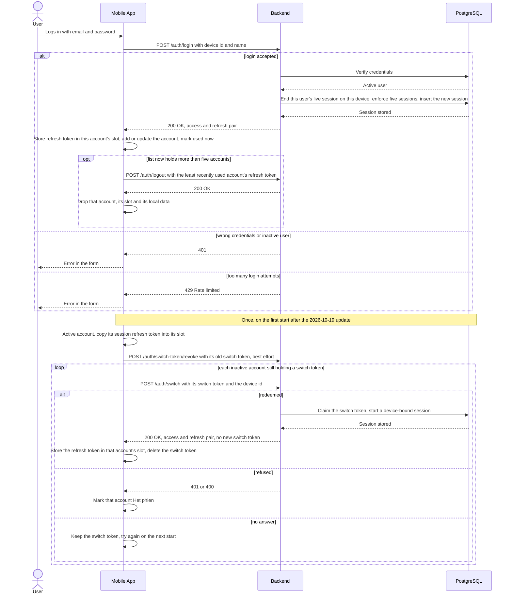

**US-02: Switch to another saved account**

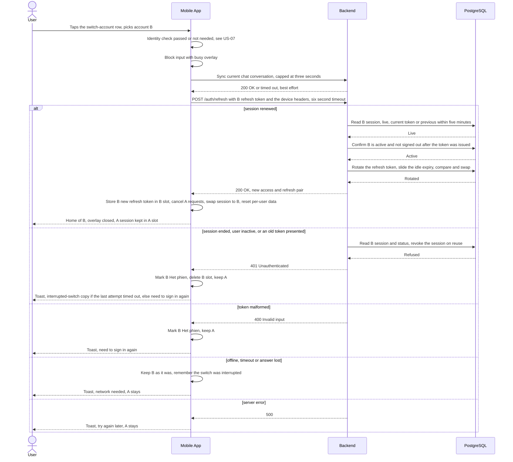

**US-03: Add another account**

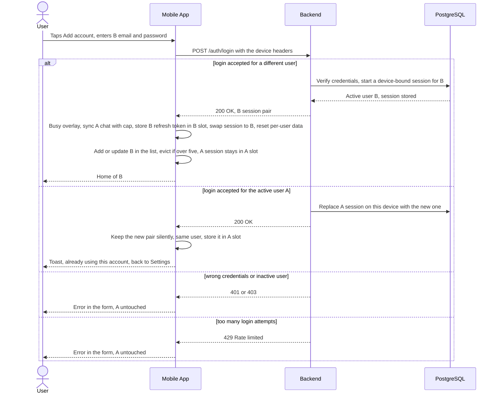

**US-04: Remove an account from the device**

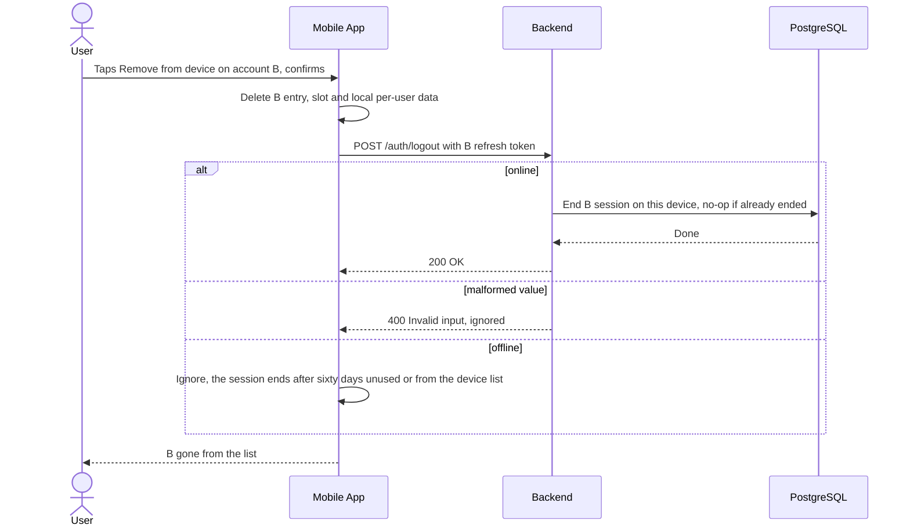

**US-05: Log out with saved accounts**

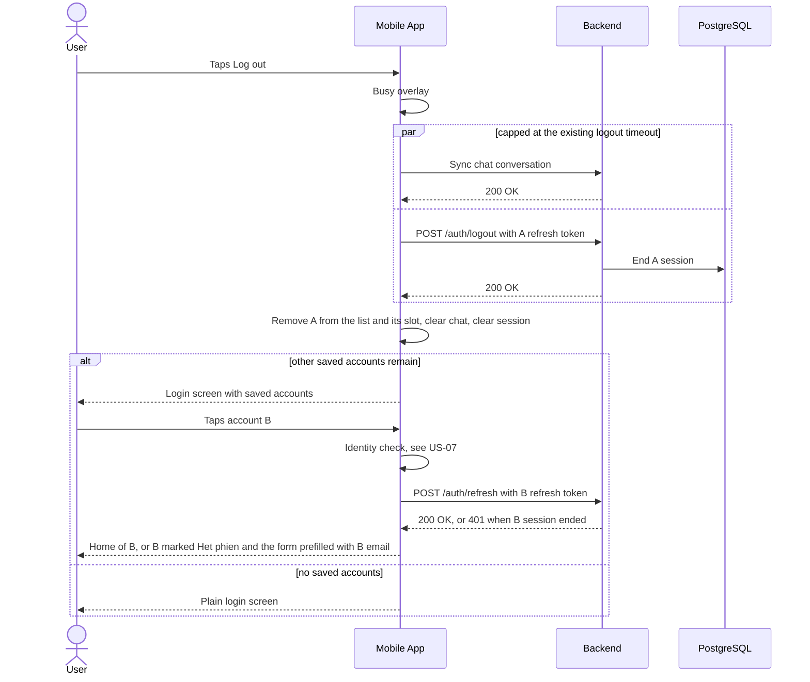

**US-06: 60 days unused, 180 days signed in**

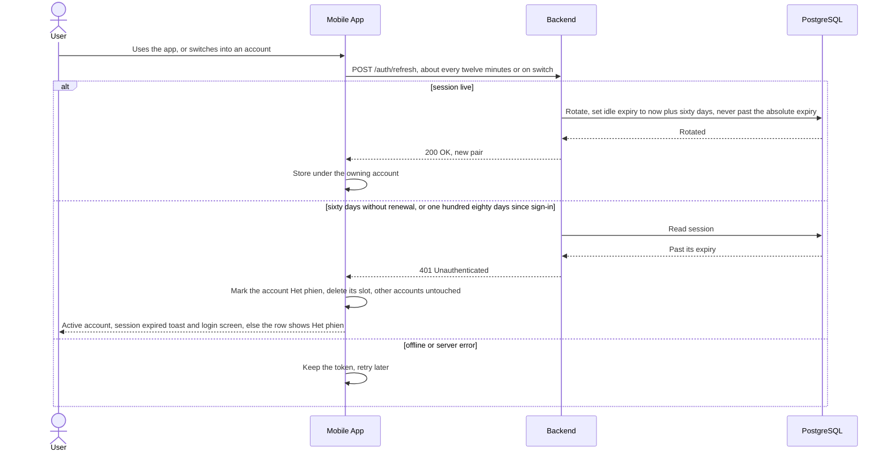

**US-07: Identity check before switching**

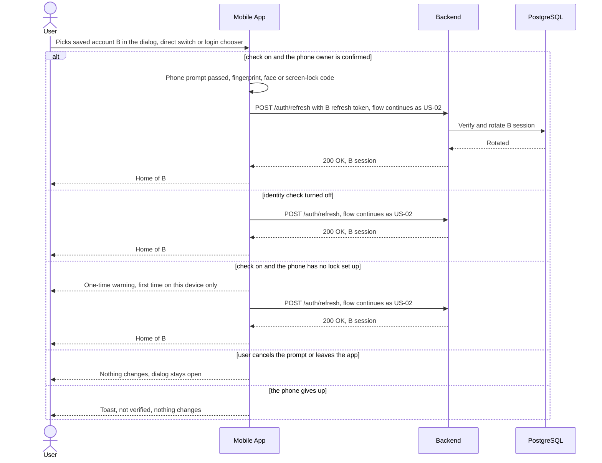

**US-08: Sign out everywhere (self)**

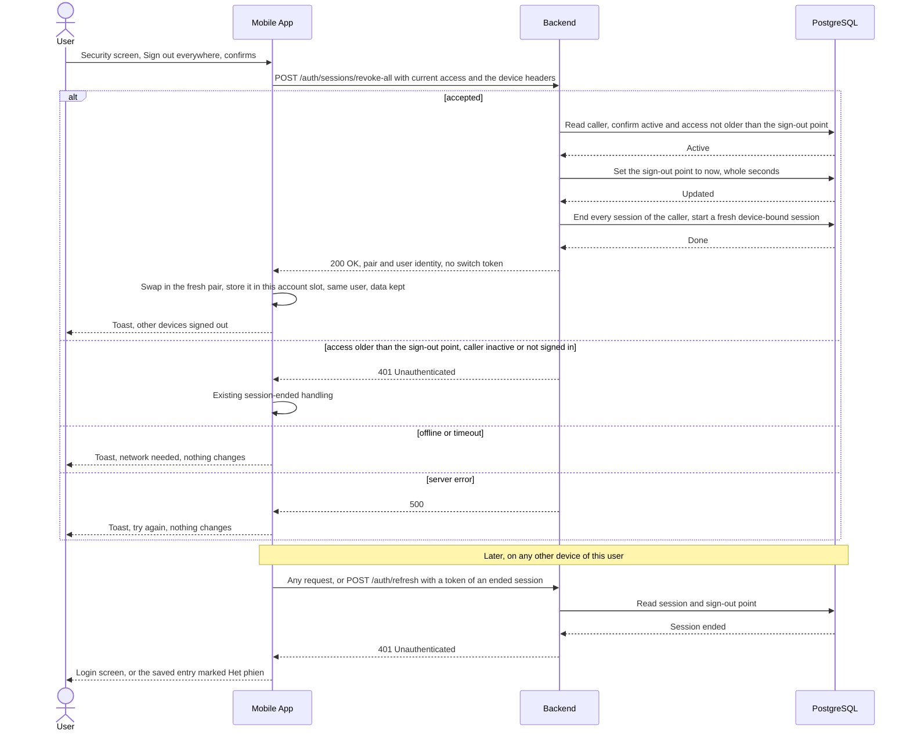

**US-09: Admin signs a user out everywhere**

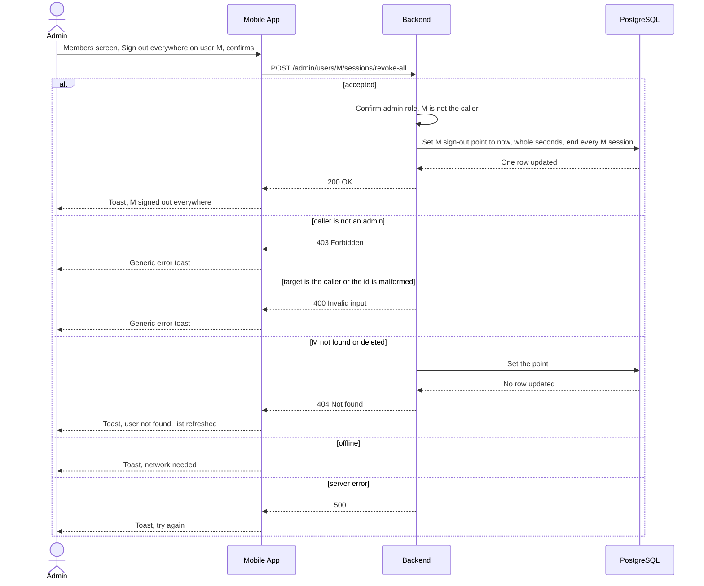

**US-10: See and sign out signed-in devices**

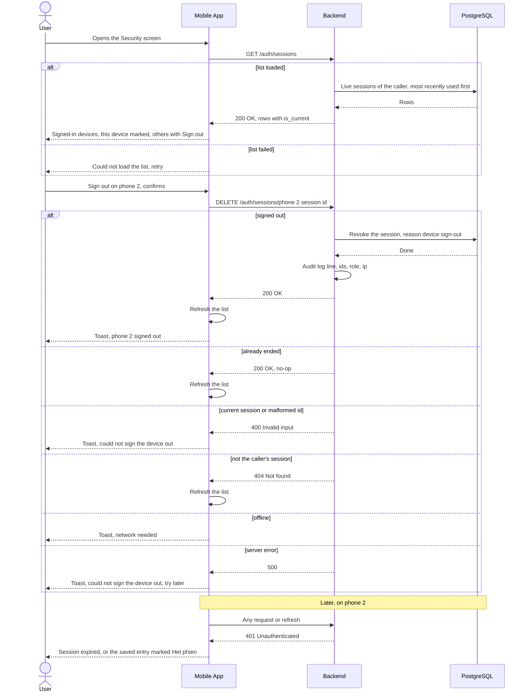

**US-11: Change password**

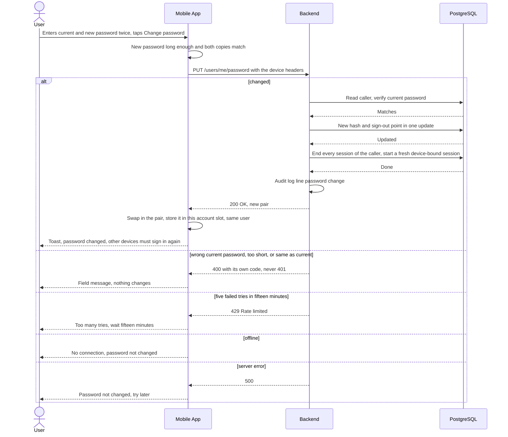

**US-12: App lock**

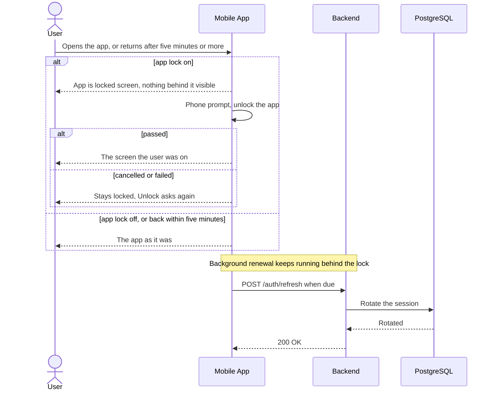

## Error Flows

| Scenario | Endpoint | HTTP | Error Code | Kind |
|----------|----------|------|------------|------|
| Refresh token missing / malformed (switch) | `POST /auth/refresh` | 400 | `INVALID_INPUT` | Client (4xx) |
| Session ended, expired (60 d idle / 180 d absolute), reused token, user inactive, or token before the sign-out point (switch) | `POST /auth/refresh` | 401 | `UNAUTHENTICATED` | Client (4xx) |
| Missing/invalid access token | `GET /auth/sessions`, `DELETE /auth/sessions/:id`, `PUT /users/me/password` | 401 | `UNAUTHENTICATED` | Client (4xx) |
| `:id` not a UUID, or `:id` = caller's current session | `DELETE /auth/sessions/:id` | 400 | `INVALID_INPUT` | Client (4xx) |
| Session not the caller's, or unknown | `DELETE /auth/sessions/:id` | 404 | `NOT_FOUND` | Client (4xx) |
| Session already ended | `DELETE /auth/sessions/:id` | 200 | — (no-op) | — |
| Body missing a field | `PUT /users/me/password` | 400 | `INVALID_INPUT` | Client (4xx) |
| Wrong current password | `PUT /users/me/password` | 400 | `WRONG_CURRENT_PASSWORD` | Client (4xx) |
| New password shorter than `MinPasswordLength` | `PUT /users/me/password` | 400 | `WEAK_PASSWORD` | Client (4xx) |
| New password equals the current one | `PUT /users/me/password` | 400 | `SAME_PASSWORD` | Client (4xx) |
| 5 failed tries in 15 min for this user | `PUT /users/me/password` | 429 | `RATE_LIMITED` | Client (4xx) |
| Missing/invalid/expired access token (legacy) | `POST /auth/switch-token` | 401 | `UNAUTHENTICATED` | Client (4xx) |
| Caller no longer active (legacy) | `POST /auth/switch-token` | 401 | `UNAUTHENTICATED` | Client (4xx) |
| Body missing `switch_token` / unparsable body (legacy) | `/auth/switch`, `/auth/switch-token/revoke` | 400 | `INVALID_INPUT` | Client (4xx) |
| Value is not a JWT at all (legacy) | `/auth/switch`, `/auth/switch-token/revoke` | 400 | `INVALID_INPUT` | Client (4xx) |
| Bad signature, expired, wrong purpose (refresh/access/import token) (legacy) | `POST /auth/switch` | 401 | `UNAUTHENTICATED` | Client (4xx) |
| Wrong purpose on revoke (legacy) | `POST /auth/switch-token/revoke` | 400 | `INVALID_INPUT` | Client (4xx) |
| Already used / revoked / lost the concurrent claim (legacy) | `POST /auth/switch` | 401 | `UNAUTHENTICATED` | Client (4xx) |
| User disabled, pending or soft-deleted | `POST /auth/refresh`, `POST /auth/switch` | 401 | `UNAUTHENTICATED` | Client (4xx) |
| Switch token presented to `/auth/refresh` | `POST /auth/refresh` | 401 | `UNAUTHENTICATED` | Client (4xx) |
| Switch token as Bearer on a protected route | any JWT route | 401 | `UNAUTHENTICATED` | Client (4xx) |
| Rate limit exceeded (legacy) | `POST /auth/switch` | 429 | `RATE_LIMITED` | Client (4xx) |
| Token `iat` before the user's `tokens_valid_after` | `POST /auth/refresh`, `POST /auth/switch`, every JWT route (mig 028) | 401 | `UNAUTHENTICATED` | Client (4xx) |
| Caller's access `iat` before `tokens_valid_after` | `POST /auth/switch-token`, `POST /auth/sessions/revoke-all` | 401 | `UNAUTHENTICATED` | Client (4xx) |
| Missing/invalid access token, caller inactive | `POST /auth/sessions/revoke-all` | 401 | `UNAUTHENTICATED` | Client (4xx) |
| Caller not admin | `POST /admin/users/:id/sessions/revoke-all` | 403 | `FORBIDDEN` (existing `RequireRole`) | Client (4xx) |
| `:id` not a UUID, or `:id` = caller | `POST /admin/users/:id/sessions/revoke-all` | 400 | `INVALID_INPUT` | Client (4xx) |
| Target unknown or soft-deleted | `POST /admin/users/:id/sessions/revoke-all` | 404 | `NOT_FOUND` | Client (4xx) |
| Session changed concurrently twice during a refresh | `POST /auth/refresh` | 500 | `INTERNAL_ERROR` (deliberately not 401) | System (5xx) |
| DB failure on user lookup / session read or write / claim / revoke / sign-out or password write | all endpoints above | 500 | `INTERNAL_ERROR` (existing generic) | System (5xx) |
| Signing failure | every endpoint that returns a pair | 500 | `INTERNAL_ERROR` | System (5xx) |

**Mobile mapping** (exact Vietnamese copy is defined in spec.md; strings live in `features/accounts/` and `features/security/`):

| Outcome | UI |
|---|---|
| 401 / 400 on switch (refresh) | entry marked "Hết phiên", slot deleted; warning toast — copy per spec S-ASW-15 (interrupted variant when `switchInterrupted`) |
| 401 / 400 on the active session's renewal | `clear()`; toast "Phiên đăng nhập đã hết hạn."; entry kept as "Hết phiên" (spec S-ASW-37) |
| No response / timeout on switch | toast — copy per spec S-ASW-18; entry **not** marked, `switchInterrupted = true` |
| 5xx on switch | toast — copy per spec S-ASW-19 |
| 429 (legacy `/auth/switch`, conversion only) | treated like no answer: retried on the next start |
| Identity check cancelled / failed / unavailable | nothing / toast / one-time warning — copy per spec US-07 |
| Self sign-out everywhere: 200 / offline / 5xx | toast — copy per spec US-08 step 4, S-ASW-61, S-ASW-62; 401 → existing session-ended handling |
| Device list: load failure / sign-out 200 / offline / 400 / 404 / 5xx | per spec US-10 (404 → refresh the list silently) |
| Change password: 200 / 400 codes / 429 / offline / 5xx | per spec US-11; 401 → existing session-ended handling |
| App lock: cancelled / failed / unavailable on toggle | stays locked / stays locked / spec AC-59 message |
| Admin sign-out: 200 / 404 / offline / other | toast — copy per spec US-09 step 3, S-ASW-69, S-ASW-71; 404 also invalidates the users query; other errors → existing generic error toast |
| Tapped a "Hết phiên" entry | navigate to `/add-account` (logged in) or prefill the login form (logged out) with its email |
| Add-account with the active user | keep the new pair silently; toast — copy per spec AC-16 (R-07) |
| Limit reached | hint instead of the add action — copy per spec AC-14 |

## API Contracts

All under `/api/v1`, response wrapped in the existing `{ success, message, data }` envelope; errors use `{ error_code, message, details? }`. Times are RFC 3339 UTC. Every mobile request carries `X-Device-Id: <uuid>` and `X-Device-Name: <encodeURIComponent(name)>` (2026-10-19); login, passkey login finish, refresh, `/auth/switch`, revoke-all and password change read them.

| Method + Path | Auth | Request | 200 `data` | Service method | Status |
|---|---|---|---|---|---|
| `POST /auth/login` | none; login limiters | `{ email, password }` + device headers | `{ access_token, refresh_token }` | `AuthService.Login` → `SessionService.Start(user, device)` | live (device-bound 2026-10-19) |
| `POST /auth/refresh` | none (token in body) | `{ refresh_token }` + device headers | `{ access_token, refresh_token }` | `AuthService.Refresh` → `SessionService.Refresh(…, device)` | live — **the switch path since 2026-10-19** |
| `POST /auth/logout` | none | `{ refresh_token }` | `null` | `AuthService.Logout` | live — also "Gỡ khỏi thiết bị" since 2026-10-19 |
| `GET /auth/sessions` | `JWTAuth` | none | `[{ id, device_name \| null, created_at, last_used_at, is_current }]`, most recently used first | `SessionService.ListDevices(ctx, callerID)` (+ `is_current` from `LocalsSessionID` in the handler) | NEW 2026-10-19 |
| `DELETE /auth/sessions/:id` | `JWTAuth` | path `id` (UUID) | `null` | `SessionService.SignOutDevice(ctx, callerID, callerSessionID, id)` | NEW 2026-10-19 |
| `PUT /users/me/password` | `JWTAuth` + `PasswordChangeRateLimiter` | `{ current_password, new_password }` + device headers | `{ access_token, refresh_token }` | `SessionRevocationService.ChangePassword(ctx, callerID, callerIssuedAt, current, next, device)` | NEW 2026-10-19 |
| `POST /auth/sessions/revoke-all` | `JWTAuth` | none (+ device headers) | `{ access_token, refresh_token, user: UserResponse }`; `switch_token`, `switch_token_expires_at` only when no `X-Device-Id` was sent | `SessionRevocationService.RevokeAllForSelf(ctx, callerID, callerIssuedAt, device)` | live |
| `POST /admin/users/:id/sessions/revoke-all` | `JWTAuth` + `RequireRole("admin")` (admin group) | path `id` (UUID) | `null` | `SessionRevocationService.RevokeAllForUser(ctx, adminID, targetID)` | live |
| `POST /auth/switch-token` | `JWTAuth` | none | `{ switch_token, expires_at, user: UserResponse }` | `AccountSwitchService.Issue(ctx, callerID, callerIssuedAt)` | **deprecated** (older builds) |
| `POST /auth/switch` | none; `SwitchRateLimiter` | `{ switch_token }` (+ device headers) | `{ access_token, refresh_token, user: UserResponse }`; `switch_token`, `switch_token_expires_at` only when no `X-Device-Id` was sent | `AccountSwitchService.Switch(ctx, token, device)` | **deprecated** (older builds + one-time conversion) |
| `POST /auth/switch-token/revoke` | none | `{ switch_token }` | `null` | `AccountSwitchService.Revoke(ctx, token)` | **deprecated** (older builds + conversion) |

Actor resolution: `/auth/sessions*`, `/users/me/password`, `/auth/switch-token`, `/auth/sessions/revoke-all` and the admin route read the caller via the existing `callerUUID(c)` (locals set by `JWTAuth`); the device list also reads `common.LocalsSessionID`, revoke-all and switch-token the access `iat` (`common.LocalsTokenIssuedAt`). `/auth/refresh`, `/auth/switch` and revoke resolve the user from the verified token inside the service. Authorization: role at `RequireRole` (admin route), ownership of a session (`user_id` in the query), active-user / stale-access / self-target checks in the service; authentication at `JWTAuth` or by the credential itself (refresh, switch).

## Constitution / Convention Notes

| Rule | Status | Note |
|------|--------|------|
| Handler → service → repository; handler never imports repository | Required | `DeviceSessionHandler` → `SessionService` (`session_devices.go`) → `SessionRepo`; `SessionRevocationHandler.ChangePassword` → `SessionRevocationService.ChangePassword` → `UserRepo`/`SessionService`; `AccountSwitchHandler` (legacy) → `AccountSwitchService` |
| Validation split | Required | Presence (`validate:"required"`), path UUID parse and header parsing (`device_info.go`) in handler; password rules, ownership, session state, user state in service |
| Authorization layer | Required | `JWTAuth` middleware (device list, password change, self revoke-all, legacy issue) + service ownership / active-user / stale-access checks; admin revoke-all behind the existing `/admin` group's `RequireRole("admin")` plus the service's self-target check |
| Transactional | Required | `SessionService.Start`: per-device replacement + 5-session cap + insert in one DB transaction. Password change and revoke-all: one atomic UPDATE on `users` first (see Transactional above). Refresh: one compare-and-swap UPDATE. Legacy: one `ClaimTokenJTI` insert (switch), one `RevokeToken` upsert (revoke). Reads non-transactional. |
| Concurrency / locking | Required | Refresh rotation is a compare-and-swap on `refresh_jti` (two refreshes of one session: one wins, the other re-reads and may use the grace). Per-device replacement relies on the cap transaction. Legacy single-use via `token_jti` UNIQUE. `tokens_valid_after`: last write wins, no lock (a later value is only stricter). |
| SQL only in `.sql` files, no `sqlc generate` | Required | `sessions.sql`, `users.sql`, `revoked_tokens.sql` — each new query **also** hand-written in the generated `.sql.go` (Finding #20) |
| Migration | Required | 025 and 033, both `IF NOT EXISTS`, applied by `cmd/migrate` on deploy / by hand with `psql` locally, **before** the new backend starts (Finding #21, R-09) |
| Wrap errors with context | Required | `fmt.Errorf("service.ChangePassword: %w", err)` etc. |
| No sensitive data in logs | Required | No token or password values in zap fields or mobile debug-console entries — `redact()` uses an explicit key list (`switch_token` added in AS-T13; `current_password`, `new_password` must be added, AS-T44). Audit lines carry ids, role, IP — never email |
| Named limits | Required | Backend: `RefreshTokenTTL = 60 d`, `LegacyRefreshTokenTTL = 7 d`, `SessionAbsoluteTTL = 180 d`, `SessionMaxActive = 5`, `RefreshReuseGrace = 5 min`, `SessionDeviceNameMaxRunes = 64`, password-change limit 5 / 15 min (named constants), legacy `AccountSwitchTokenTTL = 180 d`, `AccountSwitchTokenPurpose`, `SwitchRateLimit = 20`, `SwitchRateLimitWindow = 15 min`. Mobile: `MAX_SAVED_ACCOUNTS = 5`, `AVATAR_GROUP_MAX_VISIBLE = 3`, `SWITCH_CHAT_FLUSH_TIMEOUT_MS = 3000`, `SWITCH_REQUEST_TIMEOUT_MS = 6000`, app lock background limit (5 min), key names `SECURE_STORE_ACCOUNTS_KEY`, device-id and account-refresh key names, `SECURITY_PREFS_STORAGE_KEY`. The revocation timestamp precision is the named `jwt.TimePrecision` (1 s), not a literal |
| Money | N/A | No money read or written |
| Timestamps | Required | Server stores UTC (`created_at`, `last_used_at`, expiries); mobile renders "Hoạt động {dd/mm/yyyy}" through the shared date formatter in local time |
| Soft delete | Required | `GetUserByID` filters `deleted_at IS NULL` → a soft-deleted user's refresh/switch refused. `sessions` and `revoked_tokens` are not financial records (no `deleted_at`; purged by the retention job). |
| User isolation | Required | Every session query has `user_id = $n`; a session id that is not the caller's → 404; mobile per-user data and slots keyed by user id |
| Mobile: server state via TanStack Query only | Required | Device list = `useQuery`; sign-out device / change password = `useMutation`. Registry and slots are device-local state (not server data) → Zustand/SecureStore is correct; refresh/switch are commands called outside React (same precedent as `refreshTokenRequest`) |
| Vietnamese copy | Required | All new strings follow `pfm-ux-copy`; glossary rows for "thiết bị đang đăng nhập", "khóa ứng dụng", "đổi mật khẩu", "hết phiên" |
| File ≤ 300 lines | Required | New service/handler files (`session_devices.go`, `password_change.go`, `device_session_handler.go`, `device_info.go`) instead of growing `session_service.go` / `auth_service.go` |
| Audit | Required (2026-10-19) | Device sign-out and password change write one zap `Info` audit line each (caller id, session id, role, `ip`; `password.change`) — no email, no token, no password. Revoke-all keeps its existing line |
| Direct URL access | Required | `/add-account`, `/security`, `/change-password` live in `(app)` behind `Stack.Protected`; backend routes protected independently of the client |

## Element/Key IDs (QA automation)

**Mobile (`testID`)** — 2026-10-04 rows exist in code; 2026-10-19 rows are **Missing** (new, planned).

| Element | testID | File |
|---------|--------|------|
| Settings switch row | `row-settings-account-switch` | `features/accounts/components/AccountSwitchRow.tsx` |
| Avatar group | `avatar-group-accounts` | `AvatarGroup.tsx` |
| "+N" circle | `text-avatar-group-overflow` | `AvatarGroup.tsx` |
| Switch dialog | `dialog-account-switch` | `AccountSwitchDialog.tsx` |
| Account row | `row-account-<userId>` | `AccountRow.tsx` |
| Remove action | `btn-account-remove-<userId>` | `AccountRow.tsx` |
| Remove confirm | existing `ConfirmDialog` with `testID="dialog-account-remove"` | `AccountSwitchDialog.tsx` |
| Add account action | `btn-account-add` | `AccountSwitchDialog.tsx` |
| Limit hint | `text-account-limit-hint` | `AccountSwitchDialog.tsx` |
| Switch overlay | `overlay-account-switch` | `BusyOverlay.tsx` (prop) |
| Add-account screen | `screen-add-account` | `app/(app)/add-account.tsx` |
| Login saved accounts entry | `btn-login-saved-accounts` | `SavedAccountsEntry.tsx` |
| Logout button | `btn-settings-logout` | `settings.tsx` |
| Settings Security row | `row-settings-security` | `settings.tsx` |
| Security screen | `screen-security` | `app/(app)/security.tsx` |
| Identity-check switch | `switch-identity-check` | `IdentityCheckToggleRow.tsx` |
| Sign out everywhere action | `btn-revoke-all-sessions` | `RevokeAllSessionsRow.tsx` |
| Sign out everywhere confirm | `dialog-revoke-all-sessions` | `RevokeAllSessionsRow.tsx` |
| Admin per-row action | `btn-user-revoke-sessions-<userId>` | `RevokeSessionsButton.tsx` |
| Admin confirm | `dialog-user-revoke-sessions` | `RevokeSessionsButton.tsx` |
| Device list section (2026-10-19) | `section-device-sessions` | `DeviceSessionsSection.tsx` |
| Device row | `row-device-session` | `DeviceSessionsSection.tsx` |
| Device sign-out action | `btn-device-sign-out` | `DeviceSessionsSection.tsx` |
| Device sign-out confirm | `dialog-device-sign-out` | `DeviceSessionsSection.tsx` |
| Device list retry | `btn-device-sessions-retry` | `DeviceSessionsSection.tsx` |
| Change password row | `row-change-password` | `ChangePasswordRow.tsx` |
| Change password screen | `screen-change-password` | `app/(app)/change-password.tsx` |
| Current / new / repeat fields | `input-current-password`, `input-new-password`, `input-confirm-password` | `ChangePasswordForm.tsx` |
| Change password submit | `btn-change-password` | `ChangePasswordForm.tsx` |
| App lock switch | `switch-app-lock` | `AppLockToggleRow.tsx` |
| App lock overlay | `overlay-app-lock` | `AppLockOverlay.tsx` |
| App lock unlock button | `btn-app-unlock` | `AppLockOverlay.tsx` |

## Open Tasks

**2026-10-04 (switch-token design) — implemented and shipped.** Kept for traceability; tasks touching the retired path are marked **superseded**.

| ID | Task | File |
|----|------|------|
| AS-T01 | Constants: `AccountSwitchTokenTTL`, `AccountSwitchTokenPurpose`, `SwitchRateLimit`, `SwitchRateLimitWindow` (deprecated 2026-10-19) | `backend/internal/common/account_switch.go` |
| AS-T02 | `switchTokenClaims` (purpose + registered claims only), `IssueSwitchToken(userID) (token, expiresAt, err)`, `ParseSwitchToken` (signature, `WithExpirationRequired`, purpose, jti, sub; malformed → wrap `jwt.ErrTokenMalformed`), `ParseSwitchTokenUnverified` (jti, sub, exp, purpose) | `backend/internal/service/switch_token.go` |
| AS-T03 | ⚠️ `refreshClaims.Purpose` + reject non-empty purpose in `ParseRefreshToken` (Finding #1); `ParseRefreshToken` also returns `issuedAt *jwt.NumericDate` (d=1 caller: `AuthService.Refresh` + tests) | `backend/internal/service/token_service.go` |
| AS-T04 | `-- name: ClaimTokenJTI :execrows` (same INSERT … ON CONFLICT DO NOTHING) in source; hand-write `ClaimTokenJTI(ctx, ClaimTokenJTIParams) (int64, error)` in generated style (reuse `RevokeTokenParams` shape) | `backend/db/queries/revoked_tokens.sql`, `backend/internal/repository/sqlc/revoked_tokens.sql.go` |
| AS-T05 | `RevokedTokenRepository.Claim(ctx, jti, userID, exp) (bool, error)`; add to `RevokedTokenRepo` interface; `fakeRevokedTokenRepo.Claim` | `repository/revoked_token_repository.go`, `service/interfaces.go`, `service/fake_repo_test.go` |
| AS-T06 | `AccountSwitchService` — `Issue(ctx, callerID, callerIssuedAt)`, `Switch`, `Revoke` per Business Rules, incl. the `issuedBeforeRevocation` checks (Findings #18/#19); returns `*model.User` for the response | `backend/internal/service/account_switch_service.go` |
| AS-T07 | DTOs: `SwitchRequest`, `RevokeSwitchTokenRequest` (`switch_token`, required), `SwitchTokenResponse`, `SwitchResponse` | `backend/internal/dto/account_switch_dto.go` |
| AS-T08 | `AccountSwitchHandler` — `IssueSwitchToken`, `Switch`, `RevokeSwitchToken` (CSRF N/A comment, like `AuthHandler`) | `backend/internal/handler/account_switch_handler.go` |
| AS-T09 | `SwitchRateLimiter` keyed by `ClientIP` | `backend/internal/middleware/rate_limit.go` |
| AS-T10 | Routes: `auth.Post("/switch-token", JWTAuth, …)`, `auth.Post("/switch-token/revoke", …)`, `auth.Post("/switch", SwitchRateLimiter, …)`; wire service + handler | `backend/cmd/server/routes.go`, `main.go` |
| AS-T11 | Tests: issue (active / inactive / unauthenticated / access `iat` before the point → 401), switch (happy, replay → 401, concurrent claim → exactly one 200, expired, revoked, wrong purpose: refresh/access/import token, inactive, deleted, `iat` before the point → 401 and JTI not claimed, `iat` same second as the point → 200, malformed → 400), revoke (idempotent, malformed, wrong purpose); refresh rejects switch token; refresh with `iat` before the point → 401; `JWTAuth` rejects switch token | `service/account_switch_service_test.go`, `service/switch_token_test.go`, `service/auth_service_test.go` (one case), `middleware/jwt_auth_test.go` |
| AS-T12 | Mobile constants (see Convention Notes) | `mobile/src/lib/constants.ts` |
| AS-T13 | Types + requests: `issueSwitchTokenRequest()` via `apiClient`; `switchRequest`, `revokeSwitchTokenRequest`, `logoutRequest` via an interceptor-free axios instance (timeout `SWITCH_REQUEST_TIMEOUT_MS`), each appending a redacted debug-log entry; add `switch_token` to `redact()`'s key list | `mobile/src/features/accounts/types.ts`, `api/account-switch-requests.ts`, `src/lib/redact.ts` |
| AS-T14 | Registry store: hydrate from `pfm_accounts`; `upsert`, `markExpired`, `setInterrupted`, `touch`, `replaceToken`, `remove(userId)`; selectors `others(activeUserId)`, `isExpired(account, now)` | `mobile/src/features/accounts/account-registry-store.ts` |
| AS-T15 | `commitSession()` and `switchToAccount(userId)` with in-flight guard (taken before the identity check), `confirmOwner()` call (AS-T31), chat flush cap, error mapping, 401 → `markExpired` (interrupted copy if flagged), no response → `setInterrupted` (Finding #23) | `features/accounts/commit-session.ts`, `switch-account.ts` |
| AS-T16 | ⚠️ `refreshSession` stale-result guard (Finding #4) — compare the used refresh token before `setTokens` and before `clear()` | `mobile/src/stores/session-store.ts` |
| AS-T17 | ⚠️ `session-scoped-reset`: on user id change A→B (both non-null) clear chat and `claimFor(B)`; saved plan → `byUser` + v2 migrate + `removeUser`; phrases `removeUser` | `stores/session-scoped-reset.ts`, `features/budget-wizard/saved-plan.ts`, `stores/saved-phrases-store.ts`, `stores/recent-phrases-store.ts` |
| AS-T18 | Login rework: mutation returns the pair only; `completeLogin(pair, email, mode)` — same-user check (AC-16), flush chat if a session exists, `commitSession`, then `issueSwitchTokenRequest` + `upsert` (failure tolerated, AC-04); `LoginForm` `mode` + `initialEmail` | `features/auth/api/use-login-mutation.ts`, `features/auth/components/LoginForm.tsx`, `features/accounts/complete-login.ts` |
| AS-T19 | `useLogout()` — flush chat + `/auth/logout` + revoke switch credential in parallel under `LOGOUT_FLUSH_TIMEOUT_MS`, then `registry.remove(active, { revoke: false })`, clear chat, clear session | `features/accounts/hooks/use-logout.ts` |
| AS-T20 | **Superseded 2026-10-19 (AS-T41).** `useSwitchTokenRenewal()` — daily renewal of the active account's switch credential after hydrate and on `AppState` → `active`; 401 → stop for the current session (S-ASW-66) | `features/accounts/hooks/use-switch-token-renewal.ts` (removed) |
| AS-T21 | UI: `AvatarGroup`, `AccountSwitchRow`, `AccountSwitchDialog` (Modal, rows incl. the active row, remove confirm via `ConfirmDialog`, add action / limit hint), `AccountRow` | `features/accounts/components/*.tsx` |
| AS-T22 | `BusyOverlay` extracted from settings' logout `Modal`; Settings: insert `AccountSwitchRow` directly above logout, use `useLogout`, `displayNameFromEmail` fallback reused for registry rows | `components/shared/BusyOverlay.tsx`, `app/(app)/(tabs)/settings.tsx` |
| AS-T23 | `/add-account` route + `ROUTES_WITHOUT_NAV`; login screen saved accounts (registry hydrated before render, expired rows prefill the form) | `app/(app)/add-account.tsx`, `app/(app)/_layout.tsx`, `app/(auth)/login.tsx`, `features/accounts/components/*` |
| AS-T24 | Root layout gates first render on registry hydration too (chooser must not pop in) | `app/_layout.tsx` |
| AS-T25 | Manual device checklist: S-ASW-06…73, plus refresh regression S-REF-09…15, A→B→A data isolation (chat, budget plan), offline switch, kill mid-switch, 6th-account eviction, logout with 2+ accounts, identity check on Android (fingerprint) and iPhone in Expo Go (passcode fallback), sign out everywhere across two devices | — |
| AS-T26 | Migration `025_users_tokens_valid_after.sql`; `SetUserTokensValidAfter :execrows`; `getUserByID` column list + `Scan` + `sqlc.User`/`model.User` field + mapping (Finding #20); `UserRepository.SetTokensValidAfter`; `UserRepo` interface + `fakeUserRepo` | `backend/db/migrations/`, `db/queries/users.sql`, `repository/sqlc/{users.sql.go,models.go}`, `model/user.go`, `repository/user_repository.go`, `service/interfaces.go`, `service/fake_repo_test.go` |
| AS-T27 | `common.LocalsTokenIssuedAt`; `JWTAuth` stores `claims.IssuedAt`; handler helper `callerTokenIssuedAt(c)` | `common/constants.go`, `middleware/jwt_auth.go`, handler helpers file next to `callerUUID` |
| AS-T28 | `issuedBeforeRevocation(iat, tva)` (exact rule in "Revocation comparison"); `AuthService.Refresh` check after the status check | `service/token_revocation.go`, `service/auth_service.go` |
| AS-T29 | `SessionRevocationService` — `RevokeAllForSelf`, `RevokeAllForUser`; DTO `RevokeAllSessionsResponse`; `SessionRevocationHandler`; routes `auth.Post("/sessions/revoke-all", JWTAuth, …)` and `admin.Post("/users/:id/sessions/revoke-all", …)`; wire in `main.go` | `service/session_revocation_service.go`, `dto/account_switch_dto.go`, `handler/session_revocation_handler.go`, `cmd/server/routes.go`, `main.go` |
| AS-T30 | Tests: helper (nil point, nil iat, earlier second, same second, later); self revoke-all; admin (happy; self → 400; unknown → 404); member on admin route → 403 | `service/token_revocation_test.go`, `service/session_revocation_service_test.go` |
| AS-T31 | `npx expo install expo-local-authentication`; `app.json` plugin with `faceIDPermission`; `security-prefs-store.ts`; `identity-check.ts` — `confirmOwner()` per Finding #25, warn-once | `mobile/package.json`, `app.json`, `src/stores/security-prefs-store.ts`, `src/features/security/identity-check.ts` |
| AS-T32 | Security screen: route `app/(app)/security.tsx`; `IdentityCheckToggleRow` (off needs the check, AC-32); `RevokeAllSessionsRow` + `ConfirmDialog`; Settings Security row `href: "/security"`; `SETTINGS_SUB_ROUTES` + `"/security"` | `app/(app)/security.tsx`, `features/security/components/*`, `app/(app)/(tabs)/settings.tsx`, `src/components/shared/BottomNav.tsx` |
| AS-T33 | `useRevokeAllSessionsMutation` (apiClient) — onSuccess: `setTokens` (same email), `registry.replaceToken` without revoke, success toast; error mapping per Error Flows; `types.ts` | `features/security/api/use-revoke-all-sessions-mutation.ts`, `features/security/types.ts` |
| AS-T34 | Admin: `useRevokeUserSessionsMutation` (404 → invalidate users query); `RevokeSessionsButton` + `ConfirmDialog`; `UserListItem` shows it for active, non-self rows | `features/users/api/use-revoke-user-sessions-mutation.ts`, `features/users/components/{RevokeSessionsButton,UserListItem}.tsx` |
| AS-T35 | Apply migration 025 to the local database by hand (`psql`) before running the new backend; production gets it from `cmd/migrate` in `deploy.sh` | — (user) |

**2026-10-19 revision — device-bound sessions.**

| ID | Task | File |
|----|------|------|
| AS-T36 | Migration `033_session_devices.sql` (columns, partial index, header comment with the apply-before-start rule) | `backend/db/migrations/033_session_devices.sql` |
| AS-T37 | Session queries: `RevokeSessionsOnDevice`, device columns in `CreateSession`/`GetSession`, `COALESCE` in `RotateSessionRefresh`, `ListLiveSessionsForUser` — source + hand-written Go; `model.Session` device fields, `SessionDevice`, `SessionSummary`, new reasons | `db/queries/sessions.sql`, `repository/sqlc/sessions.sql.go`, `repository/session_repository.go`, `model/session.go` |
| AS-T38 | Lifetimes: `RefreshTokenTTL = 60 d`, `SessionAbsoluteTTL = 180 d`, `LegacyRefreshTokenTTL = 7 d` (legacy window + `GenerateTokenPair`); `SessionDeviceNameMaxRunes`; `LocalsSessionID` + `JWTAuth` stores it | `common/constants.go`, `common/constants_session.go`, `cmd/server/database.go`, `service/token_service.go`, `middleware/jwt_auth.go` |
| AS-T39 | `device_info.go` (R-06); `SessionService.Start(user, device)` with the per-device replacement inside the cap transaction; `Refresh(…, device)`; login, passkey login finish, refresh pass the device | `handler/device_info.go`, `service/session_service.go`, `service/auth_service.go`, `service/passkey_login.go`, `handler/auth_handler.go`, `handler/passkey_handler.go` |
| AS-T40 | Device list: `SessionService.ListDevices`, `SignOutDevice` (+ audit line); DTO; `DeviceSessionHandler`; routes `auth.Get("/sessions", jwtAuth, …)`, `auth.Delete("/sessions/:id", jwtAuth, …)` (literal `/sessions/revoke-all` stays a POST, no clash) | `service/session_devices.go`, `dto/`, `handler/device_session_handler.go`, `cmd/server/routes.go`, `main.go` |
| AS-T41 | Change password: users.sql UPDATE (hash + `tokens_valid_after`), `ChangePassword` (R-11/R-12, audit `password.change`), error codes, per-user failed-try limiter (5 / 15 min), handler, route `users.Put("/me/password", limiter, …)` | `db/queries/users.sql`, `repository/sqlc/users_password.sql.go`, `repository/user_repository_password.go`, `service/password_change.go`, `common/password.go`, `common/errors.go`, `middleware/rate_limit_password.go`, `handler/session_revocation_handler.go`, `cmd/server/routes.go`, `main.go` |
| AS-T42 | Deprecated endpoints with a device id: `/auth/switch` → device-bound session, no switch token; self revoke-all → device-bound fresh session, no switch token; DTO `omitempty`; `account_switch.go` deprecation comment | `service/account_switch_service.go`, `service/session_revocation_service.go`, `handler/account_switch_handler.go`, `handler/session_revocation_handler.go`, `dto/account_switch_dto.go`, `common/account_switch.go` |
| AS-T43 | Backend tests: one session per (user, device) (other users / devices untouched; no device → no replacement); device recorded once; lifetimes (idle slides, capped by absolute); list (own, live, order, `is_current`); sign-out device (current 400, other user 404, ended 200, refused afterwards); password change (each 400 code, success ends every session, fresh pair works, old refused, limiter); `/auth/switch` and revoke-all with a device return no switch token | `service/*_test.go`, `middleware/*_test.go` |
| AS-T44 | Mobile foundation: `device-identity.ts` (id + name, headers on both axios clients, URI-encoded name); `account-tokens.ts` (slots, single flight, compare-and-set, refusal → "Hết phiên", R-04); `session-events.ts`; constants; `redact()` + `current_password`, `new_password` | `src/lib/device-identity.ts`, `src/lib/account-tokens.ts`, `src/lib/session-events.ts`, `src/lib/axios.ts`, `src/lib/constants.ts`, `src/lib/redact.ts` |
| AS-T45 | ⚠️ Session store on `account-tokens.ts`: active refresh writes to its owner; refused active → `clear()` + "Phiên đăng nhập đã hết hạn." with the entry kept as "Hết phiên" | `src/stores/session-store.ts` |
| AS-T46 | Accounts flows: registry drops switch fields; `switchToAccount` via `refreshAccount`; `commitSession` new order (no logout of the outgoing session); `completeLogin` stores the slot, no switch-token request, same-user branch (R-07), identity via `GET /users/me` (R-14); `useLogout` and `remove` via `/auth/logout` with the account's refresh token; copy (R-15) | `features/accounts/*` |
| AS-T47 | Remove `use-switch-token-renewal.ts`; add the saved-account sync hook and the one-time legacy conversion (R-08), mounted in `app/(app)/_layout.tsx` | `features/accounts/hooks/use-saved-account-sync.ts`, `features/accounts/convert-legacy-accounts.ts`, `app/(app)/_layout.tsx` |
| AS-T48 | Device list UI: `DeviceSessionsSection` + query/mutation hooks; confirm, toast, errors (spec US-10); Security screen section order (spec decision 14) | `features/security/components/DeviceSessionsSection.tsx`, `features/security/api/*`, `app/(app)/security.tsx` |
| AS-T49 | Change password UI: route, form (client checks, field messages), mutation (swap pair into session + slot), Security row; `SETTINGS_SUB_ROUTES` + `"/change-password"` | `app/(app)/change-password.tsx`, `features/security/components/ChangePasswordForm.tsx`, `features/security/api/use-change-password-mutation.ts`, `src/components/shared/BottomNav.tsx` |
| AS-T50 | App lock: `appLockEnabled` in `security-prefs-store`; `AppLockToggleRow` (change needs the check; `unavailable` blocks on); overlay on cold start and after ≥ 5 min background (`AppState`) | `src/stores/security-prefs-store.ts`, `features/security/components/AppLockToggleRow.tsx`, `features/security/components/AppLockOverlay.tsx`, `features/security/app-lock.ts`, `app/(app)/_layout.tsx`, `app/_layout.tsx` |
| AS-T51 | Apply migration 033 locally by hand (`psql`) before running the new backend; production: `cmd/migrate` in `deploy.sh`; then backend, then `npm run ota:publish` (R-09) | — (user) |
| AS-T52 | Manual device checklist: S-ASW-01…05 (incl. upgrade from the previous build), S-ASW-11/15/18/20/22, S-ASW-37/40–42 (shortened lifetimes in a test build), S-ASW-74…112 across two phones (device sign-out, password change, app lock on a phone with and without a screen lock) | — |

### Task Sequencing

| Phase | Tasks | Gate |
|---|---|---|
| 1–6 (2026-10-04) | AS-T01…AS-T35 | Done |
| 7 Backend foundation (2026-10-19) | AS-T36 (+ AS-T51 locally), AS-T37, AS-T38, AS-T39 | `go build ./...` + existing tests green; 033 applied before any run |
| 8 Backend API | AS-T40, AS-T41, AS-T42 | — |
| 9 Backend tests | AS-T43 | `go test ./...` green |
| 10 Mobile core | AS-T44, AS-T45, AS-T46, AS-T47 | `tsc` clean for touched files |
| 11 Mobile UI | AS-T48, AS-T49, AS-T50 | — |
| 12 Deploy + device verification | AS-T51, AS-T52 | User — order: migration → backend → OTA |

### T-OPEN (product/tech sign-off, not blocking)

| ID | Item |
|----|------|
| T-OPEN-1 | No "disable user" action exists (Finding #22) — confirm it stays out of scope (spec Open Question 1). |
| T-OPEN-2 | Admin may sign out another admin (spec Open Question 2, EC-22). |
| T-OPEN-3 | Turning the identity check off requires passing it (spec Open Question 3, AC-32). |
| T-OPEN-4 | The decision text says the project has no migration runner; `backend/cmd/migrate` + `deploy.sh` exist (Finding #21). Plan follows the code; owner to confirm the deploy path still runs it. |
| T-OPEN-5 | Forgot password (spec Open Question 4) — separate spec, production-readiness P0. |
| T-OPEN-6 | Phase-2 device key pair (spec Open Question 5) — `sessions.public_key` reserved, unused. |
| T-OPEN-7 | When to delete the deprecated switch-token endpoints, `switch_token.go`, `ClaimTokenJTI` and `SwitchRateLimiter` (spec Open Question 6). |
| T-OPEN-8 | App lock when the phone's screen lock is removed (spec Open Question 7). |
| T-OPEN-9 | Rate limit on `/auth/refresh`, now the switch path (spec Open Question 8). |

### Handoff Summary

| Step | Status | Owner |
|---|---|---|
| Research + decisions | Done (2026-10-04, extended same day: revocation, identity check, Security screen) | Product owner |
| Device-bound session proposal | Done (2026-10-19, design contract; adopted / not adopted recorded in spec + R-01…R-14) | Product owner |
| spec.md | Done (US-01…US-09; revised 2026-10-19 with US-10…US-12) | BA |
| plan.md | Done (this file, revised 2026-10-19) | Architect |
| Implementation AS-T01…T34 | Done (shipped 2026-10) | — |
| Implementation AS-T36…T50 | In progress (2026-10-19) | `/cook-implementation` |
| Local migrations 025 (AS-T35), 033 (AS-T51) | 025 done; 033 pending | User |
| test_cases.md | Pending | `/cook-qc` |
| Device verification AS-T25, AS-T52 + commit | Pending | User |
