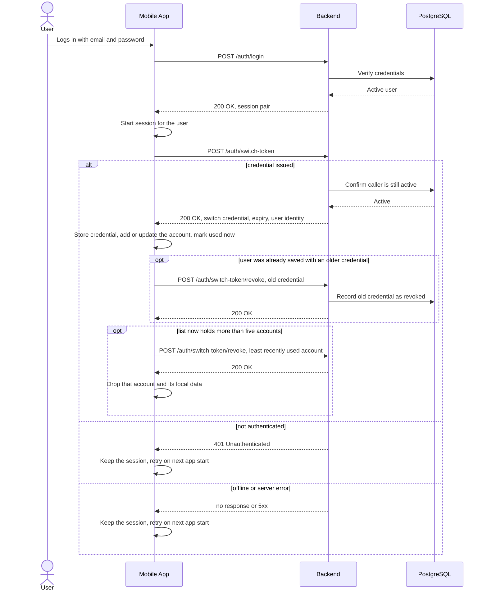
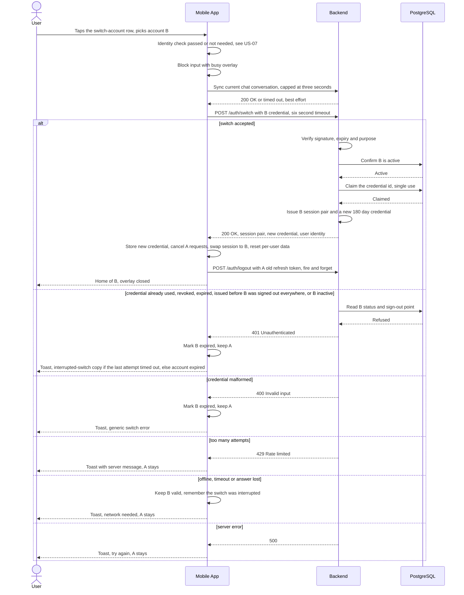
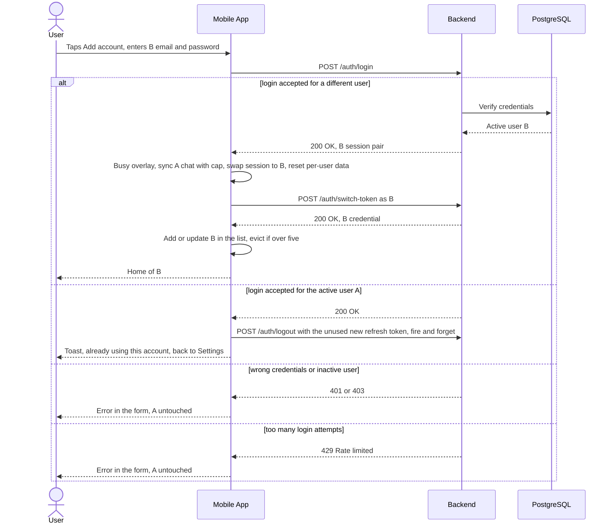
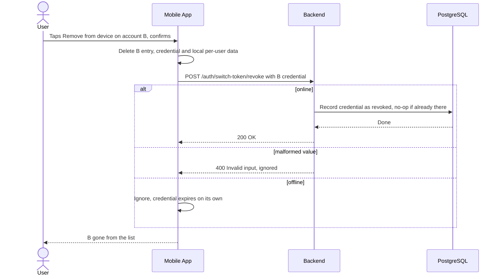
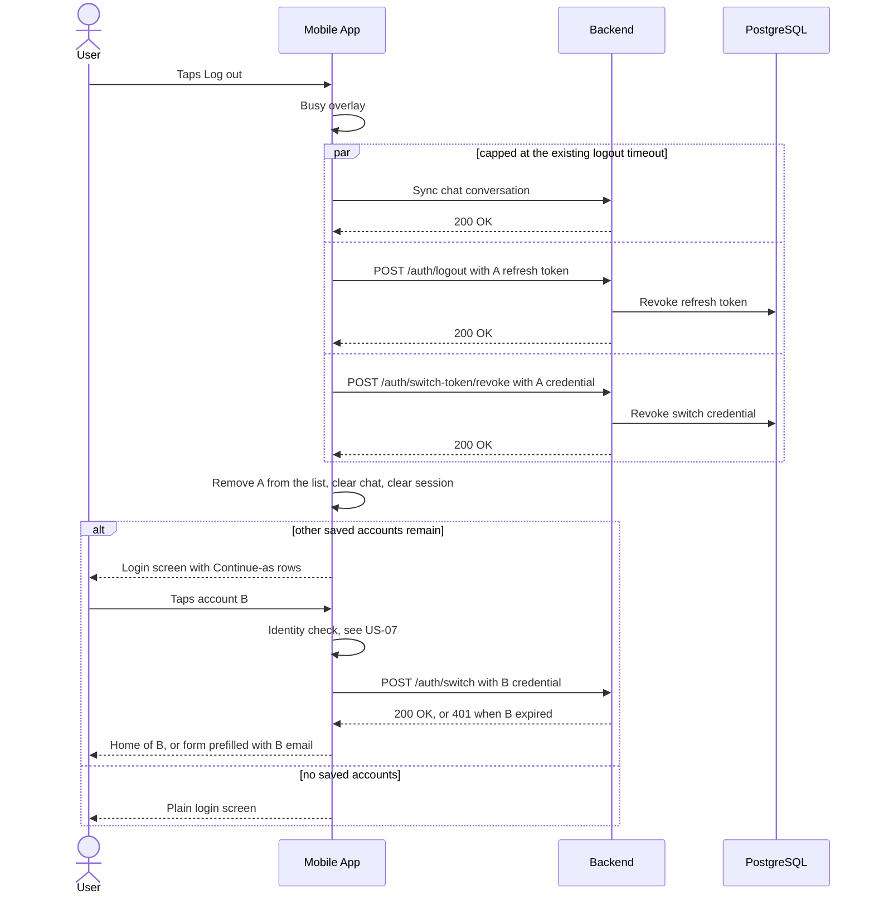
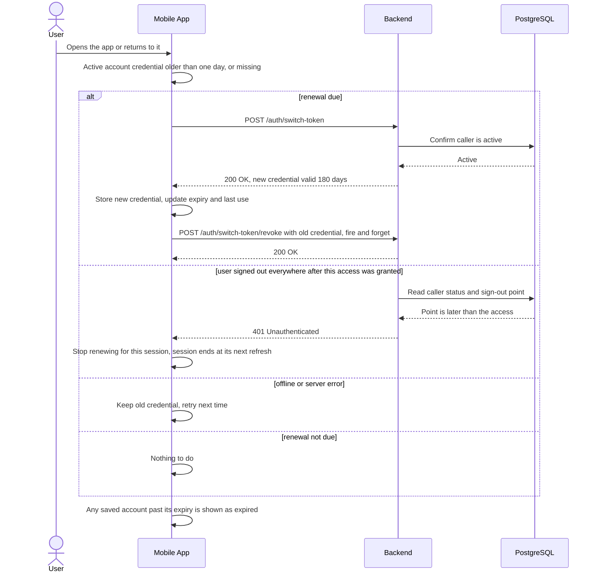
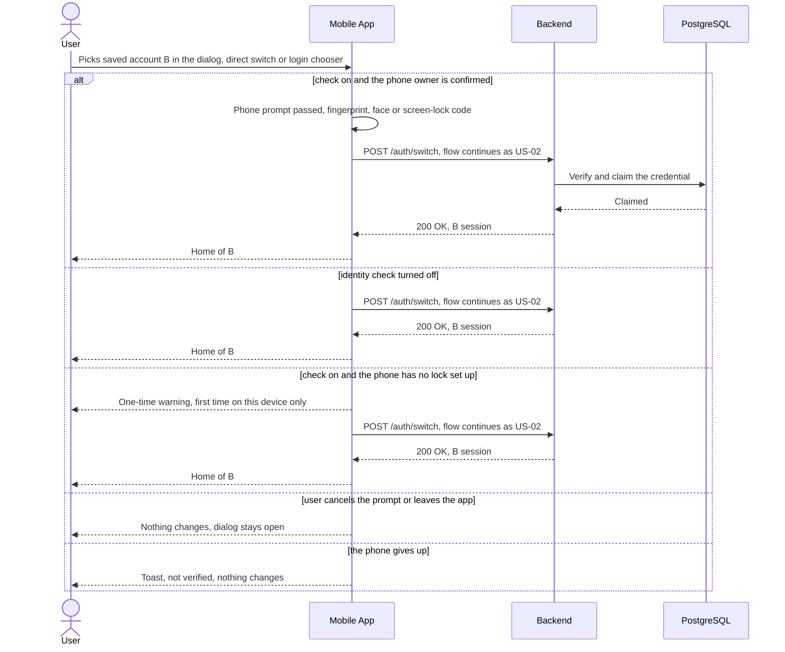
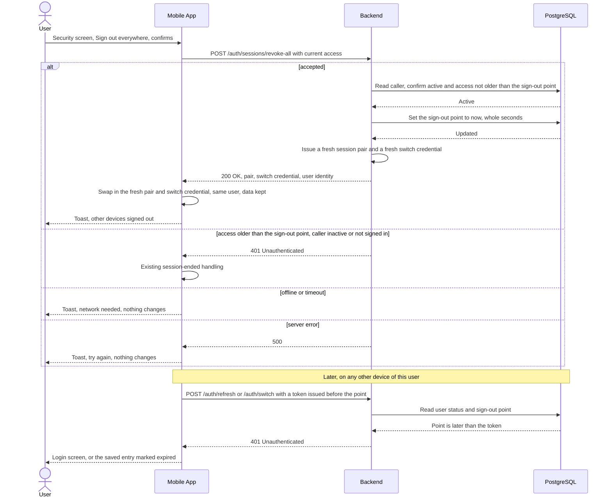
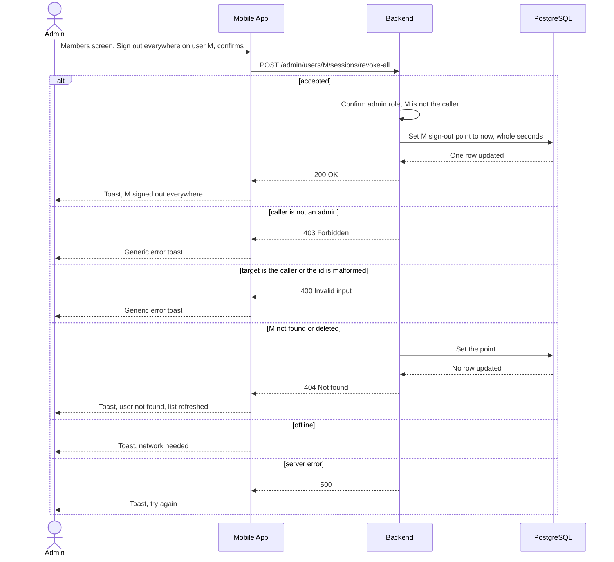

# Implementation Plan: Account Switching on Mobile (F-02 extension)

- **Feature:** Account switching — switch credential (backend) + saved-account registry, switch/add/remove/logout flows and Settings avatar group (mobile); plus remote "sign out everywhere" (self + admin), identity check before switching and a Security screen (owner decisions 2026-10-04, final)
- **SRS Feature Code:** F-02 System Security (extension; SRS has no section for it — source is the approved research note)
- **Jira:** N/A — this repository has no Jira integration
- **Spec:** [spec.md](./spec.md)
- **Related:** [research-account-switch](../mobile-ux-batch-2026-10/research-account-switch.md), [mobile-session-refresh plan](../mobile-session-refresh/plan.md) (session store/refresh this builds on), [transaction-export-import](../transaction-export-import/spec.md) (purpose-tagged token precedent)
- **Client scope:** Backend (Go Fiber) + `mobile/` only. `frontend/` (web) is frozen — no task touches it.
- **Baseline:** plans on top of the uncommitted 2026-10-04 `session-store.ts` change — `setTokens` clears the query cache only when the user id changes; `refreshSession` force-logs-out only on 400/401/403 and otherwise schedules a retry after `REFRESH_RETRY_DELAY_SECONDS`.
- **One migration (`025_users_tokens_valid_after.sql`), no `sqlc generate`.** New queries are hand-written into the generated files in the existing style (local sqlc CLI version differs from the committed output). See Finding #21 for how 025 gets applied.

## Pre-flight: Spec Review Findings

| # | Type | Finding | Resolution / Open Task |
|---|------|---------|-------------------------|
| 1 | ⚠️ Security gap (code) | `TokenService.ParseRefreshToken` accepts **any** signed token that has `jti`, `sub` and `exp`. A switch token carries all three, so without a change **`POST /auth/refresh` would accept a 180-day switch token** and silently turn it into a 7-day refresh chain — breaking BR-04 / S-ASW-22. | `refreshClaims` gains `Purpose string json:"purpose,omitempty"`; `ParseRefreshToken` rejects any non-empty purpose. Test: switch token → `Refresh` → 401. AS-T03. |
| 2 | Security check (code) | `JWTAuth` rejects a token whose decoded `role` or `user_id` is empty. | Switch claims must carry **only** `sub`, `jti`, `iat`, `exp`, `purpose` — never `user_id`/`role` — so `JWTAuth` rejects them by construction. Test in `jwt_auth_test.go`. AS-T02, AS-T11. |
| 3 | Gap (research) | Research slides the 180 days only "on each switch". An account used continuously as the active one (never switched away from and back) would keep its original credential and expire after 180 days **while in use** — violating AC-24. | Mobile renews the active account's credential at most once per `SWITCH_TOKEN_RENEW_AFTER_SECONDS` (1 day) on cold start and on app foreground (spec US-06). AS-T20. |
| 4 | ⚠️ Race (research P1–P4 missed this) | `refreshSession()` of User A in flight when the switch lands resolves afterwards and calls `setTokens(A pair)` — **silently switching back to A**, with B's data cleared. Its rejected path would also `clear()` B's session. | `refreshSession` captures the refresh token it used; in both `.then` and the rejected `.catch` it does nothing to the session unless `get().refreshToken` is still that token. AS-T16 (spec EC-05). |
| 5 | ⚠️ Single-use race | `IsRevoked` then `Revoke` (the refresh pattern) lets two concurrent `/auth/switch` calls with the same credential both succeed (`ON CONFLICT DO NOTHING` returns no signal). For a 180-day credential that matters (BR-05). | New hand-written query `ClaimTokenJTI :execrows` (same insert, returns rows affected). The service claims the JTI **first**; 0 rows → 401. Only one caller can ever win. AS-T04/T05. |
| 6 | Gap | Spec says rows show a display name, but the device only knows the email (no `GET /users/me`; access token carries only `user_id`, `role`). | `POST /auth/switch-token` and `POST /auth/switch` both return `user` (existing `dto.UserResponse` whitelist: id, email, full_name, role, …). Mobile stores `fullName`, falling back to the existing email-derived name. |
| 7 | Gap | The add-account action logs B in while A is active, but `apiClient` attaches **A's** bearer to every request — so B's switch credential cannot be requested through `apiClient` before B's session is committed. | Order for both login and add-account: commit the session (`setTokens(B)`) first, then request the switch credential through `apiClient` (now B). The login itself is done through the existing login request without the hook's `setTokens` side effect. AS-T18. |
| 8 | Gap | `useLoginMutation.onSuccess` calls `setTokens` directly; add-account needs to flush A's chat and run the shared "commit session" step instead. | Login mutation returns the pair only; the caller runs `completeLogin()` (AS-T18). `LoginForm` gets `mode` + `initialEmail` props. |
| 9 | Resolved (existing code) | `LoginForm` used to initialise a hard-coded email/password; removed 2026-10-04 (both now `useState("")`). | Add-account and chooser-prefill modes start from `initialEmail ?? ""` and an empty password (spec EC-10). No separate task remains. |
| 10 | Clarification | Research said "after login / activation". Mobile has **no activation flow** — `/auth/activate` is only used by the backend's own HTML page. | Only login adds an account on mobile (spec Context note). `ActivateResponse` untouched. |
| 11 | Clarification | Research says the add action is hidden at 5 accounts (§3.5) **and** that a 6th evicts the LRU one (R6). | Both hold: a 6th can only arrive through the logged-out login screen (after a session expired in place). Eviction never picks the active or incoming account. Spec EC-03. |
| 12 | Gap | Offline detection — there is no NetInfo dependency and the research says "no new dependency". | "Offline" = the switch request fails with no response (`!error.response`) within `SWITCH_REQUEST_TIMEOUT_MS`. No pre-check. |
| 13 | Gap | Existing sessions persisted before this feature ships are not in any registry. | On hydrate, an active session whose user id is not in the registry is treated like "credential missing" (AC-04 retry path) — a switch credential is requested and the account added. AS-T20. |
| 14 | Decision | On a successful switch, A's 7-day refresh token is no longer stored anywhere on the device but would stay valid server-side. | After commit, fire-and-forget `POST /auth/logout` with A's old refresh token (A keeps its switch credential, so switching back still works). Closes research P5 for the switch path too. |
| 15 | Transactional | `/auth/switch` writes one row (the JTI claim); token generation is in-memory. | No DB transaction needed — the single atomic insert is the only write. Generation after the claim can only fail on a signing-key misconfiguration (500); the user then needs one password login — accepted. |
| 16 | Security | CSRF posture of the five new mutating endpoints. | Not applicable — Bearer-in-header / token-in-body API, no cookies, no server session (same as `AuthHandler`'s existing doc comment). |
| 17 | Decision (owner) | Switch and refresh tokens are stateless JWTs — "sign out everywhere" cannot enumerate them. | New nullable column `users.tokens_valid_after TIMESTAMPTZ` (migration 025). `/auth/refresh` **and** `/auth/switch` reject a token whose `iat` is before it (refresh must be checked too, otherwise a lost device's 7-day refresh chain survives). Access tokens are **not** checked per request (no DB read in `JWTAuth`); they die within `AccessTokenTTL` — accepted (spec EC-20). AS-T26…T30. |
| 18 | ⚠️ Precision | JWT `iat` is whole seconds (`jwt.NewNumericDate` truncates to `jwt.TimePrecision` = 1 s); `TIMESTAMPTZ` keeps microseconds. A naive `iat < tokens_valid_after` with a sub-second stored value would reject the fresh pair issued in the same second to the requesting device (spec AC-37). | Exact rule — see "Revocation comparison" below: store `time.Now().UTC().Truncate(time.Second)` computed in Go (same clock that signs `iat`, not DB `NOW()`); reject iff the value is set and (`iat` missing **or** `iat.Unix() < tokens_valid_after.Unix()`). Fresh tokens are generated after the UPDATE, so their `iat` ≥ the stored second. Residual: a token another device obtained earlier **within the same second** survives — < 1 s window, accepted. One helper `issuedBeforeRevocation(iat, tva)` used by every check. |
| 19 | ⚠️ Gap (decision text) | Access tokens are unchecked, so during the ≤ 15-min tail a lost device could (a) mint a fresh 180-day switch token via `POST /auth/switch-token` (daily renewal) or (b) call "sign out everywhere" itself, get a fresh pair and lock the owner's own device out. Either undoes the revocation. | Both `Issue` and `RevokeAllForSelf` also check the **caller's access-token `iat`** against `tokens_valid_after`. Free: both services already re-read the user. `JWTAuth` additionally stores `claims.IssuedAt` in a new local `common.LocalsTokenIssuedAt`; handlers pass it to the service. Spec S-ASW-63/66. AS-T27, AS-T28. |
| 20 | Gap (sqlc) | `tokens_valid_after` must be read where the user row is already read (`GetUserByID` in `Refresh`, `Switch`, `Issue`) — no extra round trip. Every generated users query lists its columns explicitly (sqlc expanded `SELECT *` at generate time), so the new column breaks none of them. | Hand-edit only `getUserByID`: append `tokens_valid_after` to its column list and `&i.TokensValidAfter` to its `Scan`; add `TokensValidAfter *time.Time` to `sqlc.User` and `model.User` (+ mapping). Documented on the field: **populated only by `GetUserByID`**. New hand-written `SetUserTokensValidAfter :execrows`. AS-T26. |
| 21 | ⚠️ Deploy order / migration practice | After AS-T26, `GetUserByID` selects a column that does not exist until 025 runs → every refresh/switch 500s (`42703`). Note: the decision text says "no migration runner", but `backend/cmd/migrate` exists and `backend/deploy.sh` runs it on every deploy (ledger `schema_migrations`). The initdb mounts in both compose files stop at 021 — 022–024 are not mounted and an existing local volume gets them by hand with `psql`. | 025 is idempotent (`ADD COLUMN IF NOT EXISTS`, re-runnable like 021/022). Deploy: applied by `cmd/migrate` before the new backend serves. Local: apply by hand (`psql … < backend/db/migrations/025_users_tokens_valid_after.sql`) **before** starting the new backend; not added to the initdb mounts (follows 022–024). AS-T26. |
| 22 | Finding (existing code) | The decision text relies on "the existing admin disable user". There is no disable endpoint or UI (admin routes: invite, list, resend-invite only); `status = 'disabled'` is only reachable by a DB edit. The status checks in `Refresh`/`Switch`/`Issue` already refuse such users. | No work; flagged as spec Open Question 1. |
| 23 | Decision (owner) | A lost `/auth/switch` response burns the rotated credential; the next attempt gets 401. | Accepted. Timeout / no response never calls `markExpired`; it sets `switchInterrupted = true` on the registry entry. A later 401 marks expired and picks the interrupted copy when the flag is set; any successful switch clears it. AS-T15. |
| 24 | Verification | Identity check library. | `expo-local-authentication` is part of the Expo SDK 54 module set bundled in Expo Go (reference page exists under docs `v54.0.0`); install with `npx expo install expo-local-authentication` so the SDK-54 version is pinned. **Face ID is not available in Expo Go** → call `authenticateAsync` with `disableDeviceFallback: false` so iOS testers pass with the device passcode; Android fingerprint works in Expo Go. Add the config plugin with `faceIDPermission` to `app.json` for future dev/EAS builds (inert in Expo Go). UI-level gate only — no `requireAuthentication` on SecureStore keys. AS-T31. |
| 25 | Design | Mapping the check's outcomes. | `getEnrolledLevelAsync()` = `NONE` (no biometrics, no passcode) → `unavailable`. `authenticateAsync`: success → `passed`; error `user_cancel` / `system_cancel` / `app_cancel` → `cancelled` (silent); `not_enrolled` / `passcode_not_set` / `not_available` → `unavailable`; anything else (`lockout`, `authentication_failed`, `unknown`, …) → `failed` (toast). `unavailable` → proceed + warn once (`noLockWarningShown`). AS-T31. |
| 26 | Race | Self "sign out everywhere" while a proactive refresh with the old refresh token is in flight: that refresh now gets 401. | Finding #4's stale-result guard already ignores it (`get().refreshToken` changed when the fresh pair was committed). Commit uses `setTokens` with the same email → no cache clear (same user). AS-T33. |
| 27 | Decision | Admin endpoint edge cases. | Target = caller → 400 `INVALID_INPUT` (self goes through the Security screen so the device keeps a fresh pair). Unknown / soft-deleted target → 404 `NOT_FOUND` (UPDATE affects 0 rows). Pending/disabled targets are accepted server-side (harmless) and hidden in the UI. Admin → admin allowed (spec EC-22). |

### Regression Scope

| Area | Change | Risk / retest |
|---|---|---|
| `POST /auth/refresh` | `ParseRefreshToken` now rejects tokens with a `purpose`, and returns `iat`; `Refresh` rejects `iat` before `tokens_valid_after` | Re-run `TestAuthService_Refresh*`; real refresh tokens carry no purpose; `tokens_valid_after` NULL for every existing user → no behaviour change until first use |
| `GetUserByID` (all callers: auth, user, chat, …) | selects one more column | ⚠️ 500 everywhere it is used if 025 is not applied first (Finding #21) |
| `JWTAuth` (every protected route) | stores one more local (`iat`) | No behaviour change; re-run `jwt_auth_test.go` |
| Mobile users screen (admin) | new per-row action | Invite + resend-invite still work; row layout |
| Mobile Settings / BottomNav | Security row gets an href; `/security` added to settings sub-routes | Settings row order; bottom bar highlight on sub-routes |
| `POST /auth/login`, `/auth/logout` | untouched server-side; mobile now **calls** `/auth/logout` for the first time | Logout on device online/offline |
| Mobile login screen | `LoginForm` props, login mutation no longer sets tokens itself | Plain login, wrong password, rate limit |
| Mobile session store | `refreshSession` stale-result guard | Proactive + reactive refresh (S-REF-09…15) |
| `session-scoped-reset.ts` | handles user change A→B, not only null↔token | Logout, fresh login, cold start restore |
| Budget wizard saved plan | single slot → `byUser` (persist v2 migration) | Wizard restore after app update |
| Settings | new row, logout logic moved to a hook | Logout overlay, row order |

## Architecture

### Package/File Layout

```text
backend/
├── db/
│   ├── migrations/025_users_tokens_valid_after.sql   # NEW — ADD COLUMN IF NOT EXISTS tokens_valid_after TIMESTAMPTZ NULL
│   └── queries/
│       ├── revoked_tokens.sql                    # + ClaimTokenJTI :execrows (source only; NOT regenerated)
│       └── users.sql                             # + SetUserTokensValidAfter :execrows (source only)
└── internal/
    ├── common/
    │   ├── account_switch.go                     # NEW — TTL, purpose, rate-limit constants
    │   └── constants.go                          # + LocalsTokenIssuedAt
    ├── model/user.go                             # + TokensValidAfter *time.Time
    ├── repository/
    │   ├── sqlc/models.go                        # sqlc.User + TokensValidAfter (hand-edit)
    │   ├── sqlc/users.sql.go                     # getUserByID column list + Scan; + SetUserTokensValidAfter (hand-written)
    │   ├── sqlc/revoked_tokens.sql.go            # + hand-written ClaimTokenJTI in generated style
    │   ├── user_repository.go                    # mapping + SetTokensValidAfter(ctx, id, at) (bool, error)
    │   └── revoked_token_repository.go           # + Claim(ctx, jti, userID, exp) (bool, error)
    ├── service/
    │   ├── interfaces.go                         # RevokedTokenRepo gains Claim; UserRepo gains SetTokensValidAfter
    │   ├── token_service.go                      # refreshClaims.Purpose + reject in ParseRefreshToken; return iat
    │   ├── token_revocation.go                   # NEW — issuedBeforeRevocation(iat, tva) (Finding #18)
    │   ├── auth_service.go                       # Refresh: iat check after the status check
    │   ├── switch_token.go                       # NEW — switchTokenClaims, IssueSwitchToken, ParseSwitchToken, ParseSwitchTokenUnverified
    │   ├── account_switch_service.go             # NEW — AccountSwitchService: Issue, Switch, Revoke
    │   ├── session_revocation_service.go         # NEW — RevokeAllForSelf, RevokeAllForUser
    │   ├── account_switch_service_test.go        # NEW
    │   ├── session_revocation_service_test.go    # NEW
    │   ├── switch_token_test.go                  # NEW
    │   └── fake_repo_test.go                     # fakeRevokedTokenRepo.Claim, fakeUserRepo.SetTokensValidAfter
    ├── dto/account_switch_dto.go                 # NEW — requests + responses (incl. RevokeAllSessionsResponse)
    ├── handler/account_switch_handler.go         # NEW
    ├── handler/session_revocation_handler.go     # NEW — self + admin
    ├── middleware/jwt_auth.go                    # + Locals(LocalsTokenIssuedAt)
    └── middleware/rate_limit.go                  # + SwitchRateLimiter (by ClientIP)
cmd/server/routes.go, main.go                     # register + wire

mobile/
├── app.json, package.json                        # + expo-local-authentication (npx expo install) + plugin faceIDPermission
├── app/
│   ├── (auth)/login.tsx                          # + ContinueAsList above LoginForm
│   └── (app)/
│       ├── _layout.tsx                           # "/add-account" in ROUTES_WITHOUT_NAV; mount renewal hook
│       ├── add-account.tsx                       # NEW — thin route: LoginForm mode="add-account"
│       ├── security.tsx                          # NEW — thin route: Security screen
│       ├── users.tsx                             # unchanged (row action lives in UserListItem)
│       └── (tabs)/settings.tsx                   # + AccountSwitchRow above logout; logout via useLogout; Security row href "/security"
└── src/
    ├── lib/constants.ts                          # + registry keys, limits, timeouts, SECURITY_PREFS_STORAGE_KEY
    ├── components/shared/BusyOverlay.tsx         # NEW — extracted from settings' logout Modal, reused by switch
    ├── components/shared/BottomNav.tsx           # SETTINGS_SUB_ROUTES + "/security"
    ├── stores/
    │   ├── session-store.ts                      # refreshSession stale-result guard
    │   ├── session-scoped-reset.ts               # handle A→B user change
    │   ├── security-prefs-store.ts               # NEW — device-wide, persisted: identityCheckEnabled (true), noLockWarningShown (false)
    │   └── saved-phrases-store.ts, recent-phrases-store.ts   # + removeUser(userId)
    └── features/
        ├── security/                             # NEW feature folder
        │   ├── types.ts                          # RevokeAllSessionsResponse
        │   ├── identity-check.ts                 # confirmOwner(purpose) → passed | cancelled | failed | unavailable; warn-once
        │   ├── api/use-revoke-all-sessions-mutation.ts   # self; onSuccess commits fresh pair + switch token
        │   └── components/
        │       ├── IdentityCheckToggleRow.tsx
        │       └── RevokeAllSessionsRow.tsx      # + ConfirmDialog
        ├── users/
        │   ├── api/use-revoke-user-sessions-mutation.ts  # NEW — admin
        │   └── components/
        │       ├── RevokeSessionsButton.tsx      # NEW — + ConfirmDialog
        │       └── UserListItem.tsx              # shows the button for active, non-self rows
        ├── auth/
        │   ├── api/use-login-mutation.ts         # returns pair, no setTokens side effect
        │   └── components/LoginForm.tsx          # mode, initialEmail, onSuccess → completeLogin
        ├── budget-wizard/saved-plan.ts           # byUser + persist v2 migrate + removeUser
        └── accounts/                             # NEW feature folder
            ├── types.ts                          # SavedAccount, SwitchResponse, SwitchTokenResponse
            ├── api/account-switch-requests.ts    # issue (apiClient), switch / revoke / logout (interceptor-free client)
            ├── account-registry-store.ts         # Zustand + SecureStore index; upsert/evict/remove/markExpired/touch
            ├── commit-session.ts                 # shared "swap the session" step (switch + add-account + chooser)
            ├── switch-account.ts                 # switchToAccount(userId) orchestration + in-flight guard
            ├── complete-login.ts                 # after a password login (plain or add-account)
            ├── hooks/use-logout.ts               # logout incl. server calls + registry removal
            ├── hooks/use-switch-token-renewal.ts # daily renewal on hydrate + AppState active
            └── components/
                ├── AvatarGroup.tsx
                ├── AccountSwitchRow.tsx
                ├── AccountSwitchDialog.tsx
                ├── AccountRow.tsx
                └── ContinueAsList.tsx
```

Every new file stays under 300 lines; `settings.tsx` (248) shrinks because logout moves to `use-logout.ts` and the overlay to `BusyOverlay`.

### Domain Objects

**Backend**

| Entity | Table | Key Fields | Notes |
|--------|-------|------------|-------|
| Switch token (JWT, not stored) | — | `sub` (user id), `jti` (UUID v4), `iat`, `exp` = iat + `AccountSwitchTokenTTL`, `purpose` = `AccountSwitchTokenPurpose` | HS256, same signing key. **No** `user_id`/`role` claims (Finding #2). All times UTC. |
| Revoked/consumed JTI | `revoked_tokens` (existing, mig 003) | `token_jti` UNIQUE, `user_id`, `expires_at` | Reused unchanged; a consumed switch JTI and a revoked one are the same row. No soft delete (not a financial record). |
| User | `users` (existing) | `id`, `email`, `full_name`, `role`, `status`, `deleted_at`, **`tokens_valid_after TIMESTAMPTZ NULL`** (new, mig 025) | Read via `GetUserByID` (already filters `deleted_at IS NULL`). `tokens_valid_after` = the sign-out-everywhere point: UTC, whole seconds, NULL = never used. Written only by `SetUserTokensValidAfter` (`WHERE id = $1 AND deleted_at IS NULL`, also bumps `updated_at`). No index (read by PK). Last write wins — no locking needed (any newer value is at least as strict). |

**Mobile (device-local)**

| Entity | Storage | Key Fields | Notes |
|--------|---------|------------|-------|
| Security preferences | AsyncStorage `pfm_security_prefs` (Zustand persist, like `pfm_theme`) | `identityCheckEnabled` (default `true`), `noLockWarningShown` (default `false`) | Device-wide, not per user; survives logout and switch. Not a secret. |
| `SavedAccount` | SecureStore key `pfm_accounts` (JSON array, no secrets) | `userId`, `email`, `fullName \| null`, `role`, `switchIssuedAt`, `switchExpiresAt` (ISO UTC), `lastUsedAt` (ISO UTC), `expired: boolean`, `switchInterrupted: boolean` (Finding #23) | ≤ `MAX_SAVED_ACCOUNTS`. Displayed dates converted to local time. |
| Switch credential | SecureStore key `pfm_account_st_<userId>` | the token string | One key per account keeps each value far under SecureStore's ~2 KB guidance. |
| Active session | existing 4 SecureStore keys | unchanged | Axios interceptor, refresh scheduler and route guard unchanged. |
| Saved budget plan | AsyncStorage `pfm_budget_plan` v2 | `byUser: Record<userId, SavedBudgetPlan>`, `unowned: SavedBudgetPlan \| null`, `activeUserId`, derived `plan` | ⚠️ v1→v2 migrate: `ownerId` set → `byUser[ownerId] = plan`; `ownerId` null → `unowned` (adopted by the next restored session, same rule as today's `claimFor(adoptUnowned)`). Money fields unchanged (xu integers). |

### Business Rules — Backend

| Rule | Source | Enforcement |
|------|--------|-------------|
| Issue a switch credential only for an authenticated, active caller | AC-01, S-ASW-05 | Route behind `JWTAuth`; `AccountSwitchService.Issue()` re-reads user, not active → 401 `UNAUTHENTICATED` |
| Switch credential accepted only by `/auth/switch` (and revoke) | BR-04, S-ASW-22 | `ParseSwitchToken` purpose check; `ParseRefreshToken` rejects any purpose (Finding #1); `JWTAuth` rejects empty role/user_id (Finding #2) |
| Single use, atomically | BR-05, Finding #5 | `AccountSwitchService.Switch()` → `RevokedTokenRepo.Claim()` first; 0 rows → 401 |
| Refused when expired / used / revoked / user inactive or deleted | BR-06, S-ASW-15/16 | `Switch()`: parse (signature, `exp` required, purpose) → user active check → claim; every failure 401 `UNAUTHENTICATED` (no reason leaked) |
| Malformed or missing credential | S-ASW-21, S-ASW-34 | Handler `validate:"required"` + service parse `jwt.ErrTokenMalformed` → 400 `INVALID_INPUT` |
| Rotation returns a fresh 180-day credential + session pair + user | BR-05, US-06 | `Switch()` → `GenerateTokenPair` + `IssueSwitchToken` |
| Revoke is idempotent and needs no session | US-04, US-05, S-ASW-33 | `AccountSwitchService.Revoke()` → unverified parse + purpose check → existing `Revoke` upsert |
| Switch attempts limited per client IP | S-ASW-20 | `SwitchRateLimiter` (`SwitchRateLimit` per `SwitchRateLimitWindow`, key `ClientIP`) → 429 `RATE_LIMITED` |
| Tokens never logged | BR-10 | No zap field carries a token; failures log `jti` only (same as `Refresh`) |
| Refresh / switch tokens issued before the sign-out point refused | BR-11, S-ASW-57/58 | `AuthService.Refresh()` and `AccountSwitchService.Switch()`: after the existing active-status check, `issuedBeforeRevocation(iat, user.TokensValidAfter)` → 401 `UNAUTHENTICATED` (in `Switch`, before the claim — a refused token is not consumed) |
| Stale access cannot mint a switch token or re-run sign-out | BR-11, S-ASW-63/66, Finding #19 | `Issue(ctx, callerID, callerIssuedAt)` and `RevokeAllForSelf(ctx, callerID, callerIssuedAt)` apply the same helper to the caller's access `iat` → 401 |
| Self sign-out keeps the requesting device | BR-12, AC-37 | `RevokeAllForSelf()`: re-read user (active + stale check) → `SetTokensValidAfter(now truncated to the second)` → `GenerateTokenPair` + `IssueSwitchToken` (both after the write, Finding #18) → return pair, switch token, user |
| Admin-only sign-out of another User | BR-13, S-ASW-67–71 | Route in the `/admin` group (`JWTAuth` + `RequireRole("admin")` → 403 `FORBIDDEN`); `RevokeAllForUser(ctx, adminID, targetID)`: target = admin → 400; 0 rows → 404 `NOT_FOUND` |

**Revocation comparison (Finding #18), exact:**
- Stored: `at := time.Now().UTC().Truncate(time.Second)` computed in the service, passed to `SetTokensValidAfter` (never DB `NOW()`).
- Checked: `issuedBeforeRevocation(iat *jwt.NumericDate, tva *time.Time) bool` = `tva != nil && (iat == nil || iat.Unix() < tva.Unix())`. Compare integer seconds only — never `time.Before` on values that may carry sub-second parts.
- Consequence: tokens with `iat` in the same second as `at` pass — this is what keeps the requesting device's fresh pair valid.

**Check ordering:** all checks are **gating** — each needs the previous result and there is at most one input field, so nothing is collectible into a multi-error response.
- `POST /auth/switch`: parse → user (active, `iat` vs point) → claim.
- `POST /auth/switch-token/revoke`: parse.
- `POST /auth/switch-token`: `JWTAuth` → user (active, access `iat` vs point).
- `POST /auth/sessions/revoke-all`: `JWTAuth` → user (active, access `iat` vs point) → write → issue.
- `POST /admin/users/:id/sessions/revoke-all`: `JWTAuth` → `RequireRole` → path id is a UUID (400) → not self (400) → write (0 rows → 404).

**Transactional:** both revoke-all endpoints perform exactly one write (single-row UPDATE) — atomic on its own, no multi-statement transaction; token generation is in-memory after the write. If generation fails after the write (signing-key misconfiguration, 500) the requesting device is signed out too and needs one password login — accepted. Reads (`GetUserByID`) are non-transactional.

### Business Rules — Mobile

| Rule | Source | Enforcement |
|------|--------|-------------|
| Account added/updated on every password login, no opt-in | AC-01, AC-02 | `completeLogin()` → `registry.upsert()`; previous credential of the same user revoked (best effort) |
| Cap of 5; evict LRU inactive, never active or incoming | AC-03, EC-03 | `registry.upsert()` → evicted entry: revoke (best effort) + delete key + per-user data |
| Login success independent of credential issue | AC-04 | `completeLogin()` commits session first; issue failure only logs (debug console) and leaves the account for the renewal hook |
| Tap rule: always the dialog (≥1 other → pick from the list; 0 → the active row (in-use label, not tappable) + add action) | AC-06, AC-07 | `AccountSwitchRow` `onPress`; `AccountSwitchDialog` always renders the active row |
| Identity check before every saved-account switch, before the overlay | BR-14, AC-27/28, EC-16/17 | `switchToAccount()` first awaits `confirmOwner()` when `identityCheckEnabled`; anything but `passed`/`unavailable` returns early with nothing written; the in-flight guard is taken before the prompt so a second tap is ignored |
| No device lock → proceed, warn once | BR-15, AC-29 | `confirmOwner()` returns `unavailable`; if `!noLockWarningShown` → warning toast + set flag |
| Turning the check off needs the check | AC-32 | `IdentityCheckToggleRow`: off → `confirmOwner()`; `passed`/`unavailable` → set false; on → set true directly |
| Not asked elsewhere | AC-33 | Only `switchToAccount()` calls `confirmOwner()`; expired rows route to the form before it |
| Lost switch response | BR-16, Finding #23 | No response / timeout → `registry.setInterrupted(userId)`; 401 → `markExpired` + interrupted copy if flagged; 200 → flag cleared in `commitSession` step 1 |
| Self sign-out everywhere keeps this device | AC-37, Finding #26 | `useRevokeAllSessionsMutation` onSuccess: `setTokens(new pair, same email)`, `registry.replaceToken(active, new switch token)` with **no** revoke call for the old one (already dead) |
| Daily renewal refused by 401 | EC-15, S-ASW-66 | `useSwitchTokenRenewal` does not retry on 401 for the rest of the current session; any other failure retries as before |
| Admin action visibility | AC-42 | `UserListItem` renders `RevokeSessionsButton` only when `user.status === "active"` and `user.id !== currentUserId` (`use-current-user-id.ts`) |
| Avatar group: ≤ `AVATAR_GROUP_MAX_VISIBLE`, then "+N", N = count − 3 | AC-05 | `AvatarGroup` |
| Switch ≤ 10 s | AC-08 | chat flush capped at `SWITCH_CHAT_FLUSH_TIMEOUT_MS` (3 s) + request timeout `SWITCH_REQUEST_TIMEOUT_MS` (6 s) on the interceptor-free client |
| One switch at a time; input blocked | AC-12, S-ASW-23, EC-13 | module-level in-flight promise in `switch-account.ts` + `BusyOverlay` |
| No cross-user data | AC-09, EC-04, EC-05 | `commitSession()`: `queryClient.cancelQueries()` before `setTokens` (which clears the cache on user change); `session-scoped-reset` clears chat on A→B; saved plan / phrases `byUser`; refresh stale-result guard (Finding #4) |
| Failed switch changes nothing | AC-11 | Nothing is written before a 200 arrives; 401 → `registry.markExpired(target)` only |
| Rotated credential persisted before session swap | research P4, EC-06 | `commitSession()` step order (below) |
| Daily renewal of the active credential | AC-24, Finding #3 | `use-switch-token-renewal.ts` |
| Remove = revoke + delete entry + per-user data; inactive only | AC-17–19, EC-11 ⚠️ | `registry.remove()`; `AccountRow` shows no remove action for the active row |
| Logout ends the server session and credential, removes the entry | AC-20, AC-23 | `useLogout()`; server calls inside the existing `LOGOUT_FLUSH_TIMEOUT_MS` race |
| Session ending by refusal keeps the entry | AC-22 | `session-store.clear()` does **not** touch the registry; only `useLogout` and `remove` do |
| Add-account form never prefilled except with the renewing account's email | EC-10, Finding #9 | `LoginForm` `mode`/`initialEmail` |

**`commitSession(target, pair, newSwitch)` order** (shared by switch, chooser and add-account):
1. Store the target's new switch credential + registry fields (`switchIssuedAt`, `switchExpiresAt`, `lastUsedAt = now`, `expired = false`, identity) — awaited.
2. Remember the outgoing refresh token (if any).
3. `queryClient.cancelQueries()`.
4. `setTokens(pair.access, pair.refresh, target.email)` — clears the cache (user changed) and triggers the A→B reset in `session-scoped-reset`.
5. `router.replace("/")`.
6. Fire-and-forget `POST /auth/logout` with the outgoing refresh token (Finding #14).

### Sequence Diagrams

> Four-tier lifeline (User → Mobile App → Backend → DB). One diagram per story, happy path first.

**US-01: Remember every account that logs in**



**US-02: Switch to another saved account**



**US-03: Add another account**



**US-04: Remove an account from the device**



**US-05: Log out with saved accounts**



**US-06: 180-day sliding expiry**



**US-07: Identity check before switching**



**US-08: Sign out everywhere (self)**



**US-09: Admin signs a user out everywhere**



## Error Flows

| Scenario | Endpoint | HTTP | Error Code | Kind |
|----------|----------|------|------------|------|
| Missing/invalid/expired access token | `POST /auth/switch-token` | 401 | `UNAUTHENTICATED` | Client (4xx) |
| Caller no longer active | `POST /auth/switch-token` | 401 | `UNAUTHENTICATED` | Client (4xx) |
| Body missing `switch_token` / unparsable body | `/auth/switch`, `/auth/switch-token/revoke` | 400 | `INVALID_INPUT` | Client (4xx) |
| Value is not a JWT at all | `/auth/switch`, `/auth/switch-token/revoke` | 400 | `INVALID_INPUT` | Client (4xx) |
| Bad signature, expired, wrong purpose (refresh/access/import token) | `POST /auth/switch` | 401 | `UNAUTHENTICATED` | Client (4xx) |
| Wrong purpose on revoke | `POST /auth/switch-token/revoke` | 400 | `INVALID_INPUT` | Client (4xx) |
| Already used / revoked / lost the concurrent claim | `POST /auth/switch` | 401 | `UNAUTHENTICATED` | Client (4xx) |
| User disabled, pending or soft-deleted | `POST /auth/switch` | 401 | `UNAUTHENTICATED` | Client (4xx) |
| Switch token presented to `/auth/refresh` | `POST /auth/refresh` | 401 | `UNAUTHENTICATED` | Client (4xx) |
| Switch token as Bearer on a protected route | any JWT route | 401 | `UNAUTHENTICATED` | Client (4xx) |
| Rate limit exceeded | `POST /auth/switch` | 429 | `RATE_LIMITED` | Client (4xx) |
| Token `iat` before the user's `tokens_valid_after` | `POST /auth/refresh`, `POST /auth/switch` | 401 | `UNAUTHENTICATED` | Client (4xx) |
| Caller's access `iat` before `tokens_valid_after` | `POST /auth/switch-token`, `POST /auth/sessions/revoke-all` | 401 | `UNAUTHENTICATED` | Client (4xx) |
| Missing/invalid access token, caller inactive | `POST /auth/sessions/revoke-all` | 401 | `UNAUTHENTICATED` | Client (4xx) |
| Caller not admin | `POST /admin/users/:id/sessions/revoke-all` | 403 | `FORBIDDEN` (existing `RequireRole`) | Client (4xx) |
| `:id` not a UUID, or `:id` = caller | `POST /admin/users/:id/sessions/revoke-all` | 400 | `INVALID_INPUT` | Client (4xx) |
| Target unknown or soft-deleted | `POST /admin/users/:id/sessions/revoke-all` | 404 | `NOT_FOUND` | Client (4xx) |
| DB failure on user lookup / claim / revoke / sign-out write | all new endpoints | 500 | `INTERNAL_ERROR` (existing generic) | System (5xx) |
| Signing failure | `/auth/switch`, `/auth/switch-token`, `/auth/sessions/revoke-all` | 500 | `INTERNAL_ERROR` | System (5xx) |

**Mobile mapping** (exact Vietnamese copy is defined in spec.md scenarios; strings live in `features/accounts/`):

| Outcome | UI |
|---|---|
| 401 / 400 on switch | entry marked expired; warning toast — copy per spec S-ASW-15 (interrupted variant when `switchInterrupted`) |
| 429 | toast with the server message (already Vietnamese in `common.ErrRateLimited`), capitalised — spec S-ASW-20 |
| No response / timeout on switch | toast — copy per spec S-ASW-18; entry **not** expired, `switchInterrupted = true` |
| Identity check cancelled / failed / unavailable | nothing / toast / one-time warning — copy per spec US-07 |
| Self sign-out everywhere: 200 / offline / 5xx | toast — copy per spec US-08 step 4, S-ASW-61, S-ASW-62; 401 → existing session-ended handling |
| Admin sign-out: 200 / 404 / offline / other | toast — copy per spec US-09 step 3, S-ASW-69, S-ASW-71; 404 also invalidates the users query; other errors → existing generic error toast |
| 5xx | toast — copy per spec S-ASW-19 |
| Tapped an expired entry | navigate to `/add-account` (logged in) or prefill the login form (logged out) with its email |
| Add-account with the active user | toast — copy per spec AC-16 |
| Limit reached | hint instead of the add action — copy per spec AC-14 |

## API Contracts

All under `/api/v1`, response wrapped in the existing `{ success, message, data }` envelope; errors use `{ error_code, message, details? }`. Times are RFC 3339 UTC.

| Method + Path | Auth | Request | 200 `data` | Service method |
|---|---|---|---|---|
| `POST /auth/switch-token` | `JWTAuth` | none | `{ switch_token, expires_at, user: UserResponse }` | `AccountSwitchService.Issue(ctx, callerID, callerIssuedAt)` |
| `POST /auth/switch` | none; `SwitchRateLimiter` | `{ switch_token }` | `{ access_token, refresh_token, switch_token, switch_token_expires_at, user: UserResponse }` | `AccountSwitchService.Switch(ctx, token)` |
| `POST /auth/switch-token/revoke` | none | `{ switch_token }` | `null` | `AccountSwitchService.Revoke(ctx, token)` |
| `POST /auth/sessions/revoke-all` | `JWTAuth` | none | `{ access_token, refresh_token, switch_token, switch_token_expires_at, user: UserResponse }` (same shape as `SwitchResponse`) | `SessionRevocationService.RevokeAllForSelf(ctx, callerID, callerIssuedAt)` |
| `POST /admin/users/:id/sessions/revoke-all` | `JWTAuth` + `RequireRole("admin")` (admin group) | path `id` (UUID) | `null` | `SessionRevocationService.RevokeAllForUser(ctx, adminID, targetID)` |

Actor resolution: `/auth/switch-token`, `/auth/sessions/revoke-all` and the admin route read the caller via the existing `callerUUID(c)` (locals set by `JWTAuth`); the first two also read the access `iat` via a new `callerTokenIssuedAt(c)` (`common.LocalsTokenIssuedAt`) and pass both to the service. `/auth/switch` and revoke resolve the user from the verified `sub` claim inside the service. Authorization: role at `RequireRole` (admin route), active-user / stale-access / self-target checks in the service; authentication at `JWTAuth` or by the credential itself (switch).

## Constitution / Convention Notes

| Rule | Status | Note |
|------|--------|------|
| Handler → service → repository; handler never imports repository | Required | `AccountSwitchHandler` → `AccountSwitchService` → `RevokedTokenRepo` / `UserRepo` interfaces |
| Validation split | Required | Presence (`validate:"required"`) in handler; parse/purpose/expiry/user state in service |
| Authorization layer | Required | `JWTAuth` middleware (issue, self revoke-all) + service active-user / stale-access checks; no role gate on switching (admins and members alike); admin revoke-all behind the existing `/admin` group's `RequireRole("admin")` (route middleware is this project's equivalent of a role annotation) plus the service's self-target check |
| Transactional | Required | Writes: one atomic `ClaimTokenJTI` insert (switch), one `RevokeToken` upsert (revoke), one `SetUserTokensValidAfter` UPDATE (each revoke-all). No multi-write tx needed (Finding #15, Revocation section). Reads (`GetUserByID`) non-transactional. Login flow unchanged (no new write). |
| Concurrency / locking | Required | Single-use enforced by the `token_jti` UNIQUE constraint + `execrows` — no row locks. `tokens_valid_after`: last write wins, no lock (a concurrent later value is only stricter). |
| SQL only in `.sql` files, no `sqlc generate` | Required | `ClaimTokenJTI` in `revoked_tokens.sql`, `SetUserTokensValidAfter` in `users.sql` — each **also** hand-written in the generated `.sql.go`; `getUserByID` column list hand-extended (Finding #20) |
| Migration | Required | `025_users_tokens_valid_after.sql`, `IF NOT EXISTS`, applied by `cmd/migrate` on deploy / by hand with `psql` locally, **before** the new backend starts (Finding #21) |
| Wrap errors with context | Required | `fmt.Errorf("service.Switch: %w", err)` etc. |
| No sensitive data in logs | Required | No token values in zap fields or mobile debug-console entries — `redact()` uses an explicit key list, so `switch_token` must be added to it (AS-T13) |
| Named limits | Required | Backend: `AccountSwitchTokenTTL = 180 * 24 * time.Hour`, `AccountSwitchTokenPurpose = "account_switch"`, `SwitchRateLimit = 20`, `SwitchRateLimitWindow = 15 * time.Minute`. Mobile: `MAX_SAVED_ACCOUNTS = 5`, `AVATAR_GROUP_MAX_VISIBLE = 3`, `ACCOUNT_SWITCH_TOKEN_TTL_SECONDS` (mirror), `SWITCH_TOKEN_RENEW_AFTER_SECONDS = 86400`, `SWITCH_CHAT_FLUSH_TIMEOUT_MS = 3000`, `SWITCH_REQUEST_TIMEOUT_MS = 6000`, key names `SECURE_STORE_ACCOUNTS_KEY`, `SECURE_STORE_SWITCH_TOKEN_KEY_PREFIX`, `SECURITY_PREFS_STORAGE_KEY`. The revocation timestamp precision is the named `jwt.TimePrecision` (1 s), not a literal |
| Money | N/A | No money read or written |
| Timestamps | Required | Server issues `exp` in UTC; mobile stores ISO UTC, renders local |
| Soft delete | Required | `GetUserByID` filters `deleted_at IS NULL` → soft-deleted user's switch refused. `revoked_tokens` is not a financial record (no `deleted_at`). |
| User isolation | Required | A credential only ever starts a session for its own `sub`; mobile per-user data keyed by user id |
| Mobile: server state via TanStack Query only | Required | Registry is device-local state (not server data) → Zustand is correct; switch/issue/revoke are commands called outside React (same precedent as `refreshTokenRequest`) |
| Vietnamese copy | Required | All new strings in `features/accounts/` |
| File ≤ 300 lines | Required | New service/handler/test files instead of growing `auth_service.go` (219) and `auth_service_test.go` (501) |
| Audit | N/A | No audit-log entry (audit log is for transactions). Revoke-all writes one zap `Info` line with caller id, target id and `ip` (`ClientIP`, per request) — no email, no token. The admin actor comes from `JWTAuth` locals in the handler, never re-derived in the service. Debug console gets `api` entries automatically for `apiClient` calls; the interceptor-free client logs its outcome explicitly like `refreshTokenRequest` callers |
| Direct URL access | Required | `/add-account` and `/security` live in `(app)` behind `Stack.Protected`; backend routes protected independently of the client (admin revoke-all refused with 403 for members even if the client is bypassed) |

## Element/Key IDs (QA automation)

**Mobile (`testID`)** — all **Missing** (new).

| Element | testID | File |
|---------|--------|------|
| Settings switch row | `row-settings-account-switch` | `features/accounts/components/AccountSwitchRow.tsx` |
| Avatar group | `avatar-group-accounts` | `AvatarGroup.tsx` |
| "+N" circle | `text-avatar-group-overflow` | `AvatarGroup.tsx` |
| Switch dialog | `dialog-account-switch` | `AccountSwitchDialog.tsx` |
| Account row | `row-account-<userId>` | `AccountRow.tsx` |
| Remove action | `btn-account-remove-<userId>` | `AccountRow.tsx` |
| Remove confirm | existing `ConfirmDialog` with `testID="dialog-account-remove"` (add prop if missing) | `AccountSwitchDialog.tsx` |
| Add account action | `btn-account-add` | `AccountSwitchDialog.tsx` |
| Limit hint | `text-account-limit-hint` | `AccountSwitchDialog.tsx` |
| Switch overlay | `overlay-account-switch` | `BusyOverlay.tsx` (prop) |
| Add-account screen | `screen-add-account` | `app/(app)/add-account.tsx` |
| Login chooser list | `list-login-continue-as` | `ContinueAsList.tsx` |
| Chooser row | `row-continue-as-<userId>` | `ContinueAsList.tsx` |
| Logout button | `btn-settings-logout` | **Exists** — `settings.tsx` |
| Settings Security row | `row-settings-security` | `settings.tsx` (add) |
| Security screen | `screen-security` | `app/(app)/security.tsx` |
| Identity-check switch | `switch-identity-check` | `IdentityCheckToggleRow.tsx` |
| Sign out everywhere action | `btn-revoke-all-sessions` | `RevokeAllSessionsRow.tsx` |
| Sign out everywhere confirm | `dialog-revoke-all-sessions` | `RevokeAllSessionsRow.tsx` |
| Admin per-row action | `btn-user-revoke-sessions-<userId>` | `RevokeSessionsButton.tsx` |
| Admin confirm | `dialog-user-revoke-sessions` | `RevokeSessionsButton.tsx` |

## Open Tasks

| ID | Task | File |
|----|------|------|
| AS-T01 | Constants: `AccountSwitchTokenTTL`, `AccountSwitchTokenPurpose`, `SwitchRateLimit`, `SwitchRateLimitWindow` | `backend/internal/common/account_switch.go` |
| AS-T02 | `switchTokenClaims` (purpose + registered claims only), `IssueSwitchToken(userID) (token, expiresAt, err)`, `ParseSwitchToken` (signature, `WithExpirationRequired`, purpose, jti, sub; malformed → wrap `jwt.ErrTokenMalformed`), `ParseSwitchTokenUnverified` (jti, sub, exp, purpose) | `backend/internal/service/switch_token.go` |
| AS-T03 | ⚠️ `refreshClaims.Purpose` + reject non-empty purpose in `ParseRefreshToken` (Finding #1); `ParseRefreshToken` also returns `issuedAt *jwt.NumericDate` (d=1 caller: `AuthService.Refresh` + tests) | `backend/internal/service/token_service.go` |
| AS-T04 | `-- name: ClaimTokenJTI :execrows` (same INSERT … ON CONFLICT DO NOTHING) in source; hand-write `ClaimTokenJTI(ctx, ClaimTokenJTIParams) (int64, error)` in generated style (reuse `RevokeTokenParams` shape) | `backend/db/queries/revoked_tokens.sql`, `backend/internal/repository/sqlc/revoked_tokens.sql.go` |
| AS-T05 | `RevokedTokenRepository.Claim(ctx, jti, userID, exp) (bool, error)`; add to `RevokedTokenRepo` interface; `fakeRevokedTokenRepo.Claim` | `repository/revoked_token_repository.go`, `service/interfaces.go`, `service/fake_repo_test.go` |
| AS-T06 | `AccountSwitchService` — `Issue(ctx, callerID, callerIssuedAt)`, `Switch`, `Revoke` per Business Rules, incl. the `issuedBeforeRevocation` checks (Findings #18/#19); returns `*model.User` for the response | `backend/internal/service/account_switch_service.go` |
| AS-T07 | DTOs: `SwitchRequest`, `RevokeSwitchTokenRequest` (`switch_token`, required), `SwitchTokenResponse`, `SwitchResponse` | `backend/internal/dto/account_switch_dto.go` |
| AS-T08 | `AccountSwitchHandler` — `IssueSwitchToken`, `Switch`, `RevokeSwitchToken` (CSRF N/A comment, like `AuthHandler`) | `backend/internal/handler/account_switch_handler.go` |
| AS-T09 | `SwitchRateLimiter` keyed by `ClientIP` | `backend/internal/middleware/rate_limit.go` |
| AS-T10 | Routes: `auth.Post("/switch-token", JWTAuth, …)`, `auth.Post("/switch-token/revoke", …)`, `auth.Post("/switch", SwitchRateLimiter, …)`; wire service + handler | `backend/cmd/server/routes.go`, `main.go` |
| AS-T11 | Tests: issue (active / inactive / unauthenticated / access `iat` before the point → 401), switch (happy, replay → 401, concurrent claim → exactly one 200, expired, revoked, wrong purpose: refresh/access/import token, inactive, deleted, `iat` before the point → 401 and JTI not claimed, `iat` same second as the point → 200, malformed → 400), revoke (idempotent, malformed, wrong purpose); refresh rejects switch token; refresh with `iat` before the point → 401; `JWTAuth` rejects switch token | `service/account_switch_service_test.go`, `service/switch_token_test.go`, `service/auth_service_test.go` (one case), `middleware/jwt_auth_test.go` |
| AS-T12 | Mobile constants (see Convention Notes) | `mobile/src/lib/constants.ts` |
| AS-T13 | Types + requests: `issueSwitchTokenRequest()` via `apiClient`; `switchRequest`, `revokeSwitchTokenRequest`, `logoutRequest` via an interceptor-free axios instance (timeout `SWITCH_REQUEST_TIMEOUT_MS`), each appending a redacted debug-log entry; add `switch_token` to `redact()`'s key list (it is an explicit list — currently access/refresh/import token only) | `mobile/src/features/accounts/types.ts`, `api/account-switch-requests.ts`, `src/lib/redact.ts` |
| AS-T14 | Registry store: hydrate from `pfm_accounts`; `upsert(account, token)` (revoke replaced token, enforce cap/LRU), `markExpired`, `setInterrupted`, `touch`, `replaceToken`, `remove(userId)` (revoke + delete key + `saved-plan`/phrases `removeUser`); selectors `others(activeUserId)`, `isExpired(account, now)` | `mobile/src/features/accounts/account-registry-store.ts` |
| AS-T15 | `commitSession()` (order above, step 1 also clears `switchInterrupted`) and `switchToAccount(userId)` with in-flight guard (taken before the identity check), `confirmOwner()` call (AS-T31), chat flush cap, error mapping, 401 → `markExpired` (interrupted copy if flagged), no response → `setInterrupted` (Finding #23) | `features/accounts/commit-session.ts`, `switch-account.ts` |
| AS-T16 | ⚠️ `refreshSession` stale-result guard (Finding #4) — compare the used refresh token before `setTokens` and before `clear()` | `mobile/src/stores/session-store.ts` |
| AS-T17 | ⚠️ `session-scoped-reset`: on user id change A→B (both non-null) clear chat and `claimFor(B)`; saved plan → `byUser` + v2 migrate + `removeUser`; phrases `removeUser` | `stores/session-scoped-reset.ts`, `features/budget-wizard/saved-plan.ts`, `stores/saved-phrases-store.ts`, `stores/recent-phrases-store.ts` |
| AS-T18 | Login rework: mutation returns the pair only; `completeLogin(pair, email, mode)` — same-user check (AC-16), flush chat if a session exists, `commitSession`, then `issueSwitchTokenRequest` + `upsert` (failure tolerated, AC-04); `LoginForm` `mode` + `initialEmail` (empty password, no hard-coded defaults in these modes) | `features/auth/api/use-login-mutation.ts`, `features/auth/components/LoginForm.tsx`, `features/accounts/complete-login.ts` |
| AS-T19 | `useLogout()` — flush chat + `/auth/logout` + revoke switch credential in parallel under `LOGOUT_FLUSH_TIMEOUT_MS`, then `registry.remove(active, { revoke: false })`, clear chat, clear session | `features/accounts/hooks/use-logout.ts` |
| AS-T20 | `useSwitchTokenRenewal()` — after hydrate and on `AppState` → `active`: if active account missing from registry, credential missing, or `switchIssuedAt` older than `SWITCH_TOKEN_RENEW_AFTER_SECONDS` → issue, `replaceToken`, revoke old (best effort); 401 → stop for the current session (S-ASW-66); mark entries past `switchExpiresAt` as expired | `features/accounts/hooks/use-switch-token-renewal.ts`, mounted in `app/(app)/_layout.tsx` |
| AS-T21 | UI: `AvatarGroup` (overlap with `colors.bgApp` ring, `Avatar fallback="initial"`, colour from `colorForCategory(userId)`, dark "+N" circle), `AccountSwitchRow`, `AccountSwitchDialog` (Modal, rows incl. the active row (in-use label) even when it is the only one, remove confirm via `ConfirmDialog`, add action / limit hint), `AccountRow` | `features/accounts/components/*.tsx` |
| AS-T22 | `BusyOverlay` extracted from settings' logout `Modal`; Settings: insert `AccountSwitchRow` directly above logout, use `useLogout`, `displayNameFromEmail` fallback reused for registry rows | `components/shared/BusyOverlay.tsx`, `app/(app)/(tabs)/settings.tsx` |
| AS-T23 | `/add-account` route + `ROUTES_WITHOUT_NAV`; login screen `ContinueAsList` (registry hydrated before render, expired rows prefill the form) | `app/(app)/add-account.tsx`, `app/(app)/_layout.tsx`, `app/(auth)/login.tsx`, `features/accounts/components/ContinueAsList.tsx` |
| AS-T24 | Root layout gates first render on registry hydration too (chooser must not pop in) | `app/_layout.tsx` |
| AS-T25 | Manual device checklist: S-ASW-06…73, plus refresh regression S-REF-09…15, A→B→A data isolation (chat, budget plan), offline switch, kill mid-switch, 6th-account eviction, logout with 2+ accounts, identity check on Android (fingerprint) and iPhone in Expo Go (passcode fallback), sign out everywhere across two devices | — |
| AS-T26 | Migration `025_users_tokens_valid_after.sql` (`ALTER TABLE users ADD COLUMN IF NOT EXISTS tokens_valid_after TIMESTAMPTZ NULL;` + header comment on purpose and the apply-before-deploy order); `SetUserTokensValidAfter :execrows` in `users.sql` + hand-written in `users.sql.go`; `getUserByID` column list + `Scan` + `sqlc.User`/`model.User` field + mapping (Finding #20); `UserRepository.SetTokensValidAfter(ctx, id, at) (bool, error)`; `UserRepo` interface + `fakeUserRepo` | `backend/db/migrations/`, `db/queries/users.sql`, `repository/sqlc/{users.sql.go,models.go}`, `model/user.go`, `repository/user_repository.go`, `service/interfaces.go`, `service/fake_repo_test.go` |
| AS-T27 | `common.LocalsTokenIssuedAt`; `JWTAuth` stores `claims.IssuedAt`; handler helper `callerTokenIssuedAt(c)` | `common/constants.go`, `middleware/jwt_auth.go`, handler helpers file next to `callerUUID` |
| AS-T28 | `issuedBeforeRevocation(iat, tva)` (exact rule in "Revocation comparison"); `AuthService.Refresh` check after the status check | `service/token_revocation.go`, `service/auth_service.go` |
| AS-T29 | `SessionRevocationService` — `RevokeAllForSelf`, `RevokeAllForUser` per Business Rules; DTO `RevokeAllSessionsResponse`; `SessionRevocationHandler` (`RevokeAllSelf`, `RevokeAllForUser`, UUID path parse → 400, zap line per Audit note); routes `auth.Post("/sessions/revoke-all", JWTAuth, …)` and `admin.Post("/users/:id/sessions/revoke-all", …)`; wire in `main.go` | `service/session_revocation_service.go`, `dto/account_switch_dto.go`, `handler/session_revocation_handler.go`, `cmd/server/routes.go`, `main.go` |
| AS-T30 | Tests: helper (nil point, nil iat, earlier second, same second, later); self revoke-all (happy → fresh pair accepted by `Refresh` and fresh switch token accepted by `Switch` right after; stale access → 401; inactive → 401; write fails → 500); admin (happy; self → 400; unknown → 404); member on admin route → 403 (route test or `RequireRole` existing test) | `service/token_revocation_test.go`, `service/session_revocation_service_test.go`, `handler` route test if present |
| AS-T31 | `npx expo install expo-local-authentication`; `app.json` plugin with `faceIDPermission`; `security-prefs-store.ts`; `identity-check.ts` — `confirmOwner()` per Finding #25 (`authenticateAsync` with `promptMessage`/`cancelLabel` from spec copy, `disableDeviceFallback: false`), warn-once | `mobile/package.json`, `app.json`, `src/stores/security-prefs-store.ts`, `src/features/security/identity-check.ts` |
| AS-T32 | Security screen: route `app/(app)/security.tsx`; `IdentityCheckToggleRow` (off needs the check, AC-32); `RevokeAllSessionsRow` + `ConfirmDialog`; Settings Security row `href: "/security"`; `SETTINGS_SUB_ROUTES` + `"/security"` | `app/(app)/security.tsx`, `features/security/components/*`, `app/(app)/(tabs)/settings.tsx`, `src/components/shared/BottomNav.tsx` |
| AS-T33 | `useRevokeAllSessionsMutation` (apiClient) — onSuccess: `setTokens` (same email), `registry.replaceToken` without revoke, success toast; error mapping per Error Flows; `types.ts` | `features/security/api/use-revoke-all-sessions-mutation.ts`, `features/security/types.ts` |
| AS-T34 | Admin: `useRevokeUserSessionsMutation` (404 → invalidate users query); `RevokeSessionsButton` + `ConfirmDialog`; `UserListItem` shows it for active, non-self rows | `features/users/api/use-revoke-user-sessions-mutation.ts`, `features/users/components/{RevokeSessionsButton,UserListItem}.tsx` |
| AS-T35 | Apply migration 025 to the local database by hand (`psql`) before running the new backend; production gets it from `cmd/migrate` in `deploy.sh` | — (user) |

### Task Sequencing

| Phase | Tasks | Gate |
|---|---|---|
| 1 Backend foundation | AS-T01, AS-T26 (+ AS-T35 locally), AS-T27, AS-T02, AS-T03, AS-T28, AS-T04, AS-T05 | `go build ./...` + existing tests green; 025 applied before any run |
| 2 Backend services + API | AS-T06, AS-T29, AS-T07, AS-T08, AS-T09, AS-T10 | — |
| 3 Backend tests | AS-T11, AS-T30 | `go test ./...` green |
| 4 Mobile core | AS-T12, AS-T13, AS-T14, AS-T16, AS-T17, AS-T31, AS-T15, AS-T18, AS-T19, AS-T20 | `tsc` clean for touched files |
| 5 Mobile UI | AS-T21, AS-T22, AS-T23, AS-T24, AS-T32, AS-T33, AS-T34 | — |
| 6 Device verification | AS-T25 | User |

### T-OPEN (product/tech sign-off, not blocking)

| ID | Item |
|----|------|
| T-OPEN-1 | No "disable user" action exists (Finding #22) — confirm it stays out of scope (spec Open Question 1). |
| T-OPEN-2 | Admin may sign out another admin (spec Open Question 2, EC-22). |
| T-OPEN-3 | Turning the identity check off requires passing it (spec Open Question 3, AC-32). |
| T-OPEN-4 | The decision text says the project has no migration runner; `backend/cmd/migrate` + `deploy.sh` exist (Finding #21). Plan follows the code; owner to confirm the deploy path still runs it. |

### Handoff Summary

| Step | Status | Owner |
|---|---|---|
| Research + decisions | Done (2026-10-04, extended same day: revocation, identity check, Security screen) | Product owner |
| spec.md | Done (updated with US-07…US-09) | BA |
| plan.md | Done (this file, updated) | Architect |
| Implementation AS-T01…T24, AS-T26…T34 | Pending | `/cook-implementation` |
| Local migration 025 (AS-T35) | Pending | User |
| test_cases.md | Pending | `/cook-qc` |
| Device verification AS-T25 + commit | Pending | User |
