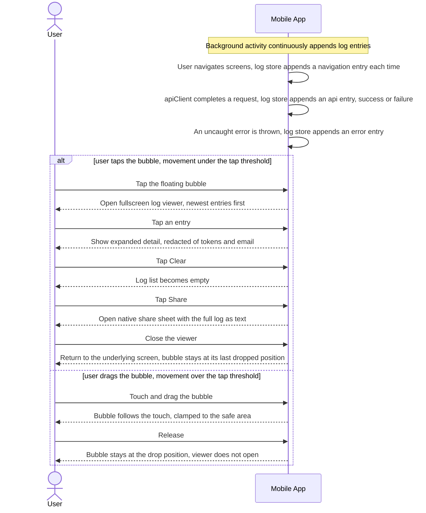

# Implementation Plan: Mobile Debug Console

- **Feature:** Mobile Debug Console — floating bubble + fullscreen log viewer
- **SRS Feature Code:** N/A — explicit user request, not an SRS-numbered feature (see spec.md Source line)
- **Jira Epic:** N/A — this repository has no Jira integration wired up
- **Spec:** [spec.md](./spec.md)
- **Related plans:** [mobile-session-refresh](../mobile-session-refresh/plan.md) (its refresh attempts/failures are the primary content this console surfaces)
- **Client scope:** `mobile/` only. No backend, no web.

## Pre-flight: Spec Review Findings

| # | Type | Finding | Resolution / Open Task |
|---|------|---------|-------------------------|
| 1 | Gap | Spec's Domain Concept doesn't specify the log store's implementation mechanism. | A Zustand store (`debug-log-store.ts`), same pairing convention as `session-store.ts`/`chat-store.ts` — global, non-persisted, matches "Client/global state → Zustand" (CLAUDE.md). |
| 2 | Gap | Spec doesn't specify how `apiClient`'s existing `console.error`-only logging (in `axios.ts`) is extended to also log successes (S-DBG-05) without duplicating interceptor logic. | The existing response interceptor's success/error branches both gain one `useDebugLogStore.getState().append(...)` call each; the pre-existing `__DEV__`-gated `console.error` block is left untouched (still dev-console output), the new log-store call is unconditional (Context decision #3). |
| 3 | Gap | Spec doesn't specify how navigation-change detection hooks into Expo Router without adding a new dependency. | A small `NavigationLogger` component (no visual output) mounted once in `app/_layout.tsx`, using `usePathname()` (built into `expo-router`, already a dependency) inside a `useEffect` that appends a `navigation` entry whenever the pathname changes. |
| 4 | Gap | Spec doesn't specify how uncaught JS errors are captured without a new crash-reporting dependency. | React Native's built-in `ErrorUtils.setGlobalHandler` (available globally in the RN runtime, no import needed) wraps the existing default handler — appends an `error` log entry, then always calls the original handler through (never suppresses the real crash behavior). |

### Regression Scope

This plan only adds new files, plus small additive edits to two shared files:
- `mobile/app/_layout.tsx` — mounts two new always-invisible components (`NavigationLogger`, `DebugBubble`) and calls one new setup function; the existing session-hydration/`Stack.Protected` logic is untouched.
- `mobile/src/lib/axios.ts` — adds one `append()` call to each of the response interceptor's two branches; request-attach logic and the existing `__DEV__` console logging and `401`-triggers-`clear()` behavior are untouched.

No existing screen, query hook, or mutation is modified. No regression risk to any feature screen is expected — this plan only adds an overlay and read-only log taps into already-existing request/response/navigation events.

## Architecture

### Package/File Layout

```text
mobile/
├── app/
│   └── _layout.tsx                       # mount NavigationLogger + DebugBubble (existing file)
└── src/
    ├── stores/
    │   └── debug-log-store.ts            # NEW — Zustand ring-buffer log store
    ├── lib/
    │   ├── axios.ts                      # add append() calls in both interceptor branches (existing file)
    │   └── global-error-logger.ts        # NEW — installs ErrorUtils wrapper once
    └── components/
        └── debug/
            ├── DebugBubble.tsx           # NEW — draggable circle, PanResponder + Animated.ValueXY
            ├── NavigationLogger.tsx      # NEW — invisible, usePathname() effect
            └── DebugLogViewer.tsx        # NEW — fullscreen modal, log list + detail + clear/share
```

### Domain Objects

| Entity | Store | Key Fields | Notes |
|--------|-------|------------|-------|
| `LogEntry` | `debug-log-store.ts` (Zustand, in-memory only) | `id` (number), `timestamp` (Date), `category` (`"navigation"\|"api"\|"error"`), `summary` (string), `detail` (unknown, optional) | Not persisted (spec decision #1); capped at 500, FIFO eviction (spec Business invariant) |

### Business Rules

| Rule | Source | Enforcement |
|------|--------|-------------|
| Ring buffer caps at 500 entries, FIFO | Business invariant | `debug-log-store.ts`'s `append()` — `state.entries.length >= 500` slices the oldest before pushing |
| Append must be a single synchronous operation, no lost updates under concurrent callers | Edge Case #3 | Zustand `set((state) => ({ entries: [...] }))` functional updater, never a read-then-write across an `await` |
| Log-store failures must never throw/crash the app | Edge Case #4 | `append()` wrapped in `try { } catch { /* swallow */ }` |
| Authorization header / token fields redacted before storage | Edge Case #5 | A `redact(value)` helper in `axios.ts`'s interceptor strips `Authorization` and any `access_token`/`refresh_token`/`email` field from the logged request/response body before calling `append()` — Open Question #2 resolved to include email in redaction scope |
| Tap vs. drag disambiguation (10px threshold) | Edge Case #6 | `DebugBubble.tsx`'s `PanResponder` tracks total displacement; `onPanResponderRelease` opens the viewer only if displacement < 10px on both axes |
| Bubble clamped to safe-area bounds after drag | Edge Case #2 | `DebugBubble.tsx` clamps `Animated.ValueXY` against `useSafeAreaInsets()` + `Dimensions.get("window")` on release |

### Sequence Diagrams

> Two-tier lifeline (User → Mobile App) — this feature has no backend/DB tier of its own; it only taps into events already produced by other in-app activity.

**US-01: Open and Use the Debug Console**



Not applicable — this feature makes no network call and has no server-side component, so the Error Flows table below is intentionally empty of rows.

## Error Flows

Not applicable — this feature makes no API calls of its own and has no server-side component. Failures within the feature itself (Edge Case #4) are swallowed, never surfaced as a user-facing error state.

## Constitution / Convention Notes

| Rule | Status | Note |
|------|--------|------|
| Mobile: client/global state → Zustand | Required | `debug-log-store.ts` follows `session-store.ts`/`chat-store.ts` convention |
| Mobile: server state via TanStack Query only | N/A | This feature has no server state — logs are ephemeral client-only data, not an API resource |
| No sensitive data logged | Required | Redaction rule above (Business Rules table) — token/email fields stripped before `append()` |
| File > 300 lines → split | Required | `DebugLogViewer.tsx` splits list item rendering into a separate `LogEntryRow.tsx` if it approaches the limit |
| No new native dependency | Required | `PanResponder`/`Animated` (RN core), `ErrorUtils` (RN core global), `Share` (RN core) — zero new `package.json` entries |

## Element/Key IDs (QA automation)

**Mobile (`testID`):**

| Element | testID | Status | File |
|---------|--------|--------|------|
| Floating draggable bubble | `testID="debug-bubble"` | **Missing** | `components/debug/DebugBubble.tsx` |
| Fullscreen log viewer root | `testID="debug-log-viewer"` | **Missing** | `components/debug/DebugLogViewer.tsx` |
| Current-screen indicator | `testID="debug-log-current-screen"` | **Missing** | `components/debug/DebugLogViewer.tsx` |
| Individual log entry row | `testID="debug-log-entry-{id}"` | **Missing** | `components/debug/DebugLogViewer.tsx` |
| Clear button | `testID="debug-log-clear-btn"` | **Missing** | `components/debug/DebugLogViewer.tsx` |
| Share button | `testID="debug-log-share-btn"` | **Missing** | `components/debug/DebugLogViewer.tsx` |
| Close button | `testID="debug-log-close-btn"` | **Missing** | `components/debug/DebugLogViewer.tsx` |

## Open Tasks

| ID | Task | File |
|----|------|------|
| DBG-T01 | `debug-log-store.ts`: Zustand store, `entries: LogEntry[]`, `append(category, summary, detail?)`, `clear()`, 500-cap FIFO, wrapped in try/catch | `mobile/src/stores/debug-log-store.ts` |
| DBG-T02 | `NavigationLogger.tsx`: invisible component, `usePathname()` + `useEffect` → `append("navigation", ...)` on change | `mobile/src/components/debug/NavigationLogger.tsx` |
| DBG-T03 | `global-error-logger.ts`: wraps `ErrorUtils.setGlobalHandler`, appends `error` entry, always forwards to the original handler; called once from `app/_layout.tsx` | `mobile/src/lib/global-error-logger.ts` |
| DBG-T04 | `axios.ts`: add `redact()` helper; call `append("api", ...)` in both the success and error branches of the response interceptor, using redacted request/response summaries | `mobile/src/lib/axios.ts` |
| DBG-T05 | `DebugBubble.tsx`: `PanResponder` + `Animated.ValueXY`, default bottom-right position, safe-area clamping, tap-vs-drag threshold, opens `DebugLogViewer` on tap | `mobile/src/components/debug/DebugBubble.tsx` |
| DBG-T06 | `DebugLogViewer.tsx`: fullscreen `Modal`, current-route header (via `usePathname()`), reverse-chronological `FlatList` of entries with expand-on-tap detail, Clear button, Share button (`Share.share({ message: serializedLog })`) | `mobile/src/components/debug/DebugLogViewer.tsx` |
| DBG-T07 | `app/_layout.tsx`: mount `NavigationLogger` and `DebugBubble` above the `Stack`, call `installGlobalErrorLogger()` once in the existing root `useEffect` | `mobile/app/_layout.tsx` |
| DBG-T08 | Manual on-device verification per spec.md Definition of Done | — |
