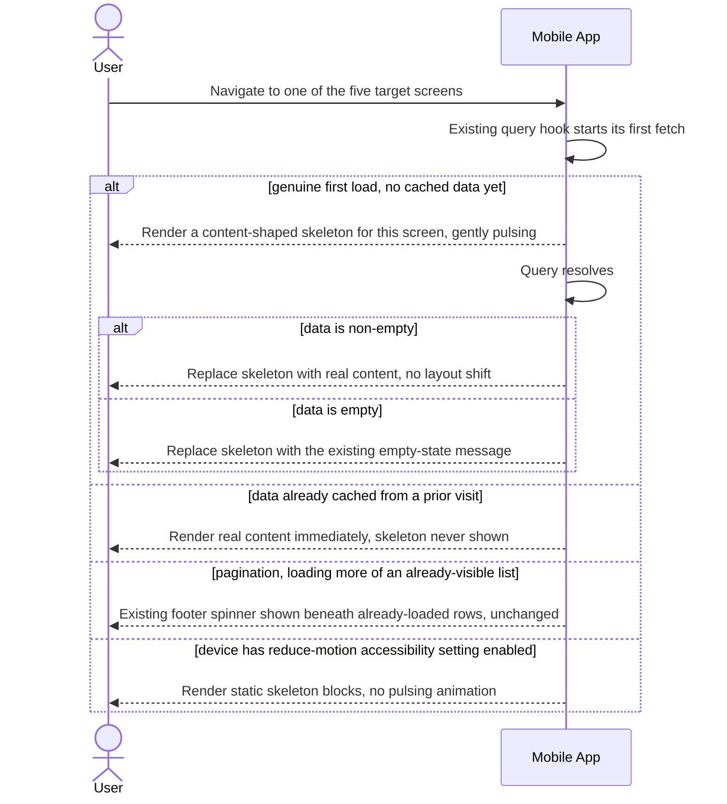

# Implementation Plan: Mobile Loading Skeletons

- **Feature:** Mobile Loading Skeletons — replace spinners with content-shaped placeholders on 5 screens
- **SRS Feature Code:** N/A — explicit user request, UI-only polish across F-03/F-05/F-06/F-07/F-01 screens (see spec.md Source line)
- **Jira Epic:** N/A — this repository has no Jira integration wired up
- **Spec:** [spec.md](./spec.md)
- **Related plans:** none — purely additive UI change, independent of the other two mobile plans in this batch
- **Client scope:** `mobile/` only. No backend, no web (web already has its own skeleton components).

## Pre-flight: Spec Review Findings

| # | Type | Finding | Resolution / Open Task |
|---|------|---------|-------------------------|
| 1 | Ambiguity | Spec's Open Question #1 flagged uncertainty over whether `SpendingTab`/`BudgetsTab` expose their own loading flags. | **Resolved by reading both files**: `SpendingTab.tsx:26` already branches on `summary.isLoading` (bare `ActivityIndicator`); `BudgetsTab.tsx:28` already branches on `budgets.isLoading` (bare `ActivityIndicator`). Both already have exactly the same "spinner on loading" pattern as the other 4 screens — no missing loading-state gap to fill, just a spinner→skeleton swap identical in shape to the other screens. |
| 2 | Gap | Spec's Per-Screen table gives approximate skeleton compositions but not exact pixel dimensions. | T2–T7 below each cite the exact real-component `StyleSheet` values to mirror, pulled from the existing files during this planning pass (see per-task notes). |
| 3 | Gap | Spec doesn't specify where the shared `SkeletonBlock` primitive's pulse animation is driven from (one shared `Animated.Value` vs. one per block). | One `Animated.Value` **per mounted `SkeletonBlock` instance** (not shared/hoisted) — simplest, avoids one component's unmount from disrupting another's animation loop, matches Edge Case #5's per-instance cleanup requirement. |

### Regression Scope

This plan only adds new small presentational components, plus additive edits to 5 existing screen/component files (swapping one `ActivityIndicator` branch each for a skeleton composition):
- `mobile/app/(app)/index.tsx`, `transactions.tsx`, `categories.tsx`, `users.tsx` — only the `isLoading`-branch JSX changes; query hooks, empty-state branches, and pagination footers are untouched.
- `mobile/src/features/reports/components/SpendingTab.tsx`, `mobile/src/features/budgets/components/BudgetsTab.tsx` — same, only the `isLoading`-branch JSX changes.

No query, mutation, type, route, or backend file is touched. No regression risk to data-fetching or empty-state behavior is expected.

## Architecture

### Package/File Layout

```text
mobile/
├── app/(app)/
│   ├── index.tsx              # swap ActivityIndicator branches for skeleton composition
│   ├── transactions.tsx       # swap ListEmptyComponent's isLoading branch
│   ├── insights.tsx           # no change here — sub-components own their loading branch
│   ├── categories.tsx         # swap whole-screen isLoading branch
│   └── users.tsx              # swap whole-screen isLoading branch
└── src/
    ├── components/ui/
    │   └── SkeletonBlock.tsx              # NEW — pulsing rounded-rect primitive
    └── features/
        ├── wallets/components/
        │   └── WalletCardSkeleton.tsx     # NEW
        ├── transactions/components/
        │   └── TransactionRowSkeleton.tsx # NEW — reused by Home + Transactions
        ├── reports/components/
        │   └── SpendingTabSkeleton.tsx    # NEW — used inside SpendingTab.tsx
        ├── budgets/components/
        │   └── BudgetCardSkeleton.tsx     # NEW — used inside BudgetsTab.tsx
        ├── categories/components/
        │   └── CategoryListItemSkeleton.tsx # NEW
        └── users/components/
            └── UserListItemSkeleton.tsx   # NEW
```

### Domain Objects

Not applicable — no data entity, no store. `SkeletonBlock` is a stateless presentational primitive (props: `width`, `height`, `borderRadius`).

### Business Rules

| Rule | Source | Enforcement |
|------|--------|-------------|
| Skeleton renders only on genuine first load (`isLoading`), never on background refetch (`isFetching`) or cache-hit revisit | AC S-SKL-10 | Every screen keeps its existing `query.isLoading` check unchanged — only the *rendered branch content* changes from `<ActivityIndicator>` to a skeleton composition |
| Skeleton dimensions match real component dimensions exactly | Edge Case #2 | Each `*Skeleton.tsx` component's `StyleSheet` values are copied from its real counterpart (see Open Tasks table for the exact source values) |
| Fixed row counts, not dynamic | Edge Case #3 | Each list skeleton hard-codes its row count (6 for Transactions/Categories, 4 for Users) via `Array.from({length: N})`, never derived from any query result |
| Reduce-motion respected | Edge Case #4 | `SkeletonBlock.tsx` reads `AccessibilityInfo.isReduceMotionEnabled()` on mount; skips starting the `Animated.loop` if `true`, renders a static `opacity: 0.6` block instead |
| Animation cleaned up on unmount | Edge Case #5 | `SkeletonBlock.tsx`'s `useEffect` cleanup calls `pulseAnim.stopAnimation()` |
| Pagination footer spinner unchanged | Context decision #4 | `transactions.tsx`'s `ListFooterComponent` block is not touched |

### Sequence Diagram

> Two-tier lifeline (User → Mobile App) — this is a pure rendering-branch change with no new request/response flow; it reuses each screen's existing query lifecycle unchanged.

**US-01: See a Skeleton Loading State Instead of a Spinner**



## Error Flows

Not applicable — no new error state; existing error/empty-state branches on each screen are untouched (spec Context decision #3).

## Constitution / Convention Notes

| Rule | Status | Note |
|------|--------|------|
| Web: skeleton loading | Required (existing, web) | This plan ports the same principle to mobile — was previously mobile-only gap |
| No new native dependency | Required | `Animated`, `AccessibilityInfo` (RN core) — zero new `package.json` entries |
| File > 300 lines → split | Required | Each `*Skeleton.tsx` is a small, single-purpose component well under the limit |
| Mobile: server state via TanStack Query only | Required (unchanged) | No query/mutation logic touched by this plan — loading-state UI only |

## Element/Key IDs (QA automation)

**Mobile (`testID`):**

| Element | testID | Status | File |
|---------|--------|--------|------|
| Home wallet-section skeleton | `testID="skeleton-home-wallets"` | **Missing** | `app/(app)/index.tsx` |
| Home recent-transactions skeleton | `testID="skeleton-home-transactions"` | **Missing** | `app/(app)/index.tsx` |
| Transactions list skeleton | `testID="skeleton-transactions-list"` | **Missing** | `app/(app)/transactions.tsx` |
| Spending tab skeleton | `testID="skeleton-spending-tab"` | **Missing** | `SpendingTab.tsx` |
| Budgets tab skeleton | `testID="skeleton-budgets-tab"` | **Missing** | `BudgetsTab.tsx` |
| Categories list skeleton | `testID="skeleton-categories-list"` | **Missing** | `app/(app)/categories.tsx` |
| Users list skeleton | `testID="skeleton-users-list"` | **Missing** | `app/(app)/users.tsx` |

## Open Tasks

| ID | Task | File |
|----|------|------|
| SKL-T01 | `SkeletonBlock.tsx`: `width`/`height`/`borderRadius`/`style` props, `Animated.Value` opacity loop (0.4↔1.0, 800ms each way), `AccessibilityInfo.isReduceMotionEnabled()` check, cleanup on unmount | `mobile/src/components/ui/SkeletonBlock.tsx` |
| SKL-T02 | `WalletCardSkeleton.tsx` — dimensions mirror `WalletCard`'s own `StyleSheet` (card width/height/border-radius) | `mobile/src/features/wallets/components/WalletCardSkeleton.tsx` |
| SKL-T03 | `TransactionRowSkeleton.tsx` — icon-circle block + two text-line blocks + amount block, dimensions mirror `TransactionRow`'s `StyleSheet` | `mobile/src/features/transactions/components/TransactionRowSkeleton.tsx` |
| SKL-T04 | `app/(app)/index.tsx`: replace `wallets.isLoading ? <ActivityIndicator/>` (line 68-69) with 2–3 `WalletCardSkeleton` in the existing horizontal `ScrollView`; replace `recent.isLoading` `ListEmptyComponent` branch (line 97-98) with 4 `TransactionRowSkeleton` | `mobile/app/(app)/index.tsx` |
| SKL-T05 | `app/(app)/transactions.tsx`: replace `transactions.isLoading` `ListEmptyComponent` branch (line 103-104) with 6 `TransactionRowSkeleton` (reused from SKL-T03) | `mobile/app/(app)/transactions.tsx` |
| SKL-T06 | `SpendingTabSkeleton.tsx`: 2 stat-card blocks (mirrors `styles.statCard`) + 1 circular block (mirrors `DonutChart`'s footprint) + 3 legend-row blocks; wire into `SpendingTab.tsx`'s existing `summary.isLoading` branch (line 26-28), replacing the bare `ActivityIndicator` | `mobile/src/features/reports/components/SpendingTabSkeleton.tsx`, `mobile/src/features/reports/components/SpendingTab.tsx` |
| SKL-T07 | `BudgetCardSkeleton.tsx` — dimensions mirror `BudgetCard`'s `StyleSheet`; render 3 in a `View` with `styles.list` gap; wire into `BudgetsTab.tsx`'s existing `budgets.isLoading` branch (line 28-30), replacing the bare `ActivityIndicator` | `mobile/src/features/budgets/components/BudgetCardSkeleton.tsx`, `mobile/src/features/budgets/components/BudgetsTab.tsx` |
| SKL-T08 | `CategoryListItemSkeleton.tsx` — icon-circle + text-line blocks mirroring `CategoryListItem`; wire into `categories.tsx`'s whole-screen `categories.isLoading` branch (line 46-48), replacing the bare `ActivityIndicator`, render 6 in the existing `list` container | `mobile/src/features/categories/components/CategoryListItemSkeleton.tsx`, `mobile/app/(app)/categories.tsx` |
| SKL-T09 | `UserListItemSkeleton.tsx` — avatar-circle + text-line blocks mirroring `UserListItem`; wire into `users.tsx`'s whole-screen `users.isLoading` branch (line 32-34), replacing the bare `ActivityIndicator`, render 4 in the existing `list` container | `mobile/src/features/users/components/UserListItemSkeleton.tsx`, `mobile/app/(app)/users.tsx` |
| SKL-T10 | Manual on-device verification per spec.md Definition of Done | — |
