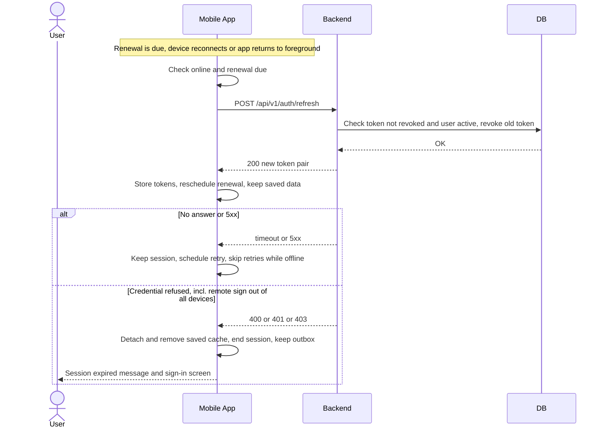
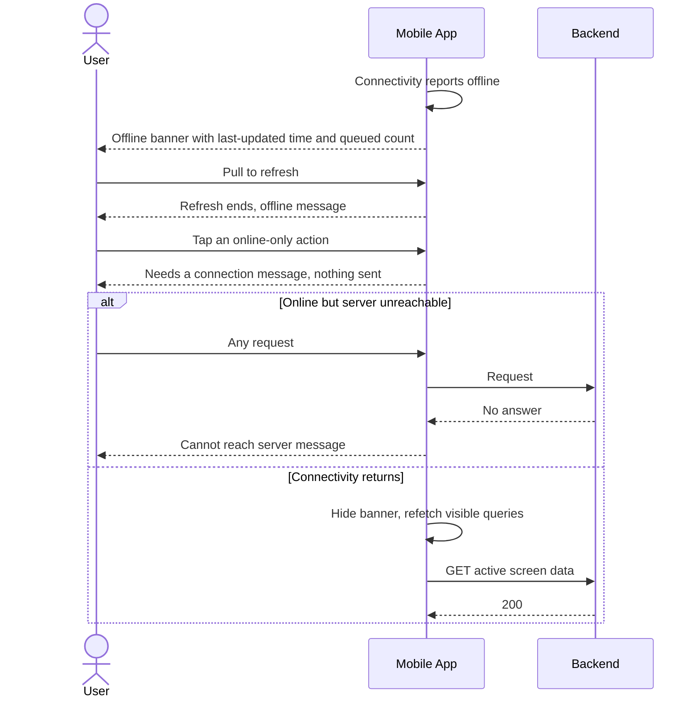
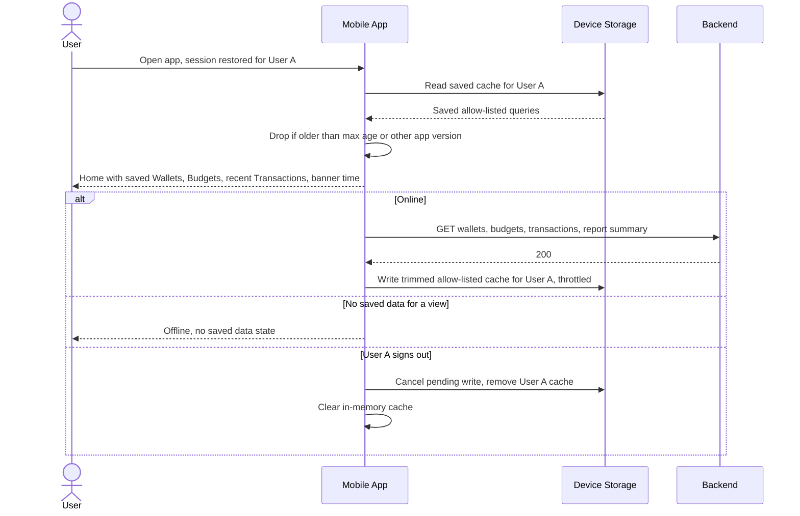
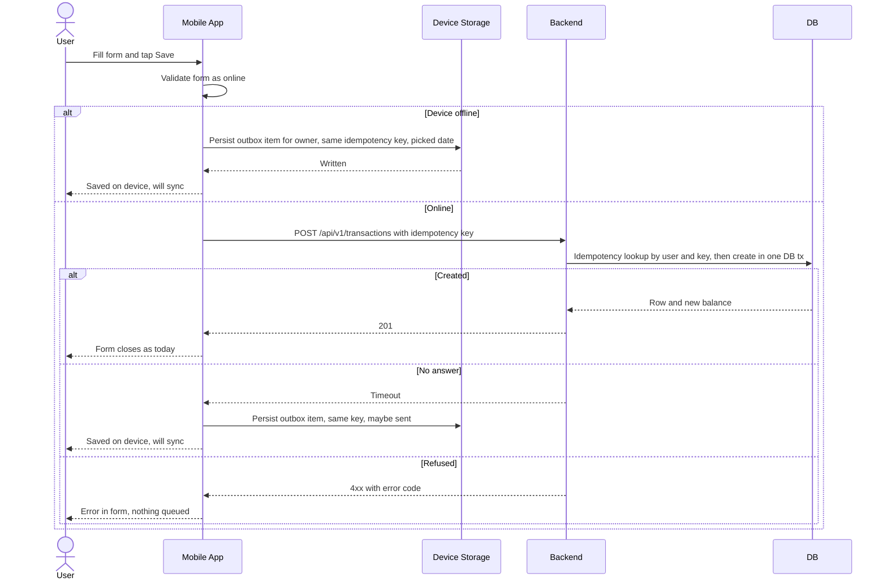
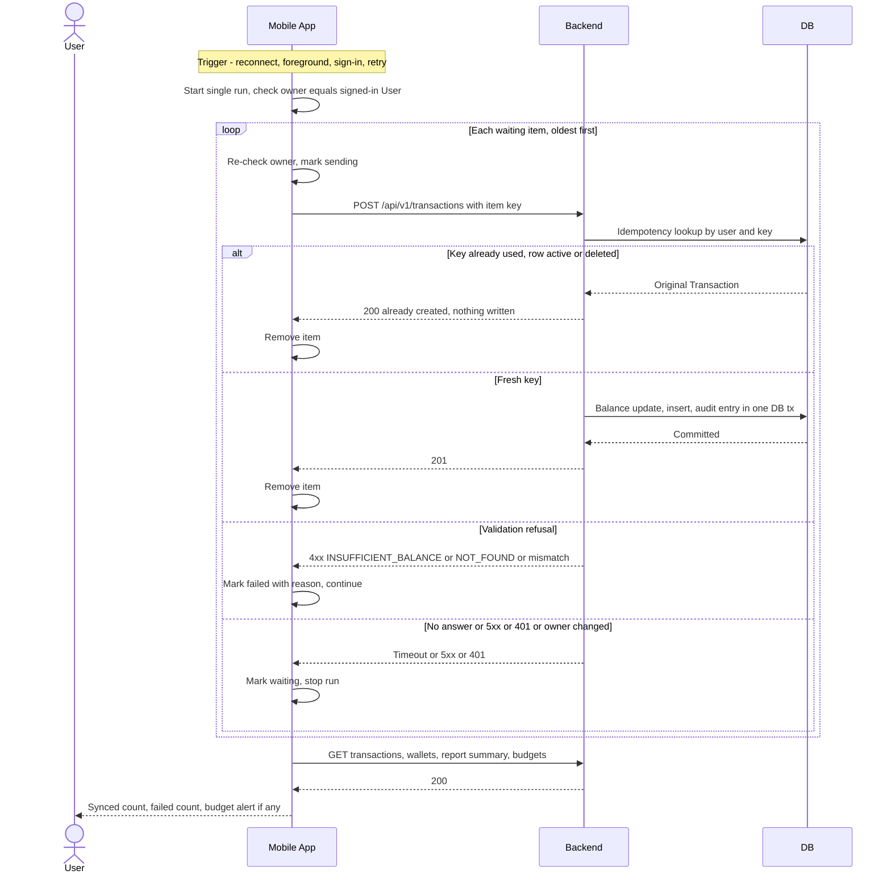
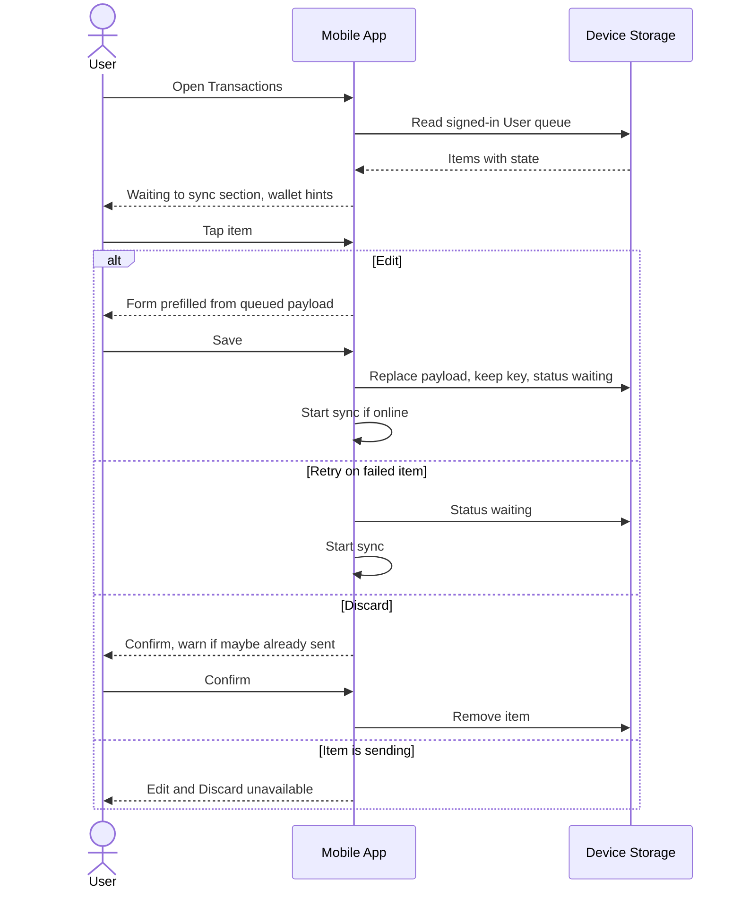
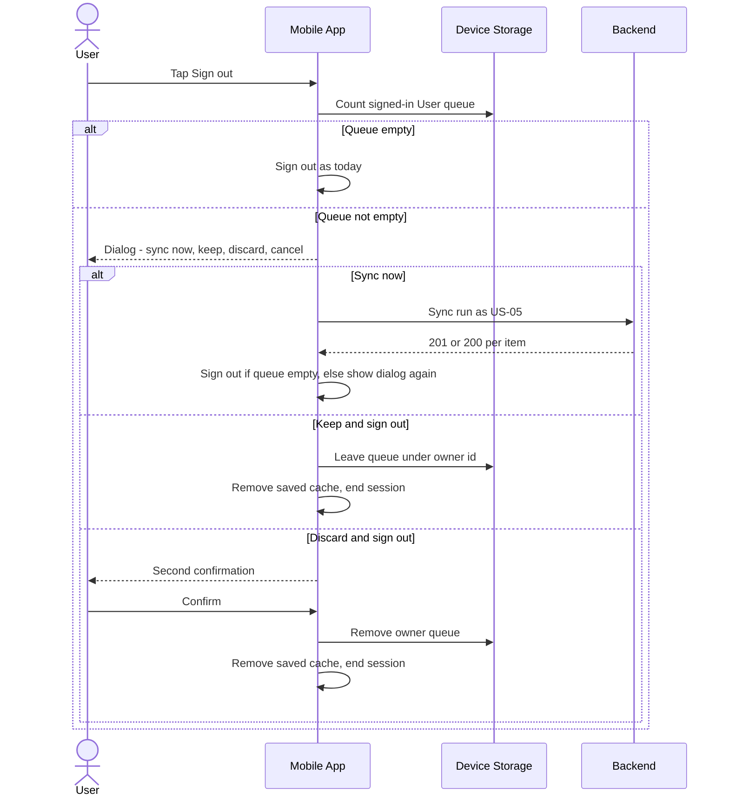
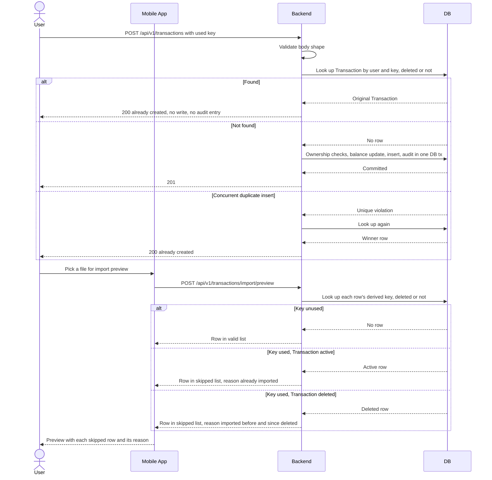

# Implementation Plan: Mobile Offline Support

**Spec:** [spec.md](./spec.md)
**Research:** [research-offline.md](../mobile-ux-batch-2026-10/research-offline.md) (Option C, phases 0 remainder + 1 + 2 + backend fix)
**SRS features touched:** F-02 System Security (session renewal triggers) · F-06 Transaction Management (create path, list) · F-03 Wallet (balance display hint) · NFR-06 Reliability
**Scope:** `mobile/` + **one backend query fix** with its import-preview follow-up (Go service tests + hand-edited sqlc output). **No migration, no new endpoint, no DTO shape change, no AI service, no `frontend/`.**
**Revision:** 2026-10-04 — product-owner final decisions folded in (confirmed limits, orphan-queue policy, idempotency without `deleted_at` filter + distinct import-preview reason, form-date bug already fixed, remote revocation from `mobile-account-switch`). Guidance: cheapest option with the biggest impact.
**Ticket:** N/A — this project tracks work in `specs/` + `CURRENT_STATE.md`, not Jira.
**Code prefix:** `OFF`
**Coordinates with:** `mobile-account-switch` (parallel spec). Every device-side store here is keyed by User id from day one; see BR-OFF-P05/P06.

---

## Pre-flight: Impact Analysis

GitNexus (repo `pfm`) was queried. Name resolution is ambiguous for symbols that exist in both `frontend/` and `mobile/` (it picked the web copy of `useCreateTransactionMutation`, and the test fake for `GetTransactionByIdempotencyKey`), so the table combines GitNexus where it resolved correctly with the TypeScript/Go import graph (grep) where it did not.

| Symbol | Direct consumers | Risk | Notes |
|---|---|---|---|
| `getErrorMessage` (`mobile/src/lib/api-envelope.ts`, re-exported by `axios.ts`) | 16 mobile files (GitNexus: 20 callers incl. web copy, 9 flows: TransactionFormModal, LoginForm, PendingReviewScreen, BudgetFormModal …) | **CRITICAL** (fan-out) | ⚠️ Only the **no-response** branch changes (returns the network message instead of the per-screen fallback). Every caller benefits; none may receive a different message for a server-answered error. |
| `queryClient` defaults (`src/lib/query-client.ts`) | every query/mutation in the app | **HIGH** | Only `mutations.networkMode` and per-key `gcTime` via `setQueryDefaults` change. Query `retry`/`staleTime` untouched. |
| `useSessionStore.setTokens` / `clear` / `refreshSession` | `axios.ts`, `LoginForm`, `settings.tsx`, `session-scoped-reset.ts`, `app/_layout.tsx` | **HIGH** | Built on the uncommitted B1/B2 fix. Adds a persistence-detach call before `queryClient.clear()` and an offline guard in the retry callback — no signature change. |
| `apiClient` interceptors (`src/lib/axios.ts`) | every request | **HIGH** | Adds an owner guard that only acts when a request carries `ownerUserId`; all existing requests unaffected. |
| `useCreateTransactionMutation` | `use-transaction-form.ts`, `use-confirm-proposal.ts` | MEDIUM | Request body + `onSuccess` side effects extracted into reusable functions; hook behaviour unchanged. |
| `checkBudgetLimit` | create + update mutations | LOW | Reused by the flusher, unchanged. |
| `useRefresh` (`src/lib/use-refresh.tsx`) | every pull-to-refresh screen | MEDIUM | Gains an offline short-circuit. |
| `GetTransactionByIdempotencyKey` (Go) | `TransactionService.CreateTransaction` (2 call sites), `TransactionImportService.isAlreadyImported` | MEDIUM | ⚠️ Import preview behaviour changes for previously imported-then-deleted rows (Regression Scope). The returned `model.Transaction` already carries `DeletedAt` (row scan + repository mapping exist) — no struct change. |
| `TransactionImportService.isAlreadyImported` (Go) | `PreviewImport` only | LOW | Returns `(found, deleted bool, err)` instead of `(bool, err)`; single private caller. |
| `ImportPreviewModal` (mobile) | — | LOW | **Not edited.** Already renders `duplicates[].reason` verbatim next to the row number, so the distinct reason appears with zero mobile code. |

### File-size watch (CLAUDE.md: > 300 lines → split)

| File | Lines now | Plan |
|---|---|---|
| `app/(app)/(tabs)/transactions.tsx` | 293 | ⚠️ Must not grow: the pending section is a self-contained component inserted as `ListHeaderComponent` content (≤ 3 lines here). |
| `app/(app)/(tabs)/index.tsx` | 252 | Untouched except via child components. |
| `app/(app)/(tabs)/settings.tsx` | 248 | Logout dialog extracted into its own component (≤ 15 lines added here). |
| `src/features/transactions/components/use-transaction-form.ts` | 218 | Save-or-queue logic goes into a new `use-save-or-queue.ts`. |
| `src/stores/session-store.ts` | ~180 | Small additions only. |

---

## Pre-flight: Spec Review Findings

| # | Finding | Type | Resolution |
|---|---|---|---|
| 1 | B1/B2 are already fixed in the working tree (`session-store.ts`: `isRefreshRejected`, retry after `REFRESH_RETRY_DELAY_SECONDS`; user-change-only `queryClient.clear()`). | Confirmation | Planned on top; not re-implemented. US-01 tasks are only the reconnect/foreground triggers and the offline guard on the retry timer. |
| 2 | Research §4 Phase 2 says "`occurred_at` is always set on enqueue — otherwise the server stamps sync time". The manual form **already always sends** `occurred_at` (`use-transaction-form.ts:170`, a `YYYY-MM-DD` date). | Contradiction (minor) | Invariant kept and asserted in the queued payload; no new code needed for the form. The value is a **date**, not a timestamp — the server parses it to midnight UTC (`parseFlexibleTimestamp`). |
| 3 | The form's default date used to be the UTC date (yesterday before 07:00 GMT+7). | ✅ Resolved | **Already fixed in the working tree (2026-10-04):** `todayDateOnly()` in `src/lib/date-range.ts`, used by `use-transaction-form.ts`, `TransactionKeypadFooter.tsx` and `MonthYearCalendar.tsx`. Queued payloads inherit the correct local date; no task here. |
| 4 | TanStack v5 default `networkMode: "online"` **pauses** mutations offline: `mutate()` would sit `isPending` forever and silently resume on reconnect — including deletes and wallet edits the spec makes online-only. | Gap vs. code | `mutations.networkMode = "always"`: offline mutations fail fast with a network error (AC-OFF-08). Queries keep `"online"` (pause, show saved data). |
| 5 | With `networkMode: "online"`, a query with **no** cached data offline is `status: "pending"` + `fetchStatus: "paused"` → every screen shows its skeleton forever. | Gap vs. code | `isWaitingForNetwork(query)` helper + `OfflinePlaceholder`, applied on the 6 main screens (OFF-T15) (EC-OFF-06). |
| 6 | `PersistQueryClientProvider` restores only **once per mount** and its subscription would persist a just-cleared cache into the previous User's storage key; a throttled pending write can also re-create a key right after logout removed it. | Design risk ⚠️ | Use the lower-level `persistQueryClientRestore` / `persistQueryClientSubscribe` + `IsRestoringProvider` in our own `UserScopedQueryPersistence`, and a **custom** persister whose throttled write is cancelled by `close()`. `@tanstack/query-async-storage-persister` is therefore **not** added (deviation from research, same Expo Go profile). |
| 7 | The axios request interceptor always attaches the **current** session's token, and the 401 path retries with the **current** session's refreshed token. If the session changes between enqueue and send (account switch, sign-out + sign-in), a queued item of User A would be booked into User B's account. | Gap ⚠️ (not in research) | Owner guard: flusher sends with `ownerUserId`; request interceptor cancels if the current token's `user_id` differs; 401-retry path re-checks the refreshed token's `user_id` (BR-OFF-P06). |
| 8 | Infinite queries dehydrate **all** loaded pages; Android AsyncStorage rows above ~2 MB fail to read back. | Gap | Custom persister trims every `["transactions", …]` query to page 0 and keeps at most `MAX_PERSISTED_TRANSACTION_QUERIES` of them (most recent `dataUpdatedAt`). |
| 9 | Home's "Chờ xác nhận" (pending **AI proposals**) and `app/(app)/pending.tsx` already use the word "pending". | Naming clash | All new code/copy uses **outbox / "chờ đồng bộ"**, never "pending"; testIDs prefixed `pending-sync-`. |
| 10 | Only one global toast exists (`toast-store`, no queue): the sync summary and a budget-limit alert would overwrite each other. | Ambiguity | Show the summary first, then run budget checks (an alert, being more actionable, wins the slot). Documented, accepted. |
| 11 | Replay responses carry no `deleted_at` and no `wallet_balance`. | Confirmation | Client never needs them: success = remove + invalidate (EC-OFF-18). |
| 12 | Spec requires a banner "on every signed-in screen". Screens own their safe-area/TopBar layout individually; a top banner would need every screen changed. | Design decision | ~~Bottom-docked slim pill rendered once in `app/(app)/_layout.tsx`~~ — **superseded 2026-10-07:** floating, it fought the Fab and BottomNav for the same corner and covered the end of every list. Now a 28px in-layout strip under the status bar, rendered by `Screen.tsx` (every `(app)` route already uses it, so still one place); the saved-data time moved into a tap-to-open sheet. Debounce: shows after 2s offline, leaves after 1s stable online + 2s "reconnected". |
| 13 | SRS §6 has no story for this feature. | Traceability gap — in progress | Being added in parallel by the product owner's side (spec Open Question #1). `SRS.md` is not edited by this plan. |
| 14 | Import keys are content-derived UUIDv5 (`transaction_import_validation.go` `deriveIdempotencyKey`). **Today** an imported-then-deleted row passes preview as new (lookup filters deleted), then fails at commit: lookup filtered → insert → unique violation → re-lookup filtered → error into `Failures`. It was never restorable. | Confirmed bug | After OFF-T26 the preview lookup finds the deleted row. Cheapest surface: `isAlreadyImported` also reports `DeletedAt != nil` from the row it already fetched; `PreviewImport` chooses the reason string. **No DTO change:** `ImportRowIssue.Reason` is shown verbatim by mobile, and `frontend/` has no import-preview consumer (no `duplicates` usage in `frontend/src`). A machine-readable flag (optional `previously_deleted` boolean, additive and backward compatible) was considered and **not** planned — no client needs it. |
| 15 | `mobile-account-switch` adds remote revocation ("sign out of all devices") via `users.tokens_valid_after`, checked in `/auth/refresh`, in **migration 025**. | Coordination | Mobile sees a `401` on refresh → existing `isRefreshRejected` → `session-store.clear()`, which never touches the outbox (BR-OFF-P19). No code here; covered by the T30 matrix. A `401` during a sync run stops the run with the item still `waiting` (Error Flows). |
| 16 | Orphan queue: a User who never signs in again. | Product decision (final) | Never auto-deleted — no TTL, no cleanup job. Removed only by that owner's explicit Discard (`discard` / `discardAllFor`, owner-gated) or by sync. Storage bound is `OUTBOX_MAX_ITEMS_PER_USER` × Users who ever signed in on the device — accepted. |

---

## Architecture

### New dependencies (Expo Go SDK 54 safe)

| Package | Why | Install |
|---|---|---|
| `@react-native-community/netinfo` | connectivity source for `onlineManager` | `npx expo install @react-native-community/netinfo` (bundled in Expo Go) |
| `@tanstack/react-query-persist-client` | `persistQueryClientRestore` / `persistQueryClientSubscribe` (pure JS) | `npm i @tanstack/react-query-persist-client@<exact installed @tanstack/react-query version>` — ⚠️ versions must match |

No MMKV, no SQLite, no dev build.

### File layout

```text
mobile/
├── app/
│   ├── _layout.tsx                                  # MODIFIED — installConnectivity(), installSessionResume(), installOutboxSync(); wraps Stack in UserScopedQueryPersistence
│   └── (app)/
│       ├── _layout.tsx                              # MODIFIED — renders OfflineBanner
│       └── (tabs)/
│           ├── transactions.tsx                     # MODIFIED — mounts PendingSyncSection (≤3 lines)
│           └── settings.tsx                         # MODIFIED — logout goes through LogoutGuardDialog
└── src/
    ├── lib/
    │   ├── connectivity.ts                          # NEW — NetInfo→onlineManager, AppState→focusManager, useIsOnline(), useRequireOnline()
    │   ├── api-envelope.ts                          # MODIFIED — isNetworkError(); getErrorMessage network branch
    │   ├── axios.ts                                 # MODIFIED — ownerUserId guard (request + 401 retry)
    │   ├── query-client.ts                          # MODIFIED — mutations.networkMode "always"; per-key gcTime
    │   ├── query-status.ts                          # NEW — isWaitingForNetwork(query)
    │   ├── refresh-scheduler.ts                     # MODIFIED — tracks dueAt, exports isRefreshDue()
    │   ├── use-refresh.tsx                          # MODIFIED — offline short-circuit
    │   ├── constants.ts                             # MODIFIED — new named constants (below)
    │   └── query-persistence/
    │       ├── persist-policy.ts                    # NEW — allow-list, buster, max age
    │       ├── user-cache-persister.ts              # NEW — per-User AsyncStorage persister, throttle, close(), trim
    │       └── UserScopedQueryPersistence.tsx       # NEW — restore/subscribe per User id, IsRestoringProvider, detachQueryPersistence()
    ├── stores/
    │   ├── session-store.ts                         # MODIFIED — detach persistence before clear; offline-aware retry
    │   ├── session-resume.ts                        # NEW — renew on reconnect / foreground when due
    │   └── outbox-store.ts                          # NEW — Zustand persist "pfm_outbox", byUser
    ├── components/shared/
    │   ├── OfflineBanner.tsx                        # NEW
    │   └── OfflinePlaceholder.tsx                   # NEW
    └── features/
        ├── transactions/
        │   ├── api/
        │   │   ├── create-transaction-request.ts    # NEW — plain async request + afterTransactionCreated()
        │   │   └── use-create-transaction-mutation.ts # MODIFIED — delegates to the above
        │   ├── outbox/
        │   │   ├── outbox-types.ts                  # NEW — OutboxItem, OutboxStatus
        │   │   ├── classify-send-error.ts           # NEW — accepted / transient / rejected / aborted
        │   │   ├── flush-outbox.ts                  # NEW — single-flight FIFO flusher with owner guard
        │   │   └── install-outbox-sync.ts           # NEW — triggers
        │   └── components/
        │       ├── use-transaction-form.ts          # MODIFIED — editingQueued mode, uses use-save-or-queue
        │       ├── use-save-or-queue.ts             # NEW — online save vs enqueue decision
        │       ├── TransactionFormModal.tsx         # MODIFIED — offline states (no wallets, category create disabled)
        │       ├── PendingSyncSection.tsx           # NEW
        │       ├── PendingSyncRow.tsx               # NEW
        │       └── PendingSyncActionsSheet.tsx      # NEW — retry / edit / discard (+ ConfirmDialog)
        ├── wallets/components/
        │   ├── PendingBalanceHint.tsx               # NEW
        │   ├── WalletStackCard.tsx                  # MODIFIED — renders hint
        │   └── WalletListItem.tsx                   # MODIFIED — renders hint
        └── settings/components/
            └── LogoutGuardDialog.tsx                # NEW
```

Backend:

```text
backend/
├── db/queries/transactions.sql                      # MODIFIED — GetTransactionByIdempotencyKey: drop deleted_at filter
└── internal/
    ├── repository/
    │   ├── sqlc/transactions.sql.go                 # MODIFIED BY HAND — same SQL constant edit (never run sqlc generate)
    │   └── transaction_repository.go                # MODIFIED — doc comment only ("non-deleted" no longer true)
    └── service/
        ├── transaction_import_service.go            # MODIFIED — isAlreadyImported returns deleted flag; distinct preview reason
        ├── fake_transaction_repo_test.go            # MODIFIED — fake lookup ignores DeletedAt
        ├── transaction_service_test.go              # MODIFIED — S-OFF-60..62
        └── transaction_import_service_test.go       # MODIFIED — S-OFF-63..66
```

### Domain objects

No new server entity, table or column. `transactions.idempotency_key` (migration 010, partial unique index on `(user_id, idempotency_key)`) is reused as-is. **No migration is planned.** (Migration `025` is taken by `mobile-account-switch` — `users.tokens_valid_after`; should this feature ever need one, take the next free number at implementation time.)

| Entity | Table | Key Fields | Notes |
|---|---|---|---|
| `Transaction` | `transactions` | id (UUID v4), user_id, wallet_id, category_id, amount BIGINT, type, occurred_at TIMESTAMPTZ, idempotency_key UUID NULL, to_wallet_id, deleted_at | ⚠️ Soft delete: a replay may now **return** a soft-deleted row; it is never undeleted. Amount integer xu. |

### Client state objects

| Object | Where | Key fields | Notes |
|---|---|---|---|
| `OutboxItem` | `outbox-store.ts` → AsyncStorage key `pfm_outbox`, shape `byUser: Record<userId, OutboxItem[]>` | `idempotency_key` (UUID v4, also inside payload), `payload: CreateTransactionRequest` (amount integer xu, `occurred_at` `YYYY-MM-DD`), `display` (wallet/category/to-wallet names + currency captured at enqueue), `enqueued_at` (ISO-8601 **UTC**), `status: "waiting" \| "sending" \| "failed"`, `attempts`, `system_error_count`, `maybe_sent: boolean`, `error_code?`, `error_message?` | ⚠️ **Client state only** — not-yet-accepted writes, never a mirror of server rows (CLAUDE.md). Removed the instant the server accepts it. `byUser` matches `saved-phrases-store` and the account-switch research §3.6. |
| Saved query cache | AsyncStorage key `pfm_query_cache:<userId>` | TanStack `PersistedClient` (buster, timestamp, dehydrated allow-listed queries) | Server state stays in TanStack Query; this is its serialized cache, removed on that User's sign-out. |
| Connectivity | TanStack `onlineManager` (module singleton) | `isOnline()` | Not a Zustand store — one source of truth, read via `useSyncExternalStore`. |
| Refresh due time | `refresh-scheduler.ts` module variable | `dueAtMs` | In-memory only. |
| Flusher lock | `flush-outbox.ts` module variable | in-flight promise + owner id | Single-flight; not persisted. |

### Business rules — mobile

| ID | Rule | Source AC | Enforcement |
|---|---|---|---|
| BR-OFF-P01 | Renewal retries do not fire while offline; reconnect / foreground renews at once when due | AC-OFF-02, AC-OFF-03 | `session-store.refreshSession` retry callback checks `onlineManager.isOnline()`; `session-resume.ts` subscribes to `onlineManager` + `AppState` and calls `refreshSession()` when `isRefreshDue()` |
| BR-OFF-P02 | A refused credential is the only session-ending failure | AC-OFF-04 | Existing `isRefreshRejected` (uncommitted fix) — unchanged |
| BR-OFF-P03 | No-answer errors get a distinct message | AC-OFF-07 | `api-envelope.isNetworkError` + `getErrorMessage` |
| BR-OFF-P04 | Online-only writes are blocked offline and fail fast if not blocked | AC-OFF-08 | `useRequireOnline()` on listed surfaces (OFF-T17); `mutations.networkMode "always"` safety net |
| BR-OFF-P05 | ⚠️ Saved cache is per User; detached before any cache clear; removed on sign-out | AC-OFF-11 | `UserScopedQueryPersistence` keyed by `useCurrentUserId()`; `detachQueryPersistence({ remove })` called by `session-store` before `queryClient.clear()` |
| BR-OFF-P06 | ⚠️ A queued item is only ever sent with its owner's session | AC-OFF-23 | `flush-outbox` compares owner with current `user_id` before each send; `axios` request interceptor cancels on mismatch; 401-retry re-checks |
| BR-OFF-P07 | Only allow-listed queries are persisted; transactions trimmed to page 0 | AC-OFF-13, AC-OFF-10 | `persist-policy.shouldPersistQuery` + persister trim |
| BR-OFF-P08 | Saved data older than max age or another buster is dropped | AC-OFF-12 | `persistQueryClientRestore({ maxAge, buster })` |
| BR-OFF-P09 | ⚠️ Save queues only on offline or no-answer; a server refusal stays in the form | AC-OFF-14, AC-OFF-16 | `use-save-or-queue.ts`: `!isOnline()` → enqueue; `onError` + `isNetworkError` → enqueue with `maybe_sent=true`; otherwise existing error display |
| BR-OFF-P10 | ⚠️ The form's idempotency key is the item's key for life | AC-OFF-15, AC-OFF-27 | `enqueue` stores `payload.idempotency_key`; `replacePayload` never changes it; enqueue is a no-op if the key already exists (double tap) |
| BR-OFF-P11 | ⚠️ Item persisted before the confirmation toast | EC-OFF-11 | `enqueue` awaits the Zustand persist write (`persist.getOptions().storage.setItem` resolution) before resolving |
| BR-OFF-P12 | Sync: single run, FIFO, one request at a time | AC-OFF-19 | `flush-outbox` module-level promise; sequential `for` loop |
| BR-OFF-P13 | Accepted → remove, then invalidate + budget check | AC-OFF-20 | `afterTransactionCreated()` shared with the online mutation |
| BR-OFF-P14 | No answer / 5xx / 401 / owner mismatch → stop run, keep waiting; 5xx counted, ≥ `OUTBOX_MAX_SYSTEM_ERRORS` → failed | AC-OFF-21 | `classify-send-error.ts` |
| BR-OFF-P15 | 4xx refusal → failed with server message; continue | AC-OFF-22 | `classify-send-error.ts` |
| BR-OFF-P16 | ⚠️ Nothing removes an item except accept or explicit Discard | EC-OFF-15, AC-OFF-28 | `outbox-store` exposes `discard()` only to `PendingSyncActionsSheet` and `LogoutGuardDialog` |
| BR-OFF-P17 | `sending` left over from a killed app becomes `waiting` + `maybe_sent` | S-OFF-34 | `outbox-store` `onRehydrateStorage` |
| BR-OFF-P18 | Queued amounts never added to any figure | AC-OFF-26 | `PendingBalanceHint` shows a count only; no arithmetic on `payload.amount` anywhere |
| BR-OFF-P19 | ⚠️ Logout with a non-empty queue goes through the guard dialog; forced logout (any refused refresh, incl. remote "sign out of all devices") keeps the queue | AC-OFF-04, AC-OFF-29, AC-OFF-30 | `LogoutGuardDialog`; `session-store.clear()` never touches the outbox; refusal detection stays `isRefreshRejected` (400/401/403) |
| BR-OFF-P20 | Queue bounded per User (confirmed 200) | AC-OFF-18 | `enqueue` rejects at `OUTBOX_MAX_ITEMS_PER_USER` |
| BR-OFF-P21 | ⚠️ No automatic queue deletion, ever (orphan queues included) | AC-OFF-30, EC-OFF-25 | No TTL / cleanup code; `discard` / `discardAllFor` only callable for the current session's own `user_id` |
| BR-OFF-P22 | A Failed item does not block later items (confirmed) | EC-OFF-16 | Flusher skips `failed` items and continues |

### Business rules — backend

| ID | Rule | Source AC | Enforcement |
|---|---|---|---|
| BR-OFF-B01 | ⚠️ A used key resolves to its original Transaction even when soft-deleted; reply `200`, write nothing | AC-OFF-31 (S-OFF-60) | `GetTransactionByIdempotencyKey` without `deleted_at` filter → `TransactionService.CreateTransaction` replay branch (unchanged) → handler `200` |
| BR-OFF-B02 | Keys are per User | S-OFF-62 | Existing `WHERE t.user_id = $1` |
| BR-OFF-B03 | Import preview lists a row whose key resolves to a soft-deleted Transaction under `duplicates` with the distinct reason; an active one keeps the existing reason | AC-OFF-32 (S-OFF-63..65) | `isAlreadyImported` returns `deleted = existing.DeletedAt != nil` from the row it already fetched (no extra query); `PreviewImport` picks `importReasonAlreadyImported` vs `importReasonImportedThenDeleted` (named constants) |
| BR-OFF-B04 | A row that became a deleted duplicate between preview and commit is `skipped`, not `failed` | AC-OFF-33 (S-OFF-66) | `CommitImport` unchanged — `CreateTransaction` now replays (`wasReplay=true`) instead of erroring |
| BR-OFF-B05 | Import preview response shape unchanged (backward compatible) | AC-OFF-34 | Only the `reason` string differs; no new field |

⚠️ **Money:** amounts are integer xu (`BIGINT` server, `number` integer client, currency = the Wallet's, VND or USD). The outbox stores the exact value the calculator resolved (`amount.resolve()`); no rounding, no float, no arithmetic. Balances remain server-computed inside the existing create DB transaction.
⚠️ **Time:** `enqueued_at` is ISO-8601 UTC, rendered local via existing date helpers. `occurred_at` is the form's picked date, sent unchanged. Banner "last updated" = `["wallets"]` query `dataUpdatedAt`, rendered local `HH:mm` (`dd/MM` prefix when not today).
⚠️ **Soft delete:** no hard delete anywhere; Discard only removes a local, never-accepted entry.

### Key design details

**Connectivity (`connectivity.ts`)** — `onlineManager.setEventListener(setOnline => NetInfo.addEventListener(s => setOnline(s.isConnected === true && s.isInternetReachable !== false)))`; `focusManager.setEventListener` from `AppState` `"active"`. Installed at module scope in `app/_layout.tsx` (same pattern as `installGlobalErrorLogger`). `useIsOnline()` = `useSyncExternalStore(onlineManager.subscribe, onlineManager.isOnline)`. `useRequireOnline()` returns `guard(action)` → runs `action` online, else shows the needs-connection toast.

**Saved cache** — `UserScopedQueryPersistence` (child of `QueryClientProvider`, wrapping the `Stack`): when `userId` becomes non-null, create `createUserCachePersister(userId)`, `persistQueryClientRestore({ queryClient, persister, maxAge: QUERY_CACHE_MAX_AGE_MS, buster })` while providing `IsRestoringProvider value={true}`, then `persistQueryClientSubscribe(...)` with `dehydrateOptions.shouldDehydrateQuery = shouldPersistQuery`. Module-level `detachQueryPersistence({ remove })`: unsubscribes, calls `persister.close()` (cancels the pending throttled write), and with `remove` deletes `pfm_query_cache:<userId>`. `session-store` calls it **before** `queryClient.clear()` — `{ remove: false }` on user change (keeps A's data for account switch, EC-OFF-09), `{ remove: true }` in `clear()`.
Allow-list (first key segment): `wallets`, `categories`, `budgets`, `report-summary`, `transactions` (no `search` filter; page 0; newest `MAX_PERSISTED_TRANSACTION_QUERIES`). Never: `chat-thread`, `audit-logs`, `users`, `notifications`, `budget-wizard-prefill`, anything else. `queryClient.setQueryDefaults([key], { gcTime: QUERY_CACHE_MAX_AGE_MS })` for each allow-listed key so restored entries are not garbage-collected before use. Buster = `${Constants.expoConfig?.version}:${QUERY_CACHE_SCHEMA_VERSION}`.

**Outbox send** — `createTransactionRequest(body, { ownerUserId })` posts `/transactions/` with config `ownerUserId`. `flushOutbox(trigger)`: returns the in-flight promise if one exists; reads `ownerId = userIdFromAccessToken(session.accessToken)`; returns if null, offline, or outbox not hydrated; iterates `byUser[ownerId]` items with status `waiting`, oldest `enqueued_at` first; before each send re-checks owner === current user (else stop); marks `sending`; on outcome per `classify-send-error`. After the run: summary toast, then `afterTransactionCreated` budget checks for accepted expenses. Replay-differs check (EC-OFF-17): compare response amount / wallet_id / category_id / type / occurred_at date / note to the sent payload; if different, info toast.

**Triggers (`install-outbox-sync.ts`)** — `onlineManager.subscribe` (to online), `AppState` → `active`, session store user id null→id (hydrate/login), outbox store hydration finished, `apiClient` success response while queue non-empty and last flush stopped on no-answer (covers "server unreachable but NetInfo online", throttled by `OUTBOX_FLUSH_MIN_INTERVAL_MS`), and the Retry action.

**Save or queue (`use-save-or-queue.ts`)** — create path only. `isOnline()` false → `enqueue` + toast + close. Online → existing `createTransaction.mutate`; `onError(err)`: `isNetworkError(err)` → `enqueue({ maybe_sent: true })` + toast + close; else existing in-form error. Editing a queued item (`editingQueued` passed to the form) → `replacePayload(key, payload)` (status → `waiting`) and, if online, `flushOutbox("edit")`.

---

## Sequence Diagrams

> Four-tier lifeline `User → Mobile App → Backend → DB`. Stories with no backend participation use `User → Mobile App → Device Storage`, the same convention the transaction-delete-guardrails plan established.

### US-01 — Stay signed in while offline



### US-02 — Know when the app is offline



### US-03 — Read last-known data offline



### US-04 — Record a Transaction while offline



### US-05 — Sync queued Transactions



### US-06 — See and manage queued Transactions



### US-07 — Sign out with unsynced Transactions



### US-08 — Same key, same result, incl. import preview



---

## Error Flows

### `POST /api/v1/transactions` as seen by the outbox flusher

| Scenario | HTTP | Error code | Class | Client behaviour |
|---|---|---|---|---|
| Created | 201 | — | Success | Remove item, refresh, budget check |
| Replay (active or soft-deleted original) | 200 | — | Success | Remove item; replay-differs toast if content differs |
| Malformed / invalid field | 400 | `INVALID_INPUT` | Validation (client) | Failed with server message |
| Access token expired, refresh succeeds | 401 → retried | — | — | Transparent (existing interceptor), owner re-checked |
| Credential refused / session ended | 401 | `UNAUTHENTICATED` | Validation (client) | Stop run; item stays waiting; session ends (US-01) |
| Wallet / Category not owned | 403 | `*_ACCESS_DENIED` | Validation (client) | Failed |
| Wallet / Category deleted | 404 | `WALLET_NOT_FOUND` / `CATEGORY_NOT_FOUND` | Validation (client) | Failed |
| Insufficient balance | 409 | `INSUFFICIENT_BALANCE` | Validation (client) | ⚠️ Failed, never dropped |
| Type mismatch / transfer currency mismatch | 422 / 4xx | `CATEGORY_TYPE_MISMATCH` / `TRANSFER_CURRENCY_MISMATCH` | Validation (client) | Failed |
| 408 / 429 | 408 / 429 | — | Transport | Waiting, stop run (not counted as system error) |
| No answer / timeout | — | — | Transport | Waiting, `maybe_sent=true`, stop run |
| Owner mismatch (session changed) | — (cancelled client-side) | — | Client guard | Waiting, stop run, nothing sent |
| Server failure | 5xx | — | **System (server)** | Waiting, `system_error_count++`, stop; at `OUTBOX_MAX_SYSTEM_ERRORS` → Failed "server error" |

### Other

| Scenario | HTTP | Error code | Class | Client behaviour |
|---|---|---|---|---|
| Any online-only mutation offline | — | — | Transport | Blocked by `useRequireOnline`; else fails fast with network message |
| `POST /auth/refresh` offline / 5xx | — / 5xx | — | Transport / System | Session kept, retry when online |
| `POST /auth/refresh` refused (expired, revoked, User disabled, remote "sign out of all devices") | 400/401/403 | — | Validation | Session ends (existing); outbox kept |
| `POST /transactions/import/preview` — row's key used by an active Transaction | 200 | — | — | Row in `duplicates`, existing reason (unchanged) |
| `POST /transactions/import/preview` — row's key used by a soft-deleted Transaction | 200 | — | — | Row in `duplicates`, distinct reason (previously: in `valid`, then `failed` at commit) |
| `POST /transactions/import/commit` — row became a deleted duplicate after preview | 200 | — | — | Counted in `skipped` (previously `failed`) |
| Sign-in offline | — | — | Transport | Network message, not "wrong credentials" |

### Independent vs. gating checks (create endpoint, unchanged)

Handler shape validation is **independent** (go-playground/validator returns every field error together — existing). After it, the service checks are **gating and sequential**: idempotency lookup → Wallet ownership → Category visibility/type (or transfer destination/currency) → balance floor inside the DB transaction. Each depends on the previous outcome, so short-circuiting is correct. This plan changes only the lookup's row filter. Import preview is unchanged in structure: per-row resolution errors and duplicate checks are **independent across rows** and all returned together in one response (existing); within a row, resolution gates the duplicate check.

---

## Transactional Planning

| Flow | Transactional? | Note |
|---|---|---|
| Create (fresh key) | **Yes** — existing single DB tx: balance update + insert + audit entry | Unchanged |
| Create replay (key found, incl. soft-deleted) | No — read only | Returns before opening a tx; writes no audit entry |
| Import preview | No — read only | Unchanged; one extra boolean read from the row already fetched |
| Import commit | Yes per row (existing — each row is its own create tx) | Unchanged; a deleted-duplicate row is now a read-only replay |
| All reads used by the saved cache | No | |
| Device-side enqueue / replace / discard | N/A (AsyncStorage) | Single-key write of the `byUser` map; flusher lock prevents concurrent mutation by sync |

Locking: server — the existing partial unique index + `WHERE balance >= amount` decrement are the concurrency guards (no new lock). Client — flusher single-flight promise; items in `sending` are not editable (S-OFF-50).

---

## Security

| Concern | Decision |
|---|---|
| Authn / authz | Unchanged: `/transactions` group behind `middleware.JWTAuth`; the handler resolves the caller via `callerUUID(c)` from JWT claims and passes it to `TransactionService`, which enforces ownership. No role gate. (This stack has no `@PreAuthorize`; the equivalent is the service-layer ownership check.) |
| Idempotency key scope | Per User (`user_id` in the lookup and the unique index) — a key cannot reveal or collide with another User's Transaction. |
| ⚠️ Cross-User on device | Saved cache keyed `pfm_query_cache:<userId>`, outbox `byUser[userId]`; owner guard in flusher + axios interceptor (Finding #7). |
| Direct URL access | No new route. Existing `Stack.Protected` guard unchanged. |
| CSRF | N/A — bearer token in header from a native client; no cookies. |
| Data at rest | Saved cache and outbox are unencrypted AsyncStorage (same as chat thread) — accepted v1 (EC-OFF-07); excluded: chat, audit, users, notifications. |
| Logging | ⚠️ No outbox payload, amount, note or token in any new log line. Existing `api` debug entries keep using `redact()`. |

### Audit & logging

- No new audit events. A replay writes none (existing behaviour, asserted by a test). Device-side enqueue/edit/discard are pre-server actions and produce no audit entry — an accepted Transaction gets its normal `create` entry when the server books it.
- Audit actor is resolved from the JWT by the handler (existing); `ipAddress` not used by this feature.

---

## Convention Notes

| Rule | Status | How satisfied |
|---|---|---|
| Server state via TanStack Query only | Required | Reads stay in TanStack; the persisted cache is TanStack's own dehydration. Outbox holds only not-yet-accepted writes and removes each on acceptance. |
| Global client state in `src/stores/` | Required | `outbox-store.ts` |
| Money integer cents, never float | Required | ⚠️ No arithmetic on queued amounts; hint shows a count |
| Soft delete respected | Required | Replay may return a deleted row; never restores it |
| User isolation | Required | Server `AND user_id = $1`; device `byUser` + owner guard |
| Handler → service → repository | Required | Backend change is query-only |
| SQL in `.sql`, sqlc output | Required | ⚠️ Hand-edit `transactions.sql.go` to match; **never run `sqlc generate`** (local CLI mismatch) |
| Go error wrapping | Required | No new error paths |
| File ≤ 300 lines | Required | See File-size watch |
| `const` by default, no `any` | Required | |
| Vietnamese user-facing copy | Required | Copy table below |
| Expo Go SDK 54 | Required | Only netinfo (bundled) + pure-JS persist-client |

### Named constants (`src/lib/constants.ts`)

| Constant | Value | Why |
|---|---|---|
| `QUERY_CACHE_MAX_AGE_MS` | 7 days | Confirmed by product owner (spec decision #8); also per-key `gcTime` |
| `QUERY_CACHE_SCHEMA_VERSION` | `1` | Part of buster; bump when a cached shape changes |
| `QUERY_CACHE_STORAGE_KEY_PREFIX` | `"pfm_query_cache:"` | Per-User key |
| `QUERY_CACHE_PERSIST_THROTTLE_MS` | 1000 | Write coalescing |
| `MAX_PERSISTED_TRANSACTION_QUERIES` | 5 | Bounds blob size |
| `OUTBOX_STORAGE_KEY` | `"pfm_outbox"` | |
| `OUTBOX_MAX_ITEMS_PER_USER` | 200 | Confirmed by product owner (spec decision #8) |
| `OUTBOX_MAX_SYSTEM_ERRORS` | 5 | 5xx count before Failed |
| `OUTBOX_FLUSH_MIN_INTERVAL_MS` | 10 000 | Throttles the success-response trigger |
| `REFRESH_RETRY_DELAY_SECONDS` | 30 (exists) | Unchanged |

Backend (`transaction_import_service.go`, unexported):

| Constant | Value | Why |
|---|---|---|
| `importReasonAlreadyImported` | existing reason string (moved out of the inline literal, text unchanged) | One place for both duplicate reasons |
| `importReasonImportedThenDeleted` | see UI copy | AC-OFF-32 |

### UI copy (Vietnamese, exact strings)

> The only non-English text in this plan — user-facing strings must be specified verbatim (project rule: Vietnamese UI), same precedent as earlier plans.

| Key | Text |
|---|---|
| Banner | `Đang ngoại tuyến · dữ liệu lúc {HH:mm}` (+ ` · {N} giao dịch chờ đồng bộ`) |
| Network error | `Không thể kết nối máy chủ. Vui lòng kiểm tra mạng và thử lại.` |
| Needs connection | `Cần kết nối mạng để thực hiện thao tác này.` |
| Pull to refresh offline | `Đang ngoại tuyến — chưa thể làm mới.` |
| Offline no data | `Chưa có dữ liệu đã lưu cho mục này. Kết nối mạng để tải.` |
| Queued toast | `Đã lưu trên máy, sẽ đồng bộ khi có mạng.` |
| Queue full | `Có quá nhiều giao dịch chờ đồng bộ. Hãy kết nối mạng để đồng bộ trước.` |
| No saved wallets | `Kết nối mạng để tải danh sách ví.` |
| Section title | `Chờ đồng bộ` · states `Đang chờ` / `Đang gửi` / `Lỗi: {reason}` |
| Wallet hint | `Chưa tính {N} giao dịch chờ đồng bộ` |
| Sync summary | `Đã đồng bộ {N} giao dịch.` / `{N} giao dịch không thể đồng bộ — vui lòng kiểm tra.` |
| Replay differs | `Giao dịch này đã được lưu trước đó; thay đổi sau không được áp dụng. Hãy sửa trong danh sách.` |
| Sheet actions | `Thử lại` · `Sửa` · `Bỏ` |
| Discard confirm | `Bỏ giao dịch chưa đồng bộ này?` (+ maybe-sent: `Giao dịch có thể đã được lưu lên tài khoản. Hãy kiểm tra danh sách sau khi đồng bộ.`) |
| Logout dialog | `Còn {N} giao dịch chưa đồng bộ` · `Đồng bộ ngay` · `Giữ lại và đăng xuất` · `Bỏ và đăng xuất` · `Huỷ` |
| Server error reason | `Lỗi máy chủ` |
| Import preview reason — earlier import still exists (backend, unchanged) | `đã được nhập trước đó` |
| Import preview reason — earlier import since deleted (backend, new) | `Đã nhập trước đó (đã bị xoá)` |

---

## Element IDs (QA automation)

| Element | testID | Status | File |
|---|---|---|---|
| Offline banner | `banner-offline` | **Missing** | `OfflineBanner.tsx` |
| Offline no-data state | `empty-offline-no-data` | **Missing** | `OfflinePlaceholder.tsx` |
| Waiting-to-sync section | `section-pending-sync` | **Missing** | `PendingSyncSection.tsx` |
| Queued row | `row-pending-sync-{idempotency_key}` | **Missing** | `PendingSyncRow.tsx` |
| Retry / Edit / Discard | `btn-pending-sync-retry` / `btn-pending-sync-edit` / `btn-pending-sync-discard` | **Missing** | `PendingSyncActionsSheet.tsx` |
| Discard confirm dialog | `dialog-confirm-discard-pending-sync` | **Missing** | `PendingSyncActionsSheet.tsx` |
| Wallet hint | `text-wallet-pending-sync-hint` | **Missing** | `PendingBalanceHint.tsx` |
| Logout guard dialog + buttons | `dialog-logout-unsynced`, `btn-logout-sync-now`, `btn-logout-keep`, `btn-logout-discard` | **Missing** | `LogoutGuardDialog.tsx` |
| Settings logout | `btn-settings-logout` | Exists — keep | `settings.tsx` |

---

## Regression Scope

| Surface | Risk | Re-verify |
|---|---|---|
| Every error toast / form error (`getErrorMessage`, 16 files) | Network branch changes | Server-answered errors still show the server message |
| All mutations (`networkMode: "always"`) | Offline behaviour changes from pause to fail | Online behaviour identical; offline ones fail fast |
| Session renewal (uncommitted B1/B2 + triggers) | Logout/renewal regressions | S-REF-09..15 from mobile-session-refresh still pass |
| Sign-in / sign-out / user change | Cache detach + clear ordering | No flash of previous User's data; previous User's saved cache removed on sign-out |
| Online transaction create (form + AI proposal confirm) | Mutation refactor | 201 path, budget alert, invalidations unchanged |
| Transaction import preview / commit (mobile `ImportPreviewModal`) | Query semantics + reason text | Imported-then-deleted rows now appear under skipped with the distinct reason (S-OFF-63..65); still-existing duplicates keep the old reason; a race lands in `skipped` not `failed` (S-OFF-66); response shape unchanged |
| AI Chat confirm replay (same lookup) | Lookup now sees deleted rows | Confirming a proposal whose created Transaction was later deleted returns 200 replay, never re-creates it |
| Pull-to-refresh on all screens | `useRefresh` short-circuit | Online refresh unchanged |
| Home / Wallets cards | Hint added | Layout at long names, both themes |
| Chat thread sync, saved budget plan, phrases | `session-scoped-reset` interplay | Unchanged behaviour on login/logout |

---

## Open Tasks

| ID | Task | File(s) |
|---|---|---|
| OFF-T01 | Install `@react-native-community/netinfo` (`npx expo install`) and `@tanstack/react-query-persist-client` pinned to the installed `@tanstack/react-query` version. Verify the app still opens in Expo Go SDK 54 on device. | `mobile/package.json` |
| OFF-T02 | Connectivity: wire `onlineManager` ↔ NetInfo, `focusManager` ↔ AppState; export `installConnectivity`, `useIsOnline`, `useRequireOnline`. Install at module scope in root layout. | `src/lib/connectivity.ts`, `app/_layout.tsx` |
| OFF-T03 | Add named constants (table above). | `src/lib/constants.ts` |
| OFF-T04 | `isNetworkError()` (axios error with request and no response, or `ERR_NETWORK` / `ECONNABORTED` / `ETIMEDOUT`); `getErrorMessage` returns the network message for it. Unit-test both branches. ⚠️ CRITICAL fan-out — server-answered errors unchanged. | `src/lib/api-envelope.ts` |
| OFF-T05 | Query client: `mutations.networkMode = "always"`; `setQueryDefaults` `gcTime = QUERY_CACHE_MAX_AGE_MS` for each allow-listed key. | `src/lib/query-client.ts` |
| OFF-T06 | Refresh scheduler tracks `dueAtMs`, exports `isRefreshDue()`; failed-retry path marks due. | `src/lib/refresh-scheduler.ts` |
| OFF-T07 | Session store: retry callback skips while offline; call `detachQueryPersistence({ remove: false })` before `queryClient.clear()` on user change and `{ remove: true }` in `clear()` (capture user id first). Do not touch the outbox. | `src/stores/session-store.ts` |
| OFF-T08 | `installSessionResume()`: on online transition or AppState `active`, if a session exists and `isRefreshDue()`, call `refreshSession()` (already de-duplicated). | `src/stores/session-resume.ts`, `app/_layout.tsx` |
| OFF-T09 | Persist policy: allow-list predicate (`defaultShouldDehydrateQuery` AND allow-listed AND no `search` filter), buster. | `src/lib/query-persistence/persist-policy.ts` |
| OFF-T10 | Custom per-User persister: AsyncStorage `persistClient` (throttled, trims transactions to page 0 + newest N), `restoreClient`, `removeClient`, `close()` cancelling a pending write. Catch storage errors silently (EC-OFF-08). | `src/lib/query-persistence/user-cache-persister.ts` |
| OFF-T11 | `UserScopedQueryPersistence` + module-level `detachQueryPersistence()`; restore with `IsRestoringProvider`, then subscribe; re-attach when `useCurrentUserId()` changes; mount inside `QueryClientProvider` around the `Stack`. | `src/lib/query-persistence/UserScopedQueryPersistence.tsx`, `app/_layout.tsx` |
| OFF-T12 | Outbox types + store: `byUser`, `hydrated`, `enqueue` (dedupe by key, cap, awaits persist), `markSending/markWaiting/markFailed`, `replacePayload`, `discard`, `discardAllFor`, `itemsFor(userId)`; `onRehydrateStorage` maps `sending` → `waiting` + `maybe_sent`. | `src/features/transactions/outbox/outbox-types.ts`, `src/stores/outbox-store.ts` |
| OFF-T13 | Extract `createTransactionRequest(body, opts)` and `afterTransactionCreated(queryClient, tx)`; make `useCreateTransactionMutation` delegate to them (no behaviour change). | `src/features/transactions/api/create-transaction-request.ts`, `use-create-transaction-mutation.ts` |
| OFF-T14 | Axios owner guard: request interceptor cancels a request whose `ownerUserId` ≠ current token `user_id`; 401 retry rejects if the refreshed token's `user_id` ≠ `ownerUserId`. Type the config extension (no `any`). | `src/lib/axios.ts` |
| OFF-T15 | `isWaitingForNetwork(query)` + `OfflinePlaceholder`; apply on Home, Transactions, Wallets, Insights, Budgets, Categories (and load-more end of the Transactions list). | `src/lib/query-status.ts`, `src/components/shared/OfflinePlaceholder.tsx`, those screens/components |
| OFF-T16 | `OfflineBanner` (bottom-docked pill, last-updated from `["wallets"]` `dataUpdatedAt`, queued count) rendered in the authenticated layout. | `src/components/shared/OfflineBanner.tsx`, `app/(app)/_layout.tsx` |
| OFF-T17 | Apply `useRequireOnline` to: transaction edit save + delete, swipe delete, Wallet/Category/Budget forms and deletes, set-default Wallet, Category quick-create in the form, budget wizard submit, AI chat send, AI proposal approve (chat card, Home section, `pending.tsx`), import/export, invite/resend invite, notification mark-read. | respective components |
| OFF-T18 | `useRefresh`: when offline, end immediately and show the offline toast. | `src/lib/use-refresh.tsx` |
| OFF-T19 | Classifier: map an error/response to `accepted` / `transient` / `rejected` / `aborted` per Error Flows table. Unit-tested. | `src/features/transactions/outbox/classify-send-error.ts` |
| OFF-T20 | Flusher: single-flight, owner checks, FIFO, outcome handling, summary toast then budget checks, replay-differs toast. | `src/features/transactions/outbox/flush-outbox.ts` |
| OFF-T21 | Sync triggers (online, foreground, session user appears, outbox hydrated, throttled success-response, Retry). | `src/features/transactions/outbox/install-outbox-sync.ts`, `app/_layout.tsx` |
| OFF-T22 | `use-save-or-queue` + form integration: offline enqueue, no-answer enqueue (`maybe_sent`), refusal stays in form, `editingQueued` mode; form offline states (no Wallets, Category create disabled, queue full). Keep both files < 300 lines. | `use-save-or-queue.ts`, `use-transaction-form.ts`, `TransactionFormModal.tsx` |
| OFF-T23 | `PendingSyncSection` / `PendingSyncRow` / `PendingSyncActionsSheet` (retry, edit, discard + confirm with maybe-sent warning; disabled while sending); mount in Transactions list header. | `src/features/transactions/components/*`, `app/(app)/(tabs)/transactions.tsx` |
| OFF-T24 | `PendingBalanceHint` on Wallet cards and rows (count of owner's items matching `wallet_id` or `to_wallet_id`). | `src/features/wallets/components/*` |
| OFF-T25 | `LogoutGuardDialog` + settings logout integration (sync now / keep / discard with second confirm / cancel). | `src/features/settings/components/LogoutGuardDialog.tsx`, `app/(app)/(tabs)/settings.tsx` |
| OFF-T26 | Backend: drop `AND t.deleted_at IS NULL` from `GetTransactionByIdempotencyKey` in the `.sql` source **and by hand** in the generated const; update the comments (incl. the repository wrapper's "non-deleted" doc). ⚠️ Do not run `sqlc generate`. | `backend/db/queries/transactions.sql`, `backend/internal/repository/sqlc/transactions.sql.go`, `backend/internal/repository/transaction_repository.go` |
| OFF-T27 | Backend tests: fake lookup ignores `DeletedAt`; add S-OFF-60 (deleted → 200, no write, no audit entry, balance unchanged), S-OFF-61, S-OFF-62. `go test ./...`. | `backend/internal/service/*_test.go` |
| OFF-T31 | Import preview distinct reason: `isAlreadyImported` → `(found, deleted bool, err)` using `existing.DeletedAt != nil`; `PreviewImport` appends to `Duplicates` with `importReasonImportedThenDeleted` or `importReasonAlreadyImported`. No DTO change, no mobile change. Tests: S-OFF-63 (deleted → distinct reason, not in `valid`), S-OFF-64 (active → old reason), S-OFF-65 (mixed file, counts), S-OFF-66 (commit of a row deleted-duplicated after preview → `skipped`, `failed` = 0). | `backend/internal/service/transaction_import_service.go`, `transaction_import_service_test.go` |
| OFF-T28 | GitNexus `impact` on every symbol in the Pre-flight table before editing (pass `repo: "pfm"`, disambiguate by `file_path`); `detect_changes` before handoff. | — |
| OFF-T29 | `tsc --noEmit`, `expo lint`; confirm no touched file > 300 lines. | — |
| OFF-T30 | ⚠️ On-device airplane-mode matrix in Expo Go: cold start offline, save offline, kill app after save, kill app mid-sync, reconnect, insufficient balance on replay, sign-out with queue (keep / discard), other User signs in, server down while Wi-Fi up, and (once `mobile-account-switch` ships) remote "sign out of all devices" with a non-empty queue → session ends, queue intact, syncs after the same User signs in again. | — |

### Sequencing

`T28` → `T01` → `T03, T26, T27, T31` (backend can ship independently — cheapest, highest-impact slice) → `T02, T04, T05, T06` → `T07, T08` (Phase 0 done) → `T09, T10, T11` (Phase 1) → `T12, T13, T14, T19` → `T20, T21, T22` → `T23, T24, T25, T15, T16, T17, T18` → `T29` → `T30`.

Phase 0 (`T02–T08`, `T16–T18`) is shippable on its own and is valuable without the rest. ⚠️ `T14` (owner guard) must land **before** `T20` — never ship a flusher without it.

### Handoff

| Step | Status | Owner |
|---|---|---|
| Research | ✅ Approved | Product owner |
| Spec | ✅ Done | BA |
| Plan | ✅ This document | Architect |
| SRS §6 story | ⏳ In progress, in parallel (spec Open Question #1) | Product owner side |
| Keep age, queue cap, failed-item ordering, orphan queue, idempotency without `deleted_at` filter | ✅ Confirmed 2026-10-04 | Product owner |
| Form default-date UTC bug | ✅ Fixed in working tree 2026-10-04 (`todayDateOnly`) | Dev |
| AI proposal approval offline (spec Open Question #2) | ⏳ v1 online-only assumed | Product owner |
| Implementation | ⏳ Pending | Dev (`/cook-implementation`) |
| Test cases | ⏳ Pending | QC (`/cook-qc`) |
| On-device verification | ⏳ Pending | Whoever holds a device |
| Coordination with `mobile-account-switch` | ⏳ Its switch flow must call `detachQueryPersistence({ remove: false })` before clearing and rely on the outbox owner guard; its remote revocation (migration 025) must keep surfacing as a refused refresh so the outbox is kept | Dev of either feature, whichever lands second |
