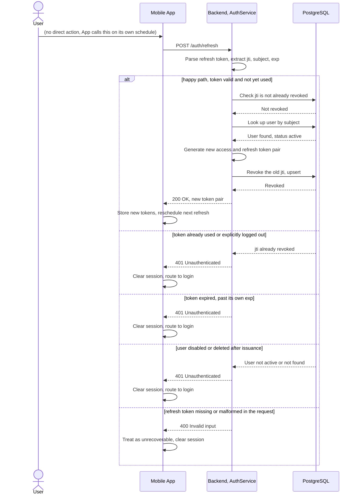
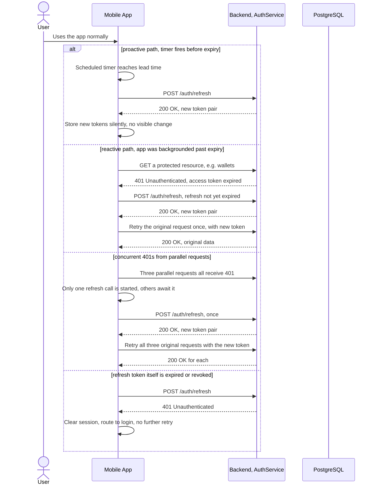

# Implementation Plan: Session Refresh (F-02 extension)

- **Feature:** Session Refresh — `POST /auth/refresh` + mobile auto-refresh
- **SRS Feature Code:** F-02 System Security (extension — no SRS/SDS section names this endpoint; it closes the gap `CURRENT_STATE.md` Active TODOs already tracks)
- **Jira Epic:** N/A — this repository has no Jira integration wired up
- **Spec:** [spec.md](./spec.md)
- **Related plans:** [security](../security/plan.md) (original JWT issuance this extends), [mobile-debug-console](../mobile-debug-console/plan.md) (refresh attempts/failures surfaced in its log viewer)
- **Client scope:** Backend (Go Fiber) + `mobile/` (React Native/Expo) only. `frontend/` (web) is explicitly out of scope (spec.md Out of Scope) — the new endpoint is available for a future web fast-follow with zero backend changes.

## Pre-flight: Spec Review Findings

| # | Type | Finding | Resolution / Open Task |
|---|------|---------|-------------------------|
| 1 | Ambiguity | Spec's Edge Case #1 says "generate new pair before revoking old" but doesn't say what to return if revoke itself then fails after the new pair is already generated. | Revoke failure after successful generation is logged (`zap.Error`) but does **not** fail the request — the client already has a usable new pair; the old token being left un-revoked for the remainder of its (short, already-being-replaced) life is a lower risk than returning `500` after successfully producing valid credentials. See REF-T02. |
| 2 | Ambiguity | Spec doesn't specify whether `/auth/refresh` needs its own rate limiter, unlike `/auth/login` (`LoginRateLimiter`). | No rate limiter — a legitimate client calls this at most once per ~12 minutes proactively, or once per failed request reactively; unlike login there's no password-guessing surface (the token itself is the credential, and a wrong/expired one just 401s). Confirmed as Open Task T-OPEN-1 for product sign-off, not blocking implementation. |
| 3 | Gap | Spec's US-02 mobile de-duplication (decision #4) doesn't specify the exact mechanism. | A module-level `Promise` variable in `axios.ts` (`let refreshPromise: Promise<string> | null`) — set when a refresh starts, awaited by concurrent 401 handlers, cleared in a `finally`. See REF-T10. |
| 4 | Gap | Spec doesn't state where the proactive-refresh timer computation reads the access token's actual expiry from (vs. just assuming exactly `AccessTokenTTL` elapsed since issuance). | Mobile does not decode the JWT to read its real `exp` — it schedules purely off `ACCESS_TOKEN_TTL_SECONDS` (already mirrored in `mobile/src/lib/constants.ts`) minus a fixed lead time, measured from the moment `setTokens` is called. This is simpler and sufficiently accurate since the client and its own token-issuance moment are the same event; decoding the JWT client-side would need a `jwt-decode` dependency for no real benefit. See REF-T11. |
| 5 | Security | Spec doesn't state CSRF posture for the new mutating endpoint. | Not applicable — same reasoning as the existing `AuthHandler` doc comment on Login/Logout: this is a Bearer-JWT (here, Bearer-refresh-token-in-body) API with no cookies or server-side sessions, so there is no ambient credential to forge against. |
| 6 | Transactional | Spec's rotation (revoke-old, issue-new) is not wrapped in a DB transaction. | Intentional, matches Finding #1's ordering resolution — issuance is a pure in-memory signing operation (no DB write), and the only DB write is the single `Revoke` upsert; there is no multi-write atomicity requirement here, unlike money/wallet operations. |

### Regression Scope

This plan only adds new files/methods, plus small additive edits to shared files:
- `backend/internal/dto/auth_request.go` — adds `RefreshRequest`; no existing type changed.
- `backend/internal/service/auth_service.go` — adds `Refresh()` method; `Login`/`Logout`/`Activate` untouched.
- `backend/internal/handler/auth_handler.go` — adds `Refresh()` method; existing handlers untouched.
- `backend/cmd/server/routes.go` — adds one route registration line to the existing unauthenticated `auth` group; no existing route changed.
- `mobile/src/lib/axios.ts` — extends the existing response interceptor's `401` branch; the interceptor's request-attach logic and non-401 error logging are untouched.
- `mobile/src/stores/session-store.ts` — `setTokens`/`clear`/`hydrate` gain new side effects (schedule/cancel a timer); their existing secure-storage read/write/query-cache-clear behavior is untouched.

No existing F-01/F-02 handler, service, or repository file is renamed or removed. No regression risk to Login/Activate/Logout is expected — this plan is purely additive to `AuthService`/`AuthHandler`.

## Architecture

### Package/File Layout

```text
backend/
└── internal/
    ├── dto/
    │   └── auth_request.go          # add RefreshRequest (new type in existing file)
    ├── handler/
    │   └── auth_handler.go          # add Refresh method (existing file)
    ├── service/
    │   ├── auth_service.go          # add Refresh method (existing file)
    │   └── auth_service_test.go     # add TestAuthService_Refresh_* cases
    └── cmd/server/routes.go         # register POST /auth/refresh (existing file)

mobile/
└── src/
    ├── lib/
    │   ├── axios.ts                 # reactive refresh-and-retry-once + de-dup (existing file)
    │   └── refresh-scheduler.ts     # NEW — proactive timer, isolated from axios.ts for testability
    ├── stores/
    │   └── session-store.ts         # setTokens/clear call scheduler start/cancel (existing file)
    └── features/auth/
        └── api/
            └── use-refresh-mutation.ts  # NEW — thin POST /auth/refresh wrapper, reused by both paths
```

No new migration, no new DTO file, no new repository — `RefreshRequest` is added to the existing `dto/auth_request.go`, reusing `TokenPairResponse` for the response (both per Pre-flight review of `spec.md`'s Response Shape section, which already states this).

### Domain Objects

| Entity | Table | Key Fields | Notes |
|--------|-------|------------|-------|
| (none new) | `revoked_tokens` (existing, `003_revoked_tokens.sql`) | `token_jti`, `user_id`, `expires_at` | Reused unchanged — `Refresh` calls the existing `RevokedTokenRepo.Revoke`/`IsRevoked`, same as `Logout` |
| (none new) | `users` (existing) | `id`, `status`, `deleted_at` | Reused unchanged — `Refresh` calls the existing `UserRepo.GetUserByID` for the S-REF-05/S-REF-06 active-user check |

### Business Rules

| Rule | Source | Enforcement |
|------|--------|-------------|
| A refresh token, once used successfully, cannot be reused | AC S-REF-03 | `AuthService.Refresh()` (Go) → checks `RevokedTokenRepo.IsRevoked` before issuing, 401 `UNAUTHENTICATED` |
| Refresh requires the user to still be `active` (not disabled/deleted) | AC S-REF-05, S-REF-06 | `AuthService.Refresh()` → `UserRepo.GetUserByID`, 401 `UNAUTHENTICATED` if not `active` or not found |
| Refresh token `exp` must not have passed | AC S-REF-02 | `AuthService.Refresh()` → compares `claims.ExpiresAt` to `time.Now().UTC()`, 401 `UNAUTHENTICATED` |
| New pair generated before old token is revoked (rotation ordering) | Edge Case #1, Pre-flight Finding #1 | `AuthService.Refresh()` — `GenerateTokenPair` call precedes `Revoke` call in source order |
| Malformed refresh token in request body | AC S-REF-04, S-REF-07 | `AuthHandler.Refresh()` validator tag (missing) + `AuthService.Refresh()`'s `ParseRefreshTokenUnverified` failure (malformed), both 400 `INVALID_INPUT` |
| Mobile schedules one proactive refresh at `AccessTokenTTL - 3min` from token issuance, cancels/reschedules on every `setTokens`/`clear` | AC S-REF-09, S-REF-15, Edge Case #3 (mobile) | `mobile/src/lib/refresh-scheduler.ts` |
| Reactive 401 triggers exactly one refresh-and-retry per original request, never a second retry on a second 401 | AC S-REF-14, Edge Case #2 (mobile) | `axios.ts` response interceptor, custom `_retried` flag on the request config |
| Concurrent 401s share one in-flight refresh call | AC S-REF-11, decision #4 | `axios.ts` module-level `refreshPromise` |
| `/auth/login`, `/auth/refresh`, `/auth/activate` are exempt from the reactive-401-triggers-refresh path | Edge Case #1 (mobile) | `axios.ts` interceptor checks `error.config.url` against an exemption list before attempting a refresh |

### Sequence Diagrams

> Four-tier lifeline (User → Mobile App → Backend → DB), one diagram per story, happy path first with real `alt/else` branches beneath it.

**US-01: Refresh an Access Token**



**US-02: Mobile Auto-Refresh, Proactive and Reactive Paths**



## Error Flows

| Scenario | HTTP | Error Code |
|----------|------|------------|
| `refresh_token` missing from body | 400 | `INVALID_INPUT` |
| `refresh_token` malformed (not a parseable JWT) | 400 | `INVALID_INPUT` |
| Refresh token expired (`exp` passed) | 401 | `UNAUTHENTICATED` |
| Refresh token already revoked (rotated or logged out) | 401 | `UNAUTHENTICATED` |
| User not found (subject doesn't resolve) | 401 | `UNAUTHENTICATED` |
| User `disabled` or soft-deleted | 401 | `UNAUTHENTICATED` |
| Unexpected error (signing failure, DB error) | 500 | — |

## Constitution / Convention Notes

| Rule | Status | Note |
|------|--------|------|
| Service layer owns business rules | Required | All checks (revoked, expired, user-active) in `AuthService.Refresh()`, not the handler |
| No raw SQL in Go | Required | Reuses existing `RevokedTokenRepository`/`UserRepository` sqlc-backed methods — no new query |
| Handler validates shape, service validates business rules | Required | `AuthHandler.Refresh()`: only `validate:"required"` on `refresh_token`; everything else in `AuthService` |
| No log of sensitive data | Required | `AuthService.Refresh()` must never log the raw refresh/access token strings, only the `jti` (already the existing `Logout` convention) |
| Go error wrapping | Required | `fmt.Errorf("service.Refresh: %w", err)` on every unexpected-error path |
| Mobile: server state via TanStack Query only | Required | `use-refresh-mutation.ts` follows the same `useMutation` pattern as `use-login-mutation.ts`; token pair itself still lives in `session-store.ts` (Zustand), not query cache — matches existing precedent |
| Mobile: no new native dependency | Required (spec Context decision, inherited from [mobile-debug-console](../mobile-debug-console/spec.md) decision #2 precedent) | Timer uses `setTimeout`/`clearTimeout` only — no JWT-decode library added (Pre-flight Finding #4) |
| CLAUDE.md: wrap Go errors with context | Required | `service.Refresh:` prefix on every wrapped error |

## Element/Key IDs (QA automation)

Not applicable — this feature has no new interactive UI element (no button/screen); it is a background token-lifecycle mechanism. The only observable mobile-side effect (proactive/reactive refresh attempts) is surfaced via [mobile-debug-console](../mobile-debug-console/spec.md)'s log viewer, not a new testable UI control.

## Open Tasks

| ID | Task | File |
|----|------|------|
| REF-T01 | Add `RefreshRequest{ RefreshToken string }` DTO (mirrors `LogoutRequest` exactly) | `backend/internal/dto/auth_request.go` |
| REF-T02 | Implement `AuthService.Refresh(ctx, refreshToken string) (accessToken, refreshToken string, err error)`: parse → check revoked → check expiry → look up user (must be `active`) → generate new pair → revoke old jti → return new pair. Unit tests for S-REF-01–S-REF-08. | `backend/internal/service/auth_service.go`, `auth_service_test.go` |
| REF-T03 | Implement `AuthHandler.Refresh(c *fiber.Ctx)`: parse body, validate `required`, call service, map errors via `response.Error`, return `200` with `dto.TokenPairResponse` | `backend/internal/handler/auth_handler.go` |
| REF-T04 | Register `POST /auth/refresh` in the existing unauthenticated `auth` group, no rate limiter (Pre-flight Finding #2) | `backend/cmd/server/routes.go` |
| REF-T05 | `frontend/`/`ai-service/` — no changes; confirmed out of scope by spec.md | — |
| REF-T06 | `mobile/src/features/auth/api/use-refresh-mutation.ts` — `useMutation` wrapper calling `POST /auth/refresh`, returns `{access_token, refresh_token}` | `mobile/src/features/auth/api/use-refresh-mutation.ts` |
| REF-T07 | `mobile/src/lib/refresh-scheduler.ts` — exports `scheduleRefresh(onDue: () => void)` / `cancelScheduledRefresh()` using `setTimeout`/`clearTimeout`, lead time `ACCESS_TOKEN_TTL_SECONDS - 180` seconds | `mobile/src/lib/refresh-scheduler.ts` |
| REF-T08 | `session-store.ts`: `setTokens` calls `scheduleRefresh(...)` (the callback calls the refresh mutation's `mutateAsync` and re-invokes `setTokens` on success, `clear()` on failure); `clear` calls `cancelScheduledRefresh()` | `mobile/src/stores/session-store.ts` |
| REF-T09 | `session-store.ts`: `hydrate()` — after restoring tokens, if elapsed time since a persisted issuance timestamp exceeds the lead-time threshold, trigger an immediate refresh instead of waiting for the timer (S-REF-13). Requires persisting an `issuedAt` timestamp alongside the token pair in secure storage. | `mobile/src/stores/session-store.ts`, `mobile/src/lib/secure-storage.ts` (add `SECURE_STORE_ISSUED_AT_KEY`) |
| REF-T10 | `axios.ts` response interceptor: on `401` from any URL not in `["/auth/login", "/auth/refresh", "/auth/activate"]` and without the request config's `_retried` flag — de-duplicate via module-level `refreshPromise`, call the refresh mutation, retry original request once with `_retried: true`; on any refresh failure, fall through to existing `clear()` | `mobile/src/lib/axios.ts` |
| REF-T11 | `mobile/src/lib/constants.ts` — add `PROACTIVE_REFRESH_LEAD_SECONDS = 180` (named constant, not inlined per CLAUDE.md) | `mobile/src/lib/constants.ts` |
| REF-T12 | Manual on-device verification per spec.md Definition of Done (US-02): foreground idle past 15 min, background-then-resume past 15 min | — |

### T-OPEN (product/tech sign-off, not blocking implementation)
- T-OPEN-1: confirm no rate limiter is desired on `/auth/refresh` (Pre-flight Finding #2).
