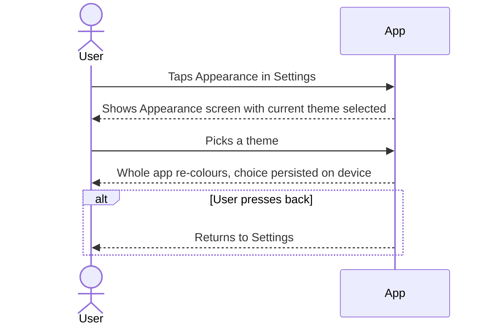
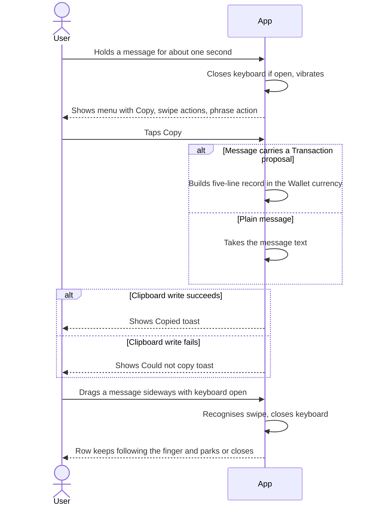
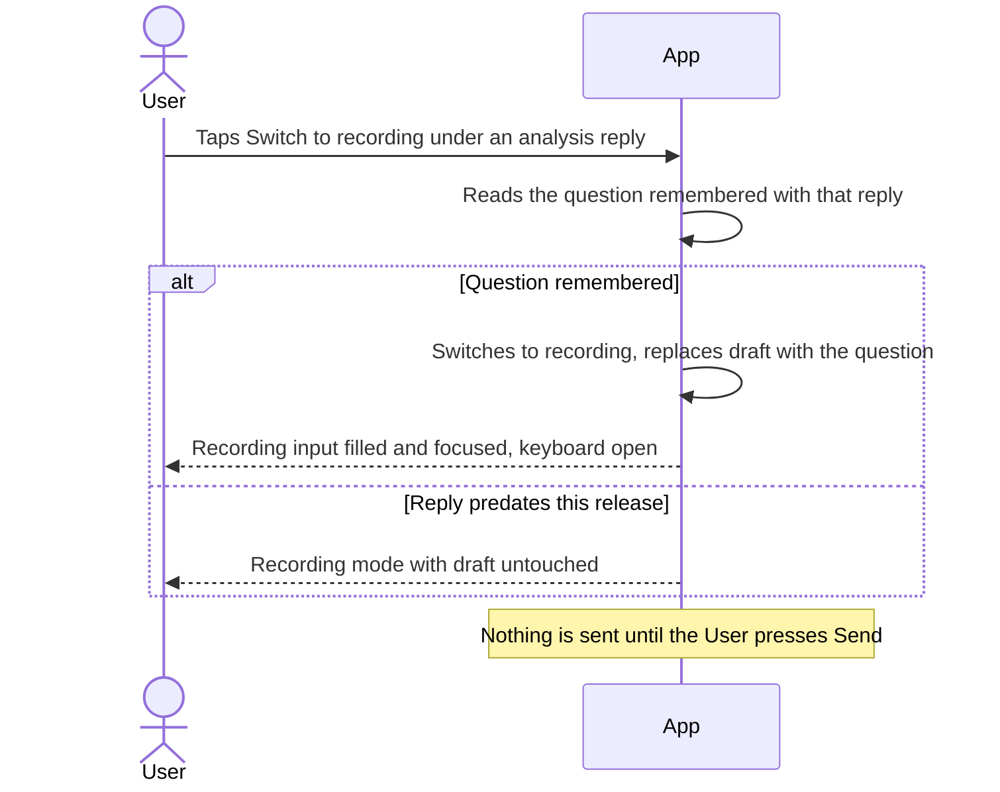
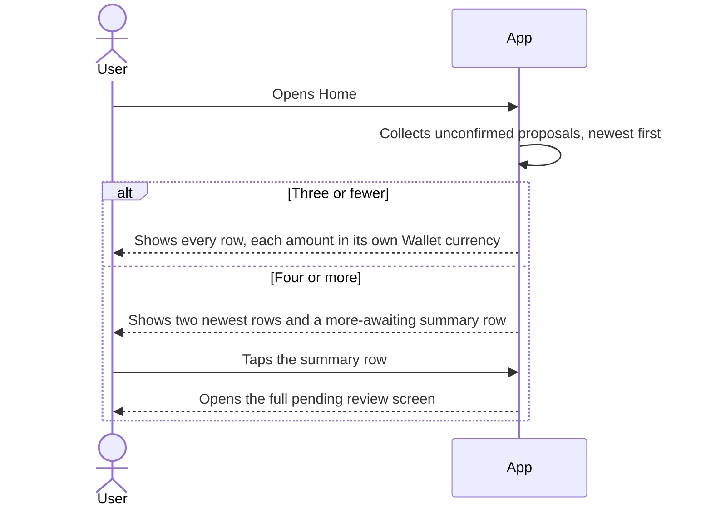
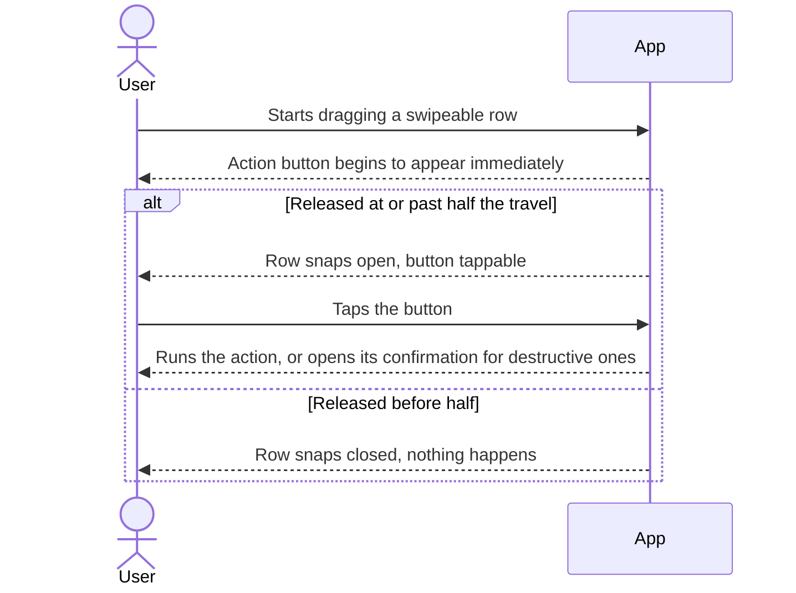
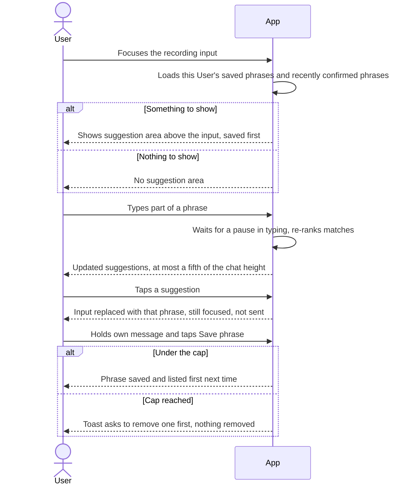
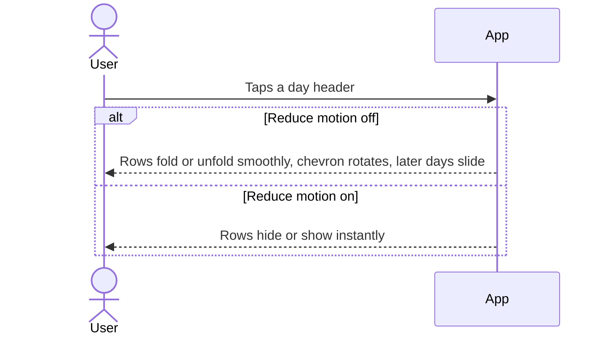
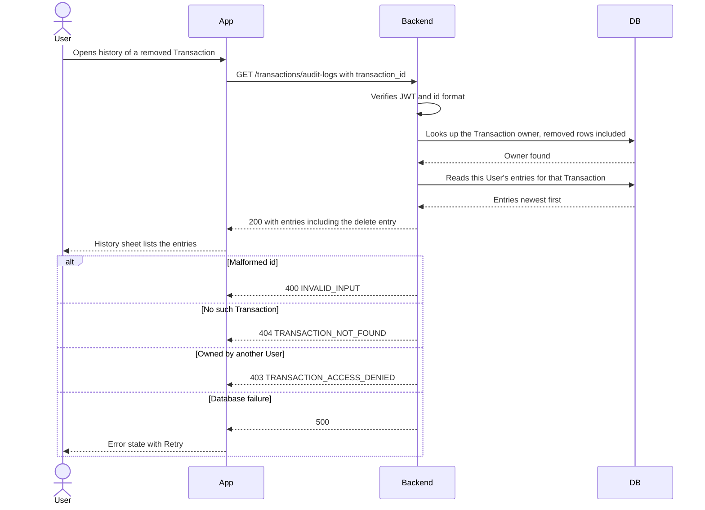

# Plan: Mobile UX Batch (October 2026)

> Spec: [spec.md](./spec.md) · Feasibility (item 2, no plan): [research.md](./research.md)
> SRS: refines F-06 Transaction, F-03 Wallet, Feature-12 AI Chat (US-01, US-03); no new SRS story. No ticket system in this project.
> Feature code: `MUX` · Tasks `MUX-T{NN}`
> Stacks touched: **mobile** (all stories) · **Go backend** (US-13 only). No ai-service, no migration, no `frontend/`.

---

## 1. Pre-flight: Spec Review Findings

| # | Finding (spec vs. code) | Resolution |
|---|---|---|
| F1 | **US-13 root cause.** `AuditLogService.getOwnedTransactionForAudit` (`backend/internal/service/audit_log_service.go:107`) calls `TransactionRepo.GetTransactionByID`, whose query filters `t.deleted_at IS NULL` (`backend/db/queries/transactions.sql:49`). A soft-deleted Transaction therefore maps to `ErrTransactionNotFound` → 404, even for its owner. It also maps **every** repository error (DB down) to 404, hiding 5xx. | New owner-lookup query that ignores `deleted_at`; map only `pgx.ErrNoRows` → 404, wrap the rest → 500. MUX-T01…T05. |
| F2 | **US-10 root cause.** `PendingConfirmationsSection` receives one `currency` from `useHomeSnapshot` (`totals[0].currency` of the period report, else the Wallets' primary currency). Any USD activity makes every pending VND row render "$". `app/(app)/pending.tsx:56` already does it right (`walletById` per message). | Pass `walletById`; resolve per row exactly like `pending.tsx`. MUX-T22. |
| F3 | **US-08 root cause.** `SwipeActionButton` fades the indicator over `[ARM_RATIO − FADE_LEAD, ARM_RATIO]` = 75%→90% of travel, and `useSwipeActions.release()` parks only when `atCapRef` (≥ 100% of travel). | Indicator fades over `[0, PARK_THRESHOLD_RATIO]`; release parks at ≥ threshold. MUX-T24. |
| F4 | **US-02.** The "outside layer" is `auraMid` + `auraCore` (concentric translucent discs) inside `auraOuter` (78 px) around a 48 px ball. | Remove mid/core, shrink the socket to `BALL_SIZE + 2·SOCKET_GAP`, with `SOCKET_GAP > BOB_DISTANCE` so the floating ball never touches the edge (EC-04). Remove now-unused `navSocketMid`/`navSocketCore` tokens. MUX-T10. |
| F5 | **US-03.** Chips and input are normal-flow siblings below `ChatThreadList`; the list ends at their top edge. No background is painted on the chips — the "band" is the hard edge where the list stops. | Composer (suggestions + chips + input) becomes an absolute overlay at the pane bottom; its measured height is reserved inside the inverted list (`contentContainerStyle.paddingTop`, which renders at the visual bottom) and offsets the jump-to-latest FAB. MUX-T11…T13. |
| F6 | **US-03 Transactions.** `TransactionsHeader` filter `ScrollView` sits inside the list's `paddingHorizontal: spacing.xl` (`transactions.tsx:297`), so it clips at the margin. | Same bleed pattern as `SuggestionChips`: `marginHorizontal: -spacing.xl`, content `paddingHorizontal: spacing.xl`. MUX-T14. |
| F7 | **US-04.** Only `TransactionActionCard` has a hold menu (its own `Pressable` + `QuickActionsPopup`); plain bubbles, tombstones and the analysis pane have none. `expo-clipboard` is **not installed**. `ChatMessage` has **no creation timestamp**; the only one is `editHistory[source="created"].timestamp`. | Move the hold menu up to row level (one menu per message, both panes); card keeps only its amount-reveal hold (EC-14). Install `expo-clipboard` via `npx expo install` (bundled in Expo Go SDK 54). "Created at" from the `created` history entry; omitted when absent (EC-13). MUX-T15…T19. |
| F8 | **US-05.** `keyboardShouldPersistTaps="handled"` is deliberate (taps must not dismiss). Neither the swipe grant nor the hold dismisses the keyboard. | `Keyboard.dismiss()` on swipe grant (inside `useSwipeActions`) and before opening the hold menu. Taps untouched. MUX-T20. |
| F9 | **US-06.** `onSwitchToRecording` takes no argument; the recording draft (`input`) is local state in `ai-chat.tsx`, which is **299 lines** — any addition breaks the 300-line rule. | Extract the recording pane into `RecordingPane.tsx` (mirrors `ConsultPane`) first. The answered question is derived at render time from the previous message in `ConsultPane.renderItem` (works for old threads, no new persisted field). MUX-T06, T21. |
| F10 | **US-09.** No saved-phrase storage exists. Session store has no user id, but the access token carries `user_id` (`lib/jwt.ts` `AccessTokenClaims`). Thread messages carry `consultQuestion` to exclude analysis questions (BR-11). | New persisted Zustand stores keyed by `user_id` (saved + recent); recent written on confirm (F18). MUX-T26…T31, T38. |
| F11 | **US-12.** Collapse rebuilds sections with `data: []` instantly. `LayoutAnimation` is already enabled for Android (`lib/use-keyboard-height.ts`), `useReduceMotion` exists. `transactions.tsx` is **300 lines**. | Move toggle into a `use-collapsed-days` hook that calls `LayoutAnimation.configureNext` (skipped under reduce-motion); animated chevron in the header. MUX-T33, T34. |
| F12 | **US-11.** Carousel box = `CARD_HEIGHT` exactly; card shadow is `shadowRadius 14` + `offset 6`, plus a 2 px highlight ring — the `ScrollView` clips them. | Taller scroll box with vertical padding = bleed; container negative vertical margin of the same amount so surrounding layout does not move (EC-38). Skeleton mirrors it. MUX-T32. |
| F13 | GitNexus impact: `useSwipeActions` → `SwipeableRow`, `SwipeableMessageRow` (LOW). `ChatInputBar`/`PendingConfirmationsSection`/`getOwnedTransactionForAudit` report 0 callers because GitNexus does not track JSX usage / unexported methods; by grep: `ChatInputBar` ← `ai-chat.tsx`, `ConsultPane.tsx`; `PendingConfirmationsSection` ← `(tabs)/index.tsx`; `getOwnedTransactionForAudit` ← `ListAuditLogs` only. | Regression scope listed in §8. |
| F14 | OQ-01…OQ-03 open in spec. | Plan follows spec assumptions (focus on switch; `MAX_SAVED_PHRASES = 20`; earlier reveal on all swipe surfaces). Each is one constant/one line to flip. |
| F15 | Plan checklist forbids Vietnamese, but UI copy must be specified somewhere. | **Deliberate exception:** §7 UI Copy lists the Vietnamese strings (project rule: all user-facing copy in Vietnamese). No other Vietnamese in this document. |
| F16 | **Review round (2026-10-03).** A second reviewer proposed replacing the swipe with `ReanimatedSwipeable` (+ reanimated, worklets, gesture-handler) and Reanimated layout animations for US-12. Feasible in Expo Go SDK 54, but it would drop the arm tick, the one-parked-row registry and the "never hand the gesture back to the scroll" fix, and makes Pan↔LongPress the largest open risk — for a US-08 change that is a threshold edit in the existing hook. | **User decision: keep `PanResponder` + core `Animated` + `LayoutAnimation`.** No new gesture/animation dependency. (Reanimated layout animations also do not cover `SectionList` cleanly.) |
| F17 | Reviewer: a new field on thread messages could be rejected by the sync endpoint. | Verified: `ChatThreadMessageSync.Payload` is `json.RawMessage`, passed through opaque (`backend/internal/dto/chat_thread_request.go:13`); no payload size cap, no `DisallowUnknownFields` on that path. Adding `sourceText` is safe. Kept as a pre-code check task anyway (MUX-T36). |
| F18 | Reviewer: US-06 should not infer the answered question from the neighbouring message; US-09 "recent" should mean phrases that led to a confirmed Transaction, not every sent message. | Accepted. New client field `sourceText` on assistant messages = the exact user text that produced the reply (recording proposals and analysis replies). US-06 reads it; absent → EC-19. US-09 recent phrases are written in `useConfirmProposal.save()` — the **single** confirm path shared by chat Confirm, `/pending` Confirm and Confirm-all (Home rows only navigate). |
| F19 | User decisions: hold duration = platform standard (500 ms); other User's Transaction in US-13 stays 403. | `MESSAGE_HOLD_MS = 500`. The card's amount reveal also uses the default 500 ms long-press; the innermost `Pressable` wins, so EC-14 holds. |
| F20 | No automated UI tests (user's accepted risk; 20 beta users are the last test layer). | §10 manual checklist is written **before** code and executed at MUX-T35. |

---

## 2. Architecture

### 2.1 File layout

```text
backend/
├── db/queries/transactions.sql                 # + GetTransactionOwnerIncludingDeleted
└── internal/
    ├── repository/sqlc/transactions.sql.go     # hand-written generated code (sqlc CLI version mismatch)
    ├── repository/transaction_repository.go    # + GetTransactionOwnerIncludingDeleted
    ├── service/interfaces.go                   # TransactionRepo + method
    ├── service/fake_transaction_repo_test.go   # fake + method
    ├── service/audit_log_service.go            # ownership check rewritten
    └── service/audit_log_service_test.go       # NEW

mobile/
├── app/(app)/appearance.tsx                    # NEW route (US-01)
├── app/(app)/(tabs)/settings.tsx               # row added, inline picker removed
├── app/(app)/(tabs)/ai-chat.tsx                # slimmed: renders RecordingPane / ConsultPane
├── app/(app)/(tabs)/transactions.tsx           # uses use-collapsed-days
├── app/(app)/(tabs)/index.tsx                  # passes walletById to pending section
└── src/
    ├── components/shared/
    │   ├── BottomNav.tsx, bottom-nav-styles.ts # socket simplified, SETTINGS_SUB_ROUTES + /appearance
    │   ├── use-swipe-actions.ts                # threshold park + keyboard dismiss
    │   └── SwipeActionButton.tsx               # earlier fade-in
    ├── components/ui/Icon.tsx (+ icons/)       # + CopyIcon, PinIcon, PaletteIcon
    ├── lib/clipboard.ts                        # NEW copyToClipboard + toast
    ├── lib/normalize-text.ts                   # NEW case/diacritic-insensitive key
    ├── lib/gestures.ts                         # NEW MESSAGE_HOLD_MS shared constant
    ├── stores/saved-phrases-store.ts           # NEW persisted, keyed by user_id
    ├── stores/recent-phrases-store.ts          # NEW persisted LRU, keyed by user_id
    ├── theme/palettes.ts (+ type)              # drop navSocketMid/Core
    ├── features/ai-chat/
    │   ├── message-copy.ts                     # NEW proposal → 5-line text
    │   ├── hooks/use-message-actions.ts        # NEW builds the hold-menu action list
    │   ├── hooks/use-phrase-suggestions.ts     # NEW debounced ranking
    │   ├── components/RecordingPane.tsx        # NEW (extracted from ai-chat.tsx)
    │   ├── components/ChatComposer.tsx         # NEW absolute overlay wrapper (measures height)
    │   ├── components/PhraseSuggestions.tsx    # NEW suggestion area
    │   ├── components/ChatInputBar.tsx         # focus callbacks, autoFocus, no outer margins logic change
    │   ├── components/ChatThreadList.tsx       # reservedBottom prop (padding + FAB offset)
    │   ├── components/ChatMessageRow.tsx       # row-level hold menu
    │   ├── components/TransactionActionCard.tsx# own menu removed
    │   ├── components/ConsultMessageRow.tsx    # hold → Copy
    │   ├── components/ConsultPane.tsx          # composer overlay, answered question
    │   ├── components/PendingConfirmationsSection.tsx # compact + per-row currency
    │   ├── components/PendingRow.tsx           # NEW (extracted row)
    │   └── hooks/use-consult-actions.ts        # onSwitchToRecording(prefill?)
    ├── features/analytics/components/ConsultReplyCard.tsx # passes prefill
    ├── features/transactions/
    │   ├── hooks/use-collapsed-days.ts         # NEW toggle + LayoutAnimation
    │   ├── components/TransactionDayHeader.tsx # animated chevron
    │   └── components/TransactionsHeader.tsx   # filter row bleed
    └── features/wallets/components/
        ├── WalletCarousel.tsx, WalletCardSkeleton.tsx, WalletStackCard.tsx # bleed constant
```

### 2.2 Domain objects

| Entity | Storage | Key fields | Notes |
|---|---|---|---|
| `Transaction` (existing) | `transactions` | id, user_id, deleted_at | **Soft-deleted rows stay readable for ownership in US-13 only.** No write path changes. Never hard-deleted. |
| `AuditLog` (existing) | `transaction_audit_logs` | transaction_id, user_id, action, before, after, created_at | Read-only here; append-only table, unchanged. |
| `SavedPhrase` (new, device-only) | AsyncStorage key `pfm_saved_phrases` | `byUser: Record<userId, { text, savedAt }[]>` | Not server data, not financial. `savedAt` = epoch ms (device clock, used only for ordering). Survives logout (BR-09). |
| `ChatMessage` (existing, client) | `pfm_chat_thread` (persisted + synced payload) | role, text, action, editHistory, consultQuestion, **sourceText (new, optional)** | `sourceText` set on assistant replies only = trimmed user text that produced them. Old messages lack it (no backfill). Creation time read from `editHistory[created]`. |
| `RecentPhrase` (new, device-only) | AsyncStorage key `pfm_recent_phrases` | `byUser: Record<userId, { text, usedAt }[]>` | Written on confirm only; LRU `RECENT_PHRASES_LIMIT = 50`, dedup by normalized key (newest wording moves to top). Survives logout. |

No migration. Next migration number stays `025`.

### 2.3 Business / UI rules

**Backend (US-13)**

| Rule | Source | Enforcement |
|---|---|---|
| Ownership checked on removed and live Transactions alike | BR-12, S-MUX-68/69 | `AuditLogService.ListAuditLogs` → `getOwnedTransactionForAudit` using `TransactionRepo.GetTransactionOwnerIncludingDeleted` |
| Other user's Transaction → 403 | BR-12, S-MUX-70 | same → `ErrTransactionAccessDenied` |
| Unknown id → 404 | BR-12, S-MUX-71 | `pgx.ErrNoRows` → `ErrTransactionNotFound` |
| Malformed id → 400 | BR-12, S-MUX-72 | existing `uuid.Parse` → `INVALID_INPUT` |
| Repository failure → 500 (no longer masked as 404) | S-MUX-74 | `fmt.Errorf("service.getOwnedTransactionForAudit: %w", err)` |
| Read only, nothing restored | BR-13 | no write in the path |

**Mobile**

| Rule | Source | Enforcement |
|---|---|---|
| Settings shows Appearance row, no inline picker | US-01 DoD | `settings.tsx` `SETTINGS_ROWS` |
| Settings stays active on `/appearance` | S-MUX-04 | `SETTINGS_SUB_ROUTES` in `BottomNav.tsx` |
| Ball + hollow only, gap > float distance | US-02, EC-04 | `bottom-nav-styles.ts` `SOCKET_GAP` |
| Composer floats; newest content never covered | US-03, EC-08 | `ChatComposer` onLayout height → `ChatThreadList.reservedBottom` |
| Hold menu = Copy + swipe actions (+ phrase action) | US-04 step 3, decision #2 | `use-message-actions` |
| Proposal copy layout, full amount, sign, wallet currency, local time | BR-01…BR-04 | `message-copy.ts` (`formatCurrency`, never truncated) |
| Keyboard dismissed on hold completion / swipe grant only | US-05 | `useSwipeActions` grant; `openMenu` |
| Switch-to-recording fills (replace) + focuses, never sends; text from the reply's `sourceText` | US-06, A-01, EC-19 | `ai-chat.tsx` handler → `RecordingPane` |
| Pending: all if N ≤ 3, else 2 newest + summary | US-07 | `PendingConfirmationsSection` constants |
| Swipe reveal from drag start, park at ≥ half, release never acts | US-08 | `useSwipeActions` / `SwipeActionButton` |
| Suggestions: focused recording input only, saved first, ≤ 20% height, debounce, replace not send | US-09 BR-05…BR-08, BR-11 | `use-phrase-suggestions`, `PhraseSuggestions` |
| Saved phrases per user, capped, never silently dropped | BR-09, BR-10 | `saved-phrases-store` |
| Recent phrases recorded on every confirm path, only on confirm, LRU | BR-08, S-MUX-50a/b | `useConfirmProposal.save()` → `recent-phrases-store` |
| Pending amount in the row's Wallet currency, signed | US-10 | `PendingRow` |
| Carousel decorations uncut, no layout shift | US-11 | `CAROUSEL_SHADOW_BLEED` |
| Smooth collapse, reduce-motion respected | US-12, S-MUX-67 | `use-collapsed-days`, `TransactionDayHeader` |

---

## 3. Per-story design and sequence diagrams

> Lifelines: `User → App (mobile) → Backend → DB`. Stories with no server call stop at `App`. Pure-render stories (US-02, US-03, US-11) have no interaction flow beyond rendering and are described without a diagram.

### US-01 — Appearance screen

- `app/(app)/appearance.tsx`: header copied from `developer.tsx` (back chevron + title), body = existing `<ThemePicker />` unchanged. Stack route auto-registered by Expo Router (`app/(app)/_layout.tsx` uses a bare `<Stack>`).
- `settings.tsx`: remove the `ThemePicker` import/render; add `{ label: "Giao diện", Icon: PaletteIcon, href: "/appearance", adminOnly: false }` as the **first** row.
- EC-03 (double tap): guard with the same `router.push` debounce already used elsewhere if present; otherwise disable the row while `router.canGoBack()` targets `/appearance` — simplest: `if (pathname === "/appearance") return`.



### US-02 — Ball and socket

- Delete `AURA_MID`, `AURA_CORE`, `auraMid`, `auraCore` and their JSX.
- `SOCKET_GAP = 8` (named; must stay `> BOB_DISTANCE` (4)). `AURA_OUTER = BALL_SIZE + 2 * SOCKET_GAP` (= 64). `AURA_TOP`, `AURA_LEFT_OFFSET`, `SOCKET_HALF_CHORD`, `RIM_*` already derive from it.
- `auraOuter` keeps `navSocketOuter` as the hollow fill (it is the visual "cut").
- Remove `navSocketMid` / `navSocketCore` from both palettes and the palette type (only consumer is the nav).
- EC-06: if the ball's green glow still reads as a ring on device, lower `shadowRadius`/`shadowOpacity` in `ball` — on-device judgement, recorded in the PR.

### US-03 — Floating composer and filter-row bleed

- `ChatComposer` = `View` with `position: absolute, left 0, right 0, bottom 0`, `pointerEvents="box-none"`, transparent; children: `PhraseSuggestions` (recording only), quick chips, `ChatInputBar`. Reports `onLayout` height to its pane.
- `ChatInputBar` keeps its own keyboard / nav-clearance `marginBottom` logic, so the overlay height already includes it.
- `ChatThreadList` gets `reservedBottom: number`: merged into `contentContainerStyle` as `paddingTop` (inverted list ⇒ visual bottom), and added to `fabWrap.bottom`.
- `ListEmptyComponent` hint gets the same reserve (EC-09) — it renders inside the content container, so the padding covers it.
- `TransactionsHeader`: `ScrollView style={{ marginHorizontal: -spacing.xl }}` + `contentContainerStyle={[styles.filterRow, { paddingHorizontal: spacing.xl }]}`. Same value as the screen's `content.paddingHorizontal`.

### US-04 / US-05 — Hold menu, copy, keyboard

- `lib/gestures.ts`: `export const MESSAGE_HOLD_MS = 500` (platform standard, user decision F19; replaces the card's 1000 ms `LONG_PRESS_MS`).
- `ChatMessageRow`: wrap `ChatBubble` in `Pressable onLongPress delayLongPress={MESSAGE_HOLD_MS}`; on fire → `Keyboard.dismiss()`, `Vibration.vibrate(20)`, open `QuickActionsPopup` with `useMessageActions(...)`.
- `useMessageActions({ message, mode, walletName, categoryName, currency, onEdit?, onDelete?, userId })` returns `SwipeAction[]`:
  1. **Copy** (always when text or proposal exists; EC-11) — proposal (live / confirmed / tombstone) → `formatProposalForCopy`, else `message.text`.
  2. **Edit / Delete** — the exact handlers the row's swipe gets (`isEditLocked` / `isRemovable`).
  3. **Save phrase / Remove saved phrase** — only `role === "user"`, `!consultQuestion`, `userId` known.
- `TransactionActionCard`: delete `menuVisible`, `menuActions`, `openMenu`, the outer `onLongPress` and its `QuickActionsPopup`; outer `Pressable` → `View`. Amount `Pressable onLongPress` (reveal) stays — deepest responder wins (EC-14). `onEdit`/`onDelete` props become unused → remove from props and from `ChatMessageRow`.
- `ConsultMessageRow`: same `Pressable` wrapper, actions = Copy only (decision #2: not swipeable).
- `message-copy.ts` `formatProposalForCopy({ payload, categoryName, walletName, currency, createdAtMs? })`:
  - lines joined by `"\n"` (BR-04); labels from §7.
  - Date: `occurred_at` (UTC ISO) → device local `DD/MM/YYYY`.
  - Amount: `(type === "income" ? "+" : "-") + formatCurrency(payload.amount, currency)` — integer xu in, `Intl` formatting, no truncation, no float arithmetic beyond the existing `/100` display conversion inside `formatCurrency` (BR-02).
  - Created at: `createdAtMs` → local `HH:mm` 24 h; line omitted when undefined (EC-13).
- `lib/clipboard.ts` `copyToClipboard(text)`: `Clipboard.setStringAsync` → toast info "copied"; catch → toast error (EC-15). Never logs the text.
- US-05 swipe: `useSwipeActions.onPanResponderGrant` calls `Keyboard.dismiss()` (no-op without a keyboard, so Home is unaffected). Grant already refuses termination, so the layout shift from the closing keyboard cannot steal the gesture (EC-16).



### US-06 — Carry the message into recording

- `use-consult-actions.exchange(userText, produce)`: stamps `sourceText: userText` on the reply before `addMessage`. `use-chat-actions.requestAssistantReply(message)` stamps `sourceText: message` the same way (feeds US-09).
- `ConsultReplyCard` receives the message's `sourceText` (via `ConsultMessageRow`); no neighbour lookup (F18).
- `ConsultHandlers.onSwitchToRecording: (prefill?: string) => void`; button calls `handlers.onSwitchToRecording(sourceText)`; `undefined` → EC-19.
- `ai-chat.tsx`: `handleSwitchToRecording(prefill)` → `setMode("transaction")`; if `prefill?.trim()` → `setInput(prefill.trim())` and `setFocusRecordingOnMount(true)`. `RecordingPane` forwards `autoFocus` to `ChatInputBar`'s `TextInput`; cleared via `onFocus`. No send call anywhere in the path (S-MUX-33).



### US-07 / US-10 — Compact pending list, per-row currency

- Constants: `PENDING_VISIBLE_WHEN_COLLAPSED = 2`, `PENDING_COLLAPSE_FROM = 4`.
- Order: newest first by `editHistory[created].timestamp`, falling back to reverse thread order (A-02).
- `visible = n >= PENDING_COLLAPSE_FROM ? sorted.slice(0, PENDING_VISIBLE_WHEN_COLLAPSED) : sorted`; overflow row "+{n−2}" (`testID btn-pending-overflow`) → `onViewAll`. Not wrapped in `SwipeableRow` (EC-22), styled as a link row (EC-23). Badge keeps `messages.length`.
- `PendingRow` (extracted, keeps file < 300): currency `walletById.get(payload.wallet_id)?.currency ?? FALLBACK_CURRENCY`, amount `±formatCurrency(...)` (EC-33/34). Prop `currency` removed from the section; `index.tsx` passes `walletById` (memoised `Map` from `wallets.data`).



### US-08 — Earlier swipe reveal

- `use-swipe-actions.ts`: `PARK_THRESHOLD_RATIO = 0.5` replaces the cap test: `release()` parks when `|offset| / cap >= PARK_THRESHOLD_RATIO`, otherwise closes. Arm tick at the same threshold. Remove `FADE_LEAD`, `CAP_EPSILON`, `atCapRef`. No velocity shortcut (EC-25).
- `SwipeActionButton.tsx`: `indicatorOpacity` input `[0, PARK_THRESHOLD_RATIO]`; armed colour/scale over `[PARK_THRESHOLD_RATIO, PARK_THRESHOLD_RATIO + ARMED_TRANSITION_SPAN]` with `ARMED_TRANSITION_SPAN = 0.15`.
- Release still never calls an action — unchanged contract (⚠️ S-MUX-44).



### US-09 — Saved and recent phrases

- `saved-phrases-store.ts` (Zustand `persist`, AsyncStorage, name `pfm_saved_phrases`): `save(userId, text): "saved" | "duplicate" | "full"`, `remove(userId, text)`, selector `phrasesFor(userId)`. Dedup by `normalizeText`. `MAX_SAVED_PHRASES = 20` (OQ-02). Not touched by logout (BR-09). Other users' entries are never read (keyed access only).
- `useCurrentUserId()` = `decodeAccessTokenClaims(accessToken)?.user_id ?? null` (add to `lib/jwt.ts` consumers / session selector). Null ⇒ phrase actions hidden.
- `normalize-text.ts`: `toLowerCase` → `normalize("NFD")` → strip combining marks → `đ→d` → collapse whitespace → trim.
- `use-phrase-suggestions({ input, userId })`:
  - `recent` = `recent-phrases-store` entries for `userId` (already deduped, newest first, ≤ `RECENT_PHRASES_LIMIT = 50`). No thread scan.
  - Write path: `useConfirmProposal.save()` on success → `recordRecent(userId, message.sourceText)` when present (chat Confirm, `/pending` Confirm, Confirm-all — one call site). Discarded / superseded proposals never reach it (S-MUX-50a).
  - `query` = `input` debounced `PHRASE_FILTER_DEBOUNCE_MS = 300`.
  - Ranking: tier 1 = prefix match, tier 2 = contains; inside each tier saved before history; saved ordered by `savedAt` desc. Empty query ⇒ saved then history. Exclude items equal to current input (BR-07). Cap `MAX_PHRASE_SUGGESTIONS = 30`.
- `PhraseSuggestions`: vertical `ScrollView`, `keyboardShouldPersistTaps="always"` (tap must not blur), `maxHeight = paneHeight * SUGGESTION_MAX_HEIGHT_RATIO (0.2)` where `paneHeight` is the `RecordingPane` root `onLayout` height; single-line rows, `PinIcon` on saved; tap → `onChangeText(fullText)` (replace, no send); hold → `QuickActionsPopup` with Save / Remove. Rendered only while `ChatInputBar` reports focus (BR-06, EC-32) and list non-empty (S-MUX-52). Rows are `memo`ised; the filter runs off the debounced value so keystrokes never re-rank (S-MUX-56).
- Hold menu (US-04) adds the Save / Remove action for the user's own recording messages; result `"full"` → toast warning (BR-10, S-MUX-55).



### US-11 — Carousel bleed

- `WalletStackCard.tsx`: `export const CAROUSEL_SHADOW_BLEED = 24` (≥ shadowRadius 14 + offset 6 + ring 2, rounded up).
- `WalletCarousel`: container `height: CARD_HEIGHT + 2 * BLEED`, `marginVertical: -BLEED`; ScrollView `contentContainerStyle` adds `paddingVertical: BLEED`. Skeleton container identical (S-MUX-62).

### US-12 — Animated day collapse

- `use-collapsed-days.ts`: owns `collapsedDays` state + `toggleDay(key)`; before `setState` calls `LayoutAnimation.configureNext({ duration: DAY_TOGGLE_ANIMATION_MS (220), update/create/delete: easeInEaseOut opacity })` unless `useReduceMotion()`.
- `TransactionDayHeader`: `Animated.Value` 0/1 synced to `section.collapsed` with `Animated.timing(DAY_TOGGLE_ANIMATION_MS, useNativeDriver: true)`; rotate interpolate `0deg→90deg`; reduce-motion ⇒ `setValue`. Rapid taps (S-MUX-66): each toggle restarts the timing from the current value.
- `transactions.tsx` swaps its local state/handler for the hook (net line count goes down).



### US-13 — History of a removed Transaction

**Endpoint (unchanged signature):** `GET /api/v1/transactions/audit-logs?transaction_id={uuid}&cursor=&limit=`
Auth: `JWTAuth` middleware (route group) → handler `callerUUID` → service ownership. No role gate. Read-only, **non-transactional**. No CSRF concern (GET, Bearer JWT, no cookie session).
Response 200: `{ success, message, data: { data: AuditLogResponse[], pagination: { next_cursor, total } } }` — unchanged.
Failure checks are **sequential/gating**: JWT (401) → id format (400) → existence (404) → ownership (403). None are independent.

- Query `GetTransactionOwnerIncludingDeleted :one` — `SELECT user_id FROM transactions WHERE id = $1 LIMIT 1;` (no `deleted_at` filter — intentional, commented in the `.sql`; still owner-checked by the service, so no cross-user leak).
- Repository returns `(uuid.UUID, error)`; `pgx.ErrNoRows` passed through.
- Service: `errors.Is(err, pgx.ErrNoRows)` → `ErrTransactionNotFound`; other err → wrapped (500); `owner != userID` → `ErrTransactionAccessDenied`.



---

## 4. Error Flows

**Backend — `GET /transactions/audit-logs?transaction_id=`**

| Scenario | HTTP | Error Code | Kind |
|---|---|---|---|
| Missing / invalid / expired JWT | 401 | `UNAUTHENTICATED` | client |
| Malformed `transaction_id` / cursor / limit | 400 | `INVALID_INPUT` | client |
| Transaction never existed | 404 | `TRANSACTION_NOT_FOUND` | client |
| Transaction (live or removed) owned by another User | 403 | `TRANSACTION_ACCESS_DENIED` | client |
| DB / repository failure | 500 | `INTERNAL_ERROR` | system (previously mis-reported as 404) |

**Mobile (no server call)**

| Scenario | Behaviour |
|---|---|
| Clipboard write throws | Error toast "could not copy"; nothing else changes (EC-15) |
| Save phrase over cap | Warning toast; store unchanged (BR-10) |
| No user id in token | Phrase actions hidden; suggestions show history only |
| AsyncStorage read fails / empty | Store starts empty; app keeps working |

---

## 5. Constitution / Convention Notes

| Rule | Status | Note |
|---|---|---|
| Handler → service → repository; no handler→repo | Required | Owner lookup lives in repository, decision in `AuditLogService` |
| sqlc only, no raw SQL in Go | Required | Query in `transactions.sql`; generated code hand-written (local sqlc CLI rewrites every file — see memory) |
| Wrap Go errors with context | Required | `service.getOwnedTransactionForAudit: %w` |
| User isolation | Required | Owner compared to caller before any audit row is read; list query keeps `user_id = $1` |
| Soft delete respected | Required | Only the ownership lookup ignores `deleted_at`, by design and commented; no query un-removes or lists removed Transactions elsewhere |
| Money as integer xu | Required | Copy/pending formatting take `amount` xu → `formatCurrency`; no new arithmetic |
| Timestamps UTC stored, local displayed | Required | `occurred_at` UTC → device local in copy; `savedAt` device-only ordering field |
| Idempotency | N/A | No write to financial data in this batch |
| Transactional | N/A | Only write is device storage; US-13 is a read |
| No sensitive logging | Required | Clipboard text and phrases never logged |
| Server state via TanStack Query only | Required | Saved phrases are client state (Zustand) — not server data; Wallets/Categories still from queries |
| No file > 300 lines | Required | `ai-chat.tsx` (299) → extract `RecordingPane`; `transactions.tsx` (300) → `use-collapsed-days`; `PendingConfirmationsSection` → `PendingRow`; `TransactionActionCard` shrinks |
| No reanimated / gesture-handler (user decision, F16) | Required | `Animated`, `PanResponder`, `LayoutAnimation` only; `expo-clipboard` is in Expo Go SDK 54 |
| Theme tokens only, both themes | Required | No colour literals; removed tokens deleted from both palettes |
| Vietnamese UI copy | Required | §7 |
| `frontend/` frozen | Required | No web task |

---

## 6. Element / Key IDs (mobile `testID`)

| Element | testID | Status | File |
|---|---|---|---|
| Settings Appearance row | `row-settings-appearance` | **Missing** | `settings.tsx` |
| Appearance back button | `btn-appearance-back` | **Missing** | `appearance.tsx` |
| Message hold target (record) | `msg-chat-{id}` | **Missing** | `ChatMessageRow.tsx` |
| Message hold target (consult) | `msg-consult-{id}` | **Missing** | `ConsultMessageRow.tsx` |
| Menu Copy | `btn-msg-menu-copy` | **Missing** | `use-message-actions.ts` |
| Menu Edit / Delete | `btn-msg-menu-edit` / `btn-msg-menu-delete` | **Missing** (replace `btn-card-menu-*`) | `use-message-actions.ts` |
| Menu Save / Remove phrase | `btn-msg-menu-save-phrase` / `btn-msg-menu-unsave-phrase` | **Missing** | `use-message-actions.ts` |
| Switch to recording | `btn-analytics-switch-recording` | Exists | `ConsultReplyCard.tsx` |
| Suggestion area | `list-phrase-suggestions` | **Missing** | `PhraseSuggestions.tsx` |
| Suggestion row | `row-phrase-suggestion-{index}` | **Missing** | `PhraseSuggestions.tsx` |
| Pending overflow row | `btn-pending-overflow` | **Missing** | `PendingConfirmationsSection.tsx` |
| Pending row amount | `text-pending-amount-{id}` | **Missing** | `PendingRow.tsx` |
| Day header | `btn-day-header-{dayKey}` | **Missing** | `TransactionDayHeader.tsx` |
| History retry | `btn-transaction-history-retry` | Exists | `TransactionHistoryDrawer.tsx` |

---

## 7. UI Copy (deliberate Vietnamese exception — see F15)

| Key | Text |
|---|---|
| Settings row / screen title | Giao diện |
| Menu: copy | Sao chép |
| Toast: copied | Đã sao chép |
| Toast: copy failed | Không sao chép được |
| Menu: save phrase | Lưu câu mẫu |
| Menu: remove saved phrase | Bỏ lưu câu mẫu |
| Toast: phrase saved | Đã lưu câu mẫu |
| Toast: phrase cap reached | Đã đủ {MAX} câu mẫu — bỏ bớt một câu trước nhé |
| Copy labels | Ngày: · Số tiền: · Danh mục: · Ví: · Tạo lúc: |
| Pending overflow | +{n} giao dịch khác đang chờ xác nhận |

---

## 8. Regression scope

- Home pending list (swipe Edit/Discard, view all), `/pending` screen (untouched but shares `SwipeableRow`).
- Chat: proposal Confirm, swipe edit/delete, edit-history badge, tombstone history, amount reveal hold, budget wizard card, manual-entry button.
- Analysis pane: starter chips, follow-up chips, category picker, switch button.
- Bottom nav on every tab and Settings sub-screens, both themes.
- Transactions: filters, sort, export, day sections, upcoming card.
- Wallets: Home carousel, Wallets screen carousel/list toggle, highlight after create.
- Backend: `GET /transactions/audit-logs` unfiltered + filtered, `transaction_service_audit_test.go`.

---

## 9. Open Tasks

| ID | Story | Task | File |
|---|---|---|---|
| MUX-T01 | US-13 | Add query `GetTransactionOwnerIncludingDeleted` (comment why `deleted_at` is not filtered) | `backend/db/queries/transactions.sql` |
| MUX-T02 | US-13 | Hand-write generated method + const for it (do **not** run `sqlc generate`) | `backend/internal/repository/sqlc/transactions.sql.go` |
| MUX-T03 | US-13 | Repository method + interface + fake | `repository/transaction_repository.go`, `service/interfaces.go`, `service/fake_transaction_repo_test.go` |
| MUX-T04 | US-13 | Rewrite `getOwnedTransactionForAudit` (ErrNoRows→404, other→wrapped 500, owner≠caller→403) | `service/audit_log_service.go` |
| MUX-T05 | US-13 | Unit tests: own removed (200), own live (200), other's removed (403), missing (404), malformed (400), repo error (500) | `service/audit_log_service_test.go` (new) |
| MUX-T06 | prep | Extract recording pane from `ai-chat.tsx` (list, input, overlays wiring unchanged); keep `input` state in screen | `features/ai-chat/components/RecordingPane.tsx`, `ai-chat.tsx` |
| MUX-T07 | US-01 | Appearance route | `mobile/app/(app)/appearance.tsx` |
| MUX-T08 | US-01 | Settings row, remove inline picker; `/appearance` in `SETTINGS_SUB_ROUTES` | `settings.tsx`, `BottomNav.tsx` |
| MUX-T09 | US-01/04/09 | Add `PaletteIcon`, `CopyIcon`, `PinIcon` | `components/ui/Icon.tsx` (+ `icons/`) |
| MUX-T10 | US-02 | Remove mid/core rings, `SOCKET_GAP`, resize socket; drop unused tokens | `bottom-nav-styles.ts`, `BottomNav.tsx`, `theme/palettes.ts` (+ palette type) |
| MUX-T11 | US-03 | `ChatComposer` absolute overlay with height callback | `features/ai-chat/components/ChatComposer.tsx` |
| MUX-T12 | US-03 | `reservedBottom` prop (content padding + FAB offset) | `ChatThreadList.tsx` |
| MUX-T13 | US-03 | Use composer in both panes | `RecordingPane.tsx`, `ConsultPane.tsx` |
| MUX-T14 | US-03 | Filter row edge-to-edge bleed | `TransactionsHeader.tsx` |
| MUX-T15 | US-04 | `npx expo install expo-clipboard`; `copyToClipboard` helper | `package.json`, `lib/clipboard.ts` |
| MUX-T16 | US-04 | `formatProposalForCopy` + unit-testable pure function | `features/ai-chat/message-copy.ts` |
| MUX-T17 | US-04 | `useMessageActions` (Copy, Edit/Delete, phrase action) and `MESSAGE_HOLD_MS` | `hooks/use-message-actions.ts`, `lib/gestures.ts` |
| MUX-T18 | US-04 | Row-level hold menu in record pane; remove card's own menu & now-unused props | `ChatMessageRow.tsx`, `TransactionActionCard.tsx` |
| MUX-T19 | US-04 | Hold → Copy in analysis pane | `ConsultMessageRow.tsx` |
| MUX-T20 | US-05 | `Keyboard.dismiss()` on swipe grant and on hold-menu open | `use-swipe-actions.ts`, `ChatMessageRow.tsx`, `ConsultMessageRow.tsx` |
| MUX-T21 | US-06 | Answered question → `onSwitchToRecording(prefill)`; screen fills + autofocuses | `ConsultPane.tsx`, `ConsultMessageRow.tsx`, `ConsultReplyCard.tsx`, `use-consult-actions.ts`, `ai-chat.tsx`, `RecordingPane.tsx`, `ChatInputBar.tsx` |
| MUX-T22 | US-07/10 | Compact list + overflow row; per-row currency via `walletById`; extract `PendingRow` | `PendingConfirmationsSection.tsx`, `PendingRow.tsx`, `(tabs)/index.tsx` |
| MUX-T23 | US-07 | Newest-first ordering helper (created timestamp, fallback thread order) | `features/ai-chat/pending.ts` |
| MUX-T24 | US-08 | Threshold park + early fade; remove cap/epsilon/fade-lead | `use-swipe-actions.ts`, `SwipeActionButton.tsx` |
| MUX-T25 | US-09 | `useCurrentUserId` from access-token claims | `stores/session-store.ts` or `lib/jwt.ts` |
| MUX-T26 | US-09 | `normalizeText` | `lib/normalize-text.ts` |
| MUX-T27 | US-09 | Saved-phrases persisted store (cap, dedup, per user) | `stores/saved-phrases-store.ts` |
| MUX-T28 | US-09 | `usePhraseSuggestions` (debounce, ranking, scan limit) | `hooks/use-phrase-suggestions.ts` |
| MUX-T29 | US-09 | `PhraseSuggestions` area (20% cap, persist taps, hold menu) | `components/PhraseSuggestions.tsx` |
| MUX-T30 | US-09 | `ChatInputBar` focus callback + `autoFocus`; mount suggestions in recording composer | `ChatInputBar.tsx`, `RecordingPane.tsx` |
| MUX-T31 | US-09 | Save/Remove phrase action wired into hold menu | `use-message-actions.ts` |
| MUX-T32 | US-11 | `CAROUSEL_SHADOW_BLEED`; carousel + skeleton bleed | `WalletStackCard.tsx`, `WalletCarousel.tsx`, `WalletCardSkeleton.tsx` |
| MUX-T33 | US-12 | `use-collapsed-days` with `LayoutAnimation` + reduce-motion | `features/transactions/hooks/use-collapsed-days.ts`, `transactions.tsx` |
| MUX-T34 | US-12 | Animated chevron | `TransactionDayHeader.tsx` |
| MUX-T35 | all | `npx tsc --noEmit` (ignore stray `mobile/pfm/` errors), `go test ./...`, then run the §10 manual checklist. **Accepted risk:** no automated UI tests; the 20 beta users are the last test layer. | — |
| MUX-T36 | US-06/09 | Pre-code check: thread sync accepts an extra message field (opaque payload — verified, F17) | `backend/internal/dto/chat_thread_request.go` (read only) |
| MUX-T37 | US-06/09 | Stamp `sourceText` on assistant replies (recording + analysis); add optional field to `ChatMessage` | `use-chat-actions.ts`, `use-consult-actions.ts`, `features/ai-chat/types.ts` |
| MUX-T38 | US-09 | Recent-phrases store (LRU 50, per user) + record in `useConfirmProposal.save()` on success | `stores/recent-phrases-store.ts`, `hooks/use-confirm-proposal.ts` |

### Delivery order

1. **Unit A — US-13** (MUX-T01…T05): backend only, independent.
2. **Unit B — US-10** (part of MUX-T22: per-row currency): independent mobile fix.
3. Prep: MUX-T06 (extract `RecordingPane`), MUX-T36, MUX-T37.
4. Remaining stories in task order.

Each unit is self-contained so the user can commit it separately.

### Handoff summary

| Step | Status | Owner |
|---|---|---|
| `/cook-state` | Done (2026-10-03) | Claude |
| `/cook-ba` → `spec.md`, `research.md` | Done — awaiting user review (OQ-01…OQ-04) | User |
| `/cook-plan` → `plan.md` | Done — awaiting user review | User |
| `/cook-implementation` | Done 2026-10-03 — all stories coded; `go test ./...` green; `tsc` clean outside the stray `mobile/pfm/`; §10 manual checklist **not yet run** | User (on device) |
| `/cook-qc` | Pending | Claude |

---

## 10. Manual verification checklist (written before code)

Device: one low-end Android phone (plus the usual dev phone). Run every row in **dark and light** theme.

| # | Surface | Gesture / state | Expected |
|---|---|---|---|
| M01 | Chat (record), user bubble | Swipe toward vacated edge to 30% | Edit button partly visible |
| M02 | same | Release at > 50% | Parks open, tick felt; tapping Edit opens editor |
| M03 | same | Release at < 50% | Snaps closed, nothing happens |
| M04 | Chat (record), proposal bubble | Swipe to delete side, release > 50%, tap Delete | Confirmation dialog opens; release alone never deleted |
| M05 | Chat (record) | Open row A, then swipe row B | A closes, B opens |
| M06 | Chat (record) | Slow diagonal vertical scroll over a bubble | List scrolls; no row opens |
| M07 | Chat (record), keyboard open | Swipe a bubble | Keyboard closes, row follows finger and parks — no jump |
| M08 | Chat (record), keyboard open | Hold a bubble ~0.5 s | Keyboard closes, menu opens with Copy (+ Edit/Delete/Save as applicable) |
| M09 | Chat (record), keyboard open | Tap Confirm on a proposal | Keyboard stays, proposal saves |
| M10 | Chat (record) | Hold the amount on a proposal | Exact-amount reveal opens, not the menu |
| M11 | Chat (record) | Hold, then start dragging sideways before 0.5 s | Swipe wins, no menu |
| M12 | Chat (record) | Copy a proposal, paste in Notes | Five lines, full signed amount, Wallet currency |
| M13 | Chat (record) | Copy a tombstone; copy a plain bubble | Record block; exact text |
| M14 | Chat (consult) | Hold an answer with chart, keyboard open | Keyboard closes, menu = Copy only; text copied |
| M15 | Chat (consult) | Type "Chuyển 500k vcb tới hhh", tap Switch | Recording mode, input filled, keyboard open, nothing sent |
| M16 | Chat (both) | Scroll long thread under chips | No band; chips readable over messages; newest message not covered |
| M17 | Chat (both) | Jump-to-latest button | Visible above chips, tappable |
| M18 | Chat (record) | Focus empty input | Saved then recent phrases, ≤ 20% of chat height |
| M19 | same | Type fast "phat" | No stutter; list updates after pause; diacritic-insensitive |
| M20 | same | Tap suggestion | Input replaced, still focused, not sent |
| M21 | same | Save 21st phrase | Warning toast, nothing removed |
| M22 | Chat (record) | Discard a proposal vs confirm one (chat, /pending) | Only confirmed phrases appear as recent |
| M23 | Home pending (0 / 3 / 4 / 12 items) | View | Hidden / 3 rows / 2 + "+2" / 2 + "+10"; badge = total |
| M24 | Home pending | Swipe row 30% / release > 50% / tap Discard | Visible early / parks / confirmation |
| M25 | Home pending | VND proposal while Home shows USD | Row shows ₫ |
| M26 | Bottom nav, every tab + Settings sub-screens | Switch tabs, idle float | Ball + hollow only, gap visible at float top and bottom |
| M27 | Home + Wallets | Carousel at rest, mid-swipe, loading | No clipped shadow/ring; no jump from skeleton |
| M28 | Transactions | Collapse/expand day, double-tap, reduce-motion on | Smooth; ends correct; instant with reduce-motion |
| M29 | Transactions | Drag filter row | Pills reach screen edge |
| M30 | Settings → Appearance | Switch theme, back, system back | Applies instantly, persists after restart, Settings tab stays active |
| M31 | Chat | History of a removed confirmed Transaction | Opens with create (+update) + delete entries |

---

## 11. Implementation notes (deviations from this plan)

| Item | Plan said | Implemented | Why |
|---|---|---|---|
| US-09 save from a suggestion | Hold → popup | Trailing pin toggle on each suggestion row | A popup is a Modal; opening it blurs the input, which hides the suggestion list and the popup with it. Spec step 8 updated. |
| US-02 ball | Shadow reduced only if it reads as a ring | Shadow removed | Android elevation draws a grey halo — the reported outer layer. Socket tint raised to the old middle ring's depth so the hollow still reads. |
| US-11 bleed | Symmetric 24 px, negative margin of the same | Top 10 / bottom 22 px; negative margin capped at the section gap | Shadow is offset downward; an uncapped negative margin let the scroll view's bleed area steal taps from the "Thêm ví" header button. |
| US-13 repository | Method in `transaction_repository.go` | `transaction_repository_owner.go` (+ `fake_transaction_repo_owner_test.go`) | Keeps both existing files at their previous size (300-line rule). |
| Shared constant | — | `FALLBACK_CURRENCY` added to `lib/constants.ts`; used by new/edited code only | Was duplicated in 8 files; the untouched copies are left for a later cleanup. |
| ThemePicker title | — | Card title now "Chủ đề" | The screen itself is titled "Giao diện". |
| US-04 hold menu (user review on device) | Centered `QuickActionsPopup` with coloured pill buttons | Anchored `ActionPopover` (`components/shared/ActionPopover.tsx`): a compact vertical menu next to the held bubble — below it when there is room, above otherwise — neutral surface, neutral labels with trailing icons, only Delete in the danger colour, light scrim, short scale/fade in. `QuickActionsPopup` deleted (no remaining consumers). | User feedback 2026-10-03: the dialog looked heavy and generic; it must be a popover. |
