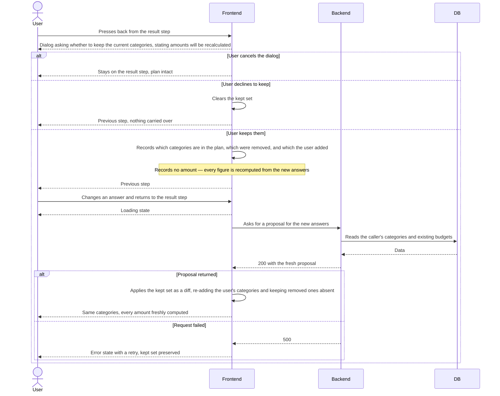

# Implementation Plan: Mobile Visual & Interaction Refinements

**Spec:** [spec.md](./spec.md)
**SRS features touched:** F-05 Budget (presentation) · F-03 Wallet (presentation) · F-07 Report (presentation) · AI Budget Wizard v2 (local draft state)
**Scope:** `mobile/` only. **No Go, no SQL, no migration, no AI service, no endpoint, no query change.**
**Ticket:** N/A — this project tracks work in `specs/` + `CURRENT_STATE.md`, not Jira.
**Code prefix:** `MVR`

---

## Pre-flight: Impact Analysis

⚠️ **GitNexus could not be queried** — same `LadybugDB unavailable … Couldn't replay shadow pages` failure documented in the sibling plan. **Re-run `node .gitnexus/run.cjs analyze` before implementation** and re-check the HIGH rows. Blast radius below comes from the TypeScript import graph.

| Symbol | Direct consumers | Risk | Why |
|---|---|---|---|
| `colorForCategory` | 14 files — transactions, budgets, categories, notifications, wallets, chat, home | **HIGH** | ⚠️ **Do not modify.** US-02 needs collision-free colour *within one list*, which this function cannot provide by design (it hashes one id in isolation). Use `buildCategoryColorMap` at the call site instead. Changing `colorForCategory` would repaint every category tile in the app. |
| `formatCurrencyCompact` | `DonutChart`, `SpendingTab`, `TransactionsHeader` | **HIGH** | ⚠️ **Cross-screen.** US-06 changes its magnitude suffixes, which also changes the **Transactions screen's tab figures** — a screen the request did not mention. Intended and correct (one abbreviation style app-wide, S-MVR-46), but it must be verified there too. |
| `theme.colors` | app-wide | **HIGH** | ⚠️ Read-only for this feature. No new token, no changed token value. |
| `WalletCard` | `index.tsx`, and its skeleton | **MEDIUM** | US-07 changes how it is laid out and composed; the card's own fields stay as they are. |
| `LiquidCircle` | `index.tsx` only | LOW | Single consumer. |
| `ProposalRow`, `WizardResultFooter` | `WizardStepResult.tsx` only | LOW | Single consumer each. |
| `withRemovedRow` | `use-budget-wizard-state.ts` only | LOW | ✅ Already generic — US-04 needs **no change to it**, only to the UI condition that gates the affordance. |
| `BudgetsTab` filter chips | self-contained | LOW | Local to one file. |
| `budgetRowStatus` | `BudgetsTab`, `index.tsx` | **MEDIUM** | US-01 must read the colours it already assigns, not invent parallel ones. Read-only. |

### GitNexus outcome (TDG-T16 / MVR-T16 — completed)

`node .gitnexus/run.cjs analyze` was re-run. It exits 0 and the database is queryable again, **but it did not index this repository**: `gitnexus://repo/PFM/context` reports **8 files, 251 symbols, 0 processes, 66 commits behind HEAD**, and `impact` returns "Target not found" for every symbol named below. FTS is also unavailable (`analyze --repair-fts` suggested). **GitNexus gave no usable blast radius for this work.** The table below therefore stands on the TypeScript import graph alone, which for this codebase is sound — every symbol is explicitly imported, with no dynamic dispatch or reflection.

⚠️ One reference the symbol-level grep missed and the route-path grep caught: `BottomNav.tsx` also hard-codes the history-log route. See TDG-T13.

### Pre-existing file-size violations

CLAUDE.md: *"File > 300 lines → tách ra. Không có ngoại lệ."* Four files this feature must edit already violate it:

| File | Lines | Required action |
|---|---|---|
| `app/(app)/index.tsx` | 638 | ⚠️ US-07 adds a carousel here — it **must** be extracted (MVR-T12) |
| `src/features/budgets/components/BudgetsTab.tsx` | 459 | ⚠️ US-01 edits it — extract the chip row (MVR-T01) |
| `src/features/budget-wizard/hooks/use-budget-wizard-state.ts` | 403 | ⚠️ US-05 adds state here — extract the step-back logic (MVR-T07) |
| `src/features/budget-wizard/components/WizardStepResult.tsx` | 297 | ⚠️ **3 lines of headroom.** Any addition must be paid for by an extraction (MVR-T05) |

**No task may leave a file it touches above 300 lines.**

---

## Pre-flight: Spec Review Findings

| # | Finding | Type | Resolution |
|---|---|---|---|
| 1 | Spec US-02 asks for distinct colours per row. `ProposalRow` currently calls `colorForCategory(entry.category_id)` per row, independently — which is exactly why a newly added row (whose id is a `new:<timestamp>` placeholder) can collide. | Root cause identified | `WizardStepResult` builds one `buildCategoryColorMap` over the ordered row list and passes each row its colour as a prop. `ProposalRow` stops choosing its own. |
| 2 | Spec US-02 also requires the bar segments to match. `WizardStepResult` currently builds segments with `colorForCategory` too, separately from the rows. | Second source of truth | ⚠️ One map, consumed by both the bar and the rows. Two independent derivations of the same colour is the defect, not the symptom. |
| 3 | Spec US-04 needs suggested rows to be removable. `withRemovedRow` is already generic; only `WizardStepResult`'s `addedIds.includes(...)` gate blocks it. | Smaller than it looks | Drop the gate. `addedIds` is still needed — it feeds the saved-plan shape. |
| 4 | Spec S-MVR-26 requires an empty plan to be blocked at submission. Nothing blocks it today, and confirming replaces the account's entire budget set. | ⚠️ **Financial-consistency gap** | `requestSubmit` gains an empty-plan guard **before** the overwrite confirmation. Without it, US-04 turns a removable row into a way to silently wipe every budget. |
| 5 | Spec US-05 requires categories to survive a step-back and amounts never to. The existing saved-plan mechanism (`applySavedPlanRows`) restores **both**. | Must not be reused | ⚠️ A separate, in-session-only `keptCategoryIds` set. Reusing the saved-plan path would restore stale amounts and contradict Context #4. |
| 6 | Spec S-MVR-36: after a profile change, kept decisions must not suppress rows the new profile introduces. | Sharp edge | The kept set records **additions and removals**, applied as a diff to whatever the new proposal returns — not as a replacement for it. |
| 7 | Request item 3 (ghost "save plan" button, left of submit) has no user story — it is layout with no behaviour. | Spec gap, deliberate | Folded into MVR-T06 as a footer layout task. Recorded here so it is not lost. |
| 8 | Spec US-06 names Settings and Insights. The compact-figure suffixes live in a shared helper used by the **Transactions** screen too. | Wider than stated | Intended (S-MVR-46). Regression scope below names Transactions explicitly. |
| 9 | Spec US-07 asks for glassmorphism. `expo-blur` **is** installed. `react-native-reanimated` and `react-native-gesture-handler` are **not**. | Constraint | Blur is available. The carousel must be built on core `Animated` + `ScrollView` snapping — no new dependency. |
| 10 | Spec US-03's hardest case (S-MVR-17, text crossing the wave) rules out a threshold-based colour flip. | Constraint | A constant treatment that does not read the fill level per frame — see Architecture. |

---

## Architecture

### File layout (mobile only)

```text
mobile/
├── app/(app)/
│   ├── index.tsx                                    # MODIFIED — sheds the wallets section
│   ├── insights.tsx                                 # MODIFIED — title + tab labels
│   └── settings.tsx                                 # MODIFIED — labels only
└── src/
    ├── lib/
    │   ├── currency.ts                              # MODIFIED — magnitude suffixes
    │   └── theme.ts                                 # UNCHANGED — read-only, no new token
    ├── components/shared/
    │   └── LiquidCircle.tsx                         # MODIFIED — label legibility
    └── features/
        ├── budgets/components/
        │   ├── BudgetsTab.tsx                       # MODIFIED — consumes the chip row
        │   └── BudgetFilterChips.tsx                # NEW — extracted, status-coloured
        ├── budget-wizard/
        │   ├── components/
        │   │   ├── WizardStepResult.tsx             # MODIFIED — one colour map, remove on every row
        │   │   ├── WizardResultFooter.tsx           # MODIFIED — ghost + primary side by side
        │   │   ├── WizardBackConfirmDialog.tsx      # NEW — the keep-categories prompt
        │   │   └── ProposalRow.tsx                  # MODIFIED — takes its colour as a prop
        │   ├── hooks/
        │   │   ├── use-budget-wizard-state.ts       # MODIFIED — delegates step-back
        │   │   └── use-wizard-kept-categories.ts    # NEW — the in-session kept set
        │   └── proposal-edits.ts                    # MODIFIED — one diff helper added
        └── wallets/components/
            ├── WalletCarousel.tsx                   # NEW — the stacked carousel
            ├── WalletStackCard.tsx                  # NEW — one card at a stack depth
            └── WalletCardSkeleton.tsx               # MODIFIED — stack-shaped placeholder
```

### Client state objects

| Object | Where | Key fields | Notes |
|---|---|---|---|
| `keptCategoryIds` | `use-wizard-kept-categories.ts`, component-local | `kept: Set<string>`, `removed: Set<string>`, `addedRows: {id, name}[]` | ⚠️ **In-session only.** Never persisted, never written to the saved-plan store, never sent anywhere. Cleared when the wizard closes. |
| Carousel front index | `WalletCarousel.tsx`, component-local | `index: number` | ⚠️ Presentation only. Not persisted, and it does **not** change the default-wallet setting (S-MVR-64 equivalent, spec Edge 4). |
| Row colour map | `WizardStepResult.tsx`, derived per render | `Map<categoryId, colour>` | Derived from the visible row list, memoised on it. Never stored. |
| Budget row status | existing `budgetRowStatus` | `state`, `colour` | ⚠️ Read-only. US-01 consumes the colours it already assigns. |

### Business rules

| ID | Rule | Source AC | Enforcement point |
|---|---|---|---|
| BR-MVR-01 | A filter chip's colour is the colour its matching rows already use | S-MVR-02 | `BudgetFilterChips` reads the shared status derivation; it defines no colour of its own |
| BR-MVR-02 | Colour is never the only signal | S-MVR-01, Edge 3 | Every chip keeps its text label and count badge |
| BR-MVR-03 | Row colours are allocated across the whole visible list, not per row | S-MVR-08, S-MVR-09 | `WizardStepResult` builds one map; `ProposalRow` receives a colour and picks none |
| BR-MVR-04 | Bar segments and rows read the same map | S-MVR-08, Finding 2 | One map, two consumers, in one file |
| BR-MVR-05 | The buffer segment is never a palette colour | S-MVR-13 | Existing hatched non-category fill, untouched |
| BR-MVR-06 | The fill circle's label is legible at every fill level and in any fill colour, without reading the fill level | S-MVR-16, S-MVR-17, S-MVR-18, S-MVR-19 | `LiquidCircle` — a constant treatment, not a per-frame decision |
| BR-MVR-07 | Every proposal row is removable | S-MVR-22, S-MVR-24 | `WizardStepResult` passes `onRemove` unconditionally |
| BR-MVR-08 | ⚠️ A removal returns the row's **edited** amount to the buffer, and the buffer is always re-derived, never adjusted by a delta | S-MVR-27 | Existing `reconcile` in `proposal-edits.ts` — already correct, must not be replaced |
| BR-MVR-09 | ⚠️ An empty plan cannot be submitted | S-MVR-26 | `requestSubmit` guard, **before** the overwrite confirmation |
| BR-MVR-10 | ⚠️ Removing a not-yet-created category removes its pending entry, so nothing is created on submit | S-MVR-28 | Existing `removeProposalRow` — already correct, verify it still runs for suggested rows |
| BR-MVR-11 | Stepping back always asks, with three distinct outcomes | S-MVR-30, S-MVR-32, S-MVR-33 | `WizardBackConfirmDialog` between the back control and `goBack` |
| BR-MVR-12 | ⚠️ Keeping preserves categories and **no amount** | S-MVR-31 | The kept set holds ids and names only; it has no amount field to leak one |
| BR-MVR-13 | A changed profile still shows its own rows | S-MVR-36 | The kept set is applied as a diff over the fresh proposal, not as a replacement |
| BR-MVR-14 | Nothing is written before the wizard's final confirmation | S-MVR-40 | Unchanged — no task in this plan adds a write |
| BR-MVR-15 | Every wallet is reachable by flicking | S-MVR-54, Edge 1 | Bounded offsets; the scroll container holds one entry per wallet |
| BR-MVR-16 | ⚠️ No cross-currency total is shown across the stack | S-MVR-58 | Each card renders its own currency; the carousel computes no total |
| BR-MVR-17 | ⚠️ No balance is clipped | S-MVR-57 | Existing shrink-to-fit on the balance, preserved |

⚠️ **Money:** this feature performs **no arithmetic on any amount**, with one exception — the wizard's buffer reconciliation on removal, which is existing code reused unchanged (BR-MVR-08). Integer cents (xu) throughout. US-06 changes the *suffix characters* on compact figures, not the magnitudes they stand for or any rounding rule.
⚠️ **Time:** no new timestamp is introduced or rendered.
⚠️ **Soft delete:** not applicable — removing a wizard row is local draft state, not a record.

---

## Sequence Diagrams

> Seven of the eight stories are pure presentation with no Backend or DB participation; drawing empty lifelines for them would misrepresent the design (the template's own reasoning for dropping `Frontend` on backend-only flows). **US-05 is the only story that crosses tiers** and is drawn below. US-08 is an investigation finding with a wording change and no flow.

### US-05 — Step back and keep the chosen categories



---

## Error Flows

> ⚠️ **This feature introduces no endpoint and no error code.** The single server interaction is the wizard's existing proposal request, re-issued on return from a step-back. Every row is existing behaviour.

| Scenario | HTTP | Error code | Class | Client behaviour |
|---|---|---|---|---|
| Missing / expired access token on the proposal request | 401 | — | Validation (client) | Existing interceptor forces re-login; the kept set is lost with the session |
| Proposal request rejected as invalid | 400 | `INVALID_INPUT` | Validation (client) | Existing error state with retry; ⚠️ kept set **preserved** so a retry does not cost the user their categories (S-MVR-38) |
| Proposal service unavailable | 503 | `AI_SERVICE_UNAVAILABLE` | **System (server)** | Existing error state with retry; kept set preserved |
| Unexpected server failure | 500 | — | **System (server)** | Existing error state with retry; kept set preserved |
| Network unreachable | — | — | Transport | Existing error state with retry; kept set preserved |
| Plan has no rows at submission | — | — | ⚠️ **Client-side guard** | Submission blocked with an explanatory message; **no request is sent** (BR-MVR-09). Never reaches the server, because a server that accepted it would wipe the user's budgets. |

All checks on the proposal path are **gating and sequential** (authentication, then input validity, then service availability). No independent field-level check set exists in this feature.

---

## Security

| Concern | Decision |
|---|---|
| Authorization boundary | ⚠️ **Unchanged.** No new endpoint, no changed request, no new data reaching the client. |
| Data exposure | This feature changes only how already-fetched, already-authorized data is rendered. It surfaces no field the user could not already see. |
| Admin-only visibility | ⚠️ US-06 translates Settings row labels. The admin-only filter is on the row's own flag, not its label — MVR-T09 must not touch it (S-MVR-48). |
| Actor resolution | Unchanged — the existing middleware resolves the caller from the access token. |
| CSRF | N/A — bearer token from a native client; no ambient cookie credential. |
| Logging | ⚠️ No amount, balance, wallet name or category name may be written to any client log by this feature. |

---

## Convention Notes

| Rule | Status | How this feature satisfies it |
|---|---|---|
| No colour literal outside the token file | **Required — currently violated nearby** | ⚠️ Every colour in this feature comes from `theme.ts`. ⚠️ `BudgetsTab` currently inlines `"rgba(133,255,51,0.08)"`; MVR-T01 moves the chip styles to tokens rather than copying the literal forward. |
| No new design token | Required | US-01 uses the existing warning and over-limit tokens; US-02 uses the existing 50-entry palette |
| Server state via TanStack Query only | Required | Untouched — no query changes, and nothing is copied into `useState` |
| Wizard draft state stays local | Required | The kept set is `useState`, never persisted and never sent |
| No file over 300 lines | **Required, currently violated** | MVR-T01, T05, T07, T11 extract before editing |
| `const` by default, no `any` | Required | New components and the kept-set hook are fully typed |
| Money as integer cents, never float | Required | ⚠️ Display only, except the existing buffer reconciliation |
| Skeleton loading preserved | Required | MVR-T13 reshapes the wallet skeleton to the stack; it is not removed |
| No new dependency | Required | ⚠️ `reanimated` / `gesture-handler` are **not installed**. Carousel uses core `Animated` + `ScrollView` snapping. `expo-blur` is already a dependency and may be used. |
| Hand-written API types mirror the Go DTO | Required | No type touches the wire in this feature |

### Named constants (no bare numbers)

| Constant | Where | Why |
|---|---|---|
| `STACK_CARD_WIDTH`, `STACK_PEEK_OFFSET`, `STACK_MAX_VISIBLE_DEPTH`, `STACK_SCALE_STEP`, `STACK_OPACITY_STEP` | `WalletCarousel.tsx` | ⚠️ `STACK_MAX_VISIBLE_DEPTH` is what stops offsets accumulating off screen (S-MVR-54, BR-MVR-15) |
| `MIN_PLAN_ROWS` | wizard state | ⚠️ The empty-plan guard's threshold (BR-MVR-09) |
| `LABEL_SCRIM_OPACITY` | `LiquidCircle.tsx` | The legibility treatment's strength — must not hide the fill (spec Edge 1) |
| Magnitude suffixes | `currency.ts` | ⚠️ Named constants, not inline strings, so all three consumers cannot drift |

---

## Element IDs (QA automation)

| Element | `testID` | Status | File |
|---|---|---|---|
| Budget filter chip (per key) | `chip-budget-filter-{key}` | **Missing** | `BudgetFilterChips.tsx` |
| Wizard remove-row control | `btn-wizard-remove-row-{categoryId}` | **Exists** | `ProposalRow.tsx` — ⚠️ now rendered for every row, not only added ones |
| Wizard save-plan (ghost) | `btn-wizard-save-plan` | **Exists** | `WizardResultFooter.tsx` — keep the id through the layout change |
| Wizard submit | `btn-wizard-submit` | **Exists** | `WizardResultFooter.tsx` — keep the id |
| Step-back confirmation dialog | `dialog-wizard-back-confirm` | **Missing** | `WizardBackConfirmDialog.tsx` |
| Empty-plan block message | `text-wizard-empty-plan` | **Missing** | `WizardStepResult.tsx` |
| Wallet carousel | `carousel-wallets` | **Missing** | `WalletCarousel.tsx` |
| Wallet card at the front | `card-wallet-{walletId}` | **Missing** | `WalletStackCard.tsx` |
| Home remaining figure | `text-home-remaining-today` | **Exists** | `index.tsx` — ⚠️ must survive the wallets extraction |

---

## Regression Scope

| Surface | Why it is at risk | Must re-verify |
|---|---|---|
| ⚠️ **Transactions screen** | `formatCurrencyCompact` is shared — US-06 changes its suffixes | The type-tab trailing figures still read correctly, in both large and small magnitudes |
| ⚠️ **Insights donut centre** | Same helper | The centre figure and the budget figure beneath it still fit and read correctly |
| Home snapshot | US-03 changes `LiquidCircle`; US-07 extracts the wallets block | The ring still sizes to its measured column; the remaining figure and its test id survive |
| Budgets tab | US-01 extracts the chip row | Filtering still works for all three chips; counts still follow the date filter |
| Budget wizard, full flow | US-02/04/05 touch the result step, the footer and the state hook | A plain run with no step-back still reaches the success screen; the saved-plan restore still works and is **not** affected by the kept set |
| Saved-plan store | US-05 introduces a second, similar mechanism | ⚠️ Saving a plan still stores amounts; the kept set still stores none; neither reads the other |
| Wallet skeleton | US-07 changes the section's shape | The loading state still occupies the same height, so content below does not jump |
| Settings | US-06 relabels rows | Every row still navigates; the admin-only row is still hidden for a member; inert rows are still inert |

---

## Open Tasks

| ID | Task | File(s) |
|---|---|---|
| MVR-T01 | ⚠️ Extract the filter chip row out of `BudgetsTab` (459 lines) into `BudgetFilterChips`, taking each chip's colour from the shared status derivation. Move the inline colour literal onto a token. **`BudgetsTab.tsx` must end under 300 lines.** | `BudgetFilterChips.tsx` (new), `BudgetsTab.tsx` |
| MVR-T02 | Verify each chip's selected and unselected states stay distinguishable with two saturated chips on screen at once, and that a zero-count chip is de-emphasised rather than hidden. | `BudgetFilterChips.tsx` |
| MVR-T03 | ⚠️ Build **one** colour map over the ordered proposal rows in `WizardStepResult`; feed it to both the bar segments and the rows. **Do not touch `colorForCategory`** — 14 files depend on it. | `WizardStepResult.tsx` |
| MVR-T04 | Change `ProposalRow` to take its colour as a prop and stop deriving one. | `ProposalRow.tsx` |
| MVR-T05 | ⚠️ Pass `onRemove` for **every** row, not only added ones. Add the empty-state message for a fully emptied plan. **`WizardStepResult.tsx` is at 297 lines — extract the deducted/buffer block to pay for this.** | `WizardStepResult.tsx`, new sibling component |
| MVR-T06 | Re-lay the footer: ghost "save plan" and primary submit side by side, ghost on the left. ⚠️ Keep both existing test ids and the overwrite confirmation exactly as they are. | `WizardResultFooter.tsx` |
| MVR-T07 | ⚠️ Add the empty-plan guard to `requestSubmit`, **before** the overwrite confirmation (BR-MVR-09). Extract the step-back logic out of `use-budget-wizard-state.ts` (403 lines) into the new kept-categories hook. **The hook file must end under 300 lines.** | `use-budget-wizard-state.ts`, `use-wizard-kept-categories.ts` (new) |
| MVR-T08 | Build the step-back dialog with three distinct outcomes, and a diff helper in `proposal-edits.ts` that applies the kept set over a fresh proposal (re-add the user's categories, keep removed ones absent, leave new-profile rows alone). ⚠️ It must have no amount parameter. | `WizardBackConfirmDialog.tsx` (new), `proposal-edits.ts` |
| MVR-T09 | ⚠️ Make the fill circle's label legible at every fill level and in any fill colour, with a constant treatment that does not read the fill level per frame and does not hide the fill. | `LiquidCircle.tsx` |
| MVR-T10 | Translate the remaining Settings and Insights strings, including the screen title and both tab labels. ⚠️ Do not touch the admin-only flag or any test id. Verify every label fits at the narrowest supported width. | `settings.tsx`, `insights.tsx` |
| MVR-T11 | ⚠️ Change the magnitude suffixes on compact figures to the Vietnamese short forms, as named constants. **Then verify all three consumers** — the donut centre, the Insights stat cards, and the Transactions tab figures. | `currency.ts`, then verify `DonutChart.tsx`, `SpendingTab.tsx`, `TransactionsHeader.tsx` |
| MVR-T12 | ⚠️ Extract the wallets section out of `index.tsx` (638 lines) and build the stacked carousel on core `Animated` + a snapping `ScrollView` — no new dependency. Bound the offsets by depth. **`index.tsx` must end under 300 lines.** | `WalletCarousel.tsx` (new), `WalletStackCard.tsx` (new), `index.tsx` |
| MVR-T13 | Handle one-wallet, two-wallet, many-wallet and empty states; reshape the skeleton to the stack and keep the section height fixed so content below does not jump. | `WalletCarousel.tsx`, `WalletCardSkeleton.tsx` |
| MVR-T14 | Verify the carousel's horizontal gesture does not capture the home screen's vertical scroll, and that a fast flick does not queue animations. | `WalletCarousel.tsx` |
| MVR-T15 | Qualify the Transactions period summary so it states which period it covers and that the list is not limited to it, shown only when no date filter is applied. ⚠️ **Change no figure, no filter default and no query.** | `TransactionsHeader.tsx` |
| MVR-T16 | ⚠️ **Re-run `node .gitnexus/run.cjs analyze`, then `impact` on `colorForCategory`, `formatCurrencyCompact`, `WalletCard`, `LiquidCircle` and `budgetRowStatus`** before the first edit. Report anything the import graph missed. | — |
| MVR-T17 | Run `tsc --noEmit` and `expo lint`; confirm no file touched by MVR-T01…T15 exceeds 300 lines. | — |
| MVR-T18 | ⚠️ **On-device verification in Expo Go.** The fill-circle legibility, the carousel's depth and snapping, and every translated label's fit are all things only a real screen can settle. | — |

### Sequencing

`MVR-T16` → `T01, T02` (budgets, independent) ‖ `T03, T04, T05, T06, T07, T08` (wizard, ordered) ‖ `T09` (independent) ‖ `T10, T11` (copy, `T11` last because it is cross-screen) ‖ `T12, T13, T14` (carousel, ordered) → `T15` → `T17` → `T18`.

The four streams are independent and can be taken in any order. ⚠️ `T11` and `T12` both need care: `T11` reaches a screen outside this feature's stated scope, and `T12` edits the same file as the sibling plan's `TDG-T10`.

### Cross-plan conflict

⚠️ **`app/(app)/index.tsx` is edited by both plans** — `TDG-T10` extracts the pending-confirmations block, `MVR-T12` extracts the wallets section. Both are extractions from the same 638-line file. **Do them in one sitting, `TDG-T10` first**, or the second will be rebasing onto a file the first has already restructured.

### Handoff

| Step | Status | Owner |
|---|---|---|
| Spec | ✅ Done | BA |
| Plan | ✅ This document | Architect |
| GitNexus re-index + impact re-check | ⏳ Blocked — DB locked | Dev (MVR-T16, first task) |
| Implementation | ⏳ Pending | Dev |
| Test cases | ⏳ Pending | QC (`/cook-qc`) |
| On-device verification | ⏳ Pending, never yet performed | Whoever holds a device |
