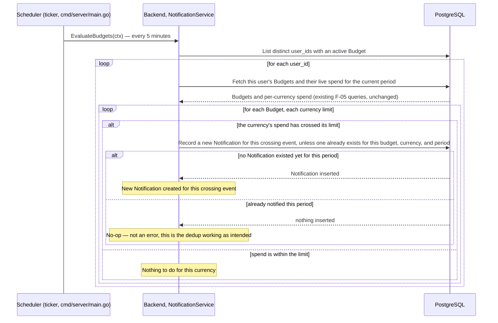
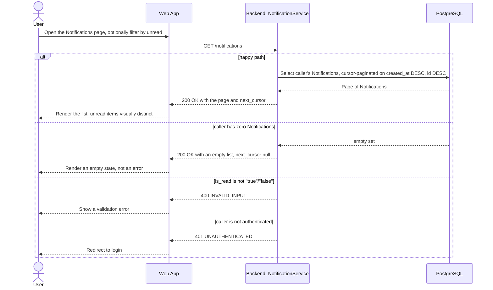
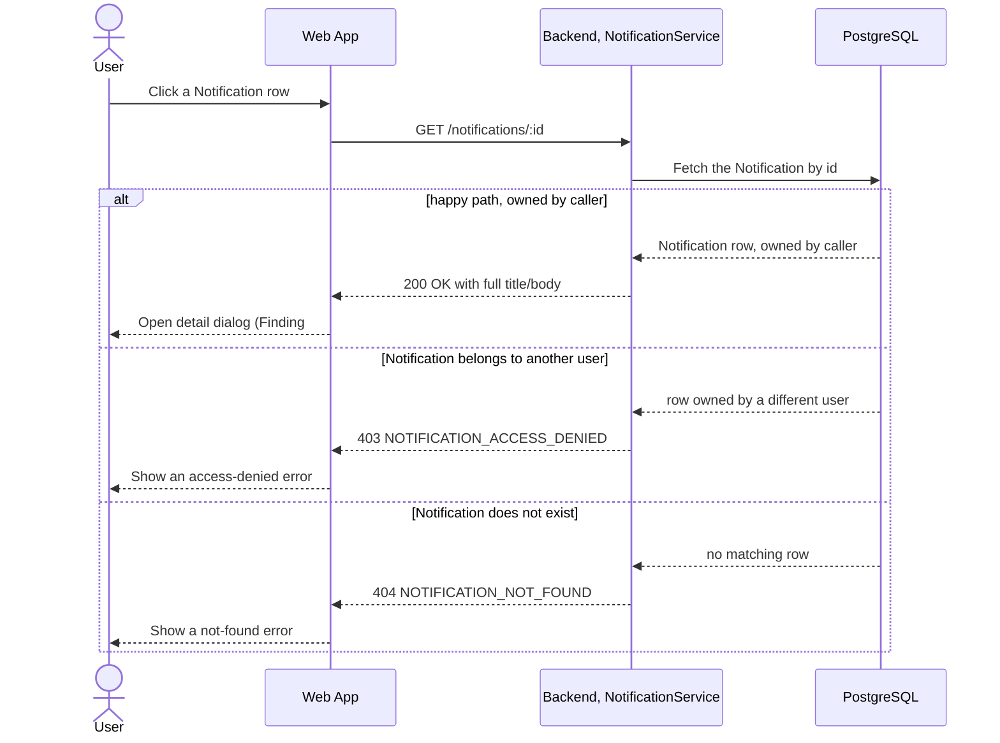
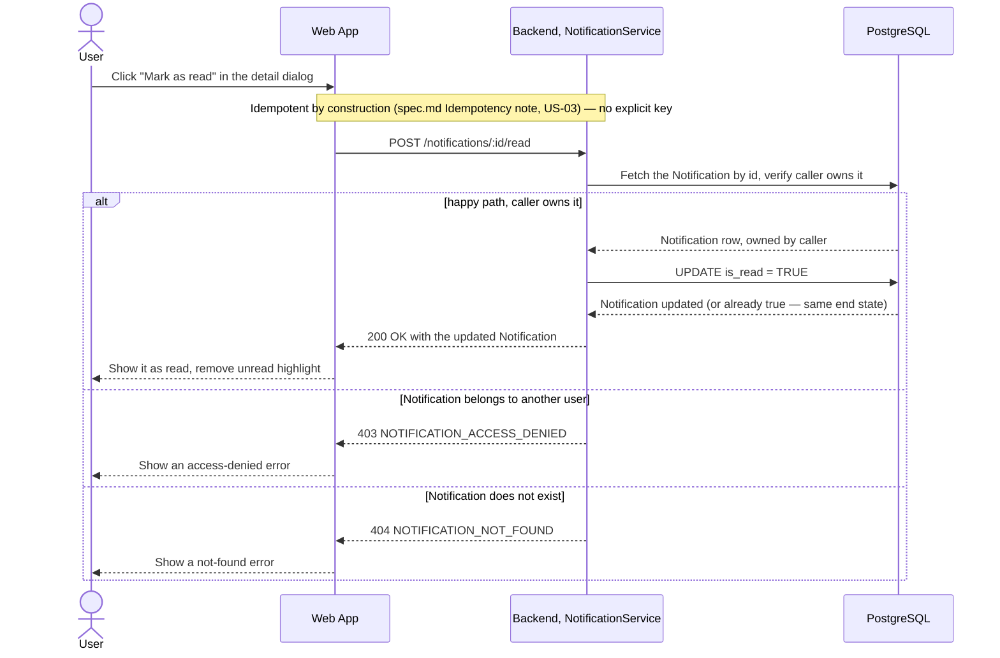

# Implementation Plan: F-10 Notification Handling (MVP)

- **Feature:** Notification Handling
- **SRS Feature Code:** F-10 (SRS.md Feature-10 §6; SDS.md §5.10/§10 are currently empty skeleton headers — no ACs defined there; `spec.md` in this folder is the authoritative source)
- **Jira Epic:** N/A — this repository has no Jira integration wired up (same as every prior plan)
- **Spec:** [spec.md](./spec.md)
- **Related plans:** [F-05 Budget Management](../budget-management/plan.md) (this plan reuses `BudgetRepository.ListBudgetsByUser`/`SpentByUserCurrentPeriod` unchanged, and adds exactly one new method to `BudgetRepo`), [F-04 Category Management](../category-management/plan.md) (reuses `CategoryRepository.GetCategoryByID` for title/body rendering), [F-06 Transaction Management](../transaction-management/plan.md) (no direct dependency — this plan never touches `transactions` or `POST /transactions`, per spec.md Context decision #2/#4's explicit ban on synchronous coupling)
- **Frontend scope:** **web only** (`frontend/`, Next.js). `mobile/` (Flutter) remains deferred per current project direction (`docs/features.md`, 2026-08-13).

---

## 1. Pre-flight: Spec Review Findings

| # | Type | Finding | Resolution / Open Task |
|---|------|---------|-------------------------|
| 1 | **Design decision, no precedent in this codebase** | `spec.md`'s US-00 job must run across **every** user's active Budgets, but the only existing spend-computation method, `BudgetRepo.SpentByUserCurrentPeriod(ctx, userID)`, is scoped to one user at a time (built for a single HTTP request). There is no existing "all users" aggregate query anywhere in this codebase. | This plan adds exactly **one** new method, `BudgetRepo.ListDistinctUserIDsWithActiveBudgets(ctx)`, and has the job loop over that list, calling the existing per-user `ListBudgetsByUser`/`SpentByUserCurrentPeriod` unchanged (Finding #1, spec.md Edge Case US-00 #1: "reuses Budget's existing repository method to avoid the two computations ever silently diverging"). This is O(N) queries per job tick for N users with at least one active Budget — acceptable for this MVP's expected personal-finance user count. Tracked as **NOT-T-FUTURE** (not a numbered Open Task — see §7) to revisit with a single global `GROUP BY user_id, category_id, currency` query only if user count is observed to grow. |
| 2 | **New infrastructure pattern** | Nothing in this codebase runs a periodic background job today — the only existing "background" work is `SMTPEmailSender`'s fire-and-forget goroutine (`go func() { done <- smtp.SendMail(...) }()`), which is per-request, not interval-based. `spec.md`'s Context decision #2 mandates a scheduled process, and `specs/budget-management/plan.md` deliberately created no placeholder for it (Finding #10 there: "No placeholder cron/job is added — that would be inventing F-10 design this plan has no mandate to make"). | This plan wires a plain `time.NewTicker`-driven goroutine directly in `cmd/server/main.go` (§2), started alongside `app.Listen` and stopped on the same shutdown signal `waitForShutdown` already listens for. No new third-party cron/scheduler dependency — a fixed-interval ticker is sufficient for spec.md's "every 5 minutes" default (Open Questions #2), and introducing `robfig/cron` or similar for a single fixed interval would be unjustified new surface area. |
| 3 | **Schema extension, spec-mandated** | `spec.md` Context decision #4 requires extending `CLAUDE.md`'s literal `notifications(id, user_id, type, title, body, is_read, created_at)` definition with `related_budget_id`, `currency`, `period_start` to make the dedup unique index possible. | This plan commits to the extension exactly as spec.md's Domain Fields table describes (§2, Schema) — same kind of extension F-05's plan made to `budgets` with `budget_limits`, and F-07 made with zero new columns at all (the opposite end of the same spectrum). A `CHECK` constraint additionally enforces that `related_budget_id`/`currency`/`period_start` are non-null together whenever `type = 'budget_exceeded'`, so the partial unique index's assumption ("these three columns are populated for every dedup-relevant row") can never be silently violated by a future second notification type. |
| 4 | **Ambiguity, resolved** | `spec.md` leaves the exact SQL mechanism for "never create a duplicate Notification for the same crossing event" unspecified — a business invariant, not an implementation. | This plan implements it as `INSERT ... ON CONFLICT (related_budget_id, currency, period_start) WHERE type = 'budget_exceeded' DO NOTHING`, not a Wallet/Budget-style "catch the unique-violation error and map it to a 409" — because a deduped insert here is a **successful no-op** for the job (spec.md S-NOT-02), never a client-facing error (there is no client in this flow at all). `NotificationRepository.CreateBudgetExceededNotification` returns `(*model.Notification, bool, error)` where the `bool` is `false` when the row already existed (`RETURNING` produced zero rows) — the job logs this at `Debug`, not `Warn`/`Error`. |
| 5 | **Ambiguity, resolved** | `spec.md` doesn't specify how a Notification's `title`/`body` render an amount (thousands separators, decimal display of integer cents, etc.). | This plan renders amounts as a plain `"<major-unit-integer> <CURRENCY>"` string (e.g. `"2,200,000 VND"` using Go's `golang.org/x/text/message` or a small hand-rolled thousands-grouping helper — **this plan chooses a hand-rolled helper**, `common.FormatCents(amountCents int64, currency string) string`, to avoid a new dependency for one formatting concern) — cents are divided by 100 for display, never for storage/comparison. Flagged as **NOT-T-FUTURE**, low priority: revisit only if product wants locale-aware formatting later. |
| 6 | **Cross-service dependency, precedented** | The job needs Budget's live spend data and Category's name, neither of which `NotificationService` owns. | `NotificationService` takes `(notificationRepo NotificationRepo, budgetRepo BudgetRepo, categoryRepo CategoryRepo, logger *zap.Logger)` — this is the same shape of dependency `ReportService` already has (`NewReportService(reportRepo, walletRepo, categoryRepo, logger)`) and `TransactionService` already has (`NewTransactionService(transactionRepo, walletRepo, categoryRepo, logger)`). No new pattern introduced, no changes needed to `BudgetService`/`CategoryService` themselves. |
| 7 | **UI design choice, not mandated by spec** | `spec.md` intentionally keeps backend/UI concerns separate and defines no specific screen layout for US-02 (View a Notification). Every prior MVP feature with a detail view (Wallet, Category, Budget) uses a routed `[id]/page.tsx` detail page. | Given a Notification's entire detail is just `title` + `body` + `created_at` (no nested data, no edit form), this plan uses a **detail dialog** (`notification-detail-dialog.tsx`) opened from a list row, calling `GET /notifications/:id`, instead of a routed detail page — closer to the Reports page's simpler read-only convention than to Wallet/Category/Budget's CRUD-detail convention. This is a deliberate, low-risk deviation flagged here rather than silently decided; either shape satisfies `spec.md`'s API contract identically. |
| 8 | Gap (carried over) | The frontend project still has zero test tooling configured — unchanged since F-03 Finding #8 / F-04 Finding #9 / F-05 Finding #8. | Not committed to in this plan either; tracked as **NOT-T-FUTURE**. |

### Regression Scope

**New files only:**
- `backend/db/migrations/009_notifications.sql`, `backend/db/queries/notifications.sql`
- `backend/internal/model/notification.go`, `backend/internal/repository/notification_repository.go`, `backend/internal/service/notification_service.go`, `backend/internal/handler/notification_handler.go`, `backend/internal/dto/notification_request.go`, `backend/internal/dto/notification_response.go`
- `frontend/src/features/notifications/**`, `frontend/src/app/app/notifications/page.tsx`

**Modified files (additive only):**
- `backend/cmd/server/routes.go` — new `/notifications` group; no existing route touched.
- `backend/cmd/server/main.go` — wires `NotificationRepository`/`Service`/`Handler` (same pattern as every prior feature) **and** starts/stops the new ticker goroutine (Finding #2) — the only file in this plan with genuinely new *kind* of wiring, not just "one more feature's boilerplate."
- `backend/internal/common/errors.go` — two new error codes appended (`ErrCodeNotificationAccessDenied`, `ErrCodeNotificationNotFound`); nothing renamed.
- `backend/internal/common/constants.go` — `NotificationJobInterval`, `NotificationTypeBudgetExceeded` appended.
- `backend/db/queries/budgets.sql` — **one new query appended**, `ListDistinctUserIDsWithActiveBudgets` (Finding #1), invoked by `NotificationService` via the existing `BudgetRepo` interface — no new cross-repository exception (this query only touches `budgets`, which `BudgetRepository` already owns).
- `backend/internal/service/interfaces.go` — new `NotificationRepo` interface + compile-time check appended; `BudgetRepo` interface gains the one method above.
- `frontend/src/features/auth/components/app-header.tsx` — adds a "Notifications" nav link.
- `docker-compose.yml` — new `009_notifications.sql` mount line (`CLAUDE.md`'s manual-mount convention, unchanged process — see `docs/features.md` Technical Debt #1 for the known friction here).

**Regression risk:** near zero — every change to existing files is additive (new query, new error codes, new constants, new route group, new service constructor call in `main.go`). No existing method signature changes. The one file with non-trivial new behavior, `main.go`, is exercised by manual/integration testing of server startup and graceful shutdown (ticker must stop cleanly), not by any existing feature's test suite.

---

## 2. Architecture

### Package/File Layout

**Backend (Go Fiber + sqlc)**

```text
backend/internal/
├── handler/
│   └── notification_handler.go     # ListNotifications, GetNotification, MarkNotificationRead
├── service/
│   └── notification_service.go     # ListNotifications, GetNotification, MarkRead, EvaluateBudgets (the job)
├── repository/
│   └── notification_repository.go  # sqlc wrapper: CreateBudgetExceededNotification (ON CONFLICT DO NOTHING),
│                                    # ListNotificationsByUser, CountNotifications, GetNotificationByID, MarkNotificationRead
├── model/
│   └── notification.go             # Notification struct — zero framework imports
└── dto/
    ├── notification_request.go     # ListNotificationsQuery (is_read, cursor, limit)
    └── notification_response.go    # NotificationResponse, ListNotificationsResponse

# Modified (Finding #1):
├── repository/budget_repository.go # + ListDistinctUserIDsWithActiveBudgets
└── service/interfaces.go           # BudgetRepo gains the above; new NotificationRepo interface

cmd/server/
└── main.go                         # + notification wiring, + notification scheduler goroutine (Finding #2)

db/
├── migrations/
│   └── 009_notifications.sql       # notifications table, dedup index, CHECK constraint
└── queries/
    ├── notifications.sql           # CreateBudgetExceededNotification, ListNotificationsByUser,
    │                                # CountNotifications, GetNotificationByID, MarkNotificationRead
    └── budgets.sql (append)        # ListDistinctUserIDsWithActiveBudgets
```

`common/errors.go` and `common/constants.go` are extended in place (new entries appended).

**Frontend (Next.js web)**

```text
frontend/src/
├── app/app/
│   └── notifications/
│       └── page.tsx                                  # NotificationsPage — list + unread filter
├── features/notifications/
│   ├── api/
│   │   ├── use-notifications-query.ts                # GET /notifications
│   │   ├── use-notification-query.ts                 # GET /notifications/{id} (used by the detail dialog)
│   │   └── use-mark-notification-read-mutation.ts     # POST /notifications/{id}/read
│   ├── components/
│   │   ├── notification-list.tsx                     # rows, unread visually distinct
│   │   ├── notification-list-skeleton.tsx
│   │   └── notification-detail-dialog.tsx            # US-02 (view) + US-03 (mark-as-read button) — Finding #7
│   └── types.ts                                       # Notification, ListNotificationsResponse
```

### Domain Objects

| Entity | Table | Key Fields | Notes |
|--------|-------|------------|-------|
| `Notification` | `notifications` | `id` (UUID v4), `user_id` (FK → `users.id`), `type` (TEXT, MVP only emits `"budget_exceeded"`), `title`/`body` (TEXT, denormalized at insert — spec.md Context #3), `is_read` (BOOLEAN, one-way `false→true`), `related_budget_id` (nullable UUID, FK → `budgets.id`), `currency` (nullable TEXT, `{VND,USD}`), `period_start` (nullable DATE), `created_at` | No `deleted_at` — no delete story in `spec.md` (Out of Scope). No money field of its own; `title`/`body` are pre-rendered strings, not structured amounts — the underlying amounts are governed by Budget's own ⚠️ money rule, already enforced before this feature ever reads them. |

### Schema — `009_notifications.sql`

```sql
CREATE TABLE notifications (
    id                UUID PRIMARY KEY DEFAULT uuid_generate_v4(),
    user_id           UUID NOT NULL REFERENCES users(id),
    type              TEXT NOT NULL,
    title             TEXT NOT NULL,
    body              TEXT NOT NULL,
    is_read           BOOLEAN NOT NULL DEFAULT FALSE,
    related_budget_id UUID REFERENCES budgets(id),
    currency          TEXT CHECK (currency IN ('VND', 'USD')),
    period_start      DATE,
    created_at        TIMESTAMPTZ NOT NULL DEFAULT NOW(),
    -- spec.md Context decision #4 / Domain Fields: these three columns are
    -- only meaningful for type='budget_exceeded' today, but must always be
    -- populated together whenever that type is used — this is what makes the
    -- dedup unique index below actually reliable, not just "usually correct."
    CONSTRAINT chk_notifications_budget_exceeded_fields CHECK (
        type <> 'budget_exceeded'
        OR (related_budget_id IS NOT NULL AND currency IS NOT NULL AND period_start IS NOT NULL)
    )
);

-- Source of truth for "at most one budget_exceeded Notification per
-- (budget, currency, calendar period)" (spec.md Business invariants /
-- S-NOT-06) — enforced at the DB level, same precedent as F-03's
-- one-default-wallet index and F-05's one-active-budget index, so the
-- background job can run repeatedly (even concurrently) without ever
-- producing a duplicate.
CREATE UNIQUE INDEX idx_notifications_budget_exceeded_dedup
    ON notifications (related_budget_id, currency, period_start)
    WHERE type = 'budget_exceeded';

-- Backs GET /notifications (cursor pagination, created_at DESC, id DESC —
-- same convention as F-01's admin/users list).
CREATE INDEX idx_notifications_user_created_at ON notifications (user_id, created_at DESC, id DESC);
CREATE INDEX idx_notifications_user_unread ON notifications (user_id) WHERE is_read = FALSE;
```

### Business Rules

| Rule | Source | Enforcement |
|------|--------|-------------|
| Job re-evaluates every active Budget's live `spent` vs. `amount_limit`, per currency | US-00 step 2–3 | `NotificationService.EvaluateBudgets` — loops `BudgetRepo.ListDistinctUserIDsWithActiveBudgets` → `ListBudgetsByUser`/`SpentByUserCurrentPeriod` per user (Finding #1) |
| At most one `budget_exceeded` Notification per `(related_budget_id, currency, period_start)` | S-NOT-02, S-NOT-06 | DB partial unique index + `INSERT ... ON CONFLICT DO NOTHING` (Finding #4) — never a duplicate even under concurrent job ticks |
| A Budget with N exceeded currencies produces N independent Notifications | S-NOT-03 | job loops per-currency inside per-budget, one insert attempt each |
| `title`/`body` are rendered once at creation, never re-derived | Context decision #3 | `NotificationService.buildBudgetExceededNotification` — pure function, called only from `EvaluateBudgets`, never from any read path |
| Job reuses Budget's existing spend computation, never duplicates it | Edge Case US-00 #1 | `EvaluateBudgets` calls `BudgetRepo.SpentByUserCurrentPeriod` (already exists, no new aggregate query) |
| `GET /notifications*` scoped strictly to `user_id = caller` | S-NOT-11 | `NotificationRepository.ListNotificationsByUser`/`GetNotificationByID` — `WHERE user_id = $1` |
| Not-found vs. access-denied split | S-NOT-14 vs. S-NOT-15 | fetch first, then decide `404 NOTIFICATION_NOT_FOUND` / `403 NOTIFICATION_ACCESS_DENIED` — same pattern as Wallet/Category/Budget/Transaction |
| `is_read` is one-way (`false → true`) | Context decision #5 | `MarkNotificationRead` query only ever sets `is_read = TRUE`; no endpoint sets it back to `false` |
| Mark-as-read is idempotent | S-NOT-18 | `UPDATE ... SET is_read = TRUE WHERE id=$1 AND user_id=$2 RETURNING *` — succeeds identically whether `is_read` was already `true` |
| Viewing a Notification never marks it read as a side effect | US-02 Edge Case #1 | `NotificationService.GetNotification` never calls `MarkRead`; the frontend detail dialog issues a separate explicit mutation only when the User clicks "Mark as read" |
| `is_read` query filter validated | S-NOT-10 | handler parses `is_read` as a string, `400 INVALID_INPUT` unless empty/`"true"`/`"false"` |
| Unauthenticated caller rejected | S-NOT-12, S-NOT-16, S-NOT-21 | `middleware.JWTAuth` at route-group level → `401` |

### API Index — Endpoint → Service Traceability

| API | Request | Response | Service Method |
|-----|---------|----------|-----------------|
| `GET /notifications` | `ListNotificationsQuery` (query params) | `ListNotificationsResponse` (`200`) | `NotificationService.ListNotifications` |
| `GET /notifications/{id}` | — | `NotificationResponse` (`200`) | `NotificationService.GetNotification` |
| `POST /notifications/{id}/read` | — | `NotificationResponse` (`200`) | `NotificationService.MarkRead` |
| *(none — internal)* | — | — | `NotificationService.EvaluateBudgets` (ticker-invoked, `cmd/server/main.go`) |

### Security & Actor Resolution

- **Middleware:** all three HTTP endpoints sit under one `JWTAuth(tokens, logger)` route group — no `RequireRole` gate, same convention as `/wallets`, `/categories`, `/budgets`, `/transactions`, `/reports`.
- **Actor resolution path:** identical to every prior feature — `callerUUID(c)` reads JWT-populated Fiber locals once in `notification_handler.go`, passed into every `NotificationService` method as an explicit `userID uuid.UUID` parameter.
- **`EvaluateBudgets` has no caller-scoped actor at all** — it is not an HTTP request; it iterates every user with an active Budget by design, and each iteration's DB writes are scoped by that specific `userID` internally, never by a JWT.
- **Cross-repository/cross-service note (Finding #6):** `NotificationService` depends directly on `BudgetRepo` and `CategoryRepo` — the same shape of dependency `ReportService`/`TransactionService` already have on other features' repositories. This is read-only composition, not a rewrite of Budget's or Category's own CRUD surface.
- **CSRF:** not applicable — Bearer-JWT API, no cookie/session auth surface (same reasoning as every prior plan).
- **Bookmark / direct-URL access:** a User navigating directly to `/app/notifications` sees only their own data — `GET /notifications` enforces `user_id = caller` server-side regardless of navigation path.
- **Validation-check independence:** on `GET /notifications`, `is_read` format and `cursor` format (US-01) are **independent** field-level checks — both run through handler-level validation and are collected into a single `400` response's `details` array (existing `newValidationError` convention), never a fix-one-resubmit-one flow. On `GET /notifications/{id}` and `POST /notifications/{id}/read`, existence → ownership is **sequential/gating** — ownership cannot be evaluated before the row is fetched, so `NotificationService.getOwnedNotification` correctly short-circuits (404 before 403 is ever reached), same pattern as every prior feature's owned-resource check.

### Sequence Diagrams

> Five-tier lifeline (User → Frontend → Backend → DB), happy path first with `alt/else` branches beneath. These diagrams are AI-generated and require human review before implementation begins.

**US-00: Generate Budget-Crossing Notifications (system-triggered, no User/Frontend actor)**



**US-01: View the List of Notifications**



**US-02: View a Notification**



**US-03: Mark a Notification as Read**



---

## 3. Error Flows

### US-00: Generate Budget-Crossing Notifications (internal — no HTTP surface)

| Scenario | HTTP | Error Code |
|----------|------|------------|
| *(not applicable — no HTTP endpoint; failures are logged, not returned to any caller)* | — | — |
| Unexpected DB error mid-evaluation for one user | — (logged `Error`, loop continues to the next user) | — |

### US-01: View the List of Notifications

| Scenario | HTTP | Error Code |
|----------|------|------------|
| Unauthenticated | 401 | — |
| `is_read` present but not `"true"`/`"false"` | 400 | `INVALID_INPUT` |
| `cursor` malformed | 400 | `INVALID_INPUT` |
| Unexpected error | 500 | — |

*(Zero Notifications is `200` with an empty list — not an error path; see `spec.md` S-NOT-08.)*

### US-02: View a Notification

| Scenario | HTTP | Error Code |
|----------|------|------------|
| Unauthenticated | 401 | — |
| `{id}` not a valid UUID | 400 | `INVALID_INPUT` |
| Notification belongs to another user | 403 | `NOTIFICATION_ACCESS_DENIED` |
| Notification not found | 404 | `NOTIFICATION_NOT_FOUND` |
| Unexpected error | 500 | — |

### US-03: Mark a Notification as Read

| Scenario | HTTP | Error Code |
|----------|------|------------|
| Unauthenticated | 401 | — |
| `{id}` not a valid UUID | 400 | `INVALID_INPUT` |
| Notification belongs to another user | 403 | `NOTIFICATION_ACCESS_DENIED` |
| Notification not found | 404 | `NOTIFICATION_NOT_FOUND` |
| Unexpected error | 500 | — |

---

## 4. Constitution / Convention Notes

| Rule | Status | Note |
|------|--------|------|
| Service layer owns business rules | Required | Dedup semantics, title/body rendering, and the 403-vs-404 split all live in `NotificationService`/`NotificationRepository` — never in `notification_handler.go` |
| Handler validates shape only | Required | `is_read`/`cursor`/`limit` parsed and shape-checked in `notification_handler.go` before the service is invoked, mirroring `user_handler.go`'s `ListUsers` |
| Transactional atomicity | N/A | Every write in this feature is a single-statement `INSERT ... ON CONFLICT DO NOTHING` or single-row `UPDATE` — no multi-statement write, no `pgx.Tx` needed (same reasoning as F-03/F-04/F-05's single-row updates) |
| Read flows non-transactional | Required | `ListNotifications`/`GetNotification` are plain reads, no transaction wrapper |
| Concurrency strategy — dedup | DB-enforced, required ⚠️ | Partial unique index + `ON CONFLICT DO NOTHING` (Finding #4) — correctness never depends on the job being a documented singleton process |
| Money stored as BIGINT cents | Required ⚠️ | This feature stores no money field itself — `title`/`body` are rendered *from* Budget's already-BIGINT-cents `amount_limit`/`spent` via `common.FormatCents`, never the reverse; no float anywhere in the render path |
| Audit logging | Not required (MVP) | No `audit_log` table exists in the schema (same reasoning as F-01–F-07); job failures are logged via Zap `Error` with `user_id`/`budget_id` context, never with amounts formatted as anything but integers |
| Idempotency on write — job (`EvaluateBudgets`) | Satisfied, DB-enforced | Re-running the job any number of times against unchanged data produces zero additional Notifications after the first successful insert per `(related_budget_id, currency, period_start)` |
| Idempotency on write — `MarkRead` | Satisfied | Setting `is_read = TRUE` any number of times converges to the same state; no idempotency key needed (mirrors F-03's `SetDefaultWallet`) |
| Idempotency on write — `ListNotifications`/`GetNotification` | N/A | Read-only (`GET`), naturally idempotent |
| JWT auth enforced at middleware | Required | `/notifications*` registered under the same `JWTAuth` group pattern as every prior feature |
| Actor resolution | Required | `callerUUID(c)` reads `JWTAuth`-populated locals once in the handler; passed to every `NotificationService` HTTP-facing method as an explicit `userID` param — `EvaluateBudgets` has no such param (Security & Actor Resolution, above) |
| User isolation on every query | Required | Every `notification_repository.go` read/write method scopes by `user_id`; cross-user data never reaches a response |
| Soft delete respected | N/A | `notifications` has no `deleted_at` — no delete story exists in `spec.md` (Out of Scope) |
| Timestamps UTC stored / local displayed | Required | `created_at` is `TIMESTAMPTZ` stored UTC; `period_start` is a plain `DATE` (no time component, mirrors Budget's `start_date`); the web app formats for display only |
| Cross-service dependency | Documented, precedented | `NotificationService` depends directly on `BudgetRepo`/`CategoryRepo` (Finding #6) — same shape as `ReportService`/`TransactionService`'s existing dependencies, not a new pattern |
| New infrastructure: periodic job | Documented ⚠️ | First `time.Ticker`-based background loop in this codebase (Finding #2) — must be started after `app.Listen` and stopped via the same shutdown signal in `waitForShutdown`, so a `SIGTERM` doesn't leave the ticker goroutine running past process shutdown |
| CSRF | N/A | Bearer-JWT API; no cookie/session auth surface for the Go backend to protect |
| No file > 300 lines | Required | Watch `notification_service.go` — `EvaluateBudgets` plus the three HTTP-facing methods could grow; split the job logic into its own file (`notification_scheduler_job.go` under `service/`) if it approaches the limit |
| Frontend server state via TanStack Query only | Required | All 3 Notification API calls are TanStack Query hooks in `features/notifications/api/`; never copied into local component state |
| Frontend skeleton loading | Required | `NotificationListSkeleton` renders while the list query loads |
| Frontend UI shape deviation | Documented (Finding #7) | Detail is a dialog, not a routed `[id]/page.tsx` — first feature in this codebase to make that choice; not a general pattern, justified by Notification's trivially small detail payload |

---

## 5. Element/Key IDs

> `data-testid` attributes for QA automation — `frontend/src` still has zero `data-testid` usage anywhere (carried-over gap, F-03 Finding #8 / F-04 Finding #9 / F-05 Finding #8).

| Element | Key | Status | File |
|---------|-----|--------|------|
| Notifications list | `data-testid="list-notifications"` | **Missing** | `frontend/src/features/notifications/components/notification-list.tsx` |
| Notification row (unread) | `data-testid="row-notification-unread"` | **Missing** | same |
| Notification row (read) | `data-testid="row-notification-read"` | **Missing** | same |
| Unread-only filter toggle | `data-testid="toggle-notifications-unread"` | **Missing** | `frontend/src/app/app/notifications/page.tsx` |
| Notifications list loading skeleton | `data-testid="skeleton-notifications"` | **Missing** | `notification-list-skeleton.tsx` |
| Notification detail dialog | `data-testid="dialog-notification-detail"` | **Missing** | `frontend/src/features/notifications/components/notification-detail-dialog.tsx` |
| Mark-as-read button | `data-testid="btn-notification-mark-read"` | **Missing** | same |

---

## 6. Status Summary (Step Handoff)

| Area | Status |
|------|--------|
| Spec (`spec.md`) | Done, self-checked against `/ba-checklist` |
| Plan (this document) | Done, pending human review of diagrams (§2) and the new scheduler pattern (Finding #2) |
| Backend migration/queries/handler/service/repository | Not started |
| `BudgetRepo.ListDistinctUserIDsWithActiveBudgets` (Finding #1) | Not started — required before `EvaluateBudgets` can run |
| `cmd/server/main.go` scheduler wiring (Finding #2) | Not started — first periodic background job in this codebase, review carefully for shutdown correctness |
| Frontend feature scaffold | Not started |
| Frontend test infra | Not started (carried-over gap) |

## 7. Open Tasks

| ID | Task | File |
|----|------|------|
| NOT-T1 | Write migration: `notifications` table, dedup partial unique index, `CHECK` constraint (Finding #3) | `backend/db/migrations/009_notifications.sql` |
| NOT-T2 | Add `docker-compose.yml` mount line for the new migration | `docker-compose.yml` |
| NOT-T3 | Write sqlc queries: `CreateBudgetExceededNotification` (`ON CONFLICT DO NOTHING RETURNING *`), `ListNotificationsByUser` (cursor + `is_read` filter), `CountNotifications`, `GetNotificationByID`, `MarkNotificationRead` | `backend/db/queries/notifications.sql` |
| NOT-T4 | Append sqlc query `ListDistinctUserIDsWithActiveBudgets` (Finding #1) | `backend/db/queries/budgets.sql` |
| NOT-T5 | Add error codes `ErrCodeNotificationAccessDenied`, `ErrCodeNotificationNotFound` (append) | `backend/internal/common/errors.go` |
| NOT-T6 | Add `NotificationJobInterval` (5 min default), `NotificationTypeBudgetExceeded` constants; add `common.FormatCents(amountCents int64, currency string) string` helper (Finding #5) | `backend/internal/common/constants.go` |
| NOT-T7 | Implement `model.Notification` (zero framework imports) | `backend/internal/model/notification.go` |
| NOT-T8 | Implement `NotificationRepository` — `CreateBudgetExceededNotification`, `ListNotificationsByUser`, `CountNotifications`, `GetNotificationByID`, `MarkNotificationRead` | `backend/internal/repository/notification_repository.go` |
| NOT-T9 | Append `ListDistinctUserIDsWithActiveBudgets` to `BudgetRepository` (Finding #1) | `backend/internal/repository/budget_repository.go` |
| NOT-T10 | Implement `NotificationService.EvaluateBudgets` — the scheduled job (Finding #1, #4, #5) | `backend/internal/service/notification_service.go` |
| NOT-T11 | Implement `NotificationService.ListNotifications` / `GetNotification` / `MarkRead` (403-vs-404 split, idempotent mark-read) | `backend/internal/service/notification_service.go` |
| NOT-T12 | Implement `notification_handler.go` (3 endpoints); register `/notifications` group under `JWTAuth` only | `backend/internal/handler/notification_handler.go`, `backend/cmd/server/routes.go` |
| NOT-T13 | Implement `dto.ListNotificationsQuery`, response DTOs | `backend/internal/dto/notification_request.go`, `notification_response.go` |
| NOT-T14 | Add `NotificationRepo` interface + compile-time check; add one method to `BudgetRepo` | `backend/internal/service/interfaces.go` |
| NOT-T15 | Wire `NotificationRepository`/`Service`/`Handler` into `main.go`; start the ticker goroutine after `app.Listen`, stop it in `waitForShutdown` (Finding #2) | `backend/cmd/server/main.go` |
| NOT-T16 | Scaffold `frontend/src/features/notifications/{api,components,types.ts}` including the new `notification-detail-dialog.tsx` pattern (Finding #7) | `frontend/src/features/notifications/` |
| NOT-T17 | Build `NotificationsPage` (list + unread filter) | `frontend/src/app/app/notifications/page.tsx` |
| NOT-T18 | Add a "Notifications" nav link (additive only) | `frontend/src/features/auth/components/app-header.tsx` |
