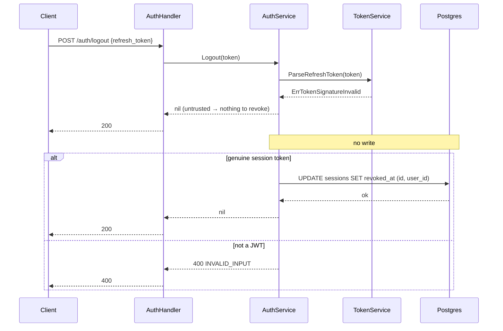
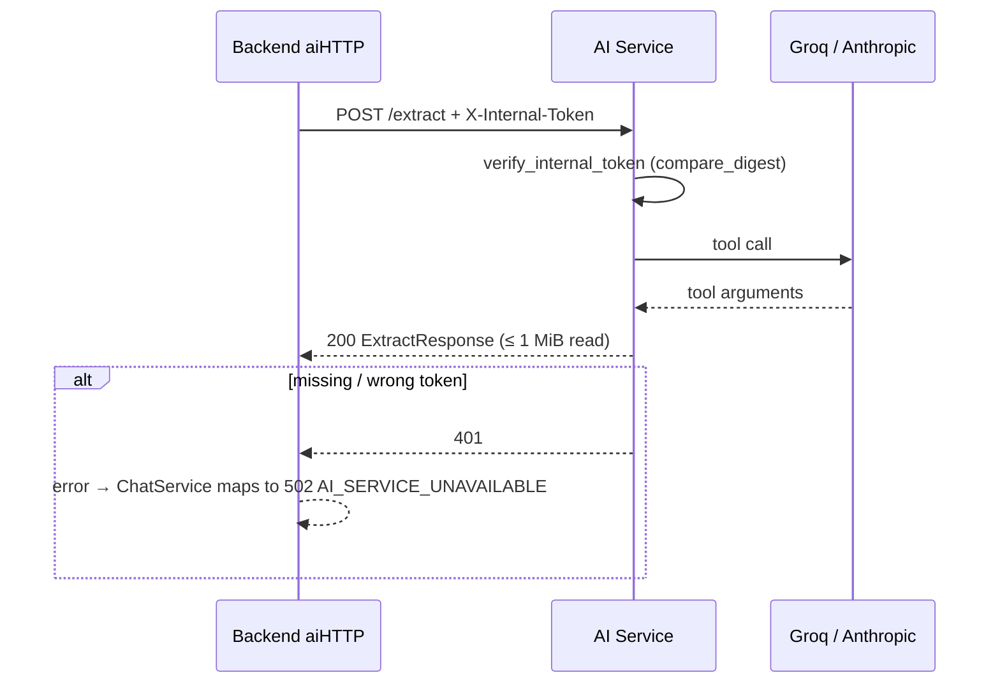

# Implementation Plan: Security & Robustness Hardening, October 2026

> Spec: [spec.md](./spec.md) · SRS: F-02 System Security (plus F-01, F-06 import, Feature-12 AI) · Task prefix `HRD-T`
> Stacks touched: Go backend, Python AI Service, Docker Compose / Dockerfiles, GitHub Actions. No migration, no client change.

## 1. Pre-flight: Spec Review Findings

| # | Type | Finding | Resolution |
|---|---|---|---|
| 1 | Gap | Spec US-06 wants the 500 for a panic in the access log, but `Recover` is "the first app.Use". A request logger placed after it never sees a panic (the panic unwinds through it). | Request logger becomes the **outermost** middleware; it runs the app's `ErrorHandler` itself when the chain returns an error (the pattern Fiber's own `logger` middleware uses), so the logged status is the status sent. `Recover` stays second and its comment is updated. |
| 2 | Gap | `response.Error` (where "auth rejected"/"unhandled error" are logged) cannot import `middleware` for `ClientIP` — `middleware` already imports `response` (cycle). | The request logger stores `request_id` and `client_ip` in Fiber locals (`common.LocalsRequestID`, `common.LocalsClientIP`); `response.Error` and `Recover` read the locals. No package move. |
| 3 | Ambiguity | US-04: what does logout answer for a correctly signed token that is **not** a refresh token (access/switch)? Old code: unverified parse → no `jti` → 400. | Keep 400 for "valid signature, wrong kind" and malformed; return 200 no-op only for *untrusted* tokens (bad signature, unknown alg, expired, not yet valid). One classifier `isUntrustedToken(err)` in the token service decides, used by both revoke paths. |
| 4 | Gap | Spec US-02 counts data rows, but `GetRows` loads the whole sheet before anything can be counted. | Read the first sheet with excelize's streaming `Rows()` iterator and stop at `max+1` data rows; memory is bounded by the cap, not by the file. Limits are a parameter (`importReadLimits`) so tests can use tiny caps instead of building a 64 MiB bomb. |
| 5 | Design | US-09 atomicity: services own transactions by convention, but this is one logical write of an opaque cache. | Repository method `UpsertMessages` sends all upserts as one `pgx.Batch` via `pool.SendBatch`: pgx runs a batch in an **implicit transaction** (one Sync), so it is atomic and one round trip. Same precedent as `SessionRepository.Create` owning its own tx. |
| 6 | Design | US-07: the AI token must not break the running deployment. | Enforced only when `AI_SERVICE_TOKEN` is set on the AI Service; backend always sends it when set. Rollout order in the runbook (§9). Backend refuses a set token < 32 bytes (`config.Load`). |
| 7 | Design | US-08 refactor must keep the monkeypatch points the existing 221 tests use (`extract_service._call_groq/_call_anthropic`, `category_suggestion_service._call_groq`, `_extract_tool_schema`). | Shared code takes callables: `llm_fallback.run_with_fallback(primary, fallback, …)` is given `lambda: _call_groq(...)` (global lookup at call time, so patches apply). Provider call helpers (`groq_tool_arguments`, `anthropic_tool_arguments`) live in `llm_tools.py`; services keep their `_call_*` wrappers. `test_consult_service` imports the moved `provider_error_code` from its new module. |
| 8 | Ambiguity | US-05 HSTS on a host also reached by plain HTTP (local dev, pre-tunnel origin). | Browsers ignore HSTS on HTTP responses (RFC 6797 §8.1), so it is safe everywhere; no `includeSubDomains` (other subdomains are not ours to pin). |
| 9 | Gap | Spec mentions "10.000" in a backend message; money/number text must go through a formatter. | New `common.FormatCountVI` (shares `groupThousands`). |
| 10 | Risk | `read_only` root on the backend: excelize spills worksheets over `UnzipXMLSizeLimit` to `os.TempDir()`. | `tmpfs: /tmp` on both hardened services; import XML limit sized so a legitimate file stays in memory anyway. |

## 2. Architecture

### 2.1 File layout (new ★, changed ✎)

```text
backend/
├── Dockerfile ✎ (alpine:3.22)
├── docker-compose.yml ✎ (hardening, AI_SERVICE_TOKEN)
├── go.mod / go.sum ✎ (fasthttp, compress, excelize)
├── cmd/server/main.go ✎ (middleware order, AI endpoint)
├── cmd/server/routes.go ✎ (public token limiter)
└── internal/
    ├── common/
    │   ├── constants_http.go ★ (headers, request-id, security header values, AI token header, response caps)
    │   ├── password.go ✎ (MaxPasswordBytes, ErrPasswordTooLong, PasswordTooLong)
    │   ├── transaction_io.go ✎ (import caps + FormatCountVI use)
    │   ├── money.go ✎ (FormatCountVI)
    │   └── constants.go ✎ (PublicTokenRateLimit*)
    ├── config/config.go ✎ (AIServiceToken)
    ├── dto/auth_request.go ✎ (password max), chat_thread_request.go ✎ (bounds)
    ├── handler/
    │   ├── html_page.go ★ (htmlPage: CSP hashes computed from the page constant)
    │   ├── activate_page_handler.go ✎, approve_access_page_handler.go ✎
    ├── middleware/
    │   ├── request_log.go ★ (RequestLogger, request id)
    │   ├── security_headers.go ★
    │   ├── rate_limit_access.go ✎ (PublicTokenRateLimiter)
    │   └── recover.go ✎ (request_id in panic log)
    ├── response/response.go ✎ (request_id + ip on auth-rejected / unhandled logs)
    ├── repository/chat_thread_repository.go ✎ (UpsertMessages batch), sqlc/chat_thread_messages.sql.go ✎ (queue helper)
    └── service/
        ├── ai_http.go ★ (AIServiceEndpoint, aiHTTP.postJSON/post, capped decode)
        ├── ai_service_client.go ✎, ai_budget_client.go ✎, ai_consult_client.go ✎, ai_image_client.go ✎
        ├── auth_service.go ✎ (password cap), auth_session.go ✎ (Logout verifies)
        ├── account_switch_service.go ✎ (Revoke verifies), switch_token.go ✎, token_service.go ✎ (isUntrustedToken; drop Unverified parsers)
        ├── password_change.go ✎
        ├── chat_thread_service.go ✎, interfaces.go ✎
        ├── transaction_import_service.go ✎ (limits, streaming rows)
        └── analytics_service.go ✎ (one-query category visibility)
ai-service/
├── Dockerfile ✎ (PYTHONDONTWRITEBYTECODE, --no-server-header)
└── app/
    ├── main.py ✎ (docs off, token dependency on routers)
    ├── core/config.py ✎ (ai_service_token, ai_service_expose_docs, anthropic_model)
    ├── core/security.py ★ (verify_internal_token)
    ├── core/llm_errors.py ★ (provider_error_code, provider_error_fields, NoToolCallError)
    ├── services/llm_tools.py ★ (dereference_schema, groq/anthropic forced tool call → arguments)
    ├── services/llm_fallback.py ★ (run_with_fallback, LLMUnavailableError)
    ├── services/extract_service.py ✎, category_suggestion_service.py ✎, consult_service.py ✎, vision_provider.py ✎
    └── schemas/*.py ✎ (upper bounds)
docker-compose.yml ✎ (Postgres loopback, AI_SERVICE_TOKEN)
.env.example ✎, backend/.env.prod.example ✎
.github/workflows/*.yml ✎ (SHA pins, govulncheck version, add-ssh-key injection)
docs/ops-runbook.md ✎ (AI token rollout, hardening notes)
```

### 2.2 Domain objects

No new entity, table or column. `revoked_tokens`, `sessions`, `chat_thread_messages` keep their schema (soft delete N/A: deny-list and cache tables are hard-deleted by retention as today). No money field is touched by any task.

### 2.3 Business rules

| Rule | Source | Enforcement |
|---|---|---|
| Deps without reachable advisories | US-01 | `go.mod`; CI `govulncheck@v1.8.0` |
| Import decompressed ≤ 64 MiB, XML part in memory ≤ 16 MiB, data rows ≤ 10,000 | US-02, S-HRD-04..07 | `TransactionImportService.readWorksheetRows` → 400 `INVALID_INPUT` |
| Password 8 chars ≤ len ≤ 72 bytes on every hash | US-03 | `AuthService.Activate`, `SessionRevocationService.ChangePassword` → 400 `WEAK_PASSWORD`; DTO `max=256` on login/activate |
| Revoke writes only tokens this server signed and that are still live | US-04 | `AuthService.Logout`, `AccountSwitchService.Revoke` via `TokenService.isUntrustedToken` |
| 60 req/min/IP across refresh, logout, activate, switch-token/revoke | US-04 | `middleware.PublicTokenRateLimiter` (one shared instance in `routes.go`) → 429 `RATE_LIMITED` |
| Baseline security headers on every response | US-05 | `middleware.SecurityHeaders` (app-level) |
| HTML pages: hash-only CSP, no-store | US-05 | `handler.htmlPage.send` |
| One access-log line per request, request id echoed | US-06 | `middleware.RequestLogger` |
| AI Service answers only with the internal token (when configured) | US-07 | `ai-service/app/core/security.verify_internal_token` → 401; backend `aiHTTP` sends header |
| Provider errors logged as type/status/code only | US-08 | `app/core/llm_errors.provider_error_fields` |
| Thread sync ≤ 500 msgs, id ≤ 200, payload ≤ 64 KiB, atomic | US-09 | DTO validate tags → 400; `ChatThreadRepository.UpsertMessages` batch |

Authorization is unchanged everywhere: JWT at middleware (`JWTAuth`), role at `RequireRole`, ownership in services. The AI token is service-to-service authentication enforced in the AI Service only.

### 2.4 Sequence diagrams

**Logout with a forged token (US-04)**



**Backend → AI Service with the internal token (US-07)**



No money write is on either path; the financial idempotency rule (`X-Idempotency-Key`) does not apply. Thread sync is idempotent by construction (upsert keyed by `(user_id, client_message_id)`).

## 3. Error Flows

| Scenario | HTTP | Error code | Kind |
|---|---|---|---|
| Import file decompresses beyond the cap / not an xlsx | 400 | `INVALID_INPUT` | validation |
| Import over 10,000 data rows | 400 | `INVALID_INPUT` | validation |
| Password over 72 bytes (activate / change) | 400 | `WEAK_PASSWORD` | validation |
| Display name at activation breaks the profile name rules (F-15) | 400 | `INVALID_FULL_NAME` | validation |
| Login/activate password field over 256 chars | 400 | `INVALID_INPUT` | validation |
| Logout/revoke with forged or expired token | 200 | — | no-op |
| Logout/revoke with a non-JWT or wrong token kind | 400 | `INVALID_INPUT` | validation |
| Public token routes over 60/min/IP | 429 | `RATE_LIMITED` | client |
| Thread sync over bounds | 400 | `INVALID_INPUT` | validation |
| Thread sync DB failure | 500 | `INTERNAL_ERROR` | system (nothing written) |
| AI Service rejects token | 502 (backend) / degraded consult | `AI_SERVICE_UNAVAILABLE` | system |
| AI response over 1 MiB | 502 | `AI_SERVICE_UNAVAILABLE` | system |
| Backend starts with `AI_SERVICE_TOKEN` < 32 bytes | — | startup error | config |

## 4. Constitution / Convention Notes

| Rule | Status | Note |
|---|---|---|
| Handler validates shape, service business rules | Kept | Password byte cap is a business rule (bcrypt) → services; 256-char DTO cap is shape → handler |
| Handler never imports repository | Kept | |
| No float for money | N/A | No money path touched |
| No sensitive data in logs | Strengthened | Access log omits query/headers/bodies; AI logs drop provider bodies |
| No magic values | Kept | Every limit is a named constant in `common` / `settings` |
| File ≤ 300 lines | Required | Watch `transaction_import_service.go` (284 today): row reading moves to `transaction_import_rows.go`; `routes.go` (268) gains ~6 lines |
| Wrap errors with context | Kept | `fmt.Errorf("op: %w")` |
| SQL in sqlc files | Kept | Batch helper reuses the existing `upsertChatThreadMessage` constant |
| UX copy skill | Applied | Two strings, see §6 |

## 5. Element / Key IDs

No UI element is added or changed (no `data-testid` / `testID` work).

## 6. User-visible strings

| Where | VI | Rule |
|---|---|---|
| `WEAK_PASSWORD` on activate / change password (server message, shown under the field on `/activate`) | Mật khẩu tối đa 72 ký tự không dấu. | Validation "vượt giới hạn" pattern; "không dấu" because bytes ≠ letters |
| `/activate` inline check | same string | one source per page |
| Import preview row cap | Tệp có quá 10.000 dòng. Tách thành nhiều tệp nhỏ hơn. | Fact + one action |

## 7. Open Tasks

| ID | Task | Files |
|---|---|---|
| HRD-T01 | Bump fasthttp v1.74.0, klauspost/compress v1.18.7, excelize 6258dcebc4e2; `go mod tidy`; alpine 3.22 | `backend/go.mod`, `go.sum`, `Dockerfile` |
| HRD-T02 | Import: `importReadLimits`, streaming row reader, row cap, `FormatCountVI`; tests (bomb with tiny cap, cap/cap+1, blank tail, row numbers) | `common/transaction_io.go`, `common/money.go`, `service/transaction_import_rows.go` ★, `service/transaction_import_service.go`, test |
| HRD-T03 | Password cap in both services + DTO caps + `/activate` JS byte check; activation name through `normalizeFullName` (`INVALID_FULL_NAME`, page maps it to the name field); tests S-HRD-08..12c | `common/password.go`, `common/access_request.go`, `service/auth_service.go`, `service/password_change.go`, `dto/auth_request.go`, `handler/activate_page_handler.go`, tests |
| HRD-T04 | `isUntrustedToken`; Logout/Revoke verify; delete unverified parsers; `PublicTokenRateLimiter` + routes; tests S-HRD-13..19 | `service/token_service.go`, `service/switch_token.go`, `service/auth_session.go`, `service/account_switch_service.go`, `middleware/rate_limit_access.go`, `common/constants.go`, `cmd/server/routes.go`, `dto/auth_request.go`, tests |
| HRD-T05 | `SecurityHeaders` middleware; `htmlPage` with computed CSP; both pages use it; tests S-HRD-20..23 | `middleware/security_headers.go` ★, `handler/html_page.go` ★, pages, `common/constants_http.go` ★, tests |
| HRD-T06 | `RequestLogger` (outermost) + locals; `response.Error`/`Recover` read them; tests S-HRD-24..28 | `middleware/request_log.go` ★, `middleware/recover.go`, `response/response.go`, `cmd/server/main.go`, tests |
| HRD-T07 | Backend: `AIServiceToken` config (≥ 32 when set); `ai_http.go`; four clients on it; response cap; tests (header sent, oversize body) | `config/config.go`, `service/ai_http.go` ★, `service/ai_*_client.go`, `cmd/server/main.go`, tests |
| HRD-T08 | AI Service: `security.py`, docs off, router dependency, schema bounds; pytest S-HRD-29..36 | `app/core/security.py` ★, `app/core/config.py`, `app/main.py`, `app/schemas/*.py`, `tests/test_security.py` ★ |
| HRD-T09 | AI Service: `llm_errors.py`, `llm_tools.py`, `llm_fallback.py`; refactor 4 services; fallback model `claude-haiku-5-5` without `temperature`; pytest S-HRD-37..40 | `app/core/llm_errors.py` ★, `app/services/llm_tools.py` ★, `app/services/llm_fallback.py` ★, services, tests |
| HRD-T10 | Thread sync DTO bounds; `UpsertMessages` batch; service uses it; tests + integration test S-HRD-41..44 | `dto/chat_thread_request.go`, `repository/chat_thread_repository.go`, `repository/sqlc/chat_thread_messages.sql.go`, `service/chat_thread_service.go`, `service/interfaces.go`, `cmd/server/main.go`, tests |
| HRD-T11 | `visibleCategories` → one query; test order semantics | `service/analytics_service.go`, test |
| HRD-T12 | Compose: dev Postgres loopback; prod hardening + `AI_SERVICE_TOKEN` both services; env examples; AI Dockerfile env + flag; verify with `docker compose config` and a hardened container run | `docker-compose.yml`, `backend/docker-compose.yml`, `.env.example`, `backend/.env.prod.example`, `ai-service/Dockerfile` |
| HRD-T13 | CI: SHA pins, `govulncheck@v1.8.0`, add-ssh-key env + format check | `.github/workflows/*.yml` |
| HRD-T14 | Runbook: AI token rollout/rotation, hardened containers, new limits | `docs/ops-runbook.md` |
| HRD-T15 | Verify: `go vet`, `go test` (+ Docker Postgres integration, `-race` in Docker if available), `govulncheck`, pytest, `docker compose config`, hardened container smoke test | — |
