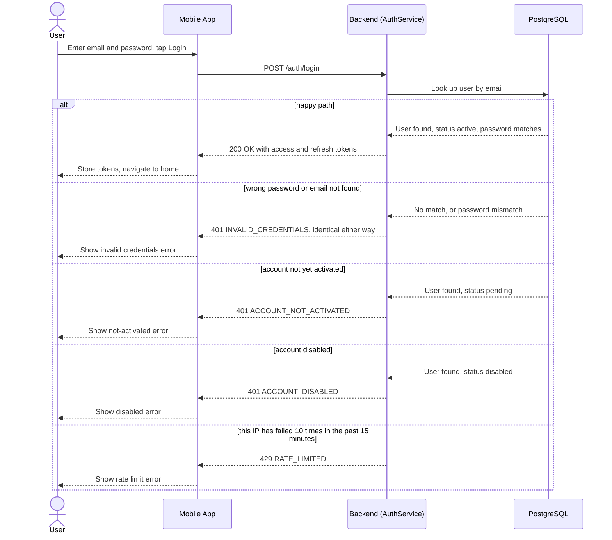
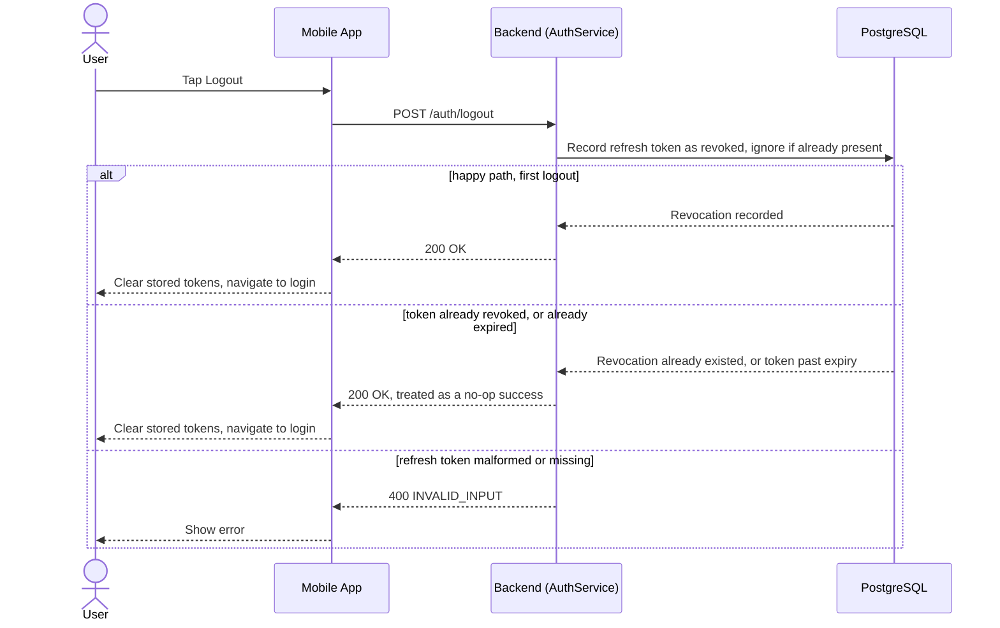

# Implementation Plan: F-02 System Security (Phase 0)

- **Feature:** System Security
- **SRS Feature Code:** F-02 (SDS.md §5.2, currently an empty skeleton — no ACs defined there; `spec.md` in this folder is the authoritative source)
- **Jira Epic:** N/A — this repository has no Jira integration wired up
- **Spec:** [spec.md](./spec.md)
- **Related plan:** [F-01 User Management](../user-management/plan.md) — US-02 (Activate) consumes the `TokenService` this plan owns

> **Status 2026-10-19** — original Phase-0 plan, kept as written; its tasks shipped. Superseded parts: `POST /auth/refresh` (SEC-T9) was specified and built in [mobile-session-refresh](../mobile-session-refresh/plan.md); refresh tokens are bound to `sessions` rows (migration 028, device columns migration 033) instead of being checked against `revoked_tokens` only; `RefreshTokenTTL` is 60 days idle (sliding) with a 180-day absolute limit (`SessionAbsoluteTTL`), not 7 days; the mobile client is React Native, not Flutter. Device list, sign out one device and change password are planned in [mobile-account-switch plan](../mobile-account-switch/plan.md) "Revision 2026-10-19". Password reset is still not planned.

---

## 1. Pre-flight: Spec Review Findings

| # | Type | Finding | Resolution / Open Task |
|---|------|---------|-------------------------|
| 1 | Gap | Repo is greenfield — no `backend/` directory exists yet. Nothing to cross-check against a running implementation. | This plan designs from scratch. |
| 2 | **Blocking gap** | `spec.md`'s Open Question #1 flags that `POST /auth/refresh` (or equivalent) is entirely undefined, yet Out of Scope for this spec. A 15-minute access token with no renewal path means a mobile session effectively dies every 15 minutes unless the user re-enters their password — that breaks the premise of a 7-day refresh token. | **Not implemented in this plan** — it is out of scope per `spec.md`. Flagged here as **blocking for real usability** and escalated as an Open Task to get a spec update before Phase 0 is considered feature-complete. Do not let this plan's silence be read as "resolved." |
| 3 | Gap | `spec.md` describes **zero** mobile/Flutter behavior for Login or Logout (no screen, no field names, no navigation) — unlike the F-01 spec, which explicitly describes "Admin opens X screen" / "App shows Y screen" for every story. | **Scope decision:** this plan covers **Go backend only**, matching what `spec.md` actually specifies. A Login screen obviously has to exist for the app to be usable, but inventing its fields/behavior here would not trace to any AC — per the plan agent's own rule ("if it doesn't trace to a spec AC, either the spec has a gap or the rule doesn't belong in this plan"). Escalated as an Open Task: `spec.md` needs a UI-flow addendum before Flutter work on Login/Logout starts. |
| 4 | Ambiguity | `spec.md` doesn't specify how the refresh token is transported to `POST /auth/logout` (body vs. header) — its own Preconditions section flags this as unresolved. | **Assumption for this plan:** refresh token is sent in the JSON request body (`{ "refresh_token": "..." }`), consistent with how it's returned by Login/Activate (also body-based), not as a header/cookie. Stated explicitly here since `spec.md` left it open — confirm before implementation. |
| 5 | Ambiguity | Open Question #3: does logout revoke one token or all of a user's tokens? | **Assumption for this plan:** single-token revocation only (per-refresh-token, not per-user) — matches `spec.md`'s literal wording ("my refresh token", singular) and keeps the schema simpler. If all-device logout is later required, `revoked_tokens` needs a `user_id` column added — noted in Domain Objects table below as a forward-compatible field, added now at low cost rather than as a later migration. |

---

## 2. Architecture

### Package/File Layout

> Go backend only — see Pre-flight Finding #3 for why no Flutter layout is scaffolded here.

```text
backend/internal/
├── handler/
│   └── auth_handler.go            # Login, Logout (+ Activate, owned by F-01 plan but same file)
├── service/
│   ├── auth_service.go            # Login, Logout (+ Activate, owned by F-01 plan)
│   └── token_service.go           # GenerateTokenPair(user), ParseAccessToken(token) — owned here
├── repository/
│   ├── user_repository.go         # GetUserByEmail — owned by F-01 plan, reused read-only here
│   └── revoked_token_repository.go # Revoke(tokenJTI, expiresAt), IsRevoked(tokenJTI)
├── model/
│   └── revoked_token.go           # RevokedToken struct — zero framework imports
├── dto/
│   ├── auth_request.go            # LoginRequest, LogoutRequest (+ ActivateRequest, owned by F-01 plan)
│   └── auth_response.go           # TokenPairResponse — shared with F-01's Activate
├── middleware/
│   ├── jwt_auth.go                # JWTAuth() — validates access token, checks revocation, injects claims
│   └── rate_limit.go              # LoginRateLimiter (10/15min/IP) — separate config from F-01's InviteRateLimiter
└── common/
    ├── errors.go                  # ErrCodeInvalidCredentials, ErrCodeAccountNotActivated, ErrCodeAccountDisabled, ErrCodeRateLimited (extends F-01's errors.go — one shared file)
    └── constants.go                # AccessTokenTTL=15min, RefreshTokenTTL=7*24h, LoginRateLimit=10, LoginRateLimitWindow=15min (extends F-01's constants.go)

db/
├── migrations/
│   └── 003_revoked_tokens.sql     # new table — see Domain Objects below
└── queries/
    └── revoked_tokens.sql          # RevokeToken, IsTokenRevoked
```

### Domain Objects

| Entity | Table | Key Fields | Notes |
|--------|-------|------------|-------|
| `User` | `users` | (see F-01 plan — read-only here, via `GetUserByEmail`) | Soft delete via `deleted_at`, must be respected in login lookup (Edge Case #3). No money fields. |
| `RevokedToken` | `revoked_tokens` | `id` (UUID v4), `token_jti` (text, unique, the refresh token's JWT ID claim — **not** the raw token, to avoid storing bearer secrets at rest), `user_id` (UUID, FK→users.id, nullable — added now per Pre-flight Finding #5 for forward-compat with all-device logout, unused by single-token revocation logic today), `expires_at` (TIMESTAMPTZ UTC — copied from the token's own `exp` claim, used for cleanup), `revoked_at` (TIMESTAMPTZ UTC, default `NOW()`) | **No soft delete** — this is not a financial record (CLAUDE.md's soft-delete rule applies to financial data; `revoked_tokens` is an operational/security table). Rows are either hard-deleted by a cleanup job once `expires_at < NOW()`, or left in place — cleanup job is an Open Task, not required for correctness (an expired row is functionally inert either way). |

### Business Rules

| Rule | Source | Enforcement |
|------|--------|-------------|
| `email` and `password` both required and non-empty | S-SEC-02 | `dto.LoginRequest` validator tags (`required`) → `400 INVALID_INPUT`, checked before any DB call |
| User must exist (soft-delete aware) | S-SEC-04, Edge Case #3 | `AuthService.Login()` → `GetUserByEmail` (filters `deleted_at IS NULL`) → `401 INVALID_CREDENTIALS` |
| Password must match via `bcrypt.CompareHashAndPassword` | S-SEC-03 | `AuthService.Login()` → `401 INVALID_CREDENTIALS` |
| Wrong-password and email-not-found return byte-identical bodies | Edge Case #1 | `AuthService.Login()` — single shared error path/constructor for both cases, no branching that could leak via message or timing |
| `status` must be `active` (`pending`→distinct error, `disabled`→distinct error) | S-SEC-05, S-SEC-06 | `AuthService.Login()` → `401 ACCOUNT_NOT_ACTIVATED` / `401 ACCOUNT_DISABLED` |
| Max 10 failed logins / 15 min / IP | S-SEC-07 | `middleware.LoginRateLimiter` keyed by request IP (runs *before* auth — login is unauthenticated) → `429 RATE_LIMITED` |
| Access token: JWT, 15 min expiry; Refresh token: JWT, 7 day expiry | Main Flow step 6 (US-04) | `TokenService.GenerateTokenPair(user)` |
| Refresh token required, well-formed | S-SEC-10 | `dto.LogoutRequest` validator (`required`) → `400 INVALID_INPUT` |
| Revoking an already-revoked or already-expired token is a no-op success | S-SEC-09, S-SEC-11 | `RevokedTokenRepository.Revoke()` — `INSERT ... ON CONFLICT (token_jti) DO NOTHING`, always returns success regardless of prior state |
| Revoked tokens must be rejected wherever a refresh token is later validated | Main Flow step 2 (US-05) + Out of Scope note | `TokenService`/future refresh-endpoint must call `RevokedTokenRepository.IsRevoked(jti)` — **currently no caller exists** since `POST /auth/refresh` is out of scope (see Pre-flight Finding #2); wired up now so it isn't forgotten later |

### Sequence Diagrams

> Four-tier lifeline (Actor → Frontend → Backend → DB), one diagram per story, happy path first with real `alt/else` branches beneath it. "Mobile App" here is shown only to keep the request path visually complete and consistent with the F-01 diagrams — it is **not** a commitment to Flutter implementation work in this plan (see Pre-flight Finding #3: no Flutter UI is in scope for F-02). Full method-level detail lives in the Business Rules table above, not in the diagram.

**US-04: Login**



**US-05: Logout**



---

## 3. Error Flows

### US-04: Login

| Scenario | HTTP | Error Code |
|----------|------|------------|
| `email` or `password` missing/empty | 400 | `INVALID_INPUT` |
| Wrong password | 401 | `INVALID_CREDENTIALS` |
| Email not found | 401 | `INVALID_CREDENTIALS` (byte-identical body to wrong-password) |
| `status=pending` | 401 | `ACCOUNT_NOT_ACTIVATED` |
| `status=disabled` | 401 | `ACCOUNT_DISABLED` |
| 11th failed attempt in 15 min from this IP | 429 | `RATE_LIMITED` |
| Unexpected error (DB down, bcrypt panic) | 500 | — |

### US-05: Logout

| Scenario | HTTP | Error Code |
|----------|------|------------|
| Malformed or missing `refresh_token` | 400 | `INVALID_INPUT` |
| Valid token, first logout | 200 | — |
| Already-revoked token (double logout) | 200 | — (idempotent, not an error — see spec.md S-SEC-09) |
| Already-expired token | 200 | — (no-op, not an error — see spec.md S-SEC-11) |
| Unexpected error | 500 | — |

---

## 4. Constitution / Convention Notes

| Rule | Status | Note |
|------|--------|------|
| Service layer owns business rules | Required | Credential verification, status checks, enumeration-protection logic all in `AuthService` — never in `auth_handler.go` |
| Handler validates shape only | Required | Required-field checks via `validator/v10` on `dto.LoginRequest`/`dto.LogoutRequest` |
| Transactional atomicity — US-04 (Login) | N/A (no write) | Login has **zero persisted side effects** on the `users` row — no `last_login_at` update, no failed-attempt counter in the DB (rate limiting is tracked in the limiter middleware, not persisted to Postgres). Purely a read (`GetUserByEmail`) plus in-memory token generation |
| Transactional atomicity — US-05 (Logout) | Required | `Revoke()` is a single-row upsert (`INSERT ... ON CONFLICT DO NOTHING`) — no multi-table write, no explicit `BEGIN/COMMIT` needed |
| Concurrency / locking strategy | Required | Logout's double-revoke / already-expired cases are handled by the upsert's `ON CONFLICT DO NOTHING` — a conflict-safe write, not a read-then-write race. No explicit locking needed since revocation is a set-membership check, not a multi-step state transition |
| JWT auth enforced at middleware | Required | `JWTAuth()` middleware owned here, consumed by every authenticated route across the whole backend (including F-01's admin-only routes). Login/Logout themselves are **not** behind `JWTAuth()` — Login is how you obtain a token in the first place; Logout only needs the refresh token payload, not a valid access token |
| Idempotency on write | Required | Logout is idempotent by design (`ON CONFLICT DO NOTHING`) — no separate idempotency key needed since revocation is a set-membership operation, not a state machine transition (see spec.md's own Idempotency section for US-05) |
| Money stored as BIGINT cents | N/A | F-02 has no monetary fields |
| Soft delete respected | Required | `GetUserByEmail` (reused from F-01) filters `deleted_at IS NULL`; a soft-deleted user must fail login identically to "not found" (Edge Case #3) |
| Timestamps UTC stored / local displayed | Required | `revoked_tokens.expires_at`/`revoked_at` are `TIMESTAMPTZ` UTC; JWT `exp`/`iat` claims are Unix epoch (UTC by definition) — no local-time conversion happens server-side |
| No magic numbers | Required | `AccessTokenTTL`, `RefreshTokenTTL`, `LoginRateLimit(Window)` defined once in `backend/internal/common/constants.go` (same file F-01 extends) |
| No file > 300 lines | Required | `auth_handler.go`/`auth_service.go` are shared with F-01's Activate — watch line count as both features land; split into `login_service.go`/`logout_service.go`/`activate_service.go` if it crosses 300 |
| Audit logging | Not required (Phase 0) | No `audit_log` table exists in the schema — only structured Zap application logs are produced for login/logout. Failed-login volume for rate limiting lives in the limiter's own store, not an audit trail |
| CSRF protection | N/A | Bearer-JWT API consumed by a Flutter mobile client — no cookies or server-side sessions, so no CSRF attack surface. Revisit only if a cookie-authenticated web client is ever added |
| Sensitive data never logged | Required | Raw `password` and raw refresh/access tokens must never appear in a Zap log field at any level, including error paths — carries `spec.md`'s Definition of Done for US-04/US-05 into the implementation itself |

---

## 5. Element/Key IDs

> N/A for this plan — `spec.md` defines no Flutter UI for Login or Logout (see Pre-flight Finding #3). Do not fabricate widget keys for screens that have no spec ACs to trace to; a Login-screen plan should be authored once `spec.md` is updated with that flow.

---

## 6. Open Tasks

> Status/owner columns below are placeholders — this project has no Jira/sprint tooling, so "owner" is whoever picks the task up next, not a pre-assigned name.

| ID | Task | File | Status | Owner |
|----|------|------|--------|-------|
| SEC-T1 | Create `revoked_tokens` table migration | `backend/db/migrations/003_revoked_tokens.sql` | Not started | Unassigned |
| SEC-T2 | Write sqlc queries: `RevokeToken` (upsert, `ON CONFLICT DO NOTHING`), `IsTokenRevoked` | `backend/db/queries/revoked_tokens.sql` | Not started | Unassigned |
| SEC-T3 | Implement `TokenService.GenerateTokenPair(user)` and `TokenService.ParseAccessToken(token)` using `golang-jwt/v5` | `backend/internal/service/token_service.go` | Not started | Unassigned |
| SEC-T4 | Implement `JWTAuth()` middleware — validates signature + expiry, injects `user_id`/`role` claims into Fiber locals, used by every authenticated route (F-01's admin routes included) | `backend/internal/middleware/jwt_auth.go` | Not started | Unassigned |
| SEC-T5 | Implement `AuthService.Login` (enumeration-safe error path, status checks) | `backend/internal/service/auth_service.go` | Not started | Unassigned |
| SEC-T6 | Implement `AuthService.Logout` (parse JTI/exp from refresh token, delegate to `RevokedTokenRepository`) | `backend/internal/service/auth_service.go` | Not started | Unassigned |
| SEC-T7 | Implement `RevokedTokenRepository` | `backend/internal/repository/revoked_token_repository.go` | Not started | Unassigned |
| SEC-T8 | Implement `middleware.LoginRateLimiter` (IP-keyed, 10/15min) | `backend/internal/middleware/rate_limit.go` | Not started | Unassigned |
| SEC-T9 | **Escalate to BA**: `POST /auth/refresh` is undefined and Out of Scope in `spec.md`, but without it a 15-min access token has no renewal path — get this added to `spec.md` before Phase 0 is considered done, then re-run this plan | N/A — spec decision, not a code file | Blocked | Unassigned |
| SEC-T10 | **Escalate to BA**: get a Login/Logout UI-flow addendum added to `spec.md` (screen, fields, navigation) so Flutter work can be planned with real ACs to trace to | N/A — spec decision, not a code file | Blocked | Unassigned |
| SEC-T11 | Confirm assumption (Pre-flight Finding #4): refresh token transported in logout's JSON body, not a header — get explicit sign-off before implementing `dto.LogoutRequest` | `backend/internal/dto/auth_request.go` | Not started | Unassigned |
| SEC-T12 | Human review and sign-off on this plan's diagrams and business-rule ownership before implementation starts | N/A — review gate, not a code file | Not started | Unassigned |
