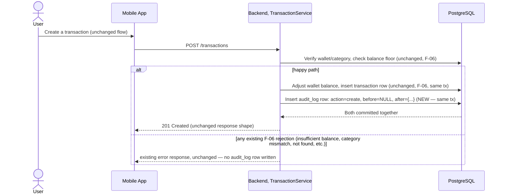
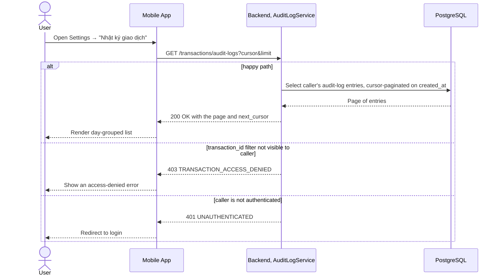

# Implementation Plan: Transaction Audit Log (extends F-06 Transaction Management)

- **Feature:** Transaction Audit Log
- **SRS Feature Code:** Extends F-06 (no own SRS entry — user-requested addition, this session)
- **Jira Epic:** N/A — no Jira integration in this repository
- **Spec:** [spec.md](./spec.md)
- **Related plans:** [F-06 Transaction Management](../transaction-management/plan.md) (this plan modifies `TransactionService.CreateTransaction`/`UpdateTransaction`/`DeleteTransaction` — additive only, no existing business rule changes)
- **Frontend scope:** **mobile only** (`mobile/`). No `frontend/` (Next.js web) work in this plan — the user's request was scoped entirely in mobile terms (Settings screen placement question); web parity is not addressed here. Flagged as an explicit scoping assumption, not a silent omission — revisit if web parity is wanted later.

---

## 1. Pre-flight: Spec Review Findings

| # | Type | Finding | Resolution / Open Task |
|---|------|---------|-------------------------|
| 1 | Gap | `transaction_audit_logs` does not exist — latest migration is `017_seed_savings_category.sql` (CURRENT_STATE.md's migration table is stale at `011`; the real latest was confirmed directly against `backend/db/migrations/`). | New migration `018_transaction_audit_logs.sql` (§2). |
| 2 | Reuse opportunity, not a gap | `spec.md` US-02's cursor requirement is keyed on `{id, created_at}` — this is **not** a new cursor shape. `backend/internal/service/cursor.go` already has a generic `cursorPayload{ID, CreatedAt}` / `encodeCursor` / `decodeCursor` pair (used today by `UserService.ListUsers` and `NotificationService.ListNotifications`). | This plan reuses `encodeCursor`/`decodeCursor` directly — no third cursor pair is added, unlike F-06's own plan which *did* need a new `{ID, OccurredAt, CreatedAt}` pair because a Transaction's natural sort isn't `created_at`. An audit-log entry's natural sort *is* `created_at` (when it was written), so the existing generic pair is the correct fit. |
| 3 | Design decision, spec-mandated (Context #1) | The audit-log write must be inside the exact same DB transaction as each of Create/Update/Delete's existing balance mutation + row write — never a second `BeginTx`. | `TransactionService.CreateTransaction`'s existing `createTransactionTx` (and the equivalent private helpers for Update/Delete) each gain one more repository call inside their existing `tx`, before `tx.Commit(ctx)`. No new transaction boundary anywhere in this plan. |
| 4 | Design decision | `spec.md` Context #4 requires `before`/`after` to contain only the fields a given operation actually touched, stored as JSONB. Go's `encoding/json` needs a concrete type to marshal, and `pgx`/sqlc's generated code needs a `[]byte`/`json.RawMessage` column type for `jsonb`. | This plan defines `map[string]any` at the service layer for building `before`/`after` (one map literal per branch, only the keys that changed), marshaled to `json.RawMessage` immediately before the repository call — never a shared "full Transaction struct" marshaled and then filtered, which would risk accidentally including an untouched field. |
| 5 | Ambiguity, resolved as an explicit assumption | Whether a no-op `PATCH` (identical value re-submitted) still logs an entry — `spec.md` Open Questions #1 flags this as unresolved, resolving provisionally to "yes, log it." | This plan implements "yes, log it" (simplest — the audit write is keyed on *which DTO fields were present*, not a value diff) per the spec's own provisional resolution. Revisit if Open Questions #1 gets an explicit product answer later. |
| 6 | Gap | No `AuditLogRepo`/`AuditLogService` exists; `TransactionRepo` interface (`backend/internal/service/interfaces.go`) has no audit-log methods. | New `AuditLogRepo` interface + `AuditLogService` (read path only, US-02); the *write* path (US-01) is not a separate interface — it's three new methods appended directly to `TransactionRepo`/`TransactionRepository`, since only `TransactionService` ever calls them, inside its own existing transaction. See Architecture. |
| 7 | Gap | No mobile screen/entry point exists for viewing this. | New Settings row + screen, per spec.md's "UI (Mobile)" section — see Architecture (Mobile). |
| 8 | **Routing gotcha, easy to get wrong** | `backend/cmd/server/routes.go`'s existing `/transactions` group already registers `transactions.Get("/:id", transactionHandler.GetTransaction)`. Fiber matches routes in registration order — a new literal-path `GET /transactions/audit-logs` registered **after** `/:id` would never be reached; Fiber would match `:id = "audit-logs"` first and route into `GetTransaction`, which would then fail a UUID parse and return `400 INVALID_INPUT` instead of the audit-log list. | `transactions.Get("/audit-logs", auditLogHandler.ListAuditLogs)` **must be registered before** the existing `transactions.Get("/:id", ...)` line in `routes.go` — a one-line reordering, not a rewrite. Flagged explicitly here because it's the single easiest mistake to make wiring this route in. |

### Regression Scope

**New files:**
- `backend/db/migrations/018_transaction_audit_logs.sql`, `backend/db/queries/transaction_audit_logs.sql`
- `backend/internal/model/transaction_audit_log.go`, `backend/internal/repository/transaction_audit_log_repository.go`, `backend/internal/service/audit_log_service.go`, `backend/internal/handler/audit_log_handler.go`, `backend/internal/dto/audit_log_response.go`
- `mobile/src/features/audit-log/{api/use-audit-logs-query.ts,components/AuditLogRow.tsx,types.ts}`, `mobile/app/(app)/audit-log.tsx`

**Modified files (additive):**
- `backend/cmd/server/routes.go` — one new `GET /transactions/audit-logs` route, registered in the existing `/transactions` JWTAuth group.
- `backend/cmd/server/main.go` — new repo/service/handler wiring, appended.
- `backend/internal/service/interfaces.go` — `TransactionRepo` gains three write methods (`InsertAuditLog`-style, see Architecture); new `AuditLogRepo` interface + compile-time check appended.
- `backend/internal/service/transaction_service_create.go`, and the Update/Delete equivalents — each gains one more call inside its existing `tx`, before commit. **No existing business rule, validation, or return signature changes** — purely additive inside an already-open transaction.
- `mobile/app/(app)/settings.tsx` — one new row ("Nhật ký giao dịch"), same pattern as this session's "Developer" row addition.

**Regression risk:** low — every change to F-06's existing service methods is "one more statement before commit," never a change to their existing validation/business-rule/response shape. The only way this plan could regress F-06 is if the new audit-insert call itself fails and isn't handled correctly (see Error Flows) — tested explicitly (Open Tasks).

---

## 2. Architecture

### Package/File Layout

**Backend (Go Fiber + sqlc)**

```text
backend/internal/
├── handler/
│   └── audit_log_handler.go          # ListAuditLogs (GET /transactions/audit-logs only)
├── service/
│   ├── audit_log_service.go          # ListAuditLogs (read path, cursor via existing encodeCursor/decodeCursor)
│   └── transaction_service_create.go, _update.go, _delete.go (modified — each gains
│         one InsertAuditLog(ctx, tx, ...) call inside its existing tx, before commit)
├── repository/
│   └── transaction_audit_log_repository.go   # sqlc wrapper: InsertAuditLog (tx-scoped),
│                                                # ListAuditLogsByUser (cursor + optional transaction_id filter)
├── model/
│   └── transaction_audit_log.go      # AuditLog struct — zero framework imports
└── dto/
    └── audit_log_response.go         # AuditLogResponse, ListAuditLogsResponse

db/
├── migrations/
│   └── 018_transaction_audit_logs.sql
└── queries/
    └── transaction_audit_logs.sql    # InsertAuditLog, ListAuditLogsByUser
```

**Mobile (`mobile/`, Expo — new feature, no existing precedent to mirror beyond the notifications screen's day-grouped list shape)**

```text
mobile/
├── app/(app)/
│   └── audit-log.tsx                          # route entry — day-grouped SectionList, same
│                                                 # pattern as transactions.tsx's own date grouping
│                                                 # (this session's redesign) and notifications.tsx's
│                                                 # dayLabelVi/SectionList shape
└── src/features/audit-log/
    ├── api/
    │   └── use-audit-logs-query.ts             # GET /transactions/audit-logs — useInfiniteQuery
    │                                             # (cursor pagination, mirrors use-transactions-query.ts)
    ├── components/
    │   └── AuditLogRow.tsx                     # one line per entry: action label (Tạo/Sửa/Xóa) +
    │                                             # a one-line before→after summary + timestamp
    └── types.ts                                 # AuditLogEntry, mirrors the backend response shape
```

`mobile/app/(app)/settings.tsx` gets one new row (`{ label: "Nhật ký giao dịch", Icon: HistoryIcon, href: "/audit-log" as const }`) — same array-literal pattern as this session's `Developer` row, and reuses the `HistoryIcon` this session already added to `mobile/src/components/ui/Icon.tsx` for the Home screen's pending-confirmation card.

### Domain Objects

| Entity | Table | Key Fields | Notes |
|--------|-------|------------|-------|
| `AuditLog` | `transaction_audit_logs` | `id` (UUID v4), `transaction_id` (FK → `transactions.id`), `user_id` (FK → `users.id`, denormalized), `action` (`create`\|`update`\|`delete`), `before` (JSONB, nullable), `after` (JSONB, nullable), `created_at` | Append-only — no `updated_at`, no `deleted_at` (spec.md Context #2). ⚠️ Any `amount` key inside `before`/`after` is the same BIGINT-cents value `transactions.amount` stores, never converted. |

### Schema — `018_transaction_audit_logs.sql`

```sql
CREATE TABLE transaction_audit_logs (
    id             UUID PRIMARY KEY DEFAULT uuid_generate_v4(),
    transaction_id UUID NOT NULL REFERENCES transactions(id),
    user_id        UUID NOT NULL REFERENCES users(id),
    action         TEXT NOT NULL CHECK (action IN ('create', 'update', 'delete')),
    before         JSONB,
    after          JSONB,
    created_at     TIMESTAMPTZ NOT NULL DEFAULT NOW()
);

-- Serves US-02's list query: WHERE user_id = $1 [AND transaction_id = $2],
-- ORDER BY created_at DESC, id DESC (reuses the existing generic cursorPayload
-- shape — Finding #2, no new cursor pair).
CREATE INDEX idx_transaction_audit_logs_user_created_at
    ON transaction_audit_logs (user_id, created_at DESC, id DESC);

CREATE INDEX idx_transaction_audit_logs_transaction_id
    ON transaction_audit_logs (transaction_id);
```

No `deleted_at` — this table is never soft- or hard-deleted (spec.md Context #2); no `updated_at` — rows are never updated after insert.

### Business Rules

| Rule | Source | Enforcement |
|------|--------|-------------|
| Every successful `POST /transactions` writes one `action='create'` entry, `before=NULL` | S-TAL-01 | `TransactionService.CreateTransaction`'s `createTransactionTx` — one more `s.repo.InsertAuditLog(ctx, tx, ...)` call after `CreateTransaction`, before `tx.Commit` |
| Every successful `PATCH /transactions/{id}` writes one `action='update'` entry, `before`/`after` containing only the fields present in that request | S-TAL-02, S-TAL-03 | `TransactionService.UpdateTransaction`'s existing tx — `before`/`after` maps built directly from which of `req.Amount`/`req.CategoryID`/`req.OccurredAt`/`req.Note` are non-nil, using the pre-update `Transaction` struct already fetched for the ownership check as the "before" source |
| Every successful `DELETE /transactions/{id}` writes one `action='delete'` entry, `before` = full field snapshot, `after=NULL` | S-TAL-04 | `TransactionService.DeleteTransaction`'s existing tx — `before` built from the `Transaction` struct already fetched for the ownership check, same struct `SignedEffect()` (F-06 `model/transaction.go`) already uses for the balance reversal |
| A rejected mutation (any 4xx from existing F-06 checks) never writes an entry | S-TAL-05, S-TAL-06 | Direct consequence of Finding #3 — the audit-insert call is placed strictly after every existing validation/business-rule check has already passed and strictly before `tx.Commit`; any early `return` before that point (which is every existing error path — unchanged) never reaches it |
| `transaction_audit_logs.user_id` is denormalized, not joined | Context #3 | `InsertAuditLog` takes `userID` directly from the same value `TransactionService` already resolved (the caller's own JWT-derived UUID), no extra lookup |
| List strictly scoped to caller, optional `transaction_id` filter | S-TAL-08, S-TAL-10, S-TAL-11 | `AuditLogService.ListAuditLogs` — if `transaction_id` given, re-runs the same ownership check `TransactionService.GetTransaction` already does (`404`/`403`) before querying; `ListAuditLogsByUser` always filters `WHERE user_id = $1` regardless |
| `category_name`/`wallet_name` in `before`/`after` resolve even if since soft-deleted | S-TAL-12 | Handler/service resolves `category_id`/`wallet_id` found inside a `before`/`after` JSON blob via the **same non-`deleted_at`-filtered lookups** `TransactionService` already uses (`getVisibleCategory`-style, `WalletRepo.GetWalletByID`) — read-only, best-effort: a UUID that resolves to nothing (extremely unlikely, Transactions/Wallets/Categories are never hard-deleted) is rendered as-is, not an error |
| Cursor pagination, `{id, created_at}` | S-TAL-14 | Reuses existing `encodeCursor`/`decodeCursor` (Finding #2) — zero new cursor code |
| Unauthenticated caller rejected | S-TAL-13 | Existing `JWTAuth` middleware on the `/transactions` group — no new middleware |

### API Index — Endpoint → Service Traceability

| API | Request | Response | Service Method |
|-----|---------|----------|-----------------|
| `GET /transactions/audit-logs` | `ListAuditLogsQuery` (`transaction_id?`, `cursor?`, `limit?`) | `ListAuditLogsResponse` (`200`) | `AuditLogService.ListAuditLogs` |

*(US-01 has no endpoint of its own — it's a side effect wired into the three existing `POST`/`PATCH`/`DELETE /transactions*` endpoints, unchanged request/response shapes.)*

### Security & Actor Resolution

- **Middleware:** `GET /transactions/audit-logs` registered inside the existing `/transactions` route group, under the same `JWTAuth` — no new middleware, no `RequireRole` gate.
- **Actor resolution:** identical to every other F-06 endpoint — `callerUUID(c)` in `audit_log_handler.go`, passed as an explicit `userID uuid.UUID` to `AuditLogService.ListAuditLogs`.
- **The write path (US-01) has no independent authorization of its own** — it only ever runs after `TransactionService`'s existing ownership/validation checks have already passed, inside the same already-authorized request.

### Sequence Diagrams

**US-01 (amended): `POST /transactions` now also writes an audit-log entry**



**US-02: View audit-log history**



---

## 3. Error Flows

### US-01 (amended writes — no new client-facing errors)

*(No new error flow — every existing F-06 `POST`/`PATCH`/`DELETE /transactions*` error response is unchanged. The only new failure mode is the audit-insert statement itself failing inside an already-open transaction, which surfaces as the same generic `500` the whole request would already return on any other mid-transaction DB failure — not a new error code.)*

### US-02: View audit-log history

| Scenario | HTTP | Error Code |
|----------|------|------------|
| Unauthenticated | 401 | — |
| `transaction_id` filter belongs to another user | 403 | `TRANSACTION_ACCESS_DENIED` *(existing code, reused)* |
| Unexpected error | 500 | — |

*(Zero matching entries, or a Transaction with none, is `200` with an empty list — not an error path; spec.md S-TAL-09/Edge Cases #3.)*

---

## 4. Constitution / Convention Notes

| Rule | Status | Note |
|------|--------|------|
| Service layer owns business rules | Required | The "what counts as before/after" logic lives in `TransactionService`, never in the handler |
| Transactional atomicity | Required ⚠️ | The audit-insert is one more statement inside `TransactionService`'s **already-existing** `pgx.Tx` for Create/Update/Delete — never a second `BeginTx`, per spec.md Context #1 |
| Read flow non-transactional | Required | `AuditLogService.ListAuditLogs` is a plain read, no transaction wrapper |
| Money stored as BIGINT cents | Required ⚠️ | Any `amount` key inside `before`/`after` JSONB is the same `int64` cents value, marshaled directly — no float, no unit conversion |
| Append-only, no soft/hard delete on this table | Required | No `deleted_at` column exists (spec.md Context #2); no `DELETE`/soft-delete query is ever written against `transaction_audit_logs` |
| JWT auth enforced at middleware | Required | `GET /transactions/audit-logs` sits inside the existing `/transactions` `JWTAuth` group |
| User isolation on every query | Required | `ListAuditLogsByUser` always filters `WHERE user_id = $1`, even when `transaction_id` is also given |
| No file > 300 lines | Required | Watch `transaction_service_create.go`/`_update.go`/`_delete.go` — each gains one call, low risk of crossing the limit |
| Idempotency | N/A | The write path is a side effect of an already-idempotency-aware operation (F-06's own `wasReplay` mechanism); a replayed Create (via `idempotency_key`) does **not** write a second audit-log entry, since `wasReplay=true` short-circuits before `createTransactionTx` (and therefore before the new audit-insert call) ever runs — see Open Task AL-T5 for the explicit test asserting this |
| Mobile: server state via TanStack Query only | Required | `use-audit-logs-query.ts` is the only place audit-log data is held; never copied into `useState`/Zustand |
| Mobile: day-grouped list | Required, matches established pattern | `audit-log.tsx` reuses `dayLabelVi`/`formatDateViShort` (`mobile/src/lib/format-date.ts`, added this session for `transactions.tsx`'s own date grouping) rather than inventing a third day-label convention |

---

## 5. Element/Key IDs

**Mobile (`testID`):**

| Element | testID | Status | File |
|---------|--------|--------|------|
| Settings "Nhật ký giao dịch" row | `testID="btn-open-audit-log"` | **Missing** | `mobile/app/(app)/settings.tsx` |
| Audit log list | `testID="list-audit-logs"` | **Missing** | `mobile/app/(app)/audit-log.tsx` |
| Audit log entry row | `testID="row-audit-log-entry"` | **Missing** | `mobile/src/features/audit-log/components/AuditLogRow.tsx` |
| Audit log empty state | `testID="empty-audit-logs"` | **Missing** | `mobile/app/(app)/audit-log.tsx` |

---

## 6. Status Summary (Step Handoff)

| Area | Status |
|------|--------|
| Spec (`spec.md`) | Done — self-checked, one pagination scenario (S-TAL-14) added |
| Plan (this document) | Done |
| Backend migration/queries/service/repository/handler | **Done** — `018_transaction_audit_logs.sql` (+ docker-compose mount), hand-authored `sqlc/transaction_audit_logs.sql.go` (per db.go's no-regenerate note), `AuditLogRepository`, `AuditLogService`, `AuditLogHandler`, DTOs, routes/main wiring |
| F-06 amendment (audit-insert calls in Create/Update/Delete) | **Done** — one `writeAuditLog` call inside each existing `pgx.Tx`, before commit; no existing business rule or response shape changed |
| Backend unit tests (AL-T9) | **Done** — `transaction_service_audit_test.go`: create/update/delete each write exactly one entry, a rejected create writes none, an idempotent replay writes no second entry. `go test ./internal/...` green |
| Mobile feature scaffold | **Done** — `features/audit-log/{api,components,types.ts}`, `app/(app)/audit-log.tsx` (day-grouped SectionList), Settings row |
| QC (`test_cases.md`) | Not started — same carried-over gap every other feature has |

## 7. Open Tasks

| ID | Task | File |
|----|------|------|
| AL-T1 | Write migration: `transaction_audit_logs` table, indexes (Finding #1) | `backend/db/migrations/018_transaction_audit_logs.sql` |
| AL-T2 | Write sqlc queries: `InsertAuditLog` (tx-scoped), `ListAuditLogsByUser` (cursor + optional `transaction_id` filter) | `backend/db/queries/transaction_audit_logs.sql` |
| AL-T3 | Implement `model.AuditLog` (zero framework imports) | `backend/internal/model/transaction_audit_log.go` |
| AL-T4 | Implement `AuditLogRepository` (`InsertAuditLog`, `ListAuditLogsByUser`); append `InsertAuditLog` to `TransactionRepo` interface | `backend/internal/repository/transaction_audit_log_repository.go`, `backend/internal/service/interfaces.go` |
| AL-T5 | Wire one `InsertAuditLog` call into each of `TransactionService.CreateTransaction`/`UpdateTransaction`/`DeleteTransaction`'s existing `tx`, before commit — including a unit test asserting a `wasReplay=true` Create writes **zero** audit-log entries (Constitution Notes, Idempotency row) | `backend/internal/service/transaction_service_create.go`, `_update.go` (or equivalent), `_delete.go` (or equivalent) |
| AL-T6 | Implement `AuditLogService.ListAuditLogs` (ownership check on `transaction_id` filter, cursor via existing `encodeCursor`/`decodeCursor`) | `backend/internal/service/audit_log_service.go` |
| AL-T7 | Implement `audit_log_handler.go` (`GET /transactions/audit-logs`); register route inside the existing `/transactions` group, **before** the existing `GET /:id` line (Finding #8) | `backend/internal/handler/audit_log_handler.go`, `backend/cmd/server/routes.go` |
| AL-T8 | Implement `dto.AuditLogResponse`/`ListAuditLogsResponse` | `backend/internal/dto/audit_log_response.go` |
| AL-T9 | Unit tests (fake repo, mirrors `fake_transaction_repo_test.go`): rejected mutation → zero audit-log writes; successful Create/Update/Delete → exactly one entry each, with the expected `before`/`after` shape | `backend/internal/service/transaction_service_test.go` (extend) or a new `audit_log_service_test.go` |
| AL-T10 | Mobile: `use-audit-logs-query.ts` (`useInfiniteQuery`, mirrors `use-transactions-query.ts`) | `mobile/src/features/audit-log/api/use-audit-logs-query.ts` |
| AL-T11 | Mobile: `audit-log.tsx` route (day-grouped `SectionList`, reuses `dayLabelVi`/`formatDateViShort`) | `mobile/app/(app)/audit-log.tsx` |
| AL-T12 | Mobile: `AuditLogRow.tsx` (action label + one-line before→after summary + timestamp) | `mobile/src/features/audit-log/components/AuditLogRow.tsx` |
| AL-T13 | Mobile: add `types.ts` mirroring the backend response shape | `mobile/src/features/audit-log/types.ts` |
| AL-T14 | Mobile: add the "Nhật ký giao dịch" row to Settings (additive only) | `mobile/app/(app)/settings.tsx` |
