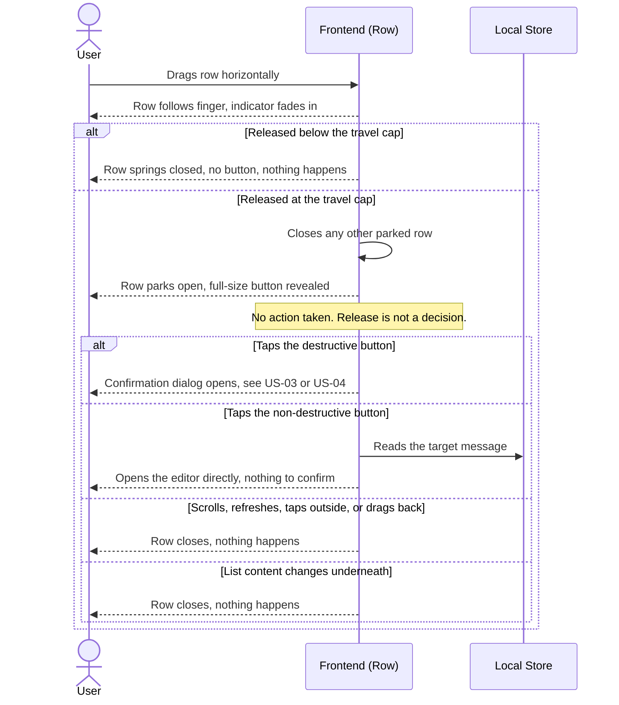
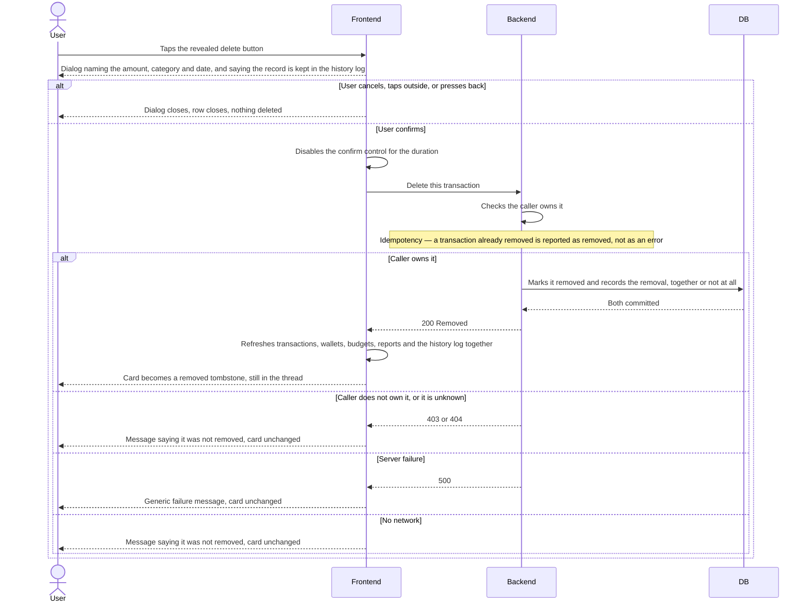
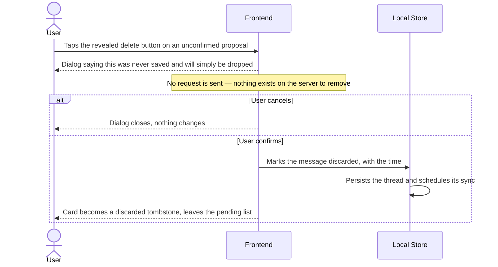
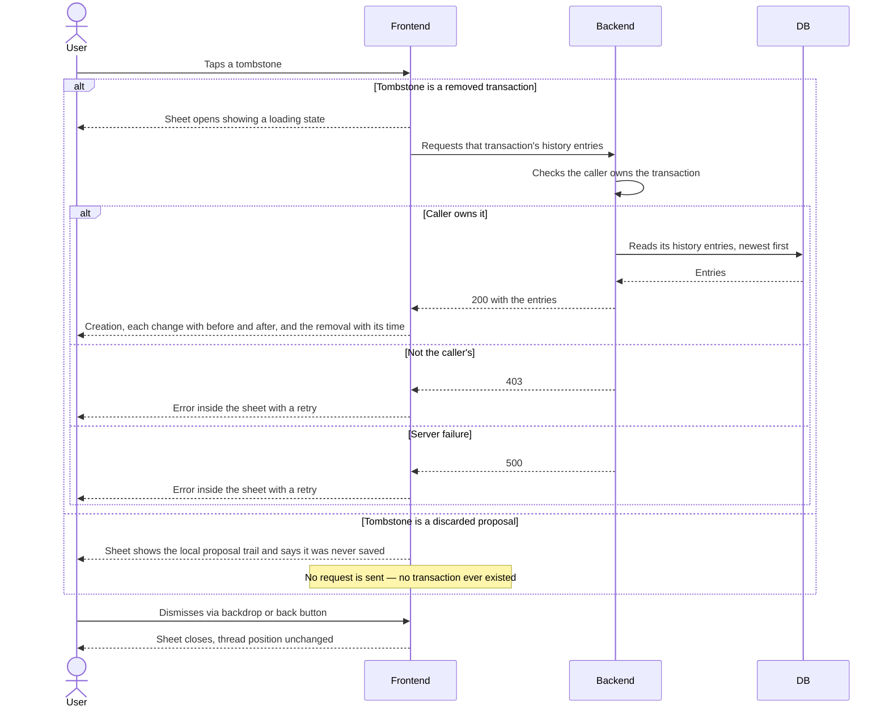
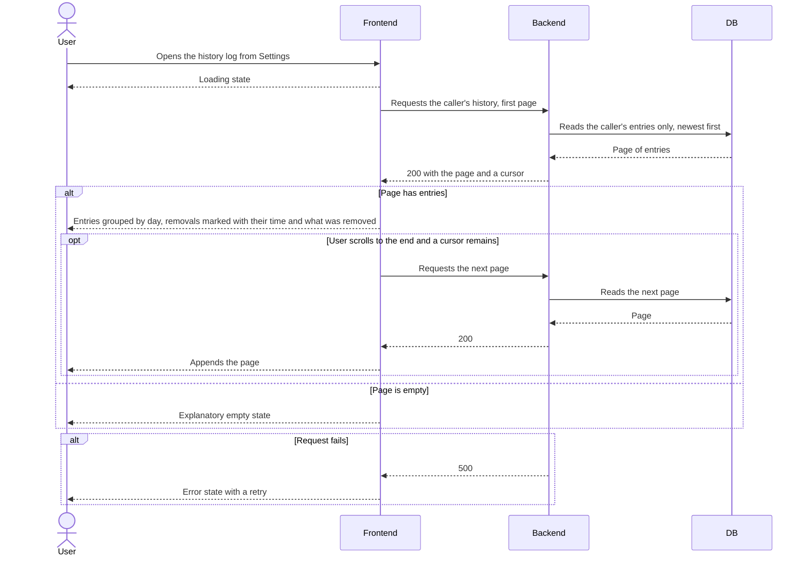

# Implementation Plan: Transaction Delete Guardrails & Persistent History

**Spec:** [spec.md](./spec.md)
**SRS features touched:** F-06 Transaction Management (delete path, read-only) · Feature-12 AI Chat (thread state) · Transaction Audit Log (read-only)
**Scope:** `mobile/` only. **No Go, no SQL, no migration, no AI service.**
**Ticket:** N/A — this project tracks work in `specs/` + `CURRENT_STATE.md`, not Jira.
**Code prefix:** `TDG`

---

## Pre-flight: Impact Analysis

⚠️ **GitNexus could not be queried.** `mcp__gitnexus__check` and `mcp__gitnexus__impact` both returned `LadybugDB unavailable … Couldn't replay shadow pages under read-only mode` for `D:\example\PFM\.gitnexus\lbug`. The index is also recorded at 251 symbols / 246 relationships, which is far below this repository's real symbol count, so it was stale before it locked. **Re-run `node .gitnexus/run.cjs analyze` from the project root before implementation begins**, and re-check the two HIGH rows below against the graph.

Blast radius below was derived from the TypeScript import graph instead. For this codebase that is reliable — every symbol is explicitly imported, there is no dynamic dispatch and no reflection — but it does not see execution-flow membership, which is what GitNexus would have added.

| Symbol | Direct consumers | Risk | Why |
|---|---|---|---|
| `colorForCategory` | 14 files | **HIGH** | ⚠️ **Do not modify.** Referenced across transactions, budgets, categories, notifications, wallets, chat and home. Nothing in this plan touches it. |
| `Drawer` | 25+ files | **HIGH** | ⚠️ Every sheet in the app. The new history sheet **consumes** it unchanged; no prop may be altered, only added with a default. |
| `ChatMessage` (type) | `ai-chat.tsx`, `index.tsx`, `chat-store.ts`, `use-chat-thread-sync.ts`, `edit-lock.ts` | **MEDIUM** | New fields must be optional so every existing reader keeps compiling and every persisted message stays valid. |
| `useDeleteTransactionMutation` | `TransactionFormModal.tsx` | **MEDIUM** | Adding one more cache invalidation changes behaviour for the Transactions screen too — intended, but it is a second caller. |
| `ConfirmDialog` | 6 files | **MEDIUM** | Any new prop must be optional with a default, or six call sites break. |
| `SwipeableRow` | `index.tsx` only | LOW | Single consumer. |
| `SwipeableMessageRow` | `ai-chat.tsx` only | LOW | Single consumer. |
| `AuditLogRow`, `useAuditLogsQuery` | `audit-log.tsx` only | LOW | Single consumer; moves with the rename. |
| `useChatStore.removeMessage` | `index.tsx` only | LOW | Its only caller is the line this plan deletes. |

### GitNexus outcome (TDG-T16 / MVR-T16 — completed)

`node .gitnexus/run.cjs analyze` was re-run. It exits 0 and the database is queryable again, **but it did not index this repository**: `gitnexus://repo/PFM/context` reports **8 files, 251 symbols, 0 processes, 66 commits behind HEAD**, and `impact` returns "Target not found" for every symbol named below. FTS is also unavailable (`analyze --repair-fts` suggested). **GitNexus gave no usable blast radius for this work.** The table below therefore stands on the TypeScript import graph alone, which for this codebase is sound — every symbol is explicitly imported, with no dynamic dispatch or reflection.

⚠️ One reference the symbol-level grep missed and the route-path grep caught: `BottomNav.tsx` also hard-codes the history-log route. See TDG-T13.

### Pre-existing file-size violations

CLAUDE.md: *"File > 300 lines → tách ra. Không có ngoại lệ."* Four files in this feature's path already violate it **before** any change:

| File | Lines | Action |
|---|---|---|
| `app/(app)/index.tsx` | 638 | ⚠️ Must shed the pending-confirmations block (TDG-T10) |
| `app/(app)/ai-chat.tsx` | 632 | ⚠️ Must shed the list row renderer (TDG-T09) |
| `src/features/budget-wizard/hooks/use-budget-wizard-state.ts` | 403 | Not touched by this plan — see the sibling plan |
| `src/features/budgets/components/BudgetsTab.tsx` | 459 | Not touched by this plan — see the sibling plan |

**Rule for this feature: no task may leave any file it touches above 300 lines.** Extraction is not optional cleanup here; it is the precondition for the edits.

---

## Pre-flight: Spec Review Findings

| # | Finding | Type | Resolution |
|---|---|---|---|
| 1 | Spec asserts "no backend change". Verified: `SyncChatThreadRequest.Payload` is `json.RawMessage` and the handler stores it verbatim without inspecting fields. | Confirmation | ✅ New tombstone fields on the message sync and restore with **zero** Go change. Recorded here so nobody re-opens it. |
| 2 | `chat-store.removeMessage` does **not** call `scheduleSync`. So today's Home discard never reaches the server at all — the thread heals on the next device. | **Latent bug** | Replacing the call with `updateMessage` (which does sync) fixes this as a side effect. Do not "fix" `removeMessage`; delete its only caller and leave the method for future use. |
| 3 | Spec S-TDG-32 requires the discarded state to survive a restart and a re-sync. | Gap in spec | The thread is persisted whole, so this follows automatically **provided** the tombstone lives on `ChatMessage` and not in component state. Stated as a binding constraint in Architecture below. |
| 4 | `useAuditLogsQuery` has no `enabled` option, so a history sheet mounting with no transaction id would fire a request for the whole log. | Gap vs. current code | TDG-T06 adds an `enabled` parameter, defaulting to `true` so the existing screen is unaffected. |
| 5 | Spec US-01 and US-02 describe the same park-and-confirm state machine in two components that are already near-duplicates (270 and 211 lines). | Design risk | Extract the shared gesture into one hook (TDG-T01). Implementing the machine twice guarantees they drift. |
| 6 | Spec does not state the travel cap for the delete side. Request said 30%; existing edit gesture uses 20%. | Ambiguity | Delete side caps at `DELETE_SWIPE_RATIO = 0.30`, edit side stays `EDIT_SWIPE_RATIO = 0.20`. Rationale: the parked state must fit a full-size labelled button, which a 20% strip cannot. Named constants, not literals. |
| 7 | Spec S-TDG-20 requires the deletion to be readable in the history log immediately. `useDeleteTransactionMutation` does not invalidate `["audit-logs"]`. | Gap vs. current code | TDG-T05 adds it. |
| 8 | Spec US-03 step 5 requires "every derived figure" to refresh. The existing mutation already invalidates transactions, wallets, budgets and report-summary. | Confirmation | ✅ No change needed beyond finding 7. |

---

## Architecture

### File layout (mobile only)

```text
mobile/
├── app/(app)/
│   ├── index.tsx                                   # MODIFIED — sheds pending block, gains dialogs
│   ├── ai-chat.tsx                                 # MODIFIED — sheds row renderer, gains delete dispatch
│   ├── audit-log.tsx        → audit-logs.tsx       # RENAMED
│   └── settings.tsx                                # MODIFIED — href only
└── src/
    ├── components/shared/
    │   ├── use-swipe-actions.ts                    # NEW — the one park-and-confirm state machine
    │   ├── SwipeActionButton.tsx                   # NEW — the revealed full-size button
    │   ├── SwipeableRow.tsx                        # MODIFIED — consumes the hook, parks instead of firing
    │   └── ConfirmDialog.tsx                       # UNCHANGED — reused as-is
    └── features/
        ├── ai-chat/
        │   ├── components/
        │   │   ├── SwipeableMessageRow.tsx         # MODIFIED — consumes the hook, gains a delete side
        │   │   ├── ChatMessageRow.tsx              # NEW — extracted renderItem body
        │   │   ├── TransactionTombstoneCard.tsx    # NEW — the removed-card presentation
        │   │   ├── TransactionHistoryDrawer.tsx    # NEW — the history sheet
        │   │   ├── PendingConfirmationsSection.tsx # NEW — extracted from index.tsx
        │   │   └── use-transaction-removal.ts      # NEW — shared delete/discard dispatch
        │   ├── tombstone.ts                        # NEW — pure helpers: is/what kind of tombstone
        │   └── types.ts                            # MODIFIED — optional tombstone fields
        ├── audit-log/ → audit-logs/                # RENAMED folder
        │   └── api/use-audit-logs-query.ts         # MODIFIED — gains `enabled`
        └── transactions/api/
            └── use-delete-transaction-mutation.ts  # MODIFIED — one more invalidation
```

### Client state objects

| Object | Where it lives | Key fields | Notes |
|---|---|---|---|
| `ChatMessage` | `features/ai-chat/types.ts`, persisted in `chat-store` (AsyncStorage) and mirrored to the server opaquely | existing fields + `removalState?: "deleted" \| "discarded"`, `removedAt?: string` | ⚠️ Both **optional** — 25+ persisted messages already exist on users' devices without them. `removedAt` is an **ISO-8601 UTC** string, displayed local. |
| Parked-row state | `use-swipe-actions.ts`, component-local | `side`, `parked` | Deliberately **not** global. Persisting which row is parked would survive a restart, which spec S-TDG-04 forbids in spirit. |
| Pending removal target | `use-transaction-removal.ts`, component-local | `target: ChatMessage \| null` | Drives which message the confirm dialog names. |
| Audit entries | server state via `useAuditLogsQuery` | — | ⚠️ **TanStack Query only.** Never copied into `useState` or Zustand (CLAUDE.md). |

### Business rules

| ID | Rule | Source AC | Enforcement point |
|---|---|---|---|
| BR-TDG-01 | A swipe release never performs an action; it only parks | S-TDG-02, S-TDG-10, S-TDG-12 | `use-swipe-actions.ts` — `release()` sets parked state and returns; it has no action callback at all |
| BR-TDG-02 | Only one row is parked at a time, app-wide within a list | S-TDG-16, Edge 1 | `use-swipe-actions.ts` via a module-level parked-row registry keyed by row id |
| BR-TDG-03 | A destructive action requires an explicit confirm; a non-destructive one does not | S-TDG-03, S-TDG-13 | `SwipeActionButton` takes `destructive: boolean`; the screen routes destructive taps to `ConfirmDialog` |
| BR-TDG-04 | ⚠️ A confirmed proposal deletes through the server; an unconfirmed one never issues a request | S-TDG-18, S-TDG-28 | `use-transaction-removal.ts` branches on `Boolean(message.confirmed && message.transactionId)` |
| BR-TDG-05 | ⚠️ A chat message is never removed from the thread | S-TDG-19, S-TDG-28, Context #2 | `use-transaction-removal.ts` calls `updateMessage`, never `removeMessage`. **`removeMessage` must have zero call sites after this change.** |
| BR-TDG-06 | ⚠️ The tombstone is written **only** after the delete request succeeds | S-TDG-23, S-TDG-26 | `onSuccess` callback of the mutation — never optimistically, never in `onSettled` |
| BR-TDG-07 | A tombstone offers no Confirm, no Edit, and no swipe affordance | S-TDG-08, US-04 step 4 | `isEditLocked` extended to treat any tombstone as locked; `ChatMessageRow` renders `TransactionTombstoneCard` instead of `TransactionActionCard` |
| BR-TDG-08 | A deleted tombstone's history comes from the server; a discarded one's from the local trail | S-TDG-35, S-TDG-39, Context #4 | `TransactionHistoryDrawer` branches on `removalState` |
| BR-TDG-09 | ⚠️ Deleting is soft-delete only; the client never expects the record to disappear from history | S-TDG-20, Context #1 | `DELETE /transactions/{id}` — existing backend behaviour, client asserts nothing else |
| BR-TDG-10 | A delete already applied elsewhere is treated as success | S-TDG-24 | `onError` inspects the error code; a not-found is routed to the success path |
| BR-TDG-11 | No second delete request per confirmation | S-TDG-22 | Confirm control disabled while `mutation.isPending`; `ConfirmDialog`'s existing `loading` prop |
| BR-TDG-12 | Parked rows close on scroll, refresh, list change, or outside tap | S-TDG-04, S-TDG-09, S-TDG-14, S-TDG-15 | List-level `onScrollBeginDrag` + an effect keyed on the rendered id set |

⚠️ **Money:** this feature reads and displays amounts only. Integer cents (xu), rendered through the existing `formatCurrency`. **No arithmetic on any amount anywhere in this feature.** No float appears in the path.
⚠️ **Time:** `removedAt` and every audit `created_at` are UTC on the wire and in storage, formatted to device-local at render only, through the existing date helpers.
⚠️ **Soft delete:** `DELETE /transactions/{id}` sets `deleted_at`. There is no hard-delete path and this plan adds none. The history log deliberately keeps showing the record.

---

## Sequence Diagrams

> Four-tier lifeline. Stories with no Backend or DB participation are drawn `Actor → Frontend → Local Store`; drawing empty Backend and DB lifelines for a pure-UI flow would misrepresent the design, the same way the plan template drops `Frontend` for backend-only flows.
>
> **US-07 (rename) has no diagram** — it is a naming change with no runtime flow.

### US-01 + US-02 — Park and confirm (one machine, two surfaces)



### US-03 — Confirm and soft-delete a real transaction



### US-04 — Discard an unconfirmed proposal



### US-05 — Open a removed transaction's history



### US-06 — Read removals on the history log screen



---

## Error Flows

> Every row below is an **existing** backend behaviour this client must handle. **No new status code or error code is introduced by this feature.**

| Scenario | HTTP | Error code | Class | Client behaviour |
|---|---|---|---|---|
| Missing / expired access token | 401 | — | Validation (client) | Existing interceptor forces re-login; ⚠️ card stays a live card, never a tombstone |
| Transaction belongs to another user | 403 | `TRANSACTION_ACCESS_DENIED` | Validation (client) | Message; no local change (S-TDG-25) |
| Transaction id unknown to the server | 404 | `TRANSACTION_NOT_FOUND` | Validation (client) | ⚠️ Treated as **success** — the outcome the user asked for already holds (S-TDG-24, BR-TDG-10) |
| Transaction already soft-deleted | 404 or 200 | `TRANSACTION_NOT_FOUND` / — | Validation (client) | Same as above |
| Network unreachable / request timeout | — | — | Transport | Message saying it was not removed; no local change (S-TDG-23) |
| Unexpected server failure | 500 | — | **System (server)** | Generic failure message; no local change (S-TDG-26) |
| History request for another user's transaction | 403 | `TRANSACTION_ACCESS_DENIED` | Validation (client) | Error inside the sheet with a retry (S-TDG-37) |
| History request fails | 500 | — | **System (server)** | Error inside the sheet with a retry |
| Discard an unconfirmed proposal | — | — | — | ⚠️ **No request is made.** No error class exists for this path (S-TDG-28) |

### Independent vs. gating checks

All server-side checks on the delete path are **gating and sequential** — authentication, then existence, then ownership. None can run before the previous one resolves, so short-circuiting is correct here and no "collect all errors" response applies. This feature adds no endpoint with independent field-level checks.

---

## Security

| Concern | Decision |
|---|---|
| Authorization boundary | ⚠️ **Server-side only, unchanged.** The existing JWT middleware authenticates; `TransactionService` checks ownership. Nothing in this plan moves, weakens or duplicates that. |
| Client-side gating | The client hides a delete affordance on messages it knows are not deletable. This is **presentation, not authorization** — a client that got it wrong would still be refused by the server. |
| Actor resolution | Unchanged: the caller is resolved from the access token by the existing middleware and passed to the service. The client never sends a user identifier. |
| Direct-URL / deep-link access | The renamed history route stays inside the authenticated route group, so the existing `Stack.Protected` guard covers it. ⚠️ TDG-T13 must verify the guard still applies after the rename. |
| CSRF | N/A — token-in-header bearer auth from a native client; there is no cookie-borne ambient credential to forge. |
| Logging | ⚠️ No amount, note, category, wallet or token value may be written to any client log by this feature. |

---

## Convention Notes

| Rule | Status | How this feature satisfies it |
|---|---|---|
| Server state via TanStack Query only | Required | Audit entries are read through `useAuditLogsQuery`; never copied into `useState`/Zustand |
| Client/draft state via Zustand | Required | Tombstone state lives on `ChatMessage` in `chat-store` — it is client state with no server owner |
| No file over 300 lines | **Required, currently violated** | TDG-T09/T10 extract from `ai-chat.tsx` (632) and `index.tsx` (638) before either is edited |
| No colour literal outside the token file | Required | The revealed buttons use existing tokens; no new hex value |
| `const` by default, no `any` | Required | New hook and components are fully typed; the audit snapshot type already exists |
| Money as integer cents, never float | Required | ⚠️ Display only — this feature performs no arithmetic on any amount |
| Soft delete respected | Required | Calls the existing delete endpoint; asserts the record remains readable in history |
| Delete behind explicit confirmation | Required | ⚠️ This feature exists to enforce exactly that |
| Hand-written API types mirror the Go DTO | Required | No DTO changes; `AuditLogEntry`/`AuditSnapshot` are reused as-is |
| No new dependency | Required | `react-native-gesture-handler` and `reanimated` are **not** installed; the hook stays on core `PanResponder` + `Animated` |

### Named constants (no bare numbers)

| Constant | Value | Where | Why |
|---|---|---|---|
| `EDIT_SWIPE_RATIO` | `0.20` | `use-swipe-actions.ts` | Existing feel, preserved |
| `DELETE_SWIPE_RATIO` | `0.30` | `use-swipe-actions.ts` | ⚠️ Wider because the parked state shows a full-size labelled button, not a small indicator |
| `ARM_RATIO` | `0.9` | `use-swipe-actions.ts` | Existing — where the indicator becomes fully opaque |
| `ACTIVATION_DISTANCE` | `10` | `use-swipe-actions.ts` | Existing — the horizontal travel before the gesture claims the touch |
| `ARM_VIBRATION_MS` / `PARK_VIBRATION_MS` | `10` / `25` | `use-swipe-actions.ts` | Existing values, renamed — the longer buzz now marks parking, not firing |

---

## Element IDs (QA automation)

| Element | `testID` | Status | File |
|---|---|---|---|
| Revealed delete button on a chat card | `btn-chat-delete-transaction` | **Missing** | `SwipeActionButton.tsx` via `ChatMessageRow.tsx` |
| Revealed delete button on a pending row | `btn-pending-discard` | **Missing** | `PendingConfirmationsSection.tsx` |
| Revealed edit button on a pending row | `btn-pending-edit` | **Missing** | `PendingConfirmationsSection.tsx` |
| Delete confirmation dialog | `dialog-confirm-delete-transaction` | **Missing** | `use-transaction-removal.ts` host |
| Discard confirmation dialog | `dialog-confirm-discard-proposal` | **Missing** | `use-transaction-removal.ts` host |
| Deleted tombstone card | `card-transaction-tombstone-deleted` | **Missing** | `TransactionTombstoneCard.tsx` |
| Discarded tombstone card | `card-transaction-tombstone-discarded` | **Missing** | `TransactionTombstoneCard.tsx` |
| History sheet | `drawer-transaction-history` | **Missing** | `TransactionHistoryDrawer.tsx` |
| History sheet retry | `btn-transaction-history-retry` | **Missing** | `TransactionHistoryDrawer.tsx` |
| History log list | `list-audit-logs` | **Exists** | moves to `audit-logs.tsx` — ⚠️ keep the id unchanged |
| History log empty state | `empty-audit-logs` | **Exists** | moves to `audit-logs.tsx` — ⚠️ keep the id unchanged |

---

## Regression Scope

| Surface | Why it is at risk | Must re-verify |
|---|---|---|
| AI Chat swipe-to-edit | The gesture is being re-implemented on a shared hook | Edit still opens on release at the cap, on user and assistant cards, with the keyboard both open and closed |
| Home pending list | Both actions change from fire-on-release to park | Edit still deep-links to the right message with the editor open; "Bỏ qua" still hides the banner without changing data |
| Transactions screen delete | `useDeleteTransactionMutation` gains an invalidation | Deleting from the form still works and still refreshes balances |
| Settings navigation | The history route path changes | Every row still navigates; the admin-only filter is unaffected |
| Chat thread sync / restore | `ChatMessage` gains fields | A thread saved before this change still restores; a thread with tombstones round-trips |
| Toast, BottomNav | They sit above these screens and read `sheet-store` | The history sheet hides the bottom nav and restores it on dismiss |

---

## Open Tasks

| ID | Task | File(s) |
|---|---|---|
| TDG-T01 | Extract the park-and-confirm gesture into one hook: signed drag, per-side cap, arm/park vibration, single-parked-row registry, `parked`/`side` output. ⚠️ **It exposes no action callback** — parking is its only outcome (BR-TDG-01). | `src/components/shared/use-swipe-actions.ts` (new) |
| TDG-T02 | Build the revealed full-size action button: icon + label, `destructive` flag, animated reveal driven by the hook's progress. | `src/components/shared/SwipeActionButton.tsx` (new) |
| TDG-T03 | Rewrite `SwipeableRow` on the hook. Replace `onTrigger` with `onPress` per side, fired by the button, not the release. Keep it under 300 lines. | `src/components/shared/SwipeableRow.tsx` |
| TDG-T04 | Rewrite `SwipeableMessageRow` on the hook and add a second (delete) side with its own cap. Keep it under 300 lines. | `src/features/ai-chat/components/SwipeableMessageRow.tsx` |
| TDG-T05 | Add `["audit-logs"]` to the delete mutation's invalidation set. ⚠️ Second caller is `TransactionFormModal` — verify it still behaves. | `src/features/transactions/api/use-delete-transaction-mutation.ts` |
| TDG-T06 | Add an `enabled` parameter to `useAuditLogsQuery`, defaulting to `true`. | `src/features/audit-logs/api/use-audit-logs-query.ts` |
| TDG-T07 | Add optional `removalState` and `removedAt` to `ChatMessage`; add pure `isTombstone` / `tombstoneKind` helpers; extend `isEditLocked` to lock tombstones. ⚠️ Both fields optional — persisted messages predate them. | `src/features/ai-chat/types.ts`, `src/features/ai-chat/tombstone.ts` (new), `src/features/ai-chat/edit-lock.ts` |
| TDG-T08 | Build the removal dispatch hook: branch on confirmed-vs-unconfirmed, host both confirm dialogs, call the mutation, write the tombstone **only** in `onSuccess`, map not-found to success. | `src/features/ai-chat/components/use-transaction-removal.ts` (new) |
| TDG-T09 | ⚠️ Extract `ai-chat.tsx`'s `renderItem` body into `ChatMessageRow`, then wire the delete side and tombstone rendering there. **`ai-chat.tsx` must end under 300 lines.** | `src/features/ai-chat/components/ChatMessageRow.tsx` (new), `app/(app)/ai-chat.tsx` |
| TDG-T10 | ⚠️ Extract `index.tsx`'s pending-confirmations block and its styles into `PendingConfirmationsSection`, then switch it to park-and-confirm. **Delete the `removeChatMessage` call — it must have zero call sites** (BR-TDG-05). **`index.tsx` must end under 300 lines.** | `src/features/ai-chat/components/PendingConfirmationsSection.tsx` (new), `app/(app)/index.tsx` |
| TDG-T11 | Build the tombstone card: two wordings (removed vs. never saved), removal time in device-local, no Confirm, no Edit, tappable to open history. | `src/features/ai-chat/components/TransactionTombstoneCard.tsx` (new) |
| TDG-T12 | Build the history sheet on the existing `Drawer`: server branch via `useAuditLogsQuery(transactionId)` with loading/error/retry, local branch from `editHistory`, read-only, scrollable. | `src/features/ai-chat/components/TransactionHistoryDrawer.tsx` (new) |
| TDG-T13 | Rename the route, the screen export and the feature folder to the plural form; update the Settings href. ⚠️ Grep for the old path and the old folder across `app/` and `src/` — zero matches before this is done. Keep both existing `testID`s. Keep every Vietnamese label byte-identical. | `app/(app)/audit-logs.tsx`, `src/features/audit-logs/**`, `app/(app)/settings.tsx` |
| TDG-T14 | Make a removal entry visually distinct on the history log row and state its time explicitly. | `src/features/audit-logs/components/AuditLogRow.tsx` |
| TDG-T15 | Close parked rows on list scroll, pull-to-refresh, and any change to the rendered id set, on both screens. | `ChatMessageRow.tsx`, `PendingConfirmationsSection.tsx` |
| TDG-T16 | ⚠️ **Re-run `node .gitnexus/run.cjs analyze`, then `impact` on every symbol in the Pre-flight table**, before the first edit. Report any HIGH/CRITICAL the import graph missed. | — |
| TDG-T17 | Run `tsc --noEmit` and `expo lint`; confirm no file touched by TDG-T01…T15 exceeds 300 lines. | — |
| TDG-T18 | ⚠️ **On-device verification in Expo Go.** Gestures, vibration and sheet layering cannot be verified by type-check or bundle. Per `CURRENT_STATE.md` this has never been done in any session. | — |

### Sequencing

`TDG-T16` → `T01, T02` → `T03, T04` → `T07` → `T05, T06, T08` → `T09, T10, T11, T12` → `T13, T14, T15` → `T17` → `T18`.

`T13` (the rename) is placed **late and alone**: it touches paths that `T06` and `T12` also reference, and doing it while those are in flight turns one mechanical change into a merge problem.

### Handoff

| Step | Status | Owner |
|---|---|---|
| Spec | ✅ Done | BA |
| Plan | ✅ This document | Architect |
| GitNexus re-index + impact re-check | ⏳ Blocked — DB locked | Dev (TDG-T16, first task) |
| Implementation | ⏳ Pending | Dev |
| Test cases | ⏳ Pending | QC (`/cook-qc`) |
| On-device verification | ⏳ Pending, never yet performed | Whoever holds a device |
