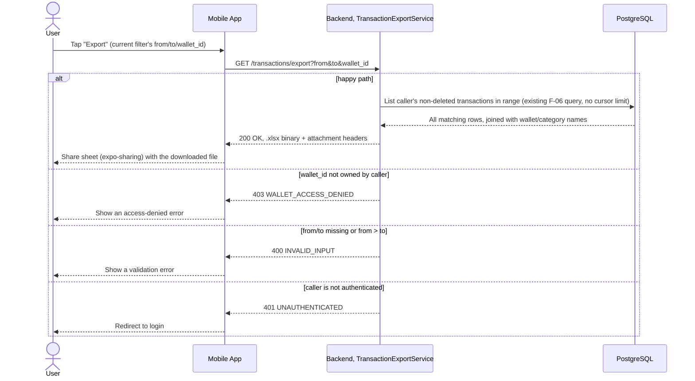
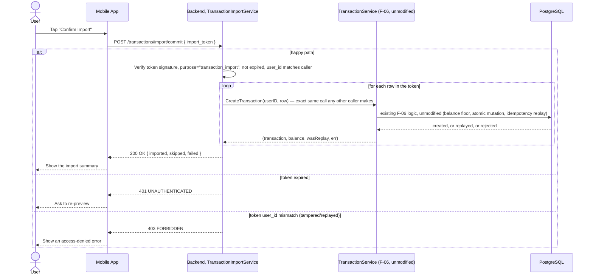

# Implementation Plan: Transaction Export/Import (.xlsx) (extends F-06 Transaction Management, touches F-03 Wallet Management)

- **Feature:** Transaction Export/Import
- **SRS Feature Code:** Extends F-06/F-03 (no own SRS entry — user-requested addition, this session)
- **Jira Epic:** N/A — no Jira integration in this repository
- **Spec:** [spec.md](./spec.md)
- **Related plans:** [F-06 Transaction Management](../transaction-management/plan.md) (Commit reuses `TransactionService.CreateTransaction` unmodified — zero changes to that method in this plan), [F-03 Wallet Management](../wallet-management/plan.md) (Wallet-name resolution reads `WalletRepo.ListWalletsByUser`, no changes to that repo either), [Transaction Audit Log](../transaction-audit-log/plan.md) (if implemented first, each row `CreateTransaction` call during Commit already produces its own audit-log entry for free — no special-casing needed in this plan)
- **Frontend scope:** **mobile only** (`mobile/`). Same explicit scoping assumption as the Audit Log plan — no `frontend/` (Next.js web) work here.

---

## 1. Pre-flight: Spec Review Findings

| # | Type | Finding | Resolution / Open Task |
|---|------|---------|-------------------------|
| 1 | Gap, biggest new-dependency item in this plan | `backend/go.mod` has no `.xlsx` read/write library. `spec.md`'s own header already flags this. | Add `github.com/xuri/excelize/v2` (actively maintained, pure-Go, no cgo — matters since `backend`'s existing dependency list, `pgx`/`fiber`/`minio-go`, is all pure-Go too, keeping the Docker build simple). Pinned to a specific version in `go.mod`, same convention as every other dependency here. |
| 2 | Reuse opportunity, not a gap — the single most important finding in this plan | `spec.md` Context #4/#5 require Commit to call `TransactionService.CreateTransaction` unmodified, including its idempotency handling. Reading that method's actual current signature (`backend/internal/service/transaction_service_create.go`) shows it **already returns exactly the signal this feature needs**: `func (s *TransactionService) CreateTransaction(ctx, userID, req) (*model.Transaction, *int64, bool wasReplay, error)` — `wasReplay=true` means the given `idempotency_key` matched an already-created Transaction and nothing new was written (specs/ai-chat-assistant's own resolved design decision). | Commit's per-row loop does **not** need its own duplicate-detection logic at all — it calls `CreateTransaction` for every row and increments `imported` when `wasReplay=false, err=nil`, `skipped` when `wasReplay=true`. Preview's own "check idempotency_key against the DB" step (spec.md US-02 step 5) becomes a **UX nicety only** (showing the user upfront which rows are already-imported before they commit) — not the actual enforcement mechanism, which is `CreateTransaction`'s own existing, already-tested replay path. This resolves spec.md Open Questions #6 in passing: a Commit-time balance race (S-TXI-23) and a Commit-time duplicate (S-TXI-22) both surface through the exact same three-value return, and both are reported as `skipped` in the response — see Error Flows for the one case that needs a fourth bucket after all. |
| 3 | Design decision, spec-mandated (Context #5) | `idempotency_key` on `transactions` is a `UUID` column, scoped `(user_id, idempotency_key)` (migration `010_transactions_idempotency_key.sql`), not an arbitrary string. `spec.md`'s "deterministic key" design (`UUIDv5(namespace, sha256(...))`) must actually produce a valid UUID, not just a hash string. | UUIDv5 (RFC 4122 §4.3, `github.com/google/uuid`'s `uuid.NewSHA1`/`uuid.NewV5`-equivalent — the `google/uuid` package already a dependency exposes `uuid.NewSHA1(namespace, data)`) *is* a real UUID format — this was already compatible, just confirmed here against the real column type. A fixed, package-level `uuid.UUID` namespace constant (e.g. `var importIdempotencyNamespace = uuid.MustParse("...")`, any fixed UUID literal) is defined once; the per-row key is `uuid.NewSHA1(importIdempotencyNamespace, []byte(fmt.Sprintf("%s|%s|%s|%d|%s|%s|%s", userID, walletID, categoryID, amount, type, occurredAt, note)))`. |
| 4 | Gap | No multipart file-upload handler pattern exists for anything but small images (`WalletHandler.UploadIcon`/`CategoryHandler.UploadIcon`, 2MB cap, PNG/JPEG/SVG). Preview needs the same `c.FormFile`/size-check/content-check shape, just for a `.xlsx` at a 5MB cap. | `import_handler.go`'s `Preview` mirrors `WalletHandler.UploadIcon`'s exact structure (`c.FormFile("file")` → size check → content-type/magic-byte check → `io.ReadAll`) — not a new pattern, an extension of an existing one. Unlike the icon uploaders, the parsed file is never sent to MinIO/object storage — it only exists in memory for the duration of the request (Preview doesn't persist the file at all, per spec.md Edge Cases US-02 — only the derived `valid`/`errors`/`import_token` are returned). |
| 5 | Design decision, spec-mandated (Context #6) | `import_token` must be a JWT with a distinct `purpose` claim, never accepted by `JWTAuth` middleware as an access token. `backend/internal/service/token_service.go`'s `TokenService` currently only issues `AccessClaims`/`refreshClaims`. | This plan adds a **third**, separate claims type, `ImportTokenClaims`, and a **new** `TokenService` method, `IssueImportToken`/`ParseImportToken` — reusing the same `TokenService.signingKey` (no new secret to manage) but a structurally distinct Go type from `AccessClaims`. `middleware.JWTAuth` is untouched — it already only ever calls `ParseAccessToken`, which unmarshals into `AccessClaims{}`; an `ImportTokenClaims`-shaped token presented as a Bearer token would either fail to carry a `role`/matching structure `JWTAuth` depends on, or (since both are just JSON under one HMAC signature) could theoretically decode into a zero-valued `AccessClaims` — **this plan closes that gap explicitly**: `AccessClaims` gains no new field, but `JWTAuth` middleware is updated to reject any token whose decoded `Role` is empty/not `admin`/`member` (defense in depth — belt-and-suspenders, since an `ImportTokenClaims` payload has no `role` key at all, `AccessClaims.Role` would decode to `""`, a value `JWTAuth` must already treat as invalid but is worth an explicit test given this new feature exists). |
| 6 | Design decision | `import_token`'s payload is the **entire validated row list** (spec.md Context #6: `rows: [...]`), not a reference/ID to something stored server-side — this plan has zero new DB tables (Finding #7). A large file (near the 5MB input cap, spec.md's own "50k transactions" sizing note) could produce a token whose payload is itself large. | Accepted as-is for this plan's scope — a JWT has no hard size limit, and 50k rows' worth of `{wallet_id, category_id, amount, type, occurred_at, note, idempotency_key}` tuples is a few MB of JSON at most, well within what an HTTP body/header can carry. If this becomes a real problem (Open Questions #3 in spec.md), the fix is a server-side token store, which is a bigger change than this plan takes on. |
| 7 | Gap, confirms scope | No new migration is needed — Preview/Commit have zero persisted server-side state (the token *is* the state, Finding #6); Export reads existing tables only. | This plan adds **zero rows** to `backend/db/migrations/` — the only backend schema-adjacent change in this whole feature area (across both this plan and the Audit Log plan) is the Audit Log plan's own migration, unrelated to this one. |
| 8 | **Routing gotcha, same class as Audit Log plan Finding #8** | `GET /transactions/export` is a new literal-path `GET` sibling of the existing `transactions.Get("/:id", transactionHandler.GetTransaction)`. | Must be registered **before** the existing `GET /:id` line, exactly like the Audit Log plan's `GET /transactions/audit-logs` — if both plans land, all three literal-path `GET` routes (`/export`, `/audit-logs`) must precede `/:id` in `routes.go`. `POST /transactions/import/preview` and `POST /transactions/import/commit` have no such conflict — the existing group only has `transactions.Post("/", ...)`, no `POST /:id`. |
| 9 | Ambiguity, resolved as a deliberate simplicity choice | `spec.md` Open Questions #4 (exact HTTP status for oversized file) and #5 (dedicated `IMPORT_TOKEN_EXPIRED` code) are both left open. | This plan resolves both pragmatically, matching existing precedent rather than introducing new codes: oversized file → `400 INVALID_INPUT` (exact string precedent: `WalletHandler.UploadIcon`'s `"icon file exceeds the 2MB size limit"` uses the same code, not `413`); expired/invalid `import_token` → `401 UNAUTHENTICATED` (same code family already used for "your credential isn't valid," which an expired signed token structurally is). No new error codes for either case — revisit only if product specifically wants finer client-side messaging later. |
| 10 | Ambiguity, resolved | `spec.md` Open Questions #6 (should a Commit-time balance race be `skipped` or a new `failed` bucket) is resolved by Finding #2's mechanism: `CreateTransaction`'s only two outcomes per row are "created" or "replay" — a genuine `409 INSUFFICIENT_BALANCE` from a *fresh* (non-replay) key is a **third**, distinct outcome. | Commit's response gains a third count, `failed`, alongside `imported`/`skipped` (a superset of the two counts `spec.md`'s own sample response names) — a row whose `CreateTransaction` call returns any error other than the replay case is `failed`, reported with its row number and the underlying error message, not silently folded into `skipped`. This is an additive clarification of `spec.md`'s response shape, not a contradiction of it — flagged for the BA/product to fold back into `spec.md` on the next spec revision. |

### Regression Scope

**New files:**
- `backend/internal/handler/transaction_export_handler.go` (Export), `backend/internal/handler/transaction_import_handler.go` (Preview/Commit)
- `backend/internal/service/transaction_export_service.go`, `backend/internal/service/transaction_import_service.go`
- `backend/internal/dto/transaction_export_request.go`, `backend/internal/dto/transaction_import_dto.go`
- `mobile/src/features/transactions/api/use-export-transactions-mutation.ts`, `use-import-preview-mutation.ts`, `use-import-commit-mutation.ts`
- `mobile/src/features/transactions/components/ImportPreviewModal.tsx`

**Modified files (additive):**
- `backend/go.mod`/`go.sum` — adds `github.com/xuri/excelize/v2`.
- `backend/cmd/server/routes.go` — `GET /transactions/export`, `POST /transactions/import/preview`, `POST /transactions/import/commit`, all inside the existing `/transactions` group; the `GET` one must precede the existing `GET /:id` (Finding #8).
- `backend/cmd/server/main.go` — new service/handler wiring, appended.
- `backend/internal/service/token_service.go` — adds `ImportTokenClaims` type + `IssueImportToken`/`ParseImportToken` methods (Finding #5). **No existing method's signature changes.**
- `backend/internal/common/constants.go` — `TransactionImportMaxUploadBytes = 5 * 1024 * 1024`, `TransactionImportTokenTTL = 5 * time.Minute`.
- `mobile/app/(app)/transactions.tsx` — adds Export/Import entry points (buttons) to the existing filter row area.

**Modified files (behavioral, defense-in-depth only — Finding #5):**
- `backend/internal/middleware/jwt_auth.go` — adds an explicit `claims.Role == ""` rejection. This tightens an already-implicit requirement (every real access token has always had a non-empty role since F-02) and does not change behavior for any existing valid access token; it only closes the theoretical gap Finding #5 describes.

**Regression risk:** very low. The `jwt_auth.go` change is the only modification to a shared, high-traffic code path, and it only rejects a token shape (empty `role`) that has never been a valid access token in practice. Everything else is new files or additive route/dependency registration.

---

## 2. Architecture

### Package/File Layout

**Backend (Go Fiber + excelize)**

```text
backend/internal/
├── handler/
│   ├── transaction_export_handler.go   # Export (GET /transactions/export)
│   └── transaction_import_handler.go   # Preview, Commit (POST /transactions/import/*)
├── service/
│   ├── transaction_export_service.go   # BuildExportWorkbook — queries ListTransactionsByUser
│   │                                     # (existing, F-06) across the full range, no cursor
│   │                                     # limit, writes the .xlsx via excelize
│   ├── transaction_import_service.go   # PreviewImport (row validation, dedup check, token mint),
│   │                                     # CommitImport (token verify, per-row CreateTransaction loop)
│   └── token_service.go (modified)     # + ImportTokenClaims, IssueImportToken, ParseImportToken
└── dto/
    ├── transaction_export_request.go   # ExportTransactionsQuery (from, to, wallet_id)
    └── transaction_import_dto.go       # ImportPreviewResponse, ImportCommitRequest,
                                          # ImportCommitResponse, importedRow (internal,
                                          # what's actually embedded in the JWT payload)

# Modified:
└── common/constants.go                 # + TransactionImportMaxUploadBytes, TransactionImportTokenTTL
└── middleware/jwt_auth.go              # + explicit empty-role rejection (Finding #5)
```

No new `repository/` file — Export reuses `TransactionRepo.ListTransactionsByUser` (F-06, unmodified) and `WalletRepo.ListWalletsByUser` (F-03, unmodified) exactly as they exist today; Import's row resolution reuses `WalletRepo.ListWalletsByUser`/`CategoryRepo.ListCategoriesForUser` (both existing, F-03/F-04) to build the name→ID lookup maps, and Commit's writes go through `TransactionService.CreateTransaction` (F-06, unmodified) — no new SQL, no new sqlc queries.

**Mobile (`mobile/`, Expo)**

```text
mobile/
├── app/(app)/
│   └── transactions.tsx (modified)               # adds Export/Import buttons near the existing
│                                                    # filter row (§ this session's redesign)
└── src/features/transactions/
    ├── api/
    │   ├── use-export-transactions-mutation.ts   # GET /transactions/export — downloads the
    │   │                                            # response as a Blob, shares via expo-sharing
    │   ├── use-import-preview-mutation.ts        # POST /transactions/import/preview (multipart)
    │   └── use-import-commit-mutation.ts         # POST /transactions/import/commit
    └── components/
        └── ImportPreviewModal.tsx                 # renders valid/duplicates/errors, "Confirm Import"
                                                     # button — mirrors TransactionActionCard's own
                                                     # "here's what I parsed, confirm to save" shape
```

New Expo dependencies: `expo-document-picker` (file picker), `expo-sharing` (share/save the exported file — the platform share sheet, not a raw download link, matching how the rest of this Expo app already has no browser-download affordance).

### Domain Objects

*(No new persisted entity — Export/Import operate entirely on existing `Wallet`/`Category`/`Transaction` rows, Finding #7.)*

| Payload (not a table) | Shape | Notes |
|---|---|---|
| `ImportTokenClaims` | `{ user_id, purpose: "transaction_import", rows: [{wallet_id, category_id, amount, type, occurred_at, note, idempotency_key}], exp }` | Signed JWT, 5-minute TTL (`common.TransactionImportTokenTTL`), same signing key as `AccessClaims` but a structurally distinct Go type (Finding #5). ⚠️ `amount` here is already converted to integer cents (the `.xlsx`'s major-unit `Amount` column × 100) — this is the only place in the whole request/response chain where a money value crosses the major-unit/cents boundary, and it happens once, at Preview time, never again. |

### Column Schema (Export/Import, restated from `spec.md` for implementation precision)

| Column | Export source | Import target | Notes |
|---|---|---|---|
| `Date` | `occurred_at.Format("2006-01-02")` | `dto.CreateTransactionRequest.OccurredAt` (string, reuses F-06's existing `parseFlexibleTimestamp`) | ⚠️ Date only, no time-of-day |
| `Type` | `"Expense"`/`"Income"` (capitalize `model.TransactionType`) | case-insensitive match → `"expense"`/`"income"` | Reject anything else |
| `Amount` | `float64(amount) / 100` | `int64(math.Round(parsed * 100))` | ⚠️ Money boundary — must be exact inverses (Finding, Context #1 of spec.md) |
| `Currency` | resolved Wallet's `currency` | must equal resolved Wallet's `currency`, or row error | Optional column on import |
| `Category` | `category_name` | resolved to `category_id` via `CategoryRepo.ListCategoriesForUser` name+type match, caller's visible set only | Not found → row error, never auto-created (spec.md Context #7) |
| `Wallet` | `wallet_name` | resolved to `wallet_id` via `WalletRepo.ListWalletsByUser` name match | Not found, or 2+ matches (ambiguous) → row error |
| `Note` | `note` (empty cell if nil) | `dto.CreateTransactionRequest.Note` | ≤ 500 chars, same `common.TransactionNoteMaxLength` |
| `Created At` | `created_at.Format("2006-01-02 15:04:05")` | **ignored** | Read-only historical metadata (spec.md Context #3) |

### Business Rules

| Rule | Source | Enforcement |
|------|--------|-------------|
| Export requires `from`/`to`, `from ≤ to` | S-TXI-05, S-TXI-06 | handler-level validation, same shape as `ListTransactionsQuery`'s existing `from`/`to` checks |
| Export scoped to caller, optional `wallet_id` ownership check | S-TXI-01–S-TXI-03 | `TransactionExportService` calls the existing `WalletRepo.GetWalletByID` ownership check (F-03) if `wallet_id` given, then `TransactionRepo.ListTransactionsByUser` (F-06, unmodified) with no cursor limit (whole range in one call) |
| Export column values exactly per Column Schema table | S-TXI-01, S-TXI-07 | `TransactionExportService.BuildExportWorkbook` — one `excelize` row per Transaction |
| Amount column is major units, exact inverse of Import's parse | Context #1 (spec.md) ⚠️ | Both directions live in one shared, tested helper pair (`centsToMajorUnitsString`/`majorUnitsStringToCents`), never duplicated ad hoc in each direction |
| Preview validates every row independently; one bad row never blocks others | Edge Cases #1 (spec.md) | `TransactionImportService.PreviewImport` iterates rows in a loop, appending to `valid`/`duplicates`/`errors` — never returns early on the first failure |
| Ambiguous Wallet-name match is an error, not "pick one" | S-TXI-11 | Name resolution builds a `map[string][]uuid.UUID` (not `map[string]uuid.UUID`) from `ListWalletsByUser`; any key with `len > 1` is an error for every row referencing it |
| Category-not-found is rejected, never auto-created | Context #7 (spec.md) | `PreviewImport` never calls `CategoryService.CreateCategory` — this is enforced by simple omission, not a flag to check |
| File > 5MB rejected before parsing | S-TXI-16 | `c.FormFile`'s `fileHeader.Size` checked before `fileHeader.Open()`, mirrors `WalletHandler.UploadIcon` |
| File content validated as real `.xlsx`, not by extension/Content-Type | Edge Cases #3 (spec.md) | `excelize.OpenReader` itself is the validation — if it errors (not a valid OOXML zip), the whole upload is `400 INVALID_INPUT`, before any row-level loop runs |
| `import_token` embeds `user_id`, `purpose`, 5-min expiry | Context #6 (spec.md) | `TokenService.IssueImportToken`/`ParseImportToken` (Finding #5) |
| Commit re-validates token `purpose`/`user_id`/expiry before trusting its rows | S-TXI-20, S-TXI-21 | `TransactionImportService.CommitImport`'s first step, before any row is processed |
| Commit never bypasses `TransactionService.CreateTransaction` | Context #4 (spec.md) ⚠️ | `CommitImport`'s row loop calls `s.transactionService.CreateTransaction(ctx, userID, dto.CreateTransactionRequest{...})` directly — no new insert/balance-mutation code path anywhere in this plan |
| Commit is idempotent via `CreateTransaction`'s own replay mechanism | Context #5 (spec.md), Finding #2 | No new dedup logic — `wasReplay` from the existing method is the whole mechanism |
| A row that fails at Commit for a reason other than replay is `failed`, not silently `skipped` | Finding #10 | Any `CreateTransaction` error where `wasReplay=false` (e.g. a fresh `409 INSUFFICIENT_BALANCE` from a balance race) increments `failed`, reported with row number + message |
| Import causing a negative Wallet balance is allowed | S-TXI-24 | No special-casing — `CreateTransaction`'s existing behavior (F-06, unmodified) already allows this for `income` rows and rejects only genuinely-insufficient `expense` rows, exactly as it does for any other caller |
| Unauthenticated caller rejected on all three endpoints | S-TXI-08, S-TXI-18, S-TXI-25 | Existing `JWTAuth` middleware on the `/transactions` group |

### API Index — Endpoint → Service Traceability

| API | Request | Response | Service Method |
|-----|---------|----------|-----------------|
| `GET /transactions/export` | `ExportTransactionsQuery` | `.xlsx` binary (`200`) | `TransactionExportService.BuildExportWorkbook` |
| `POST /transactions/import/preview` | multipart `file` | `ImportPreviewResponse` (`200`) | `TransactionImportService.PreviewImport` |
| `POST /transactions/import/commit` | `ImportCommitRequest{import_token}` | `ImportCommitResponse` (`200`) | `TransactionImportService.CommitImport` |

### Security & Actor Resolution

- **Middleware:** all three endpoints sit inside the existing `/transactions` `JWTAuth` group — no `RequireRole` gate.
- **Actor resolution:** `callerUUID(c)` in both new handlers, same as every other F-06 endpoint.
- **`import_token` is not a bearer/access token** (Finding #5) — `ParseImportToken` is called explicitly by `CommitImport`, never by `JWTAuth` middleware. The `jwt_auth.go` hardening (empty-role rejection) is defense in depth only, not the primary guard — the primary guard is that `JWTAuth` never calls `ParseImportToken` in the first place.
- **File-upload surface:** `Preview` is the only endpoint in this plan accepting arbitrary user-supplied binary content — `excelize.OpenReader`'s own parse failure is the content-validation boundary (Finding, Edge Cases #3), not a separate magic-byte check reimplemented by hand.

### Sequence Diagrams

**Export**



**Import — Preview**

```mermaid
sequenceDiagram
    actor User
    participant App as Mobile App
    participant BE as Backend, TransactionImportService
    participant DB as PostgreSQL

    User->>App: Pick an .xlsx file
    App->>BE: POST /transactions/import/preview (multipart)
    alt happy path
        BE->>BE: Reject upfront if > 5MB; parse via excelize (content-based validation)
        BE->>DB: Load caller's wallets + visible categories (name lookup maps)
        BE->>BE: Validate every row independently (wallet/category/amount/date/currency)
        BE->>DB: Check each valid row's deterministic idempotency_key (UX-only pre-check, Finding #2)
        BE->>BE: Mint a 5-minute import_token carrying the non-duplicate valid rows
        BE-->>App: 200 OK { valid, duplicates, errors, import_token }
        App-->>User: Render the breakdown, offer "Confirm Import"
    else file too large or not a valid .xlsx
        BE-->>App: 400 INVALID_INPUT
        App-->>User: Show a file-error message
    else caller is not authenticated
        BE-->>App: 401 UNAUTHENTICATED
        App-->>User: Redirect to login
    end
```

**Import — Commit**



---

## 3. Error Flows

### `GET /transactions/export`

| Scenario | HTTP | Error Code |
|----------|------|------------|
| Unauthenticated | 401 | — |
| `from`/`to` missing, or `from > to` | 400 | `INVALID_INPUT` |
| `wallet_id` not owned by caller | 403 | `WALLET_ACCESS_DENIED` *(existing code, reused)* |
| Unexpected error | 500 | — |

### `POST /transactions/import/preview`

| Scenario | HTTP | Error Code |
|----------|------|------------|
| Unauthenticated | 401 | — |
| No `file` field, file > 5MB, or unparseable as `.xlsx` | 400 | `INVALID_INPUT` |
| Unexpected error | 500 | — |

*(Row-level problems — bad wallet/category/amount/date — are never a request-level error; they're entries in the `errors` array of a `200` response, per spec.md Edge Cases #1.)*

### `POST /transactions/import/commit`

| Scenario | HTTP | Error Code |
|----------|------|------------|
| Unauthenticated | 401 | — |
| `import_token` missing, malformed, expired, or wrong `purpose` | 401 | `UNAUTHENTICATED` *(Finding #9 — no dedicated `IMPORT_TOKEN_EXPIRED` code in this plan)* |
| `import_token`'s embedded `user_id` doesn't match the caller | 403 | `FORBIDDEN` |
| Unexpected error | 500 | — |

*(A per-row balance-floor rejection, category/wallet no-longer-existing, etc. is never a request-level error either — it's counted in `failed`, per Finding #10.)*

---

## 4. Constitution / Convention Notes

| Rule | Status | Note |
|------|--------|------|
| Service layer owns business rules | Required | Row validation, name resolution, token issuance/verification all live in `TransactionImportService`/`TransactionExportService`, never in the handlers |
| No new business logic duplicated from F-06 | Required ⚠️ | Commit's writes go through `TransactionService.CreateTransaction` verbatim — this is the single most load-bearing convention in this whole plan (Context #4 of spec.md) |
| Money stored as BIGINT cents | Required ⚠️ | The `.xlsx` `Amount` column is the *only* place in this feature that's ever major units — the conversion happens exactly once per direction, in one shared helper pair (Business Rules table) |
| Idempotency on write | Required, reuses existing mechanism | No new idempotency code — `CreateTransaction`'s existing `idempotency_key`/`wasReplay` handles it (Finding #2) |
| JWT auth enforced at middleware, but `import_token` is explicitly NOT an access token | Required, new pattern | `JWTAuth` never parses an `import_token`; `CommitImport` explicitly parses and validates `purpose` itself (Finding #5) |
| No new persisted state | Notable, by design | Zero new DB tables/columns (Finding #7) — the `import_token` itself is the only "state," and it's stateless (self-contained, signed, expiring) |
| Soft delete respected | Required | Export's underlying query is F-06's existing `ListTransactionsByUser`, already `deleted_at IS NULL`-filtered; Commit's writes go through `CreateTransaction`, which never touches `deleted_at` |
| No file > 300 lines | Required | Watch `transaction_import_service.go` — likely the largest new file (row validation + name resolution + token issuance/verification + the Commit loop); split into a second file (e.g. `transaction_import_validation.go`) if it grows past 300 |
| Mobile: server state via TanStack Query only | Required | Preview/Commit/Export are all one-shot mutations (`useMutation`), not cached queries — matches the existing convention for write-shaped calls in this codebase |
| Mobile: draft-confirmation UX | Required, spec-mandated | `ImportPreviewModal` never calls Commit automatically — the user must explicitly tap "Confirm Import," mirroring `TransactionActionCard`'s own confirm-before-save pattern from AI chat |
| New Go dependency | Flagged | `github.com/xuri/excelize/v2` — first new backend dependency since `minio-go` (icon uploads); pin an exact version in `go.mod`, same as every existing dependency |
| New Expo dependencies | Flagged | `expo-document-picker`, `expo-sharing` — neither previously used anywhere in `mobile/` |

---

## 5. Element/Key IDs

**Mobile (`testID`):**

| Element | testID | Status | File |
|---------|--------|--------|------|
| Export button | `testID="btn-export-transactions"` | **Missing** | `mobile/app/(app)/transactions.tsx` |
| Import button | `testID="btn-import-transactions"` | **Missing** | `mobile/app/(app)/transactions.tsx` |
| Import preview modal | `testID="modal-import-preview"` | **Missing** | `mobile/src/features/transactions/components/ImportPreviewModal.tsx` |
| Import preview — valid row count | `testID="text-import-valid-count"` | **Missing** | same |
| Import preview — error row list | `testID="list-import-errors"` | **Missing** | same |
| Import preview — confirm button | `testID="btn-import-confirm"` | **Missing** | same |
| Import result summary | `testID="text-import-result"` | **Missing** | same |

---

## 6. Status Summary (Step Handoff)

| Area | Status |
|------|--------|
| Spec (`spec.md`) | Done — self-checked; Commit's `skipped` vs `failed` split (Finding #10) has been folded back into `spec.md`'s response shape and Open Questions #6 |
| Plan (this document) | Done, pending human review — particularly Finding #5 (`import_token` design) and Finding #2 (reusing `CreateTransaction`'s `wasReplay`) |
| `github.com/xuri/excelize/v2` dependency add | Not started |
| Backend Export service/handler | Not started |
| Backend Import Preview/Commit service/handler | Not started |
| `TokenService` `ImportTokenClaims` addition | Not started |
| `jwt_auth.go` empty-role hardening | Not started |
| Mobile feature scaffold | Not started |

## 7. Open Tasks

| ID | Task | File |
|----|------|------|
| TXI-T1 | Add `github.com/xuri/excelize/v2` dependency (Finding #1) | `backend/go.mod`, `go.sum` |
| TXI-T2 | Add `common.TransactionImportMaxUploadBytes`, `common.TransactionImportTokenTTL` | `backend/internal/common/constants.go` |
| TXI-T3 | Implement `TransactionExportService.BuildExportWorkbook` (query via existing `ListTransactionsByUser`, write via excelize, major-units conversion helper) | `backend/internal/service/transaction_export_service.go` |
| TXI-T4 | Implement `transaction_export_handler.go` (`GET /transactions/export`); register **before** the existing `GET /:id` line (Finding #8) | `backend/internal/handler/transaction_export_handler.go`, `backend/cmd/server/routes.go` |
| TXI-T5 | Implement `dto.ExportTransactionsQuery` | `backend/internal/dto/transaction_export_request.go` |
| TXI-T6 | Add `TokenService.ImportTokenClaims`, `IssueImportToken`, `ParseImportToken` (Finding #5) | `backend/internal/service/token_service.go` |
| TXI-T7 | Harden `middleware.JWTAuth` — reject empty/unrecognized `Role` explicitly (Finding #5, defense in depth) | `backend/internal/middleware/jwt_auth.go` |
| TXI-T8 | Implement `TransactionImportService.PreviewImport` — row parsing/validation loop, name-resolution maps (wallet ambiguous-match check, category never-auto-create), deterministic idempotency-key derivation (Finding #3), duplicate pre-check, token minting | `backend/internal/service/transaction_import_service.go` |
| TXI-T9 | Implement `TransactionImportService.CommitImport` — token verification, per-row `TransactionService.CreateTransaction` calls (Finding #2), `imported`/`skipped`/`failed` counting (Finding #10) | same file |
| TXI-T10 | Implement `transaction_import_handler.go` (`Preview`, `Commit`); `Preview`'s multipart handling mirrors `WalletHandler.UploadIcon` (Finding #4) | `backend/internal/handler/transaction_import_handler.go`, `backend/cmd/server/routes.go` |
| TXI-T11 | Implement `dto.ImportPreviewResponse`, `dto.ImportCommitRequest`, `dto.ImportCommitResponse` | `backend/internal/dto/transaction_import_dto.go` |
| TXI-T12 | Unit tests: ambiguous wallet name (S-TXI-11), category-not-found reject (S-TXI-12), deterministic key stability across repeat Preview calls on the same file (S-TXI-15), double-commit no-op (S-TXI-22), a fresh balance-race row landing in `failed` not `skipped` (Finding #10) | `backend/internal/service/transaction_import_service_test.go` |
| TXI-T13 | Mobile: add `expo-document-picker`, `expo-sharing` dependencies | `mobile/package.json` |
| TXI-T14 | Mobile: `use-export-transactions-mutation.ts` (downloads blob, shares via `expo-sharing`) | `mobile/src/features/transactions/api/use-export-transactions-mutation.ts` |
| TXI-T15 | Mobile: `use-import-preview-mutation.ts`, `use-import-commit-mutation.ts` | `mobile/src/features/transactions/api/use-import-preview-mutation.ts`, `use-import-commit-mutation.ts` |
| TXI-T16 | Mobile: `ImportPreviewModal.tsx` (valid/duplicates/errors breakdown, explicit confirm button) | `mobile/src/features/transactions/components/ImportPreviewModal.tsx` |
| TXI-T17 | Mobile: add Export/Import buttons to `transactions.tsx`'s existing filter row | `mobile/app/(app)/transactions.tsx` |
