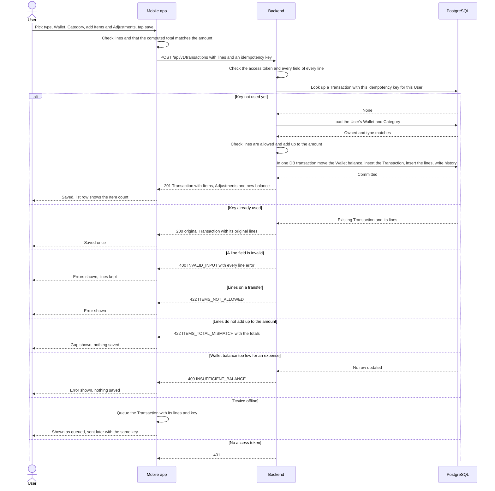
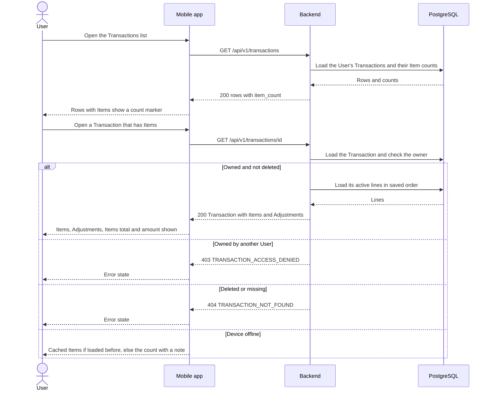
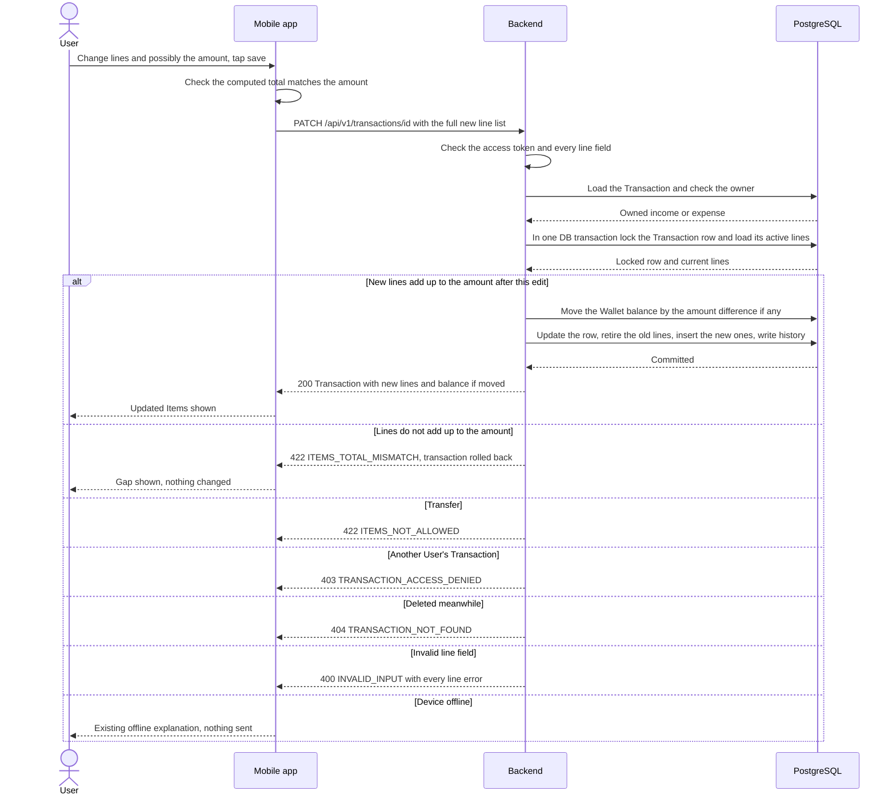

# Plan: F-06 — Items of a Transaction (`transaction-line-items`)

> Spec: [spec.md](./spec.md) · SRS: Feature-06 US-06 / US-07 / US-08, FR-02, BF-05 · Feature code `TXI`
> Ticket: none — PFM has no Jira; this folder is the tracking unit.
> Stacks touched: **Go backend · React Native mobile.** `frontend/` web is frozen — no web section (regression only, §9). No AI Service change here; the receipt-reading side lives in [`../ai-chat-image-capture/plan.md`](../ai-chat-image-capture/plan.md) (amended 2026-10-11, F24–F27).
> Task prefix: `TXI-T{NN}`. Scenario IDs: `S-TXI-NN` (spec).

---

## 1. Pre-flight: Spec Review Findings

Cross-checked against the code on 2026-10-11.

| # | Finding | Evidence | Resolution |
|---|---|---|---|
| F1 ⚠️ | **Concurrent edits can break the balance rule (BR-07).** `UpdateTransaction` reads the row, then writes inside a tx with no row lock. Edit A (Items + amount → 113,000 VND) and edit B (amount only → 108,000 VND, validated against the *old* Items) can both commit → Items 113,000 VND, amount 108,000 VND. Spec EC-11 ("last save wins") is only safe if each save re-checks against the state it overwrites. | `transaction_service_mutate.go` `updateTransactionTx` | **Pessimistic row lock**: when a PATCH touches `amount`, `items` or `adjustments`, `updateTransactionTx` first locks the Transaction row (`SELECT … FOR UPDATE`, scoped by `user_id`), then loads the active lines and runs the balance check **inside the tx**. Edits that touch only note/date/Category/location keep today's unlocked path. |
| F2 | Spec splits Items and Adjustments conceptually; storing them in two tables doubles every query and the replace logic. | — | **One table `transaction_lines`** with `kind` ∈ `item`, `tax`, `fee`, `discount`, `other` and `sign` ∈ `+1`/`-1`, DB CHECKs tie kind ↔ sign ↔ required fields. The **API keeps two arrays** (`items`, `adjustments`) so the wire matches the spec's language. |
| F3 | Spec BR-12 "a removed line is never permanently erased" + BR-11 "replace the whole list". | CLAUDE.md soft-delete rule | Replace = soft-delete every active line of the Transaction (`deleted_at = now()`) + insert the new set, same tx. The audit entry also carries the full before/after lists (AC-24). |
| F4 | Mobile never calls `GET /transactions/:id` — the edit form is opened from the list row's data. A list carrying full Items for 20–100 rows per page is heavy. | `mobile/src/features/transactions/api/*` (no detail hook) | List rows gain **`item_count`** only (one extra batched count query per page). Detail/create/update responses carry the full `items` / `adjustments`. Mobile adds `useTransactionQuery(id)` and fetches it when opening a Transaction with `item_count > 0`. Detail queries live under the persisted `transactions` root → available offline once loaded (spec EC-09). |
| F5 | PATCH has to tell "leave Items alone" from "remove all Items". | `dto.DecodeStrict`, pointer fields | `Items *[]TransactionItemRequest`: absent or `null` = unchanged; `[]` = remove all (and Adjustments); non-empty = replace. `adjustments` sent without `items` → `400` (spec BR-08/BR-11: the two lists are replaced as one unit). |
| F6 | Amount-only PATCH on a Transaction with Items must be re-checked (AC-22). | `UpdateTransaction` | Covered by F1: any PATCH with `amount` loads the active lines under the lock; if lines exist, the check runs against them. |
| F7 | Create with an idempotency key replays the original Transaction — must also return its original Items (S-TXI-12). | `lookupIdempotentTransaction` | Replay path loads the lines too. Lines are only ever inserted inside the create tx, so a replay never writes a second set. |
| F8 | Web (frozen) has no Items UI. A web amount-only edit on a Transaction with Items now gets `422 ITEMS_TOTAL_MISMATCH`. | `frontend/` | Accepted while web is frozen (spec Out of Scope). A web PATCH never sends `items`, so it never removes them. Flagged in §9. |
| F9 | `use-transaction-form.ts` is 288 lines and `TransactionFormModal.tsx` 265 — Items state cannot go inside them without breaking the 300-line rule. | file sizes | All Items state in a new `use-items-editor.ts`; the form hook only receives `{ items, adjustments, amountFollowsItems }`. New UI in new components. |
| F10 | Spec AC-06 "amount follows the computed total until the User types one". The keypad writes `amount` directly. | `TransactionKeypadFooter.tsx` | `amountTouched` flag in `use-items-editor.ts`: set by any keypad input; while false and lines exist, `amount = computedTotal`. Editing a saved Transaction starts with `amountTouched = true`. |
| F11 | Export and import do not know about Items. | `transaction_export_service.go`, `transaction_import_service.go` | No change. Import builds `CreateTransactionRequest` without Items (unchanged). Export ignores Items (spec OQ #1). |
| F12 | The audit row renderer is keyed on field names. | `mobile/src/features/audit-logs/components/AuditLogRow.tsx` `FIELD_LABEL` | New audit key `items` (before/after `{ count, items_total, lines }`); mobile renders count + total and expands to the line list (AC-24). Same renderer serves `TransactionHistoryDrawer`. |
| F13 | Spec names no unit-price/line-amount relation check (BR-05, OQ #3). | — | Server never compares `quantity × unit_price` to `amount`; only the client pre-fills. |
| F14 | New user-facing terms (Item, Adjustment and its kinds) are not in the copy glossary. | CLAUDE.md UX Copy: "new terms go into the glossary first" | TXI-T20 adds them to `.claude/skills/pfm-ux-copy/references/glossary.md` before any UI copy is written. |
| F16 | **Export Items (spec BR-15, AC-28).** Export reads `ListTransactionsByUser` and writes one sheet. Import reads the first sheet only. | `transaction_export_service.go`, `transaction_import_service.go` | Second sheet `TransactionExportItemsSheet` with columns `TransactionExportItemColumns` (date, Transaction amount, note, line kind, name/label, quantity, unit price, amount, direction). Lines loaded in one batched query `ListActiveLinesByTransactionIDs` for the exported ids. Import untouched. Replaces F11's export half. |
| F17 ⚠️ | **Concurrent-edit warning (spec BR-16, AC-29).** Needs a version the client can send back. | `transactions.updated_at` set on every update | **Optimistic check on top of F1's lock**: PATCH gains optional `expected_updated_at` (RFC3339). When present, `updateTransactionTx` locks the row and compares with `time.Equal`; different → `409 TRANSACTION_CHANGED`, nothing written. Absent = today's behavior (web, "Save anyway"). Mobile sends it on every edit from the form; on 409 shows a dialog: "Load latest" refetches the detail and resets the form, "Save anyway" resends without it. A lines-only PATCH still runs the row update so `updated_at` moves. |
| F15 | GitNexus `impact` on `createTransactionTx` / `updateTransactionTx` reports 0 callers — known blind spot for calls through Go receivers/interfaces. Real callers: `TransactionHandler.Create/Update`, `TransactionImportService.Commit` (create), AI Chat confirm (client → `POST /transactions`). `auditSnapshot` → `createTransactionTx`, `DeleteTransaction` (LOW). | gitnexus 2026-10-11 | Regression scope §9 lists the real callers. Re-run `gitnexus_impact` before editing each symbol (§7). |

---

## 2. Architecture

### 2.1 Package / file layout

```text
backend/
├── db/
│   ├── migrations/029_transaction_lines.sql          # NEW
│   └── queries/transaction_lines.sql                 # NEW (sqlc source — reference only, see T03)
└── internal/
    ├── common/
    │   ├── constants.go                              # + line limits (§2.6)
    │   └── errors.go                                 # + ITEMS_TOTAL_MISMATCH, ITEMS_NOT_ALLOWED (422)
    ├── model/transaction_line.go                     # NEW TransactionItem, TransactionAdjustment, AdjustmentKind
    ├── model/transaction.go                          # + Items, Adjustments, ItemCount
    ├── dto/
    │   ├── transaction_line_request.go               # NEW TransactionItemRequest, TransactionAdjustmentRequest
    │   ├── transaction_request.go                    # + Items/Adjustments on Create and Update; HasUpdates
    │   └── transaction_response.go                   # + item_count, items, adjustments
    ├── repository/
    │   ├── sqlc/transaction_lines.sql.go             # NEW hand-written (never run sqlc generate)
    │   ├── transaction_line_repository.go            # NEW methods on TransactionRepository
    │   └── transaction_repository.go                 # + LockTransactionForUpdate
    └── service/
        ├── interfaces.go                             # TransactionRepo + 5 methods
        ├── transaction_lines.go                      # NEW pure: normalize, validate, reconcile, totals
        ├── transaction_lines_test.go                 # NEW
        ├── transaction_service_create.go             # insert lines in the create tx; replay loads lines
        ├── transaction_service_mutate.go             # lock + reconcile + replace lines in the update tx
        ├── transaction_service_query.go              # GetTransaction loads lines; List attaches item_count
        ├── transaction_service_audit.go              # lines in snapshot; `items` diff key
        └── transaction_service_lines_test.go         # NEW S-TXI service tests (fake repo)

mobile/
├── app/(app)/(tabs)/{transactions.tsx,index.tsx}     # pass detail to the form (no route change)
└── src/
    ├── components/shared/TransactionRow.tsx          # + Item-count marker
    └── features/
        ├── transactions/
        │   ├── types.ts                              # + TransactionItem, TransactionAdjustment, item_count, request fields
        │   ├── items/line-math.ts                    # NEW pure totals / gap / prefill / validation (mirrors server)
        │   ├── items/line-math.test.ts               # NEW (pure, no React)
        │   ├── items/use-items-editor.ts             # NEW draft lines + amountTouched
        │   ├── api/use-transaction-query.ts          # NEW GET /transactions/:id
        │   ├── api/create-transaction-request.ts     # carry items/adjustments
        │   ├── api/use-update-transaction-mutation.ts# carry items/adjustments; invalidate detail key
        │   └── components/
        │       ├── ItemsEntryRow.tsx                 # NEW form row: add entry / summary
        │       ├── ItemsEditorSheet.tsx              # NEW Drawer: lists + totals
        │       ├── ItemLineEditor.tsx                # NEW one Item
        │       ├── AdjustmentLineEditor.tsx          # NEW one Adjustment
        │       ├── ItemsTotalsPanel.tsx              # NEW totals, match/gap, two fixes
        │       ├── TransactionItemsSection.tsx       # NEW read-only view inside the form
        │       ├── TransactionFormModal.tsx          # mount ItemsEntryRow / section; transfer-switch confirm
        │       └── use-transaction-form.ts           # accept editor state; send lines; amount follow
        └── audit-logs/components/
            ├── AuditLogRow.tsx                       # `items` key → AuditItemsDiff
            └── AuditItemsDiff.tsx                    # NEW count + total, expandable lines
```

### 2.2 Domain objects

| Entity | Table | Key fields | Notes |
|---|---|---|---|
| `Transaction` | `transactions` | existing | Unchanged columns. Gains in-memory `Items`, `Adjustments`, `ItemCount` (not stored). |
| `TransactionLine` (Item or Adjustment) | `transaction_lines` (mig 029) | `id` UUID v4 (`uuid_generate_v4()` DB default), `transaction_id` FK, `user_id` FK, `position` SMALLINT, `kind` TEXT, `sign` SMALLINT, `name` TEXT NULL, `quantity` INTEGER NULL, `unit_price` BIGINT NULL, `amount` BIGINT, `created_at` TIMESTAMPTZ, `deleted_at` TIMESTAMPTZ NULL | ⚠️ Money BIGINT xu of the Wallet's currency. **Soft delete**: replaced or removed lines get `deleted_at`; a deleted Transaction keeps its lines untouched (hidden with it). `user_id` denormalized for the isolation rule. Timestamps UTC. |

**Migration 029 CHECKs** (re-runnable, `IF NOT EXISTS` / `DROP CONSTRAINT IF EXISTS` like 026):
- `amount > 0`; `unit_price IS NULL OR unit_price > 0`; `position >= 0`
- `kind IN ('item','tax','fee','discount','other')`, `sign IN (1,-1)`
- item: `name IS NOT NULL AND quantity >= 1 AND sign = 1`
- non-item: `quantity IS NULL AND unit_price IS NULL`
- tax/fee: `sign = 1`; discount: `sign = -1`; other: `name IS NOT NULL` (the label)
- Index `(transaction_id, position) WHERE deleted_at IS NULL`; index `(user_id)`.
- Not mounted into `docker-entrypoint-initdb.d` (same as 022–028); applied by `cmd/migrate`. Purely additive — no existing query breaks if it is applied before the code.

### 2.3 API

No new endpoint. Three existing endpoints gain fields; one gains a field in each row.

#### `POST /api/v1/transactions` (US-01)
- **Auth:** `JWTAuth` on the `transactions` group (filter level — a direct URL call is rejected like an app call). Actor: handler `callerUUID(c)` from `LocalsUserID` → service.
- **Request:** existing body + optional
  `items: [{ name, quantity, unit_price?, amount }]` and `adjustments: [{ kind: tax|fee|discount|other, direction?: add|subtract, label?, amount }]`.
  `direction` is required for `other` and ignored-if-consistent / rejected-if-contradicting for the fixed kinds (`tax`/`fee` = add, `discount` = subtract).
- **Response 201 / 200 (replay):** existing `TransactionResponse` + `item_count`, `items[]`, `adjustments[]` (always arrays, `[]` when none).
- **Service:** `TransactionService.CreateTransaction` (1:1, unchanged signature).

#### `GET /api/v1/transactions/:id` (US-02)
- Response adds `item_count`, `items[]`, `adjustments[]` in saved `position` order. Non-transactional read. Service: `TransactionService.GetTransaction`.

#### `GET /api/v1/transactions` (US-02)
- Each row adds `item_count` (int, `0` when none). `items`/`adjustments` are **omitted** from list rows. Non-transactional. Service: `TransactionService.ListTransactions`.

#### `PATCH /api/v1/transactions/:id` (US-03)
- Request adds optional `items` and `adjustments` (F5 semantics). `HasUpdates()` counts a present `items`.
- Response as GET `/:id` + `wallet_balance` when the amount moved it. Service: `TransactionService.UpdateTransaction`.

#### Check ordering
- **Create — gating (sequential):** JWT (401) → body shape incl. every line field (400) → idempotency replay (200) → Wallet existence/ownership (404/403) → Category / transfer resolution (404/403/422) → lines on a transfer (422 `ITEMS_NOT_ALLOWED`) → balance rule (422 `ITEMS_TOTAL_MISMATCH`) → in tx: balance floor (409 `INSUFFICIENT_BALANCE`) → insert Transaction → insert lines → audit → commit.
- **Create — independent (collected into one 400 `details`):** every line-level shape error (missing name, quantity < 1, non-integer money, label missing for `other`, too many lines, adjustments without items, name too long) plus the existing field errors. One response lists them all, keyed by `items[i].field` / `adjustments[i].field`.
- **Update — gating:** JWT → shape (400, collected as above) → ownership (404/403) → Category checks → lines on a transfer (422) → **in tx: lock row → load active lines → balance rule against effective amount + effective lines (422)** → balance delta → update row → replace lines (when sent) → audit → commit.

### 2.4 Business rules (Go backend)

| Rule | Source | Enforcement |
|---|---|---|
| Lines optional; none = today's behavior | BR-01, AC-16 | DTO pointers; service skips all line logic when absent |
| Lines only on income/expense | BR-02, AC-01, S-TXI-09, S-TXI-30 | `CreateTransaction` / `UpdateTransaction` → 422 `ITEMS_NOT_ALLOWED` |
| Item: name 1..`TransactionLineNameMaxLength` runes (trimmed), quantity 1..`TransactionItemQuantityMax`, unit price optional > 0, amount > 0 | BR-03, AC-02, S-TXI-06 | DTO tags (`dive`) + `transaction_lines.go normalizeLines` → 400 |
| ⚠️ Money integer xu ≤ `MaxTransactionAmountCents` per field; JSON integer only (a fractional value fails decoding) | BR-04, S-TXI-07 | DTO `int64` + `lte` tag → 400; DB CHECK `> 0` |
| ⚠️ Stale edit refused when `expected_updated_at` differs from the locked row | BR-16, AC-29, S-TXI-35 | `updateTransactionTx` → 409 `TRANSACTION_CHANGED` |
| Export lists every line on a second sheet; first sheet unchanged | BR-15, AC-28, S-TXI-33, S-TXI-34 | `TransactionExportService.BuildExportWorkbook` |
| Line amount never recomputed server-side | BR-05, S-TXI-15 | No server arithmetic on quantity × unit price (F13) |
| Adjustment kind → sign; `other` needs direction + label | BR-06, AC-04, S-TXI-11 | `normalizeLines` → 400; DB CHECK as backstop |
| ⚠️ Items total + adding − subtracting = Transaction amount, exact integer equality | BR-07, AC-07, AC-20, AC-22, S-TXI-04, S-TXI-24, S-TXI-25 | `transaction_lines.go reconcile(amount, lines)` using `common/money.go` overflow-safe add → 422 `ITEMS_TOTAL_MISMATCH` (details: `items_total`, `computed_total`, `amount`) |
| Computed total ≤ 0 (discount larger than Items) | EC-04 | Same check — amount is always > 0, so it can never match → 422 |
| No Adjustment without an Item | BR-08, S-TXI-08 | `normalizeLines` → 400 |
| ≤ `TransactionItemsMax` Items, ≤ `TransactionAdjustmentsMax` Adjustments | BR-09, AC-09, S-TXI-10 | DTO `max` tags → 400 |
| ⚠️ Transaction + lines + balance change + audit in one DB tx | BR-10, AC-10 | `createTransactionTx` / `updateTransactionTx` |
| ⚠️ Edit replaces the whole list (soft-delete active + insert new), under a row lock | BR-11, F1, F3, EC-11 | `updateTransactionTx` → `LockTransactionForUpdate`, `SoftDeleteActiveLines`, `InsertTransactionLine` |
| Removed lines never erased; deleted Transaction keeps its lines | BR-12, AC-24 | Soft delete only; `DeleteTransaction` does not touch lines |
| ⚠️ Owner-only | BR-13, S-TXI-20, S-TXI-29 | Existing `getOwnedTransaction` (403/404) before any line read; every line query `AND user_id = $n` |
| Reports / Budgets / analytics unchanged | BR-14 | No change to `transactions.sql` aggregates or `analytics.sql` (regression test) |
| ⚠️ Replay returns original lines, writes none | AC-10, S-TXI-12 | Replay path loads lines; lines only inserted inside the create tx; existing partial unique index on `idempotency_key` is the concurrency guard |
| Amount-only edit re-checked | AC-22 | F6 |
| Removing all Items removes Adjustments; amount unchanged | AC-23, S-TXI-27 | `items: []` → soft-delete all active lines; no balance delta unless `amount` also sent |

### 2.5 Mobile-side rules (not assumed from the backend)

| Rule | Source | Enforcement |
|---|---|---|
| Add-items entry only for income/expense | AC-01 | `ItemsEntryRow` hidden when `type === "transfer"` |
| Switching to transfer with lines → confirm, then clear; cancel keeps type | AC-13, S-TXI-17 | `TransactionFormModal` uses existing `ConfirmDialog` |
| Item kept only with name + amount > 0; quantity whole ≥ 1, default 1 | AC-02 | `line-math.ts validateItem`; keypad-style integer inputs |
| Unit price pre-fills `quantity × unit_price` until the User edits the line amount | AC-03, BR-05 | `use-items-editor.ts` per-line `amountTouched` |
| Fixed kinds set direction; `other` needs direction + label | AC-04 | `AdjustmentLineEditor` |
| Live totals, match/gap | AC-05 | `ItemsTotalsPanel` from `line-math.ts` |
| Amount follows computed total until typed | AC-06, F10 | `use-items-editor.ts amountTouched` → form `amount` |
| Gap blocks save; offers "add as other Adjustment" (label still required) and "use computed total" | AC-07, S-TXI-05 | `ItemsTotalsPanel`; form save disabled while `gap !== 0` |
| Reorder / remove | AC-08 | Up/down controls (no gesture-handler — Expo Go rule) |
| Limits mirrored | AC-09 | `line-math.ts` constants mirror Go (§2.6) |
| Removing all Items clears Adjustments | AC-11 | `use-items-editor.ts` |
| Offline create carries lines; queued edit edits them | AC-12, AC-27 | `OutboxPayload` already = `CreateTransactionRequest & key` → lines ride along; `PendingSyncEditor` → same editor |
| Item-count marker on list rows | AC-14 | `TransactionRow` when `item_count > 0` |
| Detail fetch when opening a Transaction with Items; cached for offline | AC-15, EC-09 | `useTransactionQuery(id)` key `["transactions","detail",id]` (persisted root) |
| Offline + never loaded → count only + note | EC-09 | `TransactionItemsSection` |
| Saved-Transaction Items edit requires online | AC-26, S-TXI-32 | existing `useRequireOnline` on the Items entry in edit mode |
| Money via `formatCurrency` in the Wallet currency | AC-17 | all new components |
| Edit history shows Items change | AC-24 | `AuditItemsDiff` |

### 2.6 Named constants

| Name | Value | Where |
|---|---|---|
| `TransactionItemsMax` | 100 | `backend/internal/common/constants.go` (+ mirror `TRANSACTION_ITEMS_MAX` in `mobile/src/lib/constants.ts`) |
| `TransactionAdjustmentsMax` | 10 | same (+ `TRANSACTION_ADJUSTMENTS_MAX`) |
| `TransactionLineNameMaxLength` | 100 runes | same (+ `TRANSACTION_LINE_NAME_MAX_LENGTH`) |
| `TransactionItemQuantityMax` | 9,999 | same (+ `TRANSACTION_ITEM_QUANTITY_MAX`) |
| `MaxTransactionAmountCents` | existing | per money field |

Struct tags repeat these as literals (existing caveat in `transaction_request.go`) — keep in step by hand.

### 2.7 Sequence diagrams

#### US-01 — Record a Transaction with Items



#### US-02 — View the Items of a Transaction



#### US-03 — Edit the Items of a saved Transaction



---

## 3. Error flows

| Scenario | HTTP | Error code | Class |
|---|---|---|---|
| Missing / invalid JWT | 401 | `UNAUTHENTICATED` | Client (auth) |
| Line shape: missing name, quantity < 1 or > max, fractional or > max money, `other` without direction/label, adjustments without items, too many lines, name too long, unknown field | 400 | `INVALID_INPUT` (all line errors in `details`) | Validation |
| Lines on a transfer | 422 | `ITEMS_NOT_ALLOWED` (new) | Business rule |
| Lines do not add up to the amount (create, line edit, amount-only edit) | 422 | `ITEMS_TOTAL_MISMATCH` (new) | Business rule |
| Expense / transfer above the Wallet balance on create | 409 | `INSUFFICIENT_BALANCE` (existing) | Business rule |
| Transaction of another User | 403 | `TRANSACTION_ACCESS_DENIED` (existing) | Authorization |
| Transaction missing / deleted (incl. lost race) | 404 | `TRANSACTION_NOT_FOUND` (existing) | Client |
| Edit from a stale copy (`expected_updated_at` differs) | 409 | `TRANSACTION_CHANGED` (new) | Business conflict |
| Wallet / Category errors | 403 / 404 / 422 | existing codes | Existing |
| Idempotency replay | 200 | — | Idempotent |
| DB failure, lock timeout, line insert failure | 500 | `INTERNAL_ERROR` (tx rolled back — nothing written) | System |

---

## 4. Security, transactions, logging

| Topic | Decision |
|---|---|
| Authentication | `middleware.JWTAuth` on the `transactions` group — unchanged; covers direct URL calls. |
| Authorization | Service layer only (`getOwnedTransaction`, `getOwnedWallet`); handler resolves the actor via `callerUUID(c)` and passes it down. Line queries additionally filter `user_id`. |
| CSRF | Not applicable — Bearer JWT, no cookie session (every route). |
| Transactional | **Create, Update, Delete: transactional** (one `pgx.Tx` each: balance + row + lines + audit). Update locks the row (`FOR UPDATE`) when amount or lines are touched — pessimistic, short-lived, single row. **List, Get: non-transactional reads.** |
| Locking | Pessimistic row lock on `transactions` for amount/line edits (F1). No optimistic version column. |
| Audit events | `create`: snapshot gains `items` / `adjustments` arrays when present. `update`: new key `items` with before/after `{ count, items_total, lines[] }` whenever `items` was sent. `delete`: snapshot includes the lines. Actor = `userID` from the handler. No IP stored. |
| Logging | No new log lines with Item names, amounts or labels (user financial data). Errors logged with `error_type` and wrapped context only. |

---

## 5. Constitution / convention notes

| Rule | Status | Note |
|---|---|---|
| Handler → service → repository; handler never imports repository | Required | Handler unchanged except DTO; all line logic in service |
| Shape validation in handler, business rules in service | Required | Line shape = DTO tags + handler collected 400; balance rule, transfer rule = service |
| ⚠️ Money BIGINT xu, never float | Required | `unit_price`, `amount` BIGINT; DTO `int64`; mobile integer `number`; display via `formatCurrency` |
| ⚠️ Currency | Required | Wallet currency, no conversion; lines carry no currency field |
| ⚠️ Same DB tx for balance + row + lines | Required | §4 |
| Idempotency on financial writes | Required | Existing `idempotency_key` on create; edit converges (replace-all) |
| Soft delete | Required | `transaction_lines.deleted_at`; every read `deleted_at IS NULL` |
| User isolation | Required | Every line query `AND user_id = $n` |
| SQL in `.sql`, sqlc | Required | Queries written in `db/queries/transaction_lines.sql`; Go **hand-written** into `repository/sqlc/transaction_lines.sql.go` in generated style. **Never run `sqlc generate`** (local CLI mismatch). |
| Errors wrapped | Required | `fmt.Errorf("service.UpdateTransaction: %w", err)` etc. |
| No file > 300 lines | Required | New pure file `transaction_lines.go`; watch `transaction_service_mutate.go` (205 → ~260), `transaction_repository.go` (261 → new methods go in `transaction_line_repository.go`), `use-transaction-form.ts` (288 → state lives in `use-items-editor.ts`), `TransactionFormModal.tsx` (265), `AuditLogRow.tsx` (166) |
| Mobile: server state via TanStack Query | Required | Detail via `useTransactionQuery`; editor draft is form state, seeded from query data, not copied into Zustand |
| Mobile: Expo Go SDK 54, no gesture-handler / reanimated | Required | Reorder by buttons |
| UX copy | Required | Load `pfm-ux-copy` before any string; glossary first (F14); new backend `message` strings for the 2 error codes follow the skill |
| Impact analysis before edits | Required | `gitnexus_impact` on `CreateTransaction`, `createTransactionTx`, `UpdateTransaction`, `updateTransactionTx`, `DeleteTransaction`, `auditSnapshot`, `auditUpdateDiff`, `GetTransaction`, `ListTransactions`, `NewTransactionResponse`, `useTransactionForm`, `TransactionRow`, `AuditLogRow` |

---

## 6. Element / key IDs (mobile `testID`)

| Element | testID | Status | File |
|---|---|---|---|
| Add-items entry / summary | `btn-transaction-items` | **Missing** | `ItemsEntryRow.tsx` |
| Items editor sheet | `sheet-transaction-items` | **Missing** | `ItemsEditorSheet.tsx` |
| Add Item | `btn-add-item` | **Missing** | `ItemsEditorSheet.tsx` |
| Add Adjustment | `btn-add-adjustment` | **Missing** | `ItemsEditorSheet.tsx` |
| Item name / quantity / unit price / amount | `input-item-name-{i}` · `input-item-qty-{i}` · `input-item-unit-price-{i}` · `input-item-amount-{i}` | **Missing** | `ItemLineEditor.tsx` |
| Remove / move Item | `btn-remove-item-{i}` · `btn-move-item-up-{i}` · `btn-move-item-down-{i}` | **Missing** | `ItemLineEditor.tsx` |
| Adjustment kind / direction / label / amount | `chip-adjustment-kind-{i}` · `chip-adjustment-direction-{i}` · `input-adjustment-label-{i}` · `input-adjustment-amount-{i}` | **Missing** | `AdjustmentLineEditor.tsx` |
| Totals / gap | `txt-items-total` · `txt-items-gap` | **Missing** | `ItemsTotalsPanel.tsx` |
| Fix: add difference / use computed total | `btn-items-add-difference` · `btn-items-use-total` | **Missing** | `ItemsTotalsPanel.tsx` |
| Read-only Items section | `section-transaction-items` | **Missing** | `TransactionItemsSection.tsx` |
| List row marker | `badge-item-count-{transactionId}` | **Missing** | `TransactionRow.tsx` |
| History Items diff | `audit-items-diff-{logId}` | **Missing** | `AuditItemsDiff.tsx` |

---

## 7. Regression scope

| Area | Why affected | Check |
|---|---|---|
| Manual create / edit / delete (mobile) | Form, payload, response shape | Plain Transactions behave as today (S-TXI-21) |
| ⚠️ Amount-only edits on Transactions with Items | New 422 path + row lock | S-TXI-25; plain Transactions' amount edits unchanged |
| AI Chat confirm (`POST /transactions` with key) | Same endpoint | Proposals without lines unchanged; receipt lines per image plan F24–F27 |
| Offline outbox | Payload gains lines | S-TXI-14; old queued items without lines still flush |
| Transaction import commit | Calls `CreateTransaction` | Unchanged (no lines); existing import tests green |
| Export | Ignores lines | Unchanged output |
| Audit history (screen + drawer) | New `items` key | Old entries render as before |
| Reports, Budgets, Home, analytics, consult | Must not change | Existing tests green; totals identical with and without lines (BR-14) |
| Query persistence | New detail key under `transactions` root | Cache schema unchanged for list rows (new optional field) |
| ⚠️ Web (`frontend/`, frozen) | Amount-only edit on a Transaction with Items → 422 | Accepted; noted for whoever unfreezes web |

---

## 8. Open tasks

### Backend
| ID | Task | File |
|---|---|---|
| TXI-T01 | Migration 029: `transaction_lines` + CHECKs + indexes (re-runnable) | `backend/db/migrations/029_transaction_lines.sql` |
| TXI-T02 | Constants (§2.6); error codes `ITEMS_TOTAL_MISMATCH`, `ITEMS_NOT_ALLOWED` (422, copy per `pfm-ux-copy`) | `common/constants.go`, `common/errors.go` |
| TXI-T03 | SQL source: `InsertTransactionLine`, `ListActiveLinesByTransaction`, `SoftDeleteActiveLinesByTransaction`, `CountActiveItemsByTransactionIDs`, `LockTransactionForUpdate`; hand-write matching Go | `db/queries/transaction_lines.sql`, `db/queries/transactions.sql`, `repository/sqlc/transaction_lines.sql.go` |
| TXI-T04 | Models `TransactionItem`, `TransactionAdjustment`, `AdjustmentKind`; `Transaction.Items/Adjustments/ItemCount` | `model/transaction_line.go`, `model/transaction.go` |
| TXI-T05 | Repository methods + `TransactionRepo` interface; update fake repo | `repository/transaction_line_repository.go`, `repository/transaction_repository.go`, `service/interfaces.go`, `service/fake_*_test.go` |
| TXI-T06 | DTOs: line requests (tags), Create/Update fields, `HasUpdates`, response `item_count`/`items`/`adjustments`; collected line errors in handler 400 | `dto/transaction_line_request.go`, `dto/transaction_request.go`, `dto/transaction_response.go`, `handler/transaction_handler.go` |
| TXI-T07 | Pure `normalizeLines`, `reconcile`, totals (overflow-safe) + table tests (BR-03–BR-09, EC-04) | `service/transaction_lines.go`, `transaction_lines_test.go` |
| TXI-T08 | Create: transfer rule, reconcile, insert lines in tx, replay loads lines | `service/transaction_service_create.go` |
| TXI-T09 | ⚠️ Update: lock row when amount/lines touched, load lines in tx, reconcile, replace lines, F5 semantics | `service/transaction_service_mutate.go` |
| TXI-T10 | Get loads lines; List attaches `item_count` (one batched count per page) | `service/transaction_service_query.go` |
| TXI-T11 | Audit: lines in create/delete snapshots; `items` diff key | `service/transaction_service_audit.go` |
| TXI-T12 | Service tests S-TXI-01–13, 20, 22–30 (incl. concurrent amount-only vs line edit → never inconsistent; replay returns one set) | `service/transaction_service_lines_test.go` |
| TXI-T13 | Regression: existing transaction, import, report, budget, analytics tests green | — |
| TXI-T14 | `expected_updated_at` on PATCH + `TRANSACTION_CHANGED` (F17) + tests S-TXI-35, S-TXI-37 | `dto/transaction_request.go`, `service/transaction_service_mutate.go`, `common/errors.go` |
| TXI-T15 | Export second sheet (F16) + tests S-TXI-33, S-TXI-34 | `service/transaction_export_service.go`, `common/constants.go`, `db/queries/transaction_lines.sql`, `repository/sqlc/transaction_lines.sql.go` |

### Mobile
| ID | Task | File |
|---|---|---|
| TXI-T20 | Glossary terms for Item, Adjustment and its kinds (before any copy) | `.claude/skills/pfm-ux-copy/references/glossary.md` |
| TXI-T21 | Types + request fields; constants mirror | `features/transactions/types.ts`, `lib/constants.ts` |
| TXI-T22 | `line-math.ts` + unit tests | `features/transactions/items/line-math.ts`, `line-math.test.ts` |
| TXI-T23 | `use-items-editor.ts` (draft, per-line prefill flag, `amountTouched`, clear-on-empty) | `features/transactions/items/use-items-editor.ts` |
| TXI-T24 | `useTransactionQuery`; update mutation sends lines and invalidates detail + list | `api/use-transaction-query.ts`, `api/use-update-transaction-mutation.ts`, `api/create-transaction-request.ts` |
| TXI-T25 | Editor UI: `ItemsEditorSheet`, `ItemLineEditor`, `AdjustmentLineEditor`, `ItemsTotalsPanel` | `features/transactions/components/*.tsx` |
| TXI-T26 | Form wiring: `ItemsEntryRow`, `TransactionItemsSection`, transfer-switch confirm, amount follow, online gate in edit mode, queued edit | `TransactionFormModal.tsx`, `use-transaction-form.ts`, `ItemsEntryRow.tsx`, `TransactionItemsSection.tsx` |
| TXI-T27 | List marker | `components/shared/TransactionRow.tsx` |
| TXI-T28 | History diff | `features/audit-logs/components/AuditLogRow.tsx`, `AuditItemsDiff.tsx` |
| TXI-T31 | Stale-edit dialog: send `expected_updated_at`; on 409 "Load latest" / "Save anyway" (S-TXI-35–37) | `use-transaction-form.ts`, `use-update-transaction-mutation.ts`, `components/StaleEditDialog.tsx` |
| TXI-T29 | On-device checklist: S-TXI-01–05, 14–19, 21, 23–28, 31–32 in Expo Go (Android) | — |

### Docs (after merge)
| ID | Task | File |
|---|---|---|
| TXI-T30 | `/cook-state`, `/renew-docs` (migration 029, new fields, error codes) | `CURRENT_STATE.md`, `docs/*` |

Sequencing: T01–T07 → T08–T11 → T12–T13. Mobile T20–T23 can start in parallel against the agreed DTO; T24–T28 after the backend merges. The image plan's receipt tasks (AIIMG-T49+) depend on T01–T11.

---

## 9. Handoff

| Step | Status | Owner next |
|---|---|---|
| spec.md | Done (3 US, 32 scenarios) | Product: spec Open Questions #1–#3 (none blocks the build) |
| plan.md | Done | Dev (`/cook-implementation`): backend T01–T13, then mobile T20–T29 |
| Image plan amendment | Done (F24–F27, AIIMG-T49–T54) | Dev, after TXI backend |
| test_cases.md | Pending | QC (`/cook-qc`) |
| SRS stories | Done (Feature-06 US-06–US-08, FR-02 extended) | — |
