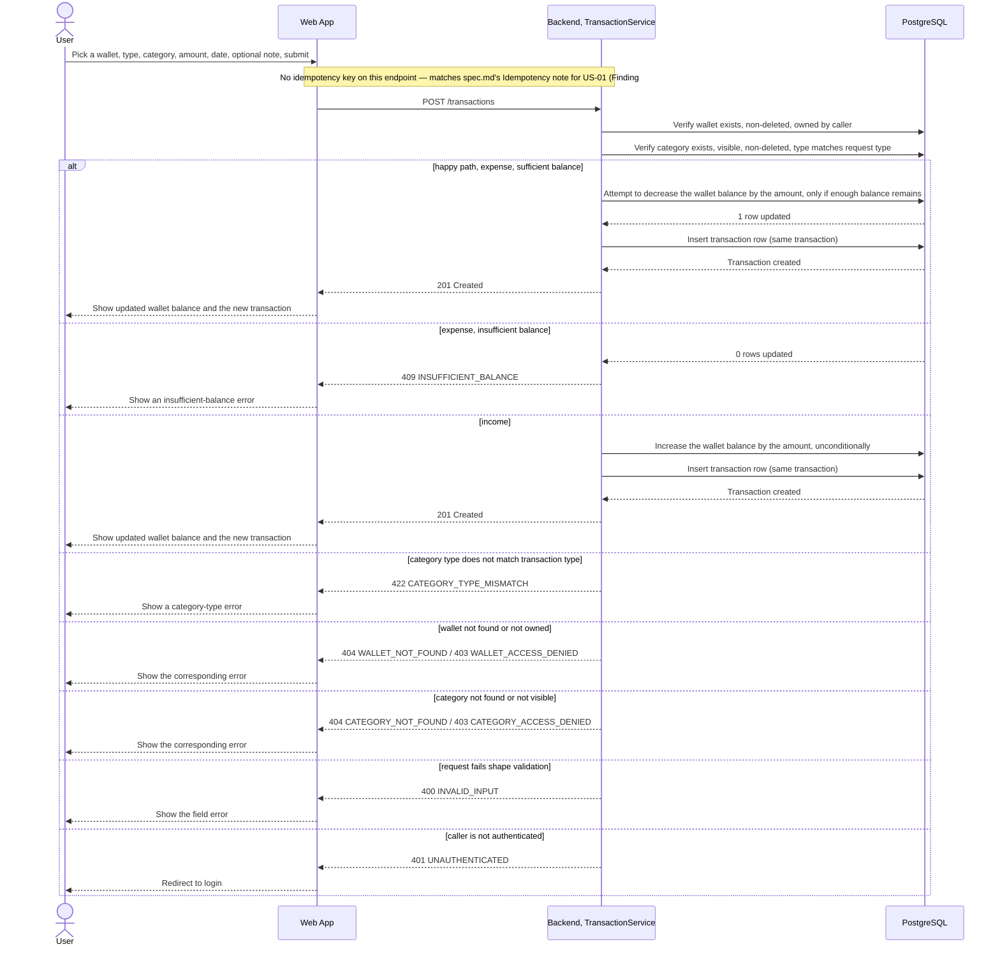
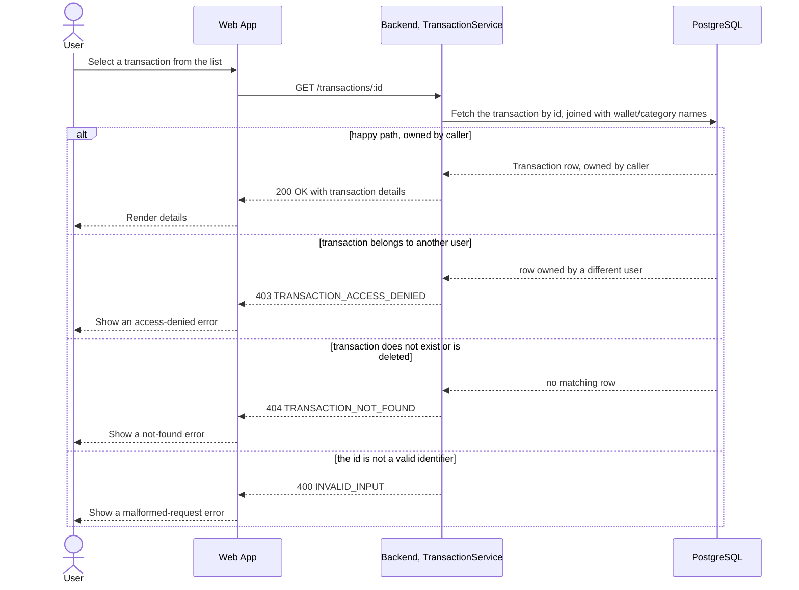
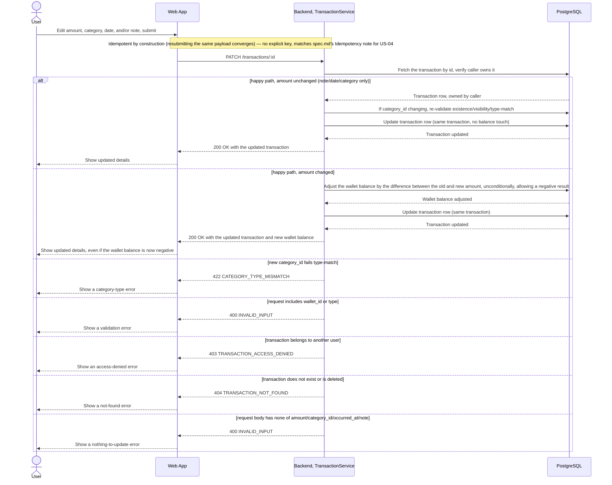
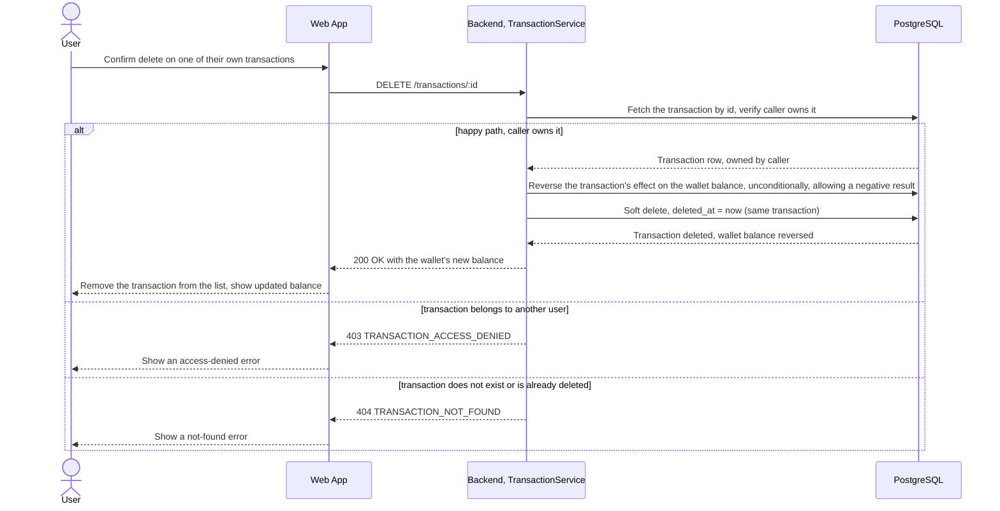
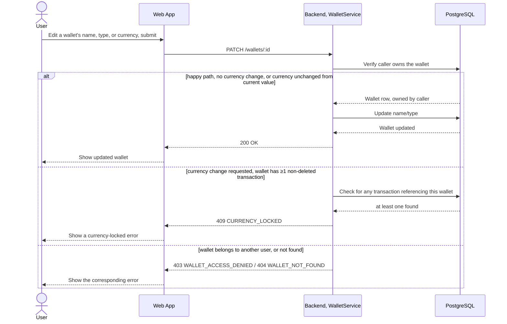
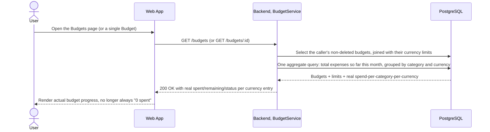

# Implementation Plan: F-06 Transaction Management (MVP)

- **Feature:** Transaction Management
- **SRS Feature Code:** F-06 (SRS.md Feature-06 §6, full Gherkin already present for US-01; SDS.md §5.6 US-06-01; `spec.md` in this folder is the authoritative source for all five User Stories)
- **Jira Epic:** N/A — this repository has no Jira integration wired up (same as every prior plan)
- **Spec:** [spec.md](./spec.md)
- **Related plans:** [F-03 Wallet Management](../wallet-management/plan.md) (`transactions.wallet_id` FK; **this plan modifies F-03's existing files** — see Finding #2 / WAL-T14), [F-04 Category Management](../category-management/plan.md) (`transactions.category_id` FK; category visibility/type-match rule reused verbatim), [F-05 Budget Management](../budget-management/plan.md) (**this plan modifies F-05's existing files** — see Finding #3 / BUD-T17)
- **Frontend scope:** **web only** (`frontend/`, Next.js). `mobile/` (Flutter) remains deferred per current project direction.

---

## 1. Pre-flight: Spec Review Findings

| # | Type | Finding | Resolution / Open Task |
|---|------|---------|-------------------------|
| 1 | Gap | The `transactions` table does not exist in any migration yet — `backend/db/migrations/` currently ends at `007_budgets.sql`. | This plan adds `008_transactions.sql` (§2, Schema). |
| 2 | **Cross-feature modification, spec-mandated (Open Question #3)** | `spec.md` explicitly notes this feature's existence unblocks F-03's deferred `409 CURRENCY_LOCKED` check — `wallet_service.go`'s own comment says this is "intentionally unimplemented... tracked as WAL-T14" pending the `transactions` table. | This plan wires it up: `WalletRepo` gains `HasTransactionForWallet(ctx, walletID) (bool, error)`, backed by a new query in `transactions.sql` (queried table owns the query, consuming repository calls it via the shared `sqlc.Queries` struct — same cross-repo pattern as F-05's `LockCategoryForBudgetCheck`/`HasActiveBudgetForCategory`). `WalletService.UpdateWallet` now rejects a `currency` change with `409 CURRENCY_LOCKED` once any non-deleted Transaction references the wallet. New error code `ErrCodeCurrencyLocked` added to `errors.go` (was never actually defined — only described in a comment). Tracked as **WAL-T18** in Regression Scope below. |
| 3 | **Cross-feature modification, spec-mandated, biggest scope item in this plan** | F-05's `BudgetService.computeStatus()` has been a stub since `specs/budget-management/plan.md` Finding #1 — every `spent` is hardcoded to `0` because the `transactions` table didn't exist. That table now does. | This plan wires up the real aggregate: `BudgetRepo` gains `SpentByUserCurrentPeriod(ctx, userID) (map[uuid.UUID]map[string]int64, error)`, backed by a new query in `transactions.sql` (`SumExpenseByUserCurrentPeriod`, keyed `category_id, currency`, filtered to the current UTC calendar month via `date_trunc('month', NOW())` — spec.md's resolved period-window decision, computed in SQL so the app server and DB never disagree on "now"). `BudgetService.computeStatus()` is rewritten to call this once per `ListBudgets`/`GetBudget` request (a single aggregate query, never N+1 — `specs/budget-management/spec.md` US-02 Edge Cases #1's explicit requirement) and look up each Budget's currency entries against the returned map. `model.BudgetLimit`'s doc comment (which currently says "Spent is currently always 0... stub") is updated to match. Tracked as **BUD-T23** in Regression Scope below. |
| 4 | Design decision | `spec.md` Context #3/#4 resolves that the insufficient-balance floor (a conditional `UPDATE ... WHERE balance >= amount`) applies **only** to `POST /transactions`, never to `PATCH`/`DELETE`. A naive schema-level `CHECK (balance >= 0)` on `wallets` would silently break the spec's own Update/Delete scenarios (S-TRX-38, S-TRX-50), which require a Transaction correction to be able to drive a Wallet negative. | **No `CHECK (balance >= 0)` constraint is added to `wallets`.** The floor is enforced exclusively at the application/query level, only inside `TransactionService.CreateTransaction`'s conditional `UPDATE`. Flagged explicitly here because it is the single easiest thing for an implementer to "improve" incorrectly. |
| 5 | Design decision | `spec.md`'s cursor requirement (Edge Cases US-02 #1) keys pagination on `occurred_at`, not `created_at` — the opposite of every existing list endpoint (`GET /admin/users`) and of `service/cursor.go`'s existing `cursorPayload{ID, CreatedAt}` helper. | This plan does **not** modify `cursor.go`'s existing helper (used only by `UserService.ListUsers`) — it adds a sibling pair, `encodeTransactionCursor`/`decodeTransactionCursor`, keyed `{ID, OccurredAt}`, in the same file. Reusing the existing helper by renaming its field would be a breaking, unrelated change to F-01; adding a second, differently-keyed pair is the additive, low-risk option. |
| 6 | Design decision | `spec.md` Business invariants requires `category_name` to resolve even when the Category has since been soft-deleted (S-TRX-30) — unlike F-05's `ListBudgetsByUser`, which can assume an always-active Category. | `ListTransactionsByUser`/`GetTransactionByID` use a plain `JOIN categories` (not `LEFT JOIN`, not filtered on `deleted_at`) — safe because `category_id` is `NOT NULL` and soft-delete never removes the row, so the join target always physically exists regardless of `deleted_at`. Flagged so a reviewer doesn't "fix" this into a `deleted_at IS NULL`-filtered join, which would silently null out historical Category names. |
| 7 | Ambiguity, resolved as an explicit assumption | `spec.md` Domain Fields flags `note` max length (500 chars) as an explicit assumption pending sign-off (Open Questions #4) — no source document commits to a number. | This plan proceeds with 500, added as `common.TransactionNoteMaxLength`, mirroring `CategoryNameMaxLength`'s precedent of a plan-owned constant for an assumed limit. Not blocking; revisit if product provides an actual number. |
| 8 | Out of scope, explicitly not started (per spec's own resolution) | `spec.md` Open Questions #2 raises whether `POST /transactions` should require an `Idempotency-Key` header, given a duplicate submission doubly mutates real money — but Out of Scope explicitly defers this ("not designed/implemented in this spec"). | This plan does **not** add an idempotency-key mechanism. No header is checked, no dedupe table is added. Tracked as **TRX-T20**, blocked on product sign-off, not silently forgotten. |
| 9 | Out of scope, explicitly not started (per spec's own resolution) | `spec.md` Open Questions #1 raises whether Update/Delete should surface a non-blocking `warnings` array when the result is a negative Wallet balance — Out of Scope resolves this as "always allow, never blocked... a softer warn-but-allow UX is Release-1+ territory, not this spec." | This plan implements the unconditional-allow behavior only. No `warnings` field is added to any response DTO. |
| 10 | Gap | No `/transactions` route group exists in `cmd/server/routes.go` yet. | Added in §2 — a new group under the existing `JWTAuth` middleware only, no `RequireRole` gate (same convention as `/wallets`, `/categories`, `/budgets`). |
| 11 | Gap | `frontend/src/features/transactions/` does not exist yet. | Scaffolded in §2. Closest precedent is `features/budgets/` (has a delete flow and a form with a category picker), but Transactions introduces two patterns neither prior feature has: **query-param filters** and **cursor-based "load more" pagination** — flagged as new patterns in the Frontend layout below, not silently copied from a mismatched precedent. |
| 12 | Gap (carried over) | The frontend project still has zero test tooling configured — unchanged since F-03 Finding #8 / F-04 Finding #9 / F-05 Finding #8. | Not committed to in this plan either; tracked as **TRX-T21**. |
| 13 | Ambiguity, resolved as a deliberate simplicity choice | `spec.md` US-04 doesn't mandate whether `PATCH /transactions/{id}` must open a DB transaction when only `note`/`occurred_at`/`category_id` change (no Wallet-balance impact) versus only when `amount` changes. | This plan **always** opens one transaction for `UpdateTransaction`, even when the update happens to not touch `amount` — avoids branching the code into a "sometimes-transactional, sometimes-not" path for a single endpoint. Same reasoning as F-05's `UpdateBudget`, which always transacts its delete-then-insert even though a single-currency edit is conceptually simple. |

### Regression Scope

**New files:**
- `backend/db/migrations/008_transactions.sql`, `backend/db/queries/transactions.sql`
- `backend/internal/model/transaction.go`, `backend/internal/repository/transaction_repository.go`, `backend/internal/service/transaction_service.go`, `backend/internal/handler/transaction_handler.go`, `backend/internal/dto/transaction_request.go`, `backend/internal/dto/transaction_response.go`
- `frontend/src/features/transactions/**`, `frontend/src/app/app/transactions/**`

**Modified files (additive):**
- `backend/cmd/server/routes.go` — new `/transactions` group; no existing route touched.
- `backend/cmd/server/main.go` — new repo/service/handler wiring, appended.
- `backend/internal/common/errors.go` / `constants.go` — new error codes/constants appended (including the previously-only-planned `ErrCodeCurrencyLocked`, Finding #2); nothing renamed.
- `backend/internal/service/interfaces.go` — new `TransactionRepo` interface + compile-time check appended; `WalletRepo` and `BudgetRepo` interfaces **gain new methods** (see below).
- `backend/db/queries/wallets.sql` — two new queries appended (`AdjustWalletBalance`, `DecrementWalletBalanceIfSufficient`), invoked by `TransactionRepository` via the shared `sqlc.Queries` struct.
- `backend/internal/service/cursor.go` — a second, additive `{ID, OccurredAt}`-keyed cursor pair appended (Finding #5); the existing `{ID, CreatedAt}` pair is untouched.
- `frontend/src/features/auth/components/app-header.tsx` — adds a "Transactions" nav link.

**Modified files (behavioral change — flagged per Findings #2/#3, not additive):**
- `backend/internal/repository/wallet_repository.go` — adds `HasTransactionForWallet` (Finding #2).
- `backend/internal/service/wallet_service.go` — `UpdateWallet` now rejects a `currency` change with `409 CURRENCY_LOCKED` once the wallet has any non-deleted Transaction (closes `WAL-T14`).
- `backend/internal/repository/budget_repository.go` — adds `SpentByUserCurrentPeriod` (Finding #3).
- `backend/internal/service/budget_service.go` — `computeStatus()` rewritten to use real spend data instead of the Finding #1 stub (closes `BUD-T17`).
- `backend/internal/model/budget.go` — `BudgetLimit`'s doc comment updated to remove the "currently always 0 / stub" note.
- `backend/internal/service/interfaces.go` — `WalletRepo`/`BudgetRepo` interface signatures change (additive methods only — no existing method signature changes, so both repositories' compile-time checks keep passing without touching other call sites).

**Regression risk:** low but non-zero, confined to two call sites: `WalletService.UpdateWallet` (only the `currency`-change branch — every other Wallet scenario, S-WAL-01 through S-WAL-29 except S-WAL-21, is untouched) and `BudgetService.computeStatus()` (only the `spent`/`remaining`/`status` values change from hardcoded to real — every other Budget scenario, S-BUD-01 through S-BUD-39 except the `spent`-dependent ones S-BUD-19 through S-BUD-22/S-BUD-33, is untouched). Re-run F-03's S-WAL-21 and F-05's S-BUD-19 through S-BUD-22 after this change to confirm both newly-wired behaviors hold.

---

## 2. Architecture

### Package/File Layout

**Backend (Go Fiber + sqlc)**

```text
backend/internal/
├── handler/
│   └── transaction_handler.go     # CreateTransaction, ListTransactions, GetTransaction,
│                                    # UpdateTransaction, DeleteTransaction
├── service/
│   └── transaction_service.go     # wallet/category ownership+type-match, atomic balance
│                                    # mutation (conditional on Create, unconditional signed
│                                    # delta on Update/Delete), cursor encode/decode
├── repository/
│   └── transaction_repository.go  # sqlc wrapper: BeginTx, CreateTransaction,
│                                    # DecrementWalletBalanceIfSufficient, AdjustWalletBalance,
│                                    # ListTransactionsByUser, GetTransactionByID,
│                                    # UpdateTransaction, SoftDeleteTransaction
├── model/
│   └── transaction.go             # Transaction struct — zero framework imports
└── dto/
    ├── transaction_request.go     # CreateTransactionRequest, UpdateTransactionRequest,
    │                                # ListTransactionsQuery
    └── transaction_response.go    # TransactionResponse, ListTransactionsResponse

# Modified (Finding #2 — WAL-T14):
├── repository/wallet_repository.go     # + HasTransactionForWallet (via shared sqlc.Queries)
├── service/wallet_service.go           # UpdateWallet: currency-change now checked
└── service/interfaces.go               # WalletRepo interface gains HasTransactionForWallet

# Modified (Finding #3 — BUD-T17):
├── repository/budget_repository.go     # + SpentByUserCurrentPeriod (via shared sqlc.Queries)
├── service/budget_service.go           # computeStatus() now uses real spend data
├── model/budget.go                     # BudgetLimit doc comment updated (no longer a stub)
└── service/interfaces.go               # BudgetRepo interface gains SpentByUserCurrentPeriod

# Modified (additive, Finding #5):
└── service/cursor.go                   # + encodeTransactionCursor/decodeTransactionCursor

db/
├── migrations/
│   └── 008_transactions.sql       # transactions table, indexes
└── queries/
    ├── transactions.sql           # CreateTransaction, GetTransactionByID,
    │                                # ListTransactionsByUser, UpdateTransaction,
    │                                # SoftDeleteTransaction, ExistsTransactionForWallet
    │                                # (WAL-T14), SumExpenseByUserCurrentPeriod (BUD-T17)
    └── wallets.sql (append)        # AdjustWalletBalance, DecrementWalletBalanceIfSufficient
```

`common/errors.go` and `common/constants.go` are extended in place (new entries appended).

**Frontend (Next.js web — mirrors `features/budgets/` structurally, with two new patterns)**

```text
frontend/src/
├── app/app/
│   └── transactions/
│       └── page.tsx                                  # TransactionsPage — filters + list + create entry point
├── features/transactions/
│   ├── api/
│   │   ├── use-transactions-query.ts                 # GET /transactions — NEW PATTERN: useInfiniteQuery
│   │   │                                               # (cursor-based "Load more", unlike every prior
│   │   │                                               # feature's single unpaginated useQuery)
│   │   ├── use-transaction-query.ts                  # GET /transactions/{id}
│   │   ├── use-create-transaction-mutation.ts        # POST /transactions
│   │   ├── use-update-transaction-mutation.ts        # PATCH /transactions/{id}
│   │   └── use-delete-transaction-mutation.ts        # DELETE /transactions/{id}
│   ├── components/
│   │   ├── create-transaction-dialog.tsx             # wallet select, type toggle, category select
│   │   │                                               # (filtered by type), amount, date, note
│   │   ├── transaction-filters.tsx                   # NEW PATTERN — wallet/category/type/date-range
│   │   │                                               # filter bar, drives query params
│   │   ├── transaction-table.tsx                     # renders one page; "Load more" button at the end
│   │   ├── transaction-table-skeleton.tsx
│   │   ├── edit-transaction-dialog.tsx                # amount/category/date/note only — no wallet/type field
│   │   │                                               # at the type level (mirrors spec.md's structural
│   │   │                                               # exclusion)
│   │   └── delete-transaction-dialog.tsx              # confirm dialog, mirrors budget's
│   └── types.ts                                        # Transaction, CreateTransactionRequest,
│                                                        # UpdateTransactionRequest, TransactionFilters
└── lib/constants.ts (extend)                             # reuses existing WALLET_CURRENCIES is NOT needed
                                                           # here (Transaction has no currency field, Finding
                                                           # in spec.md Context #1); adds
                                                           # TRANSACTION_NOTE_MAX_LENGTH = 500
```

### Domain Objects

| Entity | Table | Key Fields | Notes |
|--------|-------|------------|-------|
| `Transaction` | `transactions` | `id` (UUID v4), `user_id` (FK → `users.id`, denormalized from `wallet_id`'s owner), `wallet_id` (FK → `wallets.id`, immutable), `category_id` (FK → `categories.id`, mutable), `amount` (BIGINT, `> 0`), `type` (`income`\|`expense`, immutable), `note` (nullable, ≤ 500 chars), `occurred_at` (`TIMESTAMPTZ`, client-supplied, distinct from `created_at`), `created_at`, `updated_at`, `deleted_at` | ⚠️ Money field — `amount` is `BIGINT` cents, `CHECK (amount > 0)`, never float. Soft delete via `deleted_at`; every query filters it. No `CHECK` on sign/direction of Wallet effect — that's `type`'s job, enforced in the service, not the schema. |

### Schema — `008_transactions.sql`

```sql
CREATE TABLE transactions (
    id          UUID PRIMARY KEY DEFAULT uuid_generate_v4(),
    user_id     UUID NOT NULL REFERENCES users(id),
    wallet_id   UUID NOT NULL REFERENCES wallets(id),
    category_id UUID NOT NULL REFERENCES categories(id),
    amount      BIGINT NOT NULL CHECK (amount > 0),
    type        TEXT NOT NULL CHECK (type IN ('income', 'expense')),
    note        TEXT,
    occurred_at TIMESTAMPTZ NOT NULL DEFAULT NOW(),
    created_at  TIMESTAMPTZ NOT NULL DEFAULT NOW(),
    updated_at  TIMESTAMPTZ NOT NULL DEFAULT NOW(),
    deleted_at  TIMESTAMPTZ
);

-- No CHECK(balance >= 0) equivalent exists here or on wallets — see Finding #4.
-- The insufficient-balance floor is enforced only by TransactionService's
-- conditional UPDATE on wallets.balance at Create time, never at the schema
-- level, so Update/Delete's spec-mandated negative-balance-allowed scenarios
-- (S-TRX-38, S-TRX-50) are never blocked by a constraint added here.

CREATE INDEX idx_transactions_user_id ON transactions (user_id) WHERE deleted_at IS NULL;
CREATE INDEX idx_transactions_wallet_id ON transactions (wallet_id) WHERE deleted_at IS NULL;
CREATE INDEX idx_transactions_category_id ON transactions (category_id) WHERE deleted_at IS NULL;

-- Serves both the cursor-paginated list query (occurred_at DESC, id DESC —
-- spec.md Edge Cases US-02 #1, Finding #5) and, via its leading user_id
-- column, the F-05 spend-aggregation query (Finding #3).
CREATE INDEX idx_transactions_user_occurred_at ON transactions (user_id, occurred_at DESC, id DESC)
    WHERE deleted_at IS NULL;
```

### Business Rules

| Rule | Source | Enforcement |
|------|--------|-------------|
| `wallet_id`, `category_id`, `amount`, `type` required; both IDs valid UUIDs; `amount` a positive integer; `type` exactly `income`/`expense` | S-TRX-03–S-TRX-08, S-TRX-15 | handler-level `validate.Struct` (`required`, `gt=0`, `oneof=income expense`) → `400 INVALID_INPUT`; a decimal `amount` fails at `c.BodyParser` itself (int64 field, same behavior already relied on by `CreateWalletRequest.InitialBalance`) |
| `note` (if present) ≤ 500 chars | S-TRX-19 | validator `max=500` (`common.TransactionNoteMaxLength`, Finding #7) → `400 INVALID_INPUT` |
| `occurred_at` (if present) a valid timestamp; defaults to `NOW()` if omitted | S-TRX-17 | `*time.Time` field — Go's `encoding/json` rejects a malformed value at `BodyParser` itself; `TransactionService.CreateTransaction` defaults nil to `time.Now().UTC()` |
| Wallet must exist, be non-deleted, owned by caller | S-TRX-10, S-TRX-11 | `TransactionService.CreateTransaction` — `getOwnedWallet`-equivalent lookup (reuses `WalletRepo.GetWalletByID`, same 403-vs-404 split as F-03) → `404 WALLET_NOT_FOUND` / `403 WALLET_ACCESS_DENIED` |
| Category must exist, be visible (system or caller's own), non-deleted | S-TRX-12, S-TRX-13 | reuses `CategoryRepo.GetCategoryByID` + the same visibility check `CategoryService` already applies → `404 CATEGORY_NOT_FOUND` / `403 CATEGORY_ACCESS_DENIED` |
| Category's `type` must equal the Transaction's `type` | S-TRX-14, S-TRX-40 | `TransactionService` compares `category.Type == req.Type` → `422 CATEGORY_TYPE_MISMATCH` (new error code) |
| Insufficient-balance floor, `expense` Create only | S-TRX-09, S-TRX-18 | `TransactionRepository.DecrementWalletBalanceIfSufficient` — conditional `UPDATE ... WHERE balance >= $2`; zero rows returned (`pgx.ErrNoRows`) is the authoritative `409 INSUFFICIENT_BALANCE` signal, closing the concurrent-expense race without a separate row lock (spec.md Context #4) |
| `income` Create — unconditional balance increment | S-TRX-02 | `TransactionRepository.AdjustWalletBalance` (unconditional signed delta) called with `+amount` |
| Wallet-balance mutation + Transaction insert are one atomic transaction | Edge Case US-01 #2 | `TransactionService.CreateTransaction` opens one `pgx.Tx`, calls the balance query then the insert, commits |
| Unauthenticated caller rejected | S-TRX-16, S-TRX-22 | `middleware.JWTAuth` at route-group level → `401` |
| List scoped strictly to caller; filterable by `wallet_id`/`category_id`/`type`/`from`/`to` | S-TRX-20, S-TRX-24, S-TRX-26, S-TRX-27 | `TransactionRepository.ListTransactionsByUser` — `WHERE user_id = $1` plus `sqlc.narg`-style optional filters (mirrors `ListUsers`'s pattern) |
| `limit` defaults to 20, capped at 100 (spec.md Query Parameters: "same convention as F-01's `GET /admin/users`") | S-TRX-29 | reuses the **existing** `common.DefaultListLimit`/`common.MaxListLimit` constants (F-01) — no new Transaction-specific limit constant is introduced |
| `wallet_id`/`category_id` filter params must be visible to caller if present | S-TRX-25 | handler/service re-runs the same ownership/visibility check as Create against the filter value → `403 WALLET_ACCESS_DENIED` / `403 CATEGORY_ACCESS_DENIED` |
| `from` must not be after `to` | S-TRX-28 | handler-level check before querying → `400 INVALID_INPUT` |
| Soft-deleted Transactions excluded everywhere | S-TRX-23 | every `transaction_repository.go` query filters `deleted_at IS NULL` |
| Category name resolves even if the Category is now soft-deleted | S-TRX-30 | plain `JOIN categories` (not `deleted_at`-filtered) — Finding #6 |
| Cursor pagination keyed on `occurred_at`, not `created_at` | Edge Case US-02 #1 | new `encodeTransactionCursor`/`decodeTransactionCursor` (Finding #5); query `ORDER BY occurred_at DESC, id DESC` with the matching `WHERE` tie-break |
| Not-found vs. access-denied split | S-TRX-32 vs. S-TRX-33 | fetch first (existence + `deleted_at IS NULL`), then decide `404 TRANSACTION_NOT_FOUND` / `403 TRANSACTION_ACCESS_DENIED` — same pattern as Wallet/Category/Budget |
| Invalid UUID path param rejected before any DB call | S-TRX-34 | handler `transactionIDParam()` helper (mirrors `budgetIDParam`) → `400 INVALID_INPUT` |
| `wallet_id`/`type` never accepted on `PATCH` | S-TRX-41, S-TRX-42 | `dto.UpdateTransactionRequest` has no such fields at the type level; decoded via existing `dto.DecodeStrict` → `400 INVALID_INPUT` on any unrecognized field |
| `category_id` change re-validates existence/visibility/type-match | S-TRX-40 | same checks as Create, re-run inside `UpdateTransaction` |
| `amount` change reconciles Wallet balance via signed delta, **no floor check** | S-TRX-36–S-TRX-38 | `delta = newSigned - oldSigned` (sign from the Transaction's immutable `type`); `TransactionRepository.AdjustWalletBalance` (unconditional) — Context #3/Finding #4 |
| Empty `PATCH` body rejected | S-TRX-46 | `UpdateTransactionRequest.HasUpdates()` → `400 INVALID_INPUT` |
| Delete reverses the Wallet-balance effect, **no floor check**, unconditional once owned | S-TRX-48–S-TRX-50 | `TransactionService.DeleteTransaction` — one transaction: `AdjustWalletBalance(tx, walletID, -oldSigned)` then `SoftDeleteTransaction(tx, ...)` |
| Delete is a soft delete only, not idempotent (second call is `404`) | S-TRX-52 | `UPDATE transactions SET deleted_at = NOW() ...` scoped by `deleted_at IS NULL`; second call finds no row |
| **[F-03 amendment]** `PATCH /wallets/{id}` rejects a `currency` change once ≥1 Transaction references the wallet | S-WAL-21 (F-03), resolved by Finding #2 | `WalletService.UpdateWallet` calls `HasTransactionForWallet` → `409 CURRENCY_LOCKED` if true |
| **[F-05 amendment]** Budget `spent`/`remaining`/`status` computed from real Transaction data | US-02 step 4–5 (F-05), resolved by Finding #3 | `BudgetService.computeStatus()` now calls `BudgetRepo.SpentByUserCurrentPeriod` (one aggregate query per request) instead of returning the Finding #1 stub |

### API Index — Endpoint → Service Traceability

| API | Request | Response | Service Method |
|-----|---------|----------|-----------------|
| `POST /transactions` | `CreateTransactionRequest` | `TransactionResponse` (`201`) | `TransactionService.CreateTransaction` |
| `GET /transactions` | `ListTransactionsQuery` | `ListTransactionsResponse` (`200`) | `TransactionService.ListTransactions` |
| `GET /transactions/{id}` | — | `TransactionResponse` (`200`) | `TransactionService.GetTransaction` |
| `PATCH /transactions/{id}` | `UpdateTransactionRequest` | `TransactionResponse` (`200`) | `TransactionService.UpdateTransaction` |
| `DELETE /transactions/{id}` | — | `200` confirmation | `TransactionService.DeleteTransaction` |

### Security & Actor Resolution

- **Middleware:** all five endpoints sit under one `JWTAuth(tokens, logger)` route group — no `RequireRole` gate, same convention as `/wallets`, `/categories`, `/budgets`.
- **Actor resolution path:** identical to F-03/F-04/F-05 — `callerUUID(c)` reads JWT-populated Fiber locals once in `transaction_handler.go`, passed into every `TransactionService` method as an explicit `userID uuid.UUID` parameter.
- **Cross-repository query note (Findings #2/#3):** `WalletRepository.HasTransactionForWallet` and `BudgetRepository.SpentByUserCurrentPeriod` each query the `transactions` table, which neither feature "owns." This works without a new repository-to-repository dependency for the same reason F-05's `LockCategoryForBudgetCheck`/`HasActiveBudgetForCategory` did — every repository already holds a reference to the same generated `*sqlc.Queries` struct, so calling a method generated from a query declared in `transactions.sql` from inside `wallet_repository.go`/`budget_repository.go` is a single extra method call, not a new dependency edge. `TransactionRepository` itself, in turn, calls into `wallets.sql`'s two new balance-mutation queries the same way (Finding #2's mirror image — this time Transaction is the consumer).
- **CSRF:** not applicable — Bearer-JWT API, no cookie/session auth surface for the Go backend to protect (same reasoning as every prior plan).
- **Framework note:** no Spring-style `@PreAuthorize`. Authorization logic (Wallet/Category ownership, type-match, balance floor) lives entirely in `TransactionService`, never in `transaction_handler.go`.
- **Bookmark / direct-URL access:** a User navigating directly to a Transaction they don't own is safe by construction — `GET /transactions/{id}` enforces ownership server-side (`403`/`404`) regardless of navigation path.
- **Validation-check independence (checklist requirement):** `wallet_id`/`category_id`/`amount`/`type`/`note` format checks (US-01) are **independent** field-level checks, collected into one `400` response via the existing `newValidationError` convention. Wallet-existence → Wallet-ownership → Category-existence → Category-visibility → Category-type-match → balance-floor are **sequential/gating** checks — each requires the prior to have resolved a real row before the next can run, modeled as early-return steps inside `TransactionService.CreateTransaction`, not collected together.

### Sequence Diagrams

> Five-tier lifeline (User → Frontend → Backend → DB), happy path first with `alt/else` branches beneath. These diagrams are AI-generated and require human review before implementation begins.

**US-01: Create a Transaction for a Wallet**



**US-02: View a List of Transactions**

```mermaid
sequenceDiagram
    actor User
    participant FE as Web App
    participant BE as Backend, TransactionService
    participant DB as PostgreSQL

    User->>FE: Open the Transactions page, optionally set filters
    FE->>BE: GET /transactions?wallet_id&category_id&type&from&to&cursor&limit
    BE->>DB: Verify any provided wallet_id/category_id is visible to caller
    alt happy path
        BE->>DB: Select caller's non-deleted transactions matching filters, cursor-paginated on occurred_at
        DB-->>BE: Page of transactions, joined with wallet/category names
        BE-->>FE: 200 OK with the page and next_cursor
        FE-->>User: Render the list; show "Load more" if next_cursor is present
    else caller has no matching transactions
        DB-->>BE: empty set
        BE-->>FE: 200 OK with an empty list, next_cursor null
        FE-->>User: Render an empty state, not an error
    else wallet_id/category_id filter not visible to caller
        BE-->>FE: 403 WALLET_ACCESS_DENIED / 403 CATEGORY_ACCESS_DENIED
        FE-->>User: Show an access-denied error
    else from is after to
        BE-->>FE: 400 INVALID_INPUT
        FE-->>User: Show a validation error
    else caller is not authenticated
        BE-->>FE: 401 UNAUTHENTICATED
        FE-->>User: Redirect to login
    end
```

**US-03: View a Transaction**



**US-04: Update a Transaction**



**US-05: Delete a Transaction**



**[F-03 amendment] Updated `PATCH /wallets/{id}` flow (Finding #2 / closes WAL-T14)**



**[F-05 amendment] Updated `GET /budgets` / `GET /budgets/{id}` flow (Finding #3 / closes BUD-T17)**



---

## 3. Error Flows

### US-01: Create a Transaction for a Wallet

| Scenario | HTTP | Error Code |
|----------|------|------------|
| Unauthenticated | 401 | — |
| `wallet_id`/`category_id` missing or not a valid UUID | 400 | `INVALID_INPUT` |
| `amount` missing, zero, negative, or non-integer | 400 | `INVALID_INPUT` |
| `type` missing or not `income`/`expense` | 400 | `INVALID_INPUT` |
| `note` exceeds 500 chars | 400 | `INVALID_INPUT` |
| Wallet not found or soft-deleted | 404 | `WALLET_NOT_FOUND` |
| Wallet belongs to another user | 403 | `WALLET_ACCESS_DENIED` |
| Category not found or soft-deleted | 404 | `CATEGORY_NOT_FOUND` |
| Category belongs to another user | 403 | `CATEGORY_ACCESS_DENIED` |
| Category's type doesn't match the Transaction's type | 422 | `CATEGORY_TYPE_MISMATCH` |
| Expense would drive the Wallet balance below zero | 409 | `INSUFFICIENT_BALANCE` |
| Unexpected error | 500 | — |

### US-02: View a List of Transactions

| Scenario | HTTP | Error Code |
|----------|------|------------|
| Unauthenticated | 401 | — |
| `wallet_id`/`category_id` filter not visible to caller | 403 | `WALLET_ACCESS_DENIED` / `CATEGORY_ACCESS_DENIED` |
| `type` filter not `income`/`expense` | 400 | `INVALID_INPUT` |
| `from` after `to` | 400 | `INVALID_INPUT` |
| Unexpected error | 500 | — |

*(Zero matching Transactions is `200` with an empty list — not an error path; see `spec.md` S-TRX-21.)*

### US-03: View a Transaction

| Scenario | HTTP | Error Code |
|----------|------|------------|
| Unauthenticated | 401 | — |
| `{id}` not a valid UUID | 400 | `INVALID_INPUT` |
| Transaction belongs to another user | 403 | `TRANSACTION_ACCESS_DENIED` |
| Transaction not found or soft-deleted | 404 | `TRANSACTION_NOT_FOUND` |
| Unexpected error | 500 | — |

### US-04: Update a Transaction

| Scenario | HTTP | Error Code |
|----------|------|------------|
| Unauthenticated | 401 | — |
| Request body has none of `amount`/`category_id`/`occurred_at`/`note` | 400 | `INVALID_INPUT` |
| Request includes `wallet_id` or `type` | 400 | `INVALID_INPUT` |
| `amount` invalid (zero/negative/non-integer) | 400 | `INVALID_INPUT` |
| New `category_id` not found, not visible, or type-mismatched | 404 / 403 / 422 | `CATEGORY_NOT_FOUND` / `CATEGORY_ACCESS_DENIED` / `CATEGORY_TYPE_MISMATCH` |
| Transaction belongs to another user | 403 | `TRANSACTION_ACCESS_DENIED` |
| Transaction not found or soft-deleted | 404 | `TRANSACTION_NOT_FOUND` |
| Unexpected error | 500 | — |

### US-05: Delete a Transaction

| Scenario | HTTP | Error Code |
|----------|------|------------|
| Unauthenticated | 401 | — |
| Transaction belongs to another user | 403 | `TRANSACTION_ACCESS_DENIED` |
| Transaction not found or already soft-deleted | 404 | `TRANSACTION_NOT_FOUND` |
| Unexpected error | 500 | — |

### [F-03 amendment] `PATCH /wallets/{id}`

| Scenario | HTTP | Error Code |
|----------|------|------------|
| `currency` change requested, wallet has ≥1 non-deleted Transaction | 409 | `CURRENCY_LOCKED` *(newly wired up — was "intentionally unimplemented" per F-03 `wallet_service.go` comment / WAL-T14)* |
| *(all other `PATCH /wallets/{id}` error flows unchanged from F-03's `plan.md`)* | — | — |

### [F-05 amendment] `GET /budgets`, `GET /budgets/{id}`

*(No new error flow — this amendment only changes the computed `spent`/`remaining`/`status` values inside an existing `200` response; see Finding #3.)*

---

## 4. Constitution / Convention Notes

| Rule | Status | Note |
|------|--------|------|
| Service layer owns business rules | Required | Wallet/Category ownership, type-match, balance-floor logic, and the signed-delta reconciliation all live in `TransactionService` — never in `transaction_handler.go` |
| Handler validates shape only | Required | `wallet_id`/`category_id`/`amount`/`type`/`note` via `validator/v10` tags; `occurred_at` parsing errors surface naturally through `c.BodyParser`'s `*time.Time` unmarshaling |
| Transactional atomicity — Create | Required ⚠️ | Balance mutation (conditional decrement for expense, unconditional increment for income) + row insert run inside one `pgx.Tx` — CLAUDE.md's explicit rule, restated for this feature |
| Transactional atomicity — Update | Required ⚠️ | Always opens one `pgx.Tx` (Finding #13), even when `amount` is unchanged — balance adjustment (when present) and the row update never observably split |
| Transactional atomicity — Delete | Required ⚠️ | Balance reversal + soft-delete run inside one `pgx.Tx` |
| Read flows non-transactional | Required | `ListTransactions`/`GetTransaction` are plain reads, no transaction wrapper |
| Locking strategy — Create's balance floor | Optimistic via conditional UPDATE, not a row lock | `DecrementWalletBalanceIfSufficient`'s `WHERE balance >= $2` is itself the concurrency guard (spec.md Context #4) — no `SELECT ... FOR UPDATE`, same reasoning as F-03's default-wallet unique index and F-05's active-Budget unique index: push the invariant into a single atomic statement instead of a check-then-write race |
| Locking strategy — Update/Delete's balance adjustment | None (deliberate — no invariant to protect) | `AdjustWalletBalance` is unconditional by design (Context #3) — there is no floor to race against, so no lock or conditional clause is needed |
| Money stored as BIGINT cents | Required ⚠️ | `transactions.amount` is `BIGINT`, `CHECK (amount > 0)`; `wallets.balance` (already `BIGINT`) is adjusted only via the two new integer-delta queries; no float anywhere in the Go path |
| Audit logging | Not required (MVP) | No `audit_log` table exists in the schema (same reasoning as F-01–F-05) — only structured Zap `WARN` logs on `401`/`403`/`409`, no PII/token/password fields in any log statement this plan introduces |
| Idempotency on write — Create | Per spec, elevated concern noted but not addressed | Explicitly **not** idempotent (`spec.md` US-01 Idempotency note, Finding #8) — no key; a duplicate submission doubly mutates the Wallet balance, a materially higher-stakes gap than F-03/F-05's equivalent, but still out of this plan's scope per spec.md's own deferral |
| Idempotency on write — Update | Satisfied | Idempotent by construction — resubmitting the same payload converges to the same end state (the balance delta becomes 0 on a repeat call) |
| Idempotency on write — Delete | Per spec | Explicitly **not** idempotent — a second `DELETE` on the same id returns `404` |
| JWT auth enforced at middleware | Required | `/transactions*` registered under the same `JWTAuth` group pattern as `/wallets*`/`/categories*`/`/budgets*` |
| Actor resolution | Required | `callerUUID(c)` reads `JWTAuth`-populated locals once in the handler; passed to every `TransactionService` method as an explicit `userID` param |
| User isolation on every query | Required | Every `transaction_repository.go` method scopes by `user_id`; cross-user data never reaches a response |
| Soft delete respected | Required | Every query filters `deleted_at IS NULL`; `DeleteTransaction` sets `deleted_at`, never a hard `DELETE FROM` |
| Timestamps UTC stored / local displayed | Required | `occurred_at`/`created_at`/`updated_at` are `TIMESTAMPTZ` stored UTC; the web app formats for display only. `occurred_at` is distinct from `created_at` (Domain Fields) — never conflated in a query or response field |
| No `balance >= 0` schema constraint | Required, deliberate absence | See Finding #4 / Schema note — a reviewer must not add this |
| Cross-repository query exception | Documented ⚠️ | `WalletRepository`/`BudgetRepository` each run one query against `transactions` (Security & Actor Resolution, above); `TransactionRepository` runs two queries against `wallets` — a deliberate, narrow, now-recurring exception (third instance after F-05's Category/Budget pair), not a general pattern to reach for casually |
| Cursor keyed on `occurred_at`, additive to existing `cursor.go` | Required, additive | New `encodeTransactionCursor`/`decodeTransactionCursor` pair; `UserService.ListUsers`'s existing `{ID, CreatedAt}` pair is untouched (Finding #5) |
| No file > 300 lines | Required | Watch `transaction_service.go` — largest file in this plan (ownership/visibility/type-match checks × Create and Update, signed-delta math, cursor wiring) |
| Frontend server state via TanStack Query only | Required | All 5 Transaction API calls are TanStack Query hooks in `features/transactions/api/`; the list uses `useInfiniteQuery` (new pattern, Finding #11) instead of `useQuery` — still never copied into local component state |
| Frontend skeleton loading | Required | `TransactionTableSkeleton` renders while the first page loads |
| Frontend delete confirmation | Required | `DeleteTransactionDialog` mirrors `DeleteBudgetDialog` — fires only on explicit confirm |
| Frontend structural field exclusion | Required, new pattern | `EditTransactionDialog`'s form/type has no `wallet_id`/`type` field at all — mirrors the backend DTO's structural exclusion, not just a disabled input the user could still tamper with client-side |

---

## 5. Element/Key IDs

> `data-testid` attributes for QA automation — `frontend/src` still has zero `data-testid` usage anywhere (carried-over gap, F-03 Finding #8 / F-04 Finding #9 / F-05 §5).

| Element | Key | Status | File |
|---------|-----|--------|------|
| Create transaction trigger button | `data-testid="btn-create-transaction"` | **Missing** | `frontend/src/features/transactions/components/create-transaction-dialog.tsx` |
| Transaction type toggle (income/expense) | `data-testid="toggle-transaction-type"` | **Missing** | same |
| Transaction wallet select | `data-testid="select-transaction-wallet"` | **Missing** | same |
| Transaction category select | `data-testid="select-transaction-category"` | **Missing** | same |
| Transaction amount input | `data-testid="input-transaction-amount"` | **Missing** | same |
| Transaction date input | `data-testid="input-transaction-date"` | **Missing** | same |
| Transaction note input | `data-testid="input-transaction-note"` | **Missing** | same |
| Create transaction submit button | `data-testid="btn-transaction-submit"` | **Missing** | same |
| Create transaction error banner | `data-testid="banner-transaction-error"` | **Missing** | same |
| Filter bar — wallet filter | `data-testid="filter-transaction-wallet"` | **Missing** | `frontend/src/features/transactions/components/transaction-filters.tsx` |
| Filter bar — category filter | `data-testid="filter-transaction-category"` | **Missing** | same |
| Filter bar — type filter | `data-testid="filter-transaction-type"` | **Missing** | same |
| Filter bar — date range filter | `data-testid="filter-transaction-date-range"` | **Missing** | same |
| Transaction list table | `data-testid="table-transactions"` | **Missing** | `frontend/src/features/transactions/components/transaction-table.tsx` |
| Transaction list loading skeleton | `data-testid="skeleton-transactions"` | **Missing** | `transaction-table-skeleton.tsx` |
| Load more button | `data-testid="btn-transactions-load-more"` | **Missing** | `transaction-table.tsx` |
| Edit transaction trigger button | `data-testid="btn-edit-transaction"` | **Missing** | same |
| Delete transaction trigger button | `data-testid="btn-delete-transaction"` | **Missing** | same |
| Edit transaction submit button | `data-testid="btn-edit-transaction-submit"` | **Missing** | `edit-transaction-dialog.tsx` |
| Delete confirmation dialog | `data-testid="dialog-delete-transaction-confirm"` | **Missing** | `delete-transaction-dialog.tsx` |
| Delete confirm button | `data-testid="btn-delete-transaction-confirm"` | **Missing** | same |
| Delete cancel button | `data-testid="btn-delete-transaction-cancel"` | **Missing** | same |

---

## 6. Status Summary (Step Handoff)

| Area | Status |
|------|--------|
| Spec (`spec.md`) | Done — cross-checked against `/ba-checklist`, two missing-required-field scenarios added and all `S-TRX-*` IDs renumbered sequentially |
| Plan (this document) | Done, pending human review of diagrams (§2) and both cross-feature amendments (Findings #2/#3) |
| Backend migration/queries/handler/service/repository | Not started |
| F-03 amendment (`WalletService.UpdateWallet` currency-lock wiring, closes WAL-T14) | Not started |
| F-05 amendment (`BudgetService.computeStatus()` real aggregate, closes BUD-T17) | Not started — this is the change that finally makes F-05's Budget feature functionally meaningful, not just structurally complete |
| Frontend feature scaffold | Not started |
| Frontend test infra | Not started (carried-over gap) |

## 7. Open Tasks

| ID | Task | File |
|----|------|------|
| TRX-T1 | Write migration: `transactions` table, indexes (Finding #1) | `backend/db/migrations/008_transactions.sql` |
| TRX-T2 | Write sqlc queries: `CreateTransaction`, `GetTransactionByID`, `ListTransactionsByUser` (cursor + filters, plain `JOIN` on wallets/categories per Finding #6), `UpdateTransaction`, `SoftDeleteTransaction` | `backend/db/queries/transactions.sql` |
| TRX-T3 | Append sqlc queries `ExistsTransactionForWallet` (WAL-T14) and `SumExpenseByUserCurrentPeriod` (BUD-T17, `date_trunc('month', NOW())` window) | `backend/db/queries/transactions.sql` |
| TRX-T4 | Append sqlc queries `AdjustWalletBalance` (unconditional signed delta) and `DecrementWalletBalanceIfSufficient` (conditional, `WHERE balance >= $2`) | `backend/db/queries/wallets.sql` |
| TRX-T5 | Add error codes `ErrCodeTransactionAccessDenied`, `ErrCodeTransactionNotFound`, `ErrCodeInsufficientBalance`, `ErrCodeCategoryTypeMismatch`, and the previously-only-planned `ErrCodeCurrencyLocked` (append) | `backend/internal/common/errors.go` |
| TRX-T6 | Add `common.TransactionNoteMaxLength` (Finding #7) | `backend/internal/common/constants.go` |
| TRX-T7 | Implement `model.Transaction` (zero framework imports) | `backend/internal/model/transaction.go` |
| TRX-T8 | Implement `TransactionRepository` — `BeginTx`, `CreateTransaction`, `DecrementWalletBalanceIfSufficient`, `AdjustWalletBalance`, `ListTransactionsByUser`, `GetTransactionByID`, `UpdateTransaction`, `SoftDeleteTransaction` | `backend/internal/repository/transaction_repository.go` |
| TRX-T9 | Implement `TransactionService.CreateTransaction` (Wallet/Category checks, type-match, atomic conditional/unconditional balance mutation) | `backend/internal/service/transaction_service.go` |
| TRX-T10 | Implement `TransactionService.ListTransactions` (filter validation, cursor encode/decode via the new pair) | `backend/internal/service/transaction_service.go` |
| TRX-T11 | Implement `TransactionService.GetTransaction` (403-vs-404 split) | `backend/internal/service/transaction_service.go` |
| TRX-T12 | Implement `TransactionService.UpdateTransaction` (signed-delta reconciliation, no floor check, category re-validation) | `backend/internal/service/transaction_service.go` |
| TRX-T13 | Implement `TransactionService.DeleteTransaction` (balance reversal, no floor check) | `backend/internal/service/transaction_service.go` |
| TRX-T14 | Implement `transaction_handler.go` (5 endpoints); register `/transactions` group under `JWTAuth` only | `backend/internal/handler/transaction_handler.go`, `backend/cmd/server/routes.go` |
| TRX-T15 | Implement `dto.CreateTransactionRequest`, `dto.UpdateTransactionRequest`, `dto.ListTransactionsQuery`, response DTOs | `backend/internal/dto/transaction_request.go`, `transaction_response.go` |
| TRX-T16 | Add `TransactionRepo` interface + compile-time check | `backend/internal/service/interfaces.go` |
| TRX-T17 | Append `encodeTransactionCursor`/`decodeTransactionCursor` (`{ID, OccurredAt}`, Finding #5) | `backend/internal/service/cursor.go` |
| TRX-T18 | **[F-03 amendment]** Add `HasTransactionForWallet` to `WalletRepo`; wire `409 CURRENCY_LOCKED` into `WalletService.UpdateWallet` (closes WAL-T14) | `backend/internal/repository/wallet_repository.go`, `backend/internal/service/wallet_service.go`, `backend/internal/service/interfaces.go` |
| TRX-T19 | **[F-05 amendment]** Add `SpentByUserCurrentPeriod` to `BudgetRepo`; rewrite `BudgetService.computeStatus()` to use it, replacing the Finding #1 stub (closes BUD-T17); update `model.BudgetLimit`'s doc comment | `backend/internal/repository/budget_repository.go`, `backend/internal/service/budget_service.go`, `backend/internal/model/budget.go`, `backend/internal/service/interfaces.go` |
| TRX-T20 | Idempotency-Key mechanism for `POST /transactions` — **blocked on product sign-off** (Finding #8 / spec.md Open Questions #2), not started | N/A |
| TRX-T21 | Stand up frontend test tooling (still zero test infra, carried-over gap) | `frontend/package.json` |
| TRX-T22 | Scaffold `frontend/src/features/transactions/{api,components,types.ts}` including the new `useInfiniteQuery`/`transaction-filters.tsx` patterns | `frontend/src/features/transactions/` |
| TRX-T23 | Build `TransactionsPage` (filters + list + create) | `frontend/src/app/app/transactions/page.tsx` |
| TRX-T24 | Add `TRANSACTION_NOTE_MAX_LENGTH` constant | `frontend/src/lib/constants.ts` |
| TRX-T25 | Add a "Transactions" nav link (additive only) | `frontend/src/features/auth/components/app-header.tsx` |
| TRX-T26 | Re-run F-03's S-WAL-21 and F-05's S-BUD-19 through S-BUD-22 test scenarios after the two cross-feature amendments land (Regression risk note) | `backend/internal/service/wallet_service_test.go`, `backend/internal/service/budget_service_test.go` |
