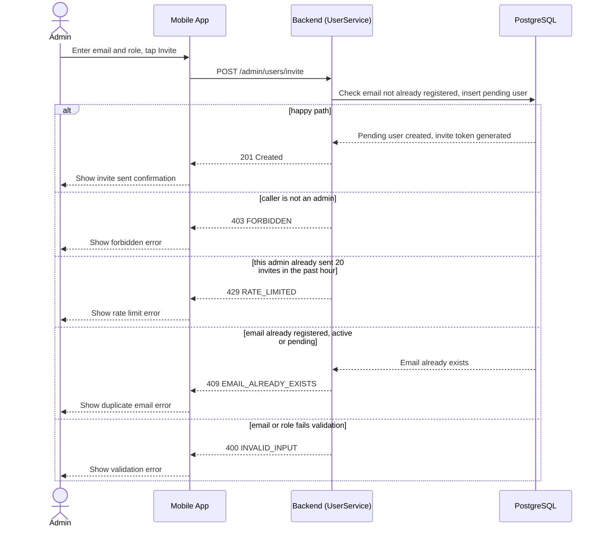
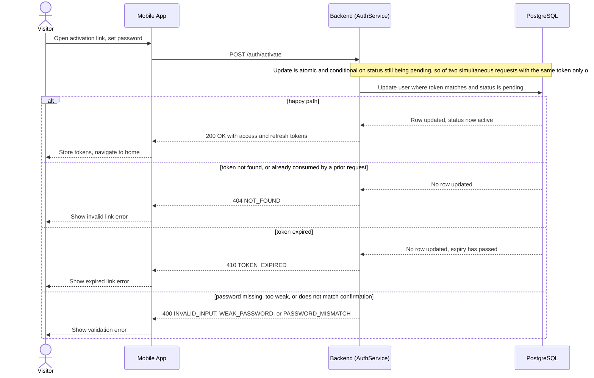
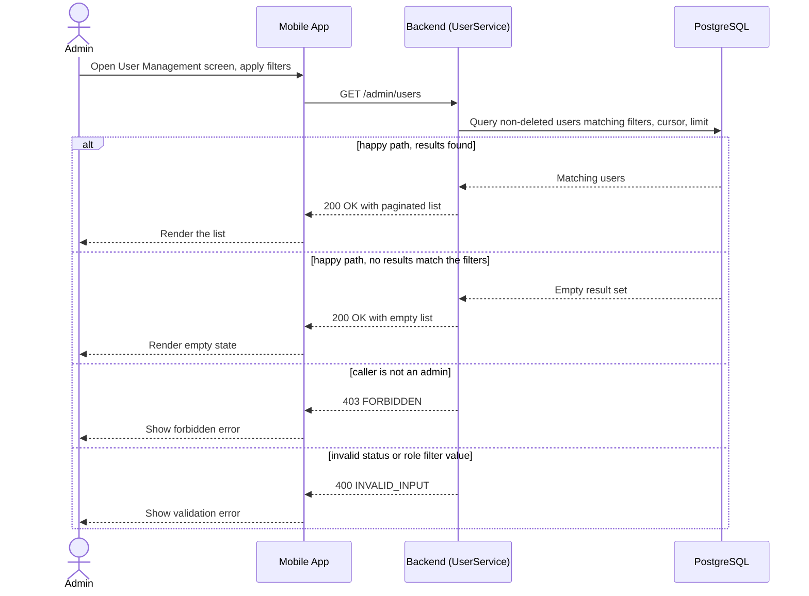

# Implementation Plan: F-01 User Management (Phase 0)

- **Feature:** User Management
- **SRS Feature Code:** F-01 (SDS.md §5.1, currently an empty skeleton — no ACs defined there; `spec.md` in this folder is the authoritative source)
- **Jira Epic:** N/A — this repository has no Jira integration wired up (no ticket/branch-naming convention found in-repo)
- **Spec:** [spec.md](./spec.md)
- **Related plan:** [F-02 System Security](../security/plan.md) — US-02 (Activate) shares its token-issuing logic with F-02's Login

---

## 1. Pre-flight: Spec Review Findings

| # | Type | Finding | Resolution / Open Task |
|---|------|---------|-------------------------|
| 1 | Gap | Repo is greenfield — no `backend/`, `mobile/`, `api-spec/`, or `infra/` directories exist yet. There is nothing to "cross-check against current implementation" beyond the empty `SDS.md` skeleton (§5.1/§5.2 headers with no content) and the illustrative SQL in `docs/features.md`. | This plan designs from scratch. `docs/features.md`'s SQL/sqlc snippets are treated as a starting draft, not as already-implemented code — they are re-verified against `spec.md` below, not assumed correct. |
| 2 | Ambiguity | `spec.md` US-01 (Invite) never states which surface the Admin uses — US-02 and US-03 both explicitly say "opens the ... screen" / "App shows"; US-01 only says "Admin submits an email address." No web admin panel exists anywhere in the stack (CLAUDE.md lists only Flutter + Go + Python). | **Assumption:** Invite is a screen inside the same Flutter mobile app, gated to `role=admin` users. Flagged here rather than silently built — confirm with BA before UI work starts. |
| 3 | Cross-feature dependency | US-02 (Activate) issues the same JWT access+refresh token pair that F-02's Login (US-04) issues. `spec.md` doesn't say who owns that logic. | Owned once, in a shared `TokenService` (`backend/internal/service/token_service.go`), fully defined in [F-02's plan.md](../security/plan.md#3-architecture-us-04-login). This plan (US-02) only *consumes* it. |
| 4 | Gap | `spec.md` doesn't define a `Key Entities` table (out of scope for `spec.md` per project convention — that lives here in `plan.md`). Added below. | See Domain Objects table, §3. |
| 5 | Ambiguity | US-01's Main Flow step 7 says the invite email is dispatched via "background task" but doesn't say which mechanism (goroutine vs. queue). CLAUDE.md doesn't specify an email/queue library. | **Assumption:** implemented as a Fiber-handler-triggered goroutine calling an `EmailSender` interface (SMTP client TBD — see spec.md Open Question #2). No message queue infra exists in `infra/docker-compose.yml` yet, so a queue is out of scope for Phase 0. |

---

## 2. Architecture (shared across all three stories)

### Package/File Layout

```text
backend/internal/
├── handler/
│   ├── user_handler.go            # InviteUser, ListUsers (admin-only user management)
│   └── auth_handler.go            # Activate, Login, Logout — grouped by "issues/manages tokens"
│                                   # (shared with F-02; Activate lives here even though its AC is in
│                                   #  this spec — see Pre-flight Finding #3 rationale)
├── service/
│   ├── user_service.go            # InviteUser, ListUsers business rules
│   ├── auth_service.go            # Activate (+ Login/Logout, owned by F-02 plan)
│   └── token_service.go           # GenerateTokenPair(user) — owned/defined in F-02 plan
├── repository/
│   └── user_repository.go         # CreatePendingUser, GetUserByInviteToken, ActivateUser,
│                                   # GetUserByEmail, GetUserByID, ListUsers, CountUsers
├── model/
│   └── user.go                    # User struct — zero framework imports
├── dto/
│   ├── user_request.go            # InviteUserRequest, ListUsersQuery
│   ├── user_response.go           # InviteUserResponse, UserResponse (field-whitelisted), ListUsersResponse
│   └── auth_response.go           # TokenPairResponse (shared with F-02)
├── middleware/
│   ├── jwt_auth.go                # JWTAuth() — validates access token, injects claims (owned by F-02 plan)
│   ├── require_role.go            # RequireRole("admin") — route-group gate
│   └── rate_limit.go              # InviteRateLimiter (20/hr/admin) config
└── common/
    ├── errors.go                  # ErrCodeInvalidInput, ErrCodeEmailExists, ErrCodeForbidden, ErrCodeNotFound, ErrCodeTokenExpired, ErrCodeWeakPassword, ErrCodePasswordMismatch, ErrCodeRateLimited
    └── constants.go                # InviteTokenTTL=72h, BcryptCost=12, MinPasswordLength=8, InviteRateLimit=20, InviteRateLimitWindow=1h

db/
├── migrations/
│   ├── 001_init.sql               # users table (per docs/features.md, re-verified below)
│   └── 002_seed_admin.sql
└── queries/
    └── users.sql                  # CreatePendingUser, GetUserByInviteToken, ActivateUser, GetUserByEmail, GetUserByID, ListUsers, CountUsers

mobile/lib/features/
├── user_management/                # US-01 (Invite), US-03 (List) — admin-only
│   ├── data/
│   │   ├── user_repository.dart
│   │   └── user_dto.dart
│   ├── domain/
│   │   ├── user.dart               # pure Dart model
│   │   └── user_repository.dart    # abstract interface
│   └── presentation/
│       ├── pages/
│       │   ├── invite_user_page.dart
│       │   └── user_list_page.dart
│       ├── widgets/
│       │   └── user_list_item.dart
│       └── providers/
│           ├── invite_user_provider.dart
│           └── user_list_provider.dart
└── auth/                           # US-02 (Activate) — grouped with F-02's Login/Logout, see Finding #3
    ├── data/
    │   └── auth_repository.dart    # activate() method; login()/logout() owned by F-02 plan
    ├── domain/
    │   └── activation.dart
    └── presentation/
        ├── pages/
        │   └── activate_account_page.dart
        └── providers/
            └── activate_provider.dart
```

### Domain Objects

| Entity | Table | Key Fields | Notes |
|--------|-------|------------|-------|
| `User` | `users` | `id` (UUID v4), `email`, `full_name` (nullable), `password_hash` (nullable until activated), `status` (`pending`\|`active`\|`disabled`), `role` (`admin`\|`member`), `invited_by` (UUID, FK→users.id), `invite_token` (nullable, unique), `invite_expires_at` (nullable, TIMESTAMPTZ UTC), `activated_at` (nullable, TIMESTAMPTZ UTC), `created_at`, `updated_at`, `deleted_at` | Soft delete via `deleted_at` — all queries filter `deleted_at IS NULL`. No money fields — not applicable to this entity. |

### Business Rules

| Rule | Source | Enforcement |
|------|--------|-------------|
| Email must be a valid format | S-USR-02 | `dto.InviteUserRequest` validator tag → `400 INVALID_INPUT` |
| `role`, if provided, must be `admin` or `member` | S-USR-03 | `dto.InviteUserRequest` validator tag (`oneof=admin member`) → `400 INVALID_INPUT` |
| Email must not already exist in `users` regardless of status | S-USR-04, S-USR-05 | `UserService.InviteUser()` → `409 EMAIL_ALREADY_EXISTS` |
| Caller must hold `role=admin` | S-USR-06 | `middleware.RequireRole("admin")` on the `/admin/*` route group → `403 FORBIDDEN` |
| Max 20 invites / hour / admin | S-USR-07 | `middleware.InviteRateLimiter` keyed by `claims.user_id` (requires `JWTAuth` to run first) → `429 RATE_LIMITED` |
| Invite token generated via `crypto/rand`, 32 bytes hex — never `uuid.New()` | Main Flow step 5 | `UserService.InviteUser()` | 
| `invite_expires_at = NOW() + 72h` | Main Flow step 6 | `repository.CreatePendingUser()` (SQL `NOW() + INTERVAL '72 hours'`) |
| Email dispatch failure does not roll back user creation | S-USR-08 | `UserService.InviteUser()` fires email as a detached goroutine after the DB insert commits; error is logged, not returned to caller |
| Invite token must be a single-use lookup, never leak existence via timing | Edge Case #4 (Invite) | `repository.GetUserByInviteToken()` — plain indexed lookup, no early-return branching on existence |
| Token exists, unexpired, unconsumed before activation | S-USR-10, S-USR-11, S-USR-12 | `AuthService.Activate()` → `404 NOT_FOUND` / `410 TOKEN_EXPIRED` |
| Password ≥ 8 chars | S-USR-13 | `dto.ActivateRequest` validator (`min=8`) → `400 WEAK_PASSWORD` (custom validator, not the generic `INVALID_INPUT`, since spec distinguishes it) |
| `token`, `password`, `password_confirm` all required | S-USR-14 | `dto.ActivateRequest` validator tags → `400 INVALID_INPUT` |
| `password == password_confirm` | S-USR-15 | `AuthService.Activate()` (cross-field, can't be a single struct tag) → `400 PASSWORD_MISMATCH` |
| Exactly one of two concurrent activations with the same token succeeds | S-USR-16 | `repository.ActivateUser()` — single `UPDATE ... WHERE invite_token=$1 AND status='pending' RETURNING *`; `pgx.ErrNoRows` on the returning query ⇒ `404 NOT_FOUND` |
| bcrypt cost factor 12 | Main Flow step 7 (US-02) | `AuthService.Activate()` calls `bcrypt.GenerateFromPassword(pw, common.BcryptCost)` |
| Caller must hold `role=admin` (list) | S-USR-21 | `middleware.RequireRole("admin")` (same middleware as invite) → `403 FORBIDDEN` |
| `status`/`role` query filters must be valid enum values | S-USR-22 | `dto.ListUsersQuery` validator (`omitempty,oneof=...`) → `400 INVALID_INPUT` |
| Cursor pagination, `created_at DESC, id DESC` | Edge Case #1 (List) | `repository.ListUsers()` |
| `password_hash`, `invite_token`, `invite_expires_at` never serialized | Edge Case #3 (List) | `dto.UserResponse` — explicit field whitelist struct, never `json:"-"` omission-based |
| Soft-deleted users excluded everywhere | Edge Case #4 (List) + feature-level rule | All three repository queries (`GetUserByInviteToken`, `GetUserByEmail`, `ListUsers`) include `deleted_at IS NULL` |

### Sequence Diagrams

> Four-tier lifeline (Actor → Frontend → Backend → DB), one diagram per story, happy path first with real `alt/else` branches beneath it. Full method-level detail lives in the Business Rules table above, not in the diagram.

**US-01: Invite a User**



**US-02: Activate Account**



**US-03: List Users**



---

## 3. Error Flows

### US-01: Invite a User

| Scenario | HTTP | Error Code |
|----------|------|------------|
| Unauthenticated (missing/invalid/expired JWT) | 401 | — |
| Invalid email format | 400 | `INVALID_INPUT` |
| Invalid `role` enum value | 400 | `INVALID_INPUT` |
| Email already exists (`active` or `pending`) | 409 | `EMAIL_ALREADY_EXISTS` |
| Caller `role=member` | 403 | `FORBIDDEN` |
| 21st invite in rolling hour for this admin | 429 | `RATE_LIMITED` |
| Email provider unreachable (email dispatch only — user still created) | 201 | — (logged server-side, not surfaced as an error to the caller) |
| Unexpected error (DB down, etc.) | 500 | — |

### US-02: Activate Account

| Scenario | HTTP | Error Code |
|----------|------|------------|
| Token not found | 404 | `NOT_FOUND` |
| Token already consumed (`invite_token IS NULL`) | 404 | `NOT_FOUND` |
| Token expired | 410 | `TOKEN_EXPIRED` |
| Password < 8 chars | 400 | `WEAK_PASSWORD` |
| `password`/`password_confirm`/`token` missing | 400 | `INVALID_INPUT` |
| `password != password_confirm` | 400 | `PASSWORD_MISMATCH` |
| Unexpected error (bcrypt failure, DB down) | 500 | — |

### US-03: List Users

| Scenario | HTTP | Error Code |
|----------|------|------------|
| Unauthenticated (missing/invalid/expired JWT) | 401 | — |
| Caller `role=member` | 403 | `FORBIDDEN` |
| Invalid `status` or `role` filter value | 400 | `INVALID_INPUT` |
| Unexpected error | 500 | — |

*(Empty result set is `200` with `data: []` — not an error path; see spec.md S-USR-20.)*

---

## 4. Constitution / Convention Notes

| Rule | Status | Note |
|------|--------|------|
| Service layer owns business rules | Required | Duplicate-email check, role/status checks, token validation all in `UserService`/`AuthService` — never in `user_handler.go`/`auth_handler.go` |
| Handler validates shape only | Required | Email format, role enum, required fields via `validator/v10` struct tags on `dto.InviteUserRequest`/`dto.ActivateRequest` |
| Transactional atomicity — US-01 (Invite) | Required | `CreatePendingUser` is a single-row `INSERT ... RETURNING *` — no multi-table write, no explicit `BEGIN/COMMIT` needed |
| Transactional atomicity — US-02 (Activate) | Required | `ActivateUser` is a single-row `UPDATE ... RETURNING *` — no multi-statement transaction needed since it's one row, one statement |
| Transactional atomicity — US-03 (List) | N/A (read) | `ListUsers`/`CountUsers` are read-only queries — no transaction wrapper applies |
| Concurrency / locking strategy | Required | US-02 uses **optimistic concurrency** via a conditional `UPDATE ... WHERE invite_token=$1 AND status='pending'`: the `WHERE` clause itself is the optimistic check (no separate version column needed). Exactly one of two simultaneous requests affects a row; the other sees `rowsAffected=0` → `404` |
| JWT auth enforced at middleware | Required | `/admin/users/invite` and `GET /admin/users` registered under a route group wrapped in `JWTAuth()` + `RequireRole("admin")`; `/auth/activate` is unauthenticated (token-based, not JWT-based) |
| Idempotency on write | Per spec | US-01 explicitly **not** idempotent (spec.md, duplicate email → 409, no dedupe key — acceptable per spec's own Idempotency section). US-02 idempotent at the token level by construction (single-use token) — no separate idempotency key needed |
| Money stored as BIGINT cents | N/A | F-01 has no monetary fields |
| Soft delete respected | Required | `GetUserByInviteToken`, `GetUserByEmail`, `ListUsers` all filter `deleted_at IS NULL` |
| Timestamps UTC stored / local displayed | Required | `invite_expires_at`, `activated_at`, `created_at` are `TIMESTAMPTZ` stored UTC; Flutter formats to device-local time for display only, never persists a converted value |
| No magic numbers | Required | `InviteTokenTTL`, `BcryptCost`, `MinPasswordLength`, `InviteRateLimit(Window)` all defined once in `backend/internal/common/constants.go`, imported everywhere they're used |
| No file > 300 lines | Required | If `user_handler.go` or `user_service.go` grows past this once List/Invite are both implemented, split by method into `user_invite_*.go` / `user_list_*.go` |
| Audit logging | Not required (Phase 0) | No `audit_log` table exists in the schema (CLAUDE.md's Core DB Schema doesn't define one) — only structured Zap application logs are produced for invite/activate/list. If an admin-action audit trail becomes a requirement, that's a new table + migration, not something this plan implies |
| CSRF protection | N/A | This is a Bearer-JWT API consumed by a Flutter mobile client — no cookies or server-side sessions are used, so there is no CSRF attack surface. Would need revisiting only if a cookie-authenticated web client is added later |
| Sensitive data never logged | Required | `invite_token`, `password_hash`, and raw `password` must never appear in a Zap log field, at any log level, including error paths — carries forward `spec.md`'s Definition of Done for US-01/US-02 into the implementation itself |

---

## 5. Element/Key IDs

| Element | Key | Status | File |
|---------|-----|--------|------|
| Invite email input | `Key('input-invite-email')` | **Missing** | `mobile/lib/features/user_management/presentation/pages/invite_user_page.dart` |
| Invite role dropdown | `Key('dropdown-invite-role')` | **Missing** | `mobile/lib/features/user_management/presentation/pages/invite_user_page.dart` |
| Invite submit button | `Key('btn-invite-submit')` | **Missing** | `mobile/lib/features/user_management/presentation/pages/invite_user_page.dart` |
| Invite error message | `Key('text-invite-error')` | **Missing** | `mobile/lib/features/user_management/presentation/pages/invite_user_page.dart` |
| Activate full name input | `Key('input-activate-fullname')` | **Missing** | `mobile/lib/features/auth/presentation/pages/activate_account_page.dart` |
| Activate password input | `Key('input-activate-password')` | **Missing** | `mobile/lib/features/auth/presentation/pages/activate_account_page.dart` |
| Activate password-confirm input | `Key('input-activate-password-confirm')` | **Missing** | `mobile/lib/features/auth/presentation/pages/activate_account_page.dart` |
| Activate submit button | `Key('btn-activate-submit')` | **Missing** | `mobile/lib/features/auth/presentation/pages/activate_account_page.dart` |
| Activate error message | `Key('text-activate-error')` | **Missing** | `mobile/lib/features/auth/presentation/pages/activate_account_page.dart` |
| User list view | `Key('list-users')` | **Missing** | `mobile/lib/features/user_management/presentation/pages/user_list_page.dart` |
| User list status filter | `Key('filter-users-status')` | **Missing** | `mobile/lib/features/user_management/presentation/pages/user_list_page.dart` |
| User list role filter | `Key('filter-users-role')` | **Missing** | `mobile/lib/features/user_management/presentation/pages/user_list_page.dart` |
| User list empty state | `Key('text-users-empty')` | **Missing** | `mobile/lib/features/user_management/presentation/pages/user_list_page.dart` |
| User list loading state | `Key('loading-users-list')` | **Missing** | `mobile/lib/features/user_management/presentation/pages/user_list_page.dart` |

---

## 6. Open Tasks

> Status/owner columns below are placeholders — this project has no Jira/sprint tooling, so "owner" is whoever picks the task up next, not a pre-assigned name.

| ID | Task | File | Status | Owner |
|----|------|------|--------|-------|
| USR-T1 | Create `users` table migration (fields per Domain Objects table above) | `backend/db/migrations/001_init.sql` | Not started | Unassigned |
| USR-T2 | Write sqlc queries: `CreatePendingUser`, `GetUserByInviteToken`, `ActivateUser`, `GetUserByEmail`, `GetUserByID`, `ListUsers`, `CountUsers` | `backend/db/queries/users.sql` | Not started | Unassigned |
| USR-T3 | Define error code + config constants (bcrypt cost, TTLs, rate limits, min password length) | `backend/internal/common/errors.go`, `backend/internal/common/constants.go` | Not started | Unassigned |
| USR-T4 | Implement `UserRepository` wrapping sqlc-generated code, returning `model.User` (not sqlc structs) | `backend/internal/repository/user_repository.go` | Not started | Unassigned |
| USR-T5 | Implement `UserService.InviteUser` (duplicate check, `crypto/rand` token gen, fire-and-forget email) | `backend/internal/service/user_service.go` | Not started | Unassigned |
| USR-T6 | Implement `UserService.ListUsers` (cursor pagination, field whitelisting via `dto.UserResponse`) | `backend/internal/service/user_service.go` | Not started | Unassigned |
| USR-T7 | Implement `AuthService.Activate` (atomic update, bcrypt hash, delegates to `TokenService`) — coordinate with F-02 plan for `TokenService` interface | `backend/internal/service/auth_service.go` | Not started | Unassigned |
| USR-T8 | Implement `user_handler.go` (Invite, List) and `auth_handler.go` (Activate) — shape validation only | `backend/internal/handler/user_handler.go`, `backend/internal/handler/auth_handler.go` | Not started | Unassigned |
| USR-T9 | Implement `middleware.RequireRole` and wire `InviteRateLimiter` (keyed by `claims.user_id`, requires `JWTAuth` — owned by F-02 — to run first in the chain) | `backend/internal/middleware/require_role.go`, `backend/internal/middleware/rate_limit.go` | Not started | Unassigned |
| USR-T10 | Build `InviteUserPage` + `UserListPage` (Riverpod providers, dio calls) | `mobile/lib/features/user_management/` | Not started | Unassigned |
| USR-T11 | Build `ActivateAccountPage`, wire deep link route (`pfm://activate?token=`) in `go_router` config | `mobile/lib/features/auth/presentation/pages/activate_account_page.dart`, `mobile/lib/core/router/` | Not started | Unassigned |
| USR-T12 | Confirm invite delivery mechanism (SMTP vs. transactional API) before implementing `EmailSender` — currently an open question in spec.md | `backend/internal/service/user_service.go` (blocked on product/tech decision) | Blocked | Unassigned |
| USR-T13 | Escalate spec.md Open Questions #1 (resend), #3 (disable user) to BA — both affect whether additional endpoints are needed before Phase 0 sign-off | N/A — product decision, not a code file | Blocked | Unassigned |
| USR-T14 | Human review and sign-off on this plan's diagrams and business-rule ownership before implementation starts | N/A — review gate, not a code file | Not started | Unassigned |
