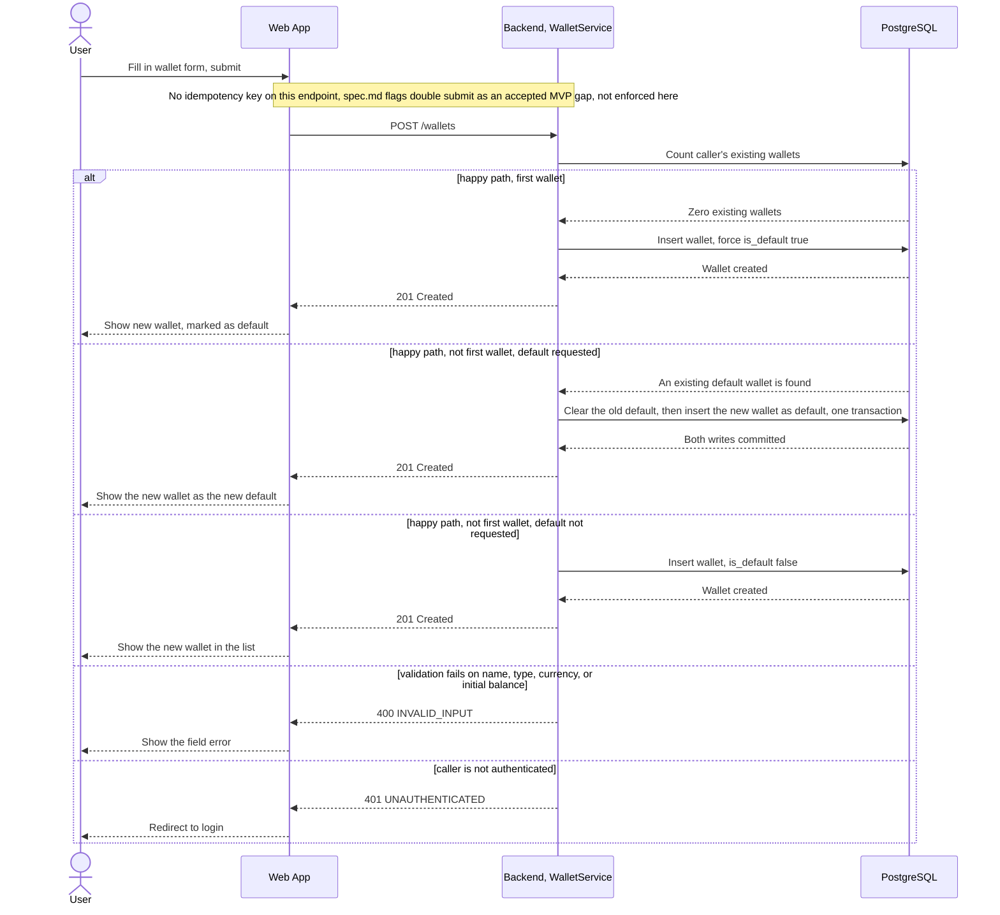
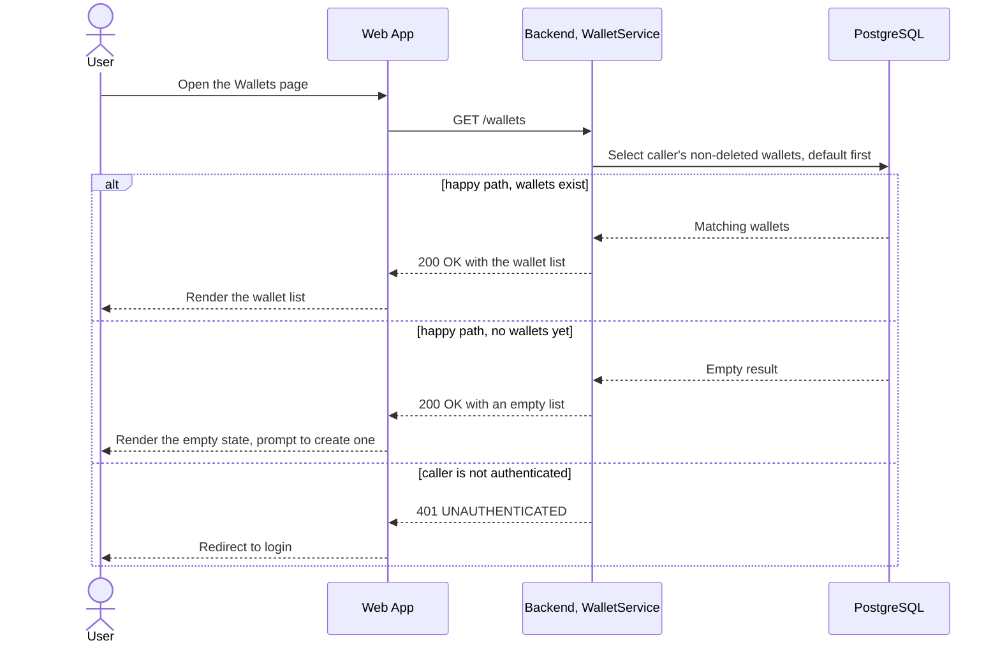
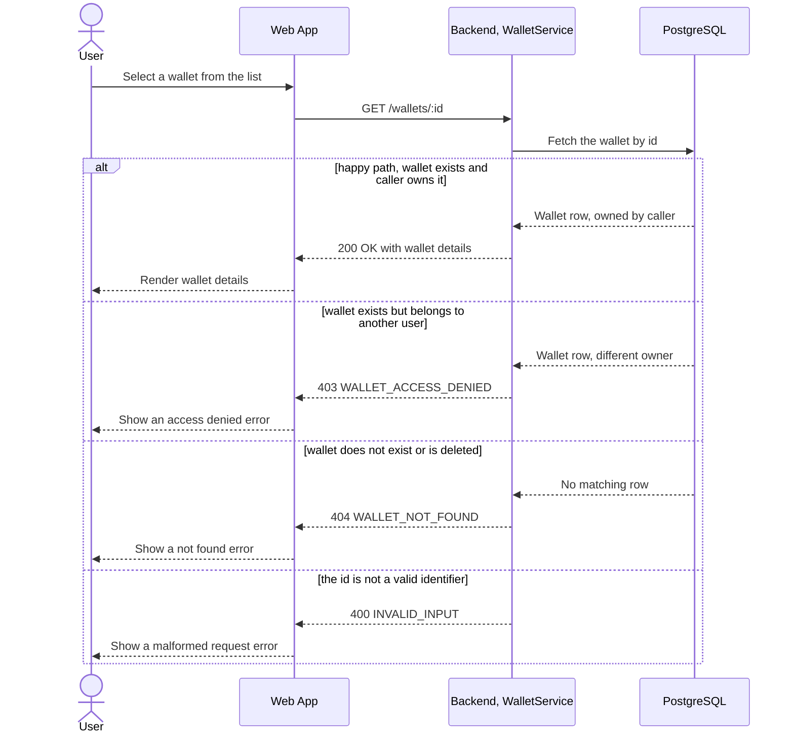
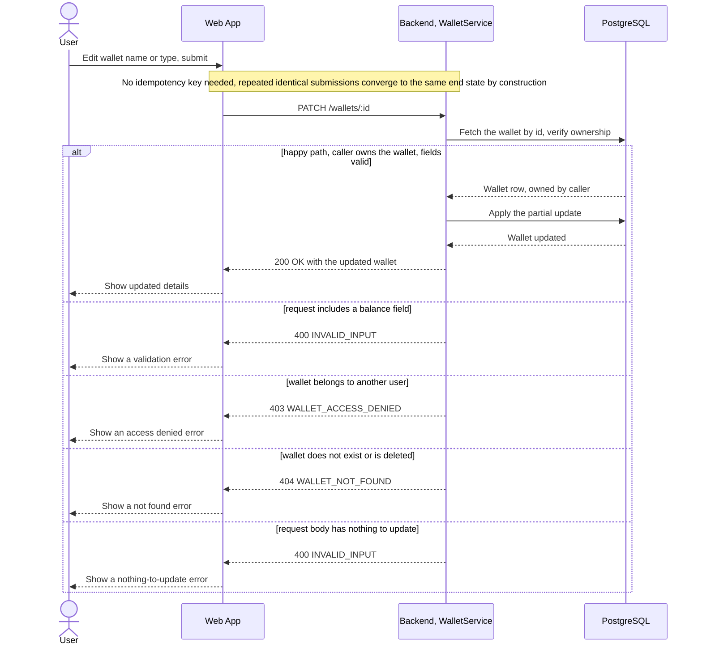
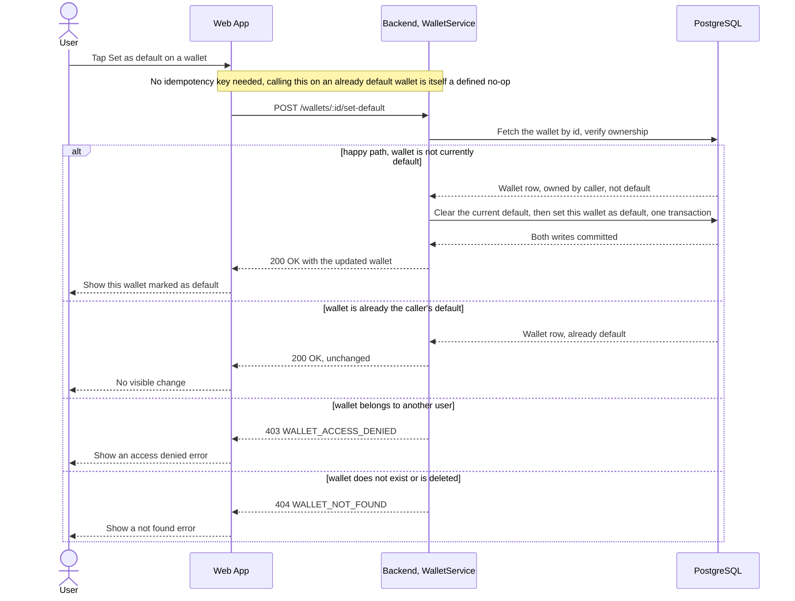

# Implementation Plan: F-03 Wallet Management (MVP)

- **Feature:** Wallet Management
- **SRS Feature Code:** F-03 (SRS.md Feature-03 §6; SDS.md §5.3 is currently an empty skeleton header — no ACs defined there; `spec.md` in this folder is the authoritative source)
- **Jira Epic:** N/A — this repository has no Jira integration wired up (same as the F-01/F-02 plans)
- **Spec:** [spec.md](./spec.md)
- **Related plans:** [F-01 User Management](../user-management/plan.md) (Wallet's `user_id` owner), [F-02 System Security](../security/plan.md) (`JWTAuth` middleware reused verbatim, no new auth code needed)
- **Frontend scope:** **web only** (`frontend/`, Next.js). Per current project direction, `mobile/` (Flutter) is intentionally deferred for every feature until explicitly requested — see the note added to CLAUDE.md/dev.md/implementation-checklist.md alongside this plan. No Flutter file layout appears below.

---

## 1. Pre-flight: Spec Review Findings

| # | Type | Finding | Resolution / Open Task |
|---|------|---------|-------------------------|
| 1 | Gap | The `wallets` table does not exist in any migration yet — `backend/db/migrations/` currently has `001_init.sql` (users), `002_seed_admin.sql`, `003_revoked_tokens.sql` only. | This plan adds `004_wallets.sql` (§3). |
| 2 | Gap | `spec.md`'s "Domain Fields" section explicitly defers schema/index detail to `plan.md` ("full schema/index design belongs in `plan.md`") — this is the first place F-03's actual DDL is defined. | Schema defined in §3, Domain Objects + migration. |
| 3 | **Blocking dependency** | `spec.md` US-04 (S-WAL-21) requires a `409 CURRENCY_LOCKED` rule gated on `EXISTS (... transactions WHERE wallet_id = $1)`, but the `transactions` table does not exist yet — F-06 Transaction Management has no spec, plan, or migration. Querying a nonexistent table would break the build. | `PATCH /wallets/{id}` is implemented in this plan **without** the currency-lock check — currency stays freely editable regardless of history for now. Tracked as **WAL-T14**, blocked on F-06's migration landing. This is a real scope reduction versus `spec.md`, not a silent one — flagged here and again in Error Flows/Constitution Notes. |
| 4 | Ambiguity | `spec.md` Open Question #4 assumes `PATCH /wallets/{id}` rejects an unrecognized `balance` field via strict decoding (`400`). The existing codebase's `c.BodyParser` (Fiber → `encoding/json`) does **not** reject unknown JSON fields by default — confirmed against `user_handler.go`/`auth_handler.go`, neither of which sets `DisallowUnknownFields`. A plain `UpdateWalletRequest{Name, Type}` struct would silently *ignore* an extra `balance` key, not reject it. | This plan introduces a dedicated strict-decode helper (`dto.DecodeStrict`) used only by `UpdateWalletRequest` — a scoped exception for this money-adjacent endpoint, not a change to the global `BodyParser` convention used everywhere else. See §3 Architecture. |
| 5 | Ambiguity | `spec.md` Open Question #1 (currency allow-list) is an explicit assumption, not a confirmed decision. | This plan commits to `{VND, USD}` as a DB `CHECK` constraint and validator `oneof` for MVP, matching `spec.md`'s own assumption. Still flagged for product sign-off — implementation proceeds on the assumption, not blocked by it. |
| 6 | Gap | No `/wallets` route group exists in `cmd/server/routes.go` yet. | Added in §3 — a new group under the existing `JWTAuth` middleware, no new middleware needed (no role restriction; every active user manages only their own wallets). |
| 7 | Gap | `frontend/src/features/wallets/` does not exist yet. | Scaffolded in §3, mirroring the existing `features/users/` structure file-for-file. |
| 8 | Gap | The frontend project has **zero test tooling** configured — no Jest/Vitest/Playwright/RTL in `frontend/package.json`, and no `data-testid` attribute anywhere in `frontend/src`. This differs from the backend, which already has a working `_test.go` + in-memory fake-repository pattern (`fake_repo_test.go`). | `spec.md`'s Definition-of-Done testing commitments (unit/integration tests per scenario) are achievable on the Go backend with the existing pattern. Frontend automated test coverage for this feature is **not** committed to in this plan — flagged as an infra gap, tracked as **WAL-T15**, not silently assumed covered. |
| 9 | Cross-story dependency | US-01's "first wallet forced default" (S-WAL-01) and US-05's "set default" (S-WAL-25) both need the same atomic "clear old default, then set new default" primitive. | Implemented once, in `WalletService`, as a private helper both `CreateWallet` and `SetDefaultWallet` call — not duplicated per story. |

### Regression Scope

This plan only adds new files, plus two small additive edits to shared files:
- `backend/cmd/server/routes.go` — adds a new `/wallets` route group; no existing route is touched.
- `backend/internal/common/errors.go` / `constants.go` — appends new error codes/constants; nothing renamed or removed.
- `frontend/src/features/auth/components/app-header.tsx` — adds a "Wallets" nav link; no existing link changed.

No existing F-01/F-02 handler, service, or repository file is modified. No regression risk to User Management or System Security is expected from this feature.

---

## 2. Architecture

### Package/File Layout

**Backend (Go Fiber + sqlc)**

```text
backend/internal/
├── handler/
│   └── wallet_handler.go        # CreateWallet, ListWallets, GetWallet, UpdateWallet, SetDefaultWallet
├── service/
│   └── wallet_service.go        # default-forcing, atomic default-swap (shared helper), ownership 403/404 split
├── repository/
│   └── wallet_repository.go     # sqlc wrapper: CreateWallet, ListWalletsByUser, GetWalletByID, UpdateWallet,
│                                 # ClearDefaultWallet, SetDefaultWallet, CountWalletsByUser
├── model/
│   └── wallet.go                # Wallet struct — zero framework imports
└── dto/
    ├── wallet_request.go        # CreateWalletRequest, UpdateWalletRequest (+ strict-decode helper, Finding #4)
    └── wallet_response.go       # WalletResponse, ListWalletsResponse

db/
├── migrations/
│   └── 004_wallets.sql          # wallets table + one-default-per-user partial unique index
└── queries/
    └── wallets.sql              # CreateWallet, ListWalletsByUser, GetWalletByID, UpdateWallet,
                                  # ClearDefaultWallet, SetDefaultWallet, CountWalletsByUser
```

`common/errors.go` and `common/constants.go` are extended in place (new entries appended — see Open Tasks), not restructured.

**Frontend (Next.js web — mirrors `features/users/` file-for-file)**

```text
frontend/src/
├── app/app/
│   └── wallets/
│       └── page.tsx                          # WalletsPage — list + create entry point
├── features/wallets/
│   ├── api/
│   │   ├── use-wallets-query.ts               # GET /wallets
│   │   ├── use-wallet-query.ts                # GET /wallets/{id}
│   │   ├── use-create-wallet-mutation.ts      # POST /wallets
│   │   ├── use-update-wallet-mutation.ts      # PATCH /wallets/{id}
│   │   └── use-set-default-wallet-mutation.ts # POST /wallets/{id}/set-default
│   ├── components/
│   │   ├── create-wallet-dialog.tsx
│   │   ├── wallet-table.tsx
│   │   ├── wallet-table-skeleton.tsx
│   │   ├── wallet-detail-card.tsx
│   │   └── edit-wallet-dialog.tsx
│   └── types.ts                                # Wallet, CreateWalletRequest, UpdateWalletRequest, ListWalletsResult
└── lib/constants.ts (extend)                    # WALLET_TYPES, WALLET_CURRENCIES — mirrors backend enums
```

### Domain Objects

| Entity | Table | Key Fields | Notes |
|--------|-------|------------|-------|
| `Wallet` | `wallets` | `id` (UUID v4, `uuid_generate_v4()`), `user_id` (UUID, FK → `users.id`), `name` (text), `type` (`cash`\|`bank`\|`e_wallet`\|`other`), `balance` (BIGINT, integer cents), `currency` (`VND`\|`USD` for MVP), `is_default` (bool), `created_at`, `updated_at`, `deleted_at` | Soft delete via `deleted_at` — every query filters `deleted_at IS NULL`. ⚠️ Money field: `balance` is BIGINT integer cents end-to-end (Go `int64`, TS `number` treated as an integer) — never a float. Concurrency: `is_default` uniqueness is constraint-based (DB partial unique index), not pessimistic row locking — same pattern as F-01's optimistic `ActivateUser` update. |

### Schema — `004_wallets.sql`

```sql
CREATE TABLE wallets (
    id          UUID PRIMARY KEY DEFAULT uuid_generate_v4(),
    user_id     UUID NOT NULL REFERENCES users(id),
    name        TEXT NOT NULL,
    type        TEXT NOT NULL CHECK (type IN ('cash', 'bank', 'e_wallet', 'other')),
    balance     BIGINT NOT NULL DEFAULT 0,
    currency    TEXT NOT NULL DEFAULT 'VND' CHECK (currency IN ('VND', 'USD')),
    is_default  BOOLEAN NOT NULL DEFAULT false,
    created_at  TIMESTAMPTZ NOT NULL DEFAULT NOW(),
    updated_at  TIMESTAMPTZ NOT NULL DEFAULT NOW(),
    deleted_at  TIMESTAMPTZ
);

-- Source of truth for "at most one default wallet per user" — enforced at the
-- DB level so two concurrent requests can never both leave a default set
-- (spec.md S-WAL-10 / S-WAL-29), not just relying on service-level ordering.
CREATE UNIQUE INDEX idx_wallets_one_default_per_user ON wallets (user_id)
    WHERE is_default = true AND deleted_at IS NULL;

CREATE INDEX idx_wallets_user_id ON wallets (user_id) WHERE deleted_at IS NULL;
```

### Business Rules

| Rule | Source | Enforcement |
|------|--------|-------------|
| `name` required, ≤ 100 chars | S-WAL-04 | `dto.CreateWalletRequest` validator (`required,max=100`) → `400 INVALID_INPUT` |
| `type` must be one of the enum values | S-WAL-05 | validator `oneof=cash bank e_wallet other` → `400 INVALID_INPUT` |
| `currency` must be in the MVP allow-list | S-WAL-06 | validator `oneof=VND USD` → `400 INVALID_INPUT` (Finding #5) |
| `initial_balance` ≥ 0 | S-WAL-07 | validator `min=0` on an `int64` field → `400 INVALID_INPUT` ⚠️ money |
| `initial_balance` must be a whole number | S-WAL-08 | The Go field type is `int64` — `encoding/json` itself rejects binding a fractional JSON number (`10.5`) into it, surfacing as a bind error before validation runs → `400 INVALID_INPUT` ⚠️ money |
| Unauthenticated caller rejected | S-WAL-09, S-WAL-13 | `middleware.JWTAuth` at the route-group level → `401` (no `error_code`, matches the existing F-02 convention) |
| First wallet is always forced `is_default = true` | S-WAL-01 | `WalletService.CreateWallet()` — counts the caller's existing wallets before insert |
| Second+ wallet requesting default swaps atomically | S-WAL-02, S-WAL-03 | `WalletService.CreateWallet()` → shared `applyDefaultSwap()` helper, one `pgx.Tx`: clear old default, then insert/set new — ordering matters so the partial unique index is never violated mid-transaction |
| Concurrent first-wallet / set-default race resolved by the DB, not the app | S-WAL-10, S-WAL-29 | `idx_wallets_one_default_per_user` (partial unique index) — the actual arbiter under concurrency ⚠️ data integrity |
| Every read/write scoped to `user_id = caller` | S-WAL-11, S-WAL-16, S-WAL-22, S-WAL-27 | Every `wallet_repository.go` method takes `userID` and every query includes `AND user_id = $n` (CLAUDE.md rule) |
| Ownership vs. existence distinguished | S-WAL-16 vs. S-WAL-17 | `WalletService` — fetch by ID first (existence + `deleted_at IS NULL`), then compare `user_id` → `404 WALLET_NOT_FOUND` / `403 WALLET_ACCESS_DENIED` |
| `balance` never accepted on `PATCH` | S-WAL-20 | `dto.DecodeStrict` on the raw request body before binding `UpdateWalletRequest` → `400 INVALID_INPUT` (Finding #4) |
| Currency lock once Transactions exist | S-WAL-21 | **Not implemented in this plan** — blocked on F-06's `transactions` table (Finding #3); tracked as **WAL-T14** |
| Empty `PATCH` body rejected | S-WAL-24 | `WalletService.UpdateWallet()` — explicit "at least one of name/type present" check → `400 INVALID_INPUT` |
| `is_default` excluded from the generic update endpoint | Edge Case (US-04 #3) | `UpdateWalletRequest` has no `is_default` field at the type level — default-swapping only happens via `set-default` |
| Default-swap is a dedicated atomic action, never a `PATCH` field | S-WAL-25, S-WAL-29 | `POST /wallets/{id}/set-default` → `WalletService.SetDefaultWallet()`, reuses the same `applyDefaultSwap()` helper as Create |
| Already-default `set-default` call is a no-op | S-WAL-26 | `WalletService.SetDefaultWallet()` short-circuits when `wallet.IsDefault` is already `true` → `200`, no write issued |

### API Index — Endpoint → Service Traceability

| API | Request | Response | Service Method |
|-----|---------|----------|-----------------|
| `POST /wallets` | `CreateWalletRequest` | `WalletResponse` (`201`) | `WalletService.CreateWallet` |
| `GET /wallets` | — | `ListWalletsResponse` (`200`) | `WalletService.ListWallets` |
| `GET /wallets/{id}` | — | `WalletResponse` (`200`) | `WalletService.GetWallet` |
| `PATCH /wallets/{id}` | `UpdateWalletRequest` | `WalletResponse` (`200`) | `WalletService.UpdateWallet` |
| `POST /wallets/{id}/set-default` | — | `WalletResponse` (`200`) | `WalletService.SetDefaultWallet` |

Each endpoint has exactly one service method — no shared "generic update" endpoint (set-default is intentionally its own action per `spec.md`'s Edge Case rationale).

### Security & Actor Resolution

- **Middleware:** all five endpoints sit under one `JWTAuth(tokens, logger)` route group in `routes.go` — no `RequireRole` gate, since wallets are personal and every active user (`admin` or `member`) manages only their own.
- **Actor resolution path:** identical to F-01/F-02 — `JWTAuth` resolves the caller's identity once and stores it in Fiber locals (`common.LocalsUserID`); `wallet_handler.go` reads it once via the existing `callerUUID(c)` helper and passes it into every `WalletService` method as an explicit `userID uuid.UUID` parameter. Service and repository layers never re-parse the token.
- **CSRF:** not applicable — this is a Bearer-JWT API with no cookie/session-based auth surface for the Go backend to protect (same reasoning as F-01/F-02's plans).
- **Bookmark / direct-URL access:** a User bookmarking or directly navigating to `/app/wallets/{id}` for a wallet they don't own is safe by construction — the page's data fetch hits `GET /wallets/{id}`, which enforces ownership **server-side** (`403`/`404`) regardless of how the URL was reached. There is no client-only gate that could be bypassed; `middleware.ts` only gates on session-cookie presence for the whole `/app` group, same as every other feature.
- **Framework note:** this stack has no Spring-style `@PreAuthorize` annotation. The underlying principle it stands for — authorization logic placed in the Service layer, never the Handler/Controller — is satisfied structurally instead: ownership and role checks happen inside `WalletService`, never in `wallet_handler.go` (same split as F-01/F-02).

### Sequence Diagrams

> Four-tier lifeline (User → Frontend → Backend → DB), one diagram per story, happy path first with real `alt/else` branches beneath it.

**US-01: Create a Wallet**



**US-02: View a List of Wallets**



**US-03: View a Wallet**



**US-04: Update a Wallet**



> Note: `spec.md`'s `409 CURRENCY_LOCKED` branch (S-WAL-21) is intentionally **not** shown above — Finding #3 blocks it on the `transactions` table not existing yet. Adding that branch here would document behavior this plan does not implement.

**US-05: Set a Wallet as Default**



> These five diagrams are AI-generated and require human review/validation before implementation begins — they are not pre-approved by virtue of being produced here.

---

## 3. Error Flows

### US-01: Create a Wallet

| Scenario | HTTP | Error Code |
|----------|------|------------|
| Unauthenticated (missing/invalid/expired JWT) | 401 | — |
| `name` empty or > 100 chars | 400 | `INVALID_INPUT` |
| `type` not a valid enum value | 400 | `INVALID_INPUT` |
| `currency` not in the MVP allow-list | 400 | `INVALID_INPUT` |
| `initial_balance` negative | 400 | `INVALID_INPUT` |
| `initial_balance` not a whole number | 400 | `INVALID_INPUT` |
| Unexpected error (DB down, etc.) | 500 | — |

### US-02: View a List of Wallets

| Scenario | HTTP | Error Code |
|----------|------|------------|
| Unauthenticated | 401 | — |
| Unexpected error | 500 | — |

*(Zero wallets is `200` with `data: []` — not an error path; see `spec.md` S-WAL-12.)*

### US-03: View a Wallet

| Scenario | HTTP | Error Code |
|----------|------|------------|
| Unauthenticated | 401 | — |
| `{id}` not a valid UUID | 400 | `INVALID_INPUT` |
| Wallet belongs to another user | 403 | `WALLET_ACCESS_DENIED` |
| Wallet not found or soft-deleted | 404 | `WALLET_NOT_FOUND` |
| Unexpected error | 500 | — |

### US-04: Update a Wallet

| Scenario | HTTP | Error Code |
|----------|------|------------|
| Unauthenticated | 401 | — |
| Request body empty (nothing to update) | 400 | `INVALID_INPUT` |
| Request includes a `balance` field | 400 | `INVALID_INPUT` |
| `name`/`type` fail validation | 400 | `INVALID_INPUT` |
| Wallet belongs to another user | 403 | `WALLET_ACCESS_DENIED` |
| Wallet not found or soft-deleted | 404 | `WALLET_NOT_FOUND` |
| Currency change after Transactions exist | — | **Not implemented — blocked on F-06, see Finding #3 / WAL-T14** |
| Unexpected error | 500 | — |

### US-05: Set a Wallet as Default

| Scenario | HTTP | Error Code |
|----------|------|------------|
| Unauthenticated | 401 | — |
| Wallet belongs to another user | 403 | `WALLET_ACCESS_DENIED` |
| Wallet not found or soft-deleted | 404 | `WALLET_NOT_FOUND` |
| Unexpected error | 500 | — |

*(Already-default is `200`, unchanged — not an error path; see `spec.md` S-WAL-26.)*

---

## 4. Constitution / Convention Notes

| Rule | Status | Note |
|------|--------|------|
| Service layer owns business rules | Required | Default-forcing, atomic default-swap, ownership checks all live in `WalletService` — never in `wallet_handler.go` |
| Handler validates shape only | Required | `name`/`type`/`currency`/`initial_balance` via `validator/v10` tags on `dto.CreateWalletRequest`/`UpdateWalletRequest` |
| Transactional atomicity — Create (default swap path) | Required | `WalletService.CreateWallet()` wraps "clear old default, insert new" in one `pgx.Tx` whenever `is_default` is requested or forced |
| Transactional atomicity — Set Default | Required | `WalletService.SetDefaultWallet()` wraps "clear old, set new" in one `pgx.Tx`, via the same `applyDefaultSwap()` helper as Create |
| Transactional atomicity — Update | N/A | Single-row `UPDATE ... RETURNING *` — no multi-statement transaction needed |
| Read flows non-transactional | Required | `ListWallets`/`GetWallet` are plain reads, no transaction wrapper |
| Concurrency / locking strategy | Required | Constraint-based (`idx_wallets_one_default_per_user`, a partial unique index) — not pessimistic row-level locking. Matches F-01's optimistic-`UPDATE` pattern for `ActivateUser` |
| JWT auth enforced at middleware | Required | `/wallets*` registered under the same `JWTAuth` group as `/admin/*`; no role restriction — any active user manages only their own wallets |
| Actor resolution | Required | `callerUUID(c)` reads `JWTAuth`-populated locals once in the handler; passed to every `WalletService` method as an explicit `userID` param — never re-parsed downstream |
| User isolation on every query | Required | Every `wallet_repository.go` method takes `userID`; every SQL query includes `AND user_id = $n` (CLAUDE.md rule) |
| Idempotency on write — Create | Per spec | Explicitly **not** idempotent (`spec.md` Open Question #5) — no key; double-submit creates two wallets. Accepted MVP UX gap, not a data-integrity one |
| Idempotency on write — Update | Satisfied | Idempotent by construction (standard `PATCH` semantics) — no key needed |
| Idempotency on write — Set Default | Satisfied | Idempotent by construction (already-default call is a defined no-op) — no key needed |
| Money stored as BIGINT cents | Required | `balance` column is `BIGINT`; Go `int64`; TS `number` treated strictly as integer cents; display always via `formatCurrency` (never `amount / 100` inline) |
| Soft delete respected | Required | Every repository query filters `deleted_at IS NULL`; no wallet-delete endpoint exists in this plan (matches `spec.md`'s Out of Scope) |
| Timestamps UTC stored / local displayed | Required | `created_at`/`updated_at` are `TIMESTAMPTZ` stored UTC; the web app formats to browser-local time for display only, never persists a converted value |
| CSRF | N/A | Bearer-JWT API behind the BFF proxy; `middleware.ts` checks only session-cookie presence, never decodes the JWT (that remains the Go backend's job) |
| Bookmark / direct URL access | Covered | See §2 Security & Actor Resolution — ownership is enforced server-side on every `GET`/`PATCH`/`POST` regardless of navigation path |
| Audit logging | Not required (MVP) | No `audit_log` table exists in the schema (same reasoning as F-01/F-02) — only structured Zap `WARN` logs on 401/403, consistent with `response.Error()`'s existing behavior |
| No file > 300 lines | Required | If `wallet_handler.go`/`wallet_service.go` grow past this once all 5 endpoints land, split by operation (e.g. `wallet_default_service.go` for the shared swap helper) |
| Frontend server state via TanStack Query only | Required | All 5 wallet API calls are TanStack Query hooks in `features/wallets/api/`; never copied into `useState`/Zustand |
| Frontend skeleton loading | Required | `WalletTableSkeleton` (mirrors `UserTableSkeleton`) renders while `useWalletsQuery` is loading — no blank screen |
| Frontend no raw fetch/axios in components | Required | All calls go through `features/wallets/api/*.ts` hooks, same as `features/users/` |

---

## 5. Element/Key IDs

> Web equivalent of Flutter's `Key(...)` — `data-testid` attributes for QA automation. None of these exist today; `frontend/src` has zero `data-testid` usage anywhere in the codebase (Finding #8).

| Element | Key | Status | File |
|---------|-----|--------|------|
| Create wallet trigger button | `data-testid="btn-create-wallet"` | **Missing** | `frontend/src/features/wallets/components/create-wallet-dialog.tsx` |
| Wallet name input | `data-testid="input-wallet-name"` | **Missing** | same |
| Wallet type select | `data-testid="select-wallet-type"` | **Missing** | same |
| Wallet currency select | `data-testid="select-wallet-currency"` | **Missing** | same |
| Wallet initial balance input | `data-testid="input-wallet-initial-balance"` | **Missing** | same |
| Wallet "make default" toggle | `data-testid="toggle-wallet-is-default"` | **Missing** | same |
| Create wallet submit button | `data-testid="btn-wallet-submit"` | **Missing** | same |
| Create wallet error banner | `data-testid="banner-wallet-error"` | **Missing** | same |
| Wallet list table | `data-testid="table-wallets"` | **Missing** | `frontend/src/features/wallets/components/wallet-table.tsx` |
| Wallet list empty state | `data-testid="text-wallets-empty"` | **Missing** | same |
| Wallet row default badge | `data-testid="badge-wallet-default"` | **Missing** | same |
| Wallet list loading skeleton | `data-testid="skeleton-wallets"` | **Missing** | `frontend/src/features/wallets/components/wallet-table-skeleton.tsx` |
| Wallet detail card | `data-testid="card-wallet-detail"` | **Missing** | `frontend/src/features/wallets/components/wallet-detail-card.tsx` |
| Edit wallet trigger button | `data-testid="btn-edit-wallet"` | **Missing** | same |
| Set default action button | `data-testid="btn-set-default-wallet"` | **Missing** | same |
| Edit wallet name input | `data-testid="input-edit-wallet-name"` | **Missing** | `frontend/src/features/wallets/components/edit-wallet-dialog.tsx` |
| Edit wallet submit button | `data-testid="btn-edit-wallet-submit"` | **Missing** | same |

---

## 6. Status Summary (Step Handoff)

> No Jira/sprint tooling in this repo (same as F-01/F-02 plans) — "owner" below is whoever picks the task up next, not a pre-assigned name.

| Area | Status |
|------|--------|
| Spec (`spec.md`) | Done — reviewed against `/ba-checklist`, DDL deferred here as intended |
| Plan (this document) | Done, pending human review of diagrams (see §2) |
| Backend migration/queries/handler/service/repository | Not started |
| Frontend feature scaffold | Not started |
| Frontend test infra | Not started — blocking any automated frontend coverage (Finding #8) |
| F-06 dependency (currency lock) | Blocked — tracked as WAL-T14, cannot start until F-06 exists |

## 7. Open Tasks

| ID | Task | File |
|----|------|------|
| WAL-T1 | Write migration: `wallets` table + `idx_wallets_one_default_per_user` partial unique index | `backend/db/migrations/004_wallets.sql` |
| WAL-T2 | Write sqlc queries: `CreateWallet`, `ListWalletsByUser`, `GetWalletByID`, `UpdateWallet`, `ClearDefaultWallet`, `SetDefaultWallet`, `CountWalletsByUser` | `backend/db/queries/wallets.sql` |
| WAL-T3 | Add error codes `ErrCodeWalletAccessDenied`, `ErrCodeWalletNotFound` (append, no renames) | `backend/internal/common/errors.go` |
| WAL-T4 | Add constants `WalletAllowedTypes`, `WalletAllowedCurrencies`, `WalletNameMaxLength = 100` (append) | `backend/internal/common/constants.go` |
| WAL-T5 | Implement `model.Wallet` (zero framework imports) | `backend/internal/model/wallet.go` |
| WAL-T6 | Implement `WalletRepository` wrapping sqlc, returning `model.Wallet` | `backend/internal/repository/wallet_repository.go` |
| WAL-T7 | Implement `WalletService.CreateWallet` (default-forcing + `applyDefaultSwap()`) | `backend/internal/service/wallet_service.go` |
| WAL-T8 | Implement `WalletService.ListWallets` / `GetWallet` (403 vs. 404 split) | `backend/internal/service/wallet_service.go` |
| WAL-T9 | Implement `WalletService.UpdateWallet` (empty-body rejection; currency lock **excluded**, see Finding #3) | `backend/internal/service/wallet_service.go` |
| WAL-T10 | Implement `WalletService.SetDefaultWallet` (idempotent no-op + `applyDefaultSwap()`) | `backend/internal/service/wallet_service.go` |
| WAL-T11 | Implement `wallet_handler.go` (5 endpoints); register `/wallets` group under `JWTAuth` only | `backend/internal/handler/wallet_handler.go`, `backend/cmd/server/routes.go` |
| WAL-T12 | Implement `dto.CreateWalletRequest`, `dto.UpdateWalletRequest` + `dto.DecodeStrict` helper (Finding #4), response DTOs | `backend/internal/dto/wallet_request.go`, `wallet_response.go` |
| WAL-T13 | Add `WalletRepo` interface + compile-time check (mirrors `UserRepo` in `interfaces.go`) | `backend/internal/service/interfaces.go` |
| WAL-T14 | **Blocked on F-06** — wire the `409 CURRENCY_LOCKED` check into `UpdateWallet` once the `transactions` table/migration exists | `backend/internal/service/wallet_service.go` |
| WAL-T15 | Stand up frontend test tooling (Vitest + RTL, or Playwright) — currently zero test infra in `frontend/` | `frontend/package.json` |
| WAL-T16 | Scaffold `frontend/src/features/wallets/{api,components,types.ts}` mirroring the `users` feature | `frontend/src/features/wallets/` |
| WAL-T17 | Build `WalletsPage` (list + create entry point) | `frontend/src/app/app/wallets/page.tsx` |
| WAL-T18 | Add `WALLET_TYPES`/`WALLET_CURRENCIES` constants mirroring backend enums | `frontend/src/lib/constants.ts` |
| WAL-T19 | Add a "Wallets" nav link (additive only, no existing link changed) | `frontend/src/features/auth/components/app-header.tsx` |
